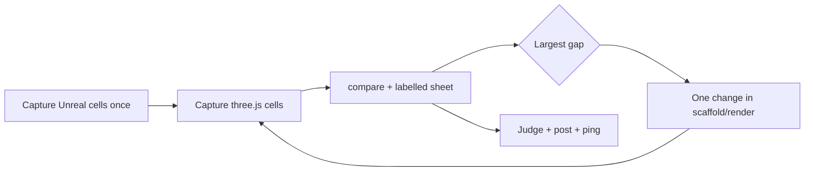

# Tune the look toward Unreal

The owner rule: every template ships the out-of-the-box Unreal 5.8.3 look. Get there on the
reference scene first, then copy the tuned files into the templates. Never the other way round.

## Rules

1. **Harness first.** Tune only in `scripts/unreal-look/scaffold/render/`. Those files replace the
   starter's own `src/render/` files in the capture's scaffold copy. Do not edit
   `packages/create-threenative/templates/*` while a layer is still being tuned.
2. **One change per iteration.** One constant, one stage or one curve. Two changes in one capture
   make the result impossible to attribute.
3. **Numbers before eyes.** Read `pnpm unreal-look:compare` for the layer first, then the sheet.
   A change that moves the number the wrong way is reverted, whatever it looks like.
4. **Every frame names its engine.** A sheet without "three.js" and "UNREAL" on each frame is not
   posted (owner, 2026-10-19).
5. **Licence.** Borrow ideas and published parameter values only. Never copy Unreal code, shader
   code or comments into the repo, a PR or a brief. Cite the Unreal path instead.
6. **Layers in order.** Tune the lowest layer that differs: L0 geometry, L1 sun and exposure, L2
   sky, L3 fog, L5 shadows, L6 AO, L9 post. A gap at L9 that already exists at L1 is an L1 problem.

## The loop

1. **Unreal cells** (once per layer; reuse them until `layers.json` or the scene changes).
   `UE_ROOT=<Unreal 5.8.3 install> pnpm unreal-look:capture --engine unreal --layers L1 --cells sun60/exterior,sun60/spheres`
   It launches one editor per layer. Watch `TNREF` lines in the log; the run writes `capture.exit`.
2. **three.js cells, BEFORE.** Capture into a named folder so it survives later runs:
   `sh scripts/xvfb.sh pnpm exec tsx scripts/unreal-look/capture.ts --engine threenative --reuse --layers L1 --cells <cells> --out tools/unreal-reference/captures/before`
   Check the printed `adapter`: it must be the real GPU, never SwiftShader or llvmpipe.
3. **Compare.** `pnpm unreal-look:compare --layer L1` prints per-region luminance quantiles,
   colour difference and silhouette overlap. Name the largest gap in one sentence. It fails
   closed until both engines have every pose of the layer plus the `ID` cells (region masks) and
   the `L5` cells (shadow masks), so capture those first.
4. **One change** in `scripts/unreal-look/scaffold/render/` (copy the starter file there first if
   it is not there yet). Recapture into `--out .../after`. Compare again.
5. **Sheet.** `python3 -I .agents/skills/tune-look-to-unreal/sheet.py <scratch>/sheet.png --layer L1 --sun sun60 "before=THREE.JS before" "after=THREE.JS after" "unreal=UNREAL 5.8.3 (target)"`
   Close-ups, once the whole frame is near parity: `python3 -I .agents/skills/tune-look-to-unreal/closeups.py <scratch>/closeups.png --layer L9 --sun sun60 "engine-after=WASM ENGINE" "unreal=UNREAL 5.8.3"` crops every scene element from each arm with the box from Unreal's region ID frame, one row per element, so detail gaps (reflections, contact shadows, edges) show at full size.
6. **Visual judge.** Write the criteria file first: per frame and region, what must change, what
   must hold and what Unreal shows there (AFTER closer to UNREAL than BEFORE on the named gap, with
   no new artefact: hue cast, banding, clipping, missing object). Then run the judge command:
   `pnpm unreal-look:judge --criteria <criteria.md> --out <verdict.json> --before <run1> --before <run2> --after <run1> --after <run2> --unreal tools/unreal-reference/captures/unreal`
   It starts a fresh read-only Sonnet session (`claude -p`, Read tool only) that did not write the
   change, so the verdict stays with the lane that ran it. It pairs the frames by path and refuses a
   layer that differs between the engines, a missing frame and a single run per arm. It checks that the
   judge opened every image and answered every frame. It writes IMPROVEMENT, NEUTRAL or REGRESSION per
   frame and overall, and MATCH, CLOSE or FAR against Unreal. Exit 2 means REGRESSION (or no overall
   IMPROVEMENT under `--expect improvement`): fix the cause and judge again. A GI capture folder
   holds ID, L1 and L7 frames side by side: `--layer L7` judges one layer and `--tier medium` pairs
   it with the Unreal Medium frames (the default is high, Unreal Epic). `--dry-run` checks the
   pairing without a session; `--help` lists the layout rules.
   For a GI scene, `pnpm unreal-look:calibrate --scene gi:<name> --tier high --before <commit>` runs
   steps 2, 3, 5 and 6 in one command. It captures ID, L1 and the tier layer twice per arm and keeps
   each arm in a store keyed by the inputs that decide the pixels, so it never captures the same
   inputs twice. It checks that direct light matches (L1), compares the regions, lays out the UNREAL,
   BEFORE and AFTER sheets, runs the judge, prints the gap list and writes one round file to
   `tools/unreal-reference/gi/parity/`. Commit that file with the change. A scene is at parity for a
   tier after two MATCH rounds on one stamp. `--allow-red-direct-light` runs a round over a red L1
   check, records the override and does not count the round toward parity. `--status` prints where
   each scene stands (latest round, gap list, parity) from the scoreboard, with no GPU and no model.
7. **Post.** Commit the images to the orphan `PRD-<n>-screenshots` branch with plumbing (no
   checkout): `git hash-object -w`, `git mktree`, `git commit-tree -p <previous>`, then
   `git push origin "${commit}:refs/heads/PRD-<n>-screenshots"`. Comment on the PR with the raw
   URLs, a table naming each column's engine, the numbers and the verdict.
8. **Ping** the owner with the `attention-ping` skill after each new pair is on the PR.
9. **Tick** the PRD box with the numbers and the verdict, in the commit that carries the change.

## Match the model, not the pixels

- Take Unreal's values from `tools/unreal-reference/template-actors.json` (sun lux, sky light,
  fog, atmosphere coefficients) and its formulas (EV100 exposure, the filmic curve parameters),
  and feed them through `exposureFromEv100` and friends. Never fit a constant to the four poses.
- Compare lighting layers scene-linear: Unreal writes an EXR with the tone curve off for every
  cell. Test the tone curve alone by applying both curves to the same EXR.
- A residual that no installed capability closes goes to a PRD. Search
  `engine_search_capabilities`, then `docs/PRDs` (`rg --no-ignore`), before filing; PRD-631's
  Decisions list the owners already found (GI, reflections, aerial perspective, clouds).
- Engine order: tune on upstream three.js, then prove the owned engine with `pnpm parity`.

## When a layer matches: promote

When the layer's thresholds in `tools/unreal-reference/thresholds.json` pass on every cell, copy
each tuned file from `scripts/unreal-look/scaffold/render/` into the templates (all kits that
share it; shared sources must stay identical, `shared-render-sources.spec.ts`), update the
scaffold hashes in `scaffold.spec.ts`, run a template playtest, and judge the template's own
scene before and after. Delete the promoted file from the overlay.

## Traps already paid for

- `-ExecutePythonScript` quits the editor when the script returns. The harness uses
  `-ExecCmds="py build_level.py"` so Movie Render Queue can tick.
- One editor rendering many layers ran out of video memory on an 8 GB card. The harness runs one
  editor per layer; do not merge them back.
- Python callbacks on the render executor must live at module level, or the editor never quits.
- The editor writes its own config into `tools/unreal-reference/Config/`. Revert it before a
  commit; never commit a `SecurityToken`.
- `page.evaluate` with an arrow function fails under tsx (`__name is not defined`). Pass a string.
- In zsh, `$c:refs/...` applies the `:r` modifier. Write `"${c}:refs/heads/..."`.
- The pre-push hook checks the working tree: commit template changes before pushing a
  screenshot ref.
- A TSL `mat3` built from row-major tables applied the colour matrix transposed (green shadows,
  magenta highlights). Use one `dot` per row.
- `filmic` falls back to ACES with a `TN_TONEMAP` warning when the renderer has no node library.
  Grep the capture log before you trust an AFTER frame.
