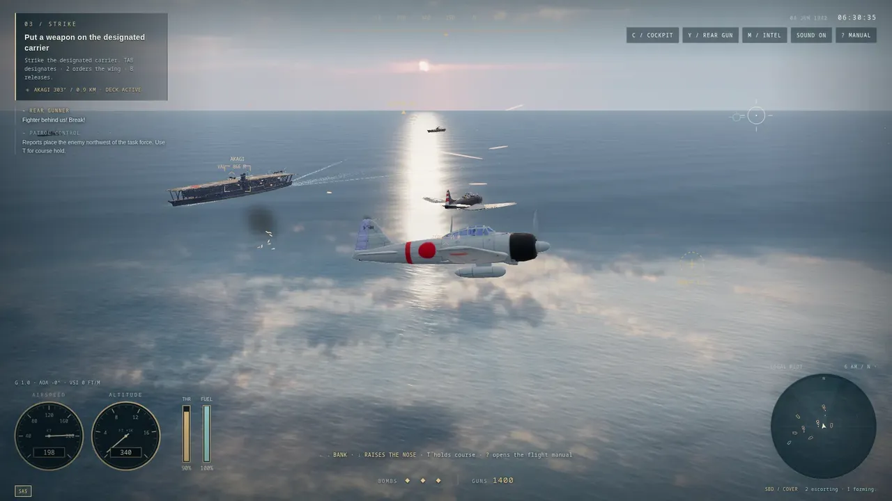
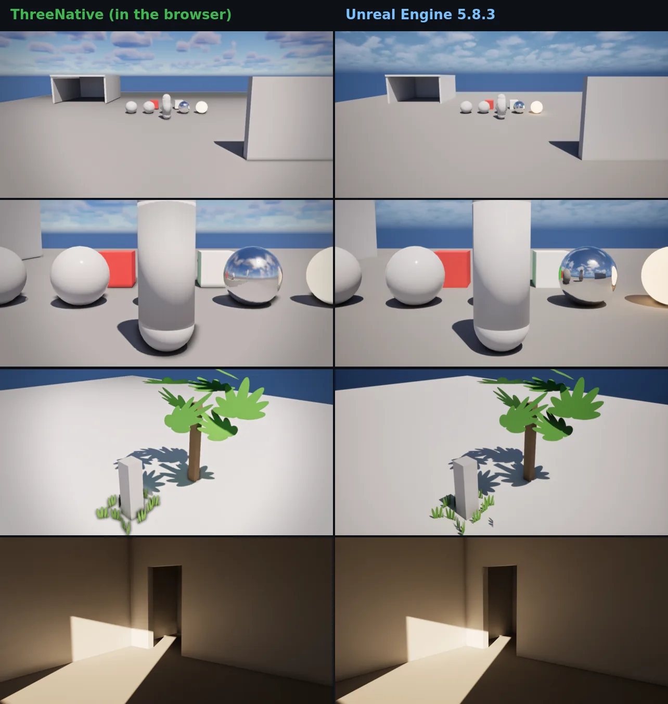
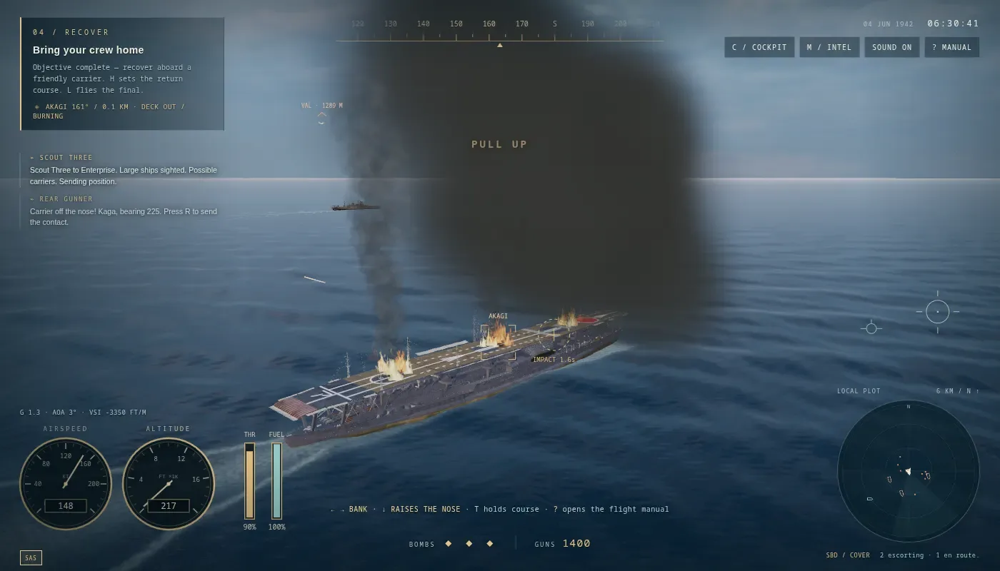
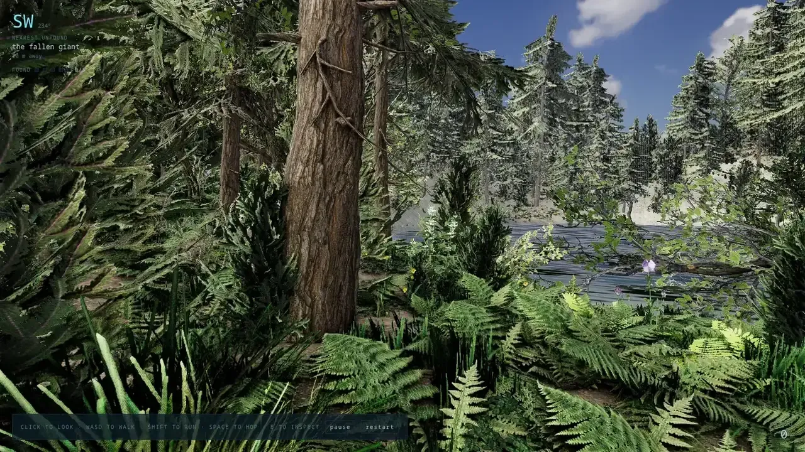
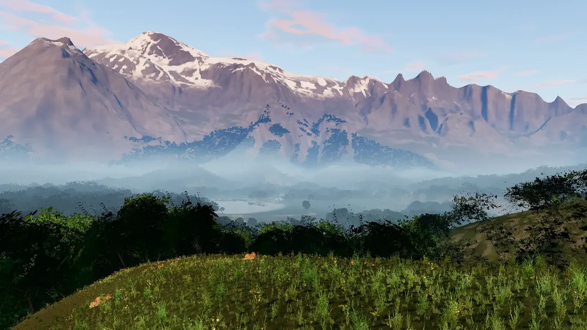
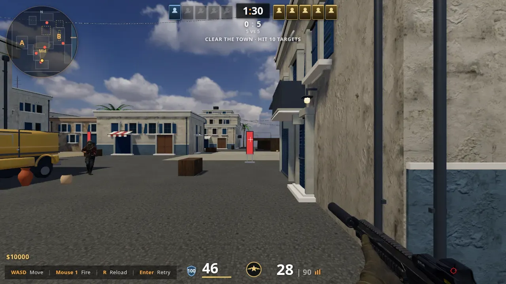
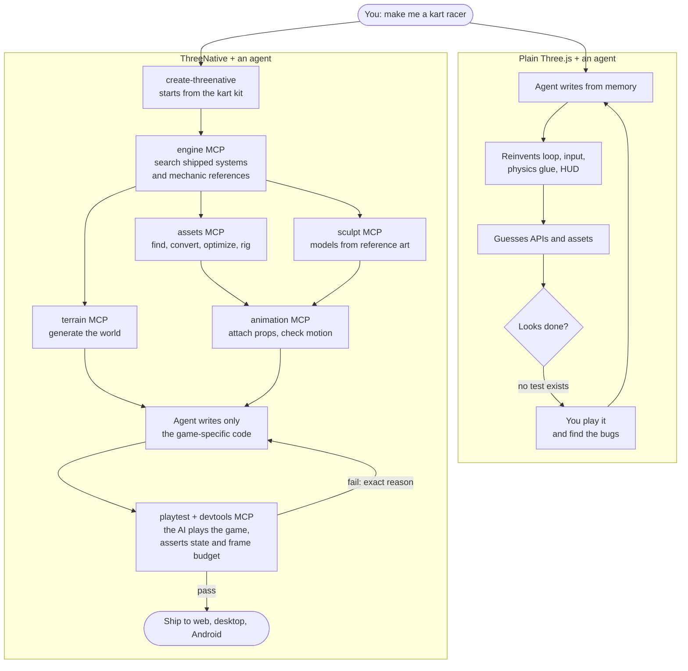

<div align="center">

# ThreeNative

**Build 3D games in plain Three.js and TypeScript — verified by playtests, compiled native to desktop and Android, never in a WebView.**

[](https://github.com/ThreeNativeHQ/threenative/actions/workflows/ci.yml)
[](https://www.npmjs.com/package/@threenative/core)
[](LICENSE)
[](https://threejs.org)



<sub><b>Midway: Open Pacific</b> — launch off a carrier deck, hunt an enemy fleet, and fly home. Built with ThreeNative. <a href="https://midway.threenative.com/">Play in your browser →</a></sub>

```sh
pnpm create threenative my-game
```

**[Website](https://threenative.com) · [Studio](https://studio.threenative.com/) · [Games store](https://store.threenative.com) · [Discord](https://discord.gg/mWxTQByxFR)**

[vs Three.js](#threenative-vs-plain-threejs) · [Quickstart](#quickstart) · [Gallery](#built-with-threenative) · [Starter kits](#starter-kits) · [Built for AI agents](#built-for-ai-agents) · [Platforms](#platforms) · [Ecosystem](#the-ecosystem) · [Docs](#docs)

</div>

---

## ThreeNative vs plain Three.js

**ThreeNative is Three.js — plus the game engine around it.** `ctx.scene` is a real
`THREE.Scene`, so every tutorial still works. You just stop writing the other half of the game.

| | Plain Three.js | ThreeNative |
| --- | --- | --- |
| **First commit** | An empty canvas. Rewrite the loop, resize, input and physics glue in every project | 19 playable starter kits. The ~170 lines (42%) of plumbing every game repeats are already written — [charter audit](docs/architecture/CHARTER.md) |
| **AI agent cost** | The agent works from memory: it reinvents the loop, input and physics glue, and guesses APIs, every session | The agent starts from a kit and searches 696 shipped capabilities over MCP before it writes a line — fewer tokens on plumbing |
| **Physics** | Pick a library, write the bridge | Rapier (Rust, compiled to WebAssembly) built in, with Godot-style `RigidBody3D`, `CharacterBody3D`, `Area3D` and navigation |
| **Engine** | JavaScript issues every draw call | An owned C++ engine behind the same Three.js API: WebAssembly in the browser (multithreaded on cross-origin-isolated pages), native code on desktop |
| **Draw calls** | One per mesh, unless you batch by hand | Batched for you: up to **11.6× faster** than plain Three.js on a many-object scene; 512 skinned characters go from **1,026 to 4 draws** (47.05 → 24.45 ms) — [data](docs/verification/runtime-perf-state.md) |
| **Default look** | Tune tonemapping, exposure and lights by hand | Unreal Engine 5.8.3 defaults out of the box: filmic tone curve and metered auto exposure, calibrated against Unreal renders of the same scene — [see below](#unreals-look-running-in-a-browser-tab) |
| **Ships to** | The browser | Web, Windows, macOS, Linux and Android from one source, with no WebView |
| **HUD and menus** | Hand-rolled DOM | React 19 and Tailwind, bound to game state |
| **Assets** | Copy files and fix paths | Hashed asset pipeline, 200+ procedural assets, and an asset MCP that searches 10+ libraries |
| **Playtests — the AI plays your game** | None. The agent says "done" from memory, and you find the bugs | The agent plays the real build: playtests press keys, then assert game state, HUD, screenshots and frame budgets. They fail closed, so the AI proves its own work before it reports done |
| **Against Godot 4.7.1** | — | **1.8× faster** at 4,096 cubes on native desktop, **3.9× faster** at 16,384 instanced cubes on the web — [data](docs/verification/runtime-perf-state.md) |
| **Lock-in** | — | None. Materials, lights and post are plain code in your `src/render/`, and `engine: "threejs"` runs stock Three.js |

### Unreal's look, running in a browser tab



Same calibration scenes, same sun. Left: ThreeNative in the browser. Right:
a stock Unreal Engine 5.8.3 render. A fresh visual judge rated the sky, foliage and shadow work an
improvement toward Unreal ([#541](https://github.com/ThreeNativeHQ/threenative-engine/pull/541)),
and rated every global-illumination pose CLOSE to Unreal
([#634](https://github.com/ThreeNativeHQ/threenative-engine/pull/634)).

## Why ThreeNative

Three.js draws the frame. A real game still needs a fixed-timestep loop, input, physics, a HUD, assets, tests, and a path off the browser. In our audit of a vanilla Three.js game, **42% of the code** (~170 of ~400 lines) was generic plumbing. ThreeNative handles that layer and stays out of your way.

- 🧊 **Zero lock-in — it is still Three.js.** `ctx.scene` is a real `THREE.Scene` and `ctx.renderer` is a real `WebGPURenderer`. No serialized scene format, no editor-owned state; drop down to raw Three.js anytime.
- 📦 **One codebase, native screens.** The same TypeScript runs on WebGPU in the browser and renders in an owned C++ host on Windows, macOS, Linux, and Android — never in a WebView.
- 🎨 **You own the look.** New scenes start with a filmic, auto-exposed default look. Materials, lights, post-processing, and camera live as plain code in your repo under `src/render/`.
- 🎮 **Playable in one command.** Start from 19 starter kits — kart racer, 3D platformer, FPS, open-world crime, stealth, survival horror and more — each wired with real mechanics, Rapier physics, a React HUD, and passing playtests.
- 🤖 **Built for coding agents.** Six MCP servers come wired for Claude Code, Codex, Cursor, Gemini CLI, VS Code, opencode, and Zed.
- ✅ **Verified, not just generated.** Scripted JSON playtests press keys, check game state, HUD, screenshots, and frame budgets. They fail closed, so the next edit cannot silently break your game.

## Quickstart

```sh
pnpm create threenative my-game                 # or: --template kart, --genre mario
cd my-game
pnpm install
pnpm dev
```

Requires Node 20.19+ and a WebGPU browser. Prefer zero local setup? Open [ThreeNative Studio](https://studio.threenative.com/) in your browser and export the exact same TypeScript repo anytime.

`defineGame` wires the loop, Rapier physics, input, React HUD, and playtests while your scene stays a plain class with three optional methods — `load`, `enter`, and `update`:

```ts
const game = defineGame<GameState, IPhysicsContext>({
  input: { move: { up: ["KeyW"], down: ["KeyS"], left: ["KeyA"], right: ["KeyD"] } },
  plugins: [rapier(), playtest()],
  scenes: { play: Play },
  start: "play",
});
```

`ctx.input.vector("move")` works across keyboard, gamepad, and touch. Physics uses Godot vocabulary: `RigidBody3D`, `CharacterBody3D`, and `Area3D`.

## Built with ThreeNative

<table>
  <tr>
    <td width="33%"><br><sub><b>Midway</b> — dive-bomb a carrier fleet</sub></td>
    <td width="33%"><br><sub><b>Vesper Hall</b> — real-time GI, reflections, god rays</sub></td>
    <td width="33%"><br><sub><b>Wildwood</b> — scanned fern and pine forest</sub></td>
  </tr>
  <tr>
    <td><br><sub><b>Strata</b> — procedural terrain across five biomes</sub></td>
    <td><br><sub><b>Bayview</b> — FPS with native Android HUD</sub></td>
    <td><br><sub><b>Fox platformer</b> — 60 fps sustained on a Pixel 8</sub></td>
  </tr>
</table>

Every image is a real engine or device capture. No mockups.

## Starter kits

Run `pnpm create threenative my-game --template <name>` — or ask your agent for "a game like Mario Kart" and it starts from the matching kit.

| Kit | What you start with |
| --- | --- |
| `kart` | **Clover Cup** — eight karts, power-slides, mini-turbo sparks, item boxes, and seven CPU drivers |
| `collectathon` | **Hop Garden** — triple jump, long jump, wall kick, ground pound, and ledge grab on one island |
| `adventure` | **Lantern Vale** — lock-on sword combat, a block puzzle, a key, and the Stone Warden mini-boss |
| `shooter` | **First-person shooter** — aim down sights, reload, hitscan/projectile weapons, and targets that hunt you |
| `action-rpg` | **Action RPG** — three-room dungeon with melee combat, loot drops, equipment, and persistence |
| `rts` | **Real-time strategy** — three commanders, fog of war, and a deterministic headless simulation |
| `tower-defense` | **Tower defense** — four towers, three upgrade tiers, twelve waves, two bosses, and an orbital strike |
| `platformer` | **Fox Dash** — a fox, rope bridges, stompable walkers, gems, and a double jump |
| `racing` · `runner` · `sailing` | Three-lap circuit with boost pads · three-lane endless runner · wind, ocean waves, and buoyancy |
| `snow` · `rain` · `puzzle` | Deformable snow footprints · coastal storm you control · 45-body physics vault |
| `open-world` | **Open-world crime** — a city on foot or by car: carjacking, traffic, five-star police pursuit and a timed job |
| `stealth` | **Stealth infiltration** — vision cones, suspicion, noise, takedowns, bodies that raise the alarm, and an extraction |
| `survival-horror` | **Survival horror** — fixed cameras, tank controls, scarce ammo, a six-slot case, herbs, keys and typewriter saves |
| `starter` · `minimal` | Default project with HUD and physics · leanest starting point to learn from |

Full kit guide in [`create-threenative`](packages/create-threenative/README.md).

## Built for AI agents

AI prototypes break fast when the next prompt ruins collisions or the HUD. Every new project wires six MCP servers into Claude Code, Codex, Cursor, Gemini CLI, VS Code, opencode, and Zed:

- 🔍 **Engine discovery** (`threenative-engine-mcp`) — search shipped APIs and 3D mechanic references before writing code, so your agent reuses built-in systems instead of reinventing them.
- 🎒 **Assets** — search 10+ asset libraries, convert owned packs into clean GLBs, optimize heavy meshes behind a visual check, and auto-rig characters or generate audio.
- 🏔️ **Strata terrain** — generate worlds from five starter biomes (Forest, Coastal, Alpine, Desert, Tundra), co-edit live in the browser, and export one optimized GLB with colliders.
- 🦴 **Animation** — inspect skeletons, attach props to bones, and catch foot-sliding or broken loops at build time.
- 🗿 **Sculpt** — turn reference art into custom 3D models behind an 8-pass visual quality gate.
- 📈 **DevTools & playtests** — profile real GPU frames in WebGPU Chrome and run fail-closed JSON playtests asserting game state, transforms, cameras, HUD, console errors, screenshots, triangles, and draw calls.

### How the pieces work together



## Procedural asset library

Run `pnpm asset-library` to browse and customize **200+ bake-ready procedural 3D assets** in a Storybook-style viewer: 28 tree species with CC0 scanned bark and leaves (3 LODs), cliffs across 12 biomes, 75 snap-fit city modules, 51 modular dungeon pieces in three themes with animated fire, and the 53-piece Stylized Biome Kit. Tweak a seed, orbit the result, and copy the bake call into your game. [Browse guide](packages/procedural-environment/README.md#browse-everything-pnpm-asset-library)

## Platforms

| Platform | Renderer | Status |
| --- | --- | --- |
| Web | Owned C++ engine (WebAssembly), WebGPU | ✅ Verified every CI run |
| Linux, macOS, Windows | Owned C++ engine, native player (no WebView) | ✅ Verified — 300 native frames and a non-blank capture |
| Android | Native host (no WebView) | ✅ Emulator lane runs · 60 fps sustained on a Pixel 8 (fox platformer) |
| iOS | Native host | ⚠️ Simulator only, unsigned. No iOS hardware is qualified yet |

Measured results on real hardware:
- **512 skinned rigs:** `1,026 → 4` draw calls, cutting frame time p50 from `47.05 ms` to `24.45 ms` vs. stock Three.js (faster in 6 of 6 paired runs).
- **4,096 cubes (native desktop, RTX 2080, 1280×720):** `2.28 ms` vs. `4.17 ms` in Godot (`1.8×` faster, median of 3 runs).
- **Native C++ engine (desktop):** `2.35×` to `3.2×` faster frame p50 than the previous host across three scene sizes (`1.41×` faster on the web main thread).

ThreeNative is **alpha** (`0.x`). Every claim links to a real run: [current numbers](docs/verification/runtime-perf-state.md) · [what is not good yet](docs/CURRENT-CHALLENGES.md). You sign your own desktop and Android releases — see [`docs/RELEASE-SIGNING.md`](docs/RELEASE-SIGNING.md).

## The ecosystem

Start in your browser with Studio or work locally with the CLI — both produce the exact same plain Three.js and TypeScript project with zero lock-in.

| | |
| --- | --- |
| 🧰 **This repo** | The engine, the `create-threenative` CLI, six MCP servers, and the native runtime. MIT, free forever. |
| ✨ **[ThreeNative Studio](https://studio.threenative.com/)** | Prompt, preview, and play in your browser with nothing to install. Export the full TypeScript repo anytime. |
| 🕹️ **[Games store](https://store.threenative.com)** | Play free 3D web games built with ThreeNative, and publish your own. |
| 📚 **[threenative.com](https://threenative.com)** | Docs, API reference, examples, and desktop downloads. |
| ✈️ **[Midway](https://midway.threenative.com/)** | Flagship demo: carrier strikes over the open Pacific, live in your browser. |
| 💬 **[Discord](https://discord.gg/mWxTQByxFR)** | Chat with the team and other ThreeNative developers. |

<details>
<summary><b>All packages</b></summary>

| Package | Purpose |
| --- | --- |
| `@threenative/assets` | Build-time asset compile step: `assets/` in, hashed outputs and a manifest out |
| `@threenative/backend` | Cloud saves, shared documents and online rooms for published games: a local-first client, the Cloudflare handler, the room Durable Object and the D1 schema |
| `@threenative/core` | Bootstrap, scenes, lifecycle, input, and renderer integration |
| `create-threenative` | Scaffold a readable game project from nineteen templates |
| `@threenative/metahuman` | MetaHuman head expressions — checksum-verified OpenRigLogic WASM evaluator and the binding-metadata asset contract |
| `@threenative/physics` | Rapier-backed Godot-shaped physics and navigation |
| `@threenative/playtest` | Browser, native, and scenario assertion harness |
| `@threenative/procedural-environment` | Optional bake-first procedural assets as GLBs: trees, cover and forest floor (`bakeVegetation`), rocks and cliffs (`bakeRock`), 75 city modules (`bakeCity`), plus the Three.js Stylized Biome Kit (`/stylized`). Browse them with `pnpm asset-library` |
| `@threenative/runtime-native` | Owned C++ host for desktop and Android |
| `@threenative/raw-unreal` | Raw Unreal editor `.uasset` static-mesh loader — UE5 FMeshDescription and UE4.18 FRawMesh, no interchange conversion |
| `@threenative/terrain` | Optional headless Strata authoring: validated recipes, baked heightfields and indexed Three.js geometry |
| `@threenative/three-native` | The native engine's Three.js API catalog and the TypeScript sources the engine bundlers read |
| `@threenative/ui` | React bindings for HUD and game state |
| `@threenative/ueformat` | UEFormat v10 `.uemodel` parser and Three.js loader for meshes exported from Unreal packages |
| `threenative-animation-mcp` | Inspects, attaches, edits and verifies character animation through one MCP, as build-time edits of one GLB |
| `@threenative/blender-bridge` | Drives an installed Blender headlessly so a downloaded `.fbx` becomes a loadable GLB — ships no Blender |
| `threenative-engine-mcp` | Offline MCP capability discovery for authoring agents |

</details>

## Docs

- [`docs/README.md`](docs/README.md) — map of all guides and references.
- [`docs/architecture/CHARTER.md`](docs/architecture/CHARTER.md) — what the framework is and refuses to be.
- [`docs/architecture/AGENT-INTERFACE.md`](docs/architecture/AGENT-INTERFACE.md) — the surface an authoring agent reads.
- [`CONTRIBUTING.md`](CONTRIBUTING.md#versioning-and-deprecation) — public surface and version promises.

## Contributing

```sh
pnpm install --frozen-lockfile
pnpm typecheck && pnpm lint && pnpm test
```

Native compilation is opt-in; the default gate needs no CMake, NDK, or Xcode. There is no root `pnpm dev` — run an example by name, such as `pnpm --filter abyss-framework dev`. Read [`CONTRIBUTING.md`](CONTRIBUTING.md) and [`AGENTS.md`](AGENTS.md) first, and follow the [Code of Conduct](CODE_OF_CONDUCT.md).

**Questions** → [Discussions](https://github.com/ThreeNativeHQ/threenative/discussions) ·
**Bugs** → [Issues](https://github.com/ThreeNativeHQ/threenative/issues) ·
**Security** → [`SECURITY.md`](SECURITY.md)

## License

MIT, end to end, including the native runtime — see [`LICENSE`](LICENSE). The name, logo, and game screenshots in `docs/media/` are not covered by the MIT license — see [`TRADEMARKS.md`](TRADEMARKS.md).
