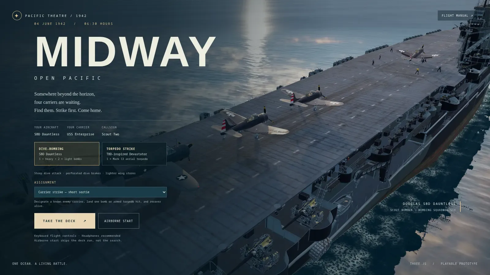
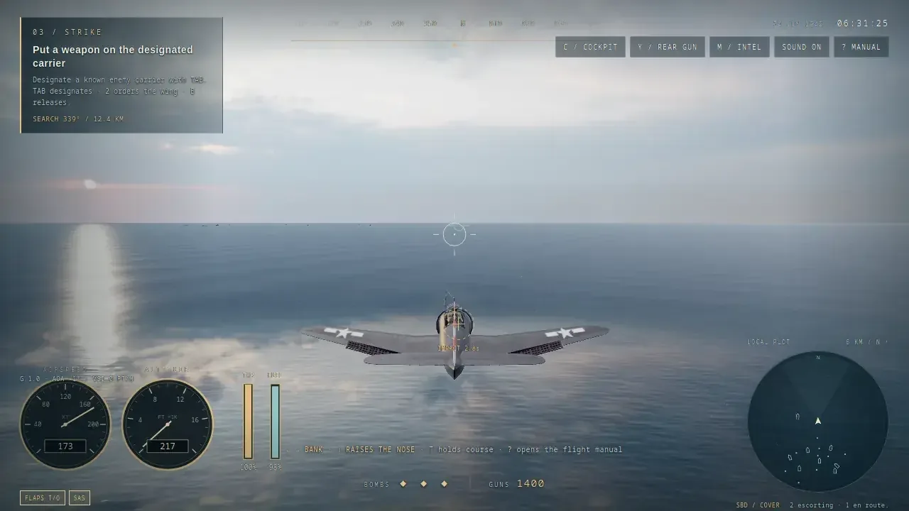
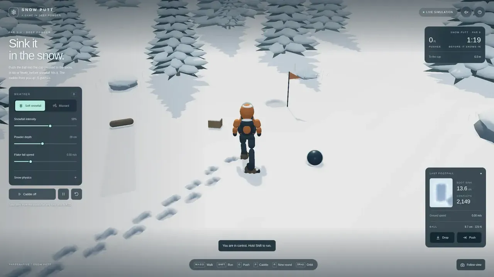
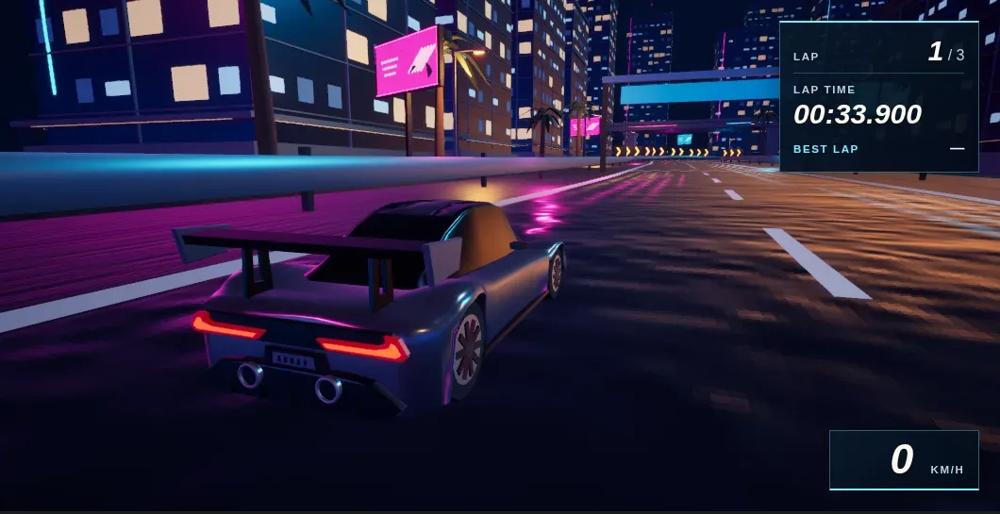
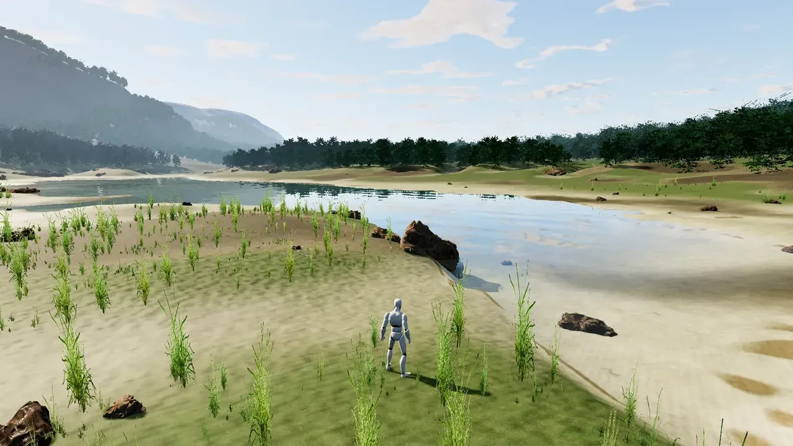
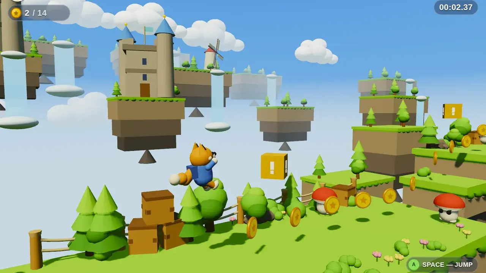

<div align="center">


# ThreeNative

**Build 3D games in plain Three.js and TypeScript. Verified by playtests, with the 3D scene rendered natively on desktop and Android, never inside a WebView.**

[](https://www.npmjs.com/package/@threenative/core)
[](LICENSE)
[](https://threejs.org)

<table>
  <tr>
    <td colspan="3"><a href="docs/media/readme/midway-dogfight.webp"></a></td>
  </tr>
  <tr>
    <td width="33%"><a href="docs/media/readme/midway-title.webp"></a></td>
    <td width="33%"><a href="docs/media/readme/midway-strike.webp"></a></td>
    <td width="33%"><a href="docs/media/readme/midway-native.webp"></a></td>
  </tr>
</table>

<sub><b>Midway: Open Pacific</b>, built with ThreeNative. Bottom right: the native desktop build. Click to enlarge.</sub>

**[▶ Play Midway in your browser](https://midway.threenative.com/)**

```sh
pnpm create threenative my-game
```

**[Website](https://threenative.com) · [Studio](https://studio.threenative.com/) · [Games store](https://store.threenative.com) · [Discord](https://discord.gg/mWxTQByxFR)**

[vs Three.js](#threenative-vs-plain-threejs) · [Gallery](#built-with-threenative) · [Ecosystem](#the-ecosystem) · [Asset MCP](#the-asset-mcp-every-asset-library-one-prompt-away) · [Quickstart](#quickstart) · [Starter kits](#starter-kits) · [Built for AI agents](#built-for-ai-agents) · [Platforms](#platforms) · [Docs](#docs)

</div>

---

## ThreeNative vs plain Three.js

> **Why it matters:** Every hour your agent spends rebuilding a game loop is an hour, and a pile of tokens, that does not go into your game. ThreeNative removes that work.

**ThreeNative is Three.js, plus the game engine around it.** `ctx.scene` is a real
`THREE.Scene`, so every tutorial still works. You just stop writing the other half of the game.

| | Plain Three.js | ThreeNative |
| --- | --- | --- |
| **First commit** | ❌ An empty canvas. Rewrite the loop, resize, input and physics glue in every project | ✅ 19 playable starter kits. The ~170 lines (42%) of plumbing every game repeats are already written. [Kits](packages/create-threenative/templates) · [audit](docs/architecture/CHARTER.md) |
| **AI agent cost** | ❌ The agent works from memory: it reinvents the loop, input and physics glue, and guesses APIs, every session | ✅ When your game matches one of the 19 kits, the agent starts from working code and searches 696 shipped capabilities over MCP before it writes a line. Your tokens go to your game, not to plumbing. [Manifest](packages/core/capabilities.json) · [engine MCP](packages/engine-mcp/src/index.ts) |
| **Physics** | ⚠️ Pick a library, write the bridge | ✅ Rapier (Rust, compiled to WebAssembly) built in, with Godot-style `RigidBody3D`, `CharacterBody3D`, `Area3D` and navigation. [RigidBody3D](packages/physics/src/RigidBody3D.ts) · [CharacterBody3D](packages/physics/src/CharacterBody3D.ts) · [navigation](packages/physics/src/navigation) |
| **Engine** | ⚠️ JavaScript issues every draw call | ✅ An owned C++ engine behind the same Three.js API: WebAssembly in the browser (multithreaded on cross-origin-isolated pages), native code on desktop. [Engine source](packages/runtime-native/src/engine) · [`wasm-threads` preset](packages/runtime-native/CMakePresets.json) · [decision](docs/architecture/NATIVE-ENGINE-DECISION.md) |
| **Draw calls** | ⚠️ One per mesh, unless you batch by hand | ✅ Fewer draws, more frames, on the same workload-equal stress scene: **57 draws vs 1,109**, **96.7 vs 75.3 fps** uncapped on an RTX 2080 (2026-11-11, both arms in ABBA order in one clean browser). [Data](docs/stress-loop/ledger.json) · [method](scripts/stress-fair.mjs) |
| **Gets faster over time** | ⚠️ Profile and optimize on your own | ✅ A continuous performance loop measures the engine on fixed stress scenes and keeps only proven wins. You get each speedup by updating a package. [413 stress-loop runs](docs/stress-loop/ledger.json) · [every lever tried, kept or rejected](PERFORMANCE-LEARNINGS.md) · [the loop](.claude/skills/perf-loop/SKILL.md) |
| **Default look** | ⚠️ Tune tonemapping, exposure and lights by hand | ✅ Unreal-class out of the box: a filmic tone curve and Unreal's metered auto exposure by default, and sky, GI, shadows and foliage calibrated against Unreal renders of the same scene, without the Unreal install. [Look defaults](packages/core/src/look/world-environment.ts) · [quality tiers](packages/core/src/look/quality.ts) · [filmic curve](packages/core/src/look/filmic-tone-mapping.ts) · [see it](#unreal-class-visuals-without-the-66-gb-unreal-install) |
| **Ships to** | ❌ The browser | ✅ Web, Windows, macOS, Linux and Android from one source. The 3D scene always renders natively, never inside a WebView. [Native runtime](packages/runtime-native) |
| **HUD and menus** | ⚠️ Hand-rolled DOM | ✅ React 19 and Tailwind, bound to game state, with three renderers to pick from per game: `web` (the default: real DOM, drawn by the platform's own system web view over the natively rendered scene), `native-css` (the same JSX and Tailwind laid out by a pure-Rust CSS engine, no web view; desktop preview) and `native` (engine-drawn quads, zero extra processes). [`@threenative/ui`](packages/ui) · [Rust CSS engine](packages/runtime-native/native/css-ui) · [renderer guide](docs/architecture/CHARTER.md#6b-ui--react--tailwind-never-the-scene-graph) |
| **Assets** | ⚠️ Copy files and fix paths | ✅ Hashed asset pipeline, 200+ procedural assets, and an asset MCP that reaches 33 sources, from Fab and Poly Haven to your own Unreal and Unity packs. [Pipeline](packages/assets) · [procedural library](packages/procedural-environment) |
| **Playtests: the AI plays your game** | ❌ None. The agent says "done" from memory, and you find the bugs | ✅ The agent plays the real build: playtests press keys, then assert game state, HUD, screenshots and frame budgets. They fail closed, so the AI proves its own work before it reports done. [`@threenative/playtest`](packages/playtest) |
| **Against Godot 4.7.1** | ❌ No numbers to compare | ✅ **1.8× faster** at 4,096 cubes on native desktop, **3.9× faster** at 16,384 instanced cubes on the web. [Data](docs/verification/runtime-perf-state.md) · [desktop bench](docs/PRDs/done/PRD-449-cross-engine-benchmarks-and-html-report.md) · [web bench](docs/PRDs/done/PRD-117-engine-load-test-godot.md) |
| **Lock-in** | ✅ None | ✅ None either. Materials, lights and post are plain code in your `src/render/`, and `engine: "threejs"` runs stock Three.js. [Generated look code](packages/create-threenative/templates/starter/src/render) · [override](docs/architecture/NATIVE-ENGINE-DECISION.md) |

### Unreal-class visuals, without the 66 GB Unreal install

> **Why it matters:** Players judge a game by its first frame. You get a look that holds up, and players still reach it by clicking a link: no 66 GB engine, no installer.


Unreal makes great frames, but you pay for them with a 66 GB editor install (Unreal Engine 5.8.3, measured on our build machine). ThreeNative
takes only the parts worth having (the sky, global illumination, shadows, foliage, exposure and
the frame-cost tricks) and runs them in a light engine that loads in a browser tab.

Same calibration scenes, same sun. Left: ThreeNative in the browser. Right: a stock Unreal Engine
5.8.3 render. A fresh visual judge rated the sky, foliage and shadow work an improvement toward
Unreal ([#541](https://github.com/ThreeNativeHQ/threenative-engine/pull/541)), and every
global-illumination pose CLOSE to Unreal
([#634](https://github.com/ThreeNativeHQ/threenative-engine/pull/634)). What is in, what is next and
what we leave out: the [feature map (work in progress)](docs/PRDs/Unreal/research/unreal-visuals-and-performance-feature-map.md).

## Built with ThreeNative

> **Why it matters:** With Midway above, these are full games, not tech demos: a shooter, exploration, platforming, open terrain. The engine carries the whole game, not only a pretty scene.

<table>
  <tr>
    <td width="33%"><a href="docs/media/readme/snow.webp"></a><br><sub><b>Snow kit</b>: footprints that stay</sub></td>
    <td width="33%"><a href="docs/media/readme/vesper-hall.webp"></a><br><sub><b>Vesper Hall</b>: real-time GI, reflections, god rays</sub></td>
    <td width="33%"><a href="docs/media/readme/racing.webp"></a><br><sub><b>Racing kit</b>: three laps, checklines and boost pads</sub></td>
  </tr>
  <tr>
    <td><a href="docs/media/readme/strata-coastal.webp"></a><br><sub><b>Strata</b>: procedural terrain across five biomes</sub></td>
    <td><a href="docs/media/readme/bayview.webp"></a><br><sub><b>Bayview</b>: FPS with native Android HUD</sub></td>
    <td><a href="docs/media/readme/fox-platformer.webp"></a><br><sub><b>Fox platformer</b>: 60 fps sustained on a Pixel 8</sub></td>
  </tr>
</table>

Every image is a real engine or device capture. No mockups.

## The ecosystem

> **Why it matters:** Start however you like and never get stuck: build in the browser or in your editor, play and publish in the store, and ask the team on Discord.

Start in your browser with Studio or work locally with the CLI. Both produce the exact same plain Three.js and TypeScript project with zero lock-in.

| Where | What you get |
| --- | --- |
| 🧰 **This repo** | The engine, the `create-threenative` CLI, six MCP servers, and the native runtime. MIT, free forever. |
| ✨ **[ThreeNative Studio](https://studio.threenative.com/)** | Prompt, preview, and play in your browser with nothing to install. Export the full TypeScript repo anytime. |
| 🕹️ **[Games store](https://store.threenative.com)** | Play free 3D web games built with ThreeNative, and publish your own. |
| 📚 **[threenative.com](https://threenative.com)** | Docs, API reference, examples, and desktop downloads. |
| ✈️ **[Midway](https://midway.threenative.com/)** | Flagship demo: carrier strikes over the open Pacific, live in your browser. |
| 💬 **[Discord](https://discord.gg/mWxTQByxFR)** | Chat with the team and other ThreeNative developers. |

## The asset MCP: every asset library, one prompt away

> **Why it matters:** art is where most game prototypes stall. A coding agent can write a game
> loop, but it cannot draw a tree, and it gets nowhere with an asset store behind a login, a
> checkout and an editor-only format. The asset MCP removes all three walls. Your agent asks for
> "a mossy rock" or "a sword swing sound", and a real, licensed asset lands in your game.

<a href="docs/media/readme/wildwood.webp"></a>

<sub><b>Wildwood</b>: a Fab Unreal pack (Landscape Pro 2.0), converted to GLB by the asset MCP and rendered by ThreeNative.</sub>

| Your agent can | From |
| --- | --- |
| ✅ **Search and download** with no browser, login or checkout | Fab free listings, Poly Haven, ambientCG, Smithsonian 3D, Polyfork, Quaternius, KayKit, Kenney, Brackeys VFX, game-icons.net |
| ✅ **Convert packs you own** to clean, self-contained GLBs, without installing either editor | Unreal (`.uasset`, `.umap`) from Fab, and Unity Asset Store (`.unitypackage`) |
| ✅ **Find music and sound effects** | Sonniss GDC bundles, Kenney audio, Tallbeard loops, plus a research list of 10 audio libraries |
| ✅ **Make the asset game-ready** | Decimate heavy meshes behind a rendered before/after check, auto-rig a character, retarget animations, AI-paint a gray blockout |
| ✅ **Stay legal** | Every source lists its license and attribution, and a download needs the license accepted. The MCP never buys anything, and it flags what it cannot convert (Blueprints, encrypted paks) |

**Major supported providers**

| 🧱 3D models | 🎨 Textures and HDRIs | 🏃 Characters and animation | 🔊 Sound and music | ✨ VFX, icons and fonts |
| --- | --- | --- | --- | --- |
| [Fab](https://www.fab.com/) (free listings, and Unreal packs you own) | [Poly Haven](https://polyhaven.com/) | [Quaternius](https://quaternius.com/) | [Sonniss GDC](https://gdc.sonniss.com/) | [Kenney Particle Pack](https://kenney.nl/assets/particle-pack) |
| Unity Asset Store (packs you own) | [ambientCG](https://ambientcg.com/) | [KayKit](https://kaylousberg.itch.io/) | [Kenney audio](https://kenney.nl/assets/category:Audio) | [Brackeys VFX](https://brackeysgames.itch.io/brackeys-vfx-bundle) |
| [Sketchfab](https://sketchfab.com/) (with your API token) | [Fab](https://www.fab.com/) materials | [Polyfork](https://polyfork.dev/) | [Tallbeard loops](https://tallbeard.itch.io/music-loop-bundle) | [game-icons.net](https://game-icons.net/) |
| [Smithsonian 3D](https://3d.si.edu/) | | [Fab](https://www.fab.com/) animation | [Freesound](https://freesound.org/), [Pixabay](https://pixabay.com/sound-effects/), [OpenGameArt](https://opengameart.org/) | [Google Fonts](https://fonts.google.com/) |
| [Kenney](https://kenney.nl/assets), [Polyfork](https://polyfork.dev/) | | | | |

<sub>Provider names are shown only to describe compatibility. ThreeNative is not affiliated with or endorsed by any of them. See [Legal](#legal).</sub>

In total it knows **33 sources** of models, textures, HDRIs, animation, VFX, icons, fonts, sound
and music, and 13 of them download straight into your project. It ships with every new project:
no setup. Source: [`threenative-asset-mcp`](https://github.com/ThreeNativeHQ/threenative-asset-mcp)
· [npm](https://www.npmjs.com/package/threenative-asset-mcp).

## Why ThreeNative

Three.js draws the frame. A real game still needs a fixed-timestep loop, input, physics, a HUD, assets, tests, and a path off the browser. In our [audit](docs/architecture/CHARTER.md) of a vanilla Three.js game, **42% of the code** (~170 of ~400 lines) was generic plumbing. ThreeNative handles that layer and stays out of your way.

- 🧊 **Zero lock-in: it is still Three.js.** `ctx.scene` is a real `THREE.Scene` and `ctx.renderer` is a real `WebGPURenderer`. No serialized scene format, no editor-owned state; drop down to raw Three.js anytime.
- 📦 **One codebase, native screens.** The same TypeScript runs on WebGPU in the browser and renders in an owned C++ host on Windows, macOS, Linux, and Android. The scene never runs inside a WebView.
- 🎨 **You own the look.** New scenes start with a filmic, auto-exposed default look. Materials, lights, post-processing, and camera live as plain code in your repo under `src/render/`.
- 🎮 **Playable in one command.** Start from 19 starter kits (kart racer, 3D platformer, FPS, open-world crime, stealth, survival horror and more), each wired with real mechanics, Rapier physics, a React HUD, and passing playtests.
- 🤖 **Built for coding agents.** Six MCP servers come wired for Claude Code, Codex, Cursor, Gemini CLI, VS Code, opencode, and Zed.
- ✅ **Verified, not just generated.** Scripted JSON playtests press keys, check game state, HUD, screenshots, and frame budgets. They fail closed, so the next edit cannot silently break your game.

## Quickstart

> **Why it matters:** One command gives you a running game with physics, a HUD and a passing playtest. Your first prompt changes a game instead of filling a blank page.

```sh
pnpm create threenative my-game                 # or: --template kart, --genre mario
cd my-game
pnpm install
pnpm dev
```

Requires Node 20.19+ and a WebGPU browser. Prefer zero local setup? Open [ThreeNative Studio](https://studio.threenative.com/) in your browser and export the exact same TypeScript repo anytime.

`defineGame` wires the loop, Rapier physics, input, React HUD, and playtests while your scene stays a plain class with three optional methods: `load`, `enter`, and `update`:

```ts
const game = defineGame<GameState, IPhysicsContext>({
  input: { move: { up: ["KeyW"], down: ["KeyS"], left: ["KeyA"], right: ["KeyD"] } },
  plugins: [rapier(), playtest()],
  scenes: { play: Play },
  start: "play",
});
```

`ctx.input.vector("move")` works across keyboard, gamepad, and touch. Physics uses Godot vocabulary: `RigidBody3D`, `CharacterBody3D`, and `Area3D`.

## Starter kits

> **Why it matters:** A kit jumpstarts your game. Your agent does not burn tokens building plumbing from scratch. It tweaks a game that already works and steers it in the direction you point.

Run `pnpm create threenative my-game --template <name>`, or ask your agent for "a game like Mario Kart" and it starts from the matching kit.

| Kit | What you start with |
| --- | --- |
| `kart` | **Clover Cup**: eight karts, power-slides, mini-turbo sparks, item boxes, and seven CPU drivers |
| `collectathon` | **Hop Garden**: triple jump, long jump, wall kick, ground pound, and ledge grab on one island |
| `adventure` | **Lantern Vale**: lock-on sword combat, a block puzzle, a key, and the Stone Warden mini-boss |
| `shooter` | **First-person shooter**: aim down sights, reload, hitscan/projectile weapons, and targets that hunt you |
| `action-rpg` | **Action RPG**: three-room dungeon with melee combat, loot drops, equipment, and persistence |
| `rts` | **Real-time strategy**: three commanders, fog of war, and a deterministic headless simulation |
| `tower-defense` | **Tower defense**: four towers, three upgrade tiers, twelve waves, two bosses, and an orbital strike |
| `platformer` | **Fox Dash**: a fox, rope bridges, stompable walkers, gems, and a double jump |
| `racing` · `runner` · `sailing` | Three-lap circuit with boost pads · three-lane endless runner · wind, ocean waves, and buoyancy |
| `snow` · `rain` · `puzzle` | Deformable snow footprints · coastal storm you control · 45-body physics vault |
| `open-world` | **Open-world crime**: a city on foot or by car: carjacking, traffic, five-star police pursuit and a timed job |
| `stealth` | **Stealth infiltration**: vision cones, suspicion, noise, takedowns, bodies that raise the alarm, and an extraction |
| `survival-horror` | **Survival horror**: fixed cameras, tank controls, scarce ammo, a six-slot case, herbs, keys and typewriter saves |
| `starter` · `minimal` | Default project with HUD and physics · leanest starting point to learn from |

Full kit guide in [`create-threenative`](packages/create-threenative/README.md).

## Built for AI agents

> **Why it matters:** An agent with the right tools stops guessing. It looks up what already exists, pulls real assets, and checks its own work, so you spend your prompts on the game, not on fixing what it broke.

AI prototypes break fast when the next prompt ruins collisions or the HUD. Every new project wires
six MCP servers into Claude Code, Codex, Cursor, Gemini CLI, VS Code, opencode and Zed. No setup:
`pnpm create threenative` writes the config.

| MCP server | What your agent can do | What it unlocks |
| --- | --- | --- |
| 🔍 **Engine** (`threenative-engine-mcp`) | Search every shipped API with its signature, example and constraints. Look up mechanic references from real games, and watch a contact sheet of real gameplay footage | The agent reuses the engine instead of reinventing it, and builds a double jump or a power-slide that feels like the genre |
| 🎒 **Assets** (`threenative-asset-mcp`) | Search Poly Haven, ambientCG, Sketchfab, Fab, Smithsonian and more. Convert owned Unreal and Unity packs to GLB, decimate heavy meshes behind a visual check, auto-rig and retarget characters, find or generate sound, AI-paint a gray blockout | Real art and audio in minutes, not placeholder cubes |
| 🏔️ **Terrain** (`@threenative/terrain`) | Generate a world from a starter biome (forest, coastal, alpine, desert, tundra), patch it, or define a new biome, live in the browser editor | Open worlds with streaming and colliders, without a level editor |
| 🗿 **Sculpt** (`threenative-sculpt-mcp`) | Plan a model from reference art, then pass a spec gate and an 8-pass visual gate, with rig gates for animated characters | Custom models and characters that match your reference, checked by image rather than by guesswork |
| 🦴 **Animation** (`threenative-animation-mcp`) | Inspect a skeleton, attach a sword or a hat to a bone, edit clips, and verify motion | No foot sliding, no clipping, and no broken loops in what ships |
| 📈 **DevTools** (`chrome-devtools-mcp`) | Drive a real WebGPU Chrome: screenshots, performance traces, console errors, heap snapshots | The agent sees and profiles the actual frame. Together with playtests, it plays the game and proves it works |

### How the pieces work together

> **Why it matters:** The plain Three.js loop ends when you find the bugs. The ThreeNative loop ends when the playtest passes.


## Procedural asset library

> **Why it matters:** Placeholder cubes kill a prototype. Real trees, rocks, cities and dungeons are one bake call away, with no download and no license hunt.

Run `pnpm asset-library` to browse and customize **200+ bake-ready procedural 3D assets** in a Storybook-style viewer: 28 tree species with CC0 scanned bark and leaves (3 LODs), cliffs across 12 biomes, 75 snap-fit city modules, 51 modular dungeon pieces in three themes with animated fire, and the 53-piece Stylized Biome Kit. Tweak a seed, orbit the result, and copy the bake call into your game. [Browse guide](packages/procedural-environment/README.md#browse-everything-pnpm-asset-library)

## Platforms

> **Why it matters:** Your game reaches players where they are: a web link, a desktop download or an Android build, from one codebase, with no rewrite.

| Platform | Renderer | Status |
| --- | --- | --- |
| Web | Owned C++ engine (WebAssembly), WebGPU | ✅ Verified every CI run |
| Linux, macOS, Windows | Owned C++ engine, native player | ✅ Verified: 300 native frames and a non-blank capture |
| Android | Native host | ✅ Emulator lane runs · 60 fps sustained on a Pixel 8 (fox platformer) |

Measured results, each with its source:
- **Same stress scene, ThreeNative vs plain Three.js (2026-11-11, RTX 2080, uncapped):** 96.7 vs 75.3 fps, 57 vs 1,109 draws. On an Intel Gen12 laptop GPU (2026-11-07): 64.3 vs 53.5 fps. [Ledger](docs/stress-loop/ledger.json) · [method](scripts/stress-fair.mjs)
- **4,096 cubes (native desktop, RTX 2080, 1280×720):** 2.28 ms vs 4.17 ms in Godot 4.7.1, 1.8× faster, median of 3 runs. [Data](docs/verification/runtime-perf-state.md) · [bench](docs/PRDs/done/PRD-449-cross-engine-benchmarks-and-html-report.md)
- **512 skinned characters:** 1,026 → 4 draw calls and frame p50 47.05 → 24.45 ms against stock Three.js skinning, faster in 6 of 6 paired runs. [Data](docs/verification/runtime-perf-state.md) · [code](packages/core/src/projection-skinned.ts)

Every number here links to the run that produced it: [current numbers](docs/verification/runtime-perf-state.md). You sign your own desktop and Android releases. See [`docs/RELEASE-SIGNING.md`](docs/RELEASE-SIGNING.md).

## Packages

<details>
<summary><b>All packages</b></summary>

| Package | Purpose |
| --- | --- |
| `@threenative/assets` | Build-time asset compile step: `assets/` in, hashed outputs and a manifest out |
| `@threenative/backend` | Cloud saves, shared documents and online rooms for published games: a local-first client, the Cloudflare handler, the room Durable Object and the D1 schema |
| `@threenative/core` | Bootstrap, scenes, lifecycle, input, and renderer integration |
| `create-threenative` | Scaffold a readable game project from nineteen templates |
| `@threenative/metahuman` | MetaHuman head expressions: checksum-verified OpenRigLogic WASM evaluator and the binding-metadata asset contract |
| `@threenative/physics` | Rapier-backed Godot-shaped physics and navigation |
| `@threenative/playtest` | Browser, native, and scenario assertion harness |
| `@threenative/procedural-environment` | Optional bake-first procedural assets as GLBs: trees, cover and forest floor (`bakeVegetation`), rocks and cliffs (`bakeRock`), 75 city modules (`bakeCity`), plus the Three.js Stylized Biome Kit (`/stylized`). Browse them with `pnpm asset-library` |
| `@threenative/runtime-native` | Owned C++ host for desktop and Android |
| `@threenative/raw-unreal` | Raw Unreal editor `.uasset` static-mesh loader for UE5 FMeshDescription and UE4.18 FRawMesh, no interchange conversion |
| `@threenative/terrain` | Optional headless Strata authoring: validated recipes, baked heightfields and indexed Three.js geometry |
| `@threenative/three-native` | The native engine's Three.js API catalog and the TypeScript sources the engine bundlers read |
| `@threenative/ui` | React bindings for HUD and game state |
| `@threenative/ueformat` | UEFormat v10 `.uemodel` parser and Three.js loader for meshes exported from Unreal packages |
| `threenative-animation-mcp` | Inspects, attaches, edits and verifies character animation through one MCP, as build-time edits of one GLB |
| `@threenative/blender-bridge` | Drives an installed Blender headlessly so a downloaded `.fbx` becomes a loadable GLB. Ships no Blender |
| `threenative-engine-mcp` | Offline MCP capability discovery for authoring agents |

</details>

## Docs

- [`docs/README.md`](docs/README.md): map of all guides and references.
- [`docs/architecture/CHARTER.md`](docs/architecture/CHARTER.md): what the framework is and refuses to be.
- [`docs/architecture/AGENT-INTERFACE.md`](docs/architecture/AGENT-INTERFACE.md): the surface an authoring agent reads.
- [`CONTRIBUTING.md`](CONTRIBUTING.md#versioning-and-deprecation): public surface and version promises.

## Contributing

```sh
pnpm install --frozen-lockfile
pnpm typecheck && pnpm lint && pnpm test
```

Native compilation is opt-in; the default gate needs no CMake, NDK, or Xcode. There is no root `pnpm dev`. Run an example by name, such as `pnpm --filter abyss-framework dev`. Read [`CONTRIBUTING.md`](CONTRIBUTING.md) and [`AGENTS.md`](AGENTS.md) first, and follow the [Code of Conduct](CODE_OF_CONDUCT.md).

**Questions** → [Discussions](https://github.com/ThreeNativeHQ/threenative/discussions) ·
**Bugs** → [Issues](https://github.com/ThreeNativeHQ/threenative/issues) ·
**Security** → [`SECURITY.md`](SECURITY.md)

## Privacy

> **Why it matters:** you ship a game, not a tracker. The engine reports its own faults so we can
> fix them for every game, and you can turn that off with one line.

- **What we collect:** when the engine logs a `TN_` error or warning, the game sends one small
  event: the code, the level, a scrubbed message (at most 200 characters, with URLs, file paths
  and emails removed), the game name, the engine version, the platform, the renderer and a random
  id for that run. No stack trace, no IP address, nothing about the player. The CLI sends the same
  fault reports and no usage analytics.
- **Why:** to find and fix engine faults fast, so every ThreeNative game gets more stable.
- **Where it goes:** to our own Cloudflare account only, kept for about three months. Never sold,
  never used for ads.
- **Turn it off:** `defineGame({ telemetry: false })` in your game, `TN_TELEMETRY=0` or
  `DO_NOT_TRACK=1` in the environment, or `?tnTelemetry=0` on a browser URL.

Full terms: [threenative.com/privacy](https://threenative.com/privacy/) · Code:
[`packages/core/src/telemetry.ts`](packages/core/src/telemetry.ts)

## Legal

- **License.** The ThreeNative source code, including the native runtime, is MIT licensed. See
  [`LICENSE`](LICENSE). The software is provided "as is", without warranty of any kind.
- **Our brand.** The ThreeNative name and logo, and the game screenshots in `docs/media/`, are not
  covered by the MIT license. See [`TRADEMARKS.md`](TRADEMARKS.md).
- **Other brands.** Unreal, Unreal Engine and Fab are trademarks of Epic Games, Inc. Unity and the
  Unity Asset Store are trademarks of Unity Technologies. Three.js, Rapier, Godot, React, Tailwind
  and every other product or provider named here belong to their owners. ThreeNative is not
  affiliated with, sponsored by or endorsed by any of them. Their names appear only to describe
  compatibility and comparisons.
- **Assets.** An asset that you find, download or convert with ThreeNative tools stays under its
  own license. You are responsible for holding the rights to every asset you use or ship. The asset
  MCP converts only packs that you own or license. It does not buy, unlock or decrypt content.
- **Benchmarks.** Every comparison names its hardware, versions and date, and links its data.
  Results on other machines can differ.
- **Privacy.** See [Privacy](#privacy) and the full terms at
  [threenative.com/privacy](https://threenative.com/privacy/).
