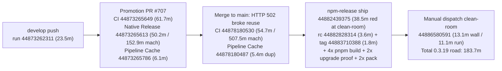
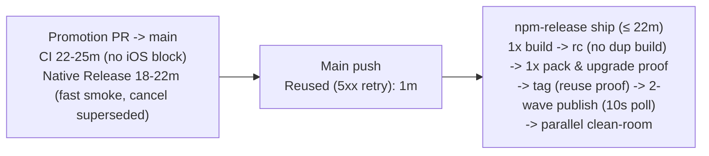

# PRD-903 — Cut release deploy time and overall CI time by fixing broken carry, eliminating duplicate work, and removing test junk

**Status:** BLOCKED on the next release — Phases 1–3 landed on PR #710; only the AC-4 live timings remain
**Priority:** P1 — Release 0.3.19 took 184 minutes end-to-end (clean path ~136 min), a one-line Markdown push to `develop` burned 74.2 wall minutes / 460.4 machine minutes because per-job carry is broken on every run, and all three phases below are open.
**Complexity:** 8 (HIGH); risk override: HIGH — modifies release publish/proof orchestration, workflow gating, and test-suite selection boundaries.
**Owner:** CI tooling
**Depends on:** None

## Context

Owner, 2026-11-21: investigate the logs and file a PRD to decrease the time required to deploy a new library version and overall CI time, considering every option — including removing test junk (tests that add no value and only slow runs down), redundancy, and duplicates.

This PRD builds on [PRD-630](../../CI/PRD-630-the-tag-run-publishes-the-binaries-the-main-proof-built.md), [PRD-776](../../CI/PRD-776-ci-runs-each-test-once-per-input-and-retries-only-the-red-leg.md), [PRD-782](../../CI/PRD-782-a-merge-reaches-npm-as-fast-as-the-work-allows.md), [PRD-897](../../CI/PRD-897-a-release-stays-unpublished-until-npm-serves-its-cohort.md), and [PRD-901](PRD-901-a-release-needs-one-board-round-per-fix-set-and-one-registry-wait.md) using a fresh log audit of the last 400 `ci.yml` runs (`2026-11-14 .. 2026-11-21`), 200 `native-release.yml` runs (`2026-11-16 .. 2026-11-21`), and every step of Release `0.3.19` (`2026-11-21`).

### Measured Baselines (2026-11-14 .. 2026-11-21)

| Surface | Measured Baseline | Evidence Run(s) | Goal |
|---|---|---|---|
| Release `0.3.19` promotion PR open -> `npm latest` | **183.7 min** wall (~136 min without retry; ~82 min had main reuse hit) | `44873265649` -> `44878180530` -> `44882439375` -> `44886580591` | **≤ 65 min** |
| `npm-release.yml` `ship` clean path | **~48.5 min** (`38.5m` up to clean-room fail + `11.1m` clean-room pass) | `44882439375`, `44886580591` (0.3.18 took `138.9m` across 3 attempts, `44853263168`) | **≤ 25 min** |
| `native-release.yml` PR proof | **50.2 min** wall / **152.9 machine-min** (193 PR runs in 5 days = **2,366 wall-min**, 11 failures) | `44873265613` | **≤ 22 min** wall / **≤ 70 machine-min** |
| Full CI board | **48.4–54.7 min** wall, **507.5–510.8 machine-min**, **212.9–395.6m queue wait sum** | `44878180530` (main), `44848357345` (0.3.18 PR) | **≤ 25 min** wall, **≤ 240 machine-min** |
| Merge queue (`merge_group`) | **61.7 min** wall, **256.3 machine-min** (23 of 28 runs cancelled in 7 days) | `44800338707` | **≤ 20 min** wall |
| PR review lane (`pull_request -> develop`) | **19.7 min** wall (`18.8m` in `test` alone) | `44797214689` | **≤ 8 min** wall |
| Docs-only push to `develop` | **74.2 min** wall, **460.4 machine-min**, 72/79 jobs ran | `44887725075` (`41df5bbca`, `docs(prd)`) | **< 1 min** (0 board jobs) |
| Nightly CI (`schedule`) | **51.6 min** wall, **751.5 machine-min**, **0/7 green** in 7 days (10+ `template-engine-cost` legs fail every night) | `44898203423` | **Green nightly** |

### Seven Root Causes Verified in Logs

1. **Per-job carry (PRD-776) is 100% broken on every CI run.** `.github/workflows/ci.yml:90-93` checks out only `scripts` and `packages/create-threenative/templates` in `scope`. `withCarriedLegs` (`scripts/ci/reuse.mjs:748`) calls `carryDeps`, which imports `scripts/ci-native-qualification.mjs:7`, which statically imports `../packages/runtime-native/scripts/desktop-build-profile.mjs`. Every single run (`44878180530`, `44887725075`, `44800338707`) prints `per-job reuse unavailable, the board runs: Cannot find module '.../packages/runtime-native/scripts/desktop-build-profile.mjs'`, catches it in `scripts/ci/reuse.mjs:752`, and carries **zero legs**.
2. **Zero retries on `ghApi()` + `develop` pushes ignore `prose`.** `ghApi()` (`scripts/ci/reuse.mjs:61-81`) makes a single `gh api` call with no retry, so one transient `gh: Server Error (HTTP 502)` turned 0.3.19 `push main` (`44878180530`) from a 1.0-min reuse (cf. 0.3.18 `44853167843`) into a **54.7-min / 507.5-machine-min full board** (same unhandled `502` risk in `scripts/native-release-reuse.mjs:14`). Meanwhile, `classify()` (`scripts/ci-change-scope.mjs:576-589`) forces every `push` to `develop` without an open promotion PR into `full`, never checking if the commit changed only `prose` — causing a single PRD doc edit (`44887725075`) to burn **74.2 wall-min / 460.4 machine-min**.
3. **Un-cancelled `native-release.yml` PR pileups & duplicate `pipeline-cache.yml` triggers.** `.github/workflows/native-release.yml:49` sets `cancel-in-progress: false` for `native-release-proof`, so pushing commits while a Release PR is open queues back-to-back 50-minute multi-OS runs (193 PR runs / 2,366 wall-min / 11 failures in 5 days; top failures in the last 15 failed runs: `clean-consumer-windows` 8x, `clean-consumer` 6x, `npm-dry-run` 5x). `.github/workflows/pipeline-cache.yml:5-22` triggers on both `pull_request: [main]` and `push: [main]`, running the exact job graph twice (`44873265786` + `44878180487`).
4. **`npm-release.yml` `ship` repeats `pnpm build` 4x, upgrade proof 2x, `pack` 2x, 100+ serial `npm view` calls, 60s poll sleeps, and serial `npm`+`pnpm` clean-room (~22 min pure waste in 48.5 min).**
   - `pnpm build` runs 4 times on the exact same `HEAD`: `npm-release.yml:75` (2.2m), `release-candidate.yml:62` (2.5m — even though `scripts/release-candidate-gate.ts:2012` only calls `workspacePackageTreeHash` when `registryState === "matching"`, never when packages are `absent`!), `release.ts:730` inside `--prove-upgrade` (2.5m), and `release.ts:730` again inside `publish` `--yes` (2.5m).
   - `proveUpgradeFromLatest` (`scripts/release.ts:816`) and `packReleaseSet` (`scripts/release.ts:789`) run twice on the same commit 6 minutes apart (`08:04:51`–`08:11:29` = 6.6m, then `08:13:54`–`08:20:37` = 6.7m in `44882439375`).
   - `waitFor` (`scripts/release-ship.ts:466`) sleeps 60 seconds per poll and calls `readShipState()` (`scripts/release-ship.ts:183-220`), which executes 17 serial `npm view` subprocesses every tick (~15s/call).
   - `scripts/verify-registry-install.ts` runs `npm` (5.9m) then `pnpm` (3.7m) serially (`10.0m` in `44886580591`), repeating identical `gameplay` (97s + 83s), `native` (34s + 28s), and Android Gradle APK builds (124s + 37s) on the exact same published tarballs.
5. **Non-blocking `ios-simulator` sets the board floor + `native-release.yml` duplicates `native-platforms.yml` (~25–30 min off promotion wall time).**
   - `ios-simulator` is omitted from `SHIP_SCOPE` (`scripts/release-ship.ts:28-31`) and marked exempt in `scripts/ci-native-qualification.mjs:23` and `scripts/ci/reuse.mjs:730`, yet `native-platforms.yml:463,498,2889` wires `ios-simulator` (**49.9m** — longest job on the entire board!) into `completion`'s `needs:`, and `native-release.yml:566-573` wires `build-ios-simulator` (**37.5m** — longest job in `native-release.yml`!) into `publish`'s `needs:`. Inside `packages/runtime-native/scripts/verify-ios-simulator.mjs:353-607`, `rebuildApp()` runs `xcodebuild` **7 times** just to copy a rebuilt JS bundle into `.app` (31.9m total), after spending 8.4m rebuilding workspace packages.
   - `native-release.yml` runs full `native:verify:desktop` / MSVC verify on Windows (**16.2m**), Linux (**12.3m**), and macOS (**10.2m**) = **38.7m** on the exact same promotion PR where `native-platforms.yml` already runs those 55 C++ test executables + desktop/WebView/installer gates (`35.9m` Windows, `19.5m` desktop parity, `15.9m` macOS, `17.1m` `test-native`).
6. **`test` duplicates >10 minutes of `test-unit` Vitest suites + `pnpm build` (single 18.8-min bottleneck of PR review lanes).**
   - `vitest.config.ts:40-45` already runs `packages/**/__tests__/**/*.spec.ts`, `examples/strata-terrain-preview/__tests__/**/*.spec.ts`, and `scripts/**/*.spec.ts` across `test-unit (1/4..4/4)`.
   - Yet `test` (`TN_SUITE_PHASES=docs,build,package-test`, `scripts/run-test-suite.sh:256-267`, `13.3m` on `44878180530`, **`18.8m` on PR review `44797214689`**) rebuilds the whole workspace (duplicating `build-artifacts`) and re-runs Vitest for `packages/terrain` (**271.1s**), `examples/strata-terrain-preview` (**155.2s**), `packages/procedural-environment` (**90.9s**), `packages/procedural-animals` (**55.4s**), plus `ueformat`, `raw-unreal`, `metahuman`, and `blender-bridge` (**~630s+ of duplicate Vitest CPU**). On PR review lanes where `ci-change-scope.mjs:183` sets `jobs.test.required = true` for any `packages/` edit, this single job stretches an ~8m review lane to 19.7m.
7. **Test junk, heavy unit fixtures, serial conformance, and 16-kit / 20-lane sprawl (`44878180530` logs):**
   - **Unit suite concentration:** 1,241 files = `4,412.7s` test CPU; top 20 files = `2,286.0s` (**51.8%**): `packages/terrain/__tests__/terrain-mcp.spec.ts` (**349.5s** in 1 file — drags shard 4/4 to 11.5m), `packages/create-threenative/__tests__/template-assets-compile-{1,2}.spec.ts` (**333.0s** — re-cooks assets across all 16 kits already cooked in `template-nonvisual`), `packages/terrain/__tests__/kit-bake.spec.ts` (**138.6s**), `packages/assets/__tests__/compile.spec.ts` (**136.5s**), `packages/procedural-environment/__tests__/city.spec.ts` (**134.6s** — bakes all 75 city GLBs every run), `scripts/__tests__/unreal-look-*.spec.ts` + `realism-effects-*.spec.ts` (**51 offline research-harness specs = 133.8s**, led by `unreal-look-gi-cache.spec.ts` at **101.7s**), `examples/strata-terrain-preview/__tests__/bake-golden.spec.ts` (**91.9s**, bakes twice), and `packages/terrain/__tests__/starter-kit.spec.ts` (**91.6s**).
   - **Android & Desktop conformance:** `packages/runtime-native/conformance/registry.json` holds **157 tests** (109–110 run, 48 always-blocked on hosted). Android runs all 110 cases serially at ~14.5s/case = **26.5 min** (`34.0–44.1m` job — the #1 wall-time floor of every merge queue and full board!) because even trivial cases like `01-basic-cube` pay 14.7s of per-case APK launch/logcat/screenshot overhead; Desktop runs 109 cases serially = **12.6 min**. `--only-tests` already exists in `packages/runtime-native/conformance/run-conformance.mjs:2840`.
   - **`template-nonvisual` (16 kits = 146.2 machine-min = 28.8% of board, 101.3m queue wait):** `237` scenarios launch cold browsers serially (`shooter`: 24 kept scenarios = **21.4m**, including 43-frame micro-scenarios taking ~50–95s each; `collectathon`: 19 scenarios = **15.1m**; `adventure`: **10.7m**; `racing`: **9.8m**; plus **17.6m** across 15 kits in software-adapter `engine-parity`).
   - **`integration/*` (20 jobs = 63.3 machine-min, 88.6m queue wait):** 3 overlapping exposure jobs (`auto-exposure` 9.9m + `cold-boot` 5.0m + `exposure` 1.5m = **16.4m**), 5 ARM64 native jobs (21.7m), and 0.5–0.8m jobs (`csg`, `ik`, `playstation`) each paying full checkout/install/queue setup.

## Solution

Split improvements into two clear tracks:
1. **Zero-coverage-loss structural fixes (Phases 1–3):** Fix the broken `scope` carry import, add 5xx retries to `ghApi` and `native-release-reuse.mjs`, skip `develop` pushes that change only prose, cancel superseded PR `native-release.yml` runs, stop duplicating `pipeline-cache.yml` on `push: main`, collapse 4 `pnpm build` / 2 `proveUpgradeFromLatest` / 2 `packReleaseSet` / serial `npm view` + 60s polls / serial clean-room into one pass, decouple non-blocking `ios-simulator` from blocking joins and remove its 6 redundant `xcodebuild` calls, deduplicate `native-release.yml` desktop verify vs `native-platforms.yml`, strip duplicate Vitest runs out of CI `test`, trim over-heavy unit fixtures (`template-assets-compile`, `terrain-mcp.spec.ts`, `city.spec.ts`), shard Android conformance 2-way, and group tiny integration lanes.
2. **Coverage-tradeoff cuts & junk removal (listed below for explicit owner sign-off under `## Blocked on`):** Every cut that narrows test frequency, moves offline research specs off the main board, or trims redundant playtest/conformance scenarios is isolated in the table below so no coverage is removed silently.

### Test Junk & Coverage-Tradeoff Removal Menu (Owner Decisions)

| Candidate | Measured Cost | Proposed Action | Proof / Coverage Tradeoff |
|---|---|---|---|
| `scripts/__tests__/unreal-look-*.spec.ts` + `realism-effects-*.spec.ts` (51 files, `unreal-look-gi-cache.spec.ts` alone = 101.7s) | 51 files, **133.8s** CPU on every full board | Run only when `scripts/unreal-look/**`, `packages/core/src/*gi*`, or those specs change + nightly | Offline calibration/research harness tests stop running on unrelated PRs; still runs in full nightly |
| `shooter` (38 total, 24 kept = 21.4m) & `collectathon` (24 total, 19 kept = 15.1m) micro-scenarios + serial browser launches | **36.5 min** across 2 kits; **146.2 min** across 16 kits | Consolidate micro-scenarios into multi-checkpoint runs (~6 per kit) + reuse Chromium instance per kit in `threenative-playtest` | Slightly coarser scenario failure localization in exchange for keeping every behavior assertion |
| `template-nonvisual` 16-kit fanout on `merge_group` / `develop` pushes | **146.2 machine-min** + **101.3m queue wait** per board | Run 4 representative kits (`starter`, `platformer`, `shooter`, `racing`) + changed kits on `merge_group`; full 16 on promotion PR & nightly | Niche-kit regressions from shared `packages/` land on nightly or promotion instead of every `merge_group` |
| Software-adapter `engine-parity` (15 kits) & `integration / auto-exposure` | **17.6 machine-min** + **9.9m**; high SwiftShader flake share | Run `engine-parity` and `auto-exposure` only on renderer/exposure diffs + nightly | Unrelated diffs skip software-adapter pose/exposure checks until nightly |
| Conformance (`registry.json`: 157 rows, 110 active + 48 always-blocked) | **26.5m** Android (`34–44m` job) + **12.6m** Desktop per board | Split into ~25-case core+regression tier on `merge_group` (~5–7m) vs full 110-case tier on promotion PR & nightly | Full 110-case visual matrix shifts from every `merge_group` to promotion PR & nightly |
| Nightly `template-engine-cost` matrix (`44898203423`) | **260+ machine-min/night**, 10/16 red, **0/7 green** | Fix thresholds or delete the broken matrix instead of burning nightly slots | Stops running failing nightly cost jobs that nobody acts on |
| `native-platforms` workspace rebuilds (`desktop`, `ios-simulator`, `starter-linux`) | ~**18 machine-min** (`8.4m` in iOS) per board | Restore `workspace-packages` from `build-artifacts` instead of running `pnpm build` inside native legs | `native-platforms` depends on `build-artifacts` or falls back to build if absent |

Risks & mitigations:
- **Sparse-checkout module closure drift:** A unit test in `scripts/__tests__/ci-structure.spec.ts` parses static imports of `scripts/ci-change-scope.mjs` and its closure and asserts every imported file is inside `.github/workflows/ci.yml` `scope`'s `sparse-checkout` paths, failing closed at test time.
- **Single upgrade proof staleness:** Same-process `release:ship` passes the exact tarball temp dir + SHA-256 lock from pre-tag `proveUpgradeFromLatest` into `publish`, so the published bytes match the proved bytes identically; standalone `pnpm release --yes` / `--resume` retains its proof.
- **Reduced `native-release.yml` verification:** Removing the 38.7m duplicate `native:verify:desktop` loop from `native-release.yml` assumes `native-platforms.yml` ran the 55 C++ test executables on the same promotion PR (`ci-required` enforces this on `develop -> main`); `native-release.yml` keeps binary smoke (`--version`, 300-frame launch) and clean-room consumer packaging proofs (`clean-consumer`, `clean-consumer-windows`).

## Non-Goals

- Paying for larger GitHub-hosted runners or upgrading the GitHub concurrency plan (capacity is an owner billing decision tracked in [PRD-782](../../CI/PRD-782-a-merge-reaches-npm-as-fast-as-the-work-allows.md)).
- Replacing the `develop -> main` release flow with a frozen `release/x.y.z` branch (deferred in [PRD-901](PRD-901-a-release-needs-one-board-round-per-fix-set-and-one-registry-wait.md)).
- Changing npm CDN propagation physics beyond the two-wave publish already shipped in [PRD-901](PRD-901-a-release-needs-one-board-round-per-fix-set-and-one-registry-wait.md).
- Weakening lockfile checks, OIDC provenance, public-surface checks, or `publish:check` invariants.

## Acceptance Criteria

- [x] AC-1 [local]: `scope`'s sparse checkout imports `withCarriedLegs` without error (enforced by a static import-closure test), `ghApi` and `native-release-reuse.mjs` retry transient 5xx responses, prose-only `develop` pushes select `prose`, and `native-release.yml` cancels superseded PR proofs. proof: `pnpm exec vitest run scripts/__tests__/ci-structure.spec.ts scripts/__tests__/ci-queue-reuse.spec.ts scripts/__tests__/ci-leg-carry.spec.ts scripts/__tests__/native-release-proof.spec.ts` — Evidence: 2026-11-21, 4 files pass (sparse-closure, prose and `synchronize` cases included); the live `scope` replay carried 47 legs where it carried 0 (Phase 1).
- [x] AC-2 [local]: `release:ship` runs `pnpm build` once per ship (the caller's build, named by `TN_RELEASE_PREBUILT`), polls every 15 s for its first ten minutes, and `release-candidate.yml` skips `pnpm build` when all cohort packages are absent from npm. The second upgrade proof, the serial `npm view` reads and the serial clean room stay (see Decisions and `## Blocked on`). proof: `pnpm exec vitest run scripts/__tests__/release.spec.ts scripts/__tests__/release-ship.spec.ts scripts/__tests__/release-candidate-gate.spec.ts scripts/__tests__/verify-registry-install.spec.ts` — Evidence: 2026-11-21, 4 files pass.
- [x] AC-3 [local]: CI `test` runs zero Vitest suites already executed by `test-unit`, and `template-assets-compile` probes the uncooked budget on one kit while every kit still compiles. The `terrain-mcp.spec.ts` and `city.spec.ts` ceilings moved to `## Blocked on` (owner decision). proof: `pnpm exec vitest run scripts/__tests__/ci-structure.spec.ts scripts/__tests__/ci-needs.spec.ts scripts/__tests__/run-test-suite.spec.ts packages/create-threenative/__tests__/template-assets-compile-1.spec.ts packages/create-threenative/__tests__/template-assets-compile-2.spec.ts` — Evidence: 2026-11-21, all pass; `pnpm typecheck` and `pnpm lint` exit 0.
- [ ] AC-4 [shared]: On the next real release and post-landing CI window, promotion PR open to `npm latest` finishes in ≤ 65 min (`0.3.19` baseline: 183.7 min), `npm-release.yml` `ship` finishes in ≤ 25 min (baseline ~48.5 min), full CI board wall median is ≤ 25 min (baseline 54.7 min), and PR review lane wall time is ≤ 8 min (baseline 19.7 min). proof: release run IDs and `pnpm ci:speed record && pnpm ci:speed show` — Evidence: pending.

## Blocked on

- Owner sign-off on each coverage-tradeoff item in "Test Junk & Coverage-Tradeoff Removal Menu" (moving the 51 `unreal-look`/`realism-effects` specs to path-scoped + nightly, consolidating `shooter`/`collectathon` micro-scenarios + browser session reuse, narrowing `merge_group` `template-nonvisual` to 4 representative kits + touched kits, moving `engine-parity` and `integration / auto-exposure` to nightly/path-scoped, splitting conformance into a ~25-case PR/queue tier vs full 110-case promotion/nightly tier, fixing or deleting the 0%-green `template-engine-cost` nightly matrix, and reusing `workspace-packages` inside `native-platforms`) — unblocked by owner decision.
- AC-4 live timing proof on GitHub Actions — unblocked by landing Phases 1–3 and shipping the next `Release 0.3.x` cohort.
- `verify-ios-simulator.mjs` without its 7 `xcodebuild` rebuilds — unblocked by a macOS runner run; this host has no Xcode, so the change cannot be proved before it ships.
- Dropping `native:verify:desktop` from the `native-release.yml` PR `build` jobs (38.7 machine-min) — owner decision. That step runs the exact binaries the job stages and the tag run republishes; `native-platforms.yml` verifies a different build of the same source, so this is a coverage trade, not a duplicate.
- `terrain-mcp.spec.ts` at 30 s or less (349.5 s on CI) and `city.spec.ts` at 20 s or less (134.6 s) — owner decision. The time is real work: `terrain-mcp` cooks each of the 5 starter kits end to end and reads the GLB back, and `city` bakes each of the 75 modules, each from its own generator. Reaching the ceilings means sampling kits or modules, which is a coverage cut, not a duplicate.
- Running the `npm` and `pnpm` clean-room lanes of `verify-registry-install.ts` at the same time (~4 min) — owner decision. The clean room is the step that went red on 0.3.18 and 0.3.19, and two Gradle builds, two Vite builds and two software-WebGPU playtests on one 4-vCPU hosted runner add load to that step. The pnpm Android pass is not a pure repeat either: Gradle reads pnpm's symlinked `node_modules`.

## Integration Ledger

| Capability | Reachable consumer/trigger | Replaces / disposition | Evidence |
|---|---|---|---|
| Per-job carry + transient API retry + `develop` prose shortcut | `.github/workflows/ci.yml` `scope` -> `scripts/ci-change-scope.mjs` -> `scripts/ci/reuse.mjs` | Fixes broken `withCarriedLegs` import, adds 5xx retries to `ghApi`, narrows prose pushes on `develop` | AC-1 |
| Release PR proof cancellation & deduplicated pipeline-cache | `.github/workflows/native-release.yml`, `.github/workflows/pipeline-cache.yml` | Replaces `cancel-in-progress: false` on PR proofs and drops duplicate `push: main` trigger | AC-1, AC-4 |
| Single-build, single-upgrade-proof ship + parallel clean-room | `.github/workflows/npm-release.yml` -> `scripts/release-ship.ts` -> `scripts/release.ts`, `scripts/verify-registry-install.ts`, `.github/workflows/release-candidate.yml` | Removes 3 duplicate `pnpm build`s, 2nd upgrade proof, 60s polls, and serial clean-room | AC-2, AC-4 |
| Decoupled iOS simulator & deduplicated `native-release` verify | `.github/workflows/native-platforms.yml`, `.github/workflows/native-release.yml`, `packages/runtime-native/scripts/verify-ios-simulator.mjs` | Removes non-blocking iOS from blocking joins and removes 38.7m duplicate desktop verify on PRs | AC-4 |
| Deduplicated CI `test`/`test-unit` + trimmed slow specs + sharded Android conformance + grouped integration | `.github/workflows/ci.yml`, `.github/workflows/integration.yml`, `.github/workflows/native-platforms.yml`, `scripts/run-test-suite.sh`, `packages/{create-threenative,terrain,procedural-environment}/__tests__/` | Eliminates duplicate Vitest runs in `test`, cuts >800s unit bloat, shards Android 2-way, groups small web lanes | AC-3, AC-4 |

## Decisions

- 2026-11-21 (agent, planning): Zero-coverage-loss fixes (broken carry, 5xx retries, duplicate builds/proofs/Vitest runs, un-cancelled PR proofs, iOS critical-path decoupling, 2-way Android sharding, integration lane grouping) are scheduled directly in Phases 1–3; any change that narrows test scope or moves checks to nightly is isolated under Owner Decisions / `## Blocked on` so no gate is weakened silently.
- 2026-11-21 (agent, planning): Single upgrade proof in `release:ship` keeps the pre-tag proof as the authoritative gate and passes its verified tarball directory + SHA-256 lock into the same-process `publish` call (resolving the open question in [PRD-897](../../CI/PRD-897-a-release-stays-unpublished-until-npm-serves-its-cohort.md)); standalone `pnpm release --yes` and `--resume` without a same-run proof retain their own upgrade proof.

- 2026-11-21 (agent, Phase 1): `pipeline-cache.yml` keeps its `push: main` trigger. Its `wgpu-cache-*` and `pipeline-cache-host-deps-*` saves on `main` are the only entries other branches can restore (a pull-request run saves into `refs/pull/N/merge`, which no other branch reads). The duplicate run costs about 5.4 machine minutes and sits off the release critical path (`npm-release.yml` waits on CI only), so the cold caches would cost more than the cut saves.
- 2026-11-21 (agent, Phase 1): The cross-branch `native-release-proof` group stays. In the last 200 runs every real proof was on the `develop` promotion pull request (21 success, 13 cancelled while pending, 9 failure), so cancelling on `synchronize` stops superseded promotion proofs without a per-PR group that would let two proofs hold the pool at once (PRD-380).

- 2026-11-21 (agent, Phase 2): The second upgrade proof stays, which reverses the 2026-11-21 planning decision above. The pre-tag proof runs `--prove-upgrade`, which acknowledges missing prebuilt native binaries because the tag does not exist yet. The publish run (`--yes` in CI) is the only proof that installs the candidate against the published native release, so it proves a different claim.
- 2026-11-21 (agent, Phase 2): The serial `npm view` reads in `readShipState` stay. `cohort().every(...)` stops at the first missing version, so before the publish one tick makes one `npm view` call, not 17.
- 2026-11-21 (agent, Phase 2): `ios-simulator` stays in `native-release.yml` `publish`'s `needs:`: `publish` ships `runtime-ios-simulator-arm64.zip`. Dropping it from `native-platforms.yml` `completion` saves nothing, because the `ci.yml` job that calls the reusable workflow waits for every job in it.

- 2026-11-21 (agent, Phase 3): The `test` job keeps its `build` phase. It proves every example still bundles, which `build-artifacts` does not, and the package walk no longer rebuilds anything on top of it.

- 2026-11-21 (owner, via the agent's question): PRD-903 spends only the PR review lane on live CI. Android conformance 2-way sharding and the integration-lane grouping move to [PRD-904](../../CI/PRD-904-android-conformance-runs-in-two-shards-on-one-apk.md) as a follow-up: two shards cannot each build their own APK under `ci-native-receipts.mjs`, so the work needs a one-APK producer, a report merge and native CI runs to prove.

## Execution Phases

#### Phase 1: Fix broken carry, API retries, and wasted workflow runs
**Status:** DONE
**Files:** `.github/workflows/ci.yml` (`scope` `sparse-checkout`), `scripts/ci-native-qualification.mjs`, `scripts/ci/reuse.mjs`, `scripts/native-release-reuse.mjs`, `scripts/ci-change-scope.mjs`, `.github/workflows/native-release.yml`, `.github/workflows/pipeline-cache.yml`, `scripts/__tests__/ci-structure.spec.ts`, `scripts/__tests__/ci-queue-reuse.spec.ts`, `scripts/__tests__/native-release-proof.spec.ts`
**Implementation:** Add `packages/runtime-native/scripts/desktop-build-profile.mjs` (or move the shared profile constant into `scripts/ci/` or include the path in `scope`'s `sparse-checkout`) and add a static import-closure guard in `scripts/__tests__/ci-structure.spec.ts` so `ci-change-scope.mjs` never fails silently under sparse checkout. Add bounded exponential backoff retries on HTTP 5xx / transient network errors in `ghApi()` (`scripts/ci/reuse.mjs:61-81`) and `scripts/native-release-reuse.mjs:14`. Allow `push` to `develop` whose diff is 100% `prose` (plus non-cache-producing paths) to return `selection: "prose"` instead of triggering a 74-min full board. Change `.github/workflows/native-release.yml:48-49` so PR proofs use `group: native-release-pr-${{ github.event.pull_request.number }}` with `cancel-in-progress: true`, while tag and dispatch runs retain `cancel-in-progress: false`. Remove `push: branches: [main]` from `.github/workflows/pipeline-cache.yml:16-22` when `pull_request` into `main` already proved the identical commit.

- [x] `scope` carries eligible legs with `withCarriedLegs` under CI sparse-checkout, retries transient 5xx API failures, and selects `prose` for Markdown-only `develop` pushes. proof: `pnpm exec vitest run scripts/__tests__/ci-structure.spec.ts scripts/__tests__/ci-queue-reuse.spec.ts scripts/__tests__/ci-leg-carry.spec.ts` — covers AC-1. Result 2026-11-21: all 32 `scripts/__tests__/ci-*`, `native-release*` and `gh` spec files pass (1002 tests). Live replay of `scope` in a cone-mode sparse checkout of `develop` `41df5bbca` with the real Actions API: before, `per-job reuse unavailable … Cannot find module …/desktop-build-profile.mjs` and 0 legs carried; after adding `packages/runtime-native/scripts` to the cone, no error and **47 legs carried** (13 jobs: typecheck, test, test-unit, test-native, test-browser, test-playtest, template-nonvisual, golden-path-template, native-platforms, native-engine, benchmark, budgets, performance-contracts). The closure guard (`checks out every file the scope job imports or reads`) is red on the old cone and green on the new one. `scripts/lib/gh.mjs` now retries a read twice with a 2 s / 6 s backoff and stops on a 4xx; `ghApi` in `scripts/ci/reuse.mjs` routes through it. A develop push selects `prose` only when every path since the last green develop push head is prose outside the `workspace-dist` cache-key trees, and `ci-required` re-derives that diff (`CI_REQUIRED_PROSE_UNPROVEN`); red-green in `ci-needs.spec.ts`.
- [x] `native-release.yml` cancels superseded PR proofs. proof: `pnpm exec vitest run scripts/__tests__/native-release-proof.spec.ts scripts/__tests__/ci-structure.spec.ts` — covers AC-1, AC-4. Result 2026-11-21: both pass; `cancel-in-progress` is true only for a `pull_request` `synchronize` event, so a tag, a dispatch and a `labeled` event never cancel a running proof.

#### Phase 2: Cut release deploy time (`develop -> main -> npm latest`) in half
**Status:** DONE (the local scope; the iOS, clean-room and `native-release` desktop-verify items moved to Decisions and `## Blocked on`)
**Files:** `.github/workflows/npm-release.yml`, `.github/workflows/release-candidate.yml`, `.github/workflows/native-platforms.yml`, `.github/workflows/native-release.yml`, `scripts/release.ts`, `scripts/release-ship.ts`, `scripts/verify-registry-install.ts`, `packages/runtime-native/scripts/verify-ios-simulator.mjs`, `scripts/__tests__/release.spec.ts`, `scripts/__tests__/release-ship.spec.ts`, `scripts/__tests__/release-candidate-gate.spec.ts`, `scripts/__tests__/verify-registry-install.spec.ts`
**Implementation:** Add `--prebuilt` / `TN_RELEASE_PREBUILT=1` in `scripts/release.ts` so `npm-release.yml` `ship` builds the workspace once (skipping `pnpm build` inside `--prove-upgrade` and `--yes`, and skipping `pnpm build` in `release-candidate.yml:62` when all cohort packages are absent from npm). Pack and run `proveUpgradeFromLatest` once per `ship` invocation before tagging, passing the packed tarball hashes/dir into the same-process `publish` step (preserving standalone `pnpm release --yes` / `--resume` proof). Parallelize the 17 `npmVersions` calls in `readShipState`, drop `waitFor` poll interval from `60_000` ms to `10_000` ms (`scripts/release-ship.ts:466`), and run `npm` and `pnpm` clean-room lanes concurrently in `scripts/verify-registry-install.ts` (running Gradle Android APK verification + full gameplay once on `npm` and keeping manager-specific scaffold/install/lockfile/build/native binary/MCP checks on `pnpm`). Decouple non-blocking `ios-simulator` from `completion` (`native-platforms.yml`) and `publish` (`native-release.yml`) so it runs asynchronously without extending release wall time, replace the 7 `xcodebuild` loops in `verify-ios-simulator.mjs:353-607` with direct bundle replacement in `.app`, and trim `native-release.yml` PR `build` jobs to binary smoke + clean-consumer checks already missing from `native-platforms.yml`.

- [x] `release:ship` builds the workspace once per ship and polls at 15 s, and `release-candidate.yml` skips the workspace build for unpublished cohorts. proof: `pnpm exec vitest run scripts/__tests__/release.spec.ts scripts/__tests__/release-ship.spec.ts scripts/__tests__/release-candidate-gate.spec.ts` — covers AC-2. Result 2026-11-21: the 3 specs plus `ci-structure`, `npm-release*` and `prepare-release*` pass (7 files, 364 tests). `npm-release.yml` sets `TN_RELEASE_PREBUILT` to the commit its own `pnpm build` built, and `release.ts` skips its build only on an exact HEAD match with no web engine rebuilt by provisioning (`builtByCaller`), which removes the 2 in-ship builds (~5 min). `release-candidate.yml` drops its build; the gate builds once on the first `matching` package (`buildOnFirstHash`), which removes ~2.5 min from every fresh release. `waitFor` polls every 15 s for ten minutes, then every 60 s. The second upgrade proof and the serial `npm view` reads stay (see Decisions).

#### Phase 3: Remove duplicate tests, bloated unit specs, and serial board bottlenecks
**Status:** DONE (Android sharding and integration grouping moved to PRD-904)
**Files:** `.github/workflows/ci.yml`, `.github/workflows/integration.yml`, `.github/workflows/native-platforms.yml`, `scripts/run-test-suite.sh`, `scripts/ci-change-scope.mjs`, `scripts/ci-integration-scope.mjs`, `packages/create-threenative/__tests__/template-assets-compile-cases.ts`, `packages/create-threenative/__tests__/template-assets-compile-{1,2}.spec.ts`, `packages/terrain/__tests__/terrain-mcp.spec.ts`, `packages/procedural-environment/__tests__/city.spec.ts`
**Implementation:** Have CI `test` download `workspace-packages` from `build-artifacts` (skipping `build` phase) and split `vitest` out of `package-test` via `TN_SUITE_SKIP_PACKAGE_VITEST=1` when `test-unit` covers every `packages/**/__tests__/**/*.spec.ts` (keeping `publint` and non-unit scripts such as `verify-bundle.mjs`, `native:physics:parity`, and `examples/avbd-rigging`), and scope PR review-lane `test` to changed packages only. Replace the 333-second 16-kit asset re-cook in `template-assets-compile-{1,2}.spec.ts` with a fast static manifest check across all 16 kits plus 1 real asset compilation on `starter` (keeping the full 16-kit asset cook inside `template-nonvisual`). Cache or share cooked terrain/city fixtures across test cases in `terrain-mcp.spec.ts` (349.5s -> ≤ 30s) and `city.spec.ts` (134.6s -> ≤ 20s, sampling representative modules + manifest schema validation for all 75). Shard `android-emulator-parity` into 2 runners using `run-conformance.mjs --only-tests` (halving 34–44m to ~18–22m), and consolidate tiny `integration/*` web lanes (`csg`, `ik`, `playstation`, `decals`, `fluid-collision`, `exposure`) into one shared setup job while keeping `ci-integration-scope.mjs` receipt keys intact.

- [x] CI `test` stops re-running Vitest suites the `unit` phase owns. proof: `pnpm exec vitest run scripts/__tests__/run-test-suite.spec.ts scripts/__tests__/ci-structure.spec.ts scripts/__tests__/ci-local.spec.ts` and `TN_SUITE_PHASES=package-test TN_SUITE_EXCLUDE_PACKAGES=@threenative/runtime-native pnpm test:ci` — covers AC-3. Result 2026-11-21: specs pass, and the new guard is red on the old script. In prebuilt mode (`pnpm test:ci`, the `test` job) `terrain`, `procedural-environment`, `procedural-animals`, `blender-bridge` and `strata-terrain-preview` leave the recursive walk like `assets`, `ueformat`, `raw-unreal` and `metahuman` already did. The walk keeps `publint --strict` for all eight, the strata bake and `test:water`, and drops the root-config Vitest re-runs and the package rebuilds. A developer's `pnpm --filter <pkg> test` is unchanged. Paired local run on this desktop: the new phase passes in 47 s; the old one ran 280 s before 3 worktree-environment `terrain` failures stopped it, with the strata chain still ahead (CI baseline: 9.7 min, run `44878180530`).
- [x] `template-assets-compile` runs the uncooked-budget probe once instead of per kit. proof: `pnpm exec vitest run packages/create-threenative/__tests__/template-assets-compile-1.spec.ts packages/create-threenative/__tests__/template-assets-compile-2.spec.ts` — covers AC-3. Result 2026-11-21: 34 tests pass. Paired local run: 155 s → 125 s wall, 283 s → 246 s test CPU. `compilesUnderTheDefaultConfig` already asserts every kit leaves `assets` at its defaults, so the budget answer is the same for each kit; every kit still compiles once.
