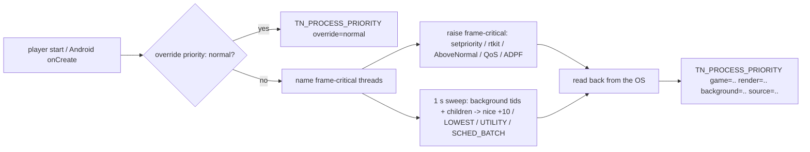

# PRD-859 — The game thread wins the CPU against everything else on the machine

**Status:** BLOCKED — owner decision (AC-3 needs the real display `:0`)
**Priority:** P2 — Linux, Android, the override and the starter kit ship (AC-1, AC-2, AC-6 to AC-8); the contended Midway run (AC-3), Windows and macOS (AC-4, AC-5) are in Blocked on.
**Complexity:** 4 (MEDIUM)
**Owner:** João (owner); an agent executes
**Depends on:** None

Complexity: 2 (6–10 implementation files) + 2 (crosses the desktop, Android and Apple build boundaries) = 4 → MEDIUM; risk override: none.

## Context

The owner asked (2026-11-08) for a shipped game to get "higher priority on the machine where it's running, so it lags everything else if needed, except the game".

Current behaviour:

- `packages/runtime-native/src/engine/player/run.cpp:504` (`ThreadPlacement`, PRD-610) is Linux only. It pins the game thread to the fastest core and its L3 domain. It moves every other thread and child process (GPU present worker, render thread, shader compiles, V8 workers, WebKit HUD) to the other CPUs and sweeps again each second (`moveTasks`, line 570). It sets no priority and no scheduling class.
- `run.cpp:597` is an empty `ThreadPlacement` stub for Windows, macOS and other platforms.
- Android runs the legacy mystral host (`android/app/src/main/java/com/mystral/engine/MystralActivity.java`), not the owned player. It sets no thread priority and opens no ADPF hint session.
- The web build runs in the browser. The browser owns scheduling, so the web build is out of scope (see Decisions).
- Proof harness: `packages/runtime-native/tests/native-engine/player-thread-placement.mjs`, registered in `cmake/NativeEngineAdapters.cmake:262` (Linux only). It reads `/proc/<pid>/task/<tid>/status` for each thread.

Unreal reference (algorithm and defaults only, no code):

- Windows: game, rendering and RHI threads run at `TPri_AboveNormal`. UE 5.8.3: `Engine/Source/Runtime/Core/Public/Windows/WindowsPlatformAffinity.h:10`, `:15`, `:20`.
- Generic platform (Linux, macOS): game and rendering threads run at `TPri_Normal`. UE 5.8.3: `Engine/Source/Runtime/Core/Public/GenericPlatform/GenericPlatformAffinity.h:120`, `:135`.
- The background thread pool runs at `TPri_Lowest`, and the IO pool at `TPri_AboveNormal`. UE 5.8.3: `Engine/Source/Runtime/Launch/Private/LaunchEngineLoop.cpp:2645`, `:2804`.
- Unix maps priorities to nice values: Highest −15, AboveNormal −10, Normal 0, BelowNormal +5, Lowest +10 ("19 is a total starvation"). A failed raise is logged once and is not an error, because "by default Unix does not allow raising priorities". UE 5.8.3: `Engine/Source/Runtime/Core/Private/Unix/UnixPlatformProcess.cpp:2620`, `:2654`.
- Android maps Lowest to `SCHED_BATCH` plus a background nice value, and Highest to NORMAL − 4. UE 5.8.3: `Engine/Source/Runtime/Core/Private/Android/AndroidPlatformProcess.cpp:301`, `:318`.

## Solution

Two levers, both on by default, with one named override and one report line.

1. **Lower our own background work** (no privilege needed on any OS). Background threads and child processes go to nice +10 (Unreal `TPri_Lowest`). Background means shader compiles, V8 workers, asset loaders, the WebKit HUD processes and Android `SCHED_BATCH`. Frame-critical threads keep their priority: the game thread, the render thread and the GPU present worker. Classification uses the thread name. Each frame-critical thread sets its name with `pthread_setname_np`, and the sweep reads `/proc/<pid>/task/<tid>/comm`. An unnamed thread counts as background.
2. **Raise the frame-critical threads through the OS route that needs no admin:**
   - Linux: first try `setpriority` to −10, which works when `RLIMIT_NICE` allows it. Else ask rtkit (`org.freedesktop.RealtimeKit1.MakeThreadHighPriority`) over D-Bus, through `dlopen("libsystemd.so.0")` and `sd_bus_call_method`. This adds no build dependency. With neither route, keep nice 0 and report why.
   - Windows: `SetThreadPriority(THREAD_PRIORITY_ABOVE_NORMAL)` on the game, render and present threads (Unreal default). Background threads get `THREAD_PRIORITY_LOWEST`.
   - macOS: `pthread_set_qos_class_self_np(QOS_CLASS_USER_INTERACTIVE)` on the frame-critical threads and `QOS_CLASS_UTILITY` on background threads. Add `LSSupportsGameMode` and `LSApplicationCategoryType = public.app-category.games` to the packaged `Info.plist`, so macOS Game Mode starts in fullscreen.
   - Android: open an ADPF hint session with the NDK `APerformanceHint_createSession` (API 33+, resolved with `dlsym` so older devices still load) on the game and render thread IDs. The target duration is the display refresh period. Report the actual work duration each frame. The frame-critical threads also get `setpriority` −4 (NORMAL − 4, Unreal `TPri_Highest`), and background threads get `SCHED_BATCH`.

**Override:** `priority: "normal"` in the native app config disables both levers on every platform. **Report:** one stdout and logcat line at startup and after each change, for example `TN_PROCESS_PRIORITY game=-10 render=-10 background=10 source=rtkit override=none`. When a route is not available, the line says why (`source=none reason=EPERM`). The report reads the value back from the OS, so the line states what the OS applied, not what the engine asked for.

Risks:

- ⚠️ A raised game thread can delay the compositor (KWin, DWM) and audio. Nice −10 changes only the scheduler weight. It does not starve other work the way `SCHED_FIFO` does, so this PRD excludes realtime classes. AC-3 measures presented frames, which include the compositor.
- ⚠️ A background thread can turn out to be frame-critical (for example a worker that the frame waits on). Then nice +10 makes frames slower. AC-3 also checks the uncontended case, which catches this.
- ⚠️ Priority helps only when the CPU is contended. A GPU-bound or vsync-bound frame shows no change, and that is the expected result.

## Phase boxes

#### Phase 1 — Linux desktop

- [x] AC-1 [local]: The player starts on Linux. Every background thread and child process reads nice +10 or more, and the game, render and present threads keep a nice value ≤ 0. proof: `sh scripts/xvfb.sh node packages/runtime-native/tests/native-engine/player-thread-placement.mjs <build>/tn-native-engine-player-v8 --x11` (reads field 19 of `/proc/<pid>/task/<tid>/stat`) — Evidence: 2026-11-08, Linux desktop: `PASS default: game=-10 render=-10 present=-10 background=16 source=setpriority override=none`; the dummy-driver run (no presenter, ctest form) passes too. Red first: the unchanged player fails `default: no TN_PROCESS_PRIORITY line`. Background reads 16 here because ananicy-cpp renices the `node` parent to 16 and the player only lowers; a host without a renice daemon reads 10. HUD WebKit children: the code lowers every descendant, but this build had no UI overlay, so that path is unverified.
- [x] AC-2 [local]: With rtkit running and no `RLIMIT_NICE`, the game thread reads nice −10 and `TN_PROCESS_PRIORITY` reports `source=rtkit`. With rtkit not reachable, the game thread keeps its nice value and the line reports `source=none reason=<errno>`. The player does not fail. proof: same test; the second arm runs under `prlimit --nice=0`, the third adds `DBUS_SYSTEM_BUS_ADDRESS=unix:path=/nonexistent/…` (masking rtkit needs root, which this lane lacks) — Evidence: 2026-11-08: `PASS RLIMIT_NICE=0 raises through rtkit: game=-10 render=-10 present=-10 … source=rtkit` and `PASS no raise route: game=16 … source=none reason=EACCES rtkit=no-system-bus:2`, the player reached its 90th frame in both.
- AC-3 moved to `## Blocked on` (2026-11-08).

#### Phase 2 — Windows and macOS desktop

- AC-4 moved to `## Blocked on` (2026-11-08).
- AC-5 moved to `## Blocked on` (2026-11-08).

#### Phase 3 — Android, override and convention

- [x] AC-6 [local]: On the Android emulator, the game thread reads nice −4 and background threads read `SCHED_BATCH`. logcat shows `TN_PROCESS_PRIORITY` with `adpf=on` or `adpf=unsupported reason=<…>`, and the game presents frames either way. proof: `node packages/playtest/dist/runner/cli.js <scenario>.playtest.json --target android` on the local AVD, plus `adb shell cat /proc/<pid>/task/<tid>/stat` — Evidence: 2026-11-08, `threenative_api35` emulator, x86_64, `-gpu host` (adapter `NVIDIA GeForce RTX 2080`), native-smoke game in a scaffolded `minimal` consumer, QuickJS build (`-PthreenativeJsEngine=quickjs`; the V8 Android payload had no build receipt and its source build needed hours), APK SHA-256 `02669cc6f409b66e…`: `device-smoke.playtest.json --target android` EXIT 0; logcat `TN_PROCESS_PRIORITY game=-4 background=10 batch=21/21 source=setpriority adpf=on override=none`; `/proc/<pid>/task/*/stat` reads `SDLThread` nice -4, 19 threads at policy 3 (`SCHED_BATCH`) and nice 10, and `RenderThread`, `hwui*`, `binder:*` and `SDLAudio*` as the platform set them. Red on the first APK: the sweep lowered `binder:<pid>_N` threads (Android 12+ spells them in lower case) and the driver reset them; the skip list now names both spellings. The emulator returns a hint manager, so ADPF reads `on`; whether it raises clocks stays on the Pixel 8 line in Blocked on.
- [x] AC-7 [local]: `priority: "normal"` restores the OS default on every platform this PRD touches, and the report line says `override=normal`. The convention appears in `packages/create-threenative/conventions.json` and is rendered into each kit `AGENTS.md`. proof: the AC-1 test run with the override, plus `pnpm exec vitest run packages/create-threenative/__tests__` (conventions spec) — Evidence: 2026-11-08. Linux: the AC-1 test's override arm passes (`override=normal`, every thread at its start value), and the packaged starter launcher with `TN_PLAYER_PRIORITY=normal` reads `game=0 render=0 present=0 … source=none override=normal` (AC-8 run). Android: an APK built with `display.priority: "normal"` carries manifest `TN_PRIORITY=normal`, passes the device smoke (EXIT 0) and reads `batch=0/20 source=none adpf=off override=normal`, no thread at `SCHED_BATCH`; the game thread keeps -4, the value SDL's `SDLMain` sets itself. Convention: row `cpu-priority` in `conventions.json`, rendered into all 16 kit routers by `pnpm sync:agents`; `vitest run scripts/__tests__/kit-conventions.spec.ts scripts/__tests__/sync-agent-docs.spec.ts scripts/__tests__/instruction-budget.spec.ts packages/create-threenative/__tests__/scaffold.spec.ts` 132/132 (the row put `starter` and `action-rpg` over 1,200 words; their own kit lines were shortened). Windows and macOS are in Blocked on.

## Acceptance criteria

- [x] AC-8 [local]: A scaffolded starter kit, packaged by the shipped Linux desktop packager and started the way a player starts it, prints `TN_PROCESS_PRIORITY` with `background=10` and a game value ≤ 0, and plays its scenario to the end. proof: `node packages/playtest/dist/runner/cli.js <starter scenario>.playtest.json --target desktop` with the report line read from the run's `console.json` (see Decisions) — Evidence: 2026-11-08, Linux desktop, private Xvfb: a starter scaffolded from this checkout's packs, packaged by `threenative build --target desktop` (launcher exports `TN_PLAYER_PRIORITY=game`), run through its launcher `dist-native/starter/starter` with `packages/runtime-native/scenarios/starter-ui-overlay-desktop.playtest.json` (the kit's `survives` scenario carries a web-only visual assertion): EXIT 0, and `console.json` holds `TN_PROCESS_PRIORITY game=-10 render=-10 present=-10 background=10 source=setpriority override=none`. The UI-overlay build lowers its WebKit HUD children too, which closes the AC-1 gap. Override arm, `TN_PLAYER_PRIORITY=normal` on the same launcher: EXIT 0, `game=0 render=0 present=0 background=-15 source=none override=normal` (the player changes no thread; the -15 child was set outside the player, unverified which).

## Blocked on

- AC-3 (contended Midway p95, moved 2026-11-08): a presented-frame p95 is valid only on the real display `:0`; the private Xvfb throttles presents (about 94 ms p95 in the trial flight) and `perf` refuses its FPS. Using `:0` needs João's approval in each session, and none came in this one. Unblocked by João approving `:0` for about 1.5 hours (20 alternating flights, contended and uncontended, under `gpu-slot.sh --exclusive`); the original box text is in this PRD's history. Assets: `flight.sh` and the packaged Midway player are reproducible from this checkout.

- AC-4 (Windows) and AC-5 (macOS), moved 2026-11-08 as the Phase 2 clause asks: the Windows and macOS legs of `.github/workflows/native-platforms.yml` build only the legacy `mystral` host, not the engine player that `ThreadPlacement` lives in; only `native-release.yml` builds the player there. This machine has no Windows or macOS toolchain, so code for those bodies would ship unrun. The `run.cpp` non-Linux stub stays as it was. Unblocked by a player build and placement-test step on those legs; then restore both boxes with their original text from this PRD's history.

- ADPF on physical hardware: the emulator can return no hint manager, so AC-6 proves only the fallback path. The proof that ADPF raises clocks needs the Pixel 8 attached over Wi-Fi ADB (`adpf=on` plus a contended p95 run). Unblocked by João attaching the device; then add this as a box.

## Integration Ledger

| Capability | Reachable consumer/trigger | Replaces / disposition | Evidence |
|---|---|---|---|
| Desktop thread priority | `Session::initialize` → `placement.start()` (`run.cpp:795`) and `placement.sweepIfDue()` (`run.cpp:1263`) | Extends `ThreadPlacement`. The `run.cpp:597` stub gets the Windows and macOS bodies. | AC-1, AC-2, AC-4, AC-5 |
| Android thread priority and ADPF | `MystralActivity` (manifest `TN_PRIORITY`, argv[11]) → `android_main.cpp` `startGameThreadPriority` before `runtime->run()`; `presentation.cpp` `paceToPresentationCap()` → `noteGameFrameWork` | New; nothing to replace | AC-6 |
| Override and report | Native app config → packager → player and host | New; nothing to replace | AC-7 |

## Decisions

- 2026-11-08 (agent): the override lives at `display.priority` (`"game"` default, `"normal"`), beside `keepScreenOn` and `maxFps`; the desktop launcher exports it as `TN_PLAYER_PRIORITY`. An unknown value stops the player by name, as `TN_PLAYER_VSYNC` does.
- 2026-11-08 (agent): the sweep only lowers a background thread (sets +10 while it reads lower). A thread that is already lower (V8, a renice daemon) keeps its value, so AC-1 reads "+10 or more". SDL's audio device threads (`SDLAudio*`) are left as SDL set them (time-critical playback).
- 2026-11-08 (agent, owner away): AC-3 is filed under Blocked on rather than re-scoped to CPU time under Xvfb. CPU time cannot show the compositor and present cost the AC exists to measure, and re-scoping an AC is the owner's call.
- 2026-11-08 (agent): Android keeps nice -4 for the game thread. SDL's `SDLMain` already sets `THREAD_PRIORITY_DISPLAY` (-4), so the Android gain is the `SCHED_BATCH` sweep and ADPF, not the raise. A stronger raise (`THREAD_PRIORITY_URGENT_DISPLAY`, -8) waits for a device measurement that shows the game thread losing CPU.
- 2026-11-08 (agent): AC-8 reads the report line from the run's `console.json` instead of a scenario assertion. No assertion kind reads host stdout on desktop (`engineCost` reads the console on web only), and a new playtest assertion kind is harness work outside this PRD. The line is in the scenario run's own captured console, so the proof is the same run.
- 2026-11-08 (agent): the game thread is identified by its thread ID, not a name: renaming the main thread would rename the process for `ps` and `pgrep`.

- 2026-11-08 (agent, owner request): the web build is out of scope. The browser owns process and thread scheduling, and no web API raises a page's CPU priority.
- 2026-11-08 (agent): no realtime class (`SCHED_FIFO`, `REALTIME_PRIORITY_CLASS`). It needs admin or `CAP_SYS_NICE`, and it can starve the compositor and audio. Unreal ships no realtime class either.
- 2026-11-08 (agent): Windows uses per-thread `THREAD_PRIORITY_ABOVE_NORMAL` (the Unreal default) instead of MMCSS or `HIGH_PRIORITY_CLASS`. Add MMCSS only if AC-3's Windows equivalent shows a gap.
- 2026-11-08 (agent): Linux uses rtkit, not Feral GameMode. GameMode's default config does not renice (`renice=0`), and rtkit ships on most desktops through PipeWire.

## Execution Phases

#### Phase 1: Linux desktop
**Status:** NOT STARTED
**Files:** `packages/runtime-native/src/engine/player/run.cpp` (thread names, raise, sweep sets nice, read-back report); the GPU thread and render thread sources (`pthread_setname_np`; locate with LSP); `packages/runtime-native/tests/native-engine/player-thread-placement.mjs` (nice assertions); `packages/runtime-native/docs/G4-threading-native-systems.md` (gate record); the Unreal feature map row (`docs/PRDs/Unreal/research/unreal-visuals-and-performance-feature-map.html`, then `pnpm unreal:status`).
**Implementation:** Name the frame-critical threads at creation. In `moveTasks`, set nice +10 on each background tid and child process only when its current value is lower, so a repeated sweep makes no extra syscalls. Raise the game thread once in `start()` (setpriority, else rtkit through `dlopen`). Apply the same raise to the render and present threads when they start. A failed raise logs once (Unreal behaviour) and is reported, not fatal. Run the search rule first: `engine_search_capabilities` for "thread priority" and "nice".
**Verification:** AC-1, AC-2 test; AC-3 paired perf run; `pnpm native:build` and `ctest -L native-engine -R thread_placement`.

#### Phase 2: Windows and macOS desktop
**Status:** NOT STARTED
**Files:** `run.cpp` (the `#else` stub gets `_WIN32` and `__APPLE__` bodies); the macOS packager's `Info.plist` template (locate in `packages/runtime-native/scripts/`); the placement test (read Windows and macOS values); `cmake/NativeEngineAdapters.cmake` (register the test beyond Linux).
**Implementation:** Same classification and report as Phase 1, with the platform calls from the Solution. The sweep enumerates threads with `CreateToolhelp32Snapshot` on Windows. macOS sets QoS at thread start, because QoS cannot be set on another thread.
**Verification:** AC-4, AC-5 on their CI legs; one push carries both platforms.

#### Phase 3: Android, override and convention
**Status:** NOT STARTED
**Files:** the Android native host frame loop (ADPF session, `setpriority`, `SCHED_BATCH`); the native app config schema and packager plumbing for `priority`; `packages/create-threenative/conventions.json`; the kit `AGENTS.md` render.
**Implementation:** Resolve `APerformanceHint_*` with `dlsym` so API < 33 devices load. Report each frame's work time from the existing frame timer. Thread the override from the config to the player (desktop) and the host (Android).
**Verification:** AC-6 on the local AVD; AC-7 override run and conventions spec; `pnpm typecheck && pnpm lint` for the config change.
