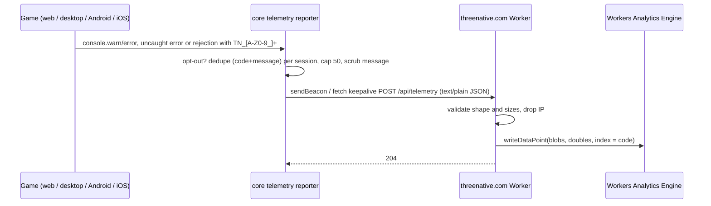

# PRD-905 — Engine telemetry: each TN_* error and warning reaches a Cloudflare dashboard, on by default, with an opt-out

**Status:** PARTIAL
**Priority:** P1 — AC-1 to AC-7 are open: when a game hits an engine error like `TN_NATIVE_PHYSICS_SHAPE_UNSUPPORTED`, nobody sees it unless an agent or a player reports it by hand.
**Complexity:** 7 (HIGH) — 6-10 files (+2), new module (+2), crosses the engine/site release boundary (+2), external API: the threenative.com Worker (+1); risk override: privacy. The engine sends data from players' machines by default.
**Owner:** João
**Depends on:** None
**Repo:** this repo (`packages/core`, `packages/create-threenative`); `ThreeNativeHQ/threenative-site` (ingest route, terms, privacy)

## Context

TN codes are spread across the packages. No central reporter exists:

- Thrown errors: `throw new Error("TN_NATIVE_PHYSICS_SHAPE_UNSUPPORTED: …")` (`packages/physics/src/native/host.ts:264`, `:727`). Many more exist in core, physics and assets.
- Console warnings: `TN_SCENE_WARNING` (`packages/core/src/profiling/scene-warning.ts:31`), `TN_HOT_CALL`, and others.
- Info markers: `TN_FRAME_BUDGET`, `TN_FRAME_SPANS`. These are measurements, not faults. They are out of scope.

A seam that wraps the console already exists. `installQuietMarkers()` (`packages/core/src/quiet-markers.ts`) re-routes `TN_` log/info lines. `game.ts:681` installs it in `start()`, and `game.ts:725` removes it in `stop()`. The reporter follows the same pattern and lifetime.

The game name is in each template's `threenative.config.ts` (`name: "__PROJECT_NAME__"`). `createWebBrandPlugin` (`packages/create-threenative/src/web-brand.ts:286`) already writes a page global into the HTML (`withBuildId`, `:121`). The same seam can write the game name.

On the site side, the `threenative-site` Worker serves `threenative.com/api/*` (`worker/index.ts:376-398`). It has no Analytics Engine binding yet (`wrangler.jsonc`). The privacy policy (`src/content/legal.ts:78-118`) says "The site has no third-party tracking" and lists what is kept. It does not mention engine telemetry. `LEGAL_VERSION` (`legal.ts:8`) and `TERMS_VERSION` (`worker/terms.ts:7`) must change together (`__tests__/legal.spec.ts`).

## Solution

**Engine (`packages/core/src/telemetry.ts`, one file):**

- `installTelemetry()` / `uninstallTelemetry()` go beside the quiet-marker calls in `game.ts` `start()`/`stop()`.
- Triggers: `console.warn`/`console.error` whose text contains `TN_[A-Z0-9_]+`, and `error`/`unhandledrejection` events on `globalThis` when it has `addEventListener`. Info and log markers do not send.
- Event: `{ code, level, message, game, engine, platform, backend, mode, session }`.
  - `message` is scrubbed: URLs, absolute paths, emails and numbers longer than 4 digits are replaced, and the result is capped at 200 chars.
  - `game` is `globalThis.__TN_GAME__`. The web brand plugin and the native bundle step write it from `threenative.config` `name`. It is `"unknown"` when absent.
  - `engine` is the core version from `version.ts`. `platform` is web, desktop, android or ios. `backend` is the renderer engine. `mode` is `prod` when `__TN_BUILD_ID__` is present, otherwise `dev`. `session` is a random id per `start()`.
  - There is no stack, no IP and no user data.
- Volume: one event per (code, scrubbed message) per session, and at most 50 per session.
- Transport: `navigator.sendBeacon` when present, otherwise `fetch(…, { keepalive: true })`. Errors are swallowed, so telemetry can never break a game.
- Endpoint: `https://threenative.com/api/telemetry`. One constant, with no config option.
- **On by default.** Named overrides, any one of which turns it off:
  - `defineGame({ telemetry: false })`
  - `TN_TELEMETRY=0`, `?tnTelemetry=0` or `globalThis.__THREENATIVE_TELEMETRY__ = false`, through the existing `readLaunchFlag`
  - `DO_NOT_TRACK=1`
- Honest reporting: at boot the engine prints one `TN_TELEMETRY on` or `TN_TELEMETRY off (<which override>)` line.

**Site (`threenative-site`):**

- `worker/telemetry.ts`: `POST /api/telemetry` accepts the JSON body.
  - It rejects a body over 2 KB, and any field with a wrong type or over its cap, with 400.
  - It calls `env.TELEMETRY.writeDataPoint({ indexes: [code], blobs: [code, level, message, game, engine, platform, backend, mode, session], doubles: [1] })` and returns 204.
  - It adds CORS `Access-Control-Allow-Origin: *`, because games run on any origin. It never reads cookies.
- `wrangler.jsonc`: `"analytics_engine_datasets": [{ "binding": "TELEMETRY", "dataset": "tn_engine_events" }]`.
- `legal.ts`, privacy page: a new paragraph names what an engine event carries, says that the IP is not stored, gives the 3-month retention (the Analytics Engine default), and names the opt-outs. Terms: games built with ThreeNative send this by default, and a game that ships to players names it in its own privacy notice or turns it off.
- Bump `LEGAL_VERSION` and `TERMS_VERSION` together.

**Reading it:** the Analytics Engine SQL API, for example `SELECT blob1 AS code, blob4 AS game, SUM(_sample_interval) AS n FROM tn_engine_events WHERE timestamp > NOW() - INTERVAL '1' DAY GROUP BY code, game ORDER BY n DESC`.

## Non-Goals

- A dashboard UI. The Analytics Engine SQL API, or a saved query, is enough for now.
- Performance markers (`TN_FRAME_BUDGET` and similar), stacks, crash dumps or session replay.
- Separating CI or playtest traffic from real players. `mode` (dev/prod) and `game` are enough to filter for now.
- Per-game configurable endpoints.

## Acceptance Criteria

- [x] AC-1 [local]: A valid event posted to `/api/telemetry` returns 204 and calls `writeDataPoint` once. An oversized or malformed event returns 400 and does not write. — proof: site `pnpm vitest run __tests__/telemetry.spec.ts` (workers pool) — Evidence: site `worker/__tests__/telemetry.spec.ts` 14 passed on `00eee04` (ThreeNativeHQ/threenative-site#92).
- [x] AC-2 [local]: The privacy and terms pages render the telemetry paragraph and the opt-outs, and the two version constants match. — proof: site `pnpm vitest run __tests__/legal.spec.ts` — Evidence: site `__tests__/legal.spec.ts` 5 passed on `00eee04`.
- [x] AC-3 [local]: A thrown or warned `TN_*` code produces one scrubbed event with `game`, `engine`, `platform` and `mode`. A repeat is deduped, the 51st event is dropped, and a `TN_FRAME_BUDGET` info line sends nothing. — proof: `pnpm exec vitest run packages/core/__tests__/telemetry.spec.ts` — Evidence: `packages/core/__tests__/telemetry.spec.ts` 16 passed, 2026-11-22.
- [x] AC-4 [local]: Each opt-out (config, env, query, global, `DO_NOT_TRACK`) sends nothing and prints `TN_TELEMETRY off (<override>)`. — proof: same spec — Evidence: same spec, the five opt-out cases plus the playtest default, 2026-11-22.
- [x] AC-5 [local]: A starter-kit game in a real browser that triggers a `TN_*` warning sends one beacon to `/api/telemetry` carrying the project name. The same run with `?tnTelemetry=0` sends none. — proof: a Playwright probe against the starter dev server with the WebGPU recipe that watches requests (see Decisions) — Evidence: Phase 2 box 2, 2026-11-22: one event with the project name, none with `?tnTelemetry=0`.
- [x] AC-6 [local]: A desktop native run sends the same event through the host's `fetch` shim. — proof: the packaged desktop game on the legacy host behind a local capture proxy (see Decisions) — Evidence: Phase 3 box 1, 2026-11-22.
- [ ] AC-7 [shared]: The deployed Worker accepts a live event, and an Analytics Engine SQL query returns it. — proof: `curl -X POST https://threenative.com/api/telemetry` followed by the SQL API query — Evidence: pending, after the owner deploy below.

## Blocked on

- Deploying the site Worker (the new route and the `tn_engine_events` dataset): this is outward-facing production. Unblocked by João's explicit "deploy the site". Note that wrangler needs Node 22 here, and the shell runs Node 20.19.6.
- Publishing the engine with telemetry on: it rides the next normal release. Unblocked by the usual `develop -> main` release.

## Integration Ledger

| Capability | Reachable consumer/trigger | Replaces / disposition | Evidence |
|---|---|---|---|
| TN event capture | `defineGame().start()` → `installTelemetry()` (`packages/core/src/game.ts`, beside `:681`) | New; removed in `stop()` beside `:725` | AC-3, AC-5 |
| Game name on the page | `createWebBrandPlugin` → `withBootGlobals` (`packages/create-threenative/src/web-brand.ts`); `bundle.mjs` and `bundle-native-engine.mjs` `--game-name`/`--engine-name` from `threenative build` | New globals `__TN_GAME__`, `__TN_ENGINE__` | AC-5, AC-6 |
| Worker games | `startWorkerGame` → `pageGlobals` (`packages/core/src/worker.ts`) | Forwards the telemetry answer and the three build globals | AC-5 |
| Ingest | `POST /api/telemetry` → `ROUTES` in `threenative-site/worker/index.ts:376` | New route | AC-1, AC-7 |
| Disclosure | `/privacy/`, `/terms/` pages from `src/content/legal.ts` | Edits existing text and bumps the version | AC-2 |

## Decisions

- 2026-11-22 (João): Telemetry is on by default for dev runs and shipped games, with an opt-out.
- 2026-11-22 (João): The payload is the code, a scrubbed message (no stack, no IP), and the game name.
- 2026-11-22 (João): Storage is Workers Analytics Engine, through a new route on the existing threenative-site Worker. There is no new Worker or domain.
- 2026-11-22 (João): The opt-outs are the `defineGame` config, the `TN_TELEMETRY` env/query/global, and `DO_NOT_TRACK`.
- 2026-11-22 (João): The site terms and privacy policy are updated in the same PRD.
- 2026-11-22 (agent): A playtest runner's launch is off by default (`TN_TELEMETRY off (playtest)`), and `tnTelemetry=1` turns it back on. Why: on the native host a refused POST lands in `fetch.network()` and fails each kit contract's `noNetworkErrors`, and CI is not a player. The check reads the two globals that `runnerAnnounced` reads, inlined, because `playtest.ts` pulls the playtest bridge into every game.
- 2026-11-22 (agent): `session` is a UUID without dashes (32 characters), because the site caps each short field at 32. `platform` on native is the host's OS name from `getPlatform()` (`packages/core/src/platform.ts:203`). `backend` comes from a second page global, `__TN_ENGINE__`, that the web brand plugin writes beside `__TN_GAME__`, because core cannot read the engine alias at run time.
- 2026-11-22 (agent): The AC-5 proof is a Playwright probe against a real starter-kit dev server with `?tnTelemetry=1`, not a playtest scenario. Why: playtest has no request assertion and no script step, so a scenario cannot trigger a `TN_*` warning or see a beacon. Adding both is a separate playtest change.
- 2026-11-22 (agent): The worker host forwards the page's `tnTelemetry` answer as `__THREENATIVE_TELEMETRY__`, and `__TN_GAME__`, `__TN_ENGINE__` and `__TN_BUILD_ID__` (`packages/core/src/worker.ts` `pageGlobals`). Why: the starter runs its game in a Worker, and the first AC-5 run showed `TN_TELEMETRY on` with `?tnTelemetry=0` and no game name.
- 2026-11-22 (agent): A native host without `__httpRequestAsync` prints `TN_TELEMETRY off (no network)`. Why: the owned-engine desktop player, the default desktop engine, makes no network request by design (`engine/player/core-host.mjs:76-78`), so "on" would be a lie. Desktop events therefore send from the legacy host (`engine: "threejs"`), Android and iOS. A network fetch on the player is a runtime-native change outside this PRD.
- 2026-11-22 (agent): The AC-6 proof is the packaged desktop game behind a local CONNECT proxy that terminates TLS with a throwaway certificate (`https_proxy` and `SSL_CERT_FILE`, both honored by the host's libcurl, `src/http/async_http_client.cpp:505`), not a playtest scenario against a stub. Why: the endpoint is one constant with no override, and a playtest launch is off by default.
- 2026-11-22 (agent, owner asked "make sure these telemetry records do not cause performance bottlenecks"): a wrapped `console.warn`/`console.error` reads no argument once the session cap is reached, gates on `includes("TN_")`, scans only a 512-character prefix, and skips the scrub for a raw prefix it has already seen (at most 256 kept). Measured per call, Node 20, original console stubbed, 100 000 calls: a repeated 4 KB `TN_` warning 68 823 ns -> about 710 ns; a 4 KB warning with no code 695 -> about 90 ns; after the cap 1 219 -> about 160 ns; a repeated short `TN_` warning 943 -> about 77 ns. `telemetry.spec.ts` locks the cap and the bounded scan (red first).
- 2026-11-22 (agent): Add an entry to the convention index (`packages/create-threenative/conventions.json`), because a default with an override that is not in the index "does not exist" (root AGENTS.md).

## Execution Phases

#### Phase 1: The site accepts and discloses events
**Status:** DONE on branch, ThreeNativeHQ/threenative-site#92 (not merged, not deployed)
**Files:** `threenative-site/worker/telemetry.ts` (new), `worker/index.ts` (route), `worker/env.ts` (binding type), `wrangler.jsonc` (dataset), `src/content/legal.ts` and `worker/terms.ts` (text and version), `__tests__/telemetry.spec.ts`, `__tests__/legal.spec.ts`
**Implementation:** Validate first and write second. Cap each field: code 64, message 200, game 64, the others 32. Answer `OPTIONS` for CORS. Commit on the site's own flow.
- [x] Ingest route validates and writes. proof: site `worker/__tests__/telemetry.spec.ts` (the Worker harness lives under `worker/__tests__/`) — covers AC-1. Result 2026-11-22: 14 passed; site pre-push gate on `00eee04`: 259 worker and 91 unit tests passed, `wrangler deploy --dry-run` lists `env.TELEMETRY (tn_engine_events)`.
- [x] Terms and privacy text updated, versions bumped together. proof: site `__tests__/legal.spec.ts` — covers AC-2. Result 2026-11-22: 5 passed; both versions are `2026-11-22`.

#### Phase 2: The engine reports TN codes from a web game
**Status:** DONE
**Files:** `packages/core/src/telemetry.ts` (new), `packages/core/src/game.ts` (install/uninstall), `packages/core/src/config.ts` (`telemetry?: false`), `packages/create-threenative/src/web-brand.ts` (`__TN_GAME__`), `packages/create-threenative/conventions.json`, `packages/core/__tests__/telemetry.spec.ts`, one playtest scenario under the starter template
**Implementation:** Follow `quiet-markers.ts`: a single install, an exact restore of the wrapped console methods, and listener removal in `stop()`. Swallow every transport error.
- [x] Capture, scrub, dedupe, cap and opt-outs. proof: `packages/core/__tests__/telemetry.spec.ts` — covers AC-3, AC-4. Result 2026-11-22: 16 passed (the session-id and playtest cases failed first, 3 red); `game*.spec.ts` 134 passed; core typecheck exit 0.
- [x] A browser game sends one beacon with the game name, and none when opted out. proof: Playwright probe against the starter dev server (see Decisions) — covers AC-5. Result 2026-11-22: starter scaffolded from local tarballs, Chromium with `WEBGPU_BROWSER_ARGS` on `nvidia/turing`; two identical worker-side warnings sent exactly one event (`game: "telemetry-probe-game"`, `backend: "threenative"`, message `… <url> <n>`); `?tnTelemetry=0` sent none and printed `TN_TELEMETRY off (__THREENATIVE_TELEMETRY__)`. The endpoint was fulfilled locally, so production was not written.
- [x] Convention listed and rendered into kit AGENTS.md. proof: `pnpm sync:agents --check` and the conventions spec — covers the convention rule. Result 2026-11-22: 31 mirrors in sync; `scripts/__tests__/kit-conventions.spec.ts` 36 passed; `web-brand.spec.ts` 9 passed.

#### Phase 3: Native parity and live proof
**Status:** PARTIAL — the live proof waits for the owner deploy
**Files:** the native bundle step that writes `__TN_GAME__` (located in phase 2); no new module
**Implementation:** Confirm that the desktop host's `fetch` shim carries `keepalive` or a plain POST. If uncaught errors do not reach `globalThis` listeners on native, the `console.error` path still captures them. Record which path fired.
- [x] Desktop native run sends the event. proof: packaged desktop game on the legacy host behind a local TLS-terminating capture proxy (see Decisions) — covers AC-6. Result 2026-11-22: `threenative build --target desktop` with `engine: "threejs"`; the bundle starts with `__TN_GAME__="telemetry-probe-game"`; the host printed `TN_TELEMETRY on` and the proxy received one `POST threenative.com/api/telemetry`, `text/plain`, `platform: "linux"`, `backend: "threejs"`, scrubbed message. Bundler specs: 4 files, 39 passed.
- [ ] Live event visible in Analytics Engine after the owner deploy. proof: curl and the SQL API — covers AC-7.
