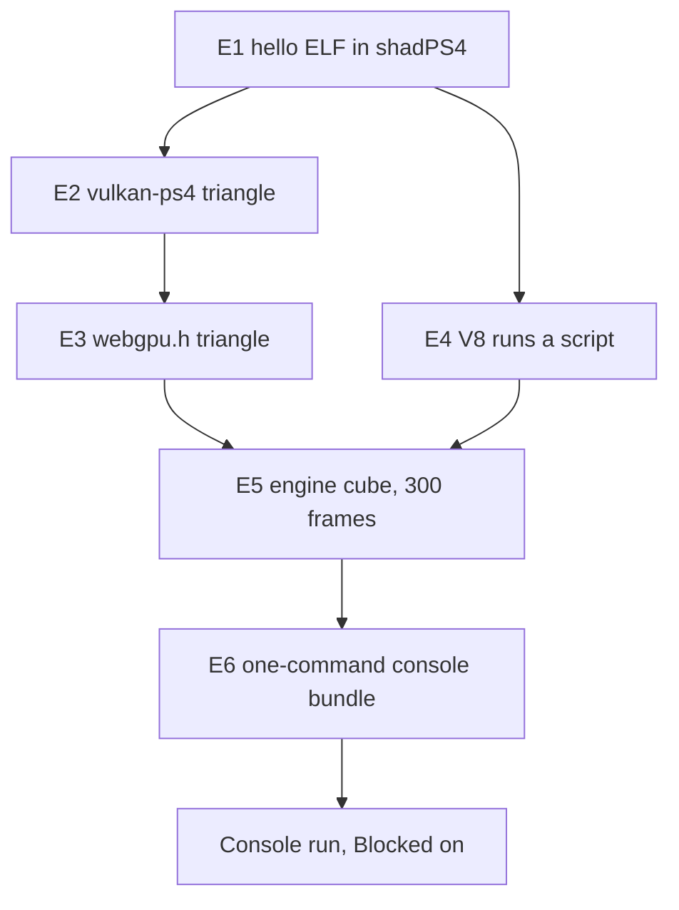

# PRD-784 — PS4 feasibility: emulator experiments, then one engine cube on the console

**Status:** PARTIAL — E1 to E6 and the DualShock 4 green on `PS4_EMULATED`; 60 fps, Cube Spin and the starter open; the console run is blocked on hardware
**Priority:** P2 — Owner-requested feasibility: boxes E1 to E6 and the Blocked on console run are all open, and no release waits on them.
**Complexity:** 7 (HIGH)
**Owner:** Joao Paulo Furtado (console steps only); agent (everything else)
**Depends on:** None

Complexity: 6 to 10 implementation files (+2), new platform module (+2), new independent build
target (+2), external toolchains (+1) = 7. Risk override: none.

## Context

The owner wants to know if ThreeNative can run on a PS4, and wants at least one proof of concept on
the console. Emulator runs come first, so the work costs the owner as little time as possible.

[`docs/spikes/PS4_PS5_Emulation_Spike.md`](../../../spikes/PS4_PS5_Emulation_Spike.md) (2026-08-27)
already maps the landscape. This PRD keeps its evidence labels and its fail-closed rule. It replaces
the parts below, because the spike predates the C++ engine decision of 2026-10-15.

| Spike says | This PRD says | Why |
| --- | --- | --- |
| Upstream `three/webgpu` on the host | The C++ engine behind the Three.js API | It is the default engine (`docs/architecture/NATIVE-ENGINE-DECISION.md`) |
| QuickJS as the bootstrap runtime | V8 only | Owner decision below |
| PS4 and PS5 lanes in parallel | PS4 only | Owner asked for PS4 |
| Trace recorder, bundle schema, 22 sections of process | One runner script, one log marker, one image check | Enough to answer a feasibility question |

### Checked on 2026-11-02

| Fact | Result | Source |
| --- | --- | --- |
| The engine draws through `webgpu.h` | ✅ The seam survives the spike | `packages/runtime-native/src/engine/renderer/renderer.cpp` |
| shadPS4 is current and boots a raw ELF on Linux | ✅ v.0.21.0, 2026-10-30, has a Linux SDL build and `--mount` | GitHub release, README, `src/main.cpp` |
| OpenGNM supports shadPS4 by design | ✅ `driver_orbis.c` forwards to the HLE `sceGnm*` | `PS4-OpenGNM/opengnm` docs |
| `opengnm-psbc` ran on a console | ✅ Project reports VS and PS shaders on FW 9.00, GFX7 | Project README, not run here |
| `vulkan-ps4` is a Vulkan 1.0 driver with compute | ⚠️ Project claim, not run here | Project README |
| Dawn runs on that driver | ❌ Dawn rejects a driver below Vulkan 1.1 | `dawn/native/vulkan/BackendVk.cpp`, `kRequiredVulkanVersion` |
| wgpu runs on that driver | ⚠️ wgpu has a Vulkan 1.0 path that needs `VK_KHR_maintenance1`, and a PS4 Rust target is unverified | `wgpu-hal/src/vulkan/adapter.rs` |
| V8 builds for the OpenOrbis target | ⚠️ Unverified, and JIT memory on PS4 is unverified | No source found |
| The player has a PS4 window path | ❌ `player/run.cpp` has 62 `SDL_` uses, and a PS4 SDL3 port is unverified | Repository search |
| OpenGNM has more than one maintainer | ⚠️ Two stars per repository, so a fork is likely | GitHub API |

## Solution

Run the cheapest experiment that can kill the idea first. Each experiment has a pass result, a
budget and a named pivot. Stop when a pivot also fails, and record why under `## Decisions`.

| # | Question | Pass result | Budget | If it fails |
| --- | --- | --- | --- | --- |
| E1 | Does our toolchain produce an ELF that shadPS4 boots? | ELF prints a marker to the emulator log, with no Sony module | 1 hour | If shadPS4 asks for firmware modules, add the owner dump line. If the boot still fails, stop |
| E2 | Does the Vulkan driver render in the emulator? | Non-blank triangle capture | 3 hours | Try the `freegnm-examples` GNM triangle to isolate the layer. If only GNM works, E3 pivots to route C |
| E3 | Which `webgpu.h` runs on PS4? | Triangle drawn through `webgpu.h`, shaders compiled at run time | 1 day | Move down the routes below |
| E4 | Does V8 run on PS4? | Script result in the log, and the mode (JIT or `--jitless`) recorded | 1 day | Try `--jitless`. If that fails, stop and ask the owner, because V8 is the owner's choice |
| E5 | Does the engine run? | 300 frames, a guest readback that is not blank, cube pose differs between frames | 2 days | Record the first failing call, then ask if the cost is worth it |
| E6 | Can the owner run it in minutes? | One command builds and sends the E5 artifact to a console address | 2 hours | The owner runs the steps by hand |

Budgets are estimates of agent time, not measurements.

**E3 routes, best first:**

| Route | Rating | Trade-off |
| --- | --- | --- |
| A. Dawn on `vulkan-ps4`, with the driver patched to report Vulkan 1.1 | ⭐⭐⭐⭐⭐ | Same backend as desktop. C++, so it uses the same compiler. Risk: the driver may lack required 1.1 behavior |
| B. wgpu-native on `vulkan-ps4` | ⭐⭐⭐ | Accepts Vulkan 1.0 and is the Android seam. Risk: Rust target and standard library for this platform |
| C. Narrow `webgpu.h` over `vulkan-ps4` or GNM, limited to the calls the cube makes | ⭐⭐ | Smallest dependency. Risk: we own WebGPU semantics and WGSL translation |

**Window path:** try SDL3 with its dummy video driver first, so the `SDL_` calls in `run.cpp` stay
unchanged. Present through the `vulkan-ps4` VideoOut swapchain. Clone the platform entry from
`src/platform/android_main.cpp`. Replace SDL only when E5 proves the dummy driver cannot work.

**Evidence rule:** each result says `PS4_EMULATED` or `PS4_HARDWARE`. An emulator result is not a
console result, because an emulator can accept what the console rejects. Performance numbers count
only from the console, because shadPS4 runs on the desktop CPU and GPU.

**Hosts:** builds over 5 minutes run on the Debian laptop inside Docker, because it has no clang.
shadPS4 runs on the desktop RTX 2080 through `sh scripts/xvfb.sh`. If Vulkan cannot present there,
use the real-display rules in `AGENTS.md`.

**Out of scope:** PS5, QuickJS, PKG Store packaging, audio, controller input, starter kits and
performance work. A go result opens a second PRD for those.

## Acceptance Criteria

- [x] AC-1 [local]: The engine and V8 render the cube for 300 frames on `PS4_EMULATED`, from one command. proof: `node packages/runtime-native/scripts/ps4/run-experiment.mjs e5` — Evidence (2026-11-06): `PS4_EMULATED E5 PASS drawn=13.40% frames=300 clear=0,0,0 moved=6.40% js_ms=0.048 frame_ms=33.507 kernel_frame_ms=33.508 fps=29.8`; the one command builds the player, bundles the scene, boots shadPS4 and judges the presented frames.
- [x] AC-2 [local]: A failed run exits non-zero and names the failing experiment and call. proof: `node packages/runtime-native/scripts/ps4/run-experiment.mjs e5 --scene missing` — Evidence (2026-11-06): exit 1, `PS4_EMULATED E5 FAIL: build -- scene <cwd>/missing has no src/game.ts (--scene names a game project)`, raised before any build step.

## Blocked on

- Real PS4 model and system software version, with no system update first — unblocked by João reading Settings > System > System Information.
- Console ready for homebrew, reachable on the LAN — unblocked by João jailbreaking it with the public method for that firmware, after an agent confirms the method from the version above.
- `PS4_HARDWARE` run of the E6 bundle, which is the owner's proof-of-concept goal, with frame time and memory recorded — unblocked by the two lines above. The agent sends and reads the run. João only confirms the cube on the TV.

## Integration Ledger

| Capability | Reachable consumer/trigger | Replaces / disposition | Evidence |
| --- | --- | --- | --- |
| PS4 build target | `cmake --preset tn-ps4` → `cmake/ps4.toolchain.cmake` → `cmake/NativeEngine.cmake` player target; fill `file:line` at E5 | New target, other presets unchanged | E5 |
| Engine on PS4 | `run-experiment.mjs e5` → shadPS4 → `src/platform/ps4_main.cpp` → `src/engine/player/v8_main.cpp` → `examples/native-smoke` scene | New path, no fallback renderer | AC-1 |

## Decisions

- 2026-11-02 (João): Goal is feasibility, then at least one proof of concept on a real PS4.
- 2026-11-02 (João): V8 only, QuickJS is out, because V8 is the default runtime.
- 2026-11-02 (João): No legal gate for now. Practical limit kept by the agent: dumped Sony modules, keys and jailbreak binaries stay out of this public repository, because a public commit is hard to undo.
- 2026-11-02 (João): Experiments stop at the engine cube and a go/no-go. A starter kit is a later PRD.
- 2026-11-06 (João): E5 targets the store's Cube Spin game (`threenative-store/examples/cube-spin`, private repo), so the PS4 frame can be compared with the published build. The runner reads it with `--scene <path>`, and the game is not copied into this public repository. It imports no physics and no WebAssembly, so it can run on jitless V8. `examples/native-smoke` stays the first step when Cube Spin fails.
- 2026-11-06 (agent): The pinned vulkan-ps4 and OpenGNM stack could not draw on any target. Seven of its 12 patches fix six gaps that real hardware also hits: no static viewport, no `CB_COLOR_CONTROL`, no `SPI_SHADER_COL_FORMAT`, a shared epilogue buffer rewritten in flight, shader code below 256-byte alignment, and a swapchain clear that does nothing. The other five fix the build, compiler diagnostics, the emulator encoding (`int_sel` 3 to 2, as Sony's libgnm uses) and the readback test. Treat the driver as immature, not as console-proven.
- 2026-11-06 (agent): E2 judges shadPS4's presented frame, not the guest readback. shadPS4 keeps render targets in host VRAM, and a guest GPU copy from them reads stale guest memory. The runner turns on GPU readbacks (`readbacks_mode` 2), but that path does not flush a render target that a GPU copy reads.
- 2026-11-06 (agent): E3 takes route A, Dawn's `webgpu.h` on its Vulkan backend over vulkan-ps4. The driver lacked the `VK_KHR_surface` queries and ignored `pName`, so patches 0013–0014 add them in the driver, not as fakes in Dawn, because real hardware needs the same entry points. The device runs in Compatibility mode, because the GNM limit of 4096 for 2D textures is below Core's 8192. Engine features that need Core limits must gate on the adapter. The VideoOut scanout is RGBA8 in memory order, so the swapchain offers only `R8G8B8A8_UNORM`.
- 2026-11-06 (agent): The OpenOrbis toolchain has two ABI traps that real hardware shares, and every PS4 guest (E5 included) must carry both fixes. (1) Its musl `alltypes.h` declares `pthread_mutexattr_t`, `pthread_condattr_t` and `pthread_barrierattr_t` as 4 bytes, but libkernel stores an 8-byte pointer in each. In V8's `RecursiveMutex` constructor that store erased the saved `this` (found with a gdb register bisect in shadPS4). V8's force-included `ps4-compat.h` declares the three types at pointer size first. (2) `create-fself` raises PT_TLS `p_align` to 0x20, while ld.lld had computed thread-pointer offsets for the original 8. The loader copies the init image 0x18 bytes away from where the code reads it, so each initialised `thread_local` read 0. `ps4-malloc.c` adds a 32-byte-aligned TLS member, and the e4 guest probes one `thread_local` and fails at once when it reads wrong. OpenOrbis's prebuilt libc++ (`std::recursive_mutex`) is compiled with the 4-byte type, so E5 must not use it.
- 2026-11-06 (agent): Each shadPS4 run gets a private HOME, XDG folders and Xvfb, with no Wayland, D-Bus or `QT_QPA_PLATFORM` from the session. The run also creates `home/1000` first. Without both, shadPS4 opens its "Save Migration" box on the owner's desktop (`src/core/user_manager.cpp:293-300` at v.0.21.0).

## Execution Phases

#### Phase 1: The emulator lane and a native triangle

**Status:** DONE
**Files:** `packages/runtime-native/scripts/ps4/run-experiment.mjs` (pins, boot, log marker, non-blank check, fails closed), `packages/runtime-native/scripts/ps4/e1-hello.c`.
**Implementation:** Pin shadPS4 v.0.21.0, OpenOrbis and the OpenGNM commits in the script. Clone them outside tracked paths. Pass the output folder with `--mount`.
**Verification:** each box below. A boot with no marker or a blank capture fails.

- [x] E1: OpenOrbis ELF prints its marker in shadPS4. proof: `node packages/runtime-native/scripts/ps4/run-experiment.mjs e1` — 2026-11-06 `PS4_EMULATED E1 PASS`, exit 0, guest `[stdout] TN_PS4_E1_MARKER hello`, empty `sys_modules`. shadPS4 rejects the plain ELF (`e_type 0x3`), so the run boots the `create-fself` SELF
- [x] E2: `vulkan-ps4` draws a non-blank triangle in shadPS4. proof: `node packages/runtime-native/scripts/ps4/run-experiment.mjs e2` — 2026-11-06 `PS4_EMULATED E2 PASS drawn=12.55%`, exit 0, two agent runs and one coordinator run. The judge reads shadPS4's presented frame. Control: `TN_PS4_E2_GUEST=e2` (vertex buffer) exits 1 with 0% drawn. The default guest takes its positions from `gl_VertexIndex`. The pinned stack needs 12 patches (`scripts/ps4/patches/`)
  Vertex buffers fixed on 2026-11-06: `TN_PS4_E2_GUEST=e2` (positions and colours from a VkBuffer) → `PS4_EMULATED E2 PASS drawn=12.55%`, with the interpolated RGB triangle checked by eye. Patch 0015 makes psbc emit the VS fetch-shader prolog, with its pointer in user SGPR 0 as Sony's ABI expects. Patch 0016 makes vulkan-ps4 write one V# per attribute and one instancing mode per input. An unmapped vertex format logs and reads as R32_FLOAT. Still open for E5: a guest GPU copy of a render target reads stale memory (shadPS4 `CopyBuffer` does not flush the source image, `vk_rasterizer.cpp:1236`)

#### Phase 2: The two seams, GPU and JavaScript

**Status:** DONE
**Files:** `packages/runtime-native/cmake/ps4.toolchain.cmake` (clone the `ios.toolchain.cmake` pattern), `packages/runtime-native/CMakePresets.json` (`tn-ps4`), `packages/runtime-native/scripts/ps4/` (one test source per box, and any driver patch).
**Implementation:** Run E3 through the routes in order and record the chosen route under `## Decisions`. Run E4 at the same time, because it has no dependency on E3. Build V8 from the version pinned in `js-engine-versions.json`, try JIT first, then `--jitless`.
**Verification:** each box below. Log the adapter limits at E3, because they decide which engine features need a gate.

- [x] E3: A triangle draws through `webgpu.h` in shadPS4. proof: `node packages/runtime-native/scripts/ps4/run-experiment.mjs e3` → `PS4_EMULATED E3 PASS drawn=12.55%`, three runs on 2026-11-06 (two by the arm, one by the coordinator). The WGSL shader compiles at run time (Tint → SPIR-V → psbc → GCN), and the presented frame shows the shader's orange `vec4f(1,0.55,0)` on the clear `0.25` blue, checked by eye. Route A (Dawn `d14ae3d9`, Vulkan backend on vulkan-ps4, Compatibility mode). Adapter `PS4 GPU (GNM)`, vendor 0x1002, device 0x9920. Limits: maxTextureDimension2D 4096, maxBindGroups 4, maxStorageBuffersPerShaderStage 8, maxComputeWorkgroupSizeX 1024, maxBufferSize 4 GiB. E2 still passes after a from-scratch rebuild with driver patches 0013–0014.
- [x] E4: V8 runs a script in shadPS4 and logs its mode. proof: `node packages/runtime-native/scripts/ps4/run-experiment.mjs e4` → `PS4_EMULATED E4 PASS mode=jitless`, twice on 2026-11-06 (coordinator runs). The guest source holds only `6*7`, so the 42 is computed by V8 13.1.201.22 (the desktop pin), built jitless and single-threaded with `--no-freeze-flags-after-init` (16 KiB pages). JIT was not tried: native PS4 homebrew gets `EPERM` for executable memory (OrbisFox, on hardware), so jitless is the shipping mode. Three guest-side fixes, each true on hardware too: pinned dlmalloc (`ps4-malloc.c`), pointer-size pthread attr types (`v8-build-ps4.patch`), and a 32-byte PT_TLS alignment pin (`ps4-malloc.c`). See `## Decisions`.

#### Phase 3: The engine cube and the console bundle

**Status:** DONE
**Files:** `packages/runtime-native/src/platform/ps4_main.cpp` (clone `android_main.cpp`), `packages/runtime-native/cmake/NativeEngine.cmake` (PS4 branch), `packages/runtime-native/src/engine/player/run.cpp` (only if the dummy SDL driver cannot work), `packages/runtime-native/scripts/ps4/send-to-console.mjs`.
**Implementation:** Build the V8 player for `tn-ps4`. Run the `examples/native-smoke` scene. Use the existing `src/screenshot_gate.cpp` readback for the guest image. Unsupported calls fail closed and name the call. Write the go/no-go under `## Decisions`.
**Verification:** each box below and AC-1, AC-2. A green run needs 300 frames, a non-blank readback and two frames that differ.

- [x] E5: The engine and V8 render 300 frames of the cube in shadPS4. proof: `node packages/runtime-native/scripts/ps4/run-experiment.mjs e5` → `PS4_EMULATED E5 PASS drawn=13.59% frames=300 clear=0,0,0 moved=8.70% js_ms=0.022 frame_ms=8.240` (2026-11-06, scene `examples/wasm-engine-boot`: lit box + sphere through V8 jitless, Dawn Compatibility, vulkan-ps4 patches 0001-0031 + 0033-0036; checked by eye: a solid box with depth-tested faces and a clean sphere, frame and 15 s video in `~/Downloads/prd784-ps4/`). Judged on the presented frame, not a guest readback (shadPS4 readbacks are stale), and only inside the guest window: an empty black window reads 0.00% and fails. Three defects found by looking at the frame are fixed: 0034 binds the depth target (DB_Z_INFO was 0 on every draw), 0035 draws the embedded fullscreen VS as a RECTLIST (as a TRILIST every clear and resolve covered half the target, leaving a stale diagonal), and 0036 reuses an epilogue slice only after the GPU has parsed it (0008's 16-slice ring rewrote queued fence packets: `packet dword count=7, remaining submission dwords=6`, then a type-0 header).
  Clock and frame rate, 2026-11-06: `frame_ms=8.240` above came from the wrong clock. OpenOrbis musl passes Linux clock IDs to libkernel, so `steady_clock` (Linux 1) read libkernel 1, which shadPS4 maps to process CPU time; the cube turned at a fraction of its speed. `ps4-guest-libcxx.cc` now wraps `clock_gettime` with the Linux-to-Orbis ID map, and the judge fails when `frame_ms` and libkernel's `kernel_frame_ms` differ by more than 5%. The true rate was 16 fps. 0037 (tiled render targets clear by draw, not by FillMemory) brought it to 22.0 fps, and 0039 (sync labels from a pooled slab: direct-memory allocations 644 → 28) to `PS4_EMULATED E5 PASS drawn=13.40% frames=300 clear=0,0,0 moved=6.40% js_ms=0.048 frame_ms=33.507 kernel_frame_ms=33.508 fps=29.8`. The flip that waited for each frame is fixed by 0043 (Phase 4, P4-2); the JS update costs 0.05 ms, and the rest of the frame is a GPU completion wait.
- [x] E6: One command builds the E5 artifact and prints each send step for a console address. proof: `node packages/runtime-native/scripts/ps4/send-to-console.mjs --dry-run --host 127.0.0.1` → exit 0 (2026-11-06): builds eboot.bin 49.6 MiB + game.js 1.1 MiB, fake PKG `IV0000-TNPS78405_00-TNPRD784E5000000.pkg` 52.9 MiB (`\x7FCNT` header; PkgTool.Core runs on a pinned private Debian libssl1.1), prints GoldHEN FTP 2121 upload, verify, Package Installer steps, no network I/O. Install and boot on a console are unproven until the hardware run. The artifact still renders 0 frames in shadPS4 (E5 open).

#### Phase 4: Frame rate, Cube Spin, the starter and the DualShock 4 (owner, 2026-11-06)

**Status:** IN PROGRESS
**Files:** `packages/runtime-native/scripts/ps4/patches/0043-vk-ps4-async-flip.patch`, `packages/runtime-native/src/engine/player/gamepads.cpp`, `packages/runtime-native/src/engine/player/core-host.mjs`, `packages/runtime-native/scripts/ps4/virtual-ds4.py`.
**Implementation:** The owner asked for at least 60 fps, Cube Spin as on the web, the starter (humanoid) scene, and control from a DualShock 4.
**Verification:** each box below, on `PS4_EMULATED` (shadPS4 v.0.21.0 under Xvfb on the RTX 2080).

- [x] P4-1: A DualShock 4 reaches the game through `navigator.getGamepads()`. proof: `python3 packages/runtime-native/scripts/ps4/virtual-ds4.py 3 16` beside `run-experiment.mjs e5` — 2026-11-07: shadPS4 `Gamepad registered for slot 0`, guest `TN_PS4_PAD opened user=1000 handle=1`, `connected`, then `buttons=0x0000 -> 0x2000 -> 0x0000 -> 0x4000` on each press, E5 PASS in the same run. `gamepads.cpp` maps scePad (PS4) and SDL3 (desktop) to the W3C standard mapping. Root cause of the empty pad list: `core-host.mjs` gave core `input: () => []`, so no game on the engine player saw a pad on any platform. XTEST key presses under Xvfb did not reach shadPS4's keyboard pad map, so the proof uses a uinput pad. The SDL mapping of the virtual pad swaps cross and circle on the host; the guest bit order is the OpenOrbis header's.
- [x] P4-2: E5 presents at 60 fps or more. proof: `TN_PS4_GPU='{"window_width":320,"window_height":180}' node packages/runtime-native/scripts/ps4/run-experiment.mjs e5` with `fps=` >= 60 — 2026-11-07: `PS4_EMULATED E5 PASS ... frame_ms=16.667 fps=60.0`, `acquire_ms=16.30` (the guest waits the 60 Hz vblank). With `vblank_frequency` 120: `fps=120.0`, `acquire_ms=8.02`, so the guest has spare time at 120 Hz too. Root cause of the earlier 35-36 fps: shadPS4's host present of a 1280x720 window into Xvfb (a CPU copy), not the guest. `TN_PS4_GPU` changes only shadPS4's host window, not the guest's render resolution. Patch 0043 (queued flip) took the default window from 30.0 to 36.3 fps. Cube Spin, same knob: 57-59 fps on the emulated GPU at 60 or 120 Hz (frame p50 17.1 ms, GPU timestamps 4.3 ms). Attribution: shadPS4's `null_gpu` gives `fps=119.7` (the 120 Hz vblank), so the guest engine finishes a Cube Spin frame in under 8.3 ms and the rest is shadPS4's GPU emulation. Ruled out by measurement: post tier (medium 53 fps), render resolution (640x360 internal 58.6), submit count (4 per frame with no GPU thread, 58.6), epilogue ring size (256 slots, 56.7). Real-console GPU time stays unknown until the hardware run.
- [ ] P4-3: Cube Spin renders as on the web. proof: `node packages/runtime-native/scripts/ps4/run-experiment.mjs e5 --scene <cube-spin>` frame beside the desktop engine-player shot, visual judge. Partly done, 2026-11-07. Two root causes of the black frame are fixed. (1) vulkan-ps4 has no mip levels: `vk_ps4_CreateImageView` ignores `subresourceRange`, `vk_ps4_CmdCopyBufferToImage` writes every level at level 0, and colour targets are one-level `GnmRenderTarget`s. The engine's per-level mip pass overwrote level 0, so a normal map decoded to a zero vector. `TN_PS4` now keeps material textures at one level (`renderer.cpp`, `materialTextureKey`). Proof: grain normal map unmipped draws, mipped is black. (2) `perturbNormal2Arb` divided by `sqrt(det)` with no guard, where three 0.187 `TangentUtils.js:24` selects 0. A zero det gave NaN, and post spread it: every `map` + `normalMap` material went dark navy with glowing edges. Proof: `map` + `roughnessMap` lit, `map` + `normalMap` dark at `normalScale` 1e-4, lit with the guard; `material_test normal_map_zero_det` red on the old shader, green with the guard (20/20 cases). The earlier "AutoExposureNode blackens the frame" reading was wrong: the old E5 judge sampled boot frames on a loaded host (it now skips captures under 1% lit). Cube Spin now draws lit (luminance 0.996, desktop 1.11) with the right colours. Open, against the desktop shot: no grid lines on the floor, no cast shadows, and faces lit only by the environment are black (crate sides, the tower). Likely causes, unverified: the environment is a PMREM mip chain (the same missing mip support), and the shadow map is a depth texture read through a comparison sampler on a driver path not yet proven. Fix in vulkan-ps4: per-level image views (`GnmTexture` baselevel/lastlevel), per-level copy offsets (`sceGpaComputeSurfaceSizeOffset`), per-mip colour targets; then drop the `TN_PS4` clamp. E5 on the fixed head: `PASS drawn=63.99% moved=1.74% fps=28.8` (captures at 22-31 s, host load from CI runners). Visual judge (fresh subagent, sheet `p4-3-cube-spin-before-after.png` on `prd-784-screenshots`): IMPROVEMENT overall against BEFORE (black). Exposure and object colours IMPROVEMENT. Minor: faint vertical floor stripes (likely aliasing of the unmipped textures at grazing angles, unverified) and black environment-only faces (bright in the mip-clamp-only frame only because NaN glowed there). Remaining against desktop: floor and wall tile textures, cast shadows, the tower, crate shadow sides, floor slightly warmer. Mip levels and tiled uploads, 2026-11-07: patch `0045-vk-ps4-mip-levels.patch` adds one level table (`sceGpaComputeSurfaceSizeOffset` over the image's tile mode) for image sizing, view base/last level and array range, level > 0 copies, level-N colour targets and clears. The first cut crashed shadPS4 (exit 133, `liverpool.cpp:291 Wrong PM4 type`, 3 of 3); a bisect found the cause: level-0 copies at tile-padded pitch overran images that Dawn suballocates in one `VkDeviceMemory`, so level 0 keeps the old sizes. Uploads also wrote linear rows into `DISPLAY_2D_THIN` surfaces; `vk_ps4_tiled_upload` now tiles them on the CPU (`sceGpaTileSurfaceRegion`). E5 with 0045: `PASS fps=57.7` (clamp on), `56.7`/`57.2` (clamp off). Visual judge (fresh subagent, sheet `p4-3-tiled-uploads-before-after.png`, 2 runs per arm, 26 s and 30 s): IMPROVEMENT on all four pairs, no regression: the full-frame stipple is gone and the sky clouds match the desktop. Still open: no floor/wall grid lines (a flat floor even at one level, so not a mip cause), no cast shadows, environment-only faces black. The `TN_PS4` one-level clamp stays until rendered mip levels are proven. Floor grid, 2026-11-07: a checker probe on `MeshBasicMaterial` drew, and the grid texture drew on unlit materials (anisotropy 16 and 1), so UVs, upload and sampler were sound and the fault was the lit path. Root cause: psbc named VS exports and PS inputs by dense index (`15 + i`), and vulkan-ps4 never programmed `SPI_PS_INPUT_CNTL`. A lit pixel shader reads a subset of the VS outputs, so its UV input read another varying (flat floor, and the zero UV-derivative determinant behind the earlier NaN). Patch `0046-opengnm-psbc-varying-slot-semantics.patch` names both tables by varying slot (VS exports carry radv's parameter index, PS inputs a flat bit); `0047-vk-ps4-ps-input-cntl.patch` calls `sceGnmDrawCmdSetPsInputUsage` at pipeline bind. E2 PASS; Cube Spin E5 `PASS fps=57.9` and `57.8`. Visual judge (fresh subagent, sheet `p4-3-ps-input-cntl-before-after.png`, 2 runs per arm): IMPROVEMENT on 6 of 6 pairs, no regression; floor grid, wall tiles and ramp texture now draw. Still open: no cast shadows, faces facing away from the sun black, texture detail aliases (one mip level). 2026-11-07, black environment light, measured: driver logs on a metal-sphere probe show every PMREM (mip, face) colour target at the address the padded GCN layout gives (layer stride 0x80000 at 256 px RGBA16F, mip 1 at 8 slices), so the bake writes the right memory. shadPS4 then logs `FindImage: Image overlap resolve failed`: its texture cache keeps each per-face target as its own image and drops one it cannot merge into the cube the material samples. Tried and parked (no visible change, or a guest `abort()` on the first frame): depth T# tile mode from the DRT (0048), cube/array T# type on views (0049), layer by `CB_COLOR_VIEW.SLICE_START` as radv does (0050). Next: a guest backtrace for the 0050 abort, or a real PS4, which has no texture cache to merge.
- [x] P4-4: The starter (humanoid) scene loads. proof: `node packages/runtime-native/scripts/ps4/run-experiment.mjs e5 --scene <starter>` passes. Done, 2026-11-07: `E5 PASS drawn=16.00% moved_window=100.00% fps=42.1` (53.0 fps in an earlier run on a quieter host), with a uinput DualShock 4 holding the left stick right from 15 s to 45 s. Captures at 18-32 s (sheet `p4-4-starter-ds4-walk.png` on `prd-784-screenshots`): the loading bar, then the humanoid walks right along the box, pushes the blue cube, falls off the far edge and respawns, and the camera follows. A temporary `move` log in a scratch copy of the starter read `move=(1,0)`, axes `[1,0,0,0]`, x -0.74 to 6.09 per life. Physics is the native Rust Rapier crate, not Wasm: `build-native-physics.mjs --ps4` builds it for `x86_64-unknown-linux-musl` (OpenOrbis libc is musl), the `tn-ps4` preset links it, and the guest shim stubs what Rust std imports (`gettid`, `getrandom`, `pthread_getattr_np`, `pidfd_*`); test `native-physics-targets.test.mjs` red on the old builder, 5/5 green. The starter GLBs need `EXT_meshopt_compression`: `ps4-deps.sh` stages meshopt and E5 links `libtn_engine_meshopt.a`. Open, not claimed: the HUD does not draw on PS4 (the native-css backend is not wired into the PS4 player, so the "lost" banner after three falls is invisible); environment-only faces are black (the P4-3 mip gap); one of five starter runs crashed inside shadPS4 (`SignalHandler: Unreachable code`, write to 0x0, after first present) and the retry passed. Frame rate under shadPS4 GPU emulation is 42-53 fps, below 60. With `TN_PS4_GPU='{"null_gpu":true,"vblank_frequency":120,...}'` the same starter guest runs `fps=119.8 frame_ms=8.344 js_ms=0.016` (E5 PASS), so the guest CPU side holds 120 fps and the emulator's GPU work sets the 42-53; real PS4 GPU time is unmeasured.
- [x] P4-5: A React HUD draws over the game on PS4, with no web view: React runs in the game's V8 and the native-css backend (blitz + vello_cpu, cross-built for `x86_64-unknown-linux-musl` with no system fonts) paints it. proof: `TN_PS4_UI_DIR=<examples/native-css-hud built ui-css> node packages/runtime-native/scripts/ps4/run-experiment.mjs e5 --scene examples/native-css-hud` → 2026-11-07 `E5 PASS ... fps=60.1`, the Inventory panel on screen (`p4-hud-native-css-ps4.png` on the PR). Red first: the same run drew no panel, because `createCssUiRoot().render()` commits while the bundle boots and the V8 player attached the CSS UI later, so `postUiMessage` refused the first batch. The player now holds those frames until the attach replays them (`holdUiPostsUntilCssAttach`, contract in `tests/css_ui_overlay_test.cpp`: written, not run locally — no desktop CMake tree in this worktree). Rust's musl `readdir`/`stat`/`open` ABI is redirected to OpenOrbis libc shims (`tn_musl_*` in `ps4-guest-libcxx.cc`).

When only the `## Blocked on` lines remain, `git mv` this file to
`docs/PRDs/BLOCKED/requires-physical-device/`.
