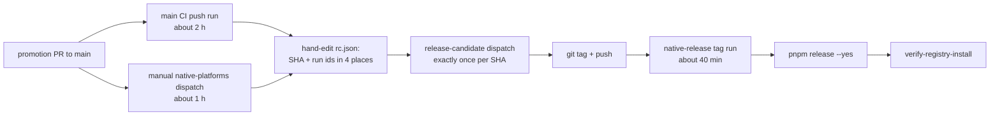

# PRD-629 — A green main commit ships to npm in one command, in under an hour

**Status:** PARTIAL — code for all three phases is on the PR; AC-1, AC-2, AC-4, AC-5 and AC-6 are ticked; AC-3 and AC-7 need the first main push after the merge and the next real release
**Priority:** P1 — The 0.3.5 release (PRD-624) took more than 30 hours across six candidate commits; every open box below removes a step that failed or needed hand work during that release.
**Complexity:** 6 (MEDIUM); risk override: none. Touches 6-10 release files (+2), crosses the npm and GitHub release boundary (+2), and drives the GitHub API (+1). It adds no new workflow file.
**Owner:** release tooling
**Depends on:** None. PRD-628 (cache hits) and PRD-550 (merge in 30 minutes) shorten the same critical path from the CI side, and this PRD does not wait for them.

## Context

Owner, 2026-10-19: "right now its a fucking nightmare". Today, a release needs these steps in order.
Each step is manual, and each step can only start after the step before it ends.

A defect found at F or later needs a new commit, and the chain restarts at A. During PRD-624 this
happened for the following reasons. All evidence is from 2026-10-18 and 2026-10-19.

| # | Finding | Evidence |
|---|---|---|
| 1 | **The tag-only jobs never run before the tag.** A PR that carries the `release-proof` label runs the build matrix and clean-consumer, but `publish`, `finalize` and the npm publish are skipped. The first run that reached `publish` failed: `RELEASE_REPOSITORY` still named `ThreeNativeHQ/threenative`, the repository name before the rename. | Tag run 39304823341: every build green, then `publish` failed ("Prebuilt releases must be published by ThreeNativeHQ/threenative, received ThreeNativeHQ/threenative-engine"). Fixed by #537. The fix cost a new candidate and about 3 h. |
| 2 | **The release proof can stay red with no alarm.** The desktop builds in `native-release.yml` were red from 2026-10-02 to 2026-10-19 (Windows `call pnpm`, MSVC, macOS duplicate symbols, Linux marker interleave). Nothing failed on develop or main, so the first tag found all of them. | Tag run 39247695392 (a9e63ef67): all 3 desktop builds red. Fixed by #531. |
| 3 | **The candidate request is typed by hand.** `rc.json` holds the candidate SHA, the CI run id and the native-platforms run id in 3 places. It changes on every new candidate and on every re-dispatch. | 6 hand edits on 2026-10-19 (`sed` on the scratchpad `rc.json`). |
| 4 | **native-platforms on main is a manual dispatch.** Each promotion needs `gh workflow run native-platforms.yml --ref main`, and a re-dispatch gives a new run id (see finding 3). | Runs 39275897403, 39281416642, 39286110991, 39286851047, 39310220017. |
| 5 | **One infrastructure blip costs a whole 2 h run.** Only a whole rerun keeps the Integration receipts valid, so a transient network failure in one leg restarts every leg. | HTTP 502 in the receipt steps (39275851944), `packages.microsoft.com` apt 403 (39281416642), corrupt Android system-image zip (39286796234 attempt 1), stale `queued` job status (39281372838; hardened by #533 and #535). |
| 6 | **A moved tag needs hand work.** A failed tag run leaves the tag on a dead SHA. Before the next candidate, the tag must be deleted and created again by hand. A duplicate main proof run held the shared `native-release-proof` concurrency group and delayed the tag run until it was cancelled. | Tag `runtime-native-v0.3.5` moved twice (a9e63ef67 to 95b600007 to 21a5a84f9). Run 39304134128 was cancelled to release the group. |

Files inspected: `.github/workflows/native-release.yml` (triggers, `gates`, `publish`, `finalize`,
concurrency group), `.github/workflows/native-platforms.yml` (only `workflow_dispatch` and
`workflow_call`), `.github/workflows/release-candidate.yml`, `scripts/release.ts`,
`scripts/release-native-local.{ts,mjs}`, `packages/runtime-native/scripts/install-prebuilt.mjs`,
`scripts/verify-registry-install.ts`, `scripts/ci-attempt-receipts.mjs`.

## Solution

1. **Rehearse every tag-only step on the release proof.** On a `release-proof` or main-promotion
   run, `publish` runs in rehearsal mode. It creates a **draft** release named
   `rehearsal-<run id>` in this repository, through the same `generateReleaseManifest`,
   SBOM/provenance and `gh release create` steps that a tag uses. Then clean-consumer installs from
   that draft through the published-lock path, and not through the same-run local asset server.
   Next, `finalize` runs its checks without the `gh release edit --draft=false` call. Then
   `pnpm release --dry-run` packs the npm cohort against that lock. Last, the rehearsal draft is
   deleted. When the rehearsal is green, the tag run has no code path that it has not already run.
   Finding 1 cannot recur.
2. **Run native-platforms on main pushes.** `native-platforms.yml` gets the trigger that `ci.yml`
   uses for main pushes, or `ci.yml` calls it through its existing `workflow_call` on main pushes.
   The choice depends on which one keeps the native receipts valid. Main proof turns red on the day
   that it breaks, not on tag day (finding 2), and no manual dispatch is needed (finding 4).
3. **One resumable command: `pnpm release:ship [--sha <main sha>]`.** It extends `scripts/release.ts`,
   not a new CLI vocabulary. It does these steps:
   1. Find the green `CI` and `native-platforms` push runs for the SHA through the GitHub API, and
      build the candidate request from them (finding 3).
   2. Dispatch `release-candidate` only when no successful run exists for that SHA. This keeps the
      exactly-once rule.
   3. Create the tag, or move it when it points at a SHA with no release and no draft. Refuse to
      move it in every other case (finding 6).
   4. Wait for the tag run and for a release that is not a draft and not a prerelease.
   5. Run the npm publish and then `verify-registry-install`.

   Each step reads the current state first, so a second invocation resumes at the first step that
   is not done. Every gate stays in force: the command only removes the hand work between gates.
4. **Retry the transient download failures inside the step.** Wrap the steps that failed on network
   errors (the apt install, the Android SDK system-image install, the pnpm and toolchain downloads)
   in a bounded retry, at most 3 attempts with backoff. Only the download is retried: a test, a
   budget or a threshold is never retried (finding 5). The `native-release-proof` concurrency group
   gives tag runs their own group, so a main proof run cannot queue ahead of a tag (finding 6).

Risks:
- A rehearsal draft that is never deleted would look like a real release. Use the
  `rehearsal-<run id>` name, which `validate-tag` never accepts, and delete the draft in an
  `always()` step.
- `release:ship` publishes to npm. It keeps `pnpm release`'s existing confirmation and `.npmrc`
  rules and never prints the token.

## Acceptance Criteria

Each box sits under the phase that delivers it, so progress moves phase by phase.

## Decisions

- A proof run builds `build-ios-simulator` too. The published matrix includes the simulator asset, so the first rehearsal (run 39348347531) failed in `publish` with "Incomplete prebuilt release matrix" while that job was skipped. It runs beside the Windows build, which is longer, so it adds no wall time. `clean-consumer-ios` stays tag-only.
- **2026-10-19, rehearsal consumer (owner delegated to the implementer).** `clean-consumer` keeps its
  same-run asset server. A draft release has no anonymous download URL, and `install-prebuilt.mjs`
  pins every lock URL to the real `runtime-native-v<version>` tag, so a consumer cannot install from
  a `rehearsal-<run id>` draft. The rehearsal `publish` job instead downloads the draft's assets back
  through the GitHub API and compares size and SHA-256 with the lock, and `npm-dry-run` reads its lock
  from the draft.
- **2026-10-19, main trigger.** `native-platforms.yml` gets `push: branches: [main]`. The existing
  `ci.yml` call runs inside the CI run, whose workflow path is `ci.yml`, but the release-candidate gate
  requires a run whose path is `native-platforms.yml`. A standalone push run takes the same full-plan
  path as a dispatch.
- **2026-10-19, `release:ship` is dry unless `--yes`.** Like `pnpm release`, the one command that
  dispatches, tags and publishes needs `--yes`. `--dry-run` and no flag print the same plan.
- **2026-10-19, request check.** `validateReleaseCandidate` validates the resolved candidate, not the
  request. `release:ship` checks the request it builds with the gate's own `parseReleaseCandidateRequest`.
- **2026-10-19, `release.ts --dry-run`** stops after packing the cohort. The upgrade proof needs the
  registry `latest` and a browser lane, which the `npm release` workflow and the real release carry.

## Speed comparison: current flow against this flow

Baseline: the last, successful attempt of the 0.3.5 release on 2026-10-19 (UTC). Every number is a
run duration read from GitHub. "New" columns are filled only from runs that executed the new flow.

| Segment | Current flow (0.3.5, measured) | New flow | Measured new |
|---|---|---|---|
| Main CI (run 39310175297) | 119 min | unchanged | |
| `native-platforms` on the same SHA (run 39310220017) | 48 min, started by hand 18 s after CI | starts by itself on the main push, in parallel with CI | AC-3 |
| CI green to candidate dispatched | about 1 min of typing: SHA, run ids in 3 places | `release:ship` reads the runs | AC-7 |
| `release-candidate` run (39304236813) | 2 min | unchanged | |
| Candidate to tag pushed | about 4 min of hand work | `release:ship` | AC-7 |
| Tag run (39327476745) | 45 min, 31 of them the Windows build | unchanged here, 12 min with PRD-630 | AC-7, PRD-630 AC-5 |
| Rehearsal after the builds (run 39362738911) | does not exist; `publish`, `finalize` and the npm step first ran on tag day | `publish` 1 min, `npm-dry-run` 5 min, `clean-consumer` 10 min, `finalize` 1 min on the pull request | 35 min whole run, Windows build 22 min |
| CI green to public GitHub release | **51 min** (21:20 to 22:11) | about 50 min | AC-7 |
| npm publish and `verify-registry-install` | not measured | unchanged | AC-7 |

What this says, without rounding it up:

- **The happy path does not get faster from this PRD alone.** The tag run is 45 of the 51 minutes and
  this PRD does not touch it. The saving PRD-630 targets is the 31-minute Windows build.
- **The gain here is on the failure path and in human latency.** The 0.3.5 release took more than 30
  hours across six candidates because defects (the wrong `RELEASE_REPOSITORY`, three red desktop
  builds, a moved tag) appeared only on tag day. Each cost a new commit and a restart of a chain of
  about 3 hours. The rehearsal moves these defects to the pull request. The `native-platforms` run no
  longer waits for a person.
- **Target after PRD-629 and PRD-630:** CI green to public release of about 20 minutes, plus the npm
  step. That is a projection, not a result, until AC-7 and PRD-630 AC-5 are measured.

## Integration Ledger

| Capability | Reachable consumer/trigger | Replaces / disposition | Evidence |
|---|---|---|---|
| Release rehearsal | `native-release.yml` on a `release-proof` or main-promotion PR | Replaces the skipped `publish`/`finalize` on proof runs; the same-run asset server stays only for the local build matrix | AC-1, AC-2 |
| Main native proof | push to `main` → `native-platforms` | Replaces the manual `gh workflow run native-platforms.yml --ref main` | AC-3 |
| One-command ship | `pnpm release:ship` → `scripts/release.ts` | Replaces the hand-edited `rc.json`, the manual dispatch, the tag and the publish steps; `pnpm release` stays as its final step | AC-4, AC-5, AC-7 |
| Download retry | the apt, SDK and toolchain steps in the existing workflows | Replaces whole-run reruns for transient download failures | AC-6 |

## Execution Phases

#### Phase 1: The release proof runs every tag-only step
**Status:** DONE — rehearsal jobs, `release.ts --dry-run --lock` and specs landed; AC-1 (run 39362738911) and AC-2 (run 39366377735) are ticked
**Files:** `.github/workflows/native-release.yml` (rehearsal mode for `publish`, `clean-consumer`, `finalize`, the `npm-dry-run` job and the `cleanup-rehearsal` job), `scripts/release.ts` (a `--dry-run` that packs against a given `--lock`), and the workflow specs.
**Implementation:** Gate the rehearsal on the same condition as `gates` for non-tag events. Use the existing `generateReleaseManifest` with the real repository and a rehearsal tag. Delete the draft in an `always()` step.
**Verification:** AC-1 and AC-2 on this PRD's PR, labeled `release-proof`. Then run all workflow specs locally.

- [x] AC-1 [shared]: A `release-proof` PR run executes `publish`, `clean-consumer`, `finalize` and the npm dry run against a draft release, and no job is skipped. proof: the `native-release.yml` run on this PRD's PR, with every listed job `success` and the draft deleted afterward. Evidence: run 39362738911 (head `8ce7bd1ed`, `release-proof` label, 35 min) is `success`: `publish`, `npm-dry-run`, `clean-consumer`, `clean-consumer-windows`, `finalize` and `cleanup-rehearsal` all `success`. `clean-consumer-ios`, `cleanup-failed-release` and `validate-tag` are skipped by design (tag-only). `gh api repos/.../releases` lists 0 drafts and 0 `rehearsal-` releases afterward. It took four runs to get there, and each red was a real defect that tag day would have found: run 39348347531 (simulator zip missing from the lock), run 39352029148 (`clean-consumer` zip check, `npm-dry-run` could not read the draft), run 39358513586 (`npm-dry-run` had no built tree).
- [x] AC-2 [shared]: The rehearsal catches the finding-1 defect. With `RELEASE_REPOSITORY` set back to `ThreeNativeHQ/threenative` on a scratch branch, the rehearsal `publish` job fails with the same error that tag run 39304823341 printed. proof: the scratch-branch run id, recorded in the PR body. The scratch branch is not merged. Evidence: run 39366377735 (draft PR #543 from scratch branch `ci/prd-629-ac2-scratch`, `RELEASE_REPOSITORY` set to `ThreeNativeHQ/threenative`). Its `publish` job failed in "Generate the checksum lock from the verified assets" with `Prebuilt releases must be published by ThreeNativeHQ/threenative, received ThreeNativeHQ/threenative-engine.`, the step and message of tag run 39304823341. `cleanup-rehearsal` was `success` and no draft remained. Attempt 1 failed in the Linux build on a timing check (`ui` phase 3.06 ms over a 2 ms budget), which does not touch this change, so only that job was rerun. The PR is closed and the branch is deleted. A `workflow_dispatch` on the scratch branch (run 39366210449) stopped at `gates`, which needs a green `main` CI run for the exact SHA, so a labeled PR is the only route for a scratch commit.

#### Phase 2: Main proof starts by itself, and downloads retry
**Status:** PARTIAL — trigger, retry wrapper and tag concurrency group landed; AC-3 needs the first main push after the merge
**Files:** `.github/workflows/native-platforms.yml` (main-push trigger), `scripts/retry-download.sh` and the download steps that call it, and the `native-release.yml` concurrency group.
**Implementation:** Choose a trigger that keeps the `CI_NATIVE` receipts valid (`scripts/ci-native-receipts.mjs`). Add a bounded retry around the network steps only.
**Verification:** AC-6 locally, then AC-3 on the first main push after the merge.

- [x] AC-6 [local]: The wrapped download steps retry at most 3 times on a network failure, and a failing test command is not retried. proof: the workflow structure specs (`ci-structure.spec.ts`, `native-platform-workflow.test.mjs` and every workflow spec, as `workflow-edits-need-all-workflow-specs` requires). Evidence: 2026-10-20, on the final workflow text after `pnpm build`: 26 root spec files (the 24 that name `.github/workflows` plus `release-ship`, `retry-download` and `release`), 757 tests green, and 5 `packages/runtime-native` workflow test files (`distribution`, `android-16kb-alignment`, `desktop-core-gate`, `native-platform-workflow`, `ios-packaging`), 182 tests green. The 2026-10-19 count (27 files, 763 tests) missed `ios-packaging` and `distribution`, which pinned workflow text I had changed; run 39348347531 was the first to show it. `retry-download.spec.ts` runs the script: a command that fails twice passes on attempt 3, one that always fails stops after 3 attempts with its own exit status, and a spec rejects any retry wrapper on a vitest, playtest, budget or verify command. The existing inline `sdkmanager` loop in `native-platforms.yml` now uses the same script. The merge queue run 39469252928 on the merged head then failed `test-native` in `packages/runtime-native/tests/starter-desktop.test.mjs`, which pinned `native-platforms.yml` to have no `push:` trigger. The test now expects `push: branches: [main]` and still rejects `pull_request` and `schedule`; the file passes (34 tests), and so do the other 11 specs that read `native-platforms.yml` (210 tests).
- [ ] AC-3 [shared]: A main push starts `native-platforms` with no manual dispatch, and its native receipts validate. proof: the first main push after the merge, with the run id of the `native-platforms` run on that SHA. Evidence: pending.

#### Phase 3: `pnpm release:ship`
**Status:** PARTIAL — command and specs landed; AC-7 needs the next real release
**Files:** `scripts/release.ts` (`ship` subcommand), `scripts/release-ship.ts`, `scripts/__tests__/release-ship.spec.ts`, and `package.json` (`release:ship` script).
**Implementation:** Find the runs, build the request, dispatch release-candidate once, then create or move the tag, wait, publish and verify. Each step checks its state before it acts, so the command can resume.
**Verification:** AC-4 and AC-5 locally. AC-7 on the next real release.

- [x] AC-4 [local]: `pnpm release:ship --dry-run --sha <green main sha>` finds both run ids, builds a candidate request that `validateReleaseCandidate` accepts, and prints the next step without dispatching. A second invocation prints the same plan. proof: `pnpm exec vitest run scripts/__tests__/release-ship.spec.ts` plus one real dry run against 21a5a84f9. Evidence: 2026-10-19, `release-ship.spec.ts` 14 tests green. Real `pnpm release:ship --dry-run --sha 21a5a84f9013f5eb3472180b74a55720831f2b7f` after CI run 39310175297 went green: found ci 39310175297 and native 39310220017, built a candidate request that `parseReleaseCandidateRequest` accepted, printed `next: dispatch release-candidate.yml`, dispatched nothing, and printed byte-identical output on two further runs. (The gate's own `validateReleaseCandidate` checks the resolved candidate, not the request: see Decisions.)
- [x] AC-5 [local]: `release:ship` refuses to move a tag that has a release or a draft, and refuses a second `release-candidate` dispatch for a SHA that already has a successful one. proof: `release-ship.spec.ts` cases with a mocked `gh`. Evidence: 2026-10-19, `pnpm exec vitest run scripts/__tests__/release-ship.spec.ts` 14 tests green: a public release, a prerelease and a draft each refuse a tag move with `TN_SHIP_TAG_HAS_RELEASE` and no git call; a running tag run refuses with `TN_SHIP_TAG_RUN_ACTIVE`; a successful, in-flight or main-moved candidate refuses a dispatch; a pushed tag and a public release resume at the publish step only.
- [ ] AC-7 [shared]: The next release (0.3.6 or later) goes from a green main SHA to `verify-registry-install` green with one `pnpm release:ship` invocation, no hand edits, and under 60 minutes of wall time after the main gates are green. proof: the command transcript and the tag run id in the PRD-624 successor or this PRD. Evidence: pending.
