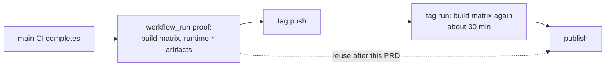

# PRD-630 — The tag run publishes the binaries the main proof already built

**Status:** NOT STARTED
**Priority:** P1 — Owner goal, 2026-10-19: a release takes minutes or under 1 hour. After PRD-629, the tag run still rebuilds the desktop and Android binaries that the main proof run built for the same commit.
**Complexity:** 5 (MEDIUM); risk override: none. Touches 3-5 files (+1), crosses the GitHub release boundary (+2), and moves artifacts between runs (+1). It adds no new workflow file.
**Owner:** release tooling
**Depends on:** PRD-629 (rehearsal, `release:ship` and the tag concurrency group). This PRD edits the same `native-release.yml` jobs, so it starts after PRD-629 merges.

## Context

PRD-629 removes the hand work between the gates. The wall time inside the gates stays. The first
full tag run, `runtime-native-v0.3.5` (run 39327476745, 2026-10-19, tag push 21:26 UTC), shows where
the time goes after the tag push. Every job below succeeded except `clean-consumer-ios`, which is
not a supported target and does not gate `finalize`.

| Job | Minutes | On the critical path |
|---|---|---|
| `validate-tag`, `gates` | 0 and 1 | yes |
| `build` win32-x64 | 31 | **yes, the longest build** |
| `build` darwin-arm64 | 18 | no |
| `build` linux-x64 | 17 | no |
| `build-android` | 10 | no |
| `build-ios-simulator` | 22 | no |
| `publish` | under 1 | yes |
| `clean-consumer` (Linux) | 10 | yes |
| `clean-consumer-windows` | 5 | no, runs beside the Linux one |
| `finalize` | under 1 | yes |

The critical path is about 43 minutes, and 31 of them are the Windows build. The earlier tag run
39304823341 measured the same build at 30 minutes. The npm publish and `verify-registry-install` come
after `finalize` and are not measured yet.

The same `build` and `build-android` jobs already run on the main commit before the tag exists. Each
main CI completion starts `native-release.yml` through `workflow_run`, and that run uploads
`runtime-*` artifacts for the exact commit. The tag run then builds the same sources again.

## Solution

1. **`validate-tag` finds the proof run for the tag commit.** It lists `native-release.yml` runs for
   `$GITHUB_SHA` and accepts exactly the newest one with event `workflow_run`, branch `main`, head
   SHA equal to the tag commit, status `completed` and conclusion `success`. It outputs the run id,
   or `reuse=false` when none qualifies.
2. **The tag run skips `build` and `build-android` when `reuse=true`.** `publish` downloads
   `runtime-*` from the proof run (`actions/download-artifact` with `run-id` and `github-token`).
   Without a qualifying run, or when an artifact expired, the tag run builds as it does today and the
   job summary says so. The fallback is the named override and it is never silent.
3. **The published bytes are the proven bytes.** The proof run's `clean-consumer` job writes
   `proof-asset-identity.json` with the SHA-256 of every asset it installed. `publish` refuses the
   release when a downloaded asset differs from that file.
4. **Kept as they are:** `clean-consumer` and `clean-consumer-windows` on the public release, the
   `finalize` promotion, the iOS simulator job and every gate. Nothing is removed from the tag run
   except a build whose output already exists and is proven.

Risks:
- A proof run for the same commit built with different inputs from a tag run would publish the wrong
  binary. The tag run and the proof run use the same job definitions at the same commit, and the
  SHA-256 check in step 3 binds the bytes to the consumer proof.
- Artifact retention could delete the proof run's artifacts before the tag. The fallback to a full
  build covers this.

## Acceptance Criteria

Each box sits under the phase that delivers it, so progress moves phase by phase.

## Integration Ledger

| Capability | Reachable consumer/trigger | Replaces / disposition | Evidence |
|---|---|---|---|
| Proof run lookup | `validate-tag` on a `runtime-native-v*` tag push | Replaces nothing; adds the `reuse` output | AC-1 |
| Artifact reuse | `publish` on a tag push with `reuse=true` | Replaces the second `build` and `build-android` run | AC-2, AC-3, AC-4 |
| Byte check | `publish` before `gh release create` | Adds a refusal; `pnpm release:ship` sees it as a failed tag run | AC-2 |

## Execution Phases

#### Phase 1: The tag run finds a proof run and checks its bytes
**Status:** NOT STARTED
**Files:** `.github/workflows/native-release.yml` (`validate-tag` outputs and the byte check), `scripts/native-release-reuse.ts` (selection and byte comparison as testable functions), `scripts/__tests__/native-release-reuse.spec.ts`.
**Implementation:** Put the run selection and the SHA-256 comparison in one script that both the workflow and the spec call, as `release-candidate-gate.ts` does for the candidate.
**Verification:** AC-1 and AC-2 locally.

- [ ] AC-1 [local]: The run selection returns the run id for exactly one qualifying proof run, and returns `reuse=false` for each of these: no run, a failed run, a run for another SHA, a `pull_request` run, a `workflow_dispatch` run, and two qualifying runs of equal age. proof: `pnpm exec vitest run scripts/__tests__/native-release-reuse.spec.ts`. Evidence: pending.
- [ ] AC-2 [local]: The byte check fails when one downloaded asset differs from `proof-asset-identity.json`, when an asset is missing, and when an extra asset is present. proof: the same spec with fixture directories. Evidence: pending.

#### Phase 2: The tag run skips the builds it can reuse
**Status:** NOT STARTED
**Files:** `.github/workflows/native-release.yml` (`build`, `build-android`, `publish` conditions and the download step), and the workflow specs.
**Implementation:** Gate `build` and `build-android` on `needs.validate-tag.outputs.reuse != 'true'`. Let `publish` accept a skipped build only when `reuse` is true, and download the proof run's artifacts in that case.
**Verification:** AC-3 locally, then AC-4 on the next real release.

- [ ] AC-3 [local]: With `reuse=true`, `build` and `build-android` are skipped and `publish` still runs. With `reuse=false`, both build as today. A failed build still blocks `publish`. proof: `native-release-proof.spec.ts` condition cases plus every workflow spec (`workflow-edits-need-all-workflow-specs`). Evidence: pending.
- [ ] AC-4 [shared]: A real tag run with a qualifying proof run shows `build` and `build-android` skipped, `publish` green, and the byte check passing. proof: the tag run id, recorded in the PR body. Evidence: pending.

#### Phase 3: The saving is measured
**Status:** NOT STARTED
**Files:** this PRD only.
**Implementation:** Read the job times of the tag run from AC-4 and record them next to the table in Context.
**Verification:** AC-5 on the same tag run.

- [ ] AC-5 [shared]: On the tag run from AC-4, the time from tag push to `finalize` finished is recorded, with the per-job times. The recorded `build` time is gone from the critical path (a saving of the longest build, 31 minutes in run 39327476745). proof: the run id and the job times in the PRD. Evidence: pending.
