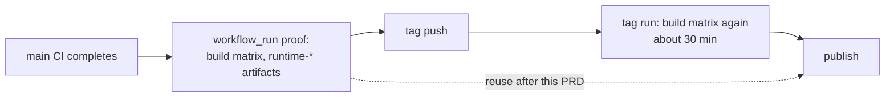

# PRD-630 — One proof per release: main and the tag run repeat nothing, and a green main publishes itself

**Status:** IN PROGRESS
**Priority:** P1 — Owner goal, 2026-10-19: a release takes minutes or under 1 hour. After PRD-629, the tag run still rebuilds the desktop and Android binaries that the main proof run built for the same commit.
**Complexity:** 5 (MEDIUM); risk override: none. Touches 3-5 files (+1), crosses the GitHub release boundary (+2), and moves artifacts between runs (+1). It adds no new workflow file.
**Owner:** release tooling
**Depends on:** PRD-629 (done work: rehearsal and `release:ship`). It ships on PR #601 with PRD-776 and PRD-782 (owner: "solve all the issue please, I cant stand this CI pipeline anymore").

## Context

PRD-629 removes the hand work between the gates. The wall time inside the gates stays. The first
full tag run, `runtime-native-v0.3.5` (run 39327476745, 2026-10-19, tag push 21:26 UTC), shows where
the time goes after the tag push. Every job below succeeded except `clean-consumer-ios`, which is
not a supported target and does not gate `finalize`.

| Job | Minutes | On the critical path |
|---|---|---|
| `validate-tag`, `gates` | 0 and 1 | yes |
| `build` win32-x64 | 31 | **yes, the longest build** |
| `build` darwin-arm64 | 18 | no |
| `build` linux-x64 | 17 | no |
| `build-android` | 10 | no |
| `build-ios-simulator` | 22 | no |
| `publish` | under 1 | yes |
| `clean-consumer` (Linux) | 10 | yes |
| `clean-consumer-windows` | 5 | no, runs beside the Linux one |
| `finalize` | under 1 | yes |

The critical path is about 43 minutes, and 31 of them are the Windows build. The earlier tag run
39304823341 measured the same build at 30 minutes. The npm publish and `verify-registry-install` come
after `finalize` and are not measured yet.

The same `build` and `build-android` jobs already run on the main commit before the tag exists. Each
main CI completion starts `native-release.yml` through `workflow_run`, and that run uploads
`runtime-*` artifacts for the exact commit. The tag run then builds the same sources again.

## Why the scope grew (owner, 2026-11-02)

- "the nubmer of verifications is insane. Like, it takes forever just to merge develop => main. Then it run tests again on main => now its running some extra fucking tests again to publish the shit"
- "also remove this main run redundancy before publishing. once it hit main it simply auto publishes without new test runs"
- "can we have some sort of admin override, that simply ignores everyting and publish?"
- "Make it lean KISS, and yet efficient!"

The 0.3.8 path, measured: one tree (`c95bd58e1558`) ran through 4 full boards (1,965 machine minutes) and 4 native release builds (520 machine minutes), about 4 h.

## Solution

1. **A main push rests on its promotion board.** `promotionReuse` in `scripts/ci-change-scope.mjs` takes the green `pull_request` board of the merge's second parent, when the board tested this tree and ran the release gate jobs itself. `ci-required` re-decides the rule. Every miss runs the board.
2. **The reports follow the tree.** `ci-required` copies `native-release-parity` and `native-release-provenance` from that board to the main run, with `candidateSha` set to the main commit. The candidate gate is unchanged.
3. **No rehearsal after the merge.** The `workflow_run` trigger of `native-release.yml` is gone, with its job table. The promotion PR holds the proof.
4. **The tag run republishes the proof's bytes.** `scripts/native-release-reuse.mjs` selects the proof. `publish` downloads its `runtime-*` artifacts, the lock refuses an incomplete set, and a final check compares the uploaded release with the lock. With no proof, the tag run builds and proves as before, and the log says so.
5. **A green main publishes itself.** `ship` in `npm-release.yml` runs `pnpm release:ship --yes --auto` after a green CI push on main. A commit whose cohort is on npm does nothing. `pnpm release --resume` finishes a cohort that a crash left partial. A package published before the commit date is a missed bump, and that stays refused.
6. **An admin can override.** `pnpm release:ship --yes --override "<reason>"` skips the CI evidence, the candidate gate, the consumer proofs, the publish preflight and the upgrade proof. The tag run refuses anyone but a repository admin and writes the actor and the reason to its summary. It still builds when no proof exists, because a release needs binaries.

Risks:
- The carried reports name a commit that no job ran on. The tree check in `ci-required` is what makes that true: the same tree is the same input.
- The tag run no longer installs the public release. The upload check and the clean-room registry install still run, and the clean-room install runs after the first npm upload.
- The clean-room row `native` fails on Linux on 0.3.8 (release session, cause known, unverified on CI, the release session owns the fix). `ship` runs that verifier after the upload, so a red there marks the job red with npm already published.
- `ship` on CI has not reached the publish. The upgrade proof runs before the first upload, so a red there publishes nothing, and `pnpm release:ship --yes` from a checkout does the same work.
- A local release needs the real display (`TN_PLAYTEST_HOST_DISPLAY=1 DISPLAY=:0`). On private Xvfb the starter's `play` scenario misses its frame budget on 0.3.8 and on 0.3.9: 19.12 to 20.73 ms against 16.7 ms.
- With no GPU, `ship` does not check frame budgets before the publish. The nightly and a local release do.

## 0.3.9, the first real release

Clock: promotion PR #603 opened at 06:53:34Z. The last package reached `latest` at 10:28:37Z.

| KPI | 0.3.8 | Goal | 0.3.9 measured | Result |
| --- | --- | --- | --- | --- |
| Full boards | 4 | 1 | 1, plus `native-platforms` again on main | ❌ |
| Native release builds | 4 | 1 | 1: the proof. The tag run built nothing | ✅ |
| Machine minutes | 2,485 | 650 or less | 695 on CI | ❌ |
| Promotion PR to `latest` | about 4 h | 100 min or less | 215 min | ❌ |

| Stage | Run | Machine min | Wall min |
| --- | --- | --- | --- |
| Develop push | [41402695974](https://github.com/ThreeNativeHQ/threenative-engine/actions/runs/41402695974) | 15 | 11 |
| Promotion board | [41402792920](https://github.com/ThreeNativeHQ/threenative-engine/actions/runs/41402792920) | 283 | 58 |
| Native proof | [41402793035](https://github.com/ThreeNativeHQ/threenative-engine/actions/runs/41402793035) | 117 | 42 |
| Main push, should be thin | [41409195649](https://github.com/ThreeNativeHQ/threenative-engine/actions/runs/41409195649) | 225 | 59 |
| Pipeline cache verification | [41409195557](https://github.com/ThreeNativeHQ/threenative-engine/actions/runs/41409195557) | 12 | 7 |
| `ship` on CI, red at the upgrade proof | [41416259680](https://github.com/ThreeNativeHQ/threenative-engine/actions/runs/41416259680) | 39 | 39 |
| Release candidate | [41416796998](https://github.com/ThreeNativeHQ/threenative-engine/actions/runs/41416796998) | 2 | 2 |
| Tag run, published the proof's bytes | [41417218675](https://github.com/ThreeNativeHQ/threenative-engine/actions/runs/41417218675) | 2 | 2 |

Two bugs caused the misses, and both have a red-green test:

1. **Main ran `native-platforms` again.** The promotion board carried every integration leg, so it wrote no Integration receipt, and the planner read the tested commit only from those receipts. It now also reads `native-web-reference-<sha>`. A replay of the real main push returns run 41402792920.
2. **`ship` ran the kit's own test on a CPU rasteriser.** Frame budgets and screenshots cannot pass there (314 s red, 900 s timeout). Every other row passed on CI, `pnpm:gameplay` included. With `TN_PLAYTEST_ALLOW_SOFTWARE=1` the row now stays out of the report, as in `verify-golden-path`.

The rest of the time was the local finish: 3 local attempts, then the publish from `1c2e968ca` on the real display. The clean room passed with 0 failed rows.

Next release, projected from these runs: board 58 min, main 2 min, `ship` setup, candidate, tag run and proof about 15 min, publish about 20 min. That is about 95 min and about 450 machine minutes. Only a real release can prove it, and the time has little margin.

## Integration Ledger

| Capability | Reachable consumer/trigger | Replaces / disposition | Evidence |
|---|---|---|---|
| Main reuse | `scope` and `ci-required` on a main push | Replaces the main board when the tree matches | AC-1, AC-9 |
| Report carry | `ci-required` step on a reused main push; read by `release-candidate-gate.ts` | Replaces the reports of the main board | AC-2 |
| Proof selection | `validate-tag` and `publish` in `native-release.yml` | Replaces the second build and consumer proofs | AC-4, AC-5, AC-9 |
| Auto-publish | `ship` in `npm-release.yml`, on CI `workflow_run` | Replaces a person running `pnpm release:ship` | AC-7, AC-9 |
| Override | `pnpm release:ship --override`, input `override` of `native-release.yml` | New | AC-8 |

## Decisions

- 2026-11-02 (agent, on the owner's words above): the candidate gate stays as it is. The main run still holds what it reads. Replacing 2,401 lines with a lookup is a separate change, and a tag run can only be proven by a real release.
- 2026-11-02 (agent): the tag run skips the consumer proofs when a proof exists. The first plan of this PRD kept them, and the owner's order removes them. A third `clean-consumer` run failed on bytes that had passed twice.
- 2026-11-02 (agent): a release starts by a dispatch on its tag, and the tag push no longer starts a run. A tag pushed with the workflow token starts nothing, and one path is simpler than two.

- 2026-11-02 (agent, after a fresh-eyes review): `npm-release.yml` lost its `v*` publish path, 170 lines, because `ship` is the one path. `pnpm release:ship --yes` from a checkout is the fallback. The dispatch keeps only the clean room.
- 2026-11-02 (agent, after the same review): no byte check against `proof-asset-identity.json`. It compared one run's immutable artifact with that run's own record, so it caught no failure the lock check misses.
- 2026-11-02 (agent): only `native-platforms` stays reserved on a promotion board, because the reports need its artifacts. The job table that reserved the others is gone.

## Execution Phases

#### Phase 1: Main proves nothing twice
**Status:** DONE

- [x] AC-1 [local]: A main merge with the tree of its green promotion board selects `reused`. A moved main, a non-merge, a red board, a carried gate job and a dispatched run each select the full board. A forged plan fails `ci-required`. proof: `pnpm exec vitest run scripts/__tests__/ci-queue-reuse.spec.ts` — 26 passed. Real data: the rule returns run 41360384887 for main `011a91bc7`, the 0.3.8 merge.
- [x] AC-2 [local]: The gate accepts a carried report and refuses an unchanged one. proof: `parseEvidenceReport` on the real reports of run 41360384887 — both accepted with the main SHA, both refused with the merge-ref SHA.
- [x] AC-3 [local]: `native-release.yml` has no `workflow_run` and no `push` trigger. proof: `native-release-proof.spec.ts`, and GitHub's workflow parser on the file — valid.

#### Phase 2: The tag run repeats nothing
**Status:** DONE

- [x] AC-4 [local]: The selection returns the newest passed proof of this tree, and no proof for a non-merge, no run, another tree or a red job. proof: `native-release-reuse.spec.ts`. Real data: `find 011a91bc7` returns run 41360384797.
- [x] AC-5 [local]: The proof's assets are the assets it installed, on real data. proof: the SHA-256 of all 20 downloaded 0.3.8 assets of run 41360384797 match its `proof-asset-identity.json`, one comparison on 2026-11-02.
- [x] AC-6 [local]: With a proof, the builds and consumer proofs skip, and `publish` and `finalize` run. With none, they run as a first run and a red consumer proof removes the release. proof: `native-release-proof.spec.ts`, condition cases.

#### Phase 3: A green main publishes itself
**Status:** PARTIAL

- [x] AC-7 [local]: `release:ship` runs candidate, tag, dispatch once, publish. It finishes a partial cohort, and in `--auto` it does nothing when the cohort is on npm. proof: `release-ship.spec.ts`, `release.spec.ts`.
- [x] AC-8 [local]: An override skips the evidence and the candidate, and it needs a reason. The tag run refuses a non-admin. proof: `release-ship.spec.ts`, `native-release-proof.spec.ts`. The admin read itself has not run with a workflow token.
- [ ] AC-9 [shared]: The next real release goes from merge to `latest` with no board on main, no build in the tag run and no hand step. Record each job time beside the 0.3.8 path. proof: the run ids of that release. Evidence: 0.3.9 did not meet this. The tag run built nothing, main ran `native-platforms` again, and the publish needed a local command. See "0.3.9, the first real release".

## Blocked on

- AC-9 needs one more real release, with the two 0.3.9 fixes on main. Unblocked by the owner's next release.
