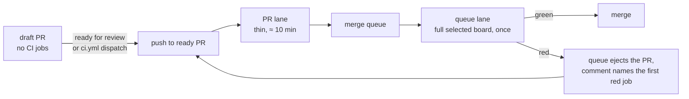

# PRD-731 — The full CI board runs once, in the merge queue

**Status:** PARTIAL — phases 1 and 2 verified locally; the real red queue entry and phase 3 need merged runs
**Priority:** P1 — all boxes are open: one change pays for the same selected board twice, a PR run plus a queue run of about 50 min each, and that doubling is the largest single cost on the path to PRD-550's 30-minute goal.
**Complexity:** 5 (MEDIUM) — 6–10 files (2), new plan lane and profile axis (+2), GitHub API comment (+1); risk override → HIGH, because a wrong per-event gate lets a red tree land on `develop`.
**Owner:** João (decisions), agent (implementation)
**Depends on:** PRD-730 (reuse a green run when the merge-group tree is identical), PRD-550 (gating board, latency audit)

## Context

An ordinary pull request into `develop` and the merge queue run the same board. `scripts/ci-change-scope.mjs`
(`validateEventPlan`, `validationProfile`) gives a `merge_group` on `develop` the same narrowed plan a
`pull_request` earns, because the queue reviews the same tree. The board `scope` selects for a shared executable
input is large, so the author pays for it on every push and the queue pays for it again.

Example, PR #541 (`feat/unreal-look-epic`, still open):

| Run | Event | Result | Wall time |
|---|---|---|---|
| 40036262286 | `pull_request` | success | 51 min (22:51 → 23:42 UTC, 2026-10-23) |
| 40041268137 | `merge_group` | failure | 54 min (23:43 → 00:37) |
| 40046171681 | `merge_group` | not green at 01:31 | 50 min (00:40 → 01:31) |

The green PR run proved nothing the queue could use: its tree differs from the queue candidate, so the queue
reran the whole board. The measured cost is in [PRD-550](PRD-550-a-change-merges-within-30-minutes.md): a full
board is 350–390 runner-minutes and 52–86 min of wall time, a merge group fails 62% of the time, and its core
(`scope`, `build-artifacts`, `typecheck`, `lint`, `test`, `test-unit`, `test-browser`, `test-playtest`,
`golden-path-template`, `budgets`) is about 45 runner-minutes on a 12-min critical path.
[PRD-481](PRD-481-ci-does-each-piece-of-work-once.md) counts 37% of runner-minutes as PR runs a newer push
cancelled. Every such cancelled run pays for the full board today.

PRD-730 (lane `ci-reuse`) covers the narrow case: the queue
reuses a green run when its tree is identical. This PRD is the structural follow-up for every other change: the
PR lane stops running the board the queue will run anyway.

## Solution

Split the board by event, not by job.

**Draft PRs run nothing.** CI starts when the author marks the PR ready for review, or dispatches `ci.yml` by
hand. This is today's behavior (`scope` and `ci-required` skip drafts in `ci.yml`); the PRD keeps it and adds a
spec that pins it.

**PR lane (`pull_request` into `develop`, ready PRs).** Each push runs a thin lane of about 10 min, and that lane
is the PR's required check. `scope` emits a `review` lane that selects: `scope`, `typecheck`,
`lint`, `budgets`, the `test-unit` shards the diff reaches (the affected unit tests), `test` and `build-artifacts`
when a package changed, and the smoke test of the template the diff touches (`golden-path-template` for starter
when none). It
omits `test-native`, `native-platforms`, `native-engine`, `integration`, `template-nonvisual`, `benchmark` and
`performance-contracts`. A prose-only or CI-only diff keeps its current, smaller plan.

**Queue lane (`merge_group` on `develop`).** The board `scope` selects for the complete base-to-candidate diff,
as today, unchanged by this PRD. If PRD-550 phase 2 lands a smaller gating board, the queue lane is that board.
`ci-required` is the queue's required check. The queue lane is the only place the selected full board runs for an
ordinary change. `push` to `develop`,
`schedule`, `workflow_dispatch` and `main` keep `full`.

**Required check.** `ci-required` stays the one required context, so the ruleset does not change. It judges the
event: a `pull_request` plan must be the `review` lane and must pass every job in it; a `merge_group` plan must
carry the full selected board. `validateEventPlan` rejects a `review` plan for `merge_group`, `push`, `schedule`
and `main`. `validationProfile` gains a `lane` axis, so PRD-481 reuse never lets a green `review` run stand in
for a queue candidate (the same rule as PRD-481's reduced-matrix case). An author who wants the full board
before enqueue dispatches `ci.yml` on the branch; PRD-730 then lets the queue reuse that green run when the tree
is identical.

**Why PRs do not go straight to the queue with no PR CI (rejected).** A red merge group makes GitHub rebuild
every PR queued behind it (`max_entries_to_build: 2` today), and agent PRs are often red on the first push. With
no PR lane, each of those reds would restart other authors' full boards. A thin PR lane catches the first-push
red in about 10 min and keeps it out of the queue, so it is cheaper than the queue churn.

**PRD-730 stays useful.** A full run that someone dispatches on a PR is reused by the queue when the tree is
identical. PRD-730 also covers the weeks before this PRD lands, when both events still run the same board.

**A queue red reaches the author fast.** GitHub ejects the PR on a red group. Today nothing names the cause.
`run-summary` on a failed `merge_group` run posts one comment on the PR: the first failing job, its log link, the
run id, and the line "fix, push, re-enqueue". The PR number comes from the queue branch name
(`gh-readonly-queue/develop/pr-<n>-<sha>`). The merge-group run cancels its remaining jobs on the first red
(the existing `ci-janitor.yml` already finds the first failing job), so a red costs minutes, not a full board.

**Capacity.** A pushed commit costs about 45 runner-minutes instead of 350–390, so a cancelled push stops being
the largest waste bucket. The full board runs once per enqueue. The `tn-local` pool keeps `TN_RUNNER` routing for
both lanes and the PR lane needs about 4 slots for 12 min, so it fits beside a queue run. Hosted minutes fall by
the PR lane's skipped jobs. All numbers are PRD-550 estimates until phase 3 measures them.

## Risks

- **A red lands later.** A native or integration red now appears about 50 min after enqueue, not at PR time.
  The author has switched context. The comment above and fail-fast cancel bound the cost; the measure is the
  queue's first-attempt success rate (phase 3 box).
- **Queue churn.** A red group restarts the entry behind it (`max_entries_to_build: 2`). A weaker PR lane lets
  more reds reach the queue. If the first-attempt rate falls below the pre-change rate, widen the PR lane by the
  job that caused the most reds, not back to the full board.
- **Flake cost.** A load red in the queue costs a full board, where it used to cost a PR rerun. This PRD does not
  fix load reds; PRD-550 phase 1 does. Phase 3 records the baseline first-attempt rate so the owner sees the effect.
- **Policy change.** Root `AGENTS.md` says "Merge groups run the same selected gating board as the PR". This PRD
  replaces that sentence with "pull requests run the fast review lane; merge groups run the full selected
  board". João signed off on 2026-10-23 (see Decisions); the workflow and `AGENTS.md` text change in phase 2.
- **Draft and fork PRs.** Drafts run no jobs today and keep doing so. The review lane keeps fork PRs on hosted
  runners.
- **Straight-to-queue is rejected.** See Solution: the queue churn costs more than the thin lane.

## Execution Phases

#### Phase 1: The plan knows two lanes
**Status:** DONE locally
**Files:** `scripts/ci-change-scope.mjs`, `scripts/ci-required.mjs`, `scripts/__tests__/ci-qualification.spec.ts`, `scripts/__tests__/ci-efficiency.spec.ts`, `scripts/__tests__/ci-needs.spec.ts`.
**Implementation:** Add the `lane` field (`review`, `queue`, `full`) to the plan and to `validationProfile`. Select the review job set for `pull_request` into `develop`. Pin the draft skip. Make `validateEventPlan` and `ci-required` enforce the per-event minimum. Land behind a flag that defaults off, so nothing changes until phase 2 turns it on.
- [x] A `pull_request` plan for a package diff selects the review job set and omits the native, integration and non-visual template jobs. proof: `pnpm exec vitest run scripts/__tests__/ci-efficiency.spec.ts` red before, green after. Result: `ci-qualification.spec.ts` "gives a package diff the thin job set..." and `ci-needs.spec.ts` red on the unchanged scripts (7 of 8 new cases red, the eighth holds before and after), green after: required set is budgets, build-artifacts, golden-path(-template), lint, supply-chain, test, test-unit, typecheck.
- [x] `validateEventPlan` rejects a `review` plan for `merge_group`, `push`, `schedule` and `main`, and accepts it for `pull_request` into `develop` only. proof: `pnpm exec vitest run scripts/__tests__/ci-qualification.spec.ts` red before, green after. Result: `ci-qualification.spec.ts` "is a verdict for a pull request into develop only" (merge_group, push, schedule, workflow_dispatch, PR into main, merge_group on main all throw `CI_REQUIRED_REVIEW_LANE`) and the `ci-required.mjs` run on a merge group; red before, green after.
- [x] A draft `pull_request` selects no jobs, and the same PR marked ready selects the review lane. proof: `pnpm exec vitest run scripts/__tests__/ci-structure.spec.ts` draft/ready case. Result: the existing draft case in `ci-structure.spec.ts` ("runs nothing on draft pull requests...") still passes, and the new "admits the review lane to its jobs only" ties each job `if` to the plan.
- [x] A green `review` run never satisfies reuse for a `queue` or `full` profile. proof: `pnpm exec vitest run scripts/__tests__/ci-qualification.spec.ts` reuse case. Result: `ci-qualification.spec.ts` lane case (`coverageMiss` names the lane for review vs queue, queue vs full) and `ci-queue-reuse.spec.ts` ("earlier pull-request run was the thin review lane") red before, green after.

#### Phase 2: The workflow follows the plan (after PRD-730)
**Status:** PARTIAL
**Files:** `.github/workflows/ci.yml`, `.github/workflows/ci-janitor.yml`, root `AGENTS.md` (+ `pnpm sync:agents`), `scripts/__tests__/ci-structure.spec.ts`, `scripts/__tests__/ci-needs.spec.ts`.
**Implementation:** Turn the flag on. Rewrite the "Merge groups run the same selected gating board" sentence in the root `AGENTS.md` CI paragraph. Add the queue-red comment and fail-fast to the `merge_group` path.
- [x] The workflow contract and the `needs` graph match the two lanes, and the `AGENTS.md` CI paragraph states them. proof: `pnpm exec vitest run scripts/__tests__/ci-structure.spec.ts scripts/__tests__/ci-needs.spec.ts scripts/__tests__/sync-agent-docs.spec.ts` and `pnpm sync:agents --check`. Result: `pnpm exec vitest run scripts/__tests__/ci-` : 673 tests, all green but `ci-fast` x2 (pre-existing: this branch diffs `origin/develop` over a native path) and `ci-structure` QuickJS (`@threenative/assets` unbuilt here); `pnpm sync:agents --check`: 26 mirrors in sync.
- [ ] A failed `merge_group` run comments on its PR with the first failing job, log link and run id, and cancels the rest. proof: `ci-queue-watch.spec.ts` (builder, earliest red job, comment-before-cancel against a stub `gh`), plus the run id of one real red queue entry carrying the comment.
  Builder and order are green in `ci-queue-watch.spec.ts` (6/6); the real queue entry is open until a merge group goes red.

#### Phase 3: Measure against PRD-550
**Status:** NOT STARTED
**Files:** `scripts/ci-merge-latency.mjs`, `docs/ci-speed/ledger.json` (generated by `ci-speed-loop`).
**Implementation:** Record a baseline window before phase 2 lands and an after window of 10 merged code PRs. Report each number beside the PRD-550 goal. A gap to 30 min is recorded, not hidden.
- [ ] The PR-lane run finishes in ≤ 12 min wall at the median over 10 code PRs. proof: `node scripts/ci-merge-latency.mjs --since <date>`.
- [ ] Runner-minutes per merged code PR fall against the baseline window. proof: `node scripts/ci-speed-loop.mjs` ledger iteration, both windows named.
- [ ] Median last push → merge over 10 code PRs falls against the baseline, with the gap to PRD-550's 30-minute goal stated, and first-attempt queue success does not fall below the baseline rate. proof: `node scripts/ci-merge-latency.mjs --since <date>`.

## Blocked on

- A real merge-group run that goes red, to show the comment and the cancel on the real API (needs a queue entry after this lands on develop).
- Phase 3 windows: baseline and after windows of 10 merged code PRs need the policy merged and used.
- PRD-730 landing, so a green full run on an identical tree is reused in the queue instead of rerun.

## Decisions

- 2026-10-23, agent: the "flag that defaults off" is dropped. Phases 1 and 2 ship in one unpushed branch, so a flag would only be turned on in the same change.
- 2026-10-23, agent: the review lane also runs `supply-chain` (the secrets scan) and the `golden-path` join. A secret pushed to a PR branch is public before the queue could catch it, and the join keeps the golden-path context reported. Both are cheap.
- 2026-10-23, agent: "affected unit shards" is one `1/1` leg running `vitest related` over the plan's changed files (plus the CI-contract specs when the diff touches CI). The queue runs every shard.
- 2026-10-23, agent: fail-fast is a `queue-watch` job in `ci.yml` (merge_group only, hosted, `needs: scope`). It polls the run, comments the first red job on the PR, then cancels the run. This is the named exception to "no job cancels its own run", because the comment names the gate before the cancel erases it. A flake red in the queue is not retried by `ci-janitor` (the run ends cancelled, not failed).
- 2026-10-23, coordinator + agent: `queue-watch` leaves infra failures to the janitor (run 40046171681 attempt 2: a runner shutdown must not drop the PR). It reads the `FLAKE:` list in `ci-janitor.yml`, which gained "lost communication with the server", and skips a job that ran no step; the janitor skips those jobs too. Only a real test red is commented and cancelled. The retry attempt has no watcher, because `gh run rerun --failed` does not rerun the green `queue-watch`.
- 2026-10-23, agent: `pnpm ci:local --affected` passes `--queue-lane`, so a developer proves the board the queue will run, not the thin lane.
- 2026-10-23, agent: PRD-730 reuse now needs a full run an author dispatched on the branch; a review-lane PR run never qualifies.

- 2026-10-23, João: "ok, 1) lgtm". Policy: a ready PR runs the thin review lane, a draft PR runs no CI jobs, and the merge queue runs the full selected board once. This replaces the root `AGENTS.md` rule that merge groups run the same selected gating board as the PR; the text change ships with phase 2.
- 2026-10-23, rejected: send PRs straight to the queue with no PR CI. A red group makes GitHub rebuild the entries queued behind it, and agent PRs are often red on the first push, so the churn costs more than the thin lane.
