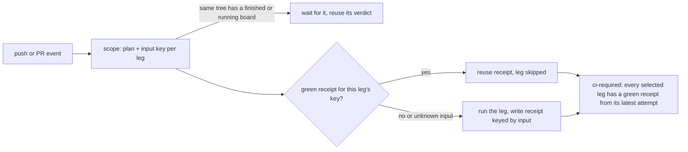

# PRD-776 — CI runs each test once per input, and a red leg retries alone

**Status:** IN PROGRESS
**Priority:** P1 — the release of 0.3.7 (PR #595) cost 3 full boards and about 6 h because AC-1 to AC-3 are open: one red leg reruns the whole board, and each develop push runs the board twice.
**Complexity:** 5 (MEDIUM); risk override: HIGH — a wrong reuse key or receipt rule turns main green on untested code, and main feeds the npm release.
**Owner:** CI tooling
**Depends on:** None. It builds on PRD-481 (tree reuse), PRD-730 (queue reuse) and PRD-731 (one board per queue entry). PRD-628 (dependency and build caches) is a separate layer and does not block this PRD.

## Context

Owner, 2026-10-31: "im tired of having to redo this whole shit over and over. please rethink the
architecture of the CI, see if we can use caching heavily to only run whats absolutely necessary,
mayeb split into smaller jobs too ... goal is to run this pipeline as quickyl ass posbile".

Measured on the 0.3.7 promotion, head `813c0166a`, PR #595. Both runs are attempt 1:

| Fact | Number | Source |
|---|---|---|
| Wall time of one full board | 125 min | CI run 41262008820 (pull_request to main) |
| Jobs per board, run minutes | 89 jobs, 742 min | same run |
| Minutes the jobs waited for a runner | 2,488 min (3.4x the work) | same run, `started_at - created_at` |
| Same tree, same time, second full board | 89 jobs, 706 min | CI run 41262005879 (push to develop) |
| Peak concurrent jobs, both boards | 19 (17 hosted Linux, 4 macOS, 2 Windows, 5 tn-local) | both runs; GitHub caps hosted jobs at about 20 |
| Longest wait | `template-engine-cost (rain)` waited 89 min, then ran 28 min | run 41262008820 |
| Longest legs | Android emulator parity 41 min, Windows desktop core 41 min, `template-nonvisual (shooter)` 35 min, `template-engine-cost` 28-30 min | same run |
| Cost of one red leg | a whole new board: 3 `--failed` attempts could not qualify | run 41262008820 attempt 3: `CI_INTEGRATION_RECEIPT_IDENTITY: required join has no exact current-attempt receipt`, `CI_NATIVE_RECEIPT_IDENTITY: missing exact current-attempt completion receipt` |

Three causes, in order of cost:

1. **Each tree is tested twice at once.** `findReusableRun` (`scripts/ci-change-scope.mjs:583`)
   skips every develop push as a "warm run" (`isWarmRun`, `:569`), but develop pushes now run the
   full qualification board. The promotion PR starts its own board at the same second, finds no
   finished run of the tree, and runs everything again. Two boards share 20 hosted slots, so each
   one waits for the other.
2. **One red leg costs a full board.** `scripts/ci-required.mjs:186-193` demands that the
   integration join receipt carries the current `GITHUB_RUN_ATTEMPT`, and
   `validateNativeReceipts` (`scripts/ci-native-qualification.mjs:223-232`) does the same for the
   native join. A `gh run rerun --failed` does not rerun a green join, so its receipt keeps
   attempt 1 and the verdict fails. The native release rehearsal has a second trap: attempt 1's
   `cleanup-rehearsal` deletes the draft release that a partial rerun needs.
3. **Unchanged work runs again.** A qualification run (develop push, main) runs all 16 templates
   twice (`template-nonvisual`, `template-engine-cost`), even when no input of a template changed.
   Reuse today is all-or-nothing on the whole tree (PRD-481), so a one-line CI script edit reruns
   about 700 runner-minutes of template, native and integration legs.

Files inspected: `scripts/ci-change-scope.mjs` (`isWarmRun`, `findReusableRun`, `reuseOrKeep`),
`scripts/ci-required.mjs` (receipt identity), `scripts/ci-native-qualification.mjs`
(`validateNativeReceipts`, `nativeJobIdentity`), `scripts/ci-integration-scope.mjs`
(`validateIntegrationReceipts`, which already takes each job's latest attempt since 28a1ca590),
`scripts/ci-attempt-receipts.mjs`, `.github/workflows/ci.yml` (job graph), the open boxes of
PRD-481, PRD-550 and PRD-628.

## Solution

Move the unit of reuse from the whole tree to the single job, and make every verdict read the
latest attempt of each job. One board per tree, each leg once per input, and a retry costs only the
red leg.

1. **One board per tree (phase 1).** `findReusableRun` accepts a develop push run when its plan was
   a full qualification board, and keeps the weaker-tier check that already exists. When a CI run
   of the same tree is still in progress, the second run's scope job waits for it (bounded, then it
   runs its own board) instead of starting a parallel board.
2. **Latest-attempt verdicts (phase 1).** `ci-required` and the native validator accept a join
   receipt from the join job's own latest attempt, which can be older than the current attempt.
   They still reject a receipt when the job ran again in a later attempt. This rule already exists
   for the per-job integration receipts (`ci-integration-scope.mjs:418-440`). The native rehearsal
   keeps its draft release until the run concludes green or is superseded, so a partial rerun
   finds it.
3. **Per-leg input keys (phase 2).** The scope job computes one key per leg from git tree hashes of
   the leg's declared input closure, plus `pnpm-lock.yaml`, the job's own workflow text, the
   runner image and the toolchain versions. The PRD-483 impact map already names each template's
   inputs, so the closure reuses that map. A green leg writes a receipt under its key. A later run
   with the same key skips the leg and carries the receipt. A path that no closure claims makes the
   key unknown, and an unknown key runs the leg (fail closed).
4. **Shorter critical path (phase 3).** Split the legs over 20 min into shards: shooter scenarios,
   engine-cost rows, the Android emulator parity cases. Create the longest legs first, so they take
   the first free slots.

Risks:
- A missing input in a closure gives a false green. Mitigation: unknown paths run the leg. The
  scheduled weekly audit already runs cold, and this PRD adds a key-coverage check to it: a cold
  verdict that differs from a cached verdict for the same key fails the audit and names the key.
- The wait in item 1 can hold a runner slot. Mitigation: the wait runs in the scope job on the
  light lane, with a time limit.
- Reuse across commits changes a written rule: root `AGENTS.md` says "A new candidate runs fresh
  tests" and "Unsafe matrix/reusable verdict reuse stays disabled until authoritative complete
  coverage and per-leg routing exist." Phase 2 supplies that coverage and edits the rule text in
  the same commit.

## Corrections and decisions, 2026-11-01

- The clean path to `latest` costs about 236 min, not 125 min or 3 h, because the promotion board and the main push board run in series: 64 + 64 + 5 + 60 + 43 min.
- The "no capacity" decision in this PRD assumed a real cost. The GitHub Team plan raises hosted jobs from 20 to 60 for about $4 per seat per month (verify on the pricing page). The purchase is the owner's call.
- A replay of 59 develop commits against their direct parents finds 24% of legs clean (kit legs about 35%, native 20%, unit legs 7%). Same-tree and version-only runs carry almost everything, so the release path gains most.

## Execution Phases

#### Phase 1: one board per tree, and a red leg retries alone
**Status:** NOT STARTED
**Files:** `scripts/ci-change-scope.mjs` (develop push runs become reusable; wait for an in-flight
run of the same tree), `scripts/ci-required.mjs` and `scripts/ci-native-qualification.mjs`
(latest-attempt join receipts), `.github/workflows/native-release.yml` (rehearsal draft survives a
partial rerun), root `AGENTS.md` (the `--failed` sentence).
**Verification:** replay specs in `scripts/__tests__/` with recorded attempt listings from run
41262008820, then the two live runs below.

- [ ] A red leg on a full board turns `ci-required` green with `gh run rerun <id> --failed` alone, and the retry wall time is the red leg plus at most 10 min. proof: a CI run id with attempt 2 green and attempt 1 red.
- [ ] `ci-required` accepts a join receipt from the join's own latest attempt and rejects one when the join ran again later. proof: `pnpm exec vitest run scripts/__tests__/ci-required-attempts.spec.ts`, red on the current rule first.
- [ ] A promotion PR to main whose tree a develop push run already qualified runs no test leg and reports `reused` in at most 10 min. proof: CI run id of the promotion PR.
- [x] A develop push with a ready promotion PR on the same head keeps only the cache producers, and develop pushes share one concurrency group. proof: 2690e724e, `scripts/__tests__/ci-needs.spec.ts` "while a promotion pull request runs the board on the same head". No CI run has run it yet.
- [x] The npm cohort publishes by dependency level, with 4 uploads at once and the scaffolder last. proof: 47c3520b7, `scripts/__tests__/release.spec.ts` 32/32, plus real `pnpm publish` calls against a throwaway local verdaccio. Registry time on npm is unverified until a release runs it.

#### Phase 2: each leg runs once per input
**Status:** IN PROGRESS
**Files:** `scripts/ci-change-scope.mjs` (`withCarriedLegs`), new `scripts/ci-leg-carry.mjs`,
`scripts/ci-required.mjs` (recheck each carried leg), `scripts/ci-integration-scope.mjs` (carried
lanes), `scripts/ci-template-typecheck.mjs`, `.github/workflows/ci.yml` (job gates), root `AGENTS.md`
(the reuse rule).
**Verification:** carry specs first, then live runs.

**Design change, 2026-11-01:** no hash and no receipt store. Scope walks the CI runs of the last 7
days, compares each tested commit with the candidate by `git diff-tree`, and reads the job's result
on the Actions API. GitHub's job record is the receipt, so reuse adds no storage and no write
permission. The 7 days bound how long a leg stays carried, because a tree cannot show a new runner
image. Owner order, relayed by the release session on 2026-11-01: "just trigger cached result", "it
hits the cache and thats it".

- [x] A changed path that no rule excludes reaches every leg, a path outside a leg's inputs does not, a cohort version bump is no change, and a third-party version bump is one. proof: `pnpm exec vitest run scripts/__tests__/ci-leg-carry.spec.ts` green. The real 0.3.8 bump 68ee52f81 compares as 42 changed files, 0 not version-only.
- [x] The walk works on real runs and stays inside the scope job's limit. proof: read-only dry run on `origin/develop` 3ea0ab2bd: 25 s, 21 API calls, 18 legs carried from 4 real runs, and `carriedFailures` returned none.
- [ ] A main push carries the jobs `native-release.yml` reads. Today it keeps them (`RELEASE_GATE_JOBS`), so a release still pays the native matrix on main. This needs the release gate to follow a carried leg, and it waits for the release session's all-clear.
- [ ] A change to one CI script on develop runs no template leg, and a change inside one template runs only that template's legs. proof: two CI run ids and their job lists.
- [ ] `pnpm release:ship` refuses to tag a main commit whose exact tree has no cold green board (one with no carried receipt). proof: `pnpm exec vitest run scripts/__tests__/release-ship.spec.ts`, plus a dry `pnpm release:ship` on a carried-only commit that names the missing cold board.
- [ ] The weekly cold audit compares each cold verdict with the cached verdict of the same key and fails on a mismatch, naming the key. proof: one scheduled audit run id, plus a spec that feeds it a planted mismatch.

#### Phase 3: no leg holds the board
**Status:** NOT STARTED
**Files:** `.github/workflows/ci.yml` (shard matrices, longest legs first), the shooter and
engine-cost scenario lists, `.github/workflows/native-platforms.yml` (Android parity shards).
**Verification:** one cold full board (no reuse) on a release-candidate head.

- [ ] No CI leg runs longer than 20 min. proof: the job list of one cold full board.
- [ ] A cold full board, with nothing to reuse, finishes in at most 45 min wall (today 125 min). proof: CI run id.

## Integration Ledger

| Capability | Reachable consumer/trigger | Replaces / disposition | Evidence |
|---|---|---|---|
| Tree reuse of develop push runs | `ci.yml` scope job → `reuseOrKeep` (`scripts/ci-change-scope.mjs`) | `isWarmRun` exclusion deleted for full-board push runs | Phase 1 box 3 |
| Latest-attempt join receipts | `ci-required` job → `scripts/ci-required.mjs`, `validateNativeReceipts` | current-attempt equality deleted | Phase 1 boxes 1-2 |
| Per-leg reuse | `ci.yml` scope job → per-leg key → each leg's `if:` | whole-tree-only reuse stays as the fast path | Phase 2 boxes 1-2 |
| Cold audit cross-check | scheduled `ci.yml` run | extends the existing scheduled audit | Phase 2 box 3 |

## Decisions
- 2026-11-01 (owner): cut this list first, on `ci/prd-776-cuts` with no new PR: the standalone native evidence run, the engine-cost row, cold boot, the benchmark extras, the ARM frame comparison, long scenarios on six kits and the starter scenarios. All but the evidence run move to the nightly. The boxes below stay open: these cuts do not build the leg receipts.
- 2026-10-31 (owner, option 1): merges and develop and main qualification use carried leg receipts. Each release tag gets one cold board on its exact tree, with no reuse. Phase 3 brings that board to at most 45 min. Phase 2 makes `release:ship` refuse a tag whose tree has no cold green board.
- 2026-10-31 (owner): plan the CI rework for speed now, with heavy caching, minimal runs and smaller jobs. Planning only: no implementation until the owner starts it.
- 2026-10-31 (planner): leave PRD-628 (dependency and build caches) separate. It speeds up a leg that must run, and this PRD stops legs that need not run. They do not share files.
- 2026-10-31 (planner): do not add runner capacity in this PRD. The measured waits come from duplicate and unchanged work on about 20 hosted slots. Removing that work is free, and more slots cost money each month.
