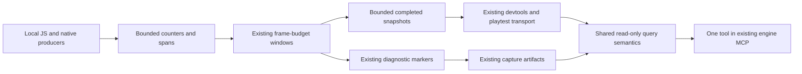

# PRD-769 — Bounded telemetry, debug mode and one query surface

**Status:** PROPOSED
**Priority:** P1 — bound diagnostic memory and frame cost while making incumbent measurements queryable by agents.
**Progress:** 0/3 phases; planning complete, implementation not started.
**Owner:** Engine maintainers
**Depends on:** None; preserves PRD-762 contracts already in source. Its unresolved platform qualification remains separate.
**Complexity:** 6 → MEDIUM; risk override: none. Estimated 6–10 implementation files (+2), bounded-state lifecycle (+2), JS/native build boundary (+2). No new telemetry service.

## Context

João requested a scalable refactor of existing telemetry/debugging with performance protection, then asked whether to centralize metrics and query through an internal MCP. This is planning-only authorization. Engine layer: shared recording, reporting and inspection affect every game. This is not an Unreal subsystem port and does not alter rendering.

Existing source already provides unified launch switches, counters, spans, frame-budget windows, ranked reports, native counters and playtest assertions. Reuse those mechanisms. [PRD-762](PRD-762-debug-telemetry-covers-every-hot-path.md) owns producer coverage and outstanding qualification; its historical correctness results are not overhead evidence for this refactor.

| Verified source | Finding |
| --- | --- |
| `packages/core/src/profiling/debug-telemetry.ts:36` | `TN_DEBUG=1`, `?tnDebug=1`, and the preboot global enable debug producers. |
| `packages/core/src/profiling/debug-telemetry.ts:46` | Numeric observations and source descriptors accumulate in global bags without a cardinality cap. Content-scaled filtering does not bound those bags. |
| `packages/core/src/profiling/FrameCounters.ts:324` | Per-frame reading copies cumulative bags before excluding content-scaled names. |
| `packages/core/src/profiling/FrameCounters.ts:148` | Each transient wrapper adds a restoration closure until uninstall. A weak reference does not bound the list. Measured heap impact remains unverified. |
| `packages/core/src/frame-budget.ts:1422` | Window completion formats and serializes reports synchronously; report spikes remain unmeasured. |
| `packages/core/src/game.ts:2444` | Game installs a `frameBudgetWindow` accessor; reuse its devtools path and prove invocation through Game boot. |
| `packages/playtest/src/evaluators/engine-cost.ts` | Existing consumers assert `TN_FRAME_BUDGET.counters.engine` and bridge census. Preserve missing-data failure and units. |
| `packages/engine-mcp/src/index.ts` | Existing MCP serves capabilities/references, without runtime telemetry queries. |

The shipped [debug reference](../../packages/create-threenative/agent-docs/references/debug-surface.md) names `examples/native-smoke/playtests/debug-telemetry.playtest.json` as the integration fixture. The runtime-diagnostic negative fixture does not exercise debug overhead.

## Architecture decision

**Centralize the contract, session ownership and query semantics; keep recording beside each subsystem.** One bounded session store belongs to the running Game/frame budget. Native/render-thread producers keep existing ownership and publish bounded snapshots at safe boundaries; recording does not synchronously call JS, MCP or another process.

No ingestion server, database, background upload, new telemetry dependency or continuously streamed raw-event bus. This is local engine diagnostics, not product analytics. Separate runtime processes have separate stores. Queries operate on immutable completed windows and cannot close windows, reset counters or trigger sampling.

### Modes and recording

Keep two effective modes: ordinary execution with existing correctness warnings/frame-budget behavior, and explicit preboot debug with incumbent extra producers/spans/reports. Preserve all three launch spellings and production diagnostics semantics. Runtime switching and a separate trace tier are deferred until a concrete incident needs them.

Reuse integer span IDs, fixed sample rings and native counter snapshots. Stable descriptors register once: name, area, unit, counter/gauge/timing semantics, caller and measured/estimated basis. Numeric hot paths do no source inference, formatting, stack capture or subscriber dispatch. Keep trust-boundary validation and original callback exceptions.

Proposed resource ceilings, checked against the incumbent producer census before implementation: 512 retained metric names/session total, at most 128 dynamic; 256 UTF-8 bytes/name and 512/caller; existing 1,024-sample rings; 8 completed summaries; 8 MiB telemetry-owned payload and 256 KiB per serialized debug summary/query response. Count rings, descriptors, snapshots, temporary report buffers and cleanup records toward the payload budget; separately measure unmanaged object overhead in the soak. These are resource limits, not warning thresholds. Revise an insufficient ceiling explicitly before implementation, without dropping existing required observations silently.

Reserve stable names before dynamic admission. Bound every owning producer at insertion, including URL/property/bridge names. Full tables reject new labels without allocating another entry or ring; expose overflow totals and rejected counts. Top ten means top ten of admitted names when saturated, labeled incomplete; do not claim exact global rankings or combine unrelated units. Missing/dropped data cannot satisfy an engineCost assertion as zero. Validate names against prototype keys or use existing safe map structures.

Remove whole dynamic-bag copies from the frame loop. Retain admitted cumulative totals and materialize necessary deltas through the existing reader. One bounded completed summary drives both query and formatted output. Preserve normal report cadence and warnings rather than hiding costs by reducing sampling.

Dispose only the session's owned hooks, snapshots and metadata. Transient encoder wrappers cannot retain an ever-growing restoration list; preserve restoration on still-live objects without overwriting another owner's later wrapper. Test two owners before changing global cleanup. Native counter resets/rollovers remain explicit. Existing exported globals remain bounded compatibility views only where real callers require them; remove replaced ownership paths.

### Query and MCP

Add one read-only `engine_query_telemetry` tool to the existing engine MCP. Its initial source is an explicitly selected playtest capture artifact under the selected project/capture root. Reuse existing capture output, extending it with a bounded structured summary only if needed. Do not launch a game, start a new server or attach/poll devices from this tool. Live developer queries use existing Game devtools/playtest transport with the same selectors. Live MCP attachment is deferred until that transport provides a supported session handle; captured data is labeled captured, never live.

Inputs: capture path/identifier, optional session, last completed window or bounded recent-window range, area/name filters, result limit (default 20, maximum 100). Answer costs, hot callers, changes between retained windows and dropped data using these selectors. Keep SQL, arbitrary expressions, executable regex and user code out.

Output: schema version, capture provenance, runtime/backend, session/window IDs, duration, availability, dropped/truncated status, observations and existing findings/callers. Keep counts, gauges, synchronous CPU time, async wall time and GPU time distinct. Preserve markers and existing fields; add metadata without changing legacy meanings. Unknown schema versions, absent windows, malformed captures and stale live session IDs fail explicitly. Successful file reads do not imply fresh telemetry.

Limit bytes before parsing. Reject paths escaping the configured capture root, including symlinks, special files and oversized files. Use bounded structured windows or streaming extraction instead of loading an ever-growing log. New exported dynamic labels strip asset URL queries/fragments; keep environment variables, arbitrary objects, raw stacks and credentials out. Share a small parser/contract without pulling browser automation dependencies into engine-mcp.

## Integration Ledger

| Capability | Reachable consumer/trigger | Replacement/disposition | Evidence |
| --- | --- | --- | --- |
| Bounded recording | Debug launch → Game initialization → counters/spans → FrameBudget | Replace unbounded admission/cleanup retention; preserve producer semantics | AC-1, AC-2 |
| Compatible reporting | FrameBudget window close → markers → playtest engineCost | Shared completed summary; one report cadence | AC-3 |
| Query | Native-smoke capture → actual engine MCP tool call → filtered windows | Reuse saved windows and devtools window accessor; no second profiler | AC-4, AC-5 |

## Acceptance Criteria

Phase boxes below are the canonical checklist; all evidence is pending. Local actor: implementation agent. Shared actor: repository CI for required target checks unavailable locally. Estimate: 3–5 engineering days, excluding unavailable target qualification.

## Execution Phases

### Phase 1: Bounded state and lifecycle
**Status:** NOT STARTED
**Files:** `packages/core/src/profiling/debug-telemetry.ts`, `FrameCounters.ts`, `frame-budget.ts`, `game.ts`; only bridge/native producer owners retaining dynamic names; adjacent tests.
**Implementation:** Census actual producer names and consumers, reproduce growth with failing tests, bound incumbent structures and remove replaced global ownership. Keep compatibility views only for actual callers. Verify scout hypotheses before editing.

- [ ] AC-1 [local]: A million unique observations stay within stated cardinality, string, payload and serialized limits; overflow is observable and missing/dropped required metrics fail assertions. proof: `pnpm exec vitest run packages/core/__tests__/debug-telemetry.spec.ts packages/core/__tests__/frame-budget.spec.ts packages/playtest/__tests__/engine-cost.spec.ts` with boundedness cases — Evidence: pending.
- [ ] AC-2 [local]: A 100,000-encoder run and 100 Game create/dispose cycles leave bounded cleanup state; disposing one owner preserves another owner's hooks/counters. proof: `pnpm exec vitest run packages/core/__tests__/frame-counters.spec.ts packages/core/__tests__/debug-telemetry.spec.ts` with lifecycle cases — Evidence: pending.

### Phase 2: Query through existing consumers
**Status:** NOT STARTED
**Files:** Game devtools/window installation, frame-budget reporting, `packages/engine-mcp/src/index.ts` and server tests, existing playtest capture writer/evaluator only as needed, debug-surface reference. No new package.
**Implementation:** Add version/provenance and bounded completed summaries. Invoke queries through the actual MCP tool registration and actual Game devtools installation. Legacy markers and engine-cost assertions are the compatibility oracle.

- [ ] AC-3 [local]: Each launch spelling produces incumbent observations and one debug report/window; off mode adds no debug hooks, and teardown removes owned surfaces. proof: `pnpm exec vitest run packages/core/__tests__/debug-telemetry.spec.ts packages/core/__tests__/game-frame-budget-surface.spec.ts packages/core/__tests__/spans.spec.ts packages/playtest/__tests__/engine-cost.spec.ts` — Evidence: pending.
- [ ] AC-4 [local]: An actual MCP tool call queries a real AC-6 native-smoke capture, returns filtered observations with correct provenance, and leaves source counters unchanged; the live devtools accessor agrees on the completed window. proof: `pnpm exec vitest run packages/engine-mcp/__tests__/server.spec.ts packages/core/__tests__/game-frame-budget-surface.spec.ts` with integration cases — Evidence: pending.
- [ ] AC-5 [local]: MCP rejects malformed/oversized input and root escapes; missing/truncated/unsupported observations stay explicit and cannot become passing zeros. proof: `pnpm exec vitest run packages/engine-mcp/__tests__/server.spec.ts packages/playtest/__tests__/engine-cost.spec.ts` with boundary cases — Evidence: pending.

### Phase 3: Runtime and whole-frame performance proof
**Status:** NOT STARTED
**Files:** Native-smoke debug playtest, existing engine-load-test capture/CLI fixtures only where debug selection is missing; scoped package tests/instructions.
**Implementation:** Extend existing benchmark with a preboot debug-on/off selector. Its phases flag is not a debug-overhead lane. Freeze workload, replay, hardware and targets before comparison. Preserve render settings, timestamp sampling, report cadence and frame pacing.

- [ ] AC-6 [local]: The real native-smoke scenario reaches frames, produces valid engineCost windows and a queryable capture in headed browser WebGPU, with adapter/backend identified. proof: build `@threenative/playtest`; run `node packages/playtest/dist/runner/cli.js examples/native-smoke/playtests/debug-telemetry.playtest.json --url 'http://127.0.0.1:5173/?tnDebug=1' --server-command 'pnpm --filter threenative-native-smoke dev --host 127.0.0.1 --port 5173' --browser-recipe webgpu --headed` — Evidence: pending.
- [ ] AC-7 [local]: The same native-smoke scenario produces queryable engineCost windows through the owned Linux desktop host. proof: run `examples/native-smoke/playtests/debug-telemetry.playtest.json` with the shipped playtest `--target desktop` runner and `TN_DEBUG=1`; resolve actual executable/bundle paths from the desktop runner contract before execution — Evidence: pending.
- [ ] AC-8 [local]: Matched baseline/candidate runs meet performance bars below, including report-closing frames, high-cardinality load, queries and a 30-minute soak. proof: extend then run `pnpm bench:engines --arm tn-engine-web --production --modes L1,L2 --ladder 256,4096 --warmup 300 --frames 1800 --repeats 5` in each off/on arm; repeat `tn-engine-desktop`, using existing `playtest perf --file` capture parsing — Evidence: pending; debug selection is planned, not an existing option.

**Phase verification:** Run focused affected tests, `pnpm typecheck`, `pnpm lint`, `pnpm check:docs` and native/Wasm build/test targets matching changed producers. One independent review checks real consumer wiring, boundedness and platform claims at a substantive implementation checkpoint; record its verdict in the PR, not as an acceptance box.

### Performance protocol

Record commits, build, adapter identity, hardware, resolution (1280×720), power/thermals, enabled producers and actual sample counts. Real GPU required for performance acceptance; software adapters prove correctness only. Prefer laptop offload for jobs over five minutes when it has room. Missing hardware/access goes under Blocked on when verified unavailable; it never becomes a green box.

Four arms: baseline off/on, candidate off/on. Alternate order over five paired trials; warm up 300 frames and collect 1,800 each. The 256-object L1 control charges small/inactive overhead; 4,096-object L2 exercises scene/bridge traffic. Add deterministic unique-name churn through real producers and transient encoders, including report boundaries. Replay identical movement/inputs. Query once/second; an unread/slow capture consumer must not block render work or cause unbounded queuing. One 30-minute churn run tests memory plateau. Use external profiler/host timing as well as internal windows so instrumentation cannot exclude its own cost.

Proposed acceptance budgets, to freeze or explicitly revise before implementation measurements: off-mode median CPU frame increase ≤0.10 ms, p95 ≤0.20 ms; debug-on versus candidate off median ≤0.25 ms, p95 ≤0.50 ms. Report-closing frames add ≤1 ms at p99 versus matched off windows. GPU median/p95 regression ≤2% beyond paired-run noise. Require net whole-frame CPU or tail improvement above noise on the debug/churn benefit workload. If baseline already meets the cost bar, claim bounded-memory improvement separately; do not claim an unmeasured speedup. Noise that prevents distinguishing the threshold is inconclusive.

Telemetry-owned retained payload stays ≤8 MiB. After comparable GC observation, retained JS heap growth between minute 5 and minute 30 is ≤1 MiB. Query output stays ≤256 KiB and median local-capture response time ≤100 ms. Collect CPU mean/median/p95/p99, GPU median/p95, report spikes, memory, drop counts, update counts and present cadence. Unavailable observations require an equivalent instrument for any claimed property.

Preserve gameplay and appearance. Capture identical poses at least twice/arm, headed WebGPU, adapter checked, BEFORE/AFTER burned in. A fresh read-only visual judge must return NEUTRAL or IMPROVEMENT with no regression. Save images in `~/Downloads/PRD-769-telemetry/`; attach to the implementation PR through the repository screenshot workflow. Record measurements/verdicts in this PRD or PR, not a separate evidence report.

## Decisions

- 2026-10-29 (planning recommendation): Local bounded recording with shared query semantics; MCP reads captures first. Live remote MCP attachment, persistent ingestion, cloud exporters and runtime mode switching are deferred.
- 2026-10-29 (scope): Preserve PRD-762 producer coverage. Browser and owned Linux desktop are required here. Modified portable/native producers still need matching conformance checks; supported-platform regressions block closure. Android/iOS qualification from PRD-762 remains open and is not satisfied by desktop.
- 2026-10-29 (authorization): Planning only. No implementation, commit, push, PR, merge or deployment. Open one draft PR with the first implementation commit; all implementation acceptance boxes remain open.

## Planning validation

LeanPi `opencode-go/deepseek-v4.1-flash`, `--thinking max`, completed a read-only scout. Source inspection confirmed bag copying and retained cleanup records. Runtime cost/heap impact is unverified. Dashboard health was unreachable (curl exit 7); telemetry reporting skipped. Planning self-review completed: separate browser/desktop acceptance, bounded query trust boundary, and no unmeasured speedup claims. `pnpm check:docs` passed (3,635 links across 1,537 Markdown files; Unreal status current). All six required prose-contract suites passed: 273/273 tests. `pnpm prd:progress` passed with three phases and eight pending implementation boxes (prd:0%). No runtime or performance check ran during planning.
