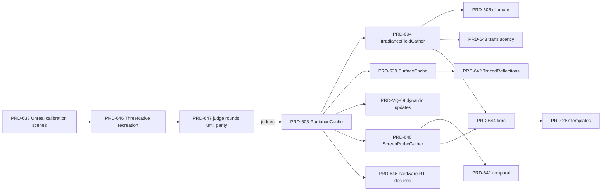
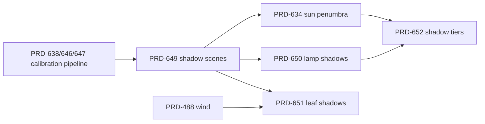

# Unreal — PRDs grounded in the Unreal Engine source

**Status: OPEN — batch filed 2026-10-09 against `origin/develop` at `6b18d913e`, from a read of
Unreal Engine 5.8.3 (`release` tag commit `396c9f05`). On 2026-10-12 every open Unreal-related PRD
moved here by topic, and each one was re-checked against the 5.8.3 source.**

| Folder | Holds |
| --- | --- |
| [`look/`](look/) | The Unreal default look, measured against a real Unreal render and turned on layer by layer |
| [`gi/`](gi/) | Lumen-style global illumination: the GI reference scene, gathers, surface cache, temporal stability, reflections, tiers |
| [`shadows/`](shadows/) | Virtual-shadow-map parity past the sun penumbra: shadow calibration scenes, lamp shadows, leaf shadows, shadow tiers |
| [`rendering/`](rendering/) | Atmosphere, clouds, shadows, virtualized geometry, the radiance cache probes (PRD-603 to PRD-605) |
| [`performance/`](performance/) | Resolution scale, temporal reconstruction, tile memory, texture residency |
| [`open-world/`](open-world/) | Terrain LOD, streaming transitions, world partition |
| [`animation/`](animation/) | Character animation and skinning cost |
| [`vfx/`](vfx/) | GPU particles and effects |
| [`assets/`](assets/) | Unreal ingest, imported materials, mobile texture formats |
| [`research/`](research/) | The UE5 feature map and its repo grounding (reference, not PRDs) |

A finished PRD still moves to `docs/PRDs/done/`, and a blocked-only PRD still moves to
`docs/PRDs/BLOCKED/<reason>/` ([`../AGENTS.md`](../AGENTS.md)). This folder holds open work only.

Each PRD here takes one mechanism that Unreal ships and proves in production, and rebuilds it
inside ThreeNative's rules: WebGPU and three.js, one source for browser and native host, mechanism
in `packages/`, look in generated `src/render/` source. The aim is the battle-tested behaviour, its
defaults and its failure guards, not parity with Unreal's feature list.

## What earns a place in this folder

All three clauses:

1. **The Unreal source shows the mechanism.** The PRD cites `UE 5.8.3: Engine/...:line` for the
   algorithm, the default values and the guards it copies in idea. A feature known only from
   Unreal's documentation goes to
   [the UE5 feature map](research/threenative-ue5-feature-checklists-and-repository-reuse-map.md).
2. **No pending or finished PRD already owns the outcome.** Where one did, that PRD was amended in
   place instead (list below).
3. **It fits ThreeNative's rules.** The two questions, "never own the look", "auto by default" and
   "web-only is unfinished" in the root `AGENTS.md` all apply unchanged.

## The licence rule — read this before you open the Unreal source

Unreal Engine source is under the Epic Games EULA. ThreeNative is MIT.

- **Never copy Unreal code, shader code or comments** into this repository, and never paste them
  into a PR, issue or agent brief that lands here.
- **Do borrow ideas:** the algorithm, the data layout, the default values, the order of operations
  and the failure guards. Describe them in your own words and write new code.
- **Third-party code that Unreal bundles keeps its own licence.** Take it from its upstream release,
  never from the Unreal tree, and add the notice the licence asks for. Example: PRD-561 ports Sony
  Bend Screen Space Shadows from Bend Studio's Apache-2.0 release.
- Cite Unreal paths and line numbers as references. A citation is not a copy.

## How to read the Unreal source

Access to `github.com/EpicGames/UnrealEngine` needs a GitHub account linked to an Epic Games
account. A sparse, blob-less clone holds the renderer, shaders and config in about 200 MB:

```sh
git clone --depth 1 --filter=blob:none --sparse https://github.com/EpicGames/UnrealEngine.git "$UE_SRC"
git -C "$UE_SRC" sparse-checkout set \
  Engine/Source/Runtime/Renderer Engine/Source/Runtime/RenderCore Engine/Source/Runtime/RHI \
  Engine/Shaders/Private Engine/Source/Runtime/Engine Engine/Config \
  Engine/Plugins/FX/Niagara/Source Engine/Source/Runtime/Landscape Engine/Source/Runtime/AnimGraphRuntime
```

Keep the clone outside this repository. Re-read every cited line before you build on it: the
citations were checked on 5.8.3 and can move in a later release.

## How to work a PRD here

1. Run `engine_search_capabilities` and `engine_capability_detail` first (root `AGENTS.md`, "How
   you work"). Several Unreal ideas turned out to be shipped already; see "Already shipped" below.
2. Read the PRD's Unreal citations, then the ThreeNative files it names. Confirm the current
   behaviour before you change it: the tree moves daily.
3. Run Phase 1 first. Most PRDs here open with a measurement that decides whether the rest of the
   PRD continues. A decline is a valid result: record it under `## Decisions` and delete the moot
   boxes (rule R4 in [`../AGENTS.md`](../AGENTS.md)).
4. Follow the normal lifecycle: one draft PR per PRD, `pnpm prd:progress <file>` for the label,
   boxes ticked with their proof in the same commit as the work.
5. A PRD that finishes moves alone to `docs/PRDs/done/` with `git mv`. The topic folders stay.

## The PRDs, in recommended order

Order is value against cost. A wave can run in parallel; nothing in a later wave depends on an
earlier wave unless the "Waits on" column says so.

| Wave | PRD | Outcome | Complexity | Waits on |
| --- | --- | --- | --- | --- |
| 1 | [PRD-560](../done/PRD-560-height-fog-follows-the-ground.md) | Fog thickens toward the ground and glows toward the sun, at near-zero cost | 3 LOW | — |
| 1 | [PRD-571](../BLOCKED/requires-physical-device/PRD-571-exposure-meters-a-histogram-and-ignores-the-sun.md) | Exposure ignores the brightest and darkest tenth of the frame | 2 LOW | — |
| 1 | [PRD-572](../done/PRD-572-shadow-casters-sort-themselves-into-static-and-moving.md) | A moving shadow caster updates its shadow without a `trackCaster` call | 3 LOW | — |
| 1 | [PRD-567](../done/PRD-567-terrain-layers-blend-by-their-own-height.md) | Terrain layers blend by their own height maps | 3 LOW | owner confirms the core/template split |
| 2 | [PRD-561](../done/PRD-561-contact-shadows-from-screen-depth.md) | DECLINED 2026-10-10: the mechanism never grounded feet and was deleted. Unreal's default light has contact-shadow length 0, so the default look does not need it | 5 MEDIUM | — |
| 2 | [PRD-563](../done/PRD-563-the-first-frame-starts-at-the-tier-the-gpu-family-holds.md) | The first frame starts at the tier the GPU family can hold | 5 MEDIUM | — |
| 2 | [PRD-569](../done/PRD-569-gpu-particle-emitters-cull-and-yield-to-the-frame-budget.md) | Off-view GPU emitters stop costing; effects yield to the frame budget | 5 MEDIUM | — |
| 2 | [PRD-566](../done/PRD-566-terrain-lod-morphs-on-the-gpu-and-picks-by-screen-error.md) | Terrain LOD morphs on the GPU and picks its level by screen error | 3 LOW | — |
| 3 | [PRD-564](../done/PRD-564-the-resolution-scale-changes-without-reallocating-a-target.md) | The resolution scale changes without reallocating a target | 6 MEDIUM | its Phase 1 hitch measurement |
| 3 | [PRD-570](./animation/PRD-570-a-character-costs-what-the-camera-sees-of-it.md) | Distant and hidden characters animate and skin for less | 5 MEDIUM | its Phase 1 cost measurement |
| 3 | [PRD-562](./rendering/PRD-562-aerial-perspective-from-a-froxel-volume.md) | Distant land takes the colour of the sky it is seen through | 4 MEDIUM | — |
| 3 | [PRD-568](../done/PRD-568-mobile-builds-ship-gpu-ready-astc.md) | Mobile builds ship GPU-ready ASTC, not RGBA8 | 4 MEDIUM | [PRD-VQ-01](../done/PRD-VQ-01-native-asset-capabilities.md) |
| 3 | [PRD-565](../done/PRD-565-multisampled-targets-stay-in-tile-memory-on-android.md) | MSAA attachments stay in tile memory on the Android host | 3 LOW | [PRD-329](../performance/critical/PRD-329-the-native-gpu-frame-matches-chrome-at-matched-pixels.md) Phase 2 (Dawn on Android) |

## The Unreal default look, measured (filed 2026-10-19)

**Owner rule (2026-10-19): the out-of-the-box Unreal 5.8.3 look is ThreeNative's default look.**

The PRDs above copy mechanisms from the Unreal source. These PRDs make the **templates look like a
fresh Unreal 5.8.3 project** with no tuning. They measure against real Unreal renders of one shared
scene and do not tune from memory. [PRD-631](../done/PRD-631-an-unreal-reference-scene-measures-the-default-look.md)
builds the instrument:
- a headless Unreal capture of a cumulative layer ladder (L0 to L9)
- the same cells from the scaffolded starter
- a comparison that gates every layer

Agents control the editor interactively through Epic's own Unreal MCP plugin. That plugin ships in
the 5.8.3 install.

A layer turns on by default only when five conditions hold:
1. Its row matches the Unreal reference.
2. A visual judge returns IMPROVEMENT.
3. The `high` frame budget holds.
4. The `low` tier has a fallback.
5. The native engine renders it.

| Layer | Adds | Owner |
| --- | --- | --- |
| L0 | Geometry and camera alignment | [PRD-631](../done/PRD-631-an-unreal-reference-scene-measures-the-default-look.md) |
| L1 | Tone curve, exposure, light units | [PRD-632](look/PRD-632-the-frame-is-exposed-and-tone-mapped-the-way-a-fresh-unreal-project-is.md) |
| L2 | Sky atmosphere and sky light capture | [PRD-633](look/PRD-633-the-sky-is-an-atmosphere-and-it-lights-the-scene.md) |
| L3 | Height fog and aerial perspective | [PRD-562](rendering/PRD-562-aerial-perspective-from-a-froxel-volume.md) (amended) |
| L4 | Volumetric clouds | [PRD-VQ-08](rendering/PRD-VQ-08-clouds-and-overhead-transmittance.md) (amended) |
| L5 | Sun shadows: coverage and source-angle penumbra | [PRD-634](look/PRD-634-sun-shadows-reach-the-horizon-and-soften-with-distance-from-the-caster.md); page cost in [PRD-457](rendering/PRD-457-virtual-shadows-scale-by-measurement.md) |
| L6 | Ambient occlusion on indirect light only | [PRD-635](look/PRD-635-ambient-occlusion-darkens-only-the-light-that-comes-from-around.md) |
| L7 | Global illumination | The [GI set](#global-illumination-the-lumen-set-filed-2026-10-20) below: PRD-603 to PRD-605, PRD-638 to PRD-645, PRD-VQ-09; templates last through [PRD-267](../useful-defaults/PRD-267-screen-space-gi-ships-in-the-templates.md) (amended) |
| L8 | Reflections | [PRD-642](gi/PRD-642-glossy-surfaces-reflect-what-the-camera-cannot-see.md) on `high`; [PRD-VQ-03](../rendering/PRD-VQ-03-local-reflection-probes.md) (amended) on `low` and `medium` |
| L9 | Bloom, vignette, local exposure, motion blur, neutral grade | [PRD-636](look/PRD-636-the-finishing-post-chain-matches-unreal-defaults.md); anti-aliasing in [PRD-539](performance/PRD-539-low-resolution-temporal-reconstruction-quality-and-cost.md) (amended); exposure default in [PRD-632](look/PRD-632-the-frame-is-exposed-and-tone-mapped-the-way-a-fresh-unreal-project-is.md) |

Order: PRD-631 first, then PRD-632, because every later row is compared at matched exposure. After
that, PRD-633 and PRD-635 can run in parallel, then the rest. Not filed: a surface BRDF PRD. three.js
r185 and the native shader already compensate GGX multi-scatter with Lambert diffuse and F0 0.04,
as Unreal's default lit does (PRD-635 `## Decisions`).

## Parity PRDs for Nanite, Lumen, World Partition and Niagara (filed 2026-10-12)

Each one compares a shipped ThreeNative system with its Unreal 5.8.3 counterpart and takes the
largest gap that fits WebGPU and ThreeNative's rules. Each opens with a measurement that can
decline the rest. The gaps checked and not filed are listed below the table.

| Unreal system | PRD | Outcome | Waits on |
| --- | --- | --- | --- |
| Nanite | [PRD-600](rendering/PRD-600-a-clustered-mesh-submits-only-the-clusters-the-view-holds.md) | A clustered mesh submits only the clusters the view holds | — |
| Nanite | [PRD-601](rendering/PRD-601-far-clusters-keep-the-shading-of-the-source-mesh.md) | Far clusters keep the shading of the source mesh | — |
| Nanite | [PRD-602](rendering/PRD-602-a-clustered-shadow-caster-draws-what-its-shadow-texel-resolves.md) | A clustered shadow caster draws what its shadow texel resolves | PRD-600 (optional) |
| Lumen | [PRD-603](rendering/PRD-603-probes-refresh-by-tracing-the-packed-scene-not-by-drawing-it-six-times.md) | Probes refresh by tracing the packed scene, not by six raster captures | — |
| Lumen | [PRD-604](rendering/PRD-604-a-surface-is-lit-only-by-probes-that-can-see-it.md) | A surface is lit only by probes that can see it (no leaks through walls) | — |
| Lumen | [PRD-605](rendering/PRD-605-the-probe-field-follows-the-camera-in-nested-rings.md) | The probe field follows the camera in nested rings | PRD-603, PRD-604 (phases 2–3) |
| World Partition | [PRD-606](open-world/PRD-606-a-fast-travel-destination-is-ready-before-the-cover-lifts.md) | A fast-travel destination is ready before the cover lifts | — |
| World Partition | [PRD-607](open-world/PRD-607-streaming-reports-when-a-hole-is-near-and-spends-more-to-close-it.md) | Streaming reports when a hole is near and spends more to close it | — |
| Niagara | [PRD-609](../done/PRD-609-a-gpu-burst-starts-where-and-when-it-is-asked-and-live-particles-stay-put.md) | A GPU burst starts where and when it is asked, and live particles stay put | — |
| Niagara | [PRD-610](vfx/PRD-610-sparks-bounce-off-the-surfaces-the-camera-can-see.md) | Sparks bounce off the surfaces the camera can see | PRD-609 (phase 3) |
| Niagara | [PRD-611](vfx/PRD-611-a-gpu-effect-that-starts-hidden-draws-its-first-frame-with-its-pipeline-built.md) | A GPU effect that starts hidden draws its first frame with its pipeline built | — |

PRD-608 was reserved for World Partition and not used.

Gaps checked on 2026-10-12 and not filed. Each one needs new evidence before it is filed again:

- **Nanite.** Persistent-thread culling is off by default in Unreal, and WebGPU gives no forward-progress
  guarantee between workgroups. Two-pass occlusion was declined on measurement (PRD-284, PRD-489).
  Software rasterization needs 64-bit image atomics and a visibility buffer that owns shading. Page
  streaming saves little because vertex data is about 74% of resident bytes (PRD-285). Tessellation
  and displacement are a material look decision.
- **Lumen.** Re-checked 2026-10-20; the GI set below now owns the surface cache (PRD-639), the screen
  probe gather (PRD-640), reflections (PRD-642 and PRD-VQ-03) and native hardware ray tracing
  (PRD-645, declined at its gate on 2026-10-21). Still not filed: global and mesh distance fields, because `GPUSceneBVH` already gives a
  GPU trace (PRD-603 revisits this if its gate fails); ReSTIR GI, because Unreal needs hardware ray
  tracing for it and no quality level turns it on (`LumenReSTIRGather.cpp`); the far field, which is
  hardware-only and off by default.
- **World Partition.** Data layers have no consumer, and two `WorldCells` instances already cover
  the case. Several streaming sources would need a terrain rewrite, because `TerrainTiles` holds
  one focus. Loaded-but-inactive cells save no draw. HLOD layers belong to PRD-456. Unreal doubles
  the HLOD range per level (`WorldPartitionRuntimeHashSet.cpp:290`), which is a note for PRD-456.
- **Niagara.** GPU ribbons are covered by the `vfx-compute` conformance row and `IComputeDriven`.
  On-death spawn needs atomic appends with no consumer, and Unreal counts event spawns on the CPU
  too. Grid smoke ships as `fluid-field.ts`. Particle lights have no consumer. Sorting belongs to
  PRD-VQ-12, and culling and budget belong to PRD-569.

## Global illumination: the Lumen set (filed 2026-10-20)

Owner direction (2026-10-19): Lumen-like GI is part of the default look. Owner rule (2026-10-20):
**GI abstractions take Unreal's names**, without the Lumen brand, in camelCase, so an agent that
knows Unreal finds them with `engine_search_capabilities`. Examples: `RadianceCache`,
`IrradianceFieldGather`, `ScreenProbeGather`, `ShortRangeAO`, `SurfaceCache`, `TracedReflections`
(Unreal's "Lumen Reflections"), `BoxReflectionCapture`, `finalGatherMethod`,
`affectDynamicIndirectLighting`. Units stay metres. Each manifest entry carries the Unreal terms,
"lumen" included, as `@alias` lines, and each PRD has a box that proves the search finds it.

What a fresh Unreal 5.8.3 project runs, from the source: Lumen GI and Lumen reflections, software
tracing against the global distance field, GI quality Epic, which uses the screen probe gather.
Medium uses the irradiance field gather, and Low has no dynamic GI (`Engine/Config/BaseScalability.ini`).
The set rebuilds that ladder on `GPUSceneBVH` instead of distance fields, and matches each tier to
its own Unreal level.

**Calibration comes first (owner, 2026-10-20).** Each calibration scene is built in Unreal
(PRD-638), recreated in ThreeNative (PRD-646), and judged in rounds until parity (PRD-647). The
pipeline, the recreation and the loop are filed once. Each GI PRD authors the scene or motion run
for its own behaviour with that pipeline, and records its visual verdict as a PRD-647 round.

| Lumen part | PRD | Outcome | Waits on |
| --- | --- | --- | --- |
| Calibration scenes | [PRD-638](../done/PRD-638-calibration-scenes-are-built-in-unreal-and-captured-as-the-gi-target.md) | Calibration scenes are built in Unreal and captured as the GI target | PRD-631 Phase 1 |
| Scene recreation, visualize modes | [PRD-646](gi/PRD-646-threenative-recreates-each-unreal-calibration-scene-exactly.md) | ThreeNative recreates each Unreal calibration scene exactly | PRD-638, PRD-632 |
| Calibration loop | [PRD-647](../done/PRD-647-a-visual-judge-calibrates-gi-against-the-unreal-scenes-until-parity.md) | A visual judge calibrates GI against the Unreal scenes until parity | PRD-638, PRD-646 |
| Radiance cache | [PRD-603](rendering/PRD-603-probes-refresh-by-tracing-the-packed-scene-not-by-drawing-it-six-times.md) | `RadianceCache` refreshes by tracing the packed scene | — |
| Irradiance field gather | [PRD-604](rendering/PRD-604-a-surface-is-lit-only-by-probes-that-can-see-it.md) | A surface is lit only by probes that can see it | — |
| Radiance cache clipmaps | [PRD-605](rendering/PRD-605-the-probe-field-follows-the-camera-in-nested-rings.md) | The probe field follows the camera in nested rings | PRD-603, PRD-604 |
| Dynamic updates | [PRD-VQ-09](../rendering/PRD-VQ-09-incremental-diffuse-relighting.md) | A door that opens and a lamp that switches change the bounce light | PRD-603, PRD-647 |
| Surface cache | [PRD-639](gi/PRD-639-a-surface-cache-gives-traced-rays-the-texture-glow-and-lights-of-what-they-hit.md) | Traced rays see the texture, glow and lights of what they hit | PRD-603 |
| Screen probe gather, Short Range AO | [PRD-640](gi/PRD-640-pixels-gather-bounce-light-from-screen-probes-and-the-radiance-cache-answers-the-rest.md) | Pixels gather from screen probes, and the radiance cache answers the rest | PRD-603, PRD-647 |
| Temporal filter | [PRD-641](gi/PRD-641-bounce-light-holds-still-while-the-camera-moves-and-follows-a-light-that-changes.md) | Bounce light holds still and follows a changed light | PRD-640, PRD-647 |
| Reflections | [PRD-642](gi/PRD-642-glossy-surfaces-reflect-what-the-camera-cannot-see.md) | Glossy surfaces reflect what the camera cannot see | PRD-603, PRD-639 |
| Translucency volume, foliage | [PRD-643](gi/PRD-643-glass-fog-and-leaves-take-the-bounce-light-too.md) | Glass, fog and leaves take the bounce light too | PRD-603, PRD-604 |
| Scalability | [PRD-644](gi/PRD-644-the-gi-tier-follows-unreal-quality-levels-and-the-measured-gpu-time.md) | The GI tier follows Unreal's quality levels and the measured GPU time | PRD-647 |
| Hardware ray tracing | [PRD-645](../done/PRD-645-a-desktop-gpu-with-ray-tracing-traces-gi-rays-in-hardware.md) | Done, declined at its gate: the hardware trace is 12 to 15 times faster, and the hand-off between the two GPU devices costs more than the software trace | — |
| Templates | [PRD-267](../useful-defaults/PRD-267-screen-space-gi-ships-in-the-templates.md) | The templates take the tuned tier table, last | PRD-644, PRD-647 parity |



Order: PRD-638 Phase 1, then PRD-646 Phases 1 and 2, then PRD-647 Phase 1: the first round on
`cornell` is the GI baseline. PRD-603 Phase 1 runs in parallel. Parity at a tier (PRD-647 Phase 3)
is the bar for PRD-267 to copy that tier to the templates. The harness `giCache.ts` (PR #541)
is the CPU reference for PRD-603 to PRD-604 until PRD-603 Phase 2 deletes it. Template edits come
last (owner, 2026-10-19: tune the harness 1:1 first).

## Existing PRDs amended from the same read

These keep their numbering. Each one gained an Unreal section, and sometimes reworded boxes and a
dated `## Decisions` entry. The ones with a full Unreal section moved here on 2026-10-12. PRD-345,
PRD-459, PRD-486 and PRD-493 cite Unreal only in passing, so they stay in their own folders.

| PRD | What the Unreal source added |
| --- | --- |
| [PRD-345](../rendering/PRD-345-a-backlit-subject-is-not-a-hole-in-the-sky.md) | Decision only: exposure is out of its scope, now owned by PRD-571 |
| [PRD-384](../done/PRD-384-adaptive-resolution-gpu-headroom.md) | Comparison with Unreal's dynamic-resolution controller; the gaps point to PRD-563, PRD-564 and PRD-549 |
| [PRD-457](rendering/PRD-457-virtual-shadows-scale-by-measurement.md) | Pool-pressure resolution bias before falling back to cached levels; cross-reference to PRD-572 |
| [PRD-538](../done/PRD-538-shadow-maps-redraw-only-what-streamed-in.md) | Per-page eviction and a nearest-first page budget |
| [PRD-539](performance/PRD-539-low-resolution-temporal-reconstruction-quality-and-cost.md) | The TSR levers not yet tried, in order, starting with 200% history |
| [PRD-VQ-08](rendering/PRD-VQ-08-clouds-and-overhead-transmittance.md) | Three-channel cloud shadow map that serves receivers below and inside the cloud |
| [PRD-459](../open-world/PRD-459-smooth-streaming-one-admission-budget-per-frame.md) | Texture uploads charged to the admission budget; stale Phase 1 status corrected |
| [PRD-460](open-world/PRD-460-invisible-streaming-transitions.md) | Distance-driven cull fade, timed LOD fade, re-crossing and camera-cut rules |
| [PRD-VQ-10](performance/PRD-VQ-10-texture-mip-residency.md) | Wanted mips from screen size, drop order over budget, no in-place shrink on WebGPU |
| [PRD-493](../open-world/PRD-493-terrain-layers-past-sixteen-textures.md) | Cross-reference to PRD-567 |
| [PRD-316](vfx/PRD-316-forty-six-vfx-are-generated-render-source-not-an-engine-inside-the-engine.md) | Culling and budget points that PRD-569 must respect |
| [PRD-486](../open-world/PRD-486-characters-get-a-lod-chain.md) | Per-LOD required bones and posed-bounds culling |

## Shadows: the virtual shadow map set (filed 2026-10-20)

What a fresh Unreal 5.8.3 project runs, from the source: virtual shadow maps for the sun and every
lamp, shadow-map ray tracing (8 rays × 4 samples at Epic), mesh distance fields generated, contact
shadows off, capsule shadows off, and ray-traced shadows and MegaLights off
(`tools/unreal-reference/Config/DefaultEngine.ini`; `Engine/Config/BaseScalability.ini:240-265`).
ThreeNative already ships the directional half: `VirtualShadowNode` clip levels with a page cache,
mover maps and partial redraw (PRD-538, PRD-572), and the source-angle filter of
[PRD-634](look/PRD-634-sun-shadows-reach-the-horizon-and-soften-with-distance-from-the-caster.md).
This set covers the rest of the default look.

**Calibration comes first (owner, 2026-10-20).** Each shadow PRD is judged on Unreal-authored
calibration scenes, recreated in ThreeNative, until parity, with the sheets on the PR. One scene
holds the features of several PRDs. [PRD-649](shadows/PRD-649-shadow-calibration-scenes-are-built-in-unreal-and-judged-until-parity.md)
adds a `shadow:` family to the GI pipeline (PRD-638, PRD-646, PRD-647) and does not copy it.

| Part | PRD | Outcome | Waits on |
| --- | --- | --- | --- |
| Calibration scenes | [PRD-649](shadows/PRD-649-shadow-calibration-scenes-are-built-in-unreal-and-judged-until-parity.md) | `penumbra-lab`, `lamp-room`, `horizon` and the shared `foliage` scene, judged at L5 | PRD-638 Phase 1, PRD-646 Phase 2, PRD-647 |
| Sun penumbra and reach | [PRD-634](look/PRD-634-sun-shadows-reach-the-horizon-and-soften-with-distance-from-the-caster.md) | Sun shadows reach the horizon and soften with the caster gap | PRD-649 for its stability runs |
| Lamp shadows | [PRD-650](../done/PRD-650-a-lamp-shadow-is-as-sharp-as-the-pixels-it-covers-and-softens-with-the-lamp-size.md) | A lamp's shadow is as sharp as the pixels it covers, cached, and softened by `sourceRadius` | PRD-649 Phase 2 |
| Leaf shadows | [PRD-651](shadows/PRD-651-leaves-cast-leaf-shadows-that-sway-near-the-camera.md) | Leaf cards cast leaf shadows on the owned engine, and sway near the camera | PRD-649 Phase 2; PRD-488 for wind |
| Tiers | [PRD-652](shadows/PRD-652-the-shadow-tier-follows-unreal-shadow-quality-levels.md) | `low`, `medium`, `high` follow Unreal Low, Medium, Epic | PRD-649 Phase 3, PRD-634, PRD-650 |
| Page cost | [PRD-457](rendering/PRD-457-virtual-shadows-scale-by-measurement.md) | Sparse pages only where measured cheaper | — |



Order: PRD-649 Phase 1, then PRD-651 Phase 1 (an engine bug on the default engine, and the scene is
not needed for its red-green test), then PRD-650 and the rest of PRD-651 in parallel, then PRD-652.

**Not filed, with the reason (2026-10-20):**

- **Screen-space contact shadows:** declined in PRD-561, and off in a fresh Unreal project (light
  length 0). The SMRT screen ray (`r.Shadow.Virtual.ScreenRayLength` 0.015) is a different thing: PRD-649
  measures it by ablation, and PRD-634 owns it if it shows.
- **Distance-field far shadows:** the source does not settle whether they render beside the virtual
  shadow clipmap. PRD-649 measures it by ablation on `horizon`. A PRD follows only if they show,
  and then it traces `GPUSceneBVH`, as the GI set does.
- **A shadow denoiser:** Unreal has none for virtual shadows. Its SMRT noise is resolved by temporal
  reconstruction ([PRD-539](performance/PRD-539-low-resolution-temporal-reconstruction-quality-and-cost.md)).
  The `walk` and `sunturn` runs show whether ThreeNative needs more.
- **Capsule shadows, ray-traced shadows, MegaLights, translucent coloured shadows, area-light
  shadows:** all off in a fresh Unreal project, so they are not the default look. Each waits for a
  game that asks. Hardware ray tracing was built and measured in [PRD-645](../done/PRD-645-a-desktop-gpu-with-ray-tracing-traces-gi-rays-in-hardware.md) and declined at its gate.

## Already shipped, or declined — do not file again
||||||| parent of 68dc34cff (Unreal feature map: what each system costs and what to port first (#555))
## Already shipped, or declined — do not file again

## Gaps filed from the feature map (2026-10-21)

The [feature map](research/unreal-visuals-and-performance-feature-map.md) found Unreal systems with no
PRD. Each one below opens with a gate measurement and names the condition that reopens it if the gate
fails. Depth of field already belongs to PRD-VQ-13, Nanite page streaming to PRD-285, and the
denoisers to PRD-641, PRD-642, PRD-660 and PRD-635. Level instances and content bundles are out of
scope by rule: the repository has no scene format.

| PRD | Outcome |
| --- | --- |
| [PRD-675](open-world/PRD-675-a-game-turns-a-named-layer-of-its-world-on-and-off-inside-one-streaming-budget.md) | A game turns a named layer of its world on and off inside one streaming budget |
| [PRD-672](performance/PRD-672-terrain-shades-its-layers-once-into-cached-pages.md) | Terrain shades its layers once into cached pages, not every pixel every frame |
| [PRD-673](performance/PRD-673-the-gpu-scene-tests-a-placement-only-when-its-grid-cell-is-in-view.md) | The GPU scene tests a placement only when its grid cell is in view |
| [PRD-676](performance/PRD-676-a-playtest-capture-tells-an-agent-whether-a-frame-pays-for-pixels-clusters-shadow-levels-or-effects.md) | A playtest capture tells an agent whether a frame pays for pixels, clusters, shadow levels or effects |
| [PRD-682](performance/PRD-682-flat-parts-of-the-frame-shade-at-a-coarser-rate-where-the-gpu-allows-it.md) | Flat parts of the frame shade at a coarser rate where the GPU allows it, and every other platform says why not |
| [PRD-683](performance/PRD-683-a-frame-skips-passes-nothing-reads-and-shares-targets-whose-lifetimes-do-not-overlap.md) | A frame skips the passes nothing reads and shares one target between passes that never overlap |
| [PRD-660](rendering/PRD-660-many-shadowed-lamps-cost-one-fixed-budget-not-one-shadow-map-each.md) | Many shadowed lamps cost one fixed budget, not one shadow map each |
| [PRD-661](rendering/PRD-661-bounce-light-stays-clean-at-fewer-rays-by-reusing-neighbour-and-last-frame-rays.md) | Bounce light stays clean at fewer rays by reusing the rays of neighbours and of the last frame |
| [PRD-662](rendering/PRD-662-with-dynamic-gi-off-the-sky-light-stops-at-nearby-walls-and-roofs.md) | With dynamic GI off, the sky light stops at nearby walls and roofs |
| [PRD-663](rendering/PRD-663-a-fog-bank-sits-where-the-game-puts-it.md) | A fog bank sits where the game puts it, and the sun lights it |
| [PRD-665](rendering/PRD-665-clouds-shade-the-haze-and-fog-below-them.md) | Clouds shade the haze and fog below them, so light shafts show through the gaps |
| [PRD-667](rendering/PRD-667-a-bright-sun-can-flare-the-lens-when-the-game-asks.md) | A bright sun can flare the lens, and bloom can take any kernel, when the game asks |
| [PRD-668](rendering/PRD-668-a-displaced-surface-changes-its-silhouette-near-the-camera.md) | A displaced surface changes its silhouette near the camera |
| [PRD-669](rendering/PRD-669-far-foliage-keeps-its-volume-when-its-clusters-become-voxels.md) | Far foliage keeps its volume when its clusters become voxels |
| [PRD-670](rendering/PRD-670-rough-surfaces-reflect-light-the-way-a-fresh-unreal-project-shades-them.md) | Rough surfaces reflect light the way a fresh Unreal project shades them |
| [PRD-671](rendering/PRD-671-a-character-wears-strand-hair-that-catches-light-along-each-strand.md) | A character wears strand hair that catches light along each strand |
| [PRD-677](rendering/PRD-677-a-dense-glass-or-water-mesh-takes-the-cluster-cut-and-blends-like-the-source-mesh.md) | A dense glass or water mesh takes the cluster cut and blends like the source mesh |
| [PRD-678](rendering/PRD-678-a-dense-skinned-body-takes-the-cluster-cut-in-every-view-that-sees-it.md) | A dense skinned body takes the cluster cut in every view that sees it |
| [PRD-679](rendering/PRD-679-sparks-and-glass-in-fog-take-the-fog-of-their-own-distance-and-blend-mode.md) | Sparks and glass in fog take the fog of their own distance and blend mode |
| [PRD-664](vfx/PRD-664-smoke-and-explosions-are-lit-volumes-not-flat-sprites.md) | Smoke and explosions are lit volumes, not flat sprites |
| [PRD-674](vfx/PRD-674-an-ambient-particle-is-a-function-of-its-age-and-seed-and-costs-no-simulation.md) | An ambient particle is a function of its age and seed, and costs no simulation |

## Already shipped, deferred, or out of scope by rule

Owner rule, 2026-10-21: a feature that fails a gate is **deferred** with the condition that reopens
it. Unreal ships each of these for a reason, so none is closed for good.

- **Already shipped:** GPU-driven cull and LOD into indirect draws (`world-gpu-scene.ts`), the
  virtual-shadow clipmap with page cache and invalidation, pipeline warm-up and the native pipeline
  disk cache, Catmull–Rom history sampling (PRD-455), and the LUT colour grade (PRD-492).
- **Declined on measurement:** HZB occlusion culling. PRD-489 closed on 2026-10-06 with a median
  would-cull share of 0.013.
- **Declined on measurement:** hardware ray tracing for the radiance cache. PRD-645 closed on
  2026-10-21. The hand-off between the two GPU devices takes about 1.1 ms of CPU per call. At 100 probes
  per frame the hardware path reaches 0.14 to 0.16 times the software trace.
- **Declined by rule:** Niagara's graph editor and module stack (an editor and an IR are closed),
  RDG, bindless, async compute and heap aliasing (no WebGPU API), Nanite landscape, runtime virtual
  textures, and the mobile tonemap subpass (off by default in Unreal itself).
- **Declined in PRD-460:** stencil LOD dither.
||||||| parent of 68dc34cff (Unreal feature map: what each system costs and what to port first (#555))
- **Declined on measurement:** HZB occlusion culling. PRD-489 closed on 2026-10-06 with a median
  would-cull share of 0.013.
- **Declined by rule:** Niagara's graph editor and module stack (an editor and an IR are closed),
  RDG, bindless, async compute and heap aliasing (no WebGPU API), Nanite landscape, runtime virtual
  textures, and the mobile tonemap subpass (off by default in Unreal itself).
- **Declined in PRD-460:** stencil LOD dither.

- **Deferred on measurement:** HZB occlusion culling. PRD-489 closed on 2026-10-06 with a median
  would-cull share of 0.013. Revisit when a dense city or interior scene shows a high would-cull share.
- **Deferred until WebGPU exposes the API:** RDG-class scheduling, bindless, async compute and heap
  aliasing, and variable rate shading.
- **Deferred with a PRD that opens on a gate:** runtime virtual textures (PRD-672). Nanite landscape
  stays deferred until PRD-672 shows that cached terrain pages pay.
- **Deferred on measurement:** Nanite page streaming. PRD-285 found vertex data is about 74% of
  resident bytes. Revisit when cluster pages exceed a memory budget on a real scene.
- **Off by default in Unreal itself:** the mobile tonemap subpass. Revisit if a mobile template needs it.
- **Out of scope by rule:** Niagara's graph editor and module stack (an editor and an IR are closed).
- **Deferred in PRD-460:** stencil LOD dither.
