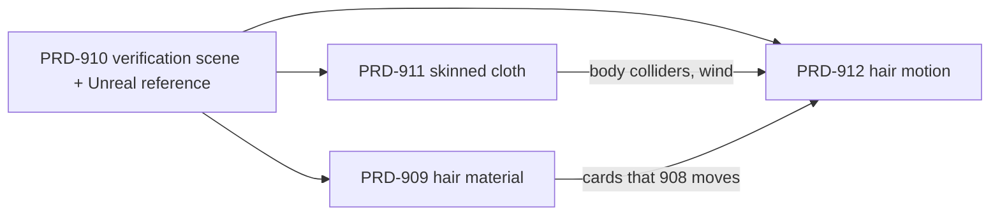

# Character dynamics epic: capes, cloth and hair on animated characters

**Status:** PROPOSED (2026-11-22). The baseline scene exists and was measured; no PRD work has started.
**Goal (owner, 2026-11-22):** "we already have some cloth/hair implementation, but i dont think its good enough. Not validated enough." A request such as "a knight with a cape and a ponytail" gets cloth and hair that move like Unreal's, on the owned Wasm/C++ engine, at a cost the frame does not notice.

## The four PRDs

| PRD | Outcome | Depends on |
|---|---|---|
| [PRD-910](PRD-910-a-running-character-proves-its-cape-and-hair-in-one-scene.md) | One verification scene measures cape and hair on a running, turning, jumping mannequin, against an Unreal 5.8.3 reference | none |
| [PRD-911](PRD-911-a-cape-on-a-skinned-character-trails-swings-and-stays-out-of-the-body.md) | `SoftBody3D` simulates cloth on a skinned character: skinned pins, XPBD, tethers, body capsules, teleport guards | 906 |
| [PRD-912](PRD-912-hair-swings-with-the-head-and-stays-out-of-the-body.md) | Hair and bone chains swing with the head: a spring bone chain and GPU guide strands | 906, 907 (colliders, wind) |
| [PRD-909](PRD-909-hair-cards-read-as-hair-under-any-light.md) | Hair cards read as hair: a generated hair material with coverage, root-tip colour and an anisotropic highlight | 906 |

## What we have today (measured 2026-11-22)

`SoftBody3D` (`packages/core/src/softbody.ts`) is one explicit mass-spring kernel in TSL compute: one spring per triangle edge, one stiffness, exponential damping, pins that snap to their initial **local** position, axis-aligned box collisions, and simulation in the mesh's local space. It has no bend, tether, body collider, skinning link, teleport guard or self-collision. It cannot be parented under a bone, because a reparent fires `removed` and that detaches it. Hair has no code: [PRD-671](../rendering/PRD-671-a-character-wears-strand-hair-that-catches-light-along-each-strand.md) (strands) and [PRD-VQ-15](../../rendering/PRD-VQ-15-hair-card-material-qualification.md) (cards) never started.

Baseline run: `examples/character-dynamics`, `?arm=softbody`, owned Wasm engine, RTX 2080, headed WebGPU. The cape gets the incumbent's best chance: its frame follows `spine_03` every tick and its gravity is turned into that frame.

| Phase | Hem offset in body frame | Max stretch | Cape vertices in torso |
|---|---|---|---|
| settle | 0.00 m | 3.5% | 9 |
| jog | 0.42 m | 139% | 9 |
| jog + turn | 0.75 m | 139% | 26 |
| sprint | 0.75 m | 135% | 29 |
| hard stop | 0.63 m | 135% | 29 |
| jump | 0.63 m | 141% | 21 |
| snap turn | 0.73 m | 141% | 19 |
| teleport 8 m | 0.73 m | 112% | 23 |

❌ The cape reads as a stiff board, never trails the motion (it lives in the body frame), stretches to 2.4× its length, and passes through the legs. Upstream three.js gives the same numbers (max stretch 135%), so the fault is the solver, not the engine. ⚠️ The owned engine also logs `createBindGroup ... resource ... undefined` three times in `WebGPURenderer.render` on this scene (PRD-910 owns the fix).

## What Unreal does (UE 5.8.3, read 2026-11-22)

- **Solver.** Chaos Cloth `Softs::FEvolution`, one substep at 60 Hz and one iteration by default. Each substep sets kinematic particles to the interpolated animation, integrates, then runs XPBD stretch, bend and area, then long-range tethers, max distance, backstop and anim drive, then collisions. `UE 5.8.3: Engine/Source/Runtime/Experimental/Chaos/Private/Chaos/SoftsEvolution.cpp:428-640`, `Engine/Plugins/ChaosCloth/Source/ChaosCloth/Private/ChaosCloth/ChaosClothConstraints.cpp:1311-1563`.
- **Inertia, not world or local space.** It simulates in a reference-bone space and gives the cloth back only part of the frame motion: linear and angular velocity scale 0.75, plus fictitious forces. `ChaosClothingSimulationSolver.cpp:1129-1330`, `Public/ChaosCloth/ChaosClothConfig.h:413,446`.
- **Guards.** A teleport past 300 cm, or a dt above 1.5× the max physics delta, drops velocity. A reset restores the animated pose. An edge-ratio check resets an exploded cloth. `Engine/Source/Runtime/Engine/Private/Components/SkeletalMeshComponent.cpp:471-473`, `ChaosClothingSimulationSolver.cpp:2293-2330`.
- **Body.** Physics-asset spheres and capsules follow bones. They are interpolated per substep with thickness 1 cm and friction 0.8. `ChaosClothingSimulationSolver.cpp:252-285`, `Chaos/Public/Chaos/PBDSoftBodyCollisionConstraint.h:215-217`.
- **Hair.** The groom solver runs as Niagara with 5 substeps, 5 iterations, stretch 1, bend 0.01 and air drag 0.1. Guide strands drive render strands by root-frame interpolation. `Engine/Plugins/Runtime/HairStrands/Source/HairStrandsCore/Private/GroomAssetPhysics.cpp:8-80`, `Shaders/Private/NiagaraInterpolateGroomGuides.usf:104-147`. The cheap path is `AnimNode_SpringBone` (stiffness 50, damping 4, step 1/120) and AnimDynamics. `Engine/Source/Runtime/AnimGraphRuntime/Private/BoneControllers/AnimNode_SpringBone.cpp:16-20`.

Licence rule: we borrow Unreal's algorithm, defaults and guards. We do not copy its code.

## What we reuse (all MIT, cloned 2026-11-22)

| Repo | Use | Why |
|---|---|---|
| [three-simplecloth](https://github.com/bandinopla/three-simplecloth) | **Vendor verbatim** (`src/SimpleCloth.ts`, 1,073 lines, three ^0.182, TSL) | Only repo with skinned pins (`computeSkinning`), a vertex-colour cloth mask, bone sphere colliders and a teleport snap |
| [threejs-particle-fluids](https://github.com/dgreenheck/threejs-particle-fluids) | **Vendor the cloth files** (`src/cloth/` XPBD stretch, dihedral bend, tethers, aero; about 1,480 lines) | XPBD with substeps, tethers to pins, per-triangle drag and lift, swept primitive colliders |
| [frostbitten-hair-webgpu](https://github.com/Scthe/frostbitten-hair-webgpu) | **Transliterate the strand simulation** WGSL to TSL (about 500 lines) | Frostbite-style guide strands: length, global shape, local shape, sphere and SDF collision |
| [threejs-hair-shader](https://github.com/creategamecharacters/threejs-hair-shader) | **Vendor the TSL card path** (about 100 lines of `hairNodes`) | Coverage atlas, root-tip colour, per-strand jitter, alpha-to-coverage plus opaque core |
| [breeze](https://github.com/holtsetio/breeze) | Reference only | Same spring scheme as simplecloth. The BVH mesh collider is an idea for later |

Owner rule (2026-11-03): copy an MIT upstream verbatim with its licence notice. Change only what our renderer cannot run. Each vendored file keeps its header, and `THIRD_PARTY_NOTICES.md` names it.

## Rules for every PRD here

1. **Owned engine first, measured.** Every kernel is TSL compute that runs on the owned Wasm/C++ engine (`engine: "threenative"`, the default) and on the desktop host. The sim stays on the GPU: zero CPU readback in steady state, with readback only on request. The budget is cape plus hair simulation ≤ 0.5 ms GPU at 1080p on the RTX 2080 owned-engine lane, with CPU submission ≤ 0.1 ms per frame. `engine: "threejs"` is the control arm in every perf claim.
2. **Flexible and searchable.** Each new API is an option on a Godot-named node (`SoftBody3D`, `Skeleton3D` modifiers). Every value has a named override on the same object. Each export carries `@situation`, `@constraint`, `@override` and `@example`, so `engine_search_capabilities` returns it for "cape", "skirt", "cloth on a character", "hair", "ponytail" and "hair cards". A PRD is not done until a cold search for its situation returns its row first.
3. **Auto by default.** The engine measures what it can: body capsules from the skeleton and skin weights, the cloth mask from vertex colour or skin weights, the rest lengths, and the teleport threshold from the character's height. The game overrides each one by name.
4. **Mechanism in `packages/core`, look in generated `src/render/`.** The solver, colliders and wind sit in core. The hair material, cape material and colours sit in the template source.
5. **One proof scene.** Every claim is a number from `examples/character-dynamics` (PRD-910), on the owned engine, compared with the Unreal reference run of the same scene.
