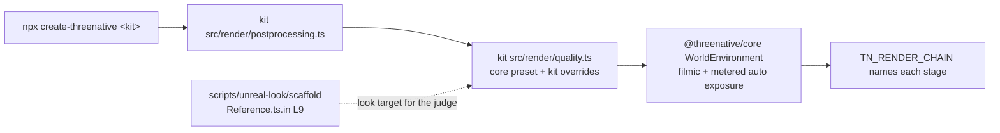

# PRD-723 — Every template's own game looks like Unreal on the engine defaults

**Status:** NOT STARTED
**Priority:** P1 — no create-threenative kit gets the Unreal defaults that #541 put in `packages/core`: all 13 kits still pin ACES and a fixed exposure, so the owner's goal ("this PR is useless if we dont change the starter kit templates to use our defaults") stays open until every kit box below is ticked.
**Complexity:** 5 (MEDIUM) — 11+ implementation files across 13 kits (+3), `packages/core` and `create-threenative` release separately (+2); risk override: every kit that `create-threenative` scaffolds changes on screen and each kit carries a frame budget.
**Owner:** João
**Depends on:** [PRD-632](PRD-632-the-frame-is-exposed-and-tone-mapped-the-way-a-fresh-unreal-project-is.md) (the core defaults, on develop through #541). [PRD-722](https://github.com/ThreeNativeHQ/threenative-engine/blob/lane/sunwarm/docs/PRDs/Unreal/look/PRD-722-every-kit-and-every-default-scene-renders-the-unreal-look.md) Phase 2 (sky, GI cache and traced reflections in core) is not gating: once the kits import the look from core, that work reaches them with no kit edit.

## Context

#541 (2026-10-23) made the Unreal 5.8.3 look the `packages/core` default. `new WorldEnvironment()` with no options starts from the core `high` tier: `tonemapMode: "filmic"`, `autoExposureEnabled: true`, local exposure, Unreal bloom, GTAO, screen probe gather, temporal AA (`packages/core/src/look/quality.ts:85-122`, `packages/core/src/look/world-environment.ts:645`).

No kit reaches that code. The cause has two parts, the same in all 13 kits:

| Layer | What the kit runs | Effect |
| --- | --- | --- |
| Vendored chain | `src/render/worldEnvironment.ts` and 8 more files, copied from `packages/create-threenative/template-assets/` by `restampSharedRenderCopies` (`SHARED_RENDER_SOURCES`, `packages/create-threenative/src/index.ts:126`). All 13 copies are byte-identical (md5 aba7ccb1). | The copy predates the core move: `tonemapMode ?? "aces"`, `autoExposureEnabled ?? false`, no merge of a tier preset. |
| Kit preset | `src/render/quality.ts` `shared` sets `tonemapMode: "aces"`, `autoExposureEnabled: false` (shooter also `exposure: 0.62`). | An explicit override. Even the core class would keep ACES. |

Example, shooter: `src/render/postprocessing.ts:47` calls `new WorldEnvironment(qualityPreset(tier))`, both imported from the kit's own `src/render/`. The shooter `AGENTS.md` says "The finish is the Unreal 5.8.3 default, set in `src/render/quality.ts`", which is false: the agent docs describe a look the kit does not run.

The look target is the calibration harness, not a kit: `scripts/unreal-look/scaffold/Reference.ts.in` (PRD-631 reference room, layers L0 to L9; L9 has every system on) and `CalibrationScene.ts.in` (PRD-638 scenes from Unreal-exported GLBs). Both draw through `scripts/unreal-look/scaffold/render/` (atmosphere, clouds, GI cache, reflection capture, shadow tier). Those harness modules are not in core yet (PRD-722 Phase 2). This PRD ports no new Unreal feature; the Unreal source citations live in PRD-632 and PRD-636.

Published `@threenative/core` is 0.3.6 (2026-10-20), older than #541. The kits pin `"@threenative/core": "0.3.6"`, so a user who runs `npx create-threenative` today cannot get the defaults. The last box of this PRD publishes the cohort.

Owner orders, verbatim:
- 2026-10-22: "ThreeNative MUST HAVE UNREAL VISUAL DEFAULTS".
- 2026-10-23: "All scenes that go with create threenative app (eg. minimal tempate, etc etc) should be tweaked with our new unreal detaulf visuals."
- 2026-10-23: "once engine defaults land, then ahve a lane just to do this migration, also with visual judges for each migration (must have an improvement)".

## Solution

1. **Fix the shared layer once.** The kits import `WorldEnvironment`, `qualityPreset`, `qualityTiers` and the exposure nodes from `@threenative/core`. The vendored copies in `template-assets/` and in each kit are deleted, and `SHARED_RENDER_SOURCES` loses those entries. Each kit's `quality.ts` becomes `{ ...qualityPreset(tier) from core, ...kit overrides }`. In this step a kit keeps its old look: its overrides still list ACES and its fixed exposure, so the resolved options do not change.
2. **Write the convention down.** A convention missing from the templates' `AGENTS.md` does not exist. A nested `packages/create-threenative/templates/AGENTS.md` tells repo agents how a kit takes the look. Each kit's `AGENTS.md` states the real default and its named overrides.
3. **Migrate one kit at a time.** At most 3 kits in flight (one GPU lane), each merged on its own. Per kit:
   1. Delete the kit's ACES and fixed-exposure overrides, and any other line that only repeats a core default.
   2. Tune the kit's own lights, sky and materials (the look stays game-owned in `src/render/`) so its scene reads as the harness L9 look. Gameplay readability stays at least as good.
   3. If the kit breaks its frame budget, it selects a lower `renderChainTier` and its `quality.ts` says why. Never raise a budget, never drop the curve or the meter to meet one.
   4. Capture the kit's own game at the poses its playtest scenarios use: develop as BEFORE, the kit line as AFTER, 2 runs per arm, headed, `--browser-recipe webgpu`, `adapter.info` checked, default engine named from the boot log.
   5. A fresh read-only judge gets BEFORE, AFTER and the harness L9 frames (`pnpm unreal-look:judge --criteria <md> --out <json> --expect improvement`, or a fresh read-only subagent). **IMPROVEMENT is required.** NEUTRAL or REGRESSION means fix the cause and judge again.
   6. Post the sheet (`TN <kit> BEFORE <sha>` | `TN <kit> AFTER <sha>` | `HARNESS L9 <sha>`, large burned-in labels, crops of the gameplay subjects) to the `PRD-723-screenshots` orphan branch, and comment on the PR with the verdict, the SHA, region numbers and the kit's GPU ms before and after. The PR comment is the delivery.
   7. Run the kit's `test:templates` scenarios, the perf budget included.

Visual acceptance criteria for every kit judge: highlights roll off on the filmic shoulder (no flat clipped white), exposure settles with no visible pumping or flicker during play, shading and sky read closer to the harness L9 frame, and the gameplay subjects (player, enemies, crosshair, HUD, pickups) are at least as readable as BEFORE.

## Acceptance Criteria

Ticked through the phase boxes below; this section holds no boxes of its own.
- AC-1 [local]: each of the 13 kits, scaffolded by `create-threenative`, resolves its quality tiers from core and runs the filmic curve and metered auto exposure unless its `quality.ts` names the override and the reason. Proof: `kit-look-defaults.spec.ts`.
- AC-2 [local]: each kit's own game judges IMPROVEMENT against its develop frames, on browser WebGPU. Proof: one verdict per kit on the Phase 2 and 3 boxes.
- AC-3 [local]: `pnpm test:templates` passes on the head that holds all 13 migrations, with no budget or timeout raised.

- AC-4 [local]: a user's `npx create-threenative@latest <kit>` from the npm registry installs a `@threenative/core` that carries #541 and the migrated kits. Proof: the Phase 3 release box.

## Integration Ledger

| Capability | Reachable consumer/trigger | Replaces / disposition | Evidence |
|---|---|---|---|
| Kit look on the core defaults | `npx create-threenative <kit>` → kit `src/render/postprocessing.ts` (shooter: line 47) → kit `quality.ts` → core `WorldEnvironment` (`packages/core/src/look/world-environment.ts:645`) → `TN_RENDER_CHAIN` | Deletes the 9 vendored chain files per kit and in `template-assets/`, and their `SHARED_RENDER_SOURCES` entries (`packages/create-threenative/src/index.ts:126`) | Phase 1 |
| Look guidance for agents | A repo agent editing `packages/create-threenative/templates/**`; a game agent reading its scaffolded `AGENTS.md` | Replaces the false "Unreal 5.8.3 default" kit prose | Phase 1 |

## Decisions

- 2026-10-23 (João): the calibration scene is not a template. Templates are migrated on their own game scenes.
- 2026-10-23 (João, team-lead): the engine defaults land first, then one kit at a time, with a fresh judge per migration, and IMPROVEMENT is required.
- 2026-10-23 (team-lead): a box that names several kits ticks only when every kit it names has IMPROVEMENT and green scenarios, each kit's verdict written beside it. This is how 13 kits fit the 8-box cap.
- 2026-10-23 (agent, re-plan on develop): this file replaces the `lane/migrate-prd` draft (ddd18ab08), which waited on PRD-722 Phase 2. Reason: #541 already put the curve and the meter in core, and the root cause is the vendored chain plus the kit pins, which this PRD can fix now. The sky and GI recipe follow through core later.
- 2026-10-23 (agent): Phase 1 keeps every kit's look (resolved options identical) so the plumbing change and the look change land and judge apart.
- 2026-10-23 (João): add nested agent guidance about the Unreal defaults, pointing at the calibration scene that uses all of them. Taken as the Phase 1 guidance box.
- 2026-10-23 (João): "i dont think 0.3.6 carry these defaults, we should republish... maybe a good opportunity to do it here?" The release is the last box of this PRD, run with the registry auth in `~/.npmrc`, after the full template gate is green, so the published kits and the published core are one cohort.
- 2026-10-23 (agent): this PRD claims browser WebGPU only. Native desktop proof of the default look is PRD-722 AC-3.

## Execution Phases

#### Phase 1: The kits take the look from core, and the convention is written down
**Status:** NOT STARTED
**Files:** `packages/create-threenative/src/index.ts` (`SHARED_RENDER_SOURCES`), `packages/create-threenative/template-assets/{worldEnvironment,autoExposure,exposureGraph,exposureReadback,tonemap,localExposure,motionBlur,unrealBloom,vignette}.ts` (deleted), `packages/create-threenative/templates/*/src/render/{quality,postprocessing}.ts` and the same 9 copies per kit, `packages/create-threenative/templates/AGENTS.md` (new), `packages/create-threenative/templates/*/AGENTS.md`, `packages/create-threenative/__tests__/kit-look-defaults.spec.ts` (new)
- [ ] The 13 kits import the chain from `@threenative/core` and the vendored copies are gone, with each kit's resolved options per tier identical to develop. proof: `kit-look-defaults.spec.ts` deep-equals the old and new resolved options for 13 kits × 3 tiers; `pnpm typecheck`; `pnpm exec vitest run packages/create-threenative/__tests__/`; `pnpm tsx scripts/count-loc.ts` delta beside this box.
- [ ] `kit-look-defaults.spec.ts` fails for a kit that resolves anything but `tonemapMode: "filmic"` and `autoExposureEnabled: true` and is not on its override list with a reason; the list starts with all 13 kits and must be empty at the end of Phase 3. proof: the spec, red when one kit is removed from the list before its migration.
- [ ] Repo agents and game agents read the same convention. The nested `templates/AGENTS.md` says: the look comes from core, a kit overrides only in `quality.ts` with a reason, the tuning target is `Reference.ts.in` L9 and the `CalibrationScene.ts.in` scenes, every kit change needs a judged IMPROVEMENT, and a budget breach drops a tier, never the curve. Each kit `AGENTS.md` states its real default and the named overrides. proof: `pnpm sync:agents --check`, `pnpm check:docs`, `scripts/__tests__/primary-docs.spec.ts`.
**Verification:** the spec and typecheck above; no capture needed while the resolved options are identical.

#### Phase 2: The shooter, then the starter and minimal
**Status:** NOT STARTED
**Files:** `packages/create-threenative/templates/{shooter,starter,minimal}/src/render/*`, their playtest scenarios
- [ ] shooter is migrated: off the override list, judge IMPROVEMENT, scenarios pass (`performance.playtest.json` included). proof: judge verdict and sheet link on the PR, `test:templates` for shooter.
- [ ] starter and minimal are migrated: each judges IMPROVEMENT and their scenarios pass. Reuse the judged scene fixes on `lane/sunwarm` (PRD-722 Phase 1, `src/scenes/Play.ts` material-lighting order) where they fit the budget. proof: one verdict per kit on the PR, `test:templates` for each.
**Verification:** per-kit capture, fresh judge, kit scenarios, as in Solution step 3.

#### Phase 3: The other ten kits, the full gate and the release
**Status:** NOT STARTED
**Files:** `packages/create-threenative/templates/{racing,platformer,runner,action-rpg,rts,tower-defense,puzzle,sailing,rain,snow}/src/render/*`, the release cohort's `package.json` versions and the kit `@threenative/core` pins
- [ ] racing, platformer, runner, action-rpg, rts and tower-defense are migrated: each judges IMPROVEMENT and their scenarios pass. proof: one verdict per kit on the PR, `test:templates` for each.
- [ ] puzzle, sailing, rain and snow are migrated: rain's own post pass takes the core curve and meter, snow's frame budget holds, each judges IMPROVEMENT and their scenarios pass. proof: one verdict per kit on the PR, `test:templates` for each.
- [ ] `pnpm test:templates` passes on the head that holds all 13 migrations, the override list in `kit-look-defaults.spec.ts` is empty, and no budget or timeout was raised. proof: the gate result on the Debian laptop (AC-3).
- [ ] The release cohort ships: `@threenative/core` past 0.3.6 with #541, `create-threenative` past 0.2.10 with the 13 migrated kits pinned to it, and a cold `npx create-threenative@latest shooter` outside the repo boots and logs `TN_RENDER_CHAIN` with `filmic` and `autoExposure` applied. proof: `pnpm release:prepare`, the publish with `npm --userconfig .npmrc`, `npm view @threenative/core version`, then a `pnpm sandbox` scaffold of shooter (AC-4).
**Verification:** the full template gate once, then the release and one cold sandbox scaffold.
