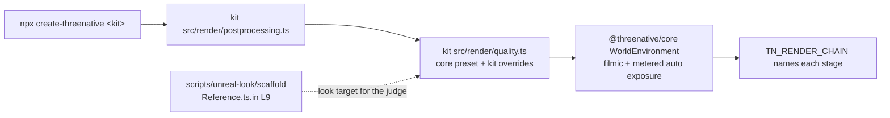

# PRD-723 — Every template's own game looks like Unreal on the engine defaults

**Status:** IN PROGRESS
**Priority:** P1 — no create-threenative kit gets the Unreal defaults that #541 put in `packages/core`: all 13 kits still pin ACES and a fixed exposure, so the owner's goal ("this PR is useless if we dont change the starter kit templates to use our defaults") stays open until every kit box below is ticked.
**Complexity:** 5 (MEDIUM) — 11+ implementation files across 13 kits (+3), `packages/core` and `create-threenative` release separately (+2); risk override: every kit that `create-threenative` scaffolds changes on screen and each kit carries a frame budget.
**Owner:** João
**Depends on:** [PRD-632](PRD-632-the-frame-is-exposed-and-tone-mapped-the-way-a-fresh-unreal-project-is.md) (the core defaults, on develop through #541). [PRD-722](https://github.com/ThreeNativeHQ/threenative-engine/blob/lane/sunwarm/docs/PRDs/Unreal/look/PRD-722-every-kit-and-every-default-scene-renders-the-unreal-look.md) Phase 2 (sky, GI cache and traced reflections in core) is not gating: once the kits import the look from core, that work reaches them with no kit edit.

## Context

#541 (2026-10-23) made the Unreal 5.8.3 look the `packages/core` default. `new WorldEnvironment()` with no options starts from the core `high` tier: `tonemapMode: "filmic"`, `autoExposureEnabled: true`, local exposure, Unreal bloom, GTAO, screen probe gather, temporal AA (`packages/core/src/look/quality.ts:85-122`, `packages/core/src/look/world-environment.ts:645`).

No kit reaches that code. The cause has two parts, the same in all 13 kits:

| Layer | What the kit runs | Effect |
| --- | --- | --- |
| Vendored chain | `src/render/worldEnvironment.ts` and 8 more files, copied from `packages/create-threenative/template-assets/` by `restampSharedRenderCopies` (`SHARED_RENDER_SOURCES`, `packages/create-threenative/src/index.ts:126`). All 13 copies are byte-identical (md5 aba7ccb1). | The copy predates the core move: `tonemapMode ?? "aces"`, `autoExposureEnabled ?? false`, no merge of a tier preset. |
| Kit preset | `src/render/quality.ts` `shared` sets `tonemapMode: "aces"`, `autoExposureEnabled: false` (shooter also `exposure: 0.62`). | An explicit override. Even the core class would keep ACES. |

Example, shooter: `src/render/postprocessing.ts:47` calls `new WorldEnvironment(qualityPreset(tier))`, both imported from the kit's own `src/render/`. The shooter `AGENTS.md` says "The finish is the Unreal 5.8.3 default, set in `src/render/quality.ts`", which is false: the agent docs describe a look the kit does not run.

The look target is the calibration harness, not a kit: `scripts/unreal-look/scaffold/Reference.ts.in` (PRD-631 reference room, layers L0 to L9; L9 has every system on) and `CalibrationScene.ts.in` (PRD-638 scenes from Unreal-exported GLBs). Both draw through `scripts/unreal-look/scaffold/render/` (atmosphere, clouds, GI cache, reflection capture, shadow tier). Those harness modules are not in core yet (PRD-722 Phase 2). This PRD ports no new Unreal feature; the Unreal source citations live in PRD-632 and PRD-636.

Published `@threenative/core` is 0.3.6 (2026-10-20), older than #541. The kits pin `"@threenative/core": "0.3.6"`, so a user who runs `npx create-threenative` today cannot get the defaults. The last box of this PRD publishes the cohort.

Owner orders, verbatim:
- 2026-10-22: "ThreeNative MUST HAVE UNREAL VISUAL DEFAULTS".
- 2026-10-23: "All scenes that go with create threenative app (eg. minimal tempate, etc etc) should be tweaked with our new unreal detaulf visuals."
- 2026-10-23: "once engine defaults land, then ahve a lane just to do this migration, also with visual judges for each migration (must have an improvement)".

## Solution

1. **Fix the shared layer once.** The kits import `WorldEnvironment`, `qualityPreset`, `qualityTiers` and the exposure nodes from `@threenative/core`. The vendored copies in `template-assets/` and in each kit are deleted, and `SHARED_RENDER_SOURCES` loses those entries. Each kit's `quality.ts` becomes `{ ...qualityPreset(tier) from core, ...kit overrides }`. In this step a kit keeps its old look: its overrides still list ACES and its fixed exposure, so the resolved options do not change.
2. **Write the convention down.** A convention missing from the templates' `AGENTS.md` does not exist. A nested `packages/create-threenative/templates/AGENTS.md` tells repo agents how a kit takes the look. Each kit's `AGENTS.md` states the real default and its named overrides.
3. **Migrate one kit at a time.** At most 3 kits in flight (one GPU lane), each merged on its own. Per kit:
   1. Delete the kit's ACES and fixed-exposure overrides, and any other line that only repeats a core default.
   2. Tune the kit's own lights, sky and materials (the look stays game-owned in `src/render/`) so its scene reads as the harness L9 look. Gameplay readability stays at least as good.
   3. If the kit breaks its frame budget, it selects a lower `renderChainTier` and its `quality.ts` says why. Never raise a budget, never drop the curve or the meter to meet one.
   4. Capture the kit's own game at the poses its playtest scenarios use: develop as BEFORE, the kit line as AFTER, 2 runs per arm, headed, `--browser-recipe webgpu`, `adapter.info` checked, default engine named from the boot log.
   5. A fresh read-only judge gets BEFORE, AFTER and the harness L9 frames (`pnpm unreal-look:judge --criteria <md> --out <json> --expect improvement`, or a fresh read-only subagent). **IMPROVEMENT is required.** NEUTRAL or REGRESSION means fix the cause and judge again.
   6. Post the sheet (`TN <kit> BEFORE <sha>` | `TN <kit> AFTER <sha>` | `HARNESS L9 <sha>`, large burned-in labels, crops of the gameplay subjects) to the `PRD-723-screenshots` orphan branch, and comment on the PR with the verdict, the SHA, region numbers and the kit's GPU ms before and after. The PR comment is the delivery.
   7. Only after the judge returns IMPROVEMENT, adjust the kit's tests that pin the old look to the new one, in the same commit as the verdict: the visual baseline (`pnpm visuals:baseline`), scenario colour and luma expectations, and specs that assert the old tone curve or exposure. A red look test before the verdict is expected and is not a reason to change the look or the test. Frame budgets and timeouts are not look tests and are never raised.
   8. Run the kit's `test:templates` scenarios, the perf budget included.

Risk, HUD colours: under the filmic curve an unlit `CanvasLayer` colour is curved too (#ff00ff reaches the screen as #f33ae0, PRD-724 Decisions). A kit scenario that asserts an exact HUD colour goes red. After the judge approves, fix it in the kit only with the named override on that check's subject, never by turning the curve off for the world. The real fix, a HUD composite after the curve on both engines, is the PRD-724 next step and is not in this PRD.

Visual acceptance criteria for every kit judge: highlights roll off on the filmic shoulder (no flat clipped white), exposure settles with no visible pumping or flicker during play, shading and sky read closer to the harness L9 frame, and the gameplay subjects (player, enemies, crosshair, HUD, pickups) are at least as readable as BEFORE.

## Acceptance Criteria

Ticked through the phase boxes below; this section holds no boxes of its own.
- AC-1 [local]: each of the 13 kits, scaffolded by `create-threenative`, resolves its quality tiers from core and runs the filmic curve and metered auto exposure unless its `quality.ts` names the override and the reason. Proof: `kit-look-defaults.spec.ts`.
- AC-2 [local]: each kit's own game judges IMPROVEMENT against its develop frames, on browser WebGPU. Proof: one verdict per kit on the Phase 2 and 3 boxes.
- AC-3 [local]: `pnpm test:templates` passes on the head that holds all 13 migrations, with no budget or timeout raised, and the golden-path journeys pass on the same head.
- AC-4 [local]: a user's `npx create-threenative@latest <kit>` from the npm registry installs a `@threenative/core` that carries #541 and the migrated kits. Proof: the Phase 3 release box.
- AC-5 [local]: the migrated shooter runs on the native desktop host with the core look applied or each refused stage reported. Proof: the Phase 2 desktop box.

## Integration Ledger

| Capability | Reachable consumer/trigger | Replaces / disposition | Evidence |
|---|---|---|---|
| Kit look on the core defaults | `npx create-threenative <kit>` → kit `src/render/postprocessing.ts` (shooter: line 47) → kit `quality.ts` → core `WorldEnvironment` (`packages/core/src/look/world-environment.ts:645`) → `TN_RENDER_CHAIN` | Deletes the 9 vendored chain files per kit and in `template-assets/`, and their `SHARED_RENDER_SOURCES` entries (`packages/create-threenative/src/index.ts:126`) | Phase 1 |
| Look guidance for agents | A repo agent editing `packages/create-threenative/templates/**`; a game agent reading its scaffolded `AGENTS.md` | Replaces the false "Unreal 5.8.3 default" kit prose | Phase 1 |

## Decisions

- 2026-10-23 (execution): preserve archived benchmark/proof records. The planned unscoped `rg` also matches six historical documentation artifacts; the live-consumer proof searches `packages`, `scripts` and `examples` (empty). The resolution experiment now names its explicitly supplied alternate module `resolutionControl.ts` and rewires its import, rather than writing an unused vendor filename.
- 2026-10-23 (execution): correct the planned generated-chain test runner to Vitest, which that existing file imports. Node's test runner rejects it; the same two checks pass under the repository runner. This changes no assertion or runtime coverage.

- 2026-10-23 (execution): one PR for this PRD, targeting develop; kit migrations are individual commits within it. Fresh visual judges use Sonnet 5.5 with high effort as requested. Phase 1 preserves resolved options before any look migration. Worktree: `.worktrees/prd-723`, branch `feat/prd-723-template-unreal-defaults`, base `53fbfa18b`. The initial checkpoint preceded verification; current results are recorded below.

- 2026-10-23 (João): the calibration scene is not a template. Templates are migrated on their own game scenes.
- 2026-10-23 (João, team-lead): the engine defaults land first, then one kit at a time, with a fresh judge per migration, and IMPROVEMENT is required.
- 2026-10-23 (team-lead): a box that names several kits ticks only when every kit it names has IMPROVEMENT and green scenarios, each kit's verdict written beside it. This is how 13 kits fit the 8-box cap.
- 2026-10-23 (agent, re-plan on develop): this file replaces the `lane/migrate-prd` draft (ddd18ab08), which waited on PRD-722 Phase 2. Reason: #541 already put the curve and the meter in core, and the root cause is the vendored chain plus the kit pins, which this PRD can fix now. The sky and GI recipe follow through core later.
- 2026-10-23 (agent): Phase 1 keeps every kit's look (resolved options identical) so the plumbing change and the look change land and judge apart.
- 2026-10-23 (João): add nested agent guidance about the Unreal defaults, pointing at the calibration scene that uses all of them. Taken as the Phase 1 guidance box.
- 2026-10-23 (João): "i dont think 0.3.6 carry these defaults, we should republish... maybe a good opportunity to do it here?" The release is the last box of this PRD, run through `pnpm release` (pnpm publish in dependency order, scaffolder last, clean-room install) after the full template gate is green, so the published kits and the published core are one cohort.
- 2026-10-23 (João): "related tests should be adjusted for this new visual, but after the visual judge approves it". Solution step 7: a test that pins the old look changes only after IMPROVEMENT, in the commit that records the verdict.
- 2026-10-23 (João, "fix in place"): this PRD claims browser WebGPU for every kit and the native desktop host for the shooter. Android, iOS and the other kits on desktop are not claimed; PRD-722 AC-3 owns the default look on the owned engines. The PRD has 10 boxes, 2 over the cap: the release and the desktop proof belong to this migration, and a separate PRD for each would only add a PR.

## Execution Phases

#### Phase 1: The kits take the look from core, and the convention is written down
**Status:** COMPLETE
**Files:** `packages/create-threenative/src/index.ts` (`SHARED_RENDER_SOURCES`), `packages/create-threenative/template-assets/{worldEnvironment,autoExposure,exposureGraph,exposureReadback,tonemap,localExposure,motionBlur,unrealBloom,vignette}.ts` (deleted), `packages/create-threenative/templates/*/src/render/{quality,postprocessing}.ts` and the same 9 copies per kit, `packages/create-threenative/templates/AGENTS.md` (new), `packages/create-threenative/templates/*/AGENTS.md`, `packages/create-threenative/__tests__/kit-look-defaults.spec.ts` (new).
Consumers of the vendored copies, each moved to core, retargeted or deleted as a duplicate of a core spec: `packages/create-threenative/__tests__/{world-environment-*,vignette,vq-volumetric-fog,looks,scaffold,starter-post-restart,platformer,shared-render-sources}.spec.ts`, `packages/runtime-native/tests/generated-render-chain.test.mjs`, `scripts/{stamp-template-render,template-quality,render-chain-capabilities}.ts`, `packages/{core,create-threenative}/capabilities.json` (rebuilt by `pnpm build`), and the game-agent docs `packages/create-threenative/agent-docs/references/{auto-exposure,visual-baseline,capability-reference}.md`.
- [x] The 13 kits import the chain from `@threenative/core` and the vendored copies are gone, with each kit's resolved options per tier identical to develop. proof: `kit-look-defaults.spec.ts` deep-equals the old and new resolved options for 13 kits × 3 tiers; `pnpm typecheck`; `pnpm exec vitest run packages/create-threenative/__tests__/`; `pnpm --filter @threenative/runtime-native exec vitest run tests/generated-render-chain.test.mjs`; `rg -l 'src/render/worldEnvironment' packages scripts examples` empty; `pnpm tsx scripts/count-loc.ts` passes (platformer 5220 LOC; existing report). Git diff from develop removes 49,284 net lines overall. Root typecheck passes; complete scaffolder suite passes 115 files / 1746 tests. After import organization and comment corrections, 117 focused tests pass plus the last two scaffold source/hash checks pass. Root lint passes with 1769 existing warnings; native generated-chain checks pass 2 tests; the live-consumer search is empty.
- [x] `kit-look-defaults.spec.ts` fails for a kit that resolves anything but `tonemapMode: "filmic"` and `autoExposureEnabled: true` and is not on its override list with a reason; the list starts with all 13 kits and must be empty at the end of Phase 3. proof: 50 tests pass; temporarily removing shooter from the override list makes its filmic assertion fail (exit 1), restoring it returns all 50 green. All 13 reason-bearing exceptions remain pending their visual migrations.
- [x] Repo agents and game agents read the same convention. The nested `templates/AGENTS.md` says: the look comes from core, a kit overrides only in `quality.ts` with a reason, the tuning target is `Reference.ts.in` L9 and the `CalibrationScene.ts.in` scenes, every kit change needs a judged IMPROVEMENT, and a budget breach drops a tier, never the curve. Each kit `AGENTS.md` states its real default and the named overrides. proof: `pnpm sync:agents --check` passes (27 mirrors); `pnpm check:docs` passes (3510 links, Unreal status current); `primary-docs.spec.ts` passes 8 tests; instruction budgets pass all 13 kits.
**Verification:** the spec and typecheck above preserve per-kit options. The separate upstream Three.js retained-GTAO correction also has the visual proof below.

Execution (2026-10-23): draft PR [#562](https://github.com/ThreeNativeHQ/threenative-engine/pull/562). Core chain imports and removal of the nine vendored modules are implemented locally. Contract: 50 passed (13 × 3 legacy preset comparisons included); chain, vignette and quality integration: 101 passed; related core retained-resolution tests: 35 passed. Root workspace build, root typecheck and root lint now pass (lint retains 1769 warnings). Historical meter and resolution-control routing have red-green coverage (17 and 9 tests); native generated-chain/contract checks pass 13 tests in the package Vitest project. Structural scaffold checks were 67/68, then both repaired ownership/hash checks passed; the final full scaffolder suite remains open. Structural file/hash expectations changed for the requested consolidation; pixel baselines, luma/colour assertions, frame budgets and timeouts are unchanged. Retargeting retained-resolution tests exposed upstream Three.js GTAO geometric-normal reconstruction bypassing retained-view samplers; the core correction preserves the owned-engine path and now passes the depth-read clamp test. A unit-test helper explicitly opts stage-isolation tests out of unrelated core effects. `node --test` cannot run the existing Vitest generated-chain spec: the actual runner is `pnpm --filter @threenative/runtime-native exec vitest run tests/generated-render-chain.test.mjs` (2 passed). Final package run: 111 files passed, 4 failed (1731 tests passed, 15 failed); the failures exposed platformer's old mock, the RTS instrumentation loader's CommonJS fallback for the now-ESM core import, fog fixture defaults and orphan exposure helpers/doc line caps. Focused repairs now pass 33 platformer/RTS/fog tests, 3 template contracts and 13 auto-exposure scaffold tests. Every kit retains its authored exposure policy; unused mechanism helpers were removed from the kit policy files. The measured structural hashes pass after those source changes. The final complete package rerun passes all 115 files / 1746 tests (240.52 seconds). Final lint, mirrors and structural source checks also pass; typecheck passed before the final import/comment-only changes. No kit has a visual verdict. Baseline workspace build passed on Debian; baseline shooter scaffold initially stopped at missing Wasm, now built locally with emsdk 6.0.11 (206 steps, exit 0). Shooter BEFORE run 1 passes all 34 scenarios on headed NVIDIA Turing WebGPU, using develop render sources and the baseline core distribution; captures are in `~/Downloads/PRD-723/shooter/BEFORE-run1`. Debian admission later refused work at 100°C (latest reading 97°C). BEFORE run 2 confirms ThreeNative in an added diagnostic-only boot observer; bullet-holes hit a 30000 ms bridge describe timeout during competing CPU work, so this run is not a green second arm. Run 2 finished 32/34 green: performance measured 36.4 ms p95 against 33 ms. The bullet-holes retry passes; performance remains an explicitly recorded baseline failure. The AFTER candidate uses core defaults while retaining the existing measured gather-off override; its scaffold check and web build pass, and two AFTER capture runs are in progress. Sonnet 5.5 high was successfully probed, with response metadata naming `claude-sonnet-5-5`.

Execution (2026-10-24): the shooter high-tier AFTER run 1 passes 34/34 scenarios (33 ms p95 against 33 ms); run 2 passes 33/34, failing performance at 34.5 ms p95. The first Sonnet 5.5 high batch rejects the look: 1 IMPROVEMENT, 13 NEUTRAL and 3 REGRESSION (breakable-shatters, debug-clear, enemy-reaches-walkway); the second batch times out without a verdict. No kit is visually accepted. A lower-tier candidate retains filmic and metered exposure; its full capture was stopped after the lighting regression was identified. A controlled environment-intensity test confirms IBL responds but does not repair the appearance; restored it. Actual deck texture samples expose a duplicate palette tint (effective luminance 0.03165 versus intended 0.17792); the one-line external candidate repair passes the albedo check (0.17784) and both walkway scenarios, with fresh visual judgment pending.

Native packaging initially rejects the new core `textureSize` import even though it is confined to the upstream-only retained-subrect branch. The desktop TSL facade now binds it to the existing explicit refused-at-use mechanism, matching Wasm; it does not claim native textureSize support. The regression test failed with the unbound export and now the owning bundle spec passes 9/9. A fresh scaffold's desktop build passes with this facade. Runtime verification remains open: ordinary `test:native` incorrectly requires the starter's production-readiness scenario, while the shooter's original survives scenario is rejected before launch because desktop visual assertions are unsupported. Neither failure proves rendered frames; the native box stays open.

Execution (2026-10-24, native verifier): ordinary owned-player desktop verification now generates a kit-independent native smoke through the existing playtest CLI. It requires the requested number of contiguous producer `present-return` observations and the runner's nonblank screenshot guards; strict `--consumer` qualification remains unchanged. The completion collector's existing defaults are unchanged. Red–green coverage includes 299/300 observations, wrong source, gaps, blank capture, failed-run cleanup and the actual CLI print path; 92 native verifier/consumer tests and 25 collector tests pass. The first installed run exposed an old v0.3.6 binary missing `StorageTexture`, which current C++ registers; no compatibility shim was added. A current-source host built at `894236e7f3f5a4634bfeadd2deb29216497d172e` passes the installed CLI with 300 contiguous native presents (sequence 49–348, 299 intervals over 7383.589 ms), zero runtime diagnostics and a nonblank 1280×720 screenshot, on the owned engine / NVIDIA RTX 2080 (`nvidia/turing`). This control retains ACES / fixed exposure 0.62, so it proves the verifier and binary closure, not the final migrated-look AC-5 box. The CLI's earlier success-message error was reproduced in a subprocess test and repaired before the exit-0 run.

Execution (2026-10-24, AO visual gate): fresh Sonnet 5.5 high inspects all five supplied images and returns IMPROVEMENT for the upstream Three.js retained-subrect correction. Both observations per arm pass six assertions and report `threejs`, NVIDIA/Turing, GTAO applied, no refused stages and retained scale 0.72. The identical fixture uses fixed exposure 0.62, meter off and single-sample world pass. The judge sees the erroneous 72% AO rectangle and ghost silhouettes disappear while real cast/contact shadows remain. [Paired AO sheet](https://github.com/ThreeNativeHQ/threenative-engine/blob/PRD-723-screenshots/ao/retained-gtao.png). Three captures end with `compiling:true`; near-identical repeated images support repeatability, not a steady-state or temporal claim. Initial multisample shader and mutable-dev-server attempts remain failed preflights, outside the four accepted observations. The exported BEFORE/AFTER core distributions differ by the nine-tap WorldEnvironment correction; archived source files are not used as the baseline runtime.

Execution (2026-10-24, template gate): Minimal's fresh scaffold passes every gameplay scenario, then the legacy structural guard fails because it still searches the deleted local chain for four stage markers. `inspectTemplate` now follows a same-file core WorldEnvironment import and construction to the authoritative core implementation, retaining all four stage checks and the local-pipeline path. A real all-kit red becomes green; 20 structural/template-runner tests pass, including rejection of an unused core import, wrong module and missing pipeline. The complete `TN_TEMPLATE_ONLY=minimal pnpm test:templates` command now passes locally at `1dd1c76e3`, including the tone-exposure negative control (underexposed fails, restored passes). A Debian attempt exits 75 before execution at 100°C, so it supplies no gate result; the final same-head Debian gates remain open. No budget, timeout or visual assertion changes accompany this repair. A later focused consumer run passes 155 tests and exposes one stale opt-in-only exposure scaffold assertion for accepted Minimal. That test now checks either the retained game policy or the core-backed game policy; the independent kit-default contract still controls which kits may migrate. The corrected scaffold/default tests pass 66 tests; Biome passes.

Execution (2026-10-24, native meter integration): the current-look shooter probe reaches two existing V8/Wasm parity gaps. V8 rejected the meter's `uniform(false)`; its facade now uses the same validated live numeric-lane/shader-bool wrapper already shipped on Wasm, with 26 related tests passing. Then V8 omitted `textureValue` from its existing texture-object argument classification; adding that operation routes the already-supported shared ABI correctly. A real-player red fails valid replacement; the green verifies replacement with `RenderTarget.texture` and rejection of an incompatible depth texture without losing the previous value. The incremental host build passes 48 steps; the scoped development manifest truthfully records dirty native source and exact source/binary hashes. The unchanged probe source then passes the installed CLI with 300 contiguous native presents (sequence 40–339, 299 intervals over 13640.869 ms), zero diagnostics and a nonblank 1280×720 screenshot on the owned engine / NVIDIA RTX 2080. It reports filmic and 32 measured/applied meter samples; the final exposure 0.09325 stops is settled against target 0.08917. The subrect controller's separate automatic-exposure-sampling refusal remains reported. Parent checks pass 35 tests (26 related TSL plus 9 native bundle checks). This is platform integration proof on the unapproved external candidate, not the final AC-5 migration verdict; rerun the approved source before ticking that box.

Execution (2026-10-24, restart regression): Starter's new look exposes black world output after restart even though gameplay assertions pass. A same-pose, no-simulation diagnostic isolates the owned environment bake: pending bit 1 and black output become pending 0 and visible output after the existing environment preparer; the post graph stays installed. The engine transition now reuses `warmUpScene` for a textured environment, preserving the existing no-environment fast path and compute-only path, and holds returned scene updates during admission. The unit first fails because restart never calls preparation, then passes; 129 related game/warm-up/compute tests pass. Starter's production scenario now checks a HUD-excluding world region after its first restart: original core mean 0 fails the unchanged minimum 16, corrected core mean 163.70 passes all six assertions on NVIDIA Turing WebGPU, and the screenshot is visually checked. Core build, root typecheck and lint pass (1771 warnings). The pre-push drift lane catches the changed Starter scenario in its byte-stability fixture (351 pass, 1 fails); its measured source hash is updated for that new regression assertion, and the focused byte-stability check passes. Both full browser AFTER runs pass all four scenarios. A separate desktop run using the original nine supported steps passes all five supported assertion groups, including 2.789 m movement against 0.5 m and zero diagnostics errors; all three restart PNGs contain world geometry, with HUD-free means 162.37/162.51/162.47 and black fraction 0, on NVIDIA RTX 2080. The native fixed-step count is not an observed-present claim. A prior derivative appended a 300-frame completion wait and failed movement because that changed the assertion observation window; its 469 actual presents remain recorded as a red command, and no collector or threshold changes were made. The later fresh browser judge approves all four Starter poses (recorded below); the canonical per-kit gate remains required. No frame budget or timeout is raised.

#### Phase 2: The shooter, then the starter and minimal
**Status:** IN PROGRESS
**Files:** `packages/create-threenative/templates/{shooter,starter,minimal}/src/{render,ui}/*`, their playtest scenarios, `packages/core/src/game.ts` and its focused test, `packages/runtime-native/scripts/verify-starter-desktop-base.mjs` and its focused test, `packages/playtest/src/runner/steps.ts` and its completion-window test
- [ ] shooter is migrated: off the override list, judge IMPROVEMENT, scenarios pass (`performance.playtest.json` included). proof: judge verdict and sheet link on the PR, `test:templates` for shooter.
- [x] starter and minimal are migrated: each judges IMPROVEMENT and their scenarios pass. Reuse the judged scene fixes on `lane/sunwarm` (PRD-722 Phase 1, `src/scenes/Play.ts` material-lighting order) where they fit the budget. proof: one verdict per kit on the PR, `test:templates` for each. **Minimal:** fresh Sonnet 5.5 high returns IMPROVEMENT overall and for all four poses (22/22 supplied images opened); the white-on-white lower legs and touch-knob fill remain readability watch items, with no judged regression. Both headed NVIDIA Turing / owned-engine runs per arm pass all four scenarios (16 observations). AFTER logs filmic and metered exposure applied; `play` p95 is 17.7/17.8 ms against 33 ms (BEFORE 17.7/17.7 ms). GPU samples are sparse: 0.38/0.38 ms BEFORE and 0.37/0.38 ms AFTER, one valid sample per run; these do not establish steady-state savings. The accepted quality/exposure policies now follow core, and minimal leaves the exception list (12 remain). Contract/material tests pass 56; changing the exception first reproduces the ACES/meter failures, and the scaffold source hash has a measured red–green update (2 checks pass). [Paired sheets](https://github.com/ThreeNativeHQ/threenative-engine/tree/PRD-723-screenshots/minimal) retain all four observations per pose. The filtered per-kit `test:templates` command passes locally at `1dd1c76e3`; the all-kit baseline and final same-head Debian gates remain pending. **Starter:** fresh Sonnet 5.5 high opens all 22 supplied images and returns IMPROVEMENT overall and for all four poses. Both new browser AFTER runs pass all four scenarios; the accepted quality/exposure source and existing-theme HUD backing are ported. Player/background lightness contrast and contact shadows are lighter but remain readable; the BEFORE production pose differs between observations, while both AFTER observations agree. These stills do not prove exposure behavior in motion; the historical live-motion failures remain recorded. The source/default contract has a real ACES/meter red before the port and passes 66 tests afterward. Three stale Starter look assertions are updated only after this verdict, and all 21 look tests pass. [Starter paired sheets and verdict](https://github.com/ThreeNativeHQ/threenative-engine/pull/562#issuecomment-6383091164) are delivered. The canonical Debian golden gate passes at clean bb01777df, including the packed install/build/scenario path and intentional broken-dependency negative control. The additional golden look pose also judges IMPROVEMENT ([paired sheet and verdict](https://github.com/ThreeNativeHQ/threenative-engine/pull/562#issuecomment-6383756293)); the replacement headroom/contrast guards pass all 23 scenario assertions. The owner-reported shadow is now fixed by arena-derived sun-camera coverage, with geometry and live contrast red–green regressions. A fresh targeted judge and two fresh migration batches approve all five current poses IMPROVEMENT. The complete local canonical Starter/Platformer golden path passes at clean pushed `0e2c4993745f174a4cecafecb6d99a2f86690c0f`, including final builds/artifact checks and the broken-dependency negative control. [Updated five-pose proof](https://github.com/ThreeNativeHQ/threenative-engine/tree/149b5e33e/starter-shadow-fix). This grouped box is complete again; final all-kit same-head Debian gates remain open.
- [ ] The migrated shooter runs on the native desktop host: 300 frames, a non-blank screenshot, and its log names `filmic` and `autoExposure` as applied or gives each refusal reason. proof: in a scaffolded shooter, `pnpm test:native`, then `node packages/playtest/dist/runner/cli.js playtests/survives.playtest.json --target desktop` (AC-5).
**Verification:** per-kit capture, fresh judge, kit scenarios, as in Solution step 3; the desktop run once, on the shooter.

#### Phase 3: The other ten kits, the full gate and the release
**Status:** IN PROGRESS
**Files:** `packages/create-threenative/templates/{racing,platformer,runner,action-rpg,rts,tower-defense,puzzle,sailing,rain,snow}/src/{render,ui}/*`, the release cohort's `package.json` versions and the kit `@threenative/core` pins
- [ ] racing, platformer, runner, action-rpg, rts and tower-defense are migrated: each judges IMPROVEMENT and their scenarios pass. proof: one verdict per kit on the PR, `test:templates` for each. **Racing:** the first judge rejects HUD contrast on brighter road/sky. The repair reuses opaque game-theme panels at the readouts, preserving text anchors. Both repaired AFTER runs pass all nine scenarios; fresh Sonnet 5.5 high opens 47 images and returns IMPROVEMENT overall (five improved, four neutral, no regressions). Static observations agree, but no boost flame/trail is visible and motion adaptation remains unverified. The core curve/meter remain on; the game retains named gather/SSR/sharpening overrides with their existing rough-tarmac/sky-artifact and 33 ms / 30 FPS reasons, without inventing isolated costs. Its approved source is ported (only import ordering and equivalent log-string formatting differ); its source/default contract passes 66 tests after the real legacy-preset red. [Racing paired sheets and verdict](https://github.com/ThreeNativeHQ/threenative-engine/pull/562#issuecomment-6383091349) are delivered. On clean `8ea807c66`, Debian `TN_TEMPLATE_ONLY=racing pnpm test:templates` passes, including the negative-control underexposed failure and restored tone success; captures use the requested host `:1` on Intel Gen-12LP WebGPU. The other five kits keep this box open.
- [ ] puzzle, sailing, rain and snow are migrated: rain's own post pass takes the core curve and meter, snow's frame budget holds, each judges IMPROVEMENT and their scenarios pass. proof: one verdict per kit on the PR, `test:templates` for each.
- [ ] `pnpm test:templates` and `pnpm verify:golden-path` pass on the head that holds all 13 migrations, the override list in `kit-look-defaults.spec.ts` is empty, and no budget or timeout was raised. proof: both gate results on the Debian laptop (AC-3).
- [ ] The release cohort ships: core, physics, ui, playtest and runtime-native past 0.3.6, engine-mcp if `pnpm release:prepare` selects it, and `create-threenative` past 0.2.10 last, with the 13 migrated kits pinned to the new cohort. The runtime-native prebuilt binaries exist for the new version (`native-release.yml`) before the scaffolder publishes. A cold `npx create-threenative@latest shooter` outside the repo boots and logs `TN_RENDER_CHAIN` with `filmic` and `autoExposure` applied. proof: `pnpm release:prepare`, `pnpm release` (dry), then `pnpm release --yes` or a `v*` tag that runs `npm-release.yml` (pnpm publish, never `npm publish`), its clean-room install, `npm view @threenative/core version`, then a `pnpm sandbox` scaffold of shooter (AC-4).
**Verification:** the full template gate once, then the release and one cold sandbox scaffold. A publish cannot be undone: the agent asks João once, after the dry run is green, before `--yes` or the tag.

Execution (2026-10-24, accepted Starter/Racing ports): the complete scaffolder run passes 1748 tests and fails one flat-guide line-budget assertion (Racing has 101 lines). The same guidance is folded into its existing look paragraph, reducing it to 97 lines; both agent mirrors are regenerated. The focused scaffold/template contract files pass 106 tests after measuring their new hashes; root typecheck, lint (1771 warnings) and docs pass. No budgets or timeouts change.

The subsequent root typecheck catches an optional-number comparison in the revised look test. That test now checks inheritance of the core sampling policy without imposing the obsolete fixed 16/8 ratio; all 21 look tests and root typecheck pass.

**AFK gate checkpoint (2026-10-24):** Debian clean `847fc080d` initialization passes frozen install, build and doctor. Starter uses `TN_GOLDEN_PATH_TEMPLATES=starter pnpm verify:golden-path`; gate3 exits 1 with invalid texture/device loss and failed diagnostics/frame difference. Racing does not run after that failure. The first texture-creation cause is absent from the log. The packaged Xvfb wrapper also overwrote the explicitly requested host DISPLAY `:1` with private `:2`; the shared wrapper now preserves the existing host opt-in. Wrapper red: 6 failed/11 passed; corrected wrapper plus capture-environment contracts: 36 passed. Actual canonical runtime rerun remains required; no acceptance box is claimed by the shell tests.

**Additional native display probe (2026-10-24):** the explicit host-display path connects to Xwayland `:0`, boots the current Starter bundle and logs measured/applied/settled metering, but its loading phase remains `collapsing` for 180000 ms. The runner exits 2 with `TN_PLAYTEST_STARTUP_NOT_READY`, before gameplay (zero observed test frames). This extra probe is failed; it does not replace the earlier passing private-display three-restart run. No startup guard or timeout is changed.

**Debian gate4 checkpoint (2026-10-24):** with the host display preserved, Starter has no unexpected device loss; its canonical golden-path gate fails only `starter-look` dark-pixel minima (whole frame 0.000109592 against 0.05 at luminance 0.25; center 0.011130952 against 0.02 at 0.4). These are separate look-fixture regions, beyond the four already judged regular poses. Capture and judge the exact fixture before replacing its legacy bounds. Racing's independent canonical gate and tone negative control pass.

**Shooter local-material checkpoint (2026-10-24):** the `.35` vehicle-material intensity was ignored because Three.js and the owned renderer deliberately use scene intensity when no material environment is bound. The external candidate now borrows the existing sky texture explicitly for glass and grey trim; the small construction check fails with `envMap: null` before the change and passes for both materials afterward. All six targeted runtime observations pass; fresh Sonnet 5.5 high opens 17 images and returns IMPROVEMENT overall (breakable neutral, debug-clear and walkway improved, no net regression). This remains three-pose evidence, with near-white floor, reduced shadow separation and faint impact debris recorded as watch items. The first full candidate run passes 33/34 scenarios; performance fails 39 ms p95 against 33 ms (1024 samples), plus its stale high-versus-medium tier assertion. No assertion, budget or timeout is changed. A real-display function trace passes as a diagnostic, but its continuous-input workload differs from the canonical scenario and mostly waits (89.8% main-thread idle, 3.7% GPU busy); it does not attribute the cost. Desktop load later measures 37–44 on 12 cores, so a controlled performance comparison remains required before attributing that failure to the material bindings. Shooter remains unapproved and its source is not ported.

**Starter additional look-pose acceptance (2026-10-24):** fresh Sonnet 5.5 high reads all seven images and returns IMPROVEMENT for the exact golden look pose, in addition to the four prior improved regular poses. It keeps the lower player-leg contrast as a watch item, with no visible regression. Both new captures have HUD-free world p99 215/255, clip/black fractions 0, and player-to-shadow-wall p99 delta 124. The fixture now retains its frame/sky nonblank and dark ceilings, while replacing only the two near-black occupancy minima with world headroom (mean 100–225, p99 ≤250, clip ≤0.005, black ≤0.01) and player/wall contrast ≥80. Its contract first fails because these two guards are absent; afterward all 21 look tests pass. The same guard evaluator accepts both real new captures and rejects white-world, black-world and flat-player controls. The complete scenario passes all 23 assertions locally; the Debian canonical golden rerun is still required, so the grouped box remains open. Related renderer/look/tone/adapter tests pass 143, root typecheck and lint pass (1771 warnings). No budget or timeout changes.

**Runner core attachment-limit regression (2026-10-24):** Runner preserves its existing documented `engine: "threejs"` override. Both baseline runs pass all three scenarios, but both core-default candidates emit repeated pipeline errors: seven RGBA16Float targets need 56 bytes/sample, while the browser device kept the portable 32-byte default despite an adapter capability of 128. The engine's existing adapter-limit negotiation now requests the supported larger color-attachment byte budget. A real helper red (`{}` instead of the required limit) becomes five passing tests; a 32-byte or absent adapter value still requests nothing. No game-stage workaround or unsupported limit request is added. The existing native upstream host already requests 64 bytes where supported, sufficient for 56, but a fresh native Runner run is unverified; its JS requiredLimits shim does not renegotiate the host-created device. The corrected browser `streams` case passes all five assertions with zero console errors; both complete after arms remain pending. Core build, root typecheck and lint pass (1771 warnings).

**Grouped Starter/Minimal completion (2026-10-24):** canonical Debian job prd723-starter-tone-gate5 exits 0 on clean frozen bb01777df with no scenario filters. It runs the entire Starter golden path, including the intended broken-vite-tarball install rejection. Admission waits for the laptop to cool from 98°C to 69°C; no guard is overridden. Together with the recorded Minimal per-kit gate and independent IMPROVEMENT verdicts, this completes the grouped phase box (4/10 PRD boxes); final all-kit same-head gates remain open. Additional core renderer tests pass all 105 tests across eight files.

**Current candidate review (2026-10-24):** Shooter's second unchanged full run captures all 34 poses and passes 33/34 scenarios; the remaining failure is the stale high-tier assertion, while the frame p95 passes at 17.6 ms against 33 ms (928 samples). The earlier 39 ms failure remains recorded. Broader fresh Sonnet 5.5 high batches reject the current candidate: faint debris, near-white bus/ground and weaker enemy/contact-shadow separation outweigh weapon/interior gains. Targeted approval therefore does not qualify Shooter. Source inspection confirms unchanged sun4.5 versus doubled sky fill2.5→5; a reversible external candidate restores the authored fill ratio before new two-arm observations. Its filmic curve and default meter stay enabled; no budgets or assertions change.

**Runner and Platformer checkpoint (2026-10-24):** both repaired Runner high-tier browser arms have zero console errors but exceed 33 ms at51.3/52 ms. Capping the external render chain to core medium passes the frame bounds at13.7/14.2 ms, but a fresh three-pose visual judge rejects weaker foot-contact occlusion. Restoring Runner's authored GTAO radius0.35 passes both new frame bounds at32.7/22.4 ms (672/667 samples), draws88/145 and triangles38370/45000, with zero console/network/runtime diagnostics. Only the old high-tier assertion remains red; visual acceptance is pending. The explicit Three.js engine override remains. Platformer's before/after sandbox installs, checks and web builds pass on Debian; a headed NVIDIA baseline scenario also passes when served from the built dist by Python. Full arms and visual review remain open.

Runner's fresh radius-repair judge improves both crash poses and accepts the foot contacts, but rejects a new dotted/stair-stepped right-rail edge in survives. Both arms report SMAA applied and temporal AA refused; core medium explicitly selects zero MSAA samples, whereas the authored high path retains four. The next external candidate restores those four samples; its runtime and visual verdicts remain open.

**Multisampled GTAO regression (2026-10-24):** Runner's four-sample candidate reaches a shared engine defect: reconstructed depth normals query `textureDimensions(multisampledDepth, 0)`, which WGSL rejects. The first complete probe reports92/24/24consoleerrors; the duplicate second attempt was stopped. A real compiled-WGSL regression fails on that exact illegal mip argument before the correction. Core now measures the scene pass's actual viewport for reconstruction, preserving the nine clamped depth taps and the owned-engine branch. Tests cover zero/four samples, multisample sample0 reads, retained clamps and928×520→784×440 resizing; all114related tests, the core build, root typecheck and lint pass (1771existing warnings). Cold source review finds the viewport correct while active, deactivated and resizing; actual Runner WebGPU replay remains pending. No broken-render frame timing is accepted.

Platformer's two complete BEFORE and two complete AFTER arms pass15/15scenarios each on headed NVIDIA Turing WebGPU, using built sandbox distributions served by Python. Two-observation paired sheets now cover all15poses; fresh Sonnet5.5high reviews are running. Runtime success does not constitute visual acceptance.

The first viewport-query correction passes retained shader tests but still fails actual Runner: metering refuses retained rendering, so that override never runs. This invalidated the fixture-coverage assumption. A second compiled-WGSL red reproduces the same illegal dimensions query on unretained four-sample depth; the correction now reconstructs through texture samplers on both upstream paths. All116related tests, core build, root typecheck and lint pass. The installed core distribution is3ecca24598b503c177144a19d4c085cecef6e7a815b5d61b47aeb1710f6bb66c. Cold review finds the equations match Three.js and notes clamped border reads differ from stock out-of-bounds loads; visual neutrality remains pending. The complete first corrected Runner arm has zero console/network/runtime diagnostics in all three scenarios; streams and survives pass, and performance passes31.8/33ms (678samples), failing only the stale high-tier assertion. The second arm and fresh visual review remain open.

Shooter's authored-fill candidate also fails its fresh17-image review: breakable shatter feedback regresses, while death and walkway are neutral. A controlled SSR-off diagnostic is prepared with all lighting, filmic and meter settings fixed; the existing source meters beauty before the reflection stage. No reflection cause or new visual acceptance is claimed before that probe. Platformer's first completed three-pose batch judges coyote, damage and dash IMPROVEMENT with no regressions; remaining coverage is pending.

**Starter shadow acceptance reopened (owner report,2026-10-24):** the owner identifies the sharp triangular shadow patch on Starter's rear wall. It is present in both original and migrated play/look captures, so prior no-regression approval did not resolve it. The grouped Starter/Minimal box is reopened until the caster/projection cause is reproduced, corrected and independently judged; earlier canonical gate results remain historical evidence. Shooter candidate work is held to keep at most three kits active (Starter,Runner,Platformer). No shadow-disabling workaround or new fixed extent has been applied.

**Starter shadow root cause and targeted proof (2026-10-24):** this belongs to generated Starter lighting: the fixed ±14 sun camera excludes part of the actual arena. Two adjacent rear-wall receivers at x9.4/x9.5 are both occluded by the side wall, but the latter projects beyond the shadow map and is incorrectly lit. The new geometry regression fails on that receiver before the fix and passes with coverage derived from the existing arena diagonal. All23related tests pass; sandbox check/build, two complete four-scenario AFTER arms and two shared golden look poses pass on headed NVIDIA Turing WebGPU. A fresh Sonnet5.5high judge reads the paired observations and returns IMPROVEMENT: the diagonal now joins the rear corner in both runs, with feet/contact, grid detail and HUD unchanged. The new playtest compares two wall regions: old runs differ−0.25/−1.45levels and fail minDelta15; fixed runs differ30.35/30.45 and pass. The assertion replay passes. Root typecheck and lint pass (1771existing warnings). Full five-pose migration review and the canonical Starter gate remain open; native shadow behavior and temporal stability are unverified.

**Runner accepted source checkpoint (2026-10-24):** both corrected four-sample arms have zero diagnostics, with frame p9531.8/29ms below33ms. A fresh Sonnet5.5high judge returns IMPROVEMENT for all three poses, including rail edges and foot contact. The exact accepted quality/exposure sources are ported; removing the pending-look exception gives a real red with the previous ACES preset and green after port. Only the observed render tier assertion changes high→medium; all draw/triangle/frame limits remain fixed. Core medium is the measured high-cost cap; authored radius0.35 and four-sample fallback AA are named overrides. The canonical Runner gate remains open.

**Platformer visual acceptance (2026-10-24):** all60observations pass (15scenarios × two runs × two arms). AFTER performance18.3/18.6ms remains below33ms. Five fresh Sonnet5.5high full-resolution batch judges return IMPROVEMENT for all15poses, followed by a fresh whole-kit consistency synthesis returning IMPROVEMENT from all ten required overview/reference/verdict inputs. The first synthesis timed out without a verdict after repeated detail reads; its transcript remains preserved. The accepted synthesis states its scope honestly: overview consistency plus binding independent full-resolution findings, not a repeated raw-frame review. It records lighter grass, softer contact, pale-accent margins and unverified temporal behavior as limitations. The exact accepted quality/exposure options are ported; the pending-look exception produces a real prior-ACES red and post-port green. The canonical Platformer gate remains open.

**Accepted-source validation checkpoint (2026-10-24):** Starter geometry/shadow, Runner and Platformer ports pass157related scaffolder/look/exposure/restart tests across6files. The first contract run exposed unformatted Platformer exposure source; Biome normalizes it and import order without changing options, then all157pass. Measured scaffold hashes are updated only for these three kits and the byte-stability check passes. Root typecheck, lint (1771existing warnings), docs links and Unreal port-map checks pass. Read-only Starter code review finds no actionable defect; cross-tier contrast margin remains unverified until the canonical lane. The first screenshot-branch push is rejected by the formatting hook; after correction the normal push succeeds. [Repeated shadow comparisons](https://github.com/ThreeNativeHQ/threenative-engine/tree/d752c94ed5a7224815d7726fba3ef40c709e11e8/starter-shadow-fix) are on PR562. Full five-pose Starter judgment and canonical gates remain open; no acceptance box is closed by this source checkpoint.

**Canonical Starter/Platformer checkpoint (2026-10-24):** `TN_GOLDEN_PATH_TEMPLATES=starter,platformer pnpm verify:golden-path` exits0 on clean pushed0e2c4993745f174a4cecafecb6d99a2f86690c0f, with every selected scenario, generated install/build, final artifact check and intentional broken-vite dependency negative control. The source stayed frozen throughout. Fresh complete Starter visual coverage is five/five IMPROVEMENT across two Sonnet5.5high migration batches, plus the independent targeted shadow IMPROVEMENT. The Starter/Minimal grouped box is restored to complete (4/10=40%). Platformer is independently qualified, but its group remains open until Runner's canonical gate passes. The full gate ran locally after fresh laptop samples98/97/97C could not admit work; desktop starting load33.46 is recorded, with no frame-budget relaxation.

**Remaining budgets contract conflict:** `pnpm budgets` exits1 at `check-core-boundary`, before later budget stages, with33findings across13kits. Its legacy SpectralOcean-only import allowlist conflicts with PRD723's mandatory core WorldEnvironment/preset/meter imports and their types. A narrow allowlist/type-re-export regression is being added; other packages, core subpaths, unlisted/look-owning symbols, namespace/default/dynamic/side-effect imports and runtime re-exports stay rejected. No budget threshold changes or broad module exemption are planned.

**Boundary-contract correction verified:** the exact ten-name shared default/type exception and named type re-exports now pass82boundary/look-default tests. The new PRD723 fixture fails before the correction and passes after; negative cases retain unlisted/mixed names, all forbidden import forms, runtime re-exports, other packages and core subpaths. A separate read-only diff review finds no actionable defect. The complete budgets chain advances past the boundary and evidence checks, then stops on the native coverage report freshness check. Its actual coverage measurement is running; overall budgets remains red until that result is refreshed and the entire command passes.

**Native coverage measurement result:** the shipped actual measurement exits1 after its build, naming `native_engine_template_post_packages` and `native_engine_template_post_starter` as failed execution cases. No coverage digest is edited or report accepted. Focused child-error diagnosis is in progress; overall budgets remains red. The direct legacy coverage command has no `artifacts/gates/status.json` (gate:status exits1), so its real process/log is used for observation; it is not claimed resumable through gate:resume.

**Next kit candidates:** Shooter's two photo-camera three-pose arms pass, and a fresh Sonnet5.5high review opens all17inputs and judges death/walkway IMPROVEMENT, breakable-shatters NEUTRAL, overall IMPROVEMENT with no confirmed regression. Debris timing remains an explicit open item before whole-kit acceptance; anchored captures use the existing startTick mechanism. Action RPG's baseline/candidate scaffold, install, typecheck/lint/format checks and web builds pass. Its diagnostic observer required formatting only; no authored game rendering behavior is changed beyond the candidate's core quality/exposure defaults. No new kit acceptance box closes on these preparations.

**Strict remaining-gate diagnosis (2026-10-24):** Runner canonical gate8 at frozen0e follows a fresh69°C/load0.65 admission and doctor; the scenario runner again fails, with generated project retained at `/tmp/threenative-template-playtests-NRd0Dn/runner` for diagnosis. No flaky retry is accepted. Native static export has distinct constructor/backend mismatch, sampled-normal receiver, SSR and automatic-exposure accounting gaps; existing local-exposure parity does not prove the meter. No coverage digest or stage refusal is suppressed. Shooter's four fixed-step anchored observations share exact shard geometry at tick311; fresh Sonnet5.5high resolves the timing confound but returns REGRESSION on tiny debris/scuff contrast. Radius0.35 alone only partly restores contact; an external full-light-AO probe tests the old authored composite semantics. Action RPG core-high fails277.5ms/187draws and medium fails52.6ms/150draws against unchanged33ms/140draw limits; an authored no-SSR medium probe is pending. Neither kit is approved.

**Sampled-normal export correction (2026-10-24):** the real `{sample:Fn}` normal receiver used by core GTAO is not a texture node. Exporting it directly fails `TN_TSL_EXPORT_INVALID`; materializing its exact expression into an existing full-resolution RTT preserves native texture-input semantics. The existing native post-normal harness now fails before the correction and passes afterward, including strict rejection of arbitrary objects. On actual Vulkan RTX2080, both box/plane materialized-normal images are byte-identical to direct-texture controls in two independent runs:603occluded box pixels,0plane pixels,47536written unit normals with all three expected face directions. Fresh Sonnet5.5high visual inspection returns NEUTRAL for both frames and overall ([paired images and verdict](https://github.com/ThreeNativeHQ/threenative-engine/tree/21037e89467b461210b08221550996ddd4840cce/native-normal-export)); it explicitly claims native offscreen stills only, with no browser/temporal claim. Root typecheck and lint pass (1772warnings). The two complete template-post executors still fail on separate upstream constructor/backend and unsupported-stage gaps; overall native coverage/budgets remain red.

**Runner handshake root correction (2026-10-24):** canonical gates7/8 fail the same initial describe30s handshake while the renderer remains alive and metering, because the start gate follows the full environment warm-up promise. The existing logical-entry contract requires registered-world capabilities, while the subsequent readiness check owns warm-up. A one-shot scene-entry notification now resolves describe after actual destination entry; public goto, readiness and fixed-step frame gating still wait for the original warm-up. The deferred-environment regression fails before the correction and passes afterward;150related playtest/game/warm-up tests pass. Independent source review finds no actionable defect. All timeouts and frame budgets are unchanged; actual canonical replay remains open.

**Action RPG contention checkpoint (2026-10-24):** production noSSR still fails desktop p9539.9ms, but passes138draws/179678triangles and zero diagnostics. An actual production trace shows67%main-thread idle and10%GPUbusy while desktop load reaches55.67, so more blind GPU cuts are unjustified. The exact installed external candidate is copied into the owning Debian lane's ignored sandbox. Its unchanged performance scenario passes on actual headed Intelgen12lp WebGPU:731samples,p9533/33ms,138/140draws,179678/185000triangles,FPS50/30, expected/observed integrated medium tier and zero diagnostics. Original source0e remains untouched; complete two-arm observations now run for all8scenarios. This is a boundary pass with no headroom, not a completed kit migration.

**Actual cost checkpoint (2026-10-24):** clean pushed `2c794badc` Runner canonical replay passes logical-entry/ready and observes 606 performance frames, but fails the unchanged p95 budget: 96.8 ms locally; Debian gate9 151 ms and 10.05 FPS against 33 ms / 30 FPS. Streams, survives and the real-frame boot check pass; no runtime diagnostic errors. Gate9 records steady GPU other-post 92.6 ms versus main 1.3 ms and shadow 0.7 ms, so an external SSR ablation replaces further canonical retries. Action RPG's two complete baseline/candidate arms preserve all 28 non-performance observations; medium/no-SSR repeats 33.7 ms twice. Four-sample GTAO repeats 33.8/33.1 ms, still above 33; all 14 other observations pass. The Intel trace identifies GPU activity 92% and other-post 17.1 of 19.41 ms. A separate local-exposure ablation is diagnostic, not an accepted migration. No budget, timeout or visual requirement changes.

**Native fixture and facade proof (2026-10-24):** the template exporter now constructs nodes with a real WebGPU backend context, preserves optional GTAO screen reach and declares actual current G-buffer inputs. All 13 template static exports pass Tint: 36 graphs and 3 no-post chains, 39 accounted, zero failures. A live SSGI regression exposed V8 addon construction bypassing the existing public `uniform` and `rtt` wrappers; supplying those wrappers fixes the camera callback and four-argument render-texture API without adding a new native feature. The real constructor test is red–green; 36 related facade tests and 17 conformance contracts pass. Root typecheck passes after correcting the test's unknown-value boundary; root lint passes with 1772 warnings. A drawing-buffer-sized linear byte texture makes automatic exposure's absolute-pixel readback valid: native luminance 0.18039219, target/current 0.99685991 stops, applied/measured/settled true. Two owned-browser and two native observations of metering/local bloom and actual GI are pixel-identical; a fresh Sonnet 5.5 high judge returns NEUTRAL for both and overall. This establishes static parity between the owned Wasm and V8 implementations; native SSGI's documented neutral AO output proves no GTAO behavior. The stronger upstream Three.js SSGI comparison remains failed (GI-half mismatch 17.47%, AO-half 12.07% against 6%); its algorithms/defaults differ and its tolerances remain unchanged. The authoritative `pnpm --filter @threenative/runtime-native native:coverage` finishes exit 0: 51,910/63,850 lines overall (81.30%) and 32,108/38,581 engine lines (83.22%, unchanged floor 82.22%). Its generated committed report is refreshed by the tool. Docs pass 3510 links and Unreal status. `pnpm budgets` initially exposed the template-quality parser assuming private `const low/medium/high`. The checker now evaluates each actual public delegated factory for all three tiers, validates its returned tier/stage values and unknown-tier rejection, and retains legacy declarations plus authored/shared cost checks. Its actual red–green regression passes 27 tests; the original full `pnpm budgets` command now exits 0. Root typecheck and direct 13-kit quality validation pass. Upstream SSGI parity and the PRD migration gates remain open.

**ARPG observation correction (2026-10-24):** recorded backend identity confirms this kit uses its explicit `engine:"threejs"` override. All earlier candidate AO4/no-SSR measurements had refused AO (`TN_AO_REACH_UNSUPPORTED`), so those observations establish no executed AO sample-cost reduction. Restoring the original authored `gtaoRadius:0.35` removes the refusal and applies AO, but the unchanged Intel test fails at 48.1 ms / 22.67 FPS (729 samples, 135 draws, 179675 triangles). GPU time is 39.71 ms with 36.6 ms other-post. The run starts at 100°C after a 91°C admission; its thermal limitation is retained. A half-resolution AO probe is separate and unverified; no migration is accepted from a dropped stage.

**Runner real-display qualification (2026-10-24):** the SSR-off candidate retains the existing logical high-to-medium cap, MSAA4, 0.35 m contact radius and core filmic/meter. On the actual NVIDIA/Turing desktop display, both complete candidate runs pass all three scenarios; performance observes 606 frames and p95 17.0/20.3 ms against the unchanged 33 ms ceiling. Both baseline runs use that same display and identical performance ticks/player pose; baseline run1 alone fails its triangle bound (55153 against 45000), retained without retry or visual credit. A fresh Sonnet 5.5 high opens all 17 required images and judges performance, streams, survives and overall IMPROVEMENT. Static captures do not establish temporal stability; dust age and unseen obstacles/pickups remain limitations. The approved SSR-off option is ported with its named rough-track reason. Its all-tier SSR regression is red–green; 131 related tests, the regenerated Runner-only scaffold hash, mirrors, root typecheck and lint (1775 warnings) pass. Canonical packed qualification on this source remains pending, so the grouped migration box stays open.

**Runner packed-gate status (2026-10-24):** on clean pushed `274ee81d0`, the canonical packed gate passes production performance with 606 frames on the real NVIDIA/Turing display. The next scenario fails initial navigation (`TN_PLAYTEST_PAGE_UNREACHABLE`, unexpected `www.127.0.0.1.com` request), before gameplay observations; the batch exits 1. A separate real-frame boot passes 60 frames, but does not replace that missing scenario. Read-only lifecycle inspection finds the preview server is shared and stopped only after the batch; the navigation cause remains unproven. Candidate visual approval stands; canonical qualification stays open.

**ARPG executed-AO checkpoint (2026-10-24):** the external Three.js/Intel Gen12LP candidate retains authored radius0.35, uses four AO samples at quarter resolution with its inline AO denoiser disabled, caps the chain to medium, and disables SSR/local exposure while retaining core filmic/automatic metering. All eight unchanged scenarios pass in both runs (16/16), including p95 23.8/27.2 ms against33 ms. AO is applied without a refusal in every observation. Runs start at87/98°C; no quiet or cool-machine claim is made. Four fresh Sonnet 5.5 high sessions reject this candidate: the synthesis opens all42 images and all three batch verdicts, marking performance/progress/survives/touch-controls/win REGRESSION for coarse AO smudges, grainy halos, wall speckle and weaker weapon contrast. Combat/fail/inventory are NEUTRAL. All required reads succeed; these performance observations do not approve the migration. A radius1 inline-filter probe fails44.2 ms/25.18 FPS (660 frames,727 samples), with actual AO applied and no dropped stages; steady GPU35.5 ms includes32.4 ms other-post. Admission is69°C but execution starts100°C/load0.31. No retry or visual pose is used. An upstream-only fractional-filter materialization experiment is separate and unverified; native/default-scale behavior must remain unchanged.

**RTS meter-cost isolation (2026-10-24):** the first unchanged baseline performance scenario passes17.2 ms, while the filmic/meter candidate fails42.6 ms. Both use the owned engine on NVIDIA/Turing,1920×1080/MSAA4,116 draws and96614 triangles. The existing real-display trace passes and records GPU52.5% busy, main-thread idle19.1%, with distributed render/wrapper work. A single external meter-off negative control, retaining filmic and all authored stages, passes17.7 ms: steady CPU render p95 falls28.2→11.0 ms and mean GPU7.48→5.36 ms. A second meter-on control passes at32.0 ms/77.51 FPS (721 samples), so the magnitude varies and the first failure is retained. These controls associate cost with the enabled-meter path, without establishing a specific function or complete causal explanation. Disabling automatic exposure is diagnostic only; no RTS migration or visual result is accepted.

**Owned-browser nested exposure side work (2026-10-24):** the mechanism layer’s `bindWebEngine` callback repeats global collection/audio updates during each nested exposure quad. An actual-binding test reproduces six collection calls instead of one. A reentrant guard retains every nested TSL sync, including in-place vector writes and exception recovery, while collection/audio run only for the outer render. Red–green and31 related tests pass; the corrected vector regression passes4/4. Root typecheck, lint (1775 warnings), budgets, core and scaffolder builds pass. The genuine installed scaffolder runtime changes9dedc4a8→a7539102, while core6dbea46f and emitted Wasm17371072 remain unchanged. Both hardware candidate performance observations pass17.4/32.7 ms and96.15/70.42 FPS; controls were42.6/32.0 ms and48.07/77.51 FPS, so stable speedup is not established. A fresh Sonnet 5.5 high reads all5 required images, confirms aligned poses and returns NEUTRAL with no visible terrain, lighting, unit, contact-shadow or HUD regression. Static captures do not establish temporal/adaptation/audio behavior. Full RTS migration remains open.

**RTS full external observations (2026-10-24):** all28 before/after observations pass across seven scenarios, two runs per arm. This consists of25 new captures and3 explicitly attributed, verbatim performance observations from the frozen control/guard runs; no replay is invented. Every new capture uses the real DISPLAY0 NVIDIA/Turing adapter. Runtime/core/render-source/dist/Wasm hashes remain unchanged across the complete arms, with no retries, budget changes or tier assertion edits. The second original baseline performance observes17.1 ms/128.2 FPS. Seven historical per-pose reviews report IMPROVEMENT, but the local capture/helper directory subsequently disappears before synthesis. Only terminal summaries survive; original images/verdict reasons cannot be reconstructed. This set does not establish whole-kit acceptance. Rebuilt frozen before/after projects require fresh complete captures and judgments.

**Shooter preflight criterion consistency (2026-10-24):** the narrower-radius0.175/scale3 probe receives an IMPROVEMENT enum after7/7 required reads, but the judge also confirms three tiny specks are paler/lower contrast. That contradicts the predeclared hard rejection of confirmed fainter gameplay cues. An independent read-only adjudication marks this gate not admissible; no Shooter migration is accepted from that enum. The subsequent scale4 probe passes both anchored runtime captures but its fresh Sonnet5.5 high review reads7/7 images and returns REGRESSION: five cues are fainter and new wheel/bumper halos appear. Scalar/radius iteration stops; the assumption that global AO strength/support alone preserves the cues is rejected. No Shooter source port is made.

**Fractional-filter runtime correction (2026-10-24):** initial materialization passes40 real compiled/lifecycle tests but fails the unchanged Intel case at33.7 ms. Reducing only AO scale0.25→0.2 also fails33.9 ms, with GPU20.05→20.22 ms; resolution tuning stops. An actual NVIDIA diagnostic confirms the requested extent (256×144 at1280×720), but the same filter RTT executes five times per raw frame while GTAO executes once. Stock RTT uses RENDER updates. A real `NodeFrame` red reproduces five draws instead of one; selecting standard FRAME updates for this producer makes five render IDs draw once and the next frame draw once more. All40 related tests, the13-package recovery build and root typecheck pass. The corrected core bundle8798768c is experimental: actual Intel performance and visual acceptance remain pending, with no native gain claim.

**Artifact recovery (2026-10-24):** local Downloads captures/helpers and build outputs disappear during the run;183 missing tracked files (8.15MB) are restored only in this worktree from its HEAD. Owned remote snapshots recover2.1GB/50938 SHA-verified files, including original ARPG core8cb58571 and72 screenshots. The older194-file essential backup survives. All source commits and accepted images already pushed remain available. New active projects live outside the repo under `/tmp/prd723-games-live-20261024`; durable proof copies and referenced Git blobs protect subsequent observations. Lost RTS raw images and detailed verdicts are explicitly unverified until recaptured; historical terminal summaries are not synthesized into replacement evidence.

**Recovered-candidate checkpoint (2026-10-24):** fresh RTS observations now pass28/28 across all seven scenarios, two runs per arm, on NVIDIA/Turing. Baseline p95 is17.6/17.4 ms; candidate17.6/13.0 ms, with116 draws/96614 triangles, all FPS at least95.23. Every candidate reports filmic and measured/applied automatic exposure. Source and installed artifact identities stay frozen; no retries or changed bounds. Fresh leaf and whole-kit visual reviews remain pending, so no RTS migration is accepted yet. Shooter runtime value checks expose a real pooled-material snapshot mismatch: original clay/opacity1 versus rendered white/opacity0. An external five-line mutation-site repair preserves ownership and produces exact rendered-value equality in both AFTER observations; all four anchored before/after captures pass. Its fresh strict visual preflight remains pending. The fractional-filter FRAME-cache Intel candidate still fails34.3 ms, despite reducing four duplicate draws and GPU20.05→16.87 ms. Disabling only authored bloom then passes25.1 ms (GPU13.73 ms); a progress pose passes, but weaker blade contrast remains unresolved. Neither the core experiment nor these game candidates are approved or ported from these runtime results alone.

**Shooter material preflight (2026-10-24):** fresh Sonnet5.5 high reads all7 required images and returns pose/overall IMPROVEMENT: six clay cues become clearer, the seventh impact dot remains unchanged, with no fainter cue, added halo/noise or material loss. Both actual rendered-material equality checks pass with maximum error0. This approves only the anchored preflight. Full34-scenario arms and whole-kit judgment remain open; the review's crosshair-color explanation and possible bright floor/fender clipping carry into that review. No Shooter source port or full-kit acceptance is claimed yet.

**Shooter performance stop (2026-10-24):** the first canonical performance pair fails before the planned full capture. BEFORE p95 is34.8 ms; AFTER33.9 ms, both above unchanged33 ms. AFTER additionally reports actual medium tier against the old scenario's high assertion; the source's high→core-medium cap is an explicit named policy. Both observations pass1115 draws/434698 triangles and47.84/47.39 FPS, with zero console/network/runtime errors. Both failures are retained; the136-observation batch stops, without assertion edits, budget changes or a retry. Runtime attribution and truthful tier-contract alignment remain open. The separate material visual preflight does not replace these failures.

**Fresh RTS visual rejection (2026-10-24):** all four fresh Sonnet5.5 high leaf reviews finish with12/12,12/12,12/12 and7/7 required reads. Performance and AI attack are REGRESSION; attack/build are IMPROVEMENT. Orders/train/survives receive NEUTRAL enums but explicitly confirm lower navigation-hint or translucent-panel-label contrast, which fails the existing no-weaker-gameplay-cue criterion. The original stricter per-pose-improvement prompt is disclosed; the confirmed readability regressions also fail the correct kit-level criterion. No whole-kit synthesis is run for this known rejected candidate. Original captures and verdicts remain immutable and SHA-verified (497 entries); CPU diagnosis of HUD backing and world-space indicators proceeds without a source port or new capture.

**Fractional-filter native import guard (2026-10-24):** source review finds the new `NodeUpdateType` import would bind through an absent native `three/tsl` export. A regression that bundles the actual current `WorldEnvironment` reproduces `TN_NATIVE_ENGINE_UNBOUND: three/tsl:NodeUpdateType` (9 other tests pass). Moving this existing constant import to `three/webgpu`, whose native facade already exports it, passes all10 native bundle and10 actual AO/default tests; targeted Biome and root typecheck pass. No new facade/API is added, and upstream scheduling behavior is unchanged. Previously installed8798768c images retain their actual provenance; final qualification must repack the corrected source.

**ARPG blade trial and Shooter callback stop (2026-10-24):** the single authored steel-color trial passes four matching Intel progress captures, but a fresh Sonnet5.5 high review opens7/7 images and returns REGRESSION: the blade remains paler/thinner against the lifted floor/player leg. Other detail improves without new AO/contact defects, but that does not offset the weaker gameplay cue. All four actual capture starts read100°C; no performance or cool-machine acceptance is claimed. The trial stops before full arms or a source port, pending actual held-material/served-bundle/pixel-response diagnosis. Shooter’s live-fog-color callback passes CPU red–green and builds, but its one performance observation still fails34.2 ms against33 ms. The49.2 ms old-callback diagnostic ran at host load23.48, so it establishes no causal speed gain against the quieter candidate. The original33.9 ms failure remains retained; callback appearance and full-kit qualification are still open.

**RTS readability preflight (2026-10-24):** the four-file external repair adds opaque existing HUD backing and dark ring/bar backing while preserving foreground colors, dimensions and layout. Actual instancing/lifetime tests fail before and pass after; Node20 check/build pass. Both fresh hardware performance poses pass16.9/15.0 ms,128.2 FPS,117 draws/97734 triangles. Fresh Sonnet5.5 high opens7/7 required images and returns NEUTRAL with no confirmed weaker cue or visual regression. Its original stricter single-pose-improvement prompt and `acceptance:false` remain preserved; under the PRD's actual kit-level criterion this allows complete candidate qualification, not kit approval. The remaining six poses are being captured twice before a fresh whole-kit judgment requiring IMPROVEMENT. A prior diagnostic's4.03→3.24 sample was incorrectly labelled as bar/backing contrast; it sampled a nearby pixel and is not used as that proof. Native compilation finished around initial capture startup; no entirely quiet admission is claimed.

**Current candidate stop points (2026-10-24, after readability repair):** RTS READABILITY1's opaque panel hides part of the Command Core ring and remains rejected. READABILITY2 restores23 panels to80% alpha with black backing, keeps the authored foregrounds and army backings, and passes actual JSX/CSS checks. All14 fresh AFTER observations plus14 retained genuine BEFORE observations pass; performance repeats pass16.8/17.3 ms with117 draws. A fresh7-image survives review returns IMPROVEMENT, but whole-kit acceptance is withheld: another fresh leaf reports paler/blurrier infantry in AIattack. Original frame budgets show automatic resolution1.0 versus.85 across those repeats, requiring diagnosis rather than waiving the visible concern. No root RTS port is credited.

ARPG's one brighter-floor trial (`e0ddda`, original blade and sky restored) passes25.4 ms performance but a fresh Sonnet5.5 high review opens7/7 images and returns REGRESSION: the near-white floor weakens player and blade separation in both runs. Capture starts are94°C/100°C; the performance start is93°C. Meter target responds−.117→−.500 EV, yet figure/ground contrast does not improve. This disproves the proposed brighter-floor repair; no full arms or source port follows. One roughness-only causal test is next, with stock metering retained. The fractional denoise/frame-cache core experiment remains unapproved and still needs separate appearance-preservation evidence.

Tower Defense CPU preparation passes install/check/web build for both isolated arms. Actual installed core/runtime hashes match the frozen package cohort; baseline53/53 source files match original53fbfa18, and AFTER44/44 files match unchanged phase-one source. Both preserve11 original scenarios. This is preparation only: AFTER still uses legacy ACES/fixed exposure, and no Tower Defense GPU capture, migration or acceptance has run.

**Stable native Fog alias checkpoint (2026-10-24):** the actual JS/native trace identifies repeated live-color marshalling. Fog and FogExp2 already return a stable, readonly-owned Color alias, but omit the existing `fixedMember` metadata used by lights and transforms. The one-line registration correction preserves live channel writes, per-instance ownership and whole-color refusal. Actual-binding red–green changes six native color reads to one;34 related browser/catalog tests pass. The actual native ABI fixture reproduces the missing metadata, then passes with4/4 related CTests. Registry regeneration/check passes. Two owned NVIDIA/Turing appearance observations pass with exact material equality and a fresh Sonnet5.5 high7-image NEUTRAL verdict. Runtimea7539102→a37fbf5a differs only in the two generated Fog metadata arrays; core6dbea46f and Wasm17371072 are unchanged. This is a lookup-work reduction, not a demonstrated FPS gain: performance remains47.7/43.2 ms against33 ms at host loads12.13/14.40. [Comparison and verdict](https://github.com/ThreeNativeHQ/threenative-engine/tree/PRD-723-screenshots/renderer-fog-cache).

Canonical instrumented `native:coverage` exits0 after executing48 native contract targets, with the same3 explicit blocked targets. The harness regenerates the existing report: engine32113/38581=83.24% against unchanged82.22%, total51909/63850=81.30%, source digest3e1a5170db7acbba6d80500167000d56ea96df6ac1199358300a6a2a5192c765. Root typecheck, lint (1775 warnings), docs (3510 links) and the subsequent complete budgets rerun pass. The laptop lacks the required LLVM/native dependencies, so this canonical run uses this checkout's desktop caches. Supported-platform qualification and Shooter's final300-frame proof remain separate open requirements.

**RTS opaque-backing correction (2026-10-24):** a fresh focused5-image adjudication confirms READABILITY1 conceals the Command Core ring arc atx258–304/y593–670 behind its opaque Vanguard panel. It returns REGRESSION/NOT_ADMISSIBLE; no whole-kit synthesis is used. READABILITY2 restores original80% translucency with black backing on23 panels and the hint, retaining the tested army backing. Rendered-React red–green, Node20 checks/build and two actual survives observations pass. Fresh Sonnet5.5 high opens7/7 images and returns IMPROVEMENT: the ring arc and other through-panel cues are visible in both repeats, with no confirmed readability/material/contact regression. Both subsequent performance observations pass16.8/17.3 ms,107.52/94.33 FPS,117 draws/97734 triangles. All14 fresh candidate observations now pass, paired with14 explicitly reused original baseline observations; fresh leaf and whole-kit judgments remain open. No RTS source port is claimed.

**ARPG diagnostic disposition (2026-10-24):** original-color/per-blade-environment-response0.5 passes25.1 ms but receives a fresh7-image REGRESSION for a weak solid silhouette and broken dark ridge. The uploaded-uniform logger imported a separate Three.js singleton: its numeric values are not GPU observations and are explicitly superseded; actual material/map/source identities and rendered pixel responses remain verified. One AO-off control and one AA-off control leave the ridge present, so neither is its necessary cause; blade receiveShadow remains false. Core key0.36 is the intentional stock+1 EV default, not a discovered meter defect. CPU texel inspection finds no floor/wall double tint: their white material colors preserve authored sRGB maps (floor interior linear approximately0.451/0.434/0.418). Further work keeps the stock meter and curve, restores rejected blade edits, and evaluates an authored floor-palette candidate; none of these controls approves the migration or the fractional-filter core experiment.
