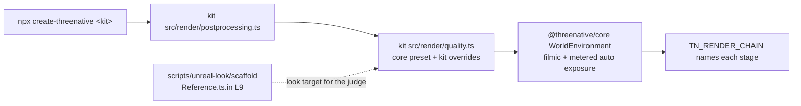

# PRD-723 — Every template's own game looks like Unreal on the engine defaults

**Status:** IN PROGRESS
**Priority:** P1 — no create-threenative kit gets the Unreal defaults that #541 put in `packages/core`: all 13 kits still pin ACES and a fixed exposure, so the owner's goal ("this PR is useless if we dont change the starter kit templates to use our defaults") stays open until every kit box below is ticked.
**Complexity:** 5 (MEDIUM) — 11+ implementation files across 13 kits (+3), `packages/core` and `create-threenative` release separately (+2); risk override: every kit that `create-threenative` scaffolds changes on screen and each kit carries a frame budget.
**Owner:** João
**Depends on:** [PRD-632](PRD-632-the-frame-is-exposed-and-tone-mapped-the-way-a-fresh-unreal-project-is.md) (the core defaults, on develop through #541). [PRD-722](https://github.com/ThreeNativeHQ/threenative-engine/blob/lane/sunwarm/docs/PRDs/Unreal/look/PRD-722-every-kit-and-every-default-scene-renders-the-unreal-look.md) Phase 2 (sky, GI cache and traced reflections in core) is not gating: once the kits import the look from core, that work reaches them with no kit edit.

## Context

#541 (2026-10-23) made the Unreal 5.8.3 look the `packages/core` default. `new WorldEnvironment()` with no options starts from the core `high` tier: `tonemapMode: "filmic"`, `autoExposureEnabled: true`, local exposure, Unreal bloom, GTAO, screen probe gather, temporal AA (`packages/core/src/look/quality.ts:85-122`, `packages/core/src/look/world-environment.ts:645`).

No kit reaches that code. The cause has two parts, the same in all 13 kits:

| Layer | What the kit runs | Effect |
| --- | --- | --- |
| Vendored chain | `src/render/worldEnvironment.ts` and 8 more files, copied from `packages/create-threenative/template-assets/` by `restampSharedRenderCopies` (`SHARED_RENDER_SOURCES`, `packages/create-threenative/src/index.ts:126`). All 13 copies are byte-identical (md5 aba7ccb1). | The copy predates the core move: `tonemapMode ?? "aces"`, `autoExposureEnabled ?? false`, no merge of a tier preset. |
| Kit preset | `src/render/quality.ts` `shared` sets `tonemapMode: "aces"`, `autoExposureEnabled: false` (shooter also `exposure: 0.62`). | An explicit override. Even the core class would keep ACES. |

Example, shooter: `src/render/postprocessing.ts:47` calls `new WorldEnvironment(qualityPreset(tier))`, both imported from the kit's own `src/render/`. The shooter `AGENTS.md` says "The finish is the Unreal 5.8.3 default, set in `src/render/quality.ts`", which is false: the agent docs describe a look the kit does not run.

The look target is the calibration harness, not a kit: `scripts/unreal-look/scaffold/Reference.ts.in` (PRD-631 reference room, layers L0 to L9; L9 has every system on) and `CalibrationScene.ts.in` (PRD-638 scenes from Unreal-exported GLBs). Both draw through `scripts/unreal-look/scaffold/render/` (atmosphere, clouds, GI cache, reflection capture, shadow tier). Those harness modules are not in core yet (PRD-722 Phase 2). This PRD ports no new Unreal feature; the Unreal source citations live in PRD-632 and PRD-636.

Published `@threenative/core` is 0.3.6 (2026-10-20), older than #541. The kits pin `"@threenative/core": "0.3.6"`, so a user who runs `npx create-threenative` today cannot get the defaults. The last box of this PRD publishes the cohort.

Owner orders, verbatim:
- 2026-10-22: "ThreeNative MUST HAVE UNREAL VISUAL DEFAULTS".
- 2026-10-23: "All scenes that go with create threenative app (eg. minimal tempate, etc etc) should be tweaked with our new unreal detaulf visuals."
- 2026-10-23: "once engine defaults land, then ahve a lane just to do this migration, also with visual judges for each migration (must have an improvement)".

## Solution

1. **Fix the shared layer once.** The kits import `WorldEnvironment`, `qualityPreset`, `qualityTiers` and the exposure nodes from `@threenative/core`. The vendored copies in `template-assets/` and in each kit are deleted, and `SHARED_RENDER_SOURCES` loses those entries. Each kit's `quality.ts` becomes `{ ...qualityPreset(tier) from core, ...kit overrides }`. In this step a kit keeps its old look: its overrides still list ACES and its fixed exposure, so the resolved options do not change.
2. **Write the convention down.** A convention missing from the templates' `AGENTS.md` does not exist. A nested `packages/create-threenative/templates/AGENTS.md` tells repo agents how a kit takes the look. Each kit's `AGENTS.md` states the real default and its named overrides.
3. **Migrate one kit at a time.** At most 3 kits in flight (one GPU lane), each merged on its own. Per kit:
   1. Delete the kit's ACES and fixed-exposure overrides, and any other line that only repeats a core default.
   2. Tune the kit's own lights, sky and materials (the look stays game-owned in `src/render/`) so its scene reads as the harness L9 look. Gameplay readability stays at least as good.
   3. If the kit breaks its frame budget, it selects a lower `renderChainTier` and its `quality.ts` says why. Never raise a budget, never drop the curve or the meter to meet one.
   4. Capture the kit's own game at the poses its playtest scenarios use: develop as BEFORE, the kit line as AFTER, 2 runs per arm, headed, `--browser-recipe webgpu`, `adapter.info` checked, default engine named from the boot log.
   5. A fresh read-only judge gets BEFORE, AFTER and the harness L9 frames (`pnpm unreal-look:judge --criteria <md> --out <json> --expect improvement`, or a fresh read-only subagent). **IMPROVEMENT is required.** NEUTRAL or REGRESSION means fix the cause and judge again.
   6. Post the sheet (`TN <kit> BEFORE <sha>` | `TN <kit> AFTER <sha>` | `HARNESS L9 <sha>`, large burned-in labels, crops of the gameplay subjects) to the `PRD-723-screenshots` orphan branch, and comment on the PR with the verdict, the SHA, region numbers and the kit's GPU ms before and after. The PR comment is the delivery.
   7. Only after the judge returns IMPROVEMENT, adjust the kit's tests that pin the old look to the new one, in the same commit as the verdict: the visual baseline (`pnpm visuals:baseline`), scenario colour and luma expectations, and specs that assert the old tone curve or exposure. A red look test before the verdict is expected and is not a reason to change the look or the test. Frame budgets and timeouts are not look tests and are never raised.
   8. Run the kit's `test:templates` scenarios, the perf budget included.

Risk, HUD colours: under the filmic curve an unlit `CanvasLayer` colour is curved too (#ff00ff reaches the screen as #f33ae0, PRD-724 Decisions). A kit scenario that asserts an exact HUD colour goes red. After the judge approves, fix it in the kit only with the named override on that check's subject, never by turning the curve off for the world. The real fix, a HUD composite after the curve on both engines, is the PRD-724 next step and is not in this PRD.

Visual acceptance criteria for every kit judge: highlights roll off on the filmic shoulder (no flat clipped white), exposure settles with no visible pumping or flicker during play, shading and sky read closer to the harness L9 frame, and the gameplay subjects (player, enemies, crosshair, HUD, pickups) are at least as readable as BEFORE.

## Acceptance Criteria

Ticked through the phase boxes below; this section holds no boxes of its own.
- AC-1 [local]: each of the 13 kits, scaffolded by `create-threenative`, resolves its quality tiers from core and runs the filmic curve and metered auto exposure unless its `quality.ts` names the override and the reason. Proof: `kit-look-defaults.spec.ts`.
- AC-2 [local]: each kit's own game judges IMPROVEMENT against its develop frames, on browser WebGPU. Proof: one verdict per kit on the Phase 2 and 3 boxes.
- AC-3 [local]: `pnpm test:templates` passes on the head that holds all 13 migrations, with no budget or timeout raised, and the golden-path journeys pass on the same head.
- AC-4 [local]: a user's `npx create-threenative@latest <kit>` from the npm registry installs a `@threenative/core` that carries #541 and the migrated kits. Proof: the Phase 3 release box.
- AC-5 [local]: the migrated shooter runs on the native desktop host with the core look applied or each refused stage reported. Proof: the Phase 2 desktop box.

## Integration Ledger

| Capability | Reachable consumer/trigger | Replaces / disposition | Evidence |
|---|---|---|---|
| Kit look on the core defaults | `npx create-threenative <kit>` → kit `src/render/postprocessing.ts` (shooter: line 47) → kit `quality.ts` → core `WorldEnvironment` (`packages/core/src/look/world-environment.ts:645`) → `TN_RENDER_CHAIN` | Deletes the 9 vendored chain files per kit and in `template-assets/`, and their `SHARED_RENDER_SOURCES` entries (`packages/create-threenative/src/index.ts:126`) | Phase 1 |
| Look guidance for agents | A repo agent editing `packages/create-threenative/templates/**`; a game agent reading its scaffolded `AGENTS.md` | Replaces the false "Unreal 5.8.3 default" kit prose | Phase 1 |

## Decisions

- 2026-10-23 (execution): preserve archived benchmark/proof records. The planned unscoped `rg` also matches six historical documentation artifacts; the live-consumer proof searches `packages`, `scripts` and `examples` (empty). The resolution experiment now names its explicitly supplied alternate module `resolutionControl.ts` and rewires its import, rather than writing an unused vendor filename.
- 2026-10-23 (execution): correct the planned generated-chain test runner to Vitest, which that existing file imports. Node's test runner rejects it; the same two checks pass under the repository runner. This changes no assertion or runtime coverage.

- 2026-10-23 (execution): one PR for this PRD, targeting develop; kit migrations are individual commits within it. Fresh visual judges use Sonnet 5.5 with high effort as requested. Phase 1 preserves resolved options before any look migration. Worktree: `.worktrees/prd-723`, branch `feat/prd-723-template-unreal-defaults`, base `53fbfa18b`. The initial checkpoint preceded verification; current results are recorded below.

- 2026-10-23 (João): the calibration scene is not a template. Templates are migrated on their own game scenes.
- 2026-10-23 (João, team-lead): the engine defaults land first, then one kit at a time, with a fresh judge per migration, and IMPROVEMENT is required.
- 2026-10-23 (team-lead): a box that names several kits ticks only when every kit it names has IMPROVEMENT and green scenarios, each kit's verdict written beside it. This is how 13 kits fit the 8-box cap.
- 2026-10-23 (agent, re-plan on develop): this file replaces the `lane/migrate-prd` draft (ddd18ab08), which waited on PRD-722 Phase 2. Reason: #541 already put the curve and the meter in core, and the root cause is the vendored chain plus the kit pins, which this PRD can fix now. The sky and GI recipe follow through core later.
- 2026-10-23 (agent): Phase 1 keeps every kit's look (resolved options identical) so the plumbing change and the look change land and judge apart.
- 2026-10-23 (João): add nested agent guidance about the Unreal defaults, pointing at the calibration scene that uses all of them. Taken as the Phase 1 guidance box.
- 2026-10-23 (João): "i dont think 0.3.6 carry these defaults, we should republish... maybe a good opportunity to do it here?" The release is the last box of this PRD, run through `pnpm release` (pnpm publish in dependency order, scaffolder last, clean-room install) after the full template gate is green, so the published kits and the published core are one cohort.
- 2026-10-23 (João): "related tests should be adjusted for this new visual, but after the visual judge approves it". Solution step 7: a test that pins the old look changes only after IMPROVEMENT, in the commit that records the verdict.
- 2026-10-23 (João, "fix in place"): this PRD claims browser WebGPU for every kit and the native desktop host for the shooter. Android, iOS and the other kits on desktop are not claimed; PRD-722 AC-3 owns the default look on the owned engines. The PRD has 10 boxes, 2 over the cap: the release and the desktop proof belong to this migration, and a separate PRD for each would only add a PR.

## Execution Phases

#### Phase 1: The kits take the look from core, and the convention is written down
**Status:** COMPLETE
**Files:** `packages/create-threenative/src/index.ts` (`SHARED_RENDER_SOURCES`), `packages/create-threenative/template-assets/{worldEnvironment,autoExposure,exposureGraph,exposureReadback,tonemap,localExposure,motionBlur,unrealBloom,vignette}.ts` (deleted), `packages/create-threenative/templates/*/src/render/{quality,postprocessing}.ts` and the same 9 copies per kit, `packages/create-threenative/templates/AGENTS.md` (new), `packages/create-threenative/templates/*/AGENTS.md`, `packages/create-threenative/__tests__/kit-look-defaults.spec.ts` (new).
Consumers of the vendored copies, each moved to core, retargeted or deleted as a duplicate of a core spec: `packages/create-threenative/__tests__/{world-environment-*,vignette,vq-volumetric-fog,looks,scaffold,starter-post-restart,platformer,shared-render-sources}.spec.ts`, `packages/runtime-native/tests/generated-render-chain.test.mjs`, `scripts/{stamp-template-render,template-quality,render-chain-capabilities}.ts`, `packages/{core,create-threenative}/capabilities.json` (rebuilt by `pnpm build`), and the game-agent docs `packages/create-threenative/agent-docs/references/{auto-exposure,visual-baseline,capability-reference}.md`.
- [x] The 13 kits import the chain from `@threenative/core` and the vendored copies are gone, with each kit's resolved options per tier identical to develop. proof: `kit-look-defaults.spec.ts` deep-equals the old and new resolved options for 13 kits × 3 tiers; `pnpm typecheck`; `pnpm exec vitest run packages/create-threenative/__tests__/`; `pnpm --filter @threenative/runtime-native exec vitest run tests/generated-render-chain.test.mjs`; `rg -l 'src/render/worldEnvironment' packages scripts examples` empty; `pnpm tsx scripts/count-loc.ts` passes (platformer 5220 LOC; existing report). Git diff from develop removes 49,284 net lines overall. Root typecheck passes; complete scaffolder suite passes 115 files / 1746 tests. After import organization and comment corrections, 117 focused tests pass plus the last two scaffold source/hash checks pass. Root lint passes with 1769 existing warnings; native generated-chain checks pass 2 tests; the live-consumer search is empty.
- [x] `kit-look-defaults.spec.ts` fails for a kit that resolves anything but `tonemapMode: "filmic"` and `autoExposureEnabled: true` and is not on its override list with a reason; the list starts with all 13 kits and must be empty at the end of Phase 3. proof: 50 tests pass; temporarily removing shooter from the override list makes its filmic assertion fail (exit 1), restoring it returns all 50 green. All 13 reason-bearing exceptions remain pending their visual migrations.
- [x] Repo agents and game agents read the same convention. The nested `templates/AGENTS.md` says: the look comes from core, a kit overrides only in `quality.ts` with a reason, the tuning target is `Reference.ts.in` L9 and the `CalibrationScene.ts.in` scenes, every kit change needs a judged IMPROVEMENT, and a budget breach drops a tier, never the curve. Each kit `AGENTS.md` states its real default and the named overrides. proof: `pnpm sync:agents --check` passes (27 mirrors); `pnpm check:docs` passes (3510 links, Unreal status current); `primary-docs.spec.ts` passes 8 tests; instruction budgets pass all 13 kits.
**Verification:** the spec and typecheck above; no capture needed while the resolved options are identical.

Execution (2026-10-23): draft PR [#562](https://github.com/ThreeNativeHQ/threenative-engine/pull/562). Core chain imports and removal of the nine vendored modules are implemented locally. Contract: 50 passed (13 × 3 legacy preset comparisons included); chain, vignette and quality integration: 101 passed; related core retained-resolution tests: 35 passed. Root workspace build, root typecheck and root lint now pass (lint retains 1769 warnings). Historical meter and resolution-control routing have red-green coverage (17 and 9 tests); native generated-chain/contract checks pass 13 tests in the package Vitest project. Structural scaffold checks were 67/68, then both repaired ownership/hash checks passed; the final full scaffolder suite remains open. Structural file/hash expectations changed for the requested consolidation; pixel baselines, luma/colour assertions, frame budgets and timeouts are unchanged. Retargeting retained-resolution tests exposed upstream Three.js GTAO geometric-normal reconstruction bypassing retained-view samplers; the core correction preserves the owned-engine path and now passes the depth-read clamp test. A unit-test helper explicitly opts stage-isolation tests out of unrelated core effects. `node --test` cannot run the existing Vitest generated-chain spec: the actual runner is `pnpm --filter @threenative/runtime-native exec vitest run tests/generated-render-chain.test.mjs` (2 passed). Final package run: 111 files passed, 4 failed (1731 tests passed, 15 failed); the failures exposed platformer's old mock, the RTS instrumentation loader's CommonJS fallback for the now-ESM core import, fog fixture defaults and orphan exposure helpers/doc line caps. Focused repairs now pass 33 platformer/RTS/fog tests, 3 template contracts and 13 auto-exposure scaffold tests. Every kit retains its authored exposure policy; unused mechanism helpers were removed from the kit policy files. The measured structural hashes pass after those source changes. The final complete package rerun passes all 115 files / 1746 tests (240.52 seconds). Final lint, mirrors and structural source checks also pass; typecheck passed before the final import/comment-only changes. No kit has a visual verdict. Baseline workspace build passed on Debian; baseline shooter scaffold initially stopped at missing Wasm, now built locally with emsdk 6.0.11 (206 steps, exit 0). Shooter BEFORE run 1 passes all 34 scenarios on headed NVIDIA Turing WebGPU, using develop render sources and the baseline core distribution; captures are in `~/Downloads/PRD-723/shooter/BEFORE-run1`. Debian admission later refused work at 100°C (latest reading 97°C). BEFORE run 2 confirms ThreeNative in an added diagnostic-only boot observer; bullet-holes hit a 30000 ms bridge describe timeout during competing CPU work, so this run is not a green second arm. Run 2 finished 32/34 green: performance measured 36.4 ms p95 against 33 ms. The bullet-holes retry passes; performance remains an explicitly recorded baseline failure. The AFTER candidate uses core defaults while retaining the existing measured gather-off override; its scaffold check and web build pass, and two AFTER capture runs are in progress. Sonnet 5.5 high was successfully probed, with response metadata naming `claude-sonnet-5-5`.

Execution (2026-10-24): the shooter high-tier AFTER run 1 passes 34/34 scenarios (33 ms p95 against 33 ms); run 2 passes 33/34, failing performance at 34.5 ms p95. The first Sonnet 5.5 high batch rejects the look: 1 IMPROVEMENT, 13 NEUTRAL and 3 REGRESSION (breakable-shatters, debug-clear, enemy-reaches-walkway); the second batch times out without a verdict. No kit is visually accepted. A lower-tier candidate retains filmic and metered exposure; its full capture was stopped after the lighting regression was identified. A controlled environment-intensity test confirms IBL responds but does not repair the appearance; restored it. Actual deck texture samples expose a duplicate palette tint (effective luminance 0.03165 versus intended 0.17792); the one-line external candidate repair passes the albedo check (0.17784) and both walkway scenarios, with fresh visual judgment pending.

Native packaging initially rejects the new core `textureSize` import even though it is confined to the upstream-only retained-subrect branch. The desktop TSL facade now binds it to the existing explicit refused-at-use mechanism, matching Wasm; it does not claim native textureSize support. The regression test failed with the unbound export and now the owning bundle spec passes 9/9. A fresh scaffold's desktop build passes with this facade. Runtime verification remains open: ordinary `test:native` incorrectly requires the starter's production-readiness scenario, while the shooter's original survives scenario is rejected before launch because desktop visual assertions are unsupported. Neither failure proves rendered frames; the native box stays open.

Execution (2026-10-24, native verifier): ordinary owned-player desktop verification now generates a kit-independent native smoke through the existing playtest CLI. It requires the requested number of contiguous producer `present-return` observations and the runner's nonblank screenshot guards; strict `--consumer` qualification remains unchanged. The completion collector's existing defaults are unchanged. Red–green coverage includes 299/300 observations, wrong source, gaps, blank capture, failed-run cleanup and the actual CLI print path; 92 native verifier/consumer tests and 25 collector tests pass. The first installed run exposed an old v0.3.6 binary missing `StorageTexture`, which current C++ registers; no compatibility shim was added. A current-source host built at `894236e7f3f5a4634bfeadd2deb29216497d172e` passes the installed CLI with 300 contiguous native presents (sequence 49–348, 299 intervals over 7383.589 ms), zero runtime diagnostics and a nonblank 1280×720 screenshot, on the owned engine / NVIDIA RTX 2080 (`nvidia/turing`). This control retains ACES / fixed exposure 0.62, so it proves the verifier and binary closure, not the final migrated-look AC-5 box. The CLI's earlier success-message error was reproduced in a subprocess test and repaired before the exit-0 run.

#### Phase 2: The shooter, then the starter and minimal
**Status:** IN PROGRESS
**Files:** `packages/create-threenative/templates/{shooter,starter,minimal}/src/render/*`, their playtest scenarios, `packages/runtime-native/scripts/verify-starter-desktop-base.mjs` and its focused test, `packages/playtest/src/runner/steps.ts` and its completion-window test
- [ ] shooter is migrated: off the override list, judge IMPROVEMENT, scenarios pass (`performance.playtest.json` included). proof: judge verdict and sheet link on the PR, `test:templates` for shooter.
- [ ] starter and minimal are migrated: each judges IMPROVEMENT and their scenarios pass. Reuse the judged scene fixes on `lane/sunwarm` (PRD-722 Phase 1, `src/scenes/Play.ts` material-lighting order) where they fit the budget. proof: one verdict per kit on the PR, `test:templates` for each. **Minimal:** fresh Sonnet 5.5 high returns IMPROVEMENT overall and for all four poses (22/22 supplied images opened); the white-on-white lower legs and touch-knob fill remain readability watch items, with no judged regression. Both headed NVIDIA Turing / owned-engine runs per arm pass all four scenarios (16 observations). AFTER logs filmic and metered exposure applied; `play` p95 is 17.7/17.8 ms against 33 ms (BEFORE 17.7/17.7 ms). GPU samples are sparse: 0.38/0.38 ms BEFORE and 0.37/0.38 ms AFTER, one valid sample per run; these do not establish steady-state savings. The accepted quality/exposure policies now follow core, and minimal leaves the exception list (12 remain). Contract/material tests pass 56; changing the exception first reproduces the ACES/meter failures, and the scaffold source hash has a measured red–green update (2 checks pass). [Paired sheets](https://github.com/ThreeNativeHQ/threenative-engine/tree/PRD-723-screenshots/minimal) retain all four observations per pose. Per-kit `test:templates` and the all-kit baseline/gates remain pending; starter is not yet accepted.
- [ ] The migrated shooter runs on the native desktop host: 300 frames, a non-blank screenshot, and its log names `filmic` and `autoExposure` as applied or gives each refusal reason. proof: in a scaffolded shooter, `pnpm test:native`, then `node packages/playtest/dist/runner/cli.js playtests/survives.playtest.json --target desktop` (AC-5).
**Verification:** per-kit capture, fresh judge, kit scenarios, as in Solution step 3; the desktop run once, on the shooter.

#### Phase 3: The other ten kits, the full gate and the release
**Status:** NOT STARTED
**Files:** `packages/create-threenative/templates/{racing,platformer,runner,action-rpg,rts,tower-defense,puzzle,sailing,rain,snow}/src/render/*`, the release cohort's `package.json` versions and the kit `@threenative/core` pins
- [ ] racing, platformer, runner, action-rpg, rts and tower-defense are migrated: each judges IMPROVEMENT and their scenarios pass. proof: one verdict per kit on the PR, `test:templates` for each.
- [ ] puzzle, sailing, rain and snow are migrated: rain's own post pass takes the core curve and meter, snow's frame budget holds, each judges IMPROVEMENT and their scenarios pass. proof: one verdict per kit on the PR, `test:templates` for each.
- [ ] `pnpm test:templates` and `pnpm verify:golden-path` pass on the head that holds all 13 migrations, the override list in `kit-look-defaults.spec.ts` is empty, and no budget or timeout was raised. proof: both gate results on the Debian laptop (AC-3).
- [ ] The release cohort ships: core, physics, ui, playtest and runtime-native past 0.3.6, engine-mcp if `pnpm release:prepare` selects it, and `create-threenative` past 0.2.10 last, with the 13 migrated kits pinned to the new cohort. The runtime-native prebuilt binaries exist for the new version (`native-release.yml`) before the scaffolder publishes. A cold `npx create-threenative@latest shooter` outside the repo boots and logs `TN_RENDER_CHAIN` with `filmic` and `autoExposure` applied. proof: `pnpm release:prepare`, `pnpm release` (dry), then `pnpm release --yes` or a `v*` tag that runs `npm-release.yml` (pnpm publish, never `npm publish`), its clean-room install, `npm view @threenative/core version`, then a `pnpm sandbox` scaffold of shooter (AC-4).
**Verification:** the full template gate once, then the release and one cold sandbox scaffold. A publish cannot be undone: the agent asks João once, after the dry run is green, before `--yes` or the tag.
