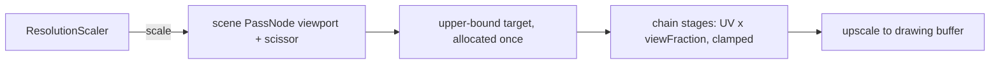

# PRD-564 — The resolution scale changes without reallocating a render target

**Status:** IN PROGRESS
**Priority:** P2 — Phase 1 earns continuation on a controlled RTX 2080 run; retained targets, sub-rectangle sampling, finer scaling and native parity remain open.
**Complexity:** 9 (HIGH) — 11+ authored implementation files including per-kit stage declarations (3), retained-target lifecycle module (+2), temporal GPU state and graph replacement (+2), native build boundary (+2); risk override: none
**Owner:** João (decline decision after Phase 1), agent (implementation)
**Depends on:** [PRD-384](../../done/PRD-384-adaptive-resolution-gpu-headroom.md) (the GPU-headroom policy this keeps unchanged). Related: [PRD-549](../../performance/PRD-549-the-engine-holds-60-fps-on-a-weak-gpu.md) (it fixes the scaler's gates and adds an MSAA rung below the floor; this PRD changes what a scale step costs, and duplicates none of its boxes), [PRD-539](PRD-539-low-resolution-temporal-reconstruction-quality-and-cost.md) (a reconstructor needs a scale that can change often and cheaply).

## Context

`ResolutionScaler` (`packages/core/src/resolution-scaler.ts`) picks one of 10 rungs, from 1.0 to
0.23. Its own comments say why the rungs are coarse: "every step reallocates render targets on
WebGPU, and fine granularity buys smoothness with hitches" (`:24-25`), and "the resize reallocates
every render target, which rebuilds pipelines" (`:83-84`).

The mechanism is `renderer.setSize()`. `setResolutionScale` stores the scale and calls the resize
handler (`packages/core/src/renderer.ts:763-773`). The handler resizes the drawing buffer to
`canvas × pixelRatio × scale` (`renderer.ts:1262-1273`). The swap chain shrinks, and every
`PassNode` target in the render chain follows it. The same code defers a resize while an
asynchronous compile holds a depth target (`renderer.ts:765-769`), because a resize then disposes
a texture that a pipeline build still reads.

PRD-549 measured how often the scaler steps on a weak GPU: on the LAN laptop's Iris Xe it went
1.0 → 0.61 within four windows of readiness. Each of those steps paid this reallocation.

PRD-384 already gives the controller the policy that Unreal also uses: a fresh GPU sample within
budget vetoes a down-step, so a CPU-bound or host-bound frame does not lose pixels. This PRD does
not change that policy. It changes what a step costs.

**What Unreal does (UE 5.8.3, ideas only, no code copied):**

- Scene textures are sized once for the **upper bound** of the resolution fraction, and each view
  renders into a rectangle inside them
  (`Engine/Source/Runtime/Renderer/Private/SceneRendering.cpp:3412-3471`). A fraction change moves
  the rectangle and allocates nothing.
- The allocated size rounds up to a multiple of 8, because many passes assume it
  (`Engine/Source/Runtime/RenderCore/Private/RenderUtils.cpp:1178-1192`).
- The fraction is continuous. The estimate is `sqrt(target / measured GPU time)` times the current
  fraction (quadratic model, `Engine/Source/Runtime/RenderCore/Private/DynamicRenderScaling.cpp:45-55`).
  An up-step is amortized: it moves only part of the way to the estimate (`:64-73`, default 0.9;
  `Engine/Source/Runtime/RenderCore/Public/DynamicRenderScaling.h:39-41`). A change smaller than
  2% is ignored (`kDefaultChangeThreshold = 0.02`).
- At least 8 frames separate two changes, so the temporal upsampler's sub-pixel history stays
  valid (`Engine/Source/Runtime/Engine/Private/DynamicResolution.cpp:76-80`, `:221`).
- Two consecutive over-budget GPU frames end the history scan. When every frame scanned was over
  budget, a panic changes the resolution at once and ignores the 8-frame period
  (`DynamicResolution.cpp:96-99`, `:299`, `:337-347`, `:406`).

three r185 already has the stock seam: `PassNode.setViewport()` and `setScissor()` set a viewport
and scissor on the pass target, scaled by its resolution scale
(`three/src/nodes/display/PassNode.js:960`, `:994`). The pass copies the rectangle into its render target only inside
`PassNode.setSize()` (`:915-945`), so a scale change must call `setSize()` with an unchanged size again. Verify in Phase 2 that this call allocates nothing.

## Solution

1. **Measure first (Phase 1).** Force three scale steps on the starter and record the step frame,
   the next 30 frames, pipelines built and texture bytes reallocated. Continue only if the step
   frame exceeds 2× the window p50, or if a step builds any pipeline. Otherwise record the numbers
   under `## Decisions` and delete Phases 2–3 (R4).
2. **Allocate at the upper bound, draw into a sub-rectangle.** The drawing buffer stays at
   `canvas × pixelRatio`. The scene pass target is allocated once at that size, rounded up to a
   multiple of 8, and reallocated only when the canvas grows. The scaler sets the scene pass
   viewport and scissor to `scale × size`. A final upscale stage samples the sub-rectangle to the
   full drawing buffer.
3. **Every chain stage reads the sub-rectangle.** A stage receives `viewFraction` (the
   sub-rectangle size over the target size) as a uniform. It multiplies screen UVs by it and clamps
   each sample to `viewFraction − half a texel`, so a bilinear tap never reads outside the
   rectangle. Unreal's temporal upscaler does the same with a per-history viewport min and max in UV
   (`UE 5.8.3: Engine/Shaders/Private/TemporalSuperResolution/TSRUpdateHistory.usf:957-960`). Stages that `three` owns (TRAA, GTAO, SSGI, bloom) get a thin wrapper or a stock
   option where one exists. A stage that cannot honour the rectangle is named in
   `TN_RESOLUTION_SUBRECT` as `refused`, and the scaler then keeps today's reallocation path for
   that game. It never draws a wrong frame silently.
4. **Then allow finer steps.** With no reallocation, the controller may use a continuous fraction:
   size from `sqrt(target / gpuMs)`, quantize to 8 pixels, ignore changes under 2%, keep at least
   8 frames between changes, and amortize up-steps. PRD-384's veto and stall guards stay as they
   are. A temporal stage resets or rescales its history on a change. PRD-549's sample-count rung
   (4× → 1× MSAA) still reallocates the multisampled target; it is rare and stays as it is.

Layer: mechanism only, `packages/core` and the native host. No appearance parameter changes.

## Acceptance Criteria

- [ ] AC-1 [local]: On the starter in browser WebGPU (RTX 2080), a forced scale step allocates no texture and builds no pipeline, and the step frame stays within the window's p95. proof: `node packages/playtest/dist/runner/cli.js perf` with a forced-step scenario, `TN_FRAME_BUDGET` and the pipeline census. — Evidence: pending.
- [ ] AC-2 [local]: A frame at scale 0.72 through the sub-rectangle matches the same frame through today's reallocation path within the visual gate's threshold. proof: `pnpm visuals:ab`. — Evidence: pending.

## Integration Ledger

| Capability | Reachable consumer/trigger | Replaces / disposition | Evidence |
|---|---|---|---|
| Scale applied as a viewport | `game.ts` frame-budget window → `ResolutionScaler` → `renderer.setResolutionScale` (`renderer.ts:763`) | The `setSize` path stays as the fallback for a refused stage | AC-1 |
| Sub-rectangle sampling | `RenderChain` stage install (`render/chain.ts`) | Full-target sampling stays when the scale is 1.0 | AC-2 |

## Execution Phases

#### Phase 1: Price the resize
**Status:** COMPLETE — controlled timing qualified; the 0.85 step in run 1 crosses the unchanged strict 2× gate.
**Files:** a forced-step playtest scenario under `packages/playtest`; no engine change
- [x] Three forced steps (1.0 → 0.85 → 0.61 → 1.0) on the starter record the step frame, the next 30 frames, pipelines built and bytes reallocated, over 3 runs. proof: `pnpm exec tsx packages/playtest/src/runner/measure-resolution-scale.ts artifacts/prd564/measurement-nvidia-render-core` — exit 0; 3 fresh contexts, 9 steps ×31 frames, zero new pipelines, descriptor bytes recorded; independently qualified timing and `resolutionScaleGate(runs, true)` return `continue`. See Decisions for the per-run controls and narrow crossing.

#### Phase 2: Draw into the sub-rectangle
**Status:** PARTIAL — implementation committed; runtime allocation and visual acceptance remain open.
**Files:** `packages/core/src/renderer.ts`, `packages/core/src/render/chain.ts`, `packages/core/src/render/resolution-subrect.ts` (new); canonical `packages/create-threenative/template-assets/worldEnvironment.ts` and its stamped kit copies, per-kit `src/render/grade.ts`; core/scaffolder specs.

Implementation boundary: core retains target capacity, sets viewport/scissor, publishes numeric view fractions and restores wrapped instance methods on graph disposal. Generated render source owns each texture UV transform and half-texel clamp; no Three prototype is patched. Stock GTAO, denoise, bloom and spatial AA receive explicit adapters; pointwise grade/grain declare compatibility. Other stages, custom base colour and automatic exposure refuse the sub-rectangle until their sampling/history is supported, keeping the original resize path and naming the reason in `TN_RESOLUTION_SUBRECT`. One active graph owns the controller; replacement/disposal cannot let an old receipt change the new graph. The original source path remains the scale-0.72 visual control. Canvas growth, canvas shrink, stage refusal, scale changes during asynchronous compile and same-node graph replacement are the distinct lifecycle risks to verify.
- [ ] A scale change sets the scene pass viewport and scissor and allocates nothing; a canvas resize still reallocates once. proof: red-green `pnpm exec vitest run packages/core/__tests__/renderer*.spec.ts` with an allocation-counting renderer stub.
- [ ] Each built-in chain stage samples inside the sub-rectangle, and a stage without support reports `refused` and keeps the reallocation path. proof: red-green chain spec, one case per stage in `RENDER_CHAIN_STAGE_ORDER`.

#### Phase 3: Finer steps and native
**Status:** COMPLETE — continuous policy regressions pass; shipped-controller down/up native parity matches the browser exactly.
**Files:** `packages/core/src/resolution-scaler.ts`; `packages/runtime-native/conformance/scenes/shared/resolution-subrect.js` (new), `packages/runtime-native/conformance/registry.json`
- [x] The controller takes continuous fractions (quantized to 8 px, 2% threshold, at least 8 frames apart, amortized up-steps), and PRD-384's existing scaler suites still pass. proof: red-green `pnpm exec vitest run packages/core/__tests__/resolution-scaler*.spec.ts`. — 80 scaler cases pass, including exact-fraction insensitivity refund and unchanged discrete-policy recovery controls; continuous estimates require an observed active sub-rectangle.
- [x] The native desktop host draws the same sub-rectangle frame as the browser. proof: `pnpm parity --target web --only-tests resolution-subrect` then `pnpm parity --target desktop --only-tests resolution-subrect --reference <browser captures>` under the existing capture lease and matching NVIDIA environment. Scene commit `3bea8eecc` imports the shipped controller and asserts retained capacity, viewport/scissor and sampling through 0.72 → 1 → 0.72. Both selected rows PASS; desktop pixelMismatchRatio 0, perceptualDeltaE 0, no GPU validation errors. Controller source SHA-256 `bd3ad7813b2d5f46ca77f2e437142e0b12559e6992f89d96dab869b3a95b2cad` was identical before/after and is present in repair commit `f335aca1f`. Reports: `artifacts/prd564/controller-parity-{web,desktop}/report.json`; wrapper exits 0 after checking selected results and stable source. Individual bounded commands exit 2 because all 103 unselected rows remain blocked; no full-registry claim.

## Decisions

- 2026-10-10 (agent, measurement scope): existing `perf` and scenario actions do not supply forced resolution steps plus exact step-and-30-frame timings or texture allocation bytes. The candidate browser-only probe reuses `FrameBudget` and the pipeline census; `frameMs` is synchronous CPU work, `rafIntervalMs` is RAF callback spacing, and texture bytes are descriptor payloads excluding driver padding/metadata. No engine renderer or render stage changed. No valid measurement frames exist; all boxes remain open and neither continue nor decline is justified.
- 2026-10-10 (agent, bootstrap diagnosis): after dependency bootstrap, serialized `__name`, and Three subpath-alias failures, the doubtful assumption was that the custom Vite fixture matched the shipped starter. Read-only Opus 5.5 HIGH diagnosis rejected that equivalence: manual aliases and disabled dependency discovery also bypassed CommonJS prebundling, while raw asset copying bypassed the authored cook. The harness now loads the starter's authored Vite config/plugins/cook, links nine exact dependencies inside a real scaffold-local `node_modules`, keeps its `.vite` cache local, prebundles the late texture-utils import, and rejects a missing `resolutionScale: "auto"` pin source. This correction has not run in a browser; failed artifacts remain under `artifacts/prd564/`.
- 2026-10-10 (agent, correction checks): the two probe tests, playtest package typecheck, Biome formatting, and `git diff --check` passed. Fresh laptop status refused work at 98°C. The allowed `pnpm --filter create-threenative build` failed during declarations with `src/config.ts` TS7016 because `@threenative/core/dist/index.d.ts` is absent; stopped at this first unexpected failure without a build retry or browser launch. Build inventory found no additional tracked rewrites. The harness/probe/tests and PRD remain uncommitted for root review; dependency-link/cache isolation, missing-pin refusal, authored asset cook, and hardware measurement remain unverified at runtime.
- 2026-10-10 (agent, bounded prerequisite attempt): `pnpm --filter @threenative/core build` exited 1 after 13.90 seconds: JS and declarations were emitted, including `dist/index.d.ts`, but `bundle-engine-mcp.mjs` refused missing `packages/engine-mcp/dist/index.js` (`TN_ENGINE_MCP_BUNDLE`). The sequential scaffolder build was not run because the first command failed. Stopped without retry, broader build, or browser launch. Before/after snapshots found no tracked or untracked source changes and no tracked generated rewrites; logs and snapshots are in `artifacts/prd564/bootstrap-lsuzm78v/`. Exact next prerequisite is the `threenative-engine-mcp` package build; scaffold declarations remain absent. All measurement boxes stay open.
- 2026-10-10 (agent, inspected dependency closure): the authorized sequential builds all exited 0: `pnpm --filter threenative-engine-mcp build` (2.32 s), `pnpm --filter @threenative/core build` (16.35 s), and `pnpm --filter create-threenative build` (5.02 s), 24.13 s total including inventory. Required JS and declarations now exist for all three packages; normal core bundling and publint completed. Before/after hashes found zero tracked or untracked source changes and no tracked generated rewrites. Fresh logs and snapshots: `artifacts/prd564/closure-9dl6i10_/`. No browser measurement was authorized or run, so every phase/acceptance box remains open.
- 2026-10-10 (agent, single authorized hardware invocation): unchanged harness SHA-256 `325104f3c7afa76e5bffe5949db90caa9ade20c4c06cbd71a118a1728a4c4beb` ran once from 21:39:50.950 to 21:40:47.996 UTC, exited 1 after 57.05 s, and stopped without retry or source changes. The authored asset cook completed; after an unqualified async readiness check, `page.evaluate` failed at harness line 47 with `TypeError: Cannot read properties of undefined (reading 'renderer')` at expression `game.ctx.renderer`. No step rows, adapter observation, pipeline census, or descriptor-byte observations were captured. The doubtful assumption is that dynamically importing `/src/game.ts` yields the running game context used by the authored `/src/main.ts` → `./game.js` → React `App`/`GameCanvas` bootstrap; `IGame.ctx` is explicitly optional. These source anchors alone do not establish the failure cause. Pre-run desktop load was 9.05/13.39/12.83 with 25,559 MiB available and NVIDIA GPU utilization 30%, so timing conclusions would remain restricted under shared load. Command, before/after load metadata, source/bundle hashes, asset cook and browser logs are preserved in `artifacts/prd564/hardware-yego1v8z/`. The harness cleanup completed and no node/Chromium/Xvfb/xcompmgr process with this checkout as cwd remained. All gate boxes stay open; root review is required before another invocation.
- 2026-10-10 (agent, readiness/context correction): read-only Opus 5.5 HIGH diagnosis showed that the old async `waitForFunction` predicate could satisfy the poll with a truthy Promise rather than a ready verdict. The previous "ready observed" claim is withdrawn: the failed artifact cannot distinguish pending boot from rejected boot and does not prove a duplicate module. The harness now reuses `PlaywrightTransport.waitForBridge`, `describe`, and the installed `waitForStartupReady`/`waitFrames` pattern without clock freezing or a longer custom timeout; missing bridge/startup and GameCanvas boot rejection fail with named errors. After readiness it checks context existence, actual ready phase, mounted-canvas identity, stable context through probe completion, and main-frame navigation. Red: four new context cases failed before the guard; green: six probe/context cases plus eighteen existing startup-ready cases passed (24 total). Playtest package typecheck, Biome formatting, and diff check passed. No browser/build/commit/push ran; all boxes remain open. The next bounded component must qualify preflight observations against the actual census adapter schema and running probe identities; the unsupported `TN_ADAPTER` lookup, census adapter path, gate verdict calculation, and possible FrameBudget/TextureUtils identity or binding issues remain unchanged and unverified.
- 2026-10-10 (agent, preflight qualification component): `--preflight` selects one fresh authored starter context and stops after readiness/context checks and one observed running FrameBudget call; it performs no scale steps or allocation probe. The census adapter field `adapter.identity` was verified against the actual core interface and renderer adapter-facts source; the unsupported `TN_ADAPTER` prefix lookup is removed. Preflight requires WebGPU, scale 1, compiling false, a complete census, and a nonempty correctly encoded identity without a software-rasterizer name, reusing the installed software-adapter detector rather than requesting another adapter or inferring one from features. A temporary prototype wrapper must observe the running budget receiver with exact prototype identity and restores itself on success/failure. Texture bytes now use the running WebGPU backend textureUtils method bound to that instance; Three constructs that utility on its backend and the installed rgba8unorm case returns 4 bytes. The separate source-class import and its late prebundle override are removed. Red: nine added preflight cases failed before implementation; green: 15 probe/preflight cases and 18 existing startup-ready cases passed (33 total). Typecheck initially rejected an undeclared core type import; removing that coupling and keeping only the checked structural fields passed playtest typecheck. Biome and diff check passed. Prior manifest searches inspected every returned detail; no installed helper qualified the running budget receiver. No browser/build/commit/push ran, so hardware preflight remains unverified and the gate verdict computation remains a separate open component. Actual before-copies and the unified review patch are in `artifacts/prd564/preflight-before-kmpxavnc/`; all measurement boxes stay open.
- 2026-10-10 (agent, single hardware preflight attempt): the unchanged reviewed harness SHA-256 `9683ac17ca81156484fd6eff5273a662b8f2c9719f07a8a0b202517da0ef93d2` ran once with `--preflight` from 23:01:03.092 to 23:01:33.571 UTC and exited 1 after 30.48 s. Authored starter asset cook completed, but the installed startup pump failed in `steps.ts:670` with `page.evaluate: ReferenceError: __name is not defined`, called by harness `measure-resolution-scale.ts:67` through `waitForStartupReady` (`startupReady.ts:115`). The imported source helper's serialized callback is not qualified under this tsx execution path. No startup-ready verdict, running-context/canvas identity, FrameBudget receiver, bound texture-byte result, complete census, or actual adapter identity was captured; no scale steps or allocation probe ran. Stopped without retry, build, or source change. Desktop load was 6.66/9.40/12.38 before and 7.54/9.27/12.22 after; NVIDIA GPU utilization was 40% then 20% with unrelated GPU processes, so no timing claim is possible. Exact command, before/after resources, source/bundle hashes and traceback are in `artifacts/prd564/preflight-hardware-9xw5y6h7/`. Harness cleanup left no process in its invocation group or node/Chromium/Xvfb/xcompmgr process with this checkout as cwd. Preflight is unqualified, all boxes remain open, and the PRD stays at 0%.
- 2026-10-10 (agent, source-harness startup pump correction): read-only Claude Opus 5.5 HIGH diagnosis identified tsx keepNames rewriting the nested `next` function in installed source `waitFrames` (`steps.ts:675`) to a `__name` call that Playwright serializes into a browser without that Node helper. This is a harness execution/serialization failure; startup success remains unverified. The compiled CLI is unaffected and its public exports do not expose all required internal startup helpers. Only this source harness now uses an existing-probe helper passing literal JavaScript to `page.evaluate` for exactly one RAF; installed bridge, startup readiness, context guards, authored starter and timeouts are unchanged, with no production export or browser-global shim. The initial regression investigation loaded actual installed `waitFrames` through tsx and reproduced the original `__name` error before any frame; that observation is preserved in the red log. The enduring regression loads only the corrected helper through tsx, executes serialized callbacks in an isolated VM with only RAF supplied, and verifies exactly one frame completes without a shim; it does not require the shared helper to remain broken. Red: the focused case failed because the corrected helper was absent after reproducing the original error. Green: the focused case passed; the nearest suite passed 16 probe cases plus 18 existing startup-ready cases (34 total). After removing the lasting assertion that the shared helper remains broken, the corrected-helper-only focused case passed again (1 passed, 15 skipped), with Biome and diff check passing; the broader suite was not rerun for that test-only correction. Playtest typecheck, Biome formatting and diff check passed. Exact before-copies/unified delta are in `artifacts/prd564/startup-frame-before-up0qsjed/`; red/green/suite/typecheck logs are under `artifacts/prd564/startup-frame-*.log`. No browser/build/commit/push ran; hardware preflight and all measurement/gate boxes remain unverified/open at 0%.
- 2026-10-10 (agent, single corrected-pump hardware preflight): reviewed harness SHA-256 `06d8eb8d492093012e70678225a5d5f7c256dc9bdbceca253fbe0b8a6921abee` and probe `966bd5a008768c2c6d9b62fb811f1a5a56355a605e3fcfdb0aed177847dfbb0e` ran once with `--preflight` from 23:15:34.959 to 23:16:44.884 UTC, exited 1 after 69.93 s, and stopped without retry or code change. Authored cook and startup pumping advanced beyond the prior serialization failure. Control flow reached `assertResolutionScalePreflight` after startup-ready, running-context/mounted-canvas guards, the bound rgba8unorm 4-byte check and observed FrameBudget receiver qualification; these checks returned without throwing, but no completed preflight payload was persisted. The first failure was `TN_RESOLUTION_SURFACE_NOT_READY` in the served probe, called by harness line 77: scale was not exactly 1 or compiling was not false; the log does not distinguish those alternatives or record actual surface values. Adapter identity and complete census were not qualified, and no run JSON, scale steps, allocation probe, or gate verdict exist. Shared desktop load was 19.15/14.65/12.63 before and 26.72/18.23/14.04 after, available memory 26,839 then 26,928 MiB, GPU utilization 29% then 8%; no timing/cost claim is possible. Command, traceback, before/after resources and unchanged source/bundle hashes are in `artifacts/prd564/preflight-pump-rj9t8dyp/`; cleanup found no remaining invocation-group or checkout node/Chromium/Xvfb/xcompmgr process. All boxes remain open at 0%; root review is required before another invocation or correction.
- 2026-10-10 (agent, surface-contract/partial-failure correction): read-only Opus 5.5 HIGH diagnosis identified a harness-only mismatch: core emits `compiling: true` while active and omits the optional field while idle, so requiring exactly false rejected the actual idle producer shape. Preflight now accepts omitted/false compiling, rejects true as not ready, and rejects nonundefined nonboolean values including null/string as malformed. Scale 1, WebGPU, complete census and hardware identity requirements remain fail closed. Errors include observed scale/source/compiling presence/value or census incomplete reasons and adapter identity as relevant. The existing run JSON is now written with `status: failed` and collected startup/partial context, bound bytes, budget receiver, surface/census/adapter observations before rethrowing failure; uncollected stages are not reported as absent observations, and errors preserve browser name/message/stack. Partial records contain serializable observations rather than renderer/game objects. Red: actual idle-shape cases and new malformed/persistence cases produced 10 failures, 11 passes. Green: focused probe passed 21 cases; nearest probe plus existing startup-ready suite passed 39 total. The persistence seam verifies a partial record is stored before the identical error object is rethrown; browser failure persistence remains unverified. Playtest typecheck, Biome formatting and diff check passed. Existing startup/bridge/context guards, authored scene/config, nine dependency links and timeouts are unchanged; no engine exports, waits, browser globals, build or browser invocation were added. Before-copies/unified review delta: `artifacts/prd564/surface-before-0buf19__/`; logs: `artifacts/prd564/surface-{red,green,suite,typecheck}.log`. All boxes remain open at 0%; no commit/push ran.
- 2026-10-10 (agent, qualified functional hardware preflight): the reviewed harness `fac1354bf0f5259d5428bdc853174bea19a8dfe7bf848f833787f0e4111b991c` and probe `f535a0b771387e0ad3e41f9dd49c1683777df92498d34c5c72cec11377d50c29` ran once with `--preflight` from 23:28:38.960 to 23:29:15.216 UTC, exited 0 after 36.26 s, and persisted `run-1.json`. Actual startup was ready with compileSettled true; mounted canvas/context identity and stable context checks passed. Surface was pinned at resolutionScale 1, 1280x720, sampleCount 4, with compiling omitted. The running FrameBudget prototype receiver was observed and the bound renderer texture utility returned rgba8unorm 4 bytes. Complete WebGPU census reported adapter `webgpu:architecture=turing|vendor=nvidia`, 50 device creations, 50 unique pipelines, 0 failures/pending/dropped events and no incomplete reasons; these are cumulative preflight counts, not scale-step builds. No PAGE_ERROR was logged. Headed private Xvfb strategy was 1600x900x24. Source/bundle hashes were unchanged; cleanup found no remaining invocation-group or checkout node/Chromium/Xvfb/xcompmgr process. Exact command, logs, run JSON, before/after resources and provenance: `artifacts/prd564/preflight-surface-6cov_kq2/`. Shared load was 15.32/19.06/16.47 before and 13.73/18.24/16.29 after, GPU utilization 26% then 12%; this proves functional preflight only, not cost. No scale/allocation probe or full three-context gate ran (`rows: []`), failure persistence remains browser-unverified, and the gate verdict calculator remains a separate component. All boxes stay open at 0%; no code change/build/install/commit/push ran.
- 2026-10-10 (agent, strict gate calculator/policy): root resolved pipeline attribution strictly: only creation tied to the first rendered scale-change frame can earn continuation; following-30-frame builds remain raw context and cannot earn by themselves. The existing probe now snapshots the installed census at that first frame boundary, retaining the original before/window-after census, full frames/allocations and descriptor-byte totals. A typed pure calculator requires three ordered contexts, all three expected scales, step plus thirty contiguous finite CPU frames, complete window census, consistent counts and descriptor payload totals. It recomputes following-frame p50 from `frameMs` (never RAF spacing) and uses strict CPU step >2×p50 or a qualified first-frame creation delta. Incomplete/pending/failed first-frame census cannot establish zero or earn a pipeline verdict; later async completion is conservatively unqualified because this component does not join originating event identities. Decline requires qualified timing and all pipeline attributions qualified. Harness timing defaults explicitly unqualified pending independent host-load review, so shared/unknown timing cannot earn or decline; reliable step pipeline creation remains independent evidence. The final third-run JSON/console includes the aggregate gate, and raw rows remain preserved including calculator failure. Manifest request search returned 15 hits and every detail was inspected; installed census/FrameBudget were reused, with no installed PRD-specific verdict helper found. Red: 11 new gate cases failed before implementation. Focused green: 32 probe cases passed; after adding empty/missing/pending coverage and direct first-frame snapshot assertion, nearest suite passed 35 probe plus 18 startup-ready cases (53 total). Typecheck initially found strict indexed-access errors after introducing row types; checked-boundary/test fixture annotations corrected them and final playtest typecheck passed. Biome and diff check passed. Before-copies/actual delta: `artifacts/prd564/gate-before-md_kyuo6/`; gate red/green/suite/typecheck logs remain under `artifacts/prd564/`. No browser/build/engine change/commit/push ran; the calculator and first-frame census capture remain hardware-unverified, all boxes open at 0%.
- 2026-10-10 (agent, single full-measurement deadline): the reviewed harness `841994e45d26df2d09a3953f477da59cb8f176660dac07f17b513edf00b492a6` and probe `731f1cc525b38a4d099f8bf6d413180bb4d109a3109d90213b84435f7db542e7` ran once in full measurement mode from 23:35:58.831 to 23:39:59.760 UTC. The authorized 240 s deadline expired (wrapper exit 124, 240.93 s including termination); only its invocation process group was killed, with no retry, source change or timeout increase. Authored asset cook completed (ktx2 pass 91.944 s); the final log lines show Vite dependency scanning/bundling. No run JSON/log, qualified preflight, adapter observation, captured step, CPU ratio, first/window census delta, descriptor-byte row, or aggregate gate was persisted. Coverage is 0 of 3 completed contexts and 0 of 9 measured steps, not evidence for continue or decline. Hard deadline termination prevented the harness catch/finally from persisting a failed partial run JSON; only wrapper command/status, full invocation log, source/bundle provenance and resource metadata survived. The exact pending operation at termination is unknown. Shared desktop load increased from 24.21/17.83/16.09 to 57.63/36.25/23.72, available memory 20,708 to 19,864 MiB, NVIDIA GPU utilization 23% to 27%; timing remains unqualified and no cost claim is possible. Source/bundle hashes were unchanged; post-termination inventory found no remaining invocation-group or checkout node/Chromium/Xvfb/xcompmgr process. Artifacts and actual PRD delta: `artifacts/prd564/measurement-y67np6r_/`. All boxes remain open at 0%; root review is required before any further invocation or correction, and no build/install/engine change/commit/push ran.
- 2026-10-10 (agent, owned lint correction awaiting review): first local commit `7a091deb93d78f0398c71e0c678cc455f541f78c` succeeded with normal pre-commit hooks, but the single normal push failed its lint stage; remote branch and draft PR were not created. Read-only error extraction then found 23 owned errors (20 explicit-any, one implicit-any, two multiple-variable declarations) and 10 preexisting donor naming errors. This correction replaces owned any types with Playwright Browser/Page types, exact used-method/descriptor/census/row/observation contracts and inferred callback parameters; malformed-input tests use explicit Reflect calls/mutations rather than type escape casts, and declarations are split. No scene, startup, scale, frame count, timing qualification, census policy or runtime mechanism changed. Initial typecheck found undeclared Vite types and strict indexed-access errors; the authored server uses a minimal exact resolvedUrls/close structural contract and checked-boundary annotations now pass. Actual `biome check` on all three owned files (error-only/high diagnostic limit) checked 3 files with zero errors; nearest 35 probe plus 18 startup-ready cases passed (53), final playtest typecheck and diff check passed. Earlier Biome passes were formatting checks only. Exact hook scripts use `scripts/ci-fast.sh:39` → `pnpm lint` → root package.json `biome check .`, with no lint-specific environment/config override in that script; prior extraction used `pnpm exec biome check .` with reporting flags. The allowed same-real-command rerun `pnpm lint --diagnostic-level=error --max-diagnostics=1000 --colors=off` exited 1 with exactly 10 donor `useNamingConvention` errors, unchanged from base, and no owned errors. The retained truncated hook log reported 22 whereas full extraction reported 33 before correction; that historical count discrepancy is unresolved, not attributed to an invented policy difference. Donor source/config/suppressions are untouched. Before-copies/actual delta: `artifacts/prd564/owned-lint-before-djkx0fvo/`; exact owned/root lint, typecheck and suite logs: `artifacts/prd564/owned-lint-*.log`. Changes remain uncommitted for root review; no browser/build/push retry/PR ran and PRD stays 0% with all boxes open.
- 2026-10-10 (agent, donor notation attempt stopped): root authorized quoting only the ten existing object-literal keys to retain public/schema spelling without renaming properties, suppressing rules or changing configuration. An initial mechanical match assertion stopped before any file write because substring matching also matched wF; the unchanged-file check from that orchestration is preserved separately. The corrected bounded edit quotes exactly D/DL/T/F/H/D/W/U/F/Lf at the ten diagnostic sites; all references/string lists/imports/header remain unchanged. `node --check` passed, but the actual `pnpm lint --diagnostic-level=error --max-diagnostics=1000 --colors=off` candidate check exited 1: Biome 1.9.4 still reports all ten quoted-key `useNamingConvention` errors plus one formatter error (11 total). Stopped without further workaround, formatting rewrite, commit or push. Root subsequently authorized restoration; exact current-candidate and before-copy SHA guards passed, and only the ten notation edits were restored to donor SHA-256 `5d939df262cad364d139f7d7ec7fea8e3d205fe72dfb6770a00b270eaa9159b4`; failed logs/copies remain preserved. Before-copies/actual delta: `artifacts/prd564/donor-notation-before-bw_fmjt1/`; candidate parse/lint logs: `artifacts/prd564/donor-notation-{parse,lint}-candidate.log`. This notation attempt establishes no runtime/visual result, and PRD stays 0% with all boxes open.
- 2026-10-10 (agent, root-reviewed fixed-schema naming exception): installed Biome 1.9.4 baseline reproduced ten unchanged donor property naming errors; the exact-file candidate removed those errors. An isolated disk-fixture matrix passed: D/DL/T/F/H/W/U/Lf and ordinary camelCase exited 0; DD, Lff, ZZ and bad_name each retained one property naming error; the same eight allowed keys outside the exact donor path retained eight errors. The appended override preserves the original interface convention, camelCase property format, strictCase:false, requireAscii:false and every other existing selector/rule. Its implicit-anchor capture pattern exempts only these fixed public/math-schema spellings while keeping other property names checked; donor source and public contract remain unchanged. Config/fixture commands, results and proposed patch are retained in `artifacts/prd564/naming-conformance-0yzq_af8/`. The first exact-hook `pnpm lint` run exited 1 on formatting of the added include/formats arrays. After root review, installed Biome formatted biome.json only; its complete extra diff consists of collapsing those two added arrays, with no unrelated formatting. Final `pnpm lint` exited 0 in 9.93 s (3,749 files, zero errors, 1,430 warnings); exact-PRD `pnpm prd:progress` and `git diff --check` passed, reporting 0/3 phases, 0/5 phase boxes, 0/2 acceptance boxes and prd:0%. Actual diff and lint log: `artifacts/prd564/config-apply-jzo0kid1/`. This style-only repair earns no runtime, visual or measurement gate; implementation remains unearned and all phase boxes stay open at 0%.
- 2026-10-10 (agent, root-reviewed pending-startup observability): the existing run JSON/log now persist before long startup operations, including the first authored starter bootstrap before run 1 and fresh evidence/logs before each subsequent context. Pending records identify starter imports, target/scaffold/dependency linking, authored server creation/listen, display/browser/context/page creation, navigation, bridge wait/describe, startup readiness and browser evaluation. Browser evaluation remains one honest pending operation; no internal substage is inferred. Existing final success/failure payloads replace pending records, and original operation errors remain unchanged. A ten-line internal probe primitive is reused solely to await checkpoint persistence before invoking an operation; it adds no Node runtime imports or public package export. The actual-tsx disk regression failed before that primitive existed, then passed: a deferred operation sees its pending record before completion, final success/failure records replace it, and the identical error is preserved. Final nearest checks passed 36 probe plus 18 startup-ready cases (54 total), playtest typecheck, actual Biome check of all three owned files, and diff check. Initial checks found one mutable-display lint diagnostic and its assumed string type; a mutable cell using the actual display return type fixed both. Before-copies and actual delta: `artifacts/prd564/checkpoint-before-9mtrqzya/`; red/green/nearest/typecheck/lint logs: `artifacts/prd564/checkpoint-*.log`. No browser/build/install/commit/push ran during this implementation component; runtime checkpoint persistence was unverified at that point and was subsequently observed in the single diagnostic invocation below. Measurement defaults and gate policy are unchanged, and all boxes remain open at 0%.
- 2026-10-10 (agent, single checkpoint-instrumented diagnostic measurement): the reviewed current tsx harness ran once from 2026-10-11 00:12:39.428 to 00:13:59.882 UTC, exiting 1 after 80.45 s without reaching the unchanged 240 s deadline. Before an awaited startup operation, the existing run-1.json was observed with status pending, pendingOperation starter.create-server, and startup/partial collected:false. The invocation subsequently created its headed private Xvfb browser and failed at measure-resolution-scale.ts:86 with TN_PLAYTEST_BRIDGE_MISSING: starter did not install its bridge. Existing catch/finally persisted run-1.json with status failed, the original error/stack and both observation flags false, plus run-1.log. Final failure replaced the pending record as designed; the last pendingOperation immediately before failure was not independently sampled/preserved, so starter.create-server is only the last directly observed pending value, not a claim that server creation remained blocked. Browser console contains Failed to load resource: net::ERR_NETWORK_CHANGED followed by Vite connecting/connected; the missing bridge cause remains undiagnosed. Coverage remains 0/3 completed contexts, 0/9 steps: no startup-ready verdict, actual adapter identity, qualified preflight, CPU rows, first/window census, descriptor bytes or gate verdict was collected. Owned Chromium command metadata verifies the unchanged nine headed hardware-request flags but does not establish an actual NVIDIA adapter. Shared host load was 22.42/19.79/20.12 to 22.09/20.67/20.43, available memory 18,295 to 24,155 MiB, GPU utilization 29% to 25%; timing remains unqualified and no cost claim is possible. Source and compiled-bundle guards were unchanged throughout the run. Cleanup inventory contains no surviving owned process, including the recorded browser/server invocation/Xvfb/xcompmgr identities; port 5174 is not listening, although its ownership was not sampled before termination and the private display number was not recorded. Receipt/raw run JSON/log, source/bundle provenance, resources, owned process metadata, cleanup and this PRD delta are retained in `artifacts/prd564/measurement-checkpoint-546d2hwl/`. No retry, source fix, build/install, commit or push ran. All boxes stay open at 0%; root review is required before further work.
- 2026-10-12 (agent, bootstrap and NVIDIA preflight): `pnpm install --frozen-lockfile --reporter append-only` completed in 13.9 s in the fresh worktree. This checkout initially had no root `node_modules`. After installation, a direct starter reproduction reached readiness and exposed its bridge; the historical `TN_PLAYTEST_BRIDGE_MISSING` artifact's cause is not established by this successful run. With the repository's matching NVIDIA 615.71.09 environment sourced from `/home/joao/.cache/nvidia-615.71.09/env.sh`, `pnpm exec tsx packages/playtest/src/runner/measure-resolution-scale.ts artifacts/prd564/measurement-nvidia --preflight` exited 0 on the actual RTX 2080 (`webgpu:architecture=turing|vendor=nvidia`). The preflight census was complete with 50 device creations, 50 unique pipelines, zero failures/pending/dropped events, and `rgba8unorm=4`; evidence: `artifacts/prd564/measurement-nvidia/run-1.json`. No source fix was needed for the missing bridge.
- 2026-10-12 (agent, Phase 1 full measurement): `source /home/joao/.cache/nvidia-615.71.09/env.sh && pnpm exec tsx packages/playtest/src/runner/measure-resolution-scale.ts artifacts/prd564/measurement-nvidia-full` exited 0 across the required three fresh contexts. All 9/9 forced steps captured 31 frames (step plus 30), complete before/step/after census data, zero pipeline builds, and nonzero texture descriptor payloads on every step: scale `0.85` = `122734560` bytes, `0.61` = `63185499`, and `1.0` = `169876480` in each run. The observed step/p50 CPU milliseconds were run 1: `0.85=11.2/6.1`, `0.61=8.0/5.3`, `1.0=7.9/6.1`; run 2: `0.85=16.7/12.8`, `0.61=23.7/10.1`, `1.0=88.1/14.2`; run 3: `0.85=59.3/13.0`, `0.61=10.7/16.1`, `1.0=41.5/11.5`. Raw rows are in `artifacts/prd564/measurement-nvidia-full/run-{1,2,3}.json`; the aggregate gate is in `run-3.json`. The gate remains `unqualified` (`timingQualified=false`) because host load was `34.47/29.90/23.63` before and `32.01/31.52/25.19` after; raw ratios over 2x cannot earn continuation. Pipeline evidence earns no continuation (`0` builds) and cannot justify decline while timing is unqualified. Per the Phase 1 gate, Phase 2/3 are not started; Phase 1, AC-1, and AC-2 remain open pending a quiet qualified rerun or owner decision.
- 2026-10-12 (Unreal source review): checked every Unreal claim, all correct. Fixed drifted repo and three line numbers. Added the `PassNode.setSize()` finding: the viewport and scissor reach the render target only through that call, so Phase 2 must call it on each scale change and prove it allocates nothing. The up-step default 0.9 and the 2% change threshold are the only Unreal numbers this PRD copies as constants. Unreal's own minimum fraction is 0.5 (`DynamicRenderScaling.h:35`), while this controller goes to 0.23, so the finer controller keeps PRD-384's floor rules.

- 2026-10-12 (agent, post-merge prerequisites): at `770f50862`, frozen-lockfile install, sequential MCP/core/scaffolder builds (including declarations and publint), the 36 resolution-probe tests, and browser machine-doctor prerequisites passed. The measurement script bypasses the shipped capture lock; a diagnostic invocation of `acquireRunnerCaptureLock` successfully acquired and released it. A subsequent 90-second per-core check found no quiet pair of physical cores, so no new browser measurement launched (setup exit 75). The final 10-second sample's least-busy physical core averaged 25% competing utilization; host load was `36.89/35.80/31.59`. Next measurement must use the existing capture lease, current builds, and independently qualified host timing; these setup checks do not close Phase 1.
- 2026-10-12 (agent, browser module load repair): the new no-`process` VM regression first failed with `ReferenceError: process is not defined` while evaluating transpiled `browser.ts`, then passed after guarding the host-display environment read with `typeof process !== "undefined"`. The focused browser-input, resolution-scale-probe, and render-chain-adapter suites passed: 3 files, 140 tests. Host-display flag coverage remains green. No phase or acceptance box is earned; this is a playtest integration repair only.
- 2026-10-12 (agent, startup resource cleanup): the mocked entrypoint first preserved the display failure but leaked the acquired Vite server (`close` called 0 times). After moving startup acquisition under the existing `try/finally` with optional handles and closing a created server when `listen()` rejects, the regression passed display, browser-launch, and listen failure paths while preserving each original error. No phase or acceptance box is earned; this is a playtest integration repair only.
- 2026-10-09 (João, via the Unreal review request): filed as a new PRD, not as a box in PRD-384. PRD-384 is a narrow GPU-headroom repair with one open box; this is a new mechanism with its own measurement gate.

- 2026-10-12 (agent, capture serialization repair): the existing measurement entrypoint now acquires the shipped runner capture lease before opening its display and releases it even when display cleanup fails. The startup regression first failed because no lease was acquired, then passed; the focused suites pass 39 tests, including acquisition refusal and cleanup failure. Three fresh RTX contexts with CPU affinity and host observations still earn no qualified timing decision: all nine steps build zero pipelines and retain the previously measured descriptor bytes. The controlled run has step/p50 milliseconds `6.9/4.0, 5.7/4.1, 5.7/3.9; 6.9/4.2, 9.2/4.5, 5.2/3.7; 7.0/4.1, 5.8/4.1, 5.5/4.0`; its 2.04× outlier coincides with competing CPU bursts. Raw rows and host observations: `artifacts/prd564/measurement-nvidia-controlled/`. An exploratory thread-CPU qualification path was rejected after independent review found observer subtraction was not a guaranteed lower bound; its code is not retained. No phase or acceptance box is earned.

- 2026-10-12 (agent, Phase 1 continuation): the headed RTX 2080 run in `artifacts/prd564/measurement-nvidia-render-core/run-{1,2,3}.json` exited 0 with three fresh browser contexts and all 279 individual frame observations. The shipped capture lease was held; workers ran on CPUs 8–10/20–22, only owned renderer main threads on physical core 11/23, and the observer on CPUs 0–5/12–17. Matching NVIDIA userspace was sourced per run; GPU preflight was 1% utilization at 44°C and package outputs were stable. Main-thread-only CPU accounting on the reserved physical core reported 0–7.35% competing use across stable measurement-window samples. A fresh read-only reviewer judged these controls proportionate for the original wall-time gate, while noting that roughly 0.33-second samples cannot exclude brief preemption. Step/p50 milliseconds: run 1 `10.2/5.0, 8.2/4.5, 5.6/4.4`; run 2 `7.8/4.9, 6.4/4.3, 6.2/4.5`; run 3 `5.9/4.4, 6.2/4.5, 7.8/4.1`. Run 1 scale 0.85 crosses the strict >2× condition by 0.20 ms; the other eight steps do not. Every step builds zero pipelines and allocates descriptor payloads of 122734560, 63185499 and 169876480 bytes respectively. **Continue**, exactly as Phase 1 specifies; no reproducibility or sustained-performance claim is made. The immutable raw aggregate retains its default `timingQualified=false`; post-run independent qualification and invoking the existing `resolutionScaleGate` with `true` produced the qualified `continue` verdict without changing timings or thresholds.
- 2026-10-12 (agent, current checks): full workspace build, full typecheck, lint and the 39 focused probe/startup cases pass. `pnpm test` reaches native package tests but fails because this fresh checkout lacks the required native V8/QuickJS host and contract binaries; a native prerequisite build is underway. Native acceptance remains open.

- 2026-10-13 (manager, implementation intake): commit `a0fcca68e` adds retained target lifetimes, generated sub-rectangle sampling, continuous scaling and the native conformance scene. Manager verification passed 96 focused renderer/scaler/chain/template tests and 10 native adapter/handle tests; the native tests pass with the existing matching NVIDIA userspace environment sourced. The first current-source starter preflight failed at `page.goto` after 30 seconds, before page console observations or hardware qualification; artifacts: `artifacts/prd564/subrect-preflight-a0/`. Runtime allocation/timing, the scale-0.72 visual comparison, native parity and full merged-candidate CI remain unverified. No additional phase or acceptance box is earned.

- 2026-10-13 (manager, review correction): the selected manual-pass native/browser scene passed with zero pixel and perceptual difference, but `.afk/current-subrect-review-result.txt` identifies five implementation defects, including a conformance case that bypasses the shipped controller. The native phase box is reopened until that case exercises controller activation and down/up changes. An active AFK repair owner is modifying the current checkout; those edits are preserved. Develop merged cleanly at `f14626db5`; no rebuild or additional GPU invocation will overlap that owner’s capture session.

- 2026-10-13 (AFK review repair): fresh review reproduced stale capacity on reactivation, scene fractions incorrectly applied to full-size intermediate targets, bloom default-UV bypass, missing continuous GPU-insensitivity probes, and native proof bypassing the controller. Core now restores actual capacity, exposes per-texture fractions and releases retired bindings. Generated render source retains GTAO, bloom, SMAA and composition RTTs; per-instance UV setup and cloned samplers apply the appropriate half-texel clamp. Bloom registers after stock shader setup and clamps small mips to one texel. Continuous probes restore their exact prior fraction and preserve the existing fixed-GPU-cost hold. A second review's request to lower resolution after returning to the same insensitive cost was rejected against a passing discrete/continuous policy control; its small-mip and retired-generation findings received failing regressions and fixes. Expanded focused checks pass 290 cases across 20 files; core build/publint and core/scaffolder typechecks pass. Navigation now uses the existing bounded startup wait budget and DOM readiness, with a red-green cleanup regression; the earlier forced-step run failed at cold navigation before collecting timings. No threshold changed.
- 2026-10-13 (AFK visual observation): two headed hardware RTX captures per arm at scales 1 and 0.72 confirm the subrect path is active and preserve the same pose. Fresh independent judge returned NEUTRAL on all four pairs: no visible crop, stale strips, AO/bloom misalignment or clarity regression, and no claimed improvement. Captures: `artifacts/prd564/visual/before-{1,2}` and `after-lazy-{1,2}`. This remains short of the owner's required IMPROVEMENT verdict; no visual acceptance or performance-win claim is earned. Later small-mip/disposal repairs still need their final runtime rerun.
