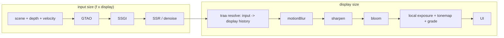

# PRD-741 — The owned engine shades fewer pixels and its temporal resolve writes the display frame

**Status:** PARTIAL — implementation started 2026-10-24; acceptance remains open.
**Priority:** P1 — Phase 2 is the only measured path from about 21 ms to the 15 ms GPU frame that the starter kits need for 60 fps on Iris Xe.
**Complexity:** 8 (HIGH) — two raster sizes in one C++ frame (+3), post-stage routing across the TS/C++ seam (+2), history lifetime on scale steps (+2), hardware-only gates (+1).
**Depends on:** [PRD-539](PRD-539-low-resolution-temporal-reconstruction-quality-and-cost.md) for the motion-quality corpus (`scripts/verify-temporal-motion.ts`). This PRD does not wait for PRD-539 to close (see Decisions).

## Problem (measured)

Goal (owner): presented p95 <= 16.7 ms in Hop Garden (`templates/collectathon`), Lantern Vale (`templates/adventure`) and Clover Cup (`templates/kart`) on Intel Iris Xe (gen-12lp), auto tier `medium`, 1080p.

| Hop Garden, medium, Iris Xe | GPU ms |
| --- | --- |
| Frame p50 today | 28.5 |
| GTAO path (half-res GTAO saves 3.3) | 10.8 |
| Local exposure | 3.2 |
| Bloom / auto exposure / SSR after its step cap | 0.1 / 0 / ~0 |
| Shadows 2048 -> 1024 | 0 saved |
| Projected after the GTAO work | ~21 |

The gap from ~21 ms to ~15 ms needs fewer shaded pixels. The core resolution scaler (`packages/core/src/resolution-scaler.ts`, `4dd4db1b9`) holds 1.0 on a desktop. The reason: below 1.0 the drawing buffer shrinks (`packages/core/src/renderer.ts:1554-1561`) and the canvas stretches it, so the frame blurs. Medium and high already run the owned engine's TRAA (`packages/runtime-native/src/engine/renderer/post/traa.cpp`). That TRAA keeps one size for input, history and output (`TraaPass::resize`, `traa.cpp:251-276`). It samples the current frame bilinearly at the output UV (`traa.cpp:132`), so it cannot rebuild detail from a smaller jittered input.

## What Unreal does (UE 5.8.3, read 2026-10-24)

- **Two rects.** With an upscaler the main pass renders into `View.ViewRect`. The upscaler output is the secondary (display) rect (`UE 5.8.3: Engine/Source/Runtime/Renderer/Private/PostProcess/TemporalSuperResolution.cpp:1974-1982`). Its history size is the output rect times `r.TSR.History.ScreenPercentage`/100, clamped to 1-2 (`:2054-2067`, cvar default 100 at `:54`). Gen4 TAAU does the same with `ScreenPercentage` = input/output width and `UpscaleFactor` = its inverse (`.../PostProcess/TemporalAA.cpp:733-734`). The output extent comes from the output rect (`TemporalAA.cpp:547-554`).
- **Upsample kernel.** For each output pixel, TAAU weights the nearby input samples by `1 - 1.9x² + 0.905x⁴`. x² is the squared distance in output pixels times `UpscaleFactor²` (`UE 5.8.3: Engine/Shaders/Private/TemporalAA.usf:1460-1478`).
- **Jitter.** With a temporal upscale, Unreal spreads the jitter uniformly over [-0.5, 0.5] input pixels with Halton(2,3) (`.../Renderer/Private/SceneVisibility.cpp:5330-5335`). TSR starts from 8 samples (`:5256-5260`). It multiplies by 1/f² so the density per output pixel stays constant (`:5268-5272`, `r.TemporalAAScaleSamples` default 1 at `:105-109`). Then it takes the next prime (`:5284-5295`). At f = 0.72 that is 8/0.518 = 15.4 -> 17.
- **Mip bias.** The texture mip bias is -log2(1/f) - 0.3, clamped at -2 (`SceneVisibility.cpp:5338-5339`, `:180-189`).
- **Screen percentage.** `r.ScreenPercentage` defaults to 0, which means "use `r.ScreenPercentage.Default.*`" (`.../Engine/Private/LegacyScreenPercentageDriver.cpp:37-43`). A desktop uses `BasedOnDisplayResolution` (`:17-20`). That mode interpolates rendered pixels between 720p->720p, 2160p->1080p and 4320p->1440p (`:362-415`, `Engine/Config/BaseEngine.ini:2248-2254`). At a 1080p display: t = (2.07M - 0.92M)/(8.29M - 0.92M) = 0.156. Rendered = 0.92M + 0.156 x 1.15M = 1.10M px, so f = sqrt(1.10/2.07) = **72.9%**.
- **Per scalability level.** Auto-detect writes `sg.ResolutionQuality` from `PerfIndexValues_ResolutionQuality="50 71 87 100 100"` (Low, Medium, High, Epic, Cinematic) (`Engine/Config/BaseScalability.ini:36-37`, `.../Engine/Private/Scalability.cpp:708-711`). A nonzero value sets `r.ScreenPercentage` (`Scalability.cpp:532-551`). The TSR fraction range is 0.25-2.0 (`.../Engine/Public/SceneView.h:2280-2281`).
- **Pass order.** All scene passes (lighting, AO, SSR, Lumen) run before `AddPostProcessingPasses` (`.../Renderer/Private/DeferredShadingRenderer.cpp:4312`), so they run at input size. In `PostProcessing.cpp`, DOF (`:976`) runs before the upscaler (`:1109-1170`). After the upscaler, at `PostTAAViewSize` = the display size (`:810`): motion blur (`:1269`), local exposure (`:1369`), histogram and eye adaptation (`:1406-1451`), bloom (`:1506-1564`), tonemap (`:1629`), FXAA/SMAA (`:1648`, `:1661`).

Our chain order (`packages/core/src/render/chain.ts:18-35`) already matches. `ambientOcclusion`, `ssgi`, `ssr`, `denoise` and `temporalReproject` come before `traa`. `motionBlur`, `sharpen`, `bloom`, `vignette` and the output come after it. Local exposure reads the frame in the output stage (`packages/core/src/look/world-environment.ts:983-988`). It stays at display size, as in Unreal.

## Where it plugs in (files this change touches)

- `packages/runtime-native/src/engine/renderer/post/traa.h`, `traa.cpp`: `resize(input, output)`. Velocity and depth history at input size. Color history and resolve at output size. The resolve gathers the 3x3 input neighbors with the TAAU kernel instead of one bilinear fetch. Neighborhood clamp moments come from the input texels.
- `packages/runtime-native/src/engine/renderer/graph/history.h`, `history.cpp`: jitter length 31 (TRAANode r185) while 31 >= Unreal's prime for 8/f². Above that, Unreal's prime rule. 31 covers f >= 0.51.
- `packages/runtime-native/src/engine/renderer/renderer.h`, `renderer.cpp`: a render scale beside `width_/height_`. The scene color, depth, MSAA, velocity and MRT targets (`Renderer::setSize`, `renderer.cpp:1173-1221`) take the input size. `postScene()` (`:1241`) and the late-resolve host pass (`:4342-4351`) give the post graph a display-size texture after `traa`.
- `packages/runtime-native/src/engine/shader/graph/post_effects.cpp`: each pass before the `traa` host pass (`:670-677`) sizes to input. Each pass after it sizes to output.
- `packages/runtime-native/src/engine/wasm/web_host.cpp`: the scale entry beside `tnw_web_resize` (`:223`). The desktop host takes the same call.
- `packages/core/src/renderer.ts`: on the owned engine with an upsampling `traa`, keep the drawing buffer at display size (`:1554`) and send the scale to the engine. `packages/core/src/render/resolution-subrect.ts` stays the three.js path. It is not used here.
- `packages/core/src/game.ts:1485-1500`: pass `temporalUpscale` when the engine reports an upsampling resolve. `packages/core/src/resolution-scaler.ts:334`: with it, the floor lifts to the rung 0.27, not 0.23 (TSR minimum 0.25).
- `packages/core/src/look/quality.ts`: per-tier start scale (Phase 2 box 3).
- Tests: `packages/runtime-native/tests/native-engine/renderer_test.cpp` (`traa_validation`), `packages/runtime-native/conformance/registry.json` with a scene beside `conformance/scenes/shared/temporal-aa-scaled.js` that drives the built-in `traa` stage, and `packages/core/__tests__/resolution-scaler*.spec.ts`.

## Phases

### Phase 1 — Measurement and a red test

2026-10-24 baseline: the focused C++ renderer target built successfully with Dawn and
`TN_ENGINE_ONLY=ON` in `build/prd741`. `ctest --test-dir packages/runtime-native/build/prd741
-R '^native_engine_traa_validation$' --output-on-failure` failed three existing draw-count
assertions (lines 210, 214, 224) before the upsampling implementation; GPU validation otherwise
reported no error. These failures need diagnosis before claiming the native gate.
The final binary passes the unchanged draw-count assertions; three additional focused repeats
also passed. The initial count failure did not recur; its cause remains unproven.

- [ ] Per-pass GPU ms for Hop Garden medium on Iris Xe at pinned scale 1.0 and 0.72 (stretch path), each pass sorted into input-bound, output-bound or fixed. This gives R (input-bound ms) and F (the rest) for the projection below. proof: `node packages/playtest/dist/runner/cli.js perf` on the kit scenario with `?tnFrameSpans=1`, 2 runs per arm, table in this box.
- [x] Red: an engine test asserts that `TraaPass` at input 1280x720 and output 1920x1080 has input-size velocity and depth history, output-size color history and resolve, and a jitter length of at least 8/f². proof: the focused native renderer test object build exited 1 before implementation (missing four-argument `resize`); the CMake renderer/player build then passed, and `ctest --test-dir packages/runtime-native/build/prd741 -R '^native_engine_traa_validation$' --output-on-failure` passed 1/1 after implementation. Status reads actual GPU allocation sizes; tests also encode three resolves, check output-only resize invalidation, odd dimensions, and the 0.27 fraction.

### Phase 2 — Engine resolve, routing and tier defaults

- [x] `TraaPass` resolves an input raster into a display-size history with the TAAU kernel, and the red test turns green. proof: frozen native `traa_validation`, `traa_history` and `history_cut` pass 3/3. `pnpm parity --target web --engine threenative --only-tests temporal-aa-upsampled --reference artifacts/conformance/prd741-color-final-reference --out artifacts/conformance/prd741-color-final-web` and the equivalent `--target desktop` using this branch's `tn-native-engine-player-v8` both report the selected row PASS after 300 actual temporal frames. Web mismatch 0.05806966 / deltaE 0.3717278; desktop 0.05811415 / 0.3716437; unchanged limits 0.06 / 9; no page, frame or GPU errors. Actual input 922x518, output 1280x720, jitter length 31. Aggregate exit 2 reports 129 intentionally unselected rows blocked, not failures. The desktop proof uses the owned player and a required frame-counter marker rather than the legacy-default `native:verify:desktop`; its frame-300 marker and nonuniform screenshot prove the requested owned native 300-frame run. A discovered runner false positive (accepting readiness despite `TN_V8_FRAME_FAILED`) now has red-to-green fail-closed tests; all 90 runner tests pass.
- [x] The scene and the stages before `traa` draw at input size, and the stages after `traa` draw at display size. The scaler takes rungs below 0.61 only while an upsampling `traa` runs. proof: native `traa_validation` passes actual pre/resolve/post GPU allocation checks, including shuffled pass order, fixed-size overrides and removing TRAA. The scaler floor test failed at 0.23 before the fix and passes at 0.27; a second red-to-green check restores 0.61 when reconstruction disappears, including during cooldown. All 87 scaler tests pass. A headed, real-display NVIDIA Turing Hop Garden smoke at medium/1080p/0.72 passed and emitted `TN_RENDER_CHAIN` with `stageSizes.traa.input=[1382,778]`, `output=[1920,1080]` (253 draws, 251575 triangles; no diagnostics). The test used exported kit authoring from PR #563, not its engine changes, and current core plus Wasm SHA `655be40f3b95a12fee407579e4abbb15dfabfa80b8e5491c4f3eca1c6871c3c3`.
- [x] Per-tier start scale from Unreal's `PerfIndexValues_ResolutionQuality`, snapped to our rungs: medium 0.72 (Unreal 71, and 72.9 at a 1080p display), high 0.85 (87). Low stays 1.0 because it runs SMAA and has nothing to reconstruct. The scaler then moves from that start. proof: focused resolution-scaler, renderer-surface, render-chain and browser-renderer specs passed 180/180; world-environment-defaults, game-gpu-class-start, game-auto-scale and renderer-config specs passed 40/40. Tier-table and display-buffer behavior have red-to-green coverage; `game.ts` chooses the installed chain tier before its first draw and keeps explicitly pinned scales.

### Phase 3 — Gates

- [ ] Paired GPU A/B on the Iris laptop, Hop Garden medium: 1.0 (BEFORE) against the tier start 0.72 (AFTER), 3 pairs from one code state through a URL knob. AFTER GPU p50 <= 15 ms and presented p95 <= 16.7 ms. proof: the `perf-loop` paired runner on the laptop, table in this box.
- [ ] Visual judge on Hop Garden, Lantern Vale and Clover Cup, 2 runs per arm, BEFORE/AFTER burned in, headed `--browser-recipe webgpu` with `adapter.info` checked. A fresh Opus subagent judges, and NEUTRAL or IMPROVEMENT ships. proof: verdict JSON and sheet on the `PRD-741-screenshots` branch, linked here.

## Projected GPU time (arithmetic, unverified until Phase 1 box 1)

Frame after the GTAO work: ~21 ms. Not scaled by the input size: local exposure 3.2 + bloom 0.1 (both after the resolve) + X. X is the shadow raster, the TRAA resolve, tonemap and present. X is unmeasured, and the assumption is X ≈ 3 ms. So F ≈ 6.3 ms and R ≈ 14.7 ms (70% of the 21 ms frame, 52% of today's 28.5 ms).

- At 0.72 (0.518 of the pixels): 6.3 + 14.7 x 0.518 = 6.3 + 7.6 = **13.9 ms**. Add ~0.3 ms for 9 taps instead of 1 in the resolve: **~14.2 ms**. That meets the ~15 ms target.
- If X = 6 ms (F = 9.3, R = 11.7): 9.3 + 6.1 = 15.4 ms at 0.72. That misses, and the scaler needs 0.61 (0.372): 9.3 + 4.4 = 13.7 ms.

## Current verification (2026-10-24)

- The owner-reported white Adventure ground was an engine shader linkage bug: a fragment `attribute("color")` collided with the fragment output named `color`. Reused PR #563's existing `vertexColor` varying fix and retained geometry colors for explicit TSL reads with `vertexColors: false`; no game workaround. The existing material-build test failed before the port and passes afterward. The rebuilt native material, TRAA validation, TRAA history and history-cut tests pass 4/4. Final Wasm SHA: `ddee0306ac28c54ff78720077e52584e470843c7c114f51f384bb37365353546`.
- Reinstalled Adventure passed its runtime scenario with zero diagnostics and console errors. A real headed screenshot confirms textured green ground is restored; a second initial-view capture shows the character, path, both training dummies and hut. The required independent visual judgment remains in progress.
- The final color-attribute and temporal-upsample conformance rows pass 2/2 on upstream, owned web and owned desktop. Color mismatch/deltaE is 0.000564236111 / 0.000250461924 on both owned targets; final native SHA `4462d82b6c49842b65aa991d93ccb50119952aa92b02f23a72698a2e78328308`. This is selected-row coverage, not the full conformance board.
- Workspace typecheck passed; lint passed with 1831 warnings. Related TypeScript tests pass 220/220; conformance-runner tests pass 90/90. These are focused checks, not a claim that the complete product board ran.
- First qualified normal-vsync Iris baseline: real Intel gen12lp, 12 steady five-second windows, 3565 presented frames and 566 fresh GPU readings. Median window GPU p50 43.035 ms; presented p95 16.8 ms in every window. The panel measures 59.88 Hz, and an empty control also has p95 16.8 ms. The strict 16.7 ms target remains unchanged and unmet; paired 0.72 measurements are still running.

## Decisions

- 2026-10-24 (filing agent): the brief asked for 5 phases. `docs/PRDs/AGENTS.md` R5 allows at most 3, so measurement + red test, engine + routing + tier defaults, and gates are the 3 phases. Every requested item keeps its own box.
- 2026-10-24: the port is Gen4 TAAU (one resolve pass, kernel above) inside the existing `TraaPass`. TSR's 200% history, rejection and flicker levers stay in PRD-539. Run the PRD-539 motion script on the AFTER arm and record its result. It does not gate this PRD, because its thresholds have not passed on any reconstructor (PRD-539 Problem).
- 2026-10-24: local exposure stays at display size after the resolve, in Unreal's order (`PostProcessing.cpp:1369` after `:1154`). Its 3.2 ms is counted in F.
- Deferred, not declined: the automatic mip bias (`SceneVisibility.cpp:5338`). WebGPU samplers have no LOD bias, so it needs `textureSampleBias` in the material shaders. Revisit when the judge reads texture blur at 0.72.
- 2026-10-24: preliminary kit runtime checks export the authored kits from PR #563 (`8030b2b774331a03579aa440fdcb302468abafe8`) into clean external projects and install this branch's packages. This permits implementation checks without importing another PRD's engine changes. It does not establish the Iris Xe frame-time gates or remove the integration prerequisite below.

## Blocked on

- The three kits are not on `develop` yet (PRD-732/733 lane). Phase 3 needs them merged.
- Phase 1 box 1 and Phase 3 need the Iris Xe laptop (laptop-offload lane) to be idle.
