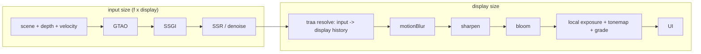

# PRD-741 — The owned engine shades fewer pixels and its temporal resolve writes the display frame

**Status:** PARTIAL — implementation started 2026-10-24; acceptance remains open.
**Priority:** P1 — Phase 2 is the only measured path from about 21 ms to the 15 ms GPU frame that the starter kits need for 60 fps on Iris Xe.
**Complexity:** 8 (HIGH) — two raster sizes in one C++ frame (+3), post-stage routing across the TS/C++ seam (+2), history lifetime on scale steps (+2), hardware-only gates (+1).
**Depends on:** [PRD-539](PRD-539-low-resolution-temporal-reconstruction-quality-and-cost.md) for the motion-quality corpus (`scripts/verify-temporal-motion.ts`). This PRD does not wait for PRD-539 to close (see Decisions).

## Problem (measured)

Goal (owner): presented p95 <= 16.7 ms in Hop Garden (`templates/collectathon`), Lantern Vale (`templates/adventure`) and Clover Cup (`templates/kart`) on Intel Iris Xe (gen-12lp), auto tier `medium`, 1080p.

| Hop Garden, medium, Iris Xe | GPU ms |
| --- | --- |
| Frame p50 today | 28.5 |
| GTAO path (half-res GTAO saves 3.3) | 10.8 |
| Local exposure | 3.2 |
| Bloom / auto exposure / SSR after its step cap | 0.1 / 0 / ~0 |
| Shadows 2048 -> 1024 | 0 saved |
| Projected after the GTAO work | ~21 |

The gap from ~21 ms to ~15 ms needs fewer shaded pixels. The core resolution scaler (`packages/core/src/resolution-scaler.ts`, `4dd4db1b9`) holds 1.0 on a desktop. The reason: below 1.0 the drawing buffer shrinks (`packages/core/src/renderer.ts:1554-1561`) and the canvas stretches it, so the frame blurs. Medium and high already run the owned engine's TRAA (`packages/runtime-native/src/engine/renderer/post/traa.cpp`). That TRAA keeps one size for input, history and output (`TraaPass::resize`, `traa.cpp:251-276`). It samples the current frame bilinearly at the output UV (`traa.cpp:132`), so it cannot rebuild detail from a smaller jittered input.

## What Unreal does (UE 5.8.3, read 2026-10-24)

- **Two rects.** With an upscaler the main pass renders into `View.ViewRect`. The upscaler output is the secondary (display) rect (`UE 5.8.3: Engine/Source/Runtime/Renderer/Private/PostProcess/TemporalSuperResolution.cpp:1974-1982`). Its history size is the output rect times `r.TSR.History.ScreenPercentage`/100, clamped to 1-2 (`:2054-2067`, cvar default 100 at `:54`). Gen4 TAAU does the same with `ScreenPercentage` = input/output width and `UpscaleFactor` = its inverse (`.../PostProcess/TemporalAA.cpp:733-734`). The output extent comes from the output rect (`TemporalAA.cpp:547-554`).
- **Upsample kernel.** For each output pixel, TAAU weights the nearby input samples by `1 - 1.9x² + 0.905x⁴`. x² is the squared distance in output pixels times `UpscaleFactor²` (`UE 5.8.3: Engine/Shaders/Private/TemporalAA.usf:1460-1478`).
- **Jitter.** With a temporal upscale, Unreal spreads the jitter uniformly over [-0.5, 0.5] input pixels with Halton(2,3) (`.../Renderer/Private/SceneVisibility.cpp:5330-5335`). TSR starts from 8 samples (`:5256-5260`). It multiplies by 1/f² so the density per output pixel stays constant (`:5268-5272`, `r.TemporalAAScaleSamples` default 1 at `:105-109`). Then it takes the next prime (`:5284-5295`). At f = 0.72 that is 8/0.518 = 15.4 -> 17.
- **Mip bias.** The texture mip bias is -log2(1/f) - 0.3, clamped at -2 (`SceneVisibility.cpp:5338-5339`, `:180-189`).
- **Screen percentage.** `r.ScreenPercentage` defaults to 0, which means "use `r.ScreenPercentage.Default.*`" (`.../Engine/Private/LegacyScreenPercentageDriver.cpp:37-43`). A desktop uses `BasedOnDisplayResolution` (`:17-20`). That mode interpolates rendered pixels between 720p->720p, 2160p->1080p and 4320p->1440p (`:362-415`, `Engine/Config/BaseEngine.ini:2248-2254`). At a 1080p display: t = (2.07M - 0.92M)/(8.29M - 0.92M) = 0.156. Rendered = 0.92M + 0.156 x 1.15M = 1.10M px, so f = sqrt(1.10/2.07) = **72.9%**.
- **Per scalability level.** Auto-detect writes `sg.ResolutionQuality` from `PerfIndexValues_ResolutionQuality="50 71 87 100 100"` (Low, Medium, High, Epic, Cinematic) (`Engine/Config/BaseScalability.ini:36-37`, `.../Engine/Private/Scalability.cpp:708-711`). A nonzero value sets `r.ScreenPercentage` (`Scalability.cpp:532-551`). The TSR fraction range is 0.25-2.0 (`.../Engine/Public/SceneView.h:2280-2281`).
- **Pass order.** All scene passes (lighting, AO, SSR, Lumen) run before `AddPostProcessingPasses` (`.../Renderer/Private/DeferredShadingRenderer.cpp:4312`), so they run at input size. In `PostProcessing.cpp`, DOF (`:976`) runs before the upscaler (`:1109-1170`). After the upscaler, at `PostTAAViewSize` = the display size (`:810`): motion blur (`:1269`), local exposure (`:1369`), histogram and eye adaptation (`:1406-1451`), bloom (`:1506-1564`), tonemap (`:1629`), FXAA/SMAA (`:1648`, `:1661`).

Our chain order (`packages/core/src/render/chain.ts:18-35`) already matches. `ambientOcclusion`, `ssgi`, `ssr`, `denoise` and `temporalReproject` come before `traa`. `motionBlur`, `sharpen`, `bloom`, `vignette` and the output come after it. Local exposure reads the frame in the output stage (`packages/core/src/look/world-environment.ts:983-988`). It stays at display size, as in Unreal.

## Where it plugs in (files this change touches)

- `packages/runtime-native/src/engine/renderer/post/traa.h`, `traa.cpp`: `resize(input, output)`. Velocity and depth history at input size. Color history and resolve at output size. The resolve gathers the 3x3 input neighbors with the TAAU kernel instead of one bilinear fetch. Neighborhood clamp moments come from the input texels.
- `packages/runtime-native/src/engine/renderer/graph/history.h`, `history.cpp`: jitter length 31 (TRAANode r185) while 31 >= Unreal's prime for 8/f². Above that, Unreal's prime rule. 31 covers f >= 0.51.
- `packages/runtime-native/src/engine/renderer/renderer.h`, `renderer.cpp`: a render scale beside `width_/height_`. The scene color, depth, MSAA, velocity and MRT targets (`Renderer::setSize`, `renderer.cpp:1173-1221`) take the input size. `postScene()` (`:1241`) and the late-resolve host pass (`:4342-4351`) give the post graph a display-size texture after `traa`.
- `packages/runtime-native/src/engine/shader/graph/post_effects.cpp`: each pass before the `traa` host pass (`:670-677`) sizes to input. Each pass after it sizes to output.
- `packages/runtime-native/src/engine/wasm/web_host.cpp`: the scale entry beside `tnw_web_resize` (`:223`). The desktop host takes the same call.
- `packages/core/src/renderer.ts`: on the owned engine with an upsampling `traa`, keep the drawing buffer at display size (`:1554`) and send the scale to the engine. `packages/core/src/render/resolution-subrect.ts` stays the three.js path. It is not used here.
- `packages/core/src/game.ts:1485-1500`: pass `temporalUpscale` when the engine reports an upsampling resolve. `packages/core/src/resolution-scaler.ts:334`: with it, the floor lifts to the rung 0.27, not 0.23 (TSR minimum 0.25).
- `packages/core/src/look/quality.ts`: per-tier start scale (Phase 2 box 3).
- Tests: `packages/runtime-native/tests/native-engine/renderer_test.cpp` (`traa_validation`), `packages/runtime-native/conformance/registry.json` with a scene beside `conformance/scenes/shared/temporal-aa-scaled.js` that drives the built-in `traa` stage, and `packages/core/__tests__/resolution-scaler*.spec.ts`.

## Phases

### Phase 1 — Measurement and a red test

2026-10-24 baseline: the focused C++ renderer target built successfully with Dawn and
`TN_ENGINE_ONLY=ON` in `build/prd741`. `ctest --test-dir packages/runtime-native/build/prd741
-R '^native_engine_traa_validation$' --output-on-failure` failed three existing draw-count
assertions (lines 210, 214, 224) before the upsampling implementation; GPU validation otherwise
reported no error. These failures need diagnosis before claiming the native gate.
The final binary passes the unchanged draw-count assertions; three additional focused repeats
also passed. The initial count failure did not recur; its cause remains unproven.

- [x] Per-pass GPU ms for Hop Garden medium on Iris Xe at pinned scale 1.0 and 0.72 (stretch path), each pass sorted into input-bound, output-bound or fixed. This gives R (input-bound ms) and F (the rest) for the projection below. proof: the existing kit playtest runner executes `integrated-gpu-passes.playtest.json` with `?tnScale=<1|0.72>&tnTier=medium&tnFrameSpans=1&tnGpuPasses=1`, `--browser-recipe webgpu --headed --live-clock --timeout 180000`, two runs per arm; measured table below. This replaces the plan's `cli perf` shorthand with the actual timestamp-observing scenario command.

  Measured before the subsequent exposure/denoise optimization, frozen source `618c0670eaff8e331b9cd87e22828d026a1aa134`, core `70cf2c29...`, Wasm `d519c305...`. A1/B1/B2/A2 order, all four exit 0 with no diagnostics/errors, real Intel gen12lp and identical spawn `[0,0.810099959,14]`. 6602 complete trace records validate; final 12 complete budget windows per arm select 3699 unique GPU frames. Profiling is ON; these runs do not qualify presented timing.

  | Class | Pass rows | Additive mean A / B (ms) | Per-frame group p50 A / B (ms) |
  | --- | ---: | ---: | ---: |
  | Input-bound | 10 | 12.737 / 7.208 | 12.765 / 7.189 |
  | Output-bound | 53 | 9.383 / 9.042 | 9.377 / 9.036 |
  | Fixed | 27 | 0.721 / 0.568 | 0.586 / 0.530 |
  | Total | 90 | 22.841 / 16.817 | 23.019 / 16.841 |

  Group p50 values are nonadditive. Measured R = 12.737 ms and F = 10.104 ms (means). Actual area ratio `(1382*778)/(1920*1080)` = 0.518517 predicts `F + R*ratio` = 16.708 ms, versus measured mean 16.817 ms. The original F estimate 6.3 ms was too low. The fixed 480x9 local-exposure grid alone is 1.824 / 1.807 ms (pooled p50); its full five stages plus native output blits are 3.174 / 2.932 ms. This evidence led to integrating the parent's two-pass grid and gather-resolution denoising before final qualification.

  Each row below is one measured pass occurrence, with GPU p50 milliseconds. A is 1.0, B is 0.72; dimensions are actual render targets, A → B. `not observed`/`—` is a missing occurrence, not zero cost. Output-derived local/auto-exposure and bloom targets follow the display size; fixed meters are 64x64, 64x1 and 1x1, shadows use the authored 2048x2048 map, and compute dispatches use fixed particle storage (exact per-emitter kernel identities are unavailable). Zero dimensions in raw metadata are resolved from those source owners; they are not treated as resolution evidence. Raw per-frame logs, screenshots, source-qualified classification bases and the complete CSV remain in the existing capture workflow output `~/Downloads/PRD-741/iris-gpu-passes/`.

  | Pass / segment / occurrence | Class | Target A → B | A1 | B1 | B2 | A2 |
  | --- | --- | --- | ---: | ---: | ---: | ---: |
  | scene / 1 / 1 | input-bound | 1920x1080 → 1382x778 | 5.8920 | 3.5343 | 3.5869 | 6.0845 |
  | aux / 2 / 1 | input-bound | 1920x1080 → 1382x778 | 0.9409 | 0.5822 | 0.5939 | 0.9598 |
  | traaVelocity / 2 / 1 | input-bound | 1920x1080 → 1382x778 | 0.4305 | 0.2064 | 0.2116 | 0.4385 |
  | velocityObjects / 2 / 1 | input-bound | 1920x1080 → 1382x778 | 0.1195 | 0.0706 | 0.0716 | 0.1193 |
  | post / 2 / 1 | input-bound | 960x540 → 691x389 | 1.1039 | 0.5637 | 0.5837 | 1.1456 |
  | post / 2 / 2 | input-bound | 1920x1080 → 1382x778 | 0.2748 | 0.1445 | 0.1459 | 0.2844 |
  | post / 2 / 3 | input-bound | 960x540 → 691x389 | 1.4350 | 0.7424 | 0.7558 | 1.4802 |
  | post / 2 / 4 | input-bound | 1920x1080 → 1382x778 | 1.5137 | 0.7771 | 0.7890 | 1.5625 |
  | post / 2 / 5 | input-bound | 1920x1080 → 1382x778 | 0.4454 | 0.2364 | 0.2422 | 0.4605 |
  | post / 2 / 6 | input-bound | 1920x1080 → 1382x778 | 0.5345 | 0.2240 | 0.2294 | 0.5379 |
  | traaResolve / 2 / 1 | output-bound | 1920x1080 → 1920x1080 | 2.2904 | 2.5755 | 2.6038 | 2.3492 |
  | post / 2 / 7 | output-bound | 1920x1080 → 1920x1080 | 0.4797 | 0.4404 | 0.4465 | 0.4839 |
  | output / 3 / 1 | output-bound | 1920x1080 → 1920x1080 | 1.1722 | 1.1550 | 1.1709 | 1.1994 |
  | scene / 2 / 1 | output-bound | 480x270 → 480x270 | 0.4448 | 0.2507 | 0.2555 | 0.4529 |
  | output / 2 / 1 | output-bound | 480x270 → 480x270 | 0.0258 | 0.0206 | 0.0211 | 0.0266 |
  | scene / 2 / 2 | output-bound | 120x68 → 120x68 | 0.0424 | 0.0383 | 0.0390 | 0.0437 |
  | output / 2 / 2 | output-bound | 120x68 → 120x68 | 0.0047 | 0.0046 | 0.0047 | 0.0048 |
  | scene / 2 / 3 | fixed | 64x64 → 64x64 | 0.0992 | 0.0955 | 0.0986 | 0.1029 |
  | output / 2 / 3 | fixed | 64x64 → 64x64 | 0.0044 | 0.0041 | 0.0042 | 0.0045 |
  | scene / 2 / 4 | fixed | 64x1 → 64x1 | 0.0255 | 0.0248 | 0.0254 | 0.0261 |
  | output / 2 / 4 | fixed | 64x1 → 64x1 | 0.0040 | 0.0039 | 0.0040 | 0.0041 |
  | scene / 2 / 5 | fixed | 1x1 → 1x1 | 0.0397 | 0.0387 | 0.0397 | 0.0410 |
  | output / 2 / 5 | fixed | 1x1 → 1x1 | 0.0042 | 0.0041 | 0.0042 | 0.0043 |
  | localExposure.log / 2 / 6 | output-bound | 960x540 → 960x540 | 0.3517 | 0.2372 | 0.2491 | 0.3525 |
  | localExposure.log.outputBlit / 2 / 6 | output-bound | 960x540 → 960x540 | 0.0960 | 0.0976 | 0.0987 | 0.0982 |
  | localExposure.luminance / 2 / 7 | output-bound | 120x68 → 120x68 | 0.6608 | 0.3658 | 0.3628 | 0.6741 |
  | localExposure.luminance.outputBlit / 2 / 7 | output-bound | 120x68 → 120x68 | 0.0049 | 0.0046 | 0.0048 | 0.0050 |
  | localExposure.blurX / 2 / 8 | output-bound | 120x68 → 120x68 | 0.0477 | 0.0464 | 0.0476 | 0.0493 |
  | localExposure.blurX.outputBlit / 2 / 8 | output-bound | 120x68 → 120x68 | 0.0046 | 0.0045 | 0.0046 | 0.0047 |
  | localExposure.blurY / 2 / 9 | output-bound | 120x68 → 120x68 | 0.0455 | 0.0445 | 0.0456 | 0.0471 |
  | localExposure.blurY.outputBlit / 2 / 9 | output-bound | 120x68 → 120x68 | 0.0046 | 0.0045 | 0.0046 | 0.0047 |
  | localExposure.grid / 2 / 10 | output-bound | 480x9 → 480x9 | 1.8200 | 1.7677 | 1.8137 | 1.8819 |
  | localExposure.grid.outputBlit / 2 / 10 | output-bound | 480x9 → 480x9 | 0.0045 | 0.0044 | 0.0045 | 0.0045 |
  | scene / 2 / 11 | output-bound | 960x540 → 960x540 | 0.2786 | 0.2704 | 0.2735 | 0.2820 |
  | output / 2 / 11 | output-bound | 960x540 → 960x540 | 0.0578 | 0.0560 | 0.0575 | 0.0598 |
  | scene / 2 / 12 | output-bound | 480x270 → 480x270 | 0.0580 | 0.0585 | 0.0596 | 0.0624 |
  | output / 2 / 12 | output-bound | 480x270 → 480x270 | 0.0164 | 0.0160 | 0.0163 | 0.0169 |
  | scene / 2 / 13 | output-bound | 240x135 → 240x135 | 0.0232 | 0.0226 | 0.0230 | 0.0238 |
  | output / 2 / 13 | output-bound | 240x135 → 240x135 | 0.0074 | 0.0073 | 0.0074 | 0.0077 |
  | scene / 2 / 14 | output-bound | 120x68 → 120x68 | 0.0134 | 0.0132 | 0.0134 | 0.0138 |
  | output / 2 / 14 | output-bound | 120x68 → 120x68 | 0.0046 | 0.0045 | 0.0046 | 0.0047 |
  | scene / 2 / 15 | output-bound | 60x34 → 60x34 | 0.0110 | 0.0107 | 0.0109 | 0.0112 |
  | output / 2 / 15 | output-bound | 60x34 → 60x34 | 0.0041 | 0.0040 | 0.0041 | 0.0042 |
  | scene / 2 / 16 | output-bound | 30x17 → 30x17 | 0.0099 | 0.0098 | 0.0099 | 0.0102 |
  | output / 2 / 16 | output-bound | 30x17 → 30x17 | 0.0040 | 0.0040 | 0.0040 | 0.0041 |
  | scene / 2 / 17 | output-bound | 30x17 → 30x17 | 0.0202 | 0.0200 | 0.0204 | 0.0208 |
  | output / 2 / 17 | output-bound | 30x17 → 30x17 | 0.0040 | 0.0039 | 0.0040 | 0.0041 |
  | scene / 2 / 18 | output-bound | 30x17 → 30x17 | 0.0187 | 0.0186 | 0.0190 | 0.0193 |
  | output / 2 / 18 | output-bound | 30x17 → 30x17 | 0.0041 | 0.0040 | 0.0041 | 0.0042 |
  | scene / 2 / 19 | output-bound | 60x34 → 60x34 | 0.0223 | 0.0221 | 0.0224 | 0.0230 |
  | output / 2 / 19 | output-bound | 60x34 → 60x34 | 0.0041 | 0.0040 | 0.0041 | 0.0042 |
  | scene / 2 / 20 | output-bound | 60x34 → 60x34 | 0.0210 | 0.0208 | 0.0212 | 0.0216 |
  | output / 2 / 20 | output-bound | 60x34 → 60x34 | 0.0040 | 0.0040 | 0.0041 | 0.0042 |
  | scene / 2 / 21 | output-bound | 120x68 → 120x68 | 0.0220 | 0.0215 | 0.0218 | 0.0225 |
  | output / 2 / 21 | output-bound | 120x68 → 120x68 | 0.0046 | 0.0045 | 0.0046 | 0.0047 |
  | scene / 2 / 22 | output-bound | 120x68 → 120x68 | 0.0221 | 0.0216 | 0.0220 | 0.0227 |
  | output / 2 / 22 | output-bound | 120x68 → 120x68 | 0.0045 | 0.0045 | 0.0045 | 0.0046 |
  | scene / 2 / 23 | output-bound | 240x135 → 240x135 | 0.0335 | 0.0331 | 0.0335 | 0.0345 |
  | output / 2 / 23 | output-bound | 240x135 → 240x135 | 0.0072 | 0.0072 | 0.0073 | 0.0075 |
  | scene / 2 / 24 | output-bound | 240x135 → 240x135 | 0.0334 | 0.0330 | 0.0335 | 0.0345 |
  | output / 2 / 24 | output-bound | 240x135 → 240x135 | 0.0072 | 0.0071 | 0.0072 | 0.0075 |
  | scene / 2 / 25 | output-bound | 480x270 → 480x270 | 0.0935 | 0.0908 | 0.0928 | 0.0944 |
  | output / 2 / 25 | output-bound | 480x270 → 480x270 | 0.0157 | 0.0154 | 0.0157 | 0.0163 |
  | scene / 2 / 26 | output-bound | 480x270 → 480x270 | 0.0952 | 0.0932 | 0.0956 | 0.0986 |
  | output / 2 / 26 | output-bound | 480x270 → 480x270 | 0.0156 | 0.0153 | 0.0156 | 0.0162 |
  | scene / 2 / 27 | output-bound | 960x540 → 960x540 | 0.2470 | 0.2471 | 0.2509 | 0.2573 |
  | output / 2 / 27 | output-bound | 960x540 → 960x540 | 0.0572 | 0.0553 | 0.0570 | 0.0592 |
  | scene / 2 / 28 | output-bound | 960x540 → 960x540 | 0.2647 | 0.2584 | 0.2646 | 0.2723 |
  | output / 2 / 28 | output-bound | 960x540 → 960x540 | 0.0553 | 0.0534 | 0.0551 | 0.0573 |
  | particle compute / 2 / 1 | fixed | fixed particle storage | 0.0030 | 0.0029 | 0.0030 | 0.0030 |
  | particle compute / 2 / 2 | fixed | fixed particle storage | 0.0031 | 0.0030 | 0.0031 | 0.0032 |
  | particle compute / 2 / 3 | fixed | fixed particle storage | 0.0037 | 0.0037 | 0.0037 | 0.0038 |
  | particle compute / 2 / 4 | fixed | fixed particle storage | 0.0037 | 0.0036 | 0.0037 | 0.0037 |
  | particle compute / 2 / 5 | fixed | fixed particle storage | 0.0027 | 0.0028 | 0.0029 | 0.0029 |
  | particle compute / 2 / 6 | fixed | fixed particle storage | 0.0030 | 0.0035 | 0.0035 | 0.0033 |
  | particle compute / 2 / 7 | fixed | fixed particle storage | 0.0032 | 0.0032 | 0.0032 | 0.0031 |
  | particle compute / 2 / 8 | fixed | fixed particle storage | 0.0033 | 0.0033 | 0.0033 | 0.0033 |
  | particle compute / 2 / 9 | fixed | fixed particle storage | 0.0032 | 0.0032 | 0.0033 | 0.0032 |
  | particle compute / 2 / 10 | fixed | fixed particle storage | 0.0033 | 0.0033 | 0.0034 | 0.0034 |
  | particle compute / 2 / 11 | fixed | fixed particle storage | 0.0032 | 0.0033 | 0.0034 | 0.0031 |
  | particle compute / 2 / 12 | fixed | fixed particle storage | 0.0035 | 0.0038 | 0.0037 | 0.0035 |
  | particle compute / 2 / 13 | fixed | fixed particle storage | 0.0032 | 0.0035 | 0.0035 | 0.0032 |
  | particle compute / 2 / 14 | fixed | fixed particle storage | 0.0034 | 0.0038 | 0.0039 | 0.0034 |
  | particle compute / 2 / 15 | fixed | fixed particle storage | 0.0033 | 0.0034 | 0.0035 | 0.0033 |
  | particle compute / 2 / 16 | fixed | fixed particle storage | 0.0037 | 0.0042 | 0.0038 | 0.0035 |
  | particle compute / 2 / 17 | fixed | fixed particle storage | 0.0033 | 0.0031 | 0.0038 | 0.0035 |
  | particle compute / 2 / 18 | fixed | fixed particle storage | 0.0039 | 0.0039 | 0.0041 | 0.0040 |
  | particle compute / 2 / 19 | fixed | fixed particle storage | 0.0034 | — | — | 0.0035 |
  | particle compute / 2 / 20 | fixed | fixed particle storage | 0.0040 | — | — | 0.0041 |
  | directional shadow 2048x2048 / 0 / 1 | fixed | 2048x2048 → 2048x2048 | 0.3325 | 0.3304 | 0.3334 | 0.3424 |

  Start temperature/load A1 78 C / 0.51, B1 81 C / 1.74, B2 83 C / 2.29, A2 82 C / 2.62. The first three following-arm starts bound the preceding ends; A2 immediate end was not recorded. A delayed post-run reading was 69 C / 0.31 at 08:22:19 UTC, not an end-of-capture sample. Laptop CI was restored and owned browsers/servers stopped.

- [x] Red: an engine test asserts that `TraaPass` at input 1280x720 and output 1920x1080 has input-size velocity and depth history, output-size color history and resolve, and a jitter length of at least 8/f². proof: the focused native renderer test object build exited 1 before implementation (missing four-argument `resize`); the CMake renderer/player build then passed, and `ctest --test-dir packages/runtime-native/build/prd741 -R '^native_engine_traa_validation$' --output-on-failure` passed 1/1 after implementation. Status reads actual GPU allocation sizes; tests also encode three resolves, check output-only resize invalidation, odd dimensions, and the 0.27 fraction.

### Phase 2 — Engine resolve, routing and tier defaults

- [x] `TraaPass` resolves an input raster into a display-size history with the TAAU kernel, and the red test turns green. proof: frozen native `traa_validation`, `traa_history` and `history_cut` pass 3/3. `pnpm parity --target web --engine threenative --only-tests temporal-aa-upsampled --reference artifacts/conformance/prd741-color-final-reference --out artifacts/conformance/prd741-color-final-web` and the equivalent `--target desktop` using this branch's `tn-native-engine-player-v8` both report the selected row PASS after 300 actual temporal frames. Web mismatch 0.05806966 / deltaE 0.3717278; desktop 0.05811415 / 0.3716437; unchanged limits 0.06 / 9; no page, frame or GPU errors. Actual input 922x518, output 1280x720, jitter length 31. Aggregate exit 2 reports 129 intentionally unselected rows blocked, not failures. The desktop proof uses the owned player and a required frame-counter marker rather than the legacy-default `native:verify:desktop`; its frame-300 marker and nonuniform screenshot prove the requested owned native 300-frame run. A discovered runner false positive (accepting readiness despite `TN_V8_FRAME_FAILED`) now has red-to-green fail-closed tests; all 90 runner tests pass.
- [x] The scene and the stages before `traa` draw at input size, and the stages after `traa` draw at display size. The scaler takes rungs below 0.61 only while an upsampling `traa` runs. proof: native `traa_validation` passes actual pre/resolve/post GPU allocation checks, including shuffled pass order, fixed-size overrides and removing TRAA. The scaler floor test failed at 0.23 before the fix and passes at 0.27; a second red-to-green check restores 0.61 when reconstruction disappears, including during cooldown. All 87 scaler tests pass. A headed, real-display NVIDIA Turing Hop Garden smoke at medium/1080p/0.72 passed and emitted `TN_RENDER_CHAIN` with `stageSizes.traa.input=[1382,778]`, `output=[1920,1080]` (253 draws, 251575 triangles; no diagnostics). The test used exported kit authoring from PR #563, not its engine changes, and current core plus Wasm SHA `655be40f3b95a12fee407579e4abbb15dfabfa80b8e5491c4f3eca1c6871c3c3`.
- [x] Per-tier start scale from Unreal's `PerfIndexValues_ResolutionQuality`, snapped to our rungs: medium 0.72 (Unreal 71, and 72.9 at a 1080p display), high 0.85 (87). Low stays 1.0 because it runs SMAA and has nothing to reconstruct. The scaler then moves from that start. proof: focused resolution-scaler, renderer-surface, render-chain and browser-renderer specs passed 180/180; world-environment-defaults, game-gpu-class-start, game-auto-scale and renderer-config specs passed 40/40. Tier-table and display-buffer behavior have red-to-green coverage; `game.ts` chooses the installed chain tier before its first draw and keeps explicitly pinned scales.

### Phase 3 — Gates

- [ ] Paired GPU A/B on the Iris laptop, Hop Garden medium: 1.0 (BEFORE) against the tier start 0.72 (AFTER), 3 pairs from one code state through a URL knob. AFTER GPU p50 <= 15 ms and presented p95 <= 16.7 ms. proof: the `perf-loop` paired runner on the laptop, table in this box.
- [ ] Visual judge on Hop Garden, Lantern Vale and Clover Cup, 2 runs per arm, BEFORE/AFTER burned in, headed `--browser-recipe webgpu` with `adapter.info` checked. A fresh Opus subagent judges, and NEUTRAL or IMPROVEMENT ships. proof: verdict JSON and sheet on the `PRD-741-screenshots` branch, linked here.

## Projected GPU time (arithmetic, unverified until Phase 1 box 1)

Frame after the GTAO work: ~21 ms. Not scaled by the input size: local exposure 3.2 + bloom 0.1 (both after the resolve) + X. X is the shadow raster, the TRAA resolve, tonemap and present. X is unmeasured, and the assumption is X ≈ 3 ms. So F ≈ 6.3 ms and R ≈ 14.7 ms (70% of the 21 ms frame, 52% of today's 28.5 ms).

- At 0.72 (0.518 of the pixels): 6.3 + 14.7 x 0.518 = 6.3 + 7.6 = **13.9 ms**. Add ~0.3 ms for 9 taps instead of 1 in the resolve: **~14.2 ms**. That meets the ~15 ms target.
- If X = 6 ms (F = 9.3, R = 11.7): 9.3 + 6.1 = 15.4 ms at 0.72. That misses, and the scaler needs 0.61 (0.372): 9.3 + 4.4 = 13.7 ms.

## Current verification (2026-10-25)

- Integrated PR #563 initially at `f9a61d044e110d82736ab4c3a22a30966046fb70`, then at current parent head `3a94788abe335c9772fcea082e2ada546d656d70`, including its authored kits, SSR step cap, one-pass MRT renderer, two-pass local-exposure grid and gather-resolution SSGI denoising. The owner's request to base this work on #563 authorizes this dependency integration; #563 itself remains unmerged. Preserved the separately published develop merge on this PR's branch; no force push.
- The owner-reported white Adventure ground was a fragment `attribute("color")` collision with the fragment output named `color`. Reused #563's existing `vertexColor` varying fix, with a native material regression and selected browser/desktop conformance. Then-qualified Wasm SHA `4f99b70a5054d4f8ba585be5eb3174bf382e9bc10c03dd2400f8c84d6f72198c`; player SHA `72bfbab5d1bfaa2c25d7f5deadab9213e6f9cbaf7ac7928d019faa6e390e7842`.
- Integration gates: 297 related TypeScript tests pass across 21 files; five focused native ABI/material/temporal tests pass; workspace typecheck passes. Native exposure contract and its validation-negative control pass 2/2 after explicitly seeding the adaptation fixture with `reset(1)`; incoming #563 intentionally snaps the unseeded first frame, which made the old fixture's requirement for 120 changing values time out. Repaired the incoming MCP instruction assignment against its existing red-to-green server tests (23/23), then rebuilt its generated core server.
- The temporal render-scale argument changes the host ABI: facade/native are now ABI 3 with signature digest `5cdb0d90812f406d`. The existing ABI test failed before the bump and passes afterward. A real kit boot caught a stale ABI-2 facade embedded in the scaffolder despite a current raw facade package; rebuilt the scaffolder and verified ABI 3 in the packed, installed and compiled bundle. All three integrated external kits install, build and typecheck. Corrected CLI tarball SHA `60f416cd5094a0e6a7883801996b891ed3e66e73f32d34f29087f2732f3ff83f`.
- Final selected conformance reports `artifacts/conformance/prd741-integrated-{reference,web,desktop}/report.json`: all three selected rows pass. Temporal web mismatch/deltaE 0.058331163194 / 0.383133136098; desktop 0.05810546875 / 0.383432175137 (unchanged limits 0.06 / 9). Color mismatch/deltaE 0.000564236111 / 0.000250461924 on both; reduced-input exposure mismatch/deltaE 0 / 0 on both. Real NVIDIA Turing; no reported page/frame/GPU errors. Aggregate exit 2 marks 133 intentionally unselected rows blocked, not a green full board.
- The exposure meter now bounds its first reduction and normalizes meter UVs against the actual texture size, using the renderer's existing texture-dimension operation. Connected that operation through browser/native TSL with red-to-green ABI coverage; the WGSL construction test also fails before the bound change and passes afterward. The first standalone-texture calibration did not drive a scene and its white capture was invalid. The corrected NVIDIA fixture passes before and after, so it does not causally reproduce the Iris washout; no such claim is made.
- Integrated Iris mini-run: real Intel gen12lp, medium 1920x1080, normal vsync; scales 1.0 and 0.72 both exit 0 with zero diagnostics/console errors. Last five-second GPU p50 is 23.69 / 17.01 ms; frame p95 is 16.8 / 16.8 ms. Actual TRAA input is 1920x1080 / 1382x778, output 1920x1080. Parent image inspection confirms the severe 0.72 washout is gone, but a fresh independent visual judgment remains open. These are short exploratory windows, not the required three steady-state pairs. Live-clock movement yielded a 0.469 m pose difference; final paired captures must use a stationary spawn pose. Start temperatures/load: 74 C / 0.78 and 77 C / 0.77. Images are in `~/Downloads/PRD-741/integrated-iris/{real-a1,real-b1}/after.png`.
- Strict GPU <= 15 ms and frame p95 <= 16.7 ms remain unmet. Per-pass GPU attribution, three full paired runs and the three-kit visual judgment remain open. The laptop panel measures 59.88 Hz; a 300-frame empty control had mean 16.694 ms and p95 16.8 ms. This does not waive the target. All captures are stopped and laptop CI runners restored; no windows opened on the owner's desktop during integrated verification. The owner requests a fresh Opus 5.5 high review with independent verification at the end.

- Per-pass attribution follow-up: opt-in `TN_GPU_PASSES=1` reuses the existing shared timestamp stream, with pass names/extents and complete validated sample totals; browser activation reads `globalThis.TN_GPU_PASSES === true` at device initialization. Default timing/query policy stays unchanged. The new metadata test first failed compilation, then all three registered timer tests passed. Native player and Wasm builds pass. A private-Xvfb native temporal fixture emitted 374 valid complete samples; every pass sum matched its total, scene/velocity 922x518 and resolve/output 1280x720. The bounded diagnostic process ended with timeout 124 after collecting the stream; this is a trace observation, not a performance or completion gate. Iris profiling on the rebuilt cohort remains pending; prior hashes/results above qualify the previous integrated build only.

- Trace cohort qualification: Wasm SHA `d519c305c3a36bffa54c60486f7e51a0ad7443ffa5c47380432025468de24ac3`, player SHA `50da0b5c6d96682b2eb9cb198e79c2dde50aac21f71cf8c6868f89b50093a638`. All three clean kits install, build and typecheck; packed/installed/compiled facades remain ABI 3. Host ABI tests pass 3/3, documentation checks pass (3549 links), and regenerated native coverage exits 0 on the trace source. No strict performance or independent visual gate is implied.

- Named non-gating motion corpus ran on the trace source under private Xvfb: `pnpm tsx scripts/verify-temporal-motion.ts` exits 1. Its own qualification limits it to software WebGPU AA measurements, with no native, reconstruction or GPU-performance claim. Its summary records passing causal/recompile/velocity controls and temporal stability, but failing edge improvement and reveal recovery (both motion and quality checks). Actual frames and measurements remain in the existing workflow output `artifacts/temporal-aa/motion/summary.json`. This is the explicitly non-gating PRD-539 corpus, not a passing temporal quality claim; the required independent three-kit visual judgment stays open.

- Pre-optimization Iris trace cohort `618c0670eaff8e331b9cd87e22828d026a1aa134`: all four stationary-spawn arms exit 0, no console errors; 6602 JSON records parse and pass-sum errors are at most 3.55e-15 ms. GPU p50 A1/B1/B2/A2 = 22.7454 / 16.6187 / 16.9521 / 23.3523 ms; pooled A/B = 23.019 / 16.841 ms. The unchanged 480x9 local-exposure grid alone costs 1.824 / 1.807 ms. Logging is enabled for attribution, so this is not the strict performance gate. The complete classified pass table and measured R/F projection are recorded in the completed Phase 1 box. Existing capture workflow output: `~/Downloads/PRD-741/iris-gpu-passes/per-pass.csv` and arm folders.
- Integrated the parent update after that measurement; source head `08ad35668fb6fd3eac4739c65e92b2de530edb65`. All 163 related tests across five files pass; workspace typecheck and lint pass (1890 warnings). The new grid splits the cell reduction into row and column passes; SSGI denoising now runs at gather resolution. Repacking and strict untraced three-pair qualification remain pending. Port 7451 now serves the previously qualified traced Adventure build (Wasm d519c305...), replacing the stale ddee0306... preview; no owner-desktop windows opened.

- Optimized cohort: all three fresh kits pass install, build and typecheck; CLI packed/installed/compiled ABI 3 and Wasm `d519c305...` verified. Core SHA `fd0bbe7ca53eea808bb61e93b5e0b2a228b82dd6e8132aca1a6e026f42058702`; handoff archive SHA `b886e46ad7cebbf182a6380b9d32d413cbe3ad25aa7a7708f4af9b8f1865eeb2`. Strict three-pair runs omit profiling and CPU spans; the stronger qualification requires all 12 complete five-second GPU-p50 windows per arm <= 15 ms and worst-window presented p95 <= 16.7 ms, with positive sample counts. A median of window medians is reported as such, not as an exact pooled p50.

- Optimized cohort strict gate is red; stopped after four valid captures instead of starting further arms on a failed candidate. Twelve complete untraced windows per arm, GPU-p50 window median [range] / worst presented p95 (ms): A1 23.305 [22.89,23.98] / 16.8; B1 16.425 [16.33,16.75] / 16.8; B2 16.450 [16.36,16.74] / 16.8; A2 23.400 [23.05,24.01] / 16.8. This is not three-pair qualification. All use the real Intel gen12lp, stationary medium 1920x1080, positive sample counts, zero diagnostics/errors and no optional profiling markers. Start/end temperature/load: A1 81 C /0.27 ->81/2.57, B1 81/2.57 ->83/2.88, B2 81/2.88 ->83/3.21, A2 83/3.21 ->83/2.97. Existing workflow outputs: `~/Downloads/PRD-741/iris-strict/strict-windows.csv` and arm folders.
- Separate post-optimization diagnostic (not a strict gate): 1831 complete valid records, 1005 selected steady frames. New local-exposure row 480x576 costs 1.164 ms and grid 480x9 costs 0.051 ms; row/grid plus blits cost 1.283 ms versus old grid/blit 1.811 ms. Full local-exposure chain drops 2.932 -> 2.362 ms. SSGI is explicitly disabled (`ssgiEnabled is false`, irradiance-field final gather), so its denoiser optimization is unexercised in Hop Garden medium; attributing a gain to it would be wrong. Remaining TRAA resolve costs 2.559 ms at 1920x1080. Diagnostic GPU p50 16.043 ms does not replace strict results. Laptop CI restored, owned browser/server stopped, no owner-desktop windows opened.
- Next measured hypothesis: engine TRAA fetched the same nine input colors separately for reconstruction and clamp moments. The candidate accumulates moments from reconstruction reads while retaining the original full-resolution and jitter-outside-viewport fallback, negative-color and out-of-bounds handling, kernel weights and history policy. Floating-point moment addition order changes; visual equivalence still requires the unchanged conformance limits and fresh judge. Native player/Wasm builds and three focused temporal GPU tests pass. Iris gain and final visual acceptance remain unverified; no final gate is checked for this candidate.

- Shared-read candidate `2cc5e8e3d7b445d0e8ab3e4efbea023b4f000af6`: all three clean kits again install, build and typecheck, with packed/installed/compiled ABI 3. Wasm SHA `7923edbfade03a5d24f6fc2aa5d3c45f0a3984b8c7f99efedac89f0c34dd86b1`, player SHA `13a83f0e409b1e07a28d01f4cc7ec351da5b33c2196a366ae43d06ca2acaab49`. Selected conformance reports `artifacts/conformance/prd741-fused-{reference,web,desktop}/report.json` pass all three rows, on real NVIDIA Turing browser / RTX 2080 owned desktop, with no GPU/page/frame errors. Temporal web mismatch/deltaE 0.058328993056 / 0.385400238140; desktop 0.058209635417 / 0.384552977213, unchanged limits 0.06 / 9. Exposure mismatch/deltaE 0 / 0; vertex color 0.000564236111 / 0.000250461924 on both. Aggregate exit 2 still marks the 133 unselected rows blocked; no full-board or fresh visual verdict is claimed. Candidate Iris mini-runs remain pending.

- Shared-read Iris mini-runs confirm a partial gain, not qualification: B1 GPU-window-p50 median 15.895 ms, range 15.45-16.09; B2 median 15.905 ms, range 15.48-16.01. Both have 12 complete positive-sample windows, real Intel gen12lp, zero runtime errors and no optional profiling markers; every GPU window still exceeds 15 ms and worst presented p95 stays 16.8 ms. Compared with prior B1/B2 medians 16.425/16.450 ms, the gain is 0.530/0.545 ms. Start/end B1 79->88 C, load 0.64->2.61; B2 87->87 C, load 2.61->2.23. A separate trace remains diagnostic only. The resolve optimization is retained as a measured improvement; Phase 3 remains open.

- The parent later added `82ac4378080dcb18b0164205f4d4c82fe7443738` (GPU submission batching); integrated cleanly at `8e916f58ef716338454fd200cd769ae0c21c9515`, built browser/native and passed nine focused queue/lifetime/temporal tests. Two untraced Iris mini-runs regressed to GPU-window-p50 medians 16.770 / 16.830 ms (ranges 16.74-16.81 / 16.75-16.92), from fused 15.895 / 15.905; presented p95 remains 16.8. A subsequent interleaved fused control verified the old Wasm/core and returned 15.940 ms [15.76,16.18], supporting a batching-specific regression. Control has 12 complete windows, 1270 GPU samples and no errors; passive frequency sampling leaves configured limits 100-1500 MHz unchanged (21 observations, active median 1300 MHz), 84->83 C, load 0.31->2.12. Reverted only that new optimization with `git revert 82ac437...`; all earlier parent fixes and the measured resolve improvement remain. No driver/power setting was changed and no target was waived.
- Exploratory batching conformance: the three qualifying temporal/exposure/color rows plus compute smoke pass on browser and owned desktop. Browser render-target resize also passes. The added legacy lifetime fixture fails its existing private-backend precondition (`cloth warmup proof requires WebGPU`); the native resize fixture additionally assumes `window`. Facade and fixture sources are unchanged by batching. These attempts are disclosed as failures/unsupported observations, not passed lifetime/native-resize proof or a green full board. The native GPU resource/lifetime tests and real native presentation-resize test provide the related owned-backend observations; the fixture limitations are kept out of the original PRD's three qualifying-row claim.
- Raw-target candidate: capability search/detail found no exported helper that removes this owned-backend dead work. `renderTargetView()` and `readRenderTarget()` consume the HDR scene texture, while each target renderer also drew an unused RGBA8 output transform. A creation-time `sceneOnly` sibling option now omits that draw only for raw targets; ordinary, canvas-layer and reflection siblings retain their output. The new native test first failed to compile against the missing option, then passes actual zero-versus-one draw assertions. All nine related native tests pass, including HDR target readback, temporal history, offscreen GPU timing and real presentation resizing; canvas-layer overlay also passes directly. The timing test changed its expected physical pass count from four to three (raw scene + main scene/output); segment coverage and sum checks stay intact. Player and Wasm builds pass. Candidate Iris gain and final visual acceptance are pending.

## Decisions

- 2026-10-24 (filing agent): the brief asked for 5 phases. `docs/PRDs/AGENTS.md` R5 allows at most 3, so measurement + red test, engine + routing + tier defaults, and gates are the 3 phases. Every requested item keeps its own box.
- 2026-10-24: the port is Gen4 TAAU (one resolve pass, kernel above) inside the existing `TraaPass`. TSR's 200% history, rejection and flicker levers stay in PRD-539. Run the PRD-539 motion script on the AFTER arm and record its result. It does not gate this PRD, because its thresholds have not passed on any reconstructor (PRD-539 Problem).
- 2026-10-24: local exposure stays at display size after the resolve, in Unreal's order (`PostProcessing.cpp:1369` after `:1154`). Its 3.2 ms is counted in F.
- Deferred, not declined: the automatic mip bias (`SceneVisibility.cpp:5338`). WebGPU samplers have no LOD bias, so it needs `textureSampleBias` in the material shaders. Revisit when the judge reads texture blur at 0.72.
- 2026-10-24: preliminary kit runtime checks export the authored kits from PR #563 (`8030b2b774331a03579aa440fdcb302468abafe8`) into clean external projects and install this branch's packages. This permits implementation checks without importing another PRD's engine changes. It does not establish the Iris Xe frame-time gates or remove the integration prerequisite below.

## Blocked on

- PR #563 is integrated locally but not merged into `develop`; dependency delivery must be resolved before queueing this PR independently.
- Phase 1 box 1 lacks per-pass GPU publication; Phase 3 still misses its strict budgets and lacks the final independent visual judgment.
