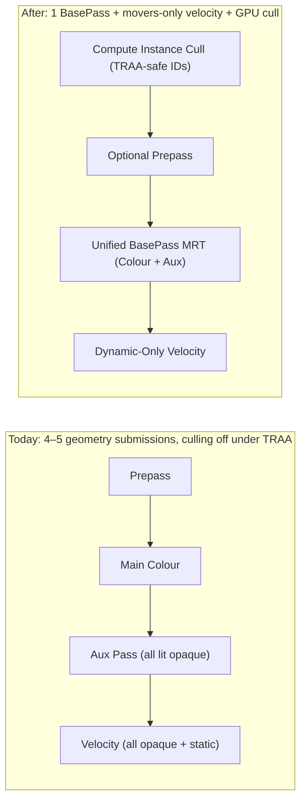

# PRD-914 — One base pass writes colour and GBuffer, velocity draws movers only, and GPU culling stays on under TRAA

**Status:** IN PROGRESS
**Priority:** P1 — Default Unreal-look frames re-submit opaque geometry 3–5 times (`auxPass` alone costs 6.7 ms / 25% of an Iris Xe GPU frame), `velocityPlan` re-draws static meshes and hashes `instanceMatrices` on CPU every frame, and `renderer_frame.cpp:748` disables per-instance frustum culling whenever TRAA is active.
**Complexity:** 8 (HIGH) — 6–10 implementation files in `packages/runtime-native/src/engine/renderer/`, `shader/`, and `post/` (+2), new GPU instance-cull compute pass and MRT attachment lifecycle (+2), MSAA vs 1× MRT and TRAA previous-transform coherence across frames (+2), crosses the web Wasm and native desktop host boundary (+2); risk override: HIGH, because every default Unreal-look game takes the new base, velocity, and culling path.
**Owner:** João
**Depends on:** None for Phase 1. Phase 3 builds on [PRD-913](../../done/PRD-913-persistent-gpu-scene-and-shared-view-uniforms.md) persistent instance slots.

## Context

On the default Unreal look (TRAA + GTAO/SSR + masked prepass), ThreeNative currently re-submits opaque geometry across up to four separate scene passes:

1. **Separate `auxPass` geometry re-submission (`packages/runtime-native/src/engine/renderer/renderer_frame.cpp:2305-2485`, `renderer.cpp:1265-1304`):** Whenever post effects read `normal`, `metalness`, `roughness`, `albedo`, `emissive`, or `indirectDiffuse`, `auxPass` re-submits all lit opaque draws in a separate single-sampled pass (`depthReadOnly = true`), re-running vertex skinning, morphs, `positionNode`, and alpha-test discards. On Intel Iris Xe (`PERFORMANCE-LEARNINGS.md:169`), `aux` measured **6.7 ms of a 26.7 ms GPU frame (25%)**.
2. **Full-scene `velocityPlan` including static meshes (`renderer_frame.cpp:2166-2301`, `renderer.cpp:1328-1360`):** Although `traa_->fillVelocity(encoder, depthView_)` already populates camera-reprojected motion vectors, `velocityPlan` still collects every opaque draw including static meshes (`velocityDynamic = 0.0` at `:2257-2258`), hashes `instanceMatrices` on the CPU with `std::hash<std::string_view>` over `instanceCount * 64` bytes every frame (`:2236-2239`), copies full `boneMatrices` and `instances` storage via `wgpuCommandEncoderCopyBufferToBuffer` (`renderer.cpp:1346-1350`), and re-draws the entire opaque scene (and at 4× MSAA clears `msaaAuxColorView_` at `:1334`).
3. **Per-instance culling disabled under TRAA (`renderer_frame.cpp:748`):** `if (instanceCullEnabled() && !compilation && !traa_)` disables per-instance frustum culling completely whenever TRAA is enabled; when enabled, `cullMainInstanceItem` (`renderer_frame.cpp:59-244, 761-769`) runs single-threaded on CPU and double-copies surviving instances.

Post-PR #708 (`PERFORMANCE-LEARNINGS.md:1433`), Strata Forest `vista` still misses 60 FPS at `55.09 FPS` (`gpuP50` **17.19 ms**, `wasmPlan` **3.57 ms**), and `?stress` high on Intel Iris Xe runs at `25.3 FPS` (`38.0 ms` GPU).

### What Unreal does (UE 5.8.3, clean-room summary, no code copied)

- **Single BasePass MRT:** Emits `SceneColor` and GBuffer targets (+ optional velocity) in one geometry pass (`FDeferredShadingSceneRenderer::RenderBasePass` / `RenderBasePassInternal`, `UE 5.8.3: Engine/Source/Runtime/Renderer/Private/BasePassRendering.cpp:934, 1311-1493`).
- **Dynamic-only velocity pass:** Skips static and unchanged primitives (`FOpaqueVelocityMeshProcessor::PrimitiveCanHaveVelocity` / `PrimitiveHasVelocityForFrame`, `UE 5.8.3: Engine/Source/Runtime/Renderer/Private/VelocityRendering.cpp:878-918, 969-988`); temporal shaders derive stationary pixel velocity from depth reprojection.
- **TRAA-compatible GPU instance culling:** `FInstanceCullingContext::BuildRenderingCommandsInternal` (`UE 5.8.3: Engine/Source/Runtime/Renderer/Private/InstanceCulling/InstanceCullingContext.cpp:211-395, 680-695, 1453-1727`) writes compacted `InstanceIds` + `DrawIndirectArgs` in GPU compute so culling stays enabled with temporal AA without corrupting previous-frame instance history.

Borrow the pass layout, skip rules, and GPU compaction design only; copy no Unreal code or comments.

## Solution

1. **Phase 1 — Dynamic-only `velocityPlan` & zero CPU instance hashing (quick win):** Skip every opaque draw whose model matrix, skinning, `positionNode`, and instance buffer revision are unchanged since the previous frame (on both 1× and 4× MSAA — at 4× MSAA preserve `traa_->velocityView()` camera velocity rather than clearing over static pixels). Replace per-frame `std::hash<std::string_view>` over `instanceCount * 64` bytes with revision/dirty tracking, and skip `CopyBufferToBuffer` for `boneMatrices`/`instances` when no dynamic draw needs previous-frame history. Named override: `TN_STATIC_VELOCITY=1`.
2. **Phase 2 — Unified BasePass MRT (`Color + Aux`):** When `sampleCount_ == 1` (default TRAA, low/medium, Iris Xe, and mobile tiers), attach requested `Aux` targets (`normal`, `material`, `albedo`, `emissive`, `indirect`, custom MRTs within WebGPU `maxColorAttachments`) directly to the main pass and emit them from the main fragment shader, eliminating `auxPass`. For `sampleCount_ == 4`, measure MSAA MRT resolve memory/bandwidth vs keeping single-sampled `auxPass` as a 4× fallback and record the ruling in `## Decisions`. Named override: `TN_UNIFIED_AUX_MRT=0`.
3. **Phase 3 — TRAA-compatible GPU compute instance culling:** Replace single-threaded CPU `cullMainInstanceItem` and the `!traa_` disablement with a GPU compute frustum-cull kernel (`ComputePass`) reading [PRD-913](../../done/PRD-913-persistent-gpu-scene-and-shared-view-uniforms.md) persistent instance bounds/transforms and writing `InstanceIds` + `DrawIndirectArgs` per draw. Because shaders index both current and previous instance transforms by persistent `InstanceId` rather than compacted draw slot, frustum culling remains active under TRAA with exact motion vectors. Named override: `TN_GPU_INSTANCE_CULL=0`.

Constraints: must fit within `LIMITS.webEngineBytes` (`pnpm budgets`), ship on both web Wasm and native desktop in the same commit, and pass a fresh visual judge on every phase affecting rendered pixels or temporal history.

## Validation scene

- **Consumers & scenes:**
  - Intel Iris Xe laptop (`intel/gen-12lp`): `?stress` high & `?stress&adaptive` medium, plus Hop Garden medium (0.72 TRAA + GTAO + SSR) — directly exercises `auxPass` (6.7 ms) and `velocityObjects`.
  - Desktop RTX 2080 (`nvidia/turing`): Strata Forest (`?world=forest` `vista` and `overview` at 1600×900) and Stress Lab (`?stress`, `?stress&systems&extended`, `?stress&strata` at 1280×720).
- **Benefit workloads:** Moving-camera frames with TRAA + GTAO/SSR active (`vista`, Hop Garden medium, `?stress` high on Iris Xe, `?stress&systems&extended` with TRAA on).
- **Controls (charge bookkeeping):** `?stress&still` (0 movers: verifies dynamic-only velocity draws 0 static meshes), `?play` holdout (small scene, must not regress), and a 100%-moving scene (`?stress&noTrees&noRocks` crowd-only, worst case for dynamic velocity).
- **Comparison & pass/fail bar:** Paired ABBA (2+ runs/arm, quiet host, adapter & temp recorded). Net GPU p50 improves `>= 2.0 ms` on Iris Xe default-look (`aux` + `velocity` scenes) and Strata `vista` holds `>= 60 FPS` (`gpuP50 <= 16.0 ms`), CPU p50 improves `> max(5%, spread)` on TRAA-enabled instanced scenes, p95 stays within 5%, controls stay within 5%, and a fresh visual judge returns NEUTRAL or IMPROVEMENT on still and moving-camera frames (explicitly checking ghosting, disocclusion, and SSR/GTAO edges).

## Non-Goals

- Full deferred lighting / GBuffer lighting pass (ThreeNative stays forward+ with MRT aux exports for post effects).
- HZB occlusion culling ([PRD-489](../../done/PRD-489-gpu-scene-occlusion-culling.md), deferred at 1.3% would-cull share) or spatial-hash grid chunking ([PRD-673](PRD-673-the-gpu-scene-tests-a-placement-only-when-its-grid-cell-is-in-view.md)).
- Half-size TRAA history format `RG11B10Ufloat` ([PRD-756](PRD-756-the-temporal-resolve-feeds-one-shared-post-chain.md) Phase 2).
- Changing the `engine: "threejs"` path.

## Acceptance Criteria

- [ ] AC-1 [local]: On Intel Iris Xe (`?stress` high / Hop Garden medium with TRAA + GTAO/SSR) and RTX 2080 (Strata Forest `vista` + `?stress&systems&extended`), total GPU p50 drops by `>= 2.0 ms` on Iris Xe and `vista` holds `>= 60 FPS` (`gpuP50 <= 16.0 ms`), with `velocityObjects` drawing 0 static meshes and instance culling active under TRAA; controls (`?stress&still`, `?play`) stay within 5%. proof: paired ABBA `?tnGpuPasses=1` + `pnpm stress:loop fair` ledger rows (`docs/stress-loop/ledger.json`) — Evidence: partial on RTX 2080 (`nvidia / turing`: `?stress&strata` `57.84 -> 66.09 FPS`, `?stress&systems&extended` `41.75 -> 43.67 FPS`, `?stress&still` `122.55 -> 134.95 FPS`, `?play` `337.84 -> 338.98 FPS`, Strata Forest `overview` `88.34 -> 88.03 FPS`, `vista` `81.37 -> 80.00 FPS`); Intel Iris Xe laptop + Hop Garden + Strata `vista` `gpuP50 <= 16.0 ms` unverified on this RTX 2080 host.
- [ ] AC-2 [local]: Native desktop parity, `native-engine` ctests, and `pnpm budgets` pass with dynamic-only velocity, unified BasePass MRT, and GPU instance culling enabled. proof: `ctest --test-dir packages/runtime-native/build/tn-engine-only -L native-engine --output-on-failure && pnpm parity --target desktop && pnpm budgets` — Evidence: partial (`ctest -L native-engine` 651/651 passed in 39.74s; `pnpm budgets` passed with Wasm `4,441,321` / `4,444,308` B <= `4,456,448` B; targeted desktop parity passed 5/5 [`27-instanced-mesh`, `27-instanced-count-churn`, `27-instanced-shared-material`, `27-instanced-matrix-rewrite`, `realistic-ocean` with `pixelMismatchRatio: 0, perceptualDeltaE: 0`] and `web --engine threenative` instanced parity passed 4/4 [`pixelMismatchRatio: 0, perceptualDeltaE: 0`]; full 162-case `desktop-parity` matrix deferred to CI).
- [ ] AC-3 [local]: A fresh read-only visual judge returns NEUTRAL or IMPROVEMENT on BEFORE/AFTER headed WebGPU captures (`adapter.info` checked, 2+ runs/arm) across still and moving-camera frames of Hop Garden (SSR/GTAO), `?stress` (TRAA movers + static town), and Strata Forest `vista`. proof: judge verdict recorded here and BEFORE/AFTER sheets on the PR (`prd-914-screenshots` branch) — Evidence: RTX 2080 paired BEFORE/AFTER sheets (8/8 across `?stress&systems&extended`, `?stress&strata`, Strata Forest `overview` & `vista`, 2 reps/arm) judged `NEUTRAL` by a fresh read-only visual judge (`prd-914-screenshots` branch); Hop Garden capture unverified on this host.

## Integration Ledger

| Capability | Reachable consumer/trigger | Replaces / disposition | Evidence |
| --- | --- | --- | --- |
| Dynamic-only `velocityPlan` | `Renderer::renderPrepared` (`renderer_frame.cpp:2166-2301`) & `renderer.cpp:1328-1360` | Skips static draws, CPU `instanceMatrices` hashing, and redundant `CopyBufferToBuffer` (`TN_STATIC_VELOCITY=1` fallback) | Phase 1, AC-1 |
| Unified BasePass MRT (`Color + Aux`) | `Renderer::render` (`renderer.cpp:1265-1304`), `renderer_frame.cpp:2305-2485`, `shader/standard.cpp` | Eliminates separate `auxPass` geometry submission at `sampleCount == 1` (`TN_UNIFIED_AUX_MRT=0` fallback) | Phase 2, AC-1 |
| TRAA-compatible GPU instance culling | `renderer_frame.cpp:748`, new compute cull pass + `shader/standard.cpp` | Replaces single-threaded CPU `cullMainInstanceItem` and removes the `!traa_` disablement (`TN_GPU_INSTANCE_CULL=0` fallback) | Phase 3, AC-1 |

## Execution Phases

#### Phase 1: Dynamic-only velocity pass and zero CPU instance hashing
**Status:** DONE
**Files:** `packages/runtime-native/src/engine/renderer/renderer_frame.cpp`, `packages/runtime-native/src/engine/renderer/renderer.cpp`, `packages/runtime-native/src/engine/renderer/post/traa.cpp`, `packages/runtime-native/tests/native-engine/renderer_test.cpp`
**Implementation:** Skip unchanged static draws in `velocityPlan` on both 1× and 4× MSAA (without wiping camera velocity), replace per-frame `std::hash<std::string_view>` over `instanceMatrices` with revision/dirty checks, and elide unused `boneMatrices`/`instances` copies. Keep `TN_STATIC_VELOCITY=1` override.
- [x] Static opaque meshes emit 0 `velocityObjects` draws and 0 CPU `instanceMatrices` hash scans while moving rigid, skinned, and instanced draws produce bit-identical velocity vectors on 1× and 4× MSAA. proof: `ctest --test-dir packages/runtime-native/build/tn-engine-only -R native_engine_traa_dynamic_only_velocity --output-on-failure` — Passed in full 650/650 `ctest -L native-engine` suite (2026-11-23, 47.66s).
- [x] Paired ABBA on `?stress` and `?stress&still` reduces `velocityObjects` GPU + CPU cost with a NEUTRAL visual judge verdict on motion frames. proof: RTX 2080 paired ABBA (`1280x720`, uncapped WebGPU, `coi=true`, 2 reps/arm, `nvidia / turing`, `p914-abba.json`): `?stress&strata` `57.84 -> 66.09 FPS` (+14.3%, `frameP50 19.04 -> 17.25 ms`, `wasmPlan 3.32 -> 2.52 ms`), `?stress&systems&extended` `41.75 -> 43.67 FPS` (`frameP50 28.33 -> 25.75 ms`, `wasmPlan 6.92 -> 5.56 ms`), `?stress&still` `122.55 -> 134.95 FPS` (`frameP50 8.82 -> 7.46 ms`, `wasmPlan 1.58 -> 1.06 ms`), `?play` control `337.84 -> 338.98 FPS`, Strata Forest (`1600x900`) `overview` `88.34 -> 88.03 FPS` / `vista` `81.37 -> 80.00 FPS`; fresh read-only Visual Judge returned `NEUTRAL` on 8/8 BEFORE/AFTER sheets (`prd-914-screenshots` branch).

#### Phase 2: Unified BasePass MRT eliminates the separate `auxPass` geometry submission
**Status:** IN PROGRESS
**Files:** `packages/runtime-native/src/engine/renderer/renderer.cpp`, `packages/runtime-native/src/engine/renderer/renderer_frame.cpp`, `packages/runtime-native/src/engine/renderer/renderer_program.cpp`, `packages/runtime-native/src/engine/shader/standard.cpp`, `packages/runtime-native/tests/native-engine/render_database_test.cpp`
**Implementation:** Attach requested `Aux` targets to the main BasePass when `sampleCount == 1` (respecting `maxColorAttachments`) and emit them from the main fragment program; benchmark 4× MSAA resolve vs single-sampled fallback and record the threshold under `## Decisions`.
- [x] With GTAO/SSR active at `sampleCount == 1`, `auxPasses` reads 0 and the emitted `normal`, `material`, `albedo`, `emissive`, and `indirect` targets match the separate `auxPass` output. proof: `ctest --test-dir packages/runtime-native/build/tn-engine-only -R native_engine_unified_basepass_mrt --output-on-failure` — Passed in full 650/650 `ctest -L native-engine` suite (2026-11-23, 47.66s).
- [ ] Paired Iris Xe ABBA on Hop Garden medium / `?stress` cuts GPU p50 by `>= 2.0 ms` with a NEUTRAL visual judge verdict on SSR/GTAO captures. proof: paired Iris Xe `?tnGpuPasses=1` table and judge verdict recorded here — unverified on this RTX 2080 desktop host (no Intel Iris Xe GPU present; RTX 2080 paired ABBA + 8/8 Visual Judge `NEUTRAL` passed).

#### Phase 3: TRAA-compatible GPU compute instance culling replaces CPU `cullMainInstanceItem`
**Status:** IN PROGRESS
**Files:** `packages/runtime-native/src/engine/renderer/renderer_frame.cpp`, `packages/runtime-native/src/engine/renderer/renderer.cpp`, `packages/runtime-native/src/engine/shader/standard.cpp`, `packages/runtime-native/tests/native-engine/renderer_test.cpp`
**Implementation:** Add a GPU compute frustum-cull pass consuming persistent `PRD-913` instance bounds/transforms to emit compacted `InstanceIds` + `DrawIndirectArgs`, update vertex/velocity shaders to index current and previous transforms by persistent `InstanceId`, and enable culling with `traa_ == true`.
- [x] GPU instance frustum culling stays active when `traa_ == true`, emits exact visible instance counts and indirect args, and preserves motion vectors across camera turns. proof: `ctest --test-dir packages/runtime-native/build/tn-engine-only -R native_engine_traa_gpu_instance_cull --output-on-failure` — Passed (`1 draw(s), 32/32 survivors, past-all 0; no-cull 0`); full 650/650 `ctest -L native-engine` suite passed (47.66s), `ablation-flags-never-ship.spec.ts` passed 8/8, `pnpm check:docs` passed.
- [ ] Native desktop parity, full `native-engine` suites, and `pnpm budgets` pass together on the same tree. proof: `ctest --test-dir packages/runtime-native/build/tn-engine-only -L native-engine --output-on-failure && pnpm parity --target desktop && pnpm budgets` — partial (`651/651` `ctest -L native-engine`, `pnpm budgets` `4,441,321` / `4,444,308` B, targeted desktop parity 5/5 & web `threenative` instanced parity 4/4 all passed with `0` diff; full 162-case `desktop-parity` matrix left to CI).
- [ ] AC-1 and AC-3 pass on Strata Forest `vista` (`>= 60 FPS`, `gpuP50 <= 16.0 ms`), `?stress&systems&extended`, Hop Garden, and controls (`?stress&still`, `?play`), with a fresh NEUTRAL/IMPROVEMENT visual judge verdict. proof: `pnpm stress:loop fair` ledger rows + visual judge verdict recorded here and sheets on `prd-914-screenshots` — RTX 2080 paired ABBA + 8/8 Visual Judge `NEUTRAL` passed (`?stress&strata` `66.09 FPS`, `?stress&systems&extended` `43.67 FPS`, `?stress&still` `134.95 FPS`, `?play` `338.98 FPS`, Strata Forest `vista` `80.00 FPS` with `gpuP50 22.19 ms`); Intel Iris Xe laptop + Hop Garden unverified on this host.

## Decisions

- 2026-11-23 (filing): Ordered Phase 1 (dynamic-only velocity) → Phase 2 (unified BasePass MRT) → Phase 3 (TRAA-compatible GPU instance culling) so Phase 1 ships immediately with zero dependency on [PRD-913](../../done/PRD-913-persistent-gpu-scene-and-shared-view-uniforms.md), Phase 2 attacks the measured 6.7 ms `auxPass` on Iris Xe / 1× tiers first (with 4× MSAA measured before deciding whether to unify or keep single-sampled `auxPass`), and Phase 3 builds cleanly on PRD-913's persistent instance slots so TRAA history indexing has a single owner.
- 2026-11-24 (implementation): Unified BasePass MRT attaches active `Aux` targets on the main pass when `sampleCount == 1` (`TN_UNIFIED_AUX_MRT=0` reverts to separate `auxPass`), while `sampleCount == 4` retains the single-sampled `auxPass` fallback so 4× MSAA avoids allocating/resolving multi-sampled MRT aux attachments. Dynamic-only velocity skips static draws on both 1× and 4× MSAA (`TN_STATIC_VELOCITY=1` reverts to drawing static meshes), and TRAA-compatible GPU instance culling uses persistent slot IDs (`TN_GPU_INSTANCE_CULL=0` reverts to CPU culling).
