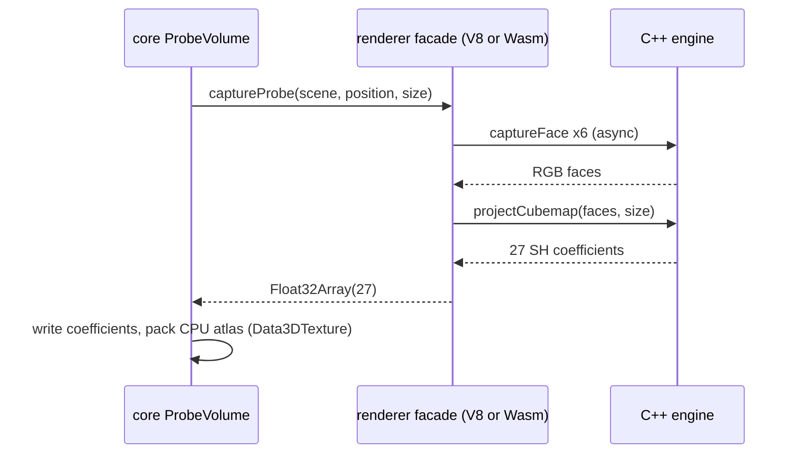

# PRD-697 — The probe volume and the atmosphere sky run on the owned engine

**Status:** IN PROGRESS
**Priority:** P1 — three epic parity rows (gi-tier-medium, atmosphere-sky-capture, leaf-receiver) cannot run on the default engine; AC-1 to AC-6 are open.
**Complexity:** 7 (HIGH) — 6–10 files (+2): core `probe-volume.ts`, the shared three-native capture helper, the V8 player and the Wasm host, the shader IR and WGSL emit (+2), native engine (+2 build boundary, C++ and Wasm); risk override: none
**Owner:** ownedbind2-lane
**Depends on:** None

## Context

The owned engine has been the default on web and desktop since 2026-10-15
(`docs/architecture/NATIVE-ENGINE-DECISION.md`). Three epic rows stop on it at the bundle or at the
first use:

| Row | Owner PRD | Fails on |
| --- | --- | --- |
| `gi-tier-medium` | PRD-644 | `ProbeVolume.attachRenderer` builds a `CubeRenderTarget`, a `CubeCamera` and a `RenderTarget3D` (`packages/core/src/render/probe-volume.ts:797-832`); Wasm: `TN_NATIVE_UNCATALOGUED_CUBERENDERTARGET`, V8: `CubeCamera` unbound |
| `atmosphere-sky-capture` | PRD-633 | `three/tsl:textureStore`, `uvec2`, `three/webgpu:StorageTexture` (the Atmosphere LUTs, `packages/core/src/atmosphere/luts.ts:87-160`) and `CubeRenderTarget`, `PMREMGenerator`, `CubeCamera` (`packages/core/src/render/sky-capture.ts`) |
| `leaf-receiver` | PRD-651:98 | `Stack`, `getShadowMaterial`, `shadow`, `AssignNode`, `AlwaysDepth`, `VSMShadowMap` |

What the engine already has (read 2026-10-22):

- A C++ probe volume: `probes::projectCubemap` (the same L2 projection as core's projection material,
  `packages/runtime-native/src/engine/renderer/probes/volume.cpp:9`), the face capture
  `probes::captureFace` (`capture.cpp:39`), exposed as `tn.captureFace` on V8 (`v8_main.cpp:885`) and
  `tnw_web_capture_face` on Wasm (`web_host.cpp:346`).
- `Data3DTexture` and `texture3D` on both back ends, so core's `sampleNode` (TSL over a 3D atlas) and its
  CPU atlas packer (`#packCpuAtlas`, `probe-volume.ts:1201`) run unchanged.
- Graph compute over storage buffers (PRD-620, `shader/graph/graph.h:235`), no storage textures.
- `SkyCapture` has an engine route through `renderer.SphereReflectionCapture` on `lane/sky2`
  (sky lanes' work, not merged).

## Solution

Bind each consumer to the engine system it needs, not to three's whole render-target surface.

1. **ProbeVolume (engine route).** On a renderer that has the engine's `captureProbe`, core's
   `ProbeVolume` captures each probe through the engine: six faces by `captureFace`, the L2
   projection in C++ (`probes::projectCubemap`), 27 coefficients back. Core writes them into its
   coefficient table and packs its existing CPU atlas. Bounce passes, sampling isolation, the
   bake budget and the `TN_PROBE_VOLUME` observation keep their three-path rules. The three path
   stays as it is.
2. **Storage textures.** `StorageTexture`, `textureStore` and `uvec2` in a compute kernel on both
   back ends: the IR gets a write-only 2D storage texture binding, WGSL emits `textureStore`, and a
   storage texture samples as a texture afterwards. This makes core's Atmosphere LUTs run unchanged.
3. **leaf-receiver.** Find what the scene uses each name for, then bind or route it.

## Acceptance Criteria

- [ ] AC-1 [local]: `gi-tier-medium` passes on the owned desktop engine. proof: `pnpm parity --target desktop --engine threenative --only-tests gi-tier-medium --reference <web run>` — Evidence: pending.
- [ ] AC-2 [local]: `gi-tier-medium` passes on the owned Wasm engine. proof: `pnpm parity --target web --engine threenative --only-tests gi-tier-medium --reference <web run>` — Evidence: pending.
- [ ] AC-3 [local]: The Atmosphere LUTs compute on both owned back ends, so `atmosphere-sky-capture` passes on the owned desktop engine (with the SkyCapture engine route). proof: `pnpm parity --target desktop --engine threenative --only-tests atmosphere-sky-capture` — Evidence: pending.
- [ ] AC-4 [local]: `leaf-receiver` bundles and passes on the owned desktop engine. proof: `pnpm parity --target desktop --engine threenative --only-tests leaf-receiver` — Evidence: pending.

## Integration Ledger

| Capability | Reachable consumer/trigger | Replaces / disposition | Evidence |
| --- | --- | --- | --- |
| Probe capture on the engine | `ProbeVolume.process` → `renderer.captureProbe` | three path unchanged; the engine route replaces the refusal | AC-1, AC-2 |
| Storage texture writes | `Atmosphere.process` → `renderer.compute` | refusal `TN_NATIVE_ENGINE_UNBOUND` | AC-3 |

## Decisions

- 2026-10-22 (ownedbind2-lane): ProbeVolume takes an engine route instead of generic
  `CubeRenderTarget`, `CubeCamera`, `RenderTarget3D` and `cubeTexture` bindings. The engine already
  has the face capture and the projection in C++ (decision 1 of NATIVE-ENGINE-DECISION: engine
  systems run in C++), and core's CPU atlas path already exists. The generic route would compile
  core's 486-tap projection material and repack materials through the engine IR for no consumer
  gain.
- 2026-10-22 (ownedbind2-lane): generic `CubeRenderTarget`, `CubeCamera` and `PMREMGenerator`
  bindings are Deferred, not declined. No epic row needs them once SkyCapture takes its engine route.
  Revisit when a game or a parity row renders a `CubeCamera` on the owned engine.

## Execution Phases

#### Phase 1: ProbeVolume captures through the engine
**Status:** IN PROGRESS
**Files:** `packages/core/src/render/probe-volume.ts`, `packages/three-native/src/sphere-reflection-capture.ts` (shared `captureProbe`), `packages/runtime-native/src/engine/player/v8_main.cpp`, `packages/runtime-native/src/engine/player/core-webgpu.mjs`, `packages/runtime-native/src/engine/wasm/web_host.cpp`, `packages/three-native/src/browser-renderer.ts`
- [ ] The engine projects six captured faces to the same 27 coefficients as core's projection. proof: `ctest -L native-engine -R player_imports` plus `pnpm exec vitest run packages/core/__tests__/probe-volume.spec.ts`.
- [ ] Core's `ProbeVolume` takes the engine route on a renderer with `captureProbe`, and the three path is unchanged. proof: `pnpm exec vitest run packages/core/__tests__/probe-volume.spec.ts`.

#### Phase 2: Storage textures in compute
**Status:** NOT STARTED
**Files:** `packages/runtime-native/src/engine/shader/ir.h`, `wgsl.cpp`, `renderer/compute.cpp`, the V8 and Wasm TSL adapters
- [ ] A compute kernel writes a `StorageTexture` with `textureStore(target, uvec2(x, y), value)` and a material samples it, on both back ends. proof: native ctest by name (new) and `pnpm parity --target web --engine threenative --only-tests atmosphere-sky-capture`.
- [ ] Core's `Atmosphere.process` computes its three LUTs on the owned desktop engine with no refusal. proof: `pnpm parity --target desktop --engine threenative --only-tests atmosphere-sky-capture` (the bundle and the LUT phase pass).

#### Phase 3: leaf-receiver
**Status:** NOT STARTED
**Files:** to be named after the scene is read
- [ ] Every name `leaf-receiver` imports is bound or routed on the V8 player. proof: ctest `native_engine_player_imports`.
