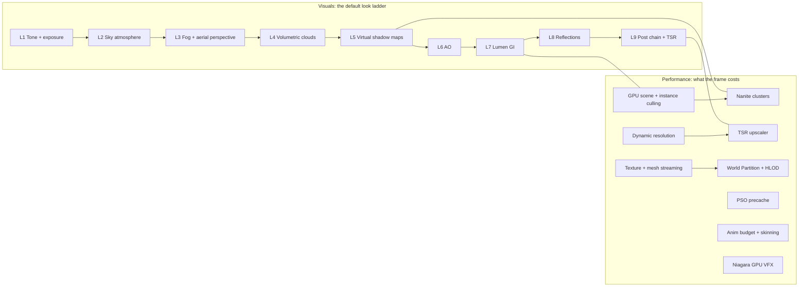

# Unreal 5.8.3: the visual and performance features, measured

**Reference, not a PRD.** Written 2026-10-21 from a sparse clone of Unreal Engine 5.8.3 (`release`
tag commit `396c9f05`, `$UE_SRC` in [`../README.md`](../README.md)). This file maps the Unreal
systems that decide how a frame looks and what it costs. It gives each system a size, a complexity
rating and its ThreeNative status on 2026-10-21, including PR #541 (`feat/unreal-look-epic`).
The visual map of the same data is
[`unreal-visuals-and-performance-feature-map.html`](unreal-visuals-and-performance-feature-map.html):
open it in a browser.

## How the numbers were made

- **LOC** is raw lines (code, comments and blank lines) of every file in the module or file group,
  counted on the clone. It is a measured number, not an estimate.
- **C++** counts `Engine/Source/Runtime/Renderer/Private` subfolders and file prefixes (for example
  `SkyAtmosphere*`). **Shader** counts `Engine/Shaders/Private` the same way.
- Shared files (`SceneRendering.cpp`, `DeferredShadingRenderer.cpp`, the common `.ush` headers) are
  not split per feature. So each row is a lower bound for that feature.
- Landscape and World Partition hold editor code inside their runtime modules, so their counts are
  high. Niagara is split: runtime 245K, editor 275K (not counted).
- Totals for the whole renderer: **449,725** lines of C++ and **359,018** lines of shader.

**Complexity** (1 to 10) is a judgement. It weighs algorithm depth, the number of passes and data
structures, coupling with other systems, and temporal state. **Port cost** is the cost to rebuild
the idea for WebGPU and the owned C++ engine under the licence rule (ideas only, no code).

**Status** values: **Shipped** (in `develop`), **Partial** (part shipped, PRDs open),
**Open** (filed PRDs, no main work landed), **Deferred** (built or measured, not worth it yet; each row names when to revisit),
**Not filed** (off in a fresh Unreal project, or no game asks for it).

## The map

## 1. Lighting and global illumination

| Feature | C++ | Shader | Total LOC | Complexity | Port cost | ThreeNative status |
| --- | ---: | ---: | ---: | :---: | --- | --- |
| Lumen (GI, reflections, surface cache, radiance cache, screen probes) | 45,712 | 33,515 | **79,227** | 10 | Very high | **Partial.** PRD-638, PRD-647 done; PRD-603 to 605, 639 to 644, 646 open; hardware ray tracing deferred (PRD-645) until WebGPU exposes ray tracing. PR #541 adds the `giCache.ts` CPU reference |
| Distance fields (global and mesh SDF) | 10,870 | 6,189 | 17,059 | 7 | High | **Not filed.** `GPUSceneBVH` gives the trace instead |
| Deferred shading, clustered lights, base pass | 16,918 | 8,254 | 25,172 | 6 | n/a | Covered by three.js and the owned engine; not a port target |
| Reflection captures and SSR | 7,226 | 4,842 | 12,068 | 5 | Medium | **Open.** PRD-VQ-03 (low, medium), PRD-642 (high) |
| Ambient occlusion (SSAO, GTAO) | 4,501 | 2,363 | 6,864 | 4 | Low | **Open.** PRD-635 (PR #541) |
| Substrate materials | 12,154 | 16,982 | 29,136 | 8 | High | **Not filed.** three.js r185 already matches Unreal default lit |
| MegaLights | 10,136 | 9,857 | 19,993 | 8 | High | **Not filed.** Off in a fresh project |

## 2. Shadows

| Feature | C++ | Shader | Total LOC | Complexity | Port cost | ThreeNative status |
| --- | ---: | ---: | ---: | :---: | --- | --- |
| Virtual shadow maps (pages, clipmaps, cache, SMRT) | 11,261 | 10,692 | **21,953** | 9 | High | **Partial.** Sun clipmap, page cache, mover maps shipped (PRD-538, 572). PRD-634, 649 to 652, 457 open |
| Classic shadows (CSM, projected, contact) | 18,513 | 2,411 | 20,924 | 6 | Medium | **Shipped.** The virtual shadow map replaced CSM. Contact shadows deferred (PRD-561): off in a fresh Unreal project; revisit when a light needs a contact-shadow length |

## 3. Sky, atmosphere and volumes

| Feature | C++ | Shader | Total LOC | Complexity | Port cost | ThreeNative status |
| --- | ---: | ---: | ---: | :---: | --- | --- |
| Sky atmosphere (LUTs, sky light capture) | 2,666 | 2,318 | 4,984 | 6 | Medium | **Open.** PRD-633 (PR #541) |
| Volumetric clouds | 3,449 | 2,695 | 6,144 | 7 | Medium | **Partial.** Template clouds in `rain`; PRD-VQ-08 open |
| Height fog, volumetric fog, local fog volumes | 6,663 | 4,050 | 10,713 | 5 | Medium | **Partial.** Height fog done (PRD-560); aerial perspective PRD-562 open |
| Heterogeneous volumes | 15,562 | 11,390 | 26,952 | 8 | High | **Not filed** |

## 4. Post-process and temporal

| Feature | C++ | Shader | Total LOC | Complexity | Port cost | ThreeNative status |
| --- | ---: | ---: | ---: | :---: | --- | --- |
| TSR (temporal super resolution) | 3,780 | 10,851 | **14,631** | 9 | High | **Partial.** Catmull-Rom history done (PRD-455); PRD-539 open |
| TAA | 1,531 | 2,463 | 3,994 | 5 | Low | Superseded by the TSR work |
| Tone map, LUT, ACES | 2,237 | 5,079 | 7,316 | 4 | Low | **Partial.** LUT grade done (PRD-492); filmic curve PRD-632 open (PR #541) |
| Exposure (eye adaptation, histogram, local) | 3,147 | 1,971 | 5,118 | 5 | Low | **Partial.** Template auto exposure; PRD-571 blocked on a device; PRD-632, 636 open |
| Bloom and lens flare | 1,797 | 932 | 2,729 | 3 | Low | **Partial.** Bloom exists; PRD-636 open |
| Motion blur | 1,518 | 2,552 | 4,070 | 5 | Low | **Open.** PRD-636 |
| Depth of field | 4,160 | 8,194 | 12,354 | 7 | Medium | **Not filed.** Not in the default look |
| Denoisers | 5,800 | 10,068 | 15,868 | 7 | High | **Not filed.** Unreal has no virtual-shadow denoiser |

## 5. Geometry and scene performance

| Feature | C++ | Shader | Total LOC | Complexity | Port cost | ThreeNative status |
| --- | ---: | ---: | ---: | :---: | --- | --- |
| Nanite (clusters, culling, raster, streaming) | 27,571 | 28,101 | **55,672** | 10 | Very high | **Open.** PRD-600 to 602. Persistent culling, software raster and page streaming deferred until WebGPU adds forward-progress guarantees and 64-bit image atomics, or a measurement shows the gain |
| GPU scene and instance culling | 12,019 | 2,420 | 14,439 | 7 | Medium | **Shipped.** `world-gpu-scene.ts` cull and LOD into indirect draws |
| Visibility, occlusion, HZB | 10,140 | 3,178 | 13,318 | 6 | Medium | **Deferred.** HZB occlusion (PRD-489): our scenes would cull 1.3%. Unreal has it for dense cities and interiors; revisit when a scene like that shows a high would-cull share |
| Mesh draw commands and pass processors | 12,081 | 0 | 12,081 | 7 | Medium | Owned C++ engine area |
| Virtual texturing | 15,462 | 1,851 | 17,313 | 8 | High | **Deferred.** Runtime VT waits until texture memory limits a game. Mip residency PRD-VQ-10 open first |
| Dynamic resolution | 847 | 0 | 847 | 4 | Low | **Shipped.** PRD-384, 563, 564 |
| PSO precache | 8,895 | 0 | 8,895 | 6 | Medium | **Shipped.** Pipeline warm-up and the native disk cache |
| Variable rate shading | 1,799 | 583 | 2,382 | 4 | n/a | **Not filed.** No WebGPU API |
| Mobile renderer | 9,086 | 3,093 | 12,179 | 6 | Medium | **Partial.** PRD-565, 568 done |

## 6. World, animation and VFX

| Feature | C++ | Shader | Total LOC | Complexity | Port cost | ThreeNative status |
| --- | ---: | ---: | ---: | :---: | --- | --- |
| Niagara runtime (+ shader, vertex factories) | 255,512 | in C++ | **255,512** | 9 | High | **Partial.** `GPUParticles3D`; PRD-569, 609 done; PRD-610, 611 (`vfx/`) open; graph editor out of scope (the repo rules close editors) |
| Landscape (incl. editor code in runtime) | 86,937 | 2,567 | 89,504 | 8 | High | **Partial.** PRD-566, 567 done; PRD-493 open |
| World Partition and HLOD (incl. editor code) | 70,618 | 0 | 70,618 | 9 | High | **Partial.** `WorldCells`, `streaming.ts`; PRD-456, 459, 460, 606, 607 open |
| Texture and mesh streaming | 20,414 | 0 | 20,414 | 7 | Medium | **Open.** PRD-VQ-10 |
| Anim budget, sharing, AnimGraphRuntime | 29,104 | 0 | 29,104 | 6 | Medium | **Open.** PRD-570 (prd:75), PRD-486 |
| GPU skinning | 6,782 | 1,207 | 7,989 | 5 | Low | Shipped through three.js and the owned engine |

## 7. Foundation and features off by default (context only)

| Feature | LOC | Complexity | ThreeNative status |
| --- | ---: | :---: | --- |
| RenderCore (RDG, shader maps) | 103,555 | 9 | **Deferred** until WebGPU exposes RDG-class features (bindless, async compute) |
| RHI (GPU abstraction) | 67,546 | 8 | WebGPU and the owned C++ engine fill this role |
| Hardware ray tracing and path tracer | 54,013 | 9 | **Deferred** for GI (PRD-645): the trace is 13x faster, but the WebGPU-to-Vulkan hand-off costs more. Revisit when WebGPU exposes ray tracing |
| Hair strands | 45,936 | 9 | **Not filed** |

## What this says

1. **The default look is about 175K lines of Unreal.** Lumen (79K), virtual shadow maps (22K),
   TSR (15K), sky, fog and clouds (22K), the post chain (19K), reflections (12K) and AO (7K) set
   the 5.8.3 look. PR #541 owns the measurement for all of it.
2. **Lumen is the largest gap.** It is the biggest visual system, rated 10, and most of its PRDs are
   open. The GI set rebuilds it on `GPUSceneBVH`, not on distance fields.
3. **The cheap layers come first.** Tone, exposure, AO, bloom and motion blur are 2.7K to 7.3K lines
   each and rated 3 to 5. PRD-632, 635 and 636 close most of the L1 and L9 gap.
4. **Most performance mechanisms are shipped or deferred.** GPU scene culling, dynamic resolution
   and PSO warm-up are shipped. HZB, runtime VT and RDG-class features are deferred, each with a revisit condition. The open
   performance work is Nanite clusters (PRD-600 to 602), streaming and character cost.
5. **Size does not equal value.** Niagara (255K) and Landscape (90K) are large because they carry
   tools. The runtime ideas ThreeNative needs are a small part of each.
