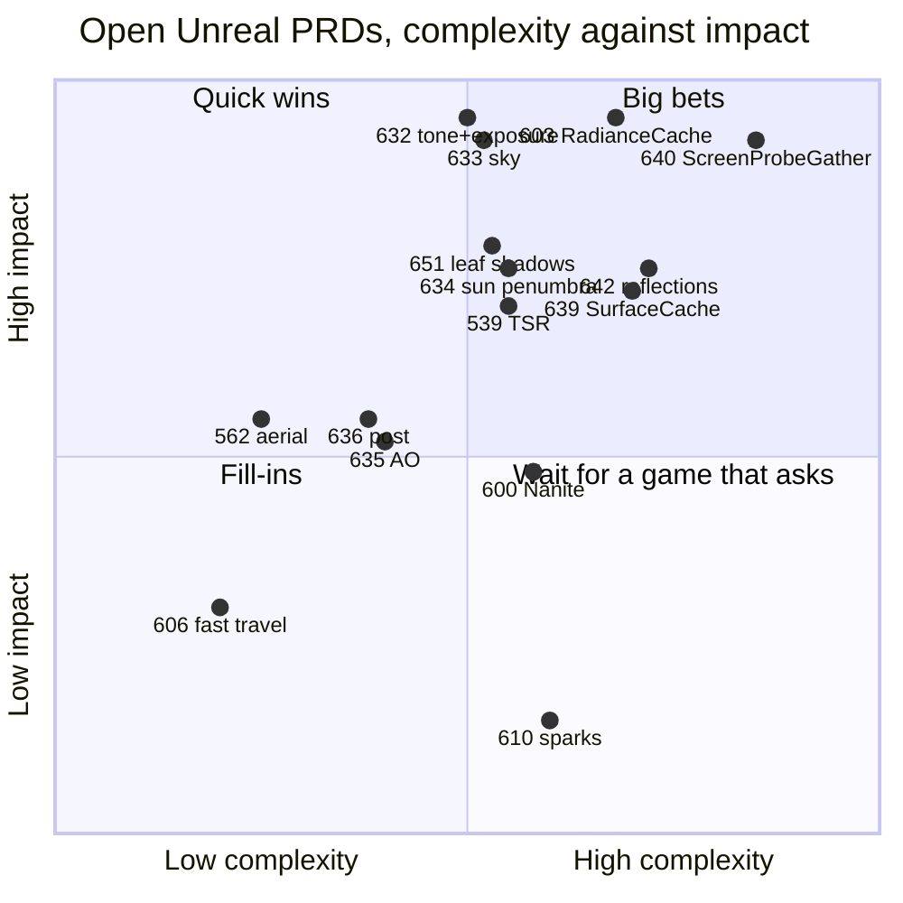
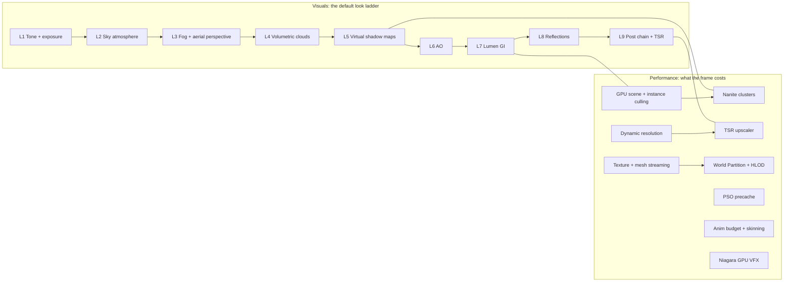

# Unreal 5.8.3: the visual and performance features, measured

**Reference, not a PRD.** Written 2026-10-21 from a sparse clone of Unreal Engine 5.8.3 (`release`
tag commit `396c9f05`, `$UE_SRC` in [`../README.md`](../README.md)). This file maps the Unreal
systems that decide how a frame looks and what it costs. It gives each system a size, a complexity
rating and its ThreeNative status on 2026-10-21, including PR #541 (`feat/unreal-look-epic`).
The visual map of the same data is
[`unreal-visuals-and-performance-feature-map.html`](unreal-visuals-and-performance-feature-map.html):
open it in a browser.

## How the numbers were made

- **LOC** is raw lines (code, comments and blank lines) of every file in the module or file group,
  counted on the clone. It is a measured number, not an estimate.
- **C++** counts `Engine/Source/Runtime/Renderer/Private` subfolders and file prefixes (for example
  `SkyAtmosphere*`). **Shader** counts `Engine/Shaders/Private` the same way.
- Shared files (`SceneRendering.cpp`, `DeferredShadingRenderer.cpp`, the common `.ush` headers) are
  not split per feature. So each row is a lower bound for that feature.
- Landscape and World Partition hold editor code inside their runtime modules, so their counts are
  high. Niagara is split: runtime 245K, editor 275K (not counted).
- Totals for the whole renderer: **449,725** lines of C++ and **359,018** lines of shader.

**Complexity** (1 to 10) is a judgement. It weighs algorithm depth, the number of passes and data
structures, coupling with other systems, and temporal state. **Port cost** is the cost to rebuild
the idea for WebGPU and the owned C++ engine under the licence rule (ideas only, no code).

**Status** values: **Shipped** (in `develop`), **Partial** (part shipped, PRDs open),
**Open** (filed PRDs, no main work landed), **Deferred** (built or measured, not worth it yet; each row names when to revisit),
**Not filed** (off in a fresh Unreal project, or no game asks for it).

## Port order: complexity against impact

This section ranks the open Unreal PRDs from `docs/PRDs/Unreal/` on PR #541 (`feat/unreal-look-epic`),
as of 2026-10-21. It leaves out the asset PRDs (PRD-352, PRD-487) and PRD-316.

- **Complexity** is the PRD's own `**Complexity:**` line (1 to 10). "est." marks a PRD without one.
- **Visual impact** and **performance impact** (each 0 to 5) sit beside every PRD in the
  [interactive page](unreal-visuals-and-performance-feature-map.html), with their source. A visual score is
  measured when the PRD's layer has parity locks (the share still broken), a performance score is measured
  when GPU ms back it, and every other score is an estimate with its reason.
- **Rank** = (visual impact + performance impact) ÷ complexity, highest first. A tie goes to the
  lower complexity, then the earlier wave. The chart below keeps the older single impact judgement.
- **Done** is ticked boxes over all boxes in the PRD file.
- **Wave** respects the "Waits on" order in [`../README.md`](../README.md). PRDs in one wave can
  run in parallel.

| Wave | PRD | What it ports | Layer | Complexity | Impact | Done | Waits on | Why this wave |
| --- | --- | --- | --- | :---: | :---: | ---: | --- | --- |
| 1 | PRD-631 | Unreal reference scene and the comparison harness | L0 | 6 | 5 | 15/15 | — | All boxes ticked; close it |
| 1 | PRD-632 | Filmic tone curve, EV100, auto exposure | L1 | 6 | 5 | 4/16 | PRD-631 | Every pixel. Every later layer compares at matched exposure |
| 2 | PRD-633 | Sky atmosphere and sky light capture | L2 | 6 | 5 | 1/11 | PRD-632 | The sky fills the frame and lights the scene |
| 2 | PRD-636 | Finishing post: bloom, vignette, local exposure, motion blur | L9 | 5 | 3 | 15/28 | PRD-632 | Half done; a cheap finish |
| 2 | PRD-635 | AO on indirect light only | L6 | 5 | 3 | 5/14 | PRD-632 | Low cost, visible in every contact area |
| 2 | PRD-651 | Leaf cards cast leaf shadows | L5 | 6 | 4 | 5/12 | — | Phase 1 is an engine bug on the default engine |
| 2 | PRD-649 | Shadow calibration scenes | L5 | 5 | 4 | 3/12 | PRD-646 | Unblocks PRD-634, 650, 652 |
| 2 | PRD-646 | ThreeNative recreates the GI calibration scenes | L7 | 6 | 4 | 6/15 | PRD-632 | Unblocks every GI verdict |
| 2 | PRD-603 | `RadianceCache` traces the packed scene | L7 | 7 | 5 | 0/10 | — | The GI foundation; README says it can start now |
| 2 | PRD-539 | TSR quality and cost at low resolution | Perf | 6 est. | 4 | 0/5 | — | Independent. Lower render resolution pays for every other layer |
| 3 | PRD-562 | Aerial perspective from a froxel volume | L3 | 4 | 3 | 0/8 | PRD-633 | Needs the atmosphere |
| 3 | PRD-VQ-08 | Volumetric clouds and overhead transmittance | L4 | 7 est. | 3 | 0/9 | PRD-633 | The default Unreal map has clouds |
| 3 | PRD-634 | Sun shadows: reach and source-angle penumbra | L5 | 6 | 4 | 2/14 | PRD-649 | The biggest shadow difference from Unreal |
| 3 | PRD-604 | `IrradianceFieldGather`: no light leaks through walls | L7 | 5 | 4 | 0/10 | PRD-603 | Unreal Medium GI tier |
| 3 | PRD-639 | `SurfaceCache`: rays see texture, glow and lights | L7 | 7 | 4 | 6/9 | PRD-603 | Two thirds done |
| 3 | PRD-640 | `ScreenProbeGather` and `ShortRangeAO` | L7 | 8 | 5 | 2/9 | PRD-603, 647 | Unreal Epic GI tier; the default |
| 4 | PRD-641 | GI temporal filter | L7 | 6 | 3 | 4/13 | PRD-640 | Stability after the gather exists |
| 4 | PRD-642 | `TracedReflections` | L8 | 7 | 4 | 1/10 | PRD-603, 639 | Needs the surface cache |
| 4 | PRD-644 | GI tiers follow Unreal quality levels | Perf | 6 | 4 | 5/10 | PRD-647 | Sets the cost of each GI tier |
| 4 | PRD-650 | Lamp shadows sharp to the pixel, soft by size | L5 | 7 | 3 | 2/11 | PRD-649 | Interiors |
| 4 | PRD-652 | Shadow tiers follow Unreal quality levels | Perf | 5 | 3 | 5/9 | PRD-634, 650 | Cost of each shadow tier |
| 5 | PRD-643 | Glass, fog and leaves take the bounce light | L7 | 5 | 2 | 0/8 | PRD-603, 604 | Small share of the frame |
| 5 | PRD-605 | Radiance cache clipmaps follow the camera | L7 | 6 | 3 | 0/8 | PRD-603, 604 | Open worlds |
| 5 | PRD-457 | Virtual shadow pages only where cheaper | Perf | 5 est. | 2 | 0/4 | — | Only where measured |
| 5 | PRD-600 | Nanite: submit only visible clusters | Perf | 6 | 3 | 0/8 | — | Dense scenes |
| 5 | PRD-601 | Far clusters keep source shading | Perf | 4 | 2 | 0/7 | PRD-600 | Follows PRD-600 |
| 5 | PRD-602 | Cluster shadow casters at shadow-texel detail | Perf | 5 | 2 | 0/8 | PRD-600 | Follows PRD-600 |
| 5 | PRD-570 | Characters cost what the camera sees | Perf | 5 | 3 | 0/10 | — | Crowds; a lane is measuring it |
| 5 | PRD-VQ-10 | Texture mip residency | Perf | 5 est. | 2 | 0/8 | — | When texture memory limits a game |
| 5 | PRD-460 | Invisible streaming transitions | Perf | 6 | 2 | 0/15 | — | Open worlds |
| 5 | PRD-606 | Fast-travel destination ready before reveal | Perf | 3 | 2 | 0/13 | — | Open worlds |
| 5 | PRD-607 | Streaming reports holes and spends to close them | Perf | 5 | 2 | 0/11 | — | Open worlds |
| 5 | PRD-611 | Hidden GPU effect draws its first frame ready | Perf | 4 | 2 | 0/10 | — | First-frame hitch |
| 5 | PRD-610 | Sparks bounce off visible surfaces | VFX | 6 | 1 | 0/12 | PRD-609 | Effect detail |

Added on 2026-10-21: PRDs filed outside `docs/PRDs/Unreal/` that port an Unreal system, and the PRDs
filed for the gaps this map found (PRD-660 to PRD-683).

| Wave | PRD | What it ports | Layer | Complexity | Impact | Done | Waits on | Why this wave |
| --- | --- | --- | --- | :---: | :---: | ---: | --- | --- |
| 2 | PRD-679 | Fog behind glass and sparks (fog composition) | L3 | 5 | 3 | 0/8 | — | Additive effects add the fog colour today; gate first |
| 2 | PRD-676 | Debug views an agent reads from a playtest capture | Perf | 5 | 3 | 0/7 | — | Explains frame cost before more perf work |
| 2 | PRD-670 | Rough diffuse like a fresh Unreal project (Substrate is on in 5.8.3) | L1 | 5 | 3 | 0/5 | PRD-632 | Every rough pixel; gate first |
| 3 | PRD-488 | Foliage moves in the wind | Look | 4 | 2 | 0/8 | — | Leaf shadows that sway (PRD-651) need it |
| 4 | PRD-VQ-03 | Local reflection probes | L8 | 5 est. | 3 | 0/8 | — | Interiors reflect their room, not the sky |
| 4 | PRD-674 | Ambient particles cost no simulation (Niagara stateless) | Perf | 5 | 2 | 0/8 | — | The rain template draws its own particles today |
| 4 | PRD-VQ-09 | Incremental diffuse relight | L7 | 6 est. | 3 | 0/8 | — | A light change relights only the dirty region |
| 5 | PRD-665 | Clouds shade the haze and fog below them | L4 | 5 | 2 | 0/7 | PRD-VQ-08, PRD-562 | Light shafts through cloud gaps |
| 5 | PRD-662 | Sky light stops at walls with GI off (DFAO on the BVH) | L6 | 6 | 2 | 0/6 | PRD-644 | Low-tier look |
| 5 | PRD-663 | Local fog volumes | L3 | 4 | 1 | 0/6 | — | No fresh Unreal project places one |
| 5 | PRD-667 | Lens flare and FFT bloom on request | L9 | 4 | 1 | 0/7 | PRD-636 | Off in a fresh Unreal project |
| 5 | PRD-VQ-13 | Cinematic stage: depth of field | Look | 6 est. | 1 | 0/8 | — | Owns DOF; lacks the Unreal lens model |
| 5 | PRD-664 | Smoke and explosions as lit volumes | VFX | 6 | 1 | 0/7 | — | Off at Unreal low and medium tiers |
| 5 | PRD-660 | Many shadowed lamps, one fixed budget (MegaLights) | Perf | 8 | 1 | 0/8 | PRD-650 | Off in a fresh Unreal project |
| 5 | PRD-661 | ReSTIR: fewer GI rays, same quality | Perf | 7 | 1 | 0/7 | PRD-640, PRD-641 | No Unreal tier turns it on |
| 5 | PRD-668 | Displacement changes the silhouette | Look | 7 | 1 | 0/6 | PRD-600 | Per-material opt-in in Unreal |
| 5 | PRD-669 | Far foliage as voxels | Perf | 7 | 1 | 0/7 | — | Off in a fresh Unreal project |
| 5 | PRD-671 | Strand hair | Look | 7 | 1 | 0/6 | PRD-VQ-15 | Off in a fresh Unreal project |
| 5 | PRD-672 | Terrain layers cached in virtual pages | Perf | 8 | 1 | 0/6 | PRD-VQ-10 | Saves shading time on many-layer terrain |
| 5 | PRD-673 | Cull by grid cell before placement (scene culling grid) | Perf | 6 | 2 | 0/7 | — | Dense placements; gate first |
| 5 | PRD-675 | Named world layers in one streaming budget (data layers) | Perf | 5 | 1 | 0/6 | PRD-606 | Tests the two-`WorldCells` claim |
| 5 | PRD-683 | Skip unread passes, share targets (render graph) | Perf | 5 | 1 | 0/7 | PRD-523 | The RDG outcomes that need no new API |
| 5 | PRD-682 | Coarse shading where the GPU allows (VRS) | Perf | 7 | 1 | 0/6 | — | Off in Unreal; Linux needs a Dawn patch |
| 5 | PRD-677 | Clustered glass and water blend like the source | Perf | 3 | 1 | 0/5 | PRD-600 | Off by default in Unreal |
| 5 | PRD-678 | Skinned bodies take the cluster cut | Perf | 6 | 1 | 0/7 | PRD-486 | Only a 100K-triangle character needs it |
| 5 | PRD-459 | One streaming admission budget per frame | Perf | 6 | 3 | 4/16 | — | Streaming hitches in open worlds |
| 5 | PRD-456 | Distant world cell proxies (HLOD) | Perf | 8 | 2 | 0/6 | — | Far cells as merged proxies |
| 5 | PRD-486 | Characters get a LOD chain | Perf | 4 | 2 | 0/8 | — | Crowds |
| 5 | PRD-493 | Terrain layers past sixteen textures | Look | 3 | 1 | 6/8 | — | Blocked on a private game walk |

The rule behind the order: **the default look first, by layer, cheapest proof first.** L1 gates every
comparison. Sky, post and AO are cheap and change most of the frame. GI is the biggest visual gap,
so its foundation (PRD-603, PRD-646) starts in wave 2, in parallel. Pure performance ports
(Nanite, streaming, residency) wait for a game or a measurement that asks for them. TSR is the
exception, because a cheaper frame pays for every look layer.

## Subsystems inside each system

The HTML page has an "Unreal feature → ThreeNative PRDs" explorer. Select any Unreal feature in its
list, the treemap or the table. The page then shows:

- the PRDs that port the feature, each with its status, ticked boxes, wave and a link to the file;
- every subsystem that no PRD covers yet, in red, with its lines;
- every subsystem with its measured lines, what it does, and its PRDs or a "No PRD" tag.

Fifteen systems are split into subsystems: Lumen (11 parts), Nanite (11), virtual shadow maps (8),
TSR (8), the post chain (9), sky atmosphere, clouds, fog, AO, reflections, GPU scene, streaming,
World Partition, Niagara and MegaLights. Every other feature shows as one row. A script reads the
PRD files and writes the title, path and box counts into the page.

## The map

## 1. Lighting and global illumination

| Feature | C++ | Shader | Total LOC | Complexity | Port cost | ThreeNative status |
| --- | ---: | ---: | ---: | :---: | --- | --- |
| Lumen (GI, reflections, surface cache, radiance cache, screen probes) | 45,712 | 33,515 | **79,227** | 10 | Very high | **Partial.** PRD-638, PRD-647 done; PRD-603 to 605, 639 to 644, 646 open; hardware ray tracing deferred (PRD-645) until WebGPU exposes ray tracing. PR #541 adds the `giCache.ts` CPU reference |
| Distance fields (global and mesh SDF) | 10,870 | 6,189 | 17,059 | 7 | High | **Open.** PRD-662 maps distance-field AO onto `GPUSceneBVH` for the GI-off tier. The distance fields themselves stay deferred: the BVH gives the trace |
| Deferred shading, clustered lights, base pass | 16,918 | 8,254 | 25,172 | 6 | n/a | Covered by three.js and the owned engine; not a port target |
| Reflection captures and SSR | 7,226 | 4,842 | 12,068 | 5 | Medium | **Partial.** The SSR stage ships. Captures PRD-VQ-03 (low, medium), traced reflections PRD-642 (high) |
| Ambient occlusion (SSAO, GTAO) | 4,501 | 2,363 | 6,864 | 4 | Low | **Partial.** GTAO ships in the templates. PRD-635 (PR #541) applies it to indirect light only |
| Substrate materials | 12,154 | 16,982 | 29,136 | 8 | High | **Open.** A fresh 5.8.3 project turns Substrate on (`GameProjectUtils.cpp:198-212`). three r185 matches its specular energy but not its rough diffuse: PRD-670 |
| MegaLights | 10,136 | 9,857 | 19,993 | 8 | High | **Open.** PRD-660, gate first. Off in a fresh project |

## 2. Shadows

| Feature | C++ | Shader | Total LOC | Complexity | Port cost | ThreeNative status |
| --- | ---: | ---: | ---: | :---: | --- | --- |
| Virtual shadow maps (pages, clipmaps, cache, SMRT) | 11,261 | 10,692 | **21,953** | 9 | High | **Partial.** Sun clipmap, page cache, mover maps shipped (PRD-538, 572). PRD-634, 649 to 652, 457 open |
| Classic shadows (CSM, projected, contact) | 18,513 | 2,411 | 20,924 | 6 | Medium | **Shipped.** The virtual shadow map replaced CSM. Contact shadows deferred (PRD-561): off in a fresh Unreal project; revisit when a light needs a contact-shadow length |

## 3. Sky, atmosphere and volumes

| Feature | C++ | Shader | Total LOC | Complexity | Port cost | ThreeNative status |
| --- | ---: | ---: | ---: | :---: | --- | --- |
| Sky atmosphere (LUTs, sky light capture) | 2,666 | 2,318 | 4,984 | 6 | Medium | **Open.** PRD-633 (PR #541) |
| Volumetric clouds | 3,449 | 2,695 | 6,144 | 7 | Medium | **Partial.** Template clouds in `rain`; PRD-VQ-08 open. Cloud shadow on air and fog, cloud sky AO: PRD-665 |
| Height fog, volumetric fog, local fog volumes | 6,663 | 4,050 | 10,713 | 5 | Medium | **Partial.** Height fog done (PRD-560); aerial perspective PRD-562 open; local fog volumes PRD-663 |
| Heterogeneous volumes | 15,562 | 11,390 | 26,952 | 8 | High | **Open.** PRD-664, gate first. Off at Unreal low and medium effects tiers |

## 4. Post-process and temporal

| Feature | C++ | Shader | Total LOC | Complexity | Port cost | ThreeNative status |
| --- | ---: | ---: | ---: | :---: | --- | --- |
| TSR (temporal super resolution) | 3,780 | 10,851 | **14,631** | 9 | High | **Partial.** Catmull-Rom history done (PRD-455); PRD-539 open |
| TAA | 1,531 | 2,463 | 3,994 | 5 | Low | **Shipped.** Template temporal AA |
| Tone map, LUT, ACES | 2,237 | 5,079 | 7,316 | 4 | Low | **Partial.** LUT grade done (PRD-492); filmic curve PRD-632 open (PR #541) |
| Exposure (eye adaptation, histogram, local) | 3,147 | 1,971 | 5,118 | 5 | Low | **Partial.** Template auto exposure; PRD-571 blocked on a device; PRD-632, 636 open |
| Bloom and lens flare | 1,797 | 932 | 2,729 | 3 | Low | **Partial.** Bloom exists; PRD-636 open. Lens flare and FFT bloom (both off in a fresh project): PRD-667 |
| Motion blur | 1,518 | 2,552 | 4,070 | 5 | Low | **Open.** PRD-636 |
| Depth of field | 4,160 | 8,194 | 12,354 | 7 | Medium | **Open.** PRD-VQ-13 owns it. It lacks the Unreal lens model, near and far layers and tier costs. Off in a fresh project |
| Denoisers | 5,800 | 10,068 | 15,868 | 7 | High | **Owned.** ScreenSpaceDenoise does not run in a fresh project. GI history PRD-641, reflections PRD-642, many lights PRD-660, low-tier AO PRD-635 |

## 5. Geometry and scene performance

| Feature | C++ | Shader | Total LOC | Complexity | Port cost | ThreeNative status |
| --- | ---: | ---: | ---: | :---: | --- | --- |
| Nanite (clusters, culling, raster, streaming) | 27,571 | 28,101 | **55,672** | 10 | Very high | **Open.** PRD-600 to 602. Persistent culling, software raster and page streaming deferred until WebGPU adds forward-progress guarantees and 64-bit image atomics, or a measurement shows the gain |
| GPU scene and instance culling | 12,019 | 2,420 | 14,439 | 7 | Medium | **Shipped.** `world-gpu-scene.ts` cull and LOD into indirect draws |
| Visibility, occlusion, HZB | 10,140 | 3,178 | 13,318 | 6 | Medium | **Deferred.** HZB occlusion (PRD-489): our scenes would cull 1.3%. Unreal has it for dense cities and interiors; revisit when a scene like that shows a high would-cull share |
| Mesh draw commands and pass processors | 12,081 | 0 | 12,081 | 7 | Medium | Owned C++ engine area |
| Virtual texturing | 15,462 | 1,851 | 17,313 | 8 | High | **Deferred, with a gate.** PRD-672 caches terrain layer shading in pages; it saves shading time, not memory. Mip residency PRD-VQ-10 open first |
| Dynamic resolution | 847 | 0 | 847 | 4 | Low | **Shipped.** PRD-384, 563, 564 |
| PSO precache | 8,895 | 0 | 8,895 | 6 | Medium | **Shipped.** Pipeline warm-up and the native disk cache |
| Variable rate shading | 1,799 | 583 | 2,382 | 4 | n/a | **Not filed.** No WebGPU API |
| Mobile renderer | 9,086 | 3,093 | 12,179 | 6 | Medium | **Partial.** PRD-565, 568 done |

## 6. World, animation and VFX

| Feature | C++ | Shader | Total LOC | Complexity | Port cost | ThreeNative status |
| --- | ---: | ---: | ---: | :---: | --- | --- |
| Niagara runtime (+ shader, vertex factories) | 255,512 | in C++ | **255,512** | 9 | High | **Partial.** `GPUParticles3D`; PRD-569, 609 done; PRD-610, 611 (`vfx/`) open; graph editor out of scope (the repo rules close editors) |
| Landscape (incl. editor code in runtime) | 86,937 | 2,567 | 89,504 | 8 | High | **Partial.** PRD-566, 567 done; PRD-493 open |
| World Partition and HLOD (incl. editor code) | 70,618 | 0 | 70,618 | 9 | High | **Partial.** `WorldCells`, `streaming.ts`; PRD-456, 459, 460, 606, 607 open |
| Texture and mesh streaming | 20,414 | 0 | 20,414 | 7 | Medium | **Open.** PRD-VQ-10 |
| Anim budget, sharing, AnimGraphRuntime | 29,104 | 0 | 29,104 | 6 | Medium | **Open.** PRD-570 (prd:75), PRD-486 |
| GPU skinning | 6,782 | 1,207 | 7,989 | 5 | Low | Shipped through three.js and the owned engine |

## 7. Foundation and features off by default (context only)

| Feature | LOC | Complexity | ThreeNative status |
| --- | ---: | :---: | --- |
| RenderCore (RDG, shader maps) | 103,555 | 9 | **Deferred** until WebGPU exposes RDG-class features (bindless, async compute) |
| RHI (GPU abstraction) | 67,546 | 8 | WebGPU and the owned C++ engine fill this role |
| Hardware ray tracing and path tracer | 54,013 | 9 | **Deferred** for GI (PRD-645): the trace is 13x faster, but the WebGPU-to-Vulkan hand-off costs more. Revisit when WebGPU exposes ray tracing |
| Hair strands | 45,936 | 9 | **Open.** PRD-671: ribbon strands and hair shading first. Off in a fresh project |

## What this says

1. **The default look is about 175K lines of Unreal.** Lumen (79K), virtual shadow maps (22K),
   TSR (15K), sky, fog and clouds (22K), the post chain (19K), reflections (12K) and AO (7K) set
   the 5.8.3 look. PR #541 owns the measurement for all of it.
2. **Lumen is the largest gap.** It is the biggest visual system, rated 10, and most of its PRDs are
   open. The GI set rebuilds it on `GPUSceneBVH`, not on distance fields.
3. **The cheap layers come first.** Tone, exposure, AO, bloom and motion blur are 2.7K to 7.3K lines
   each and rated 3 to 5. PRD-632, 635 and 636 close most of the L1 and L9 gap.
4. **Most performance mechanisms are shipped or deferred.** GPU scene culling, dynamic resolution
   and PSO warm-up are shipped. HZB, runtime VT and RDG-class features are deferred, each with a revisit condition. The open
   performance work is Nanite clusters (PRD-600 to 602), streaming and character cost.
5. **Size does not equal value.** Niagara (255K) and Landscape (90K) are large because they carry
   tools. The runtime ideas ThreeNative needs are a small part of each.
