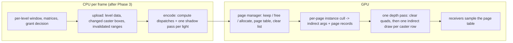

# PRD-775 — Virtual shadow pages are managed and drawn on the GPU, as in Unreal

**Status:** PROPOSED
**Priority:** P1 — no box is ticked: the stress lab `?stress` CPU frame (p50 12.82, p95 17.64 ms) is behind Unreal 5.8.3 (p50 9.45, p95 11.03 ms) on the same scene, and the gap is the virtual shadow map's CPU work.
**Complexity:** 6 (MEDIUM) — 6-10 files (+2), a new GPU page module (+2), CPU/GPU page state in step (+2); risk override: HIGH, because every virtual-shadow game (the shooter kit ships VSM by default) takes the new path.
**Owner:** João · 2026-10-30
**Depends on:** [PRD-773](../../performance/stress-lab-2026-10-30/PRD-773-vsm-per-page-instance-culling.md) Phase 1 (FG1 per-instance page culling, merged in `1882d6041`); PRD-770 fair window. Phase B starts from the stress-120 verdicts on FV1, FV3, FGL3 and FC1s-b.

## Context

**The gap.** On the stress lab (`sandbox/stress-lab`, `main.html?stress`, 1280x720, RTX 2080, uncapped):

| arm | CPU frame p50 | CPU frame p95 |
| --- | --- | --- |
| Unreal 5.8.3, matched scene (provisional) | 9.45 | 11.03 |
| ThreeNative stack, virtual shadow map (VSM) | 12.82 | 17.64 |
| ThreeNative, plain sun map (`?stress&plainShadow`) | 9.09 | 10.7 |

The plain-map arm is under Unreal on both numbers. So the AC is reachable when the VSM's CPU work falls to about the
plain map's cost. That delta (p50 +3.7, p95 +6.9 ms) is this PRD's ceiling.

**Where the VSM CPU time goes** (native ms per frame, `hunt/HUNT-cpuvsm.md`; the Wasm stage costs about 4.3x native;
`stagesAtP95` names the p95 tail: shadow encode +1.4, VSM pages +1.4, shadow lists +1.0 ms):

| work | steady frame | page-granting frame (12-15 % of frames) | file |
| --- | --- | --- | --- |
| caster bounds loop, every caster, every frame | 0.173 | 0.166 | `renderer.cpp:3010-3027` |
| caster state records + string signatures | 0.051 | 0.048 | `renderer.cpp:3036-3054` |
| `PageAtlas::updateCasters`: ordered set + per-caster compare | 0.184 | 0.182 | `atlas.cpp:309` |
| `PageAtlas::update`: protected ids, 256 page builds, LRU pool, `writeTable` | 0.064 | 0.240 | `atlas.cpp:133`, `pages.cpp:143`, `atlas.cpp:394` |
| per-level page index (FS9) + per-page caster selection | 0.091 | 0.277 | `renderer.cpp:3860-3950` |
| per-page rows (`CpuShadowBuild`) | 0.317 | 0.686 | `renderer.cpp:3952-4334` |
| encode: one render pass per page (256 on a grant), a page clear each | small | ≈0.9 ms web | `renderer.cpp:5530-5600` |

**Our design today** (`packages/runtime-native/src/engine/renderer/shadows/virtual/`): the CPU owns everything.
`PageAtlas` keeps the page table, a CPU `PhysicalPagePool` with LRU eviction, the per-level clip windows and the
caster motion state; it maps every page of a level's window (`tiles²`, 256 at 2048 texels) and grants one level a
frame. The renderer builds an `AtlasPage` (two matrices) per granted page, selects each page's casters, plans rows
per page, and encodes one render pass per page with a viewport, a scissor and a clear draw. The page table is
re-uploaded each frame (`renderer.cpp:3242-3250`). Movers draw into one full mover map per level each frame.

**What Unreal 5.8.3 does** (read 2026-10-30 at `/home/joao/projects/UnrealEngine`; ideas, defaults and guards only):

- **The page table and physical pool live on the GPU.** `BuildPageAllocations`
  (`UE 5.8.3: Engine/Source/Runtime/Renderer/Private/VirtualShadowMaps/VirtualShadowMapArray.cpp:3227`) runs
  `UpdatePhysicalPages` (`:3306`), `PackAvailablePages` (`:3336`), `AllocateNewPageMappings` (`:3362`),
  `SelectPagesToInitialize` (`:3438`) and an indirect page clear (`:3457`) as compute passes. The pool keeps four
  ordered lists, LRU, AVAILABLE, EMPTY and REQUESTED (`UE 5.8.3: Engine/Shaders/Private/VirtualShadowMaps/VirtualShadowMapPhysicalPageManagement.usf:34-41`).
  `UpdatePhysicalPages` (`:236`) walks last frame's REQUESTED list as the LRU order (`:252-260`), keeps a page that
  is requested again or younger than `r.Shadow.Virtual.Cache.MaxPageAgeSinceLastRequest` (1000 frames,
  `VirtualShadowMapCacheManager.cpp:127`), turns invalidation flags into static or dynamic "uncached" bits
  (`:328-342`), and moves a dead page to EMPTY (`:460-466`). `PackAvailablePages` (`:686`) compacts LRU into AVAILABLE
  with one group prefix sum; `AllocateNewPageMappings` (`:475`) pops AVAILABLE (`:487`) and first clears the page
  table entry of the page it evicts (`:506`); `AppendPhysicalPageLists` (`:732`) keeps the order and never loses a
  page on overflow (`:738-740`). `SelectPagesToInitializeCS` (`:852`) emits only uncached pages to clear. The CPU only
  sizes the pool: `r.Shadow.Virtual.MaxPhysicalPages` 2048 (`VirtualShadowMapArray.cpp:173-175`).
- **Non-Nanite casters draw into all their pages in one batched pass, not one pass per page.**
  `r.Shadow.Virtual.NonNanite.Batch` 1 and `.SinglePassBatched` 1 (`VirtualShadowMapArray.cpp:490-492`, `:637-639`).
  `CullPerPageDrawCommandsCs` (`UE 5.8.3: Engine/Shaders/Private/VirtualShadowMaps/VirtualShadowMapBuildPerPageDrawCommands.usf:155`)
  takes each instance's own bounds to a page rect (`:307`) and keeps it only where it overlaps a page to render
  (`:309`); `AllocateCommandInstanceOutputSpaceCs` (`:454`) and `OutputCommandInstanceListsCs` (`:485`) write the
  indirect args and a per-instance page record. The vertex shader reads that record
  (`UE 5.8.3: Engine/Shaders/Private/ShadowDepthVertexShader.usf:210`), scales and biases clip space into the physical
  page and sets four clip planes to the page rect (`:42-63`). The output buffer is sized conservatively on the CPU
  (`VirtualShadowMapArray.cpp:3964-3970`, `r.Shadow.Virtual.NonNanite.CulledInstanceAllocationFactor` 1.0, `:444`).
- **Invalidation is pushed by the scene, not scanned.** The cache manager reads only the primitives the scene
  update changed (`VirtualShadowMapCacheManager.cpp:2178`, `ForEachUpdateCommand(AddedUpdated, AllCulling)`), marks
  them dynamic with a frame stamp (`:1767-1785`), and returns a dynamic primitive to the static cache after
  `r.Shadow.Virtual.Cache.FramesStaticThreshold` (100, `:142-145`) frames, iterating only the dynamic set
  (`:1803-1810`). The page marking itself runs on the GPU
  (`VirtualShadowMapCacheGPUInvalidation.usf:66`, `:151`).

## Solution

Port the three Unreal ideas in the order of their measured CPU ceiling. Each phase stands alone, keeps pixels, and
keeps the CPU `PageAtlas` as the test oracle where the GPU replaces it.

1. **Phase 1 — one shadow pass, GPU-built page draws** (ceiling: rows 0.686 + index 0.277 native and ≈0.9-1.4 ms of
   web encode on a granting frame; the p95 lever). On a granting frame the CPU uploads the list of pages to draw
   (≤256 records: slot, level, page projection) and keeps a coarse cull: one `pageRange` per caster row against the
   granted level's dirty rect. A compute kernel (shader IR `ComputePass`, `engine/renderer/compute.h`) runs FG1's
   per-instance rule on the GPU: each (row, instance) box becomes a page rect, every drawn page in it gets a
   (instance, page) record, and the row's indirect `instanceCount` counts them. The output region of a row is
   `instances x reach²` records, with `reach` from the row's largest instance box, so no output can overflow (Unreal
   sizes the same buffer conservatively). The shadow vertex shader takes the page record, applies the page
   projection, and scales and biases clip space into the slot; clipping to the slot uses the `clip-distances` device
   feature where present and a fragment discard against the slot rect elsewhere. One render pass per light replaces
   the per-page passes: an instanced clear draw over the drawn slots, then one `drawIndexedIndirect` per row. No
   `indirect-first-instance` is needed: the row's record offset rides in its per-draw uniform. Mover maps keep
   today's path.
2. **Phase 2 — caster state is pushed, not scanned** (ceiling: 0.408 native ≈ 1.75 ms web on every frame; the p50
   lever). The render database already knows which draws changed (TR1's stamp, FM1's refresh guard). The VSM stage
   takes that change set: a changed caster updates its bounds, motion state and invalidation; an unchanged one costs
   nothing. Motion state is a flat array indexed by the frozen draw list (FS11's record) with a frame stamp, and the
   static return walks only the moving set, as `UpdateCachePrimitiveAsDynamic` does. Invalidation stays on the CPU
   by page range (FV3): for our changed-caster counts a range write costs less than a dispatch.
3. **Phase 3 — the page table and pool on the GPU** (ceiling: 0.06 native steady, 0.24 on a grant, plus the table
   upload). The CPU keeps only per-level state: window origin, matrices, depth fit and the grant decision. A GPU page
   manager keeps Unreal's four lists and runs keep/free, pack, allocate and select-to-clear. The request is still the
   whole window of a granted level; [PRD-457](../rendering/PRD-457-virtual-shadows-scale-by-measurement.md) owns sparse
   pages from receiver demand and gets the GPU request flags from this phase. The page records of Phase 1 come from
   the allocation pass, so the 256 `AtlasPage` builds and `writeTable` leave the CPU.

**Risks.** (a) WebGPU has no per-instance viewport: the slot remap is extra float math, so a page-edge texel can round
differently; each phase states a pixel target and runs the Opus judge. (b) The fragment-discard fallback disables
early depth on that pass; Phase 1 measures GPU p95 with both arms. (c) The web Wasm budget is 4 MiB (`pnpm budgets`);
the WGSL and setup code must fit. Web shadow bundles stay compiled out (FM5 closed). (d) One pass hides the per-level
GPU cost that `recordCost` reads; the pass time goes to the granted level, split evenly when several levels grant.

## Validation scene

- **Consumer and scene:** the stress lab, `main.html?stress` (4000 trees, 6000 rocks, 120 rigs, 300 bodies, VSM sun),
  with its 40 s orbit, against the Unreal 5.8.3 matched scene (provisional numbers above).
- **Window:** the PRD-770 fair window, RTX 2080, 1280x720, uncapped and vsync passes, ABBA pairs; lane checks
  through `measure.sh`.
- **Benefit workload:** `?stress` with the camera moving (granting frames for Phase 1, every frame for Phase 2).
- **Controls that charge the bookkeeping:** `?stress&still` (no grant, no motion: the new path must not cost CPU),
  `?stress&plainShadow` (the floor this PRD aims at), and the shooter-kit holdout (many static non-instanced casters,
  the case where one indirect row per caster could cost more encode than today's per-page rows).
- **Pass:** each phase's keep rule below; the PRD's ACs on the whole stack.

## Acceptance criteria

- [ ] AC-1 [local]: In a PRD-770 fair window, `?stress` CPU frame p95 is below 11.03 ms and p50 below 9.45 ms, GPU p95 is not worse than develop. proof: `TN_STRESS_LEDGER=/home/joao/projects/threenative/threenative-engine/docs/stress-loop/ledger.json node scripts/stress-loop.mjs fair ...` (ledger row)
- [ ] AC-2 [local]: A fresh Opus visual judge returns NEUTRAL or IMPROVEMENT for the whole stack against develop on `?stress&freezeAt=12` and `?stress&closeup`, 2+ runs per arm. proof: judge verdict on the PR (orphan `prd-775-screenshots` branch)

## Blocked on

- The keep rule for Phase 1: it cuts granting frames (12-15 % of frames), so it moves CPU p95, not p50. The brief's
  rule asks for CPU p50 better by more than 3 %. Unblocked by the coordinator (stress-120): accept "CPU p95 better
  by more than 3 % in both ABBA pairs, p50 not worse" for Phase 1, or keep the brief's rule.

## Integration ledger

| Capability | Reachable consumer/trigger | Replaces / disposition | Evidence |
| --- | --- | --- | --- |
| Static virtual pages draw from GPU rows | any `VirtualShadowNode` sun → `Renderer::renderPrepared` shadow stage (`renderer.cpp:3745`) | per-page selection, rows and passes (`renderer.cpp:3860-4334`, `:5530`) deleted for static pages | Phase 1 box 1 |
| Caster state from the change set | `RenderDatabase::render` → VSM stage (`renderer.cpp:2998`) | per-frame scan (`renderer.cpp:3010-3054`, `atlas.cpp:309`) deleted | Phase 2 box 1 |
| GPU page table and pool | VSM stage → GPU page manager; receivers read `s_vsmTable` | CPU `PhysicalPagePool` and `writeTable` leave the runtime path; kept as the test oracle | Phase 3 box 1 |

## Decisions

- 2026-10-30 (vsm-gpu): the phase order follows the measured CPU ceiling, not Unreal's pass order. Phase 1 needs no
  GPU page table: it reads the CPU's granted page list.
- 2026-10-30 (vsm-gpu): GPU invalidation (`VSMUpdateViewInstanceStateCS`, `ProcessInvalidationQueueGPUCS`) is deferred.
  With the change set of Phase 2 the CPU touches only changed casters, and a page-range write costs less than a
  dispatch. Revisit when a measured frame invalidates more than about 1000 casters.
- 2026-10-30 (vsm-gpu): mover maps keep today's path. Unreal's dynamic page layer is a separate port; the stress lab's
  movers cost a fixed three passes a frame.
- 2026-10-30 (vsm-gpu): closed levers stay closed. Pass count and fill count alone did not move GPU p95 (FP2), and
  FG1b showed the per-level index was not FG1's CPU p95 cost. This PRD removes the CPU planning and encode of those
  passes, not their GPU count.
- 2026-10-30 (vsm-gpu), folded plans: PRD-457 keeps sparse demand and the cost gate; PRD-524's parity cases
  (`native-engine-vsm`, `-deformation`, `-cut`) are this PRD's pixel gates where they exist; PRD-652's tier
  `maxPhysicalPages` sizes the GPU pool; PRD-773 Phase 3 (FG2 depth band) stays there; PRD-774 moves the plan off the
  main thread and is independent of this work.

## Execution phases

Every phase: engine code only (`packages/`), red-green first, measured only through
`/home/joao/.cache/tmp-tn/stress-loop/measure.sh` and the fair window. **Keep rule** (brief): CPU p50 better by more
than 3 % in both ABBA pairs, CPU p95 and GPU p95 not worse, Opus judge NEUTRAL or IMPROVEMENT (2+ runs per arm), the
shooter-kit holdout shows a gain or no effect (`holdout-measure-shooter.sh`), `pnpm budgets` green. Then a ledger
row (decision keep), a `PERFORMANCE-LEARNINGS.md` entry and the box ticked with the proof.

### Phase 1 — One shadow pass per light draws GPU-culled page instances

**Status:** NOT STARTED
**Files:** new `packages/runtime-native/src/engine/renderer/shadows/virtual/gpu_pages.{h,cpp}` (cull kernel, buffers);
`renderer.cpp` (shadow stage, encode); the shadow vertex program generator under `engine/shader/` (page record path);
`tests/native-engine/render_database_test.cpp`.

- [ ] A granted level draws in one render pass per light, from GPU rows. proof: new case `virtual_shadow_pages_draw_from_gpu_rows` in `tn-native-engine-render-database-test` — RED on develop (one pass per drawn page, 124+ passes); GREEN: one pass, the GPU's (page, instance) set equals FG1's CPU set (1,118 instances on 124 pages), receiver pixels max channel diff 0 on the case and on `ctest -R native_engine_render_vsm`
- [ ] Phase 1 passes the keep rule on the stress lab. proof: ledger rows (decision keep) from `measure.sh` and the fair window, judge verdict, shooter holdout

### Phase 2 — The VSM stage reads the caster change set

**Status:** NOT STARTED
**Files:** `renderer.cpp` (VSM stage), `render_database.{h,cpp}` (change set), `shadows/virtual/atlas.{h,cpp}`
(`updateCasters` over changed casters), `tests/native-engine/vsm/vsm_atlas_test.cpp`.

- [ ] A frame where no caster changed visits no caster state, and the move, settle and remove invalidations equal today's. proof: new case `virtual_shadow_caster_changes_are_pushed` in `tn-native-engine-render-database-test` (RED: develop visits every caster; GREEN: 0 visits) plus every `tn-native-engine-vsm-atlas-test` case green
- [ ] Phase 2 passes the keep rule on the stress lab. proof: ledger rows (decision keep), judge verdict, shooter holdout

### Phase 3 — The page table and physical pool live on the GPU

**Status:** NOT STARTED
**Files:** `shadows/virtual/gpu_pages.{h,cpp}` (page manager passes), `shadows/virtual/atlas.{h,cpp}` (per-level state
only on the runtime path), `renderer.cpp` (table binding), `tests/native-engine/vsm/vsm_atlas_test.cpp`.

- [ ] The GPU page manager maps the same virtual pages as the CPU `PageAtlas` over a recorded path with pans, a camera cut, a sun direction change and an invalidation, with no lost or duplicated physical page. proof: new differential case `gpu_page_table_matches_cpu_atlas` in `tn-native-engine-vsm-atlas-test`, receiver pixels max channel diff 0 on `ctest -R native_engine_render_vsm`
- [ ] Phase 3 passes the keep rule on the stress lab. proof: ledger rows (decision keep), judge verdict, shooter holdout
