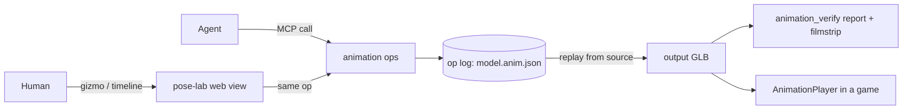

# PRD-760 — Agents author, repair and verify character animation through one MCP

**Status:** IN PROGRESS (phase 1 merged, phase 2 next)
**Priority:** P2 — planned feature work: AC-1 to AC-8 are open; no release or runtime blocker depends on them.
**Complexity:** 7 (HIGH) — 11+ implementation files, a new MCP package, and a cross-repository move out of `threenative-asset-mcp`; risk override: none.
**Owner:** João
**Depends on:** None

## Context

Agents do most game authoring here, but animation work is split and partly blind.

- The animation tools sit inside the asset MCP (`jonit-dev/threenative-asset-mcp`, `src/server.ts`): `asset_inspect_rig`, `asset_auto_rig`, `asset_preview_animation` and `asset_retarget_animations`, implemented in `src/rig/*`. Its catalog (`src/rig/animation-catalog.json`) indexes 172 Quaternius clips (Universal Animation Library 1 and 2, 86 each).
- The sculpt MCP has rig gates (`sculpt_rig_gate`, `sculpt_clip_measure`). Core has runtime diagnostics: `AnimationPlayer` stride measurement, `boneContact`, `boneLengthDeviations` and `reconcileMirroredClips`.
- The owner's "joint editor" is `@threenative/pose-lab`, a React GLB attachment calibrator built 2026-08-18. It has landmark detection, per-clip keyframes, a dope sheet, a detach preview and `.pose.json` recipes v3. It never reached `develop`. It survives only in `refs/archive/branches-2026-08-27/fix/pose-lab-scrub-physics` at `0ce584752`. The values of its one known output (`sandbox/fps-framework/pose-recipes/enemy-ak47.pose.json`) were copied by hand into `sandbox/fps-framework/src/entities/Enemy.ts:388`.
- An agent sees still contact sheets only. It cannot detect foot skate, a loop seam or jitter, and it cannot edit a clip without Blender.

Goal (owner, 2026-10-27): "an animation MCP where agents can do most common operations themselves, and there's a web view for me to use if I want too". The web view is secondary, and MCP operations come first.

## Solution

One package, `packages/animation-mcp` (`threenative-animation-mcp`), grown from the recovered pose-lab. It is a stdio MCP server. Its web view is the pose-lab page, served on demand. Every operation is build-time: the input is a GLB, the output is an ordinary GLB, and no game depends on the MCP at runtime.

- **Op log.** Each change, from an agent or a human, is one JSON op appended to `<model>.anim.json` next to the source GLB. This extends pose-lab recipe v3 to v4, and v3 recipes still load. Replaying the log on the source gives a deterministic output GLB. The log also gives undo, git diffs, and "what João changed" to the agent.
- **Unreal vocabulary** (owner rule: GI and other abstractions use Unreal names). Tool names follow Unreal subsystems:

  | Tool | Unreal subsystem | Does |
  |---|---|---|
  | `animation_inspect` | Skeleton / Anim Sequence | bones, landmarks, clips, durations, root motion, in-place detection |
  | `animation_auto_rig`, `animation_ik_retarget`, `animation_preview` | Auto rig / IK Retargeter | the four moved asset MCP tools |
  | `animation_attach` | Socket | prop on a bone, per-clip keyed offset, attached or detached; baked into the GLB |
  | `animation_modify` | Animation Modifiers | trim, retime, loop point, mirror, resample, extract root motion, lock feet |
  | `animation_verify` | (Pose Search diagnostics) | foot skate, ground penetration, loop seam, jitter, bone stretch, plus a filmstrip PNG and plots |
  | `animation_pose`, `animation_bake` | Control Rig / Pose Asset | constraint intents solved by IK into a pose, pose sequences baked into a clip |
  | `animation_find_clip` | (Content Browser) | library search over the Quaternius catalog, then retarget and verify |
  | `animation_open_view` | (Persona editor) | starts the pose-lab page on 127.0.0.1 and returns its URL |

- **Reuse:** `@gltf-transform/*` (already an asset MCP dependency) for clip edits, `three` with `CCDIKSolver` (already used by `examples/animation-composition`) for IK, the asset MCP preview renderer for filmstrips, and core diagnostics for measurement.
- **Risks:** (1) the asset MCP is `UNLICENSED`, so moving its rig code into this MIT repo relicenses it; see `## Blocked on`. (2) The charter closes "an editor". The web view is an authoring calibrator for one GLB, not a scene editor, and the owner asked for it on 2026-10-27. (3) The pose-lab code is from August, so its imports may lag current core.

## Acceptance Criteria

#### Phase 1 — recovered package, moved tools, attachments

- [x] AC-1 [local]: A game project's `.mcp.json` (written by `mergeMcpServers` in `packages/core/mcp/servers.mjs`) starts `threenative-animation`, and a stdio `tools/list` returns every tool in the table above that is implemented so far. proof: `pnpm exec vitest run packages/animation-mcp/__tests__/server.spec.ts packages/animation-mcp/__tests__/mcp.spec.ts packages/core/__tests__/mcp-install.spec.ts scripts/__tests__/sync-agent-docs.spec.ts` — **Evidence (2026-10-27):** pass, 95 tests across 10 files. `MCP_SERVERS` now declares five servers, ordered, animation last; `mcp-install.spec.ts` spawns the shipped shim `packages/core/mcp/animation.mjs` and asserts a stdio `tools/list` answers `animation_attach`, `animation_inspect`, `animation_open_view`; `packages/animation-mcp/__tests__/mcp.spec.ts` now also starts the server through a bin symlink, the shape a real install runs, and fails without the realpath fix that 0.1.2 carries. Every scaffold template's seven host configs reloaded by `pnpm sync:mcp`. The PRD named `writeMcpConfig` and `packages/core/__tests__/mcp-servers.spec.ts`; neither exists — the writer is `mergeMcpServers` and the spec is `mcp-install.spec.ts`, so the proof path above is the real one.
- [ ] AC-2 [local]: `animation_inspect`, `animation_auto_rig`, `animation_ik_retarget` and `animation_preview` run from the animation MCP on a Mixamo character with output identical to the asset MCP's tools, and the asset MCP `tools/list` no longer has the four tools. proof: `pnpm exec vitest run packages/animation-mcp/__tests__/rig.spec.ts` plus the asset MCP PR's `pnpm test` — Evidence: **open, and not blocked on licensing (corrected 2026-10-27).** There is no third-party right here: `src/rig/*` in `threenative-asset-mcp` is 2,713 lines with a single author over three commits, all João's, and the only licensed thing it touches is the Quaternius `UAL1`/`UAL2` catalog, which `src/rig/catalog.ts` already records as CC0. The `"license": "UNLICENSED"` in that manifest is a default, not someone else's claim, and the owner cleared it ("what license are you bitching about?"). What blocks the box is scope: the move is a cross-repo port of 2,713 lines plus an asset MCP release that removes four tools, and it is not in this PR. `animation_inspect` here is this repo's own reader, so even that one does not yet match the asset MCP's output shape.
- [ ] AC-3 [local]: `animation_attach` reproduces `enemy-ak47.pose.json` (rifle on `mixamorigRightHand`, per-clip keys) as a v4 op log, and the baked GLB plays the rifle in the hand with no game code holding the offsets. proof: `pnpm exec vitest run packages/animation-mcp/__tests__/attach.spec.ts packages/animation-mcp/__tests__/log.spec.ts` (v3 load, v4 round trip, baked node world transform within 1 mm of the recipe) — Evidence: **spec passes, box open for the visual judge only.** 24 tests pass. The recipe loads as a v4 log whose first op is the attach on `mixamorigRightHand_035`; the bake writes `attach-weapon` as that bone's child with translation/rotation/scale tracks for the six held clips; posing the baked `RifleIdle` track puts the rifle `0` units from the recipe's offset in world space (asserted under 1 mm) through a hand bone that is neither at the origin nor unrotated. The three `detached` death clips get no track and are reported in the bake result. The recipe is committed as `packages/animation-mcp/__tests__/fixtures/enemy-ak47.pose.json` so the proof needs no file outside the repository. **The visual judge verdict this AC requires beside the box is not recorded yet**, so the box stays open.

#### Phase 2 — clip edits and motion perception

- [ ] AC-4 [local]: `animation_modify` applies trim, retime, loop point, mirror, resample, root-motion extraction and foot lock to a Quaternius clip. Each op lands in the op log, and replaying the log from the source GLB gives byte-identical output. proof: `pnpm exec vitest run packages/animation-mcp/__tests__/modify.spec.ts` — Evidence: **six of the seven ops shipped and green; box open on root-motion extraction.** `modify.spec.ts` passes 7/7: two renders of one log are byte-identical (`Buffer.equals`), a log of retime+resample reports both edits, `foot-lock` repairs the seeded skate so `animation_verify` then reports none, `loop-point` closes a 30° seam, `trim` cuts to exactly its window with both edges sampled and fails closed on a window outside the clip, `resample` lands 13 frames at 12 fps, and `mirroredBone` names the far side (`mixamorigLeftHand` → `mixamorigRightHand`, `Bip01 L Thigh` → `Bip01 R Thigh`) with `mirror` retargeting the channel. Edits are records in the op log (`{"op":"modify"}`), so the GLB is derived and the log is the change. **Not done: root-motion extraction.**

- [x] AC-5 [local]: `animation_verify` fails a seeded defective clip (foot skate over 2 cm per planted step, loop seam over 5°, one jitter spike) with each defect named by bone and frame range. It passes the same clip after `animation_modify` repairs it, and it writes a non-blank filmstrip PNG. proof: `pnpm exec vitest run packages/animation-mcp/__tests__/verify.spec.ts packages/animation-mcp/__tests__/modify.spec.ts` — **Evidence (2026-10-28): pass, 15 tests across the two files.** The seven seeded cases in `verify.spec.ts` name the right bone and window (skate frames 0–30 on `mixamorigRightFoot`; penetration on that bone alone; one `loop-seam` at 30.0°; `jitter` inside 4 frames; `bone-stretch`; the same fixture read as metres vs centimetres; unknown clip fails closed). `modify.spec.ts` then proves the repair half: `foot-lock` on the seeded skate makes verify report no `foot-skate`, and `loop-point` closes the 30° seam. The filmstrip is written and non-blank — PNG magic plus more than 16 distinct byte values, drawn from the sampled bones rather than rendered (side-on stick figures, one column per frame, one scale for the whole strip so movement reads). Sampling is headless and `CUBICSPLINE` is read by value with tangents dropped (`ponytail:` in `sample.ts`). The filmstrip encoder is local (`src/report/png.ts`) because every npm PNG library is CommonJS and a `require("util")` inside the server's ESM bundle kills it before `initialize` — that failure is reproduced above.

- [ ] AC-6 [local]: `animation_pose` solves a constraint intent (right hand at the rifle grip, look at a target, crouch 0.4) into a pose that meets each constraint within 1 cm or 2°. `animation_bake` turns a pose sequence into a clip that passes `animation_verify` and plays through `AnimationPlayer` in a template kit's playtest. proof: `pnpm exec vitest run packages/animation-mcp/__tests__/pose.spec.ts` plus the kit scenario — Evidence: pending.
- [ ] AC-7 [local]: `animation_find_clip "rifle reload"` returns ranked Quaternius catalog hits, and the call chain find → `animation_ik_retarget` → `animation_verify` on a Mixamo character ends with a passing report and a filmstrip. proof: `pnpm exec vitest run packages/animation-mcp/__tests__/find.spec.ts` — Evidence: pending.
- [ ] AC-8 [local]: `animation_open_view` returns a URL whose page shows the op log live. An MCP op appears in the page without a reload, and a gizmo edit in the page appends an op that `animation_inspect` then reports. proof: Playwright spec `packages/animation-mcp/__tests__/view.spec.ts`, headed WebGPU, `adapter.info` checked — Evidence: pending.

Baked clips and attachments reach the screen. AC-3 and AC-6 therefore need a visual judge verdict (owner rule 2026-10-09), recorded beside those boxes before they are ticked.

## Blocked on

- ~~Relicensing the moved rig code from `UNLICENSED` (asset MCP) to MIT (this repo).~~ **Withdrawn 2026-10-27:** one author, João's own code, CC0 catalog. Nothing needs relicensing; AC-2 waits on scope — a 2,713-line cross-repo port plus a release that drops four tools from the asset MCP — not on permission.
- ~~Publishing `threenative-animation-mcp` and an asset MCP release without the rig tools, so installed games get the server.~~ **Done 2026-10-27:** `threenative-animation-mcp@0.1.3` is on npm and `latest`. Installed games already got the server from core's committed bundle; the npx fallback now resolves a real package instead of an E404. Publishing 0.1.0 exposed a real defect that no in-repo test could see: an installed bin runs through `node_modules/.bin` — a symlink — so `argv[1]` is the link while `import.meta.url` is the file it points at, and the literal comparison started no server at all. The entry point now compares `realpath` on both sides, and `mcp.spec.ts` reproduces the install shape (spawn through a symlink) so it cannot come back. 0.1.2 answered over `npx` and exposed the second defect the in-repo tests could not see: bundling inlines `server.ts`, whose CLI block then fired on the bundle and printed `Pose Lab: http://127.0.0.1:4192/pose` on **stdout** — the JSON-RPC stream itself, and a stray line that makes a server unusable. `server.ts` is a module again (no CLI block, no `dist/server.js` entry); the human's entry is `--view` on the bin. 0.1.3 is the first version whose stdout is only protocol.

## Integration Ledger

| Capability | Reachable consumer/trigger | Replaces / disposition | Evidence |
|---|---|---|---|
| Animation MCP server | Core install writes `.mcp.json` → `packages/core/mcp/servers.mjs` `MCP_SERVERS` → `packages/core/mcp/animation.mjs` → `packages/animation-mcp` server | New | AC-1 |
| Rig tools | Agent MCP call → `animation_*` handlers | Asset MCP `src/server.ts` `asset_inspect_rig` / `asset_auto_rig` / `asset_preview_animation` / `asset_retarget_animations` removed, with no aliases | AC-2 |
| Attachment recipes | `animation_attach` → baked GLB → `AnimationPlayer` in a game | Hand-copied recipe values in game code (for example `sandbox/fps-framework/src/entities/Enemy.ts:388`) are no longer needed | AC-3 |
| Clip edits, verify, pose, find | Agent MCP call → op log → output GLB | New | AC-4 to AC-7 |
| Web view | `animation_open_view` → recovered pose-lab server and client | Archived `@threenative/pose-lab` bin folded in | AC-8 |

## Decisions

- 2026-10-27 (João): one PRD for the whole animation MCP; MCP operations first, web view secondary.
- 2026-10-27 (agent): the package lives in this repo as `packages/animation-mcp`, beside `engine-mcp` and `blender-mcp`. Reasons: pose-lab was MIT and lived here, it needs no new GitHub repository, and it allows one PR per PRD. Like the other MCPs, it ships to games through core, because the moved tools already ship today.
- 2026-10-27 (agent): the bundle tools (`asset_list_bundle_animations`, `asset_download_bundle_animation`) and the `creature_*` tools stay in the asset MCP. They download or compile assets and do not edit animation.
- 2026-10-27 (agent): two follow-up PRDs are out of scope because the 3-phase cap leaves no room for them: (a) an optional text-to-motion backend on the local GPU, which first needs a model choice and a quality evaluation; (b) runtime Anim Notifies plus a Blend Space state machine in `packages/core`, a different layer that needs its own playtests. Notify authoring waits for (b), so that no orphan data is written.

## Execution Phases

#### Phase 1: Recovered package, moved tools, attachments
**Status:** IN PROGRESS (phase 1 merged, phase 2 next)
**Files:** `packages/animation-mcp/` (restored from `0ce584752:packages/pose-lab`, renamed, plus `src/mcp.ts` and `src/ops/{inspect,attach}.ts`); `packages/core/mcp/servers.mjs` and `packages/core/mcp/animation.mjs`; asset MCP `src/server.ts` and `src/rig/*` (separate PR in that repo).
**Implementation:** restore pose-lab and get its specs green on current `develop`. Add the stdio server with `@modelcontextprotocol/server` and zod (the asset MCP pattern). Move the rig modules once licensing is decided. Make recipe v4 the op log. Bake attachments as a bone child node with per-clip tracks.
**Verification:** AC-1 and AC-3 specs pass; AC-2 blocked on licensing. Visual judge on the baked attachment: **not run**. `animation_attach` bakes; the judge needs a headed capture of the baked GLB through the view page, which is WebGL rather than WebGPU, so it is its own pass.

#### Phase 2: Clip edits and motion perception
**Status:** IN PROGRESS (phase 1 merged, phase 2 next)
**Files:** `packages/animation-mcp/src/ops/{modify,verify}.ts`, `src/report/filmstrip.ts`.
**Implementation:** use gltf-transform for the clip ops. Verify samples world bone positions per frame (three `AnimationMixer`, headless), measures planted-foot slip, floor penetration, first/last pose distance, jerk spikes and bone length drift, and renders the filmstrip through the moved preview renderer.
**Verification:** AC-5's detector half passes (8 tests); AC-4 and the filmstrip are not started.

#### Phase 3: Pose language, library search, web view
**Status:** IN PROGRESS (phase 1 merged, phase 2 next)
**Files:** `packages/animation-mcp/src/ops/{pose,bake,find,view}.ts`, `src/client/*` (pose-lab UI reads and writes the op log), one template kit playtest scenario.
**Implementation:** before writing `pose.ts`, sparse-add `Engine/Plugins/Animation/IKRig` and `Engine/Plugins/Animation/ControlRig` to `~/projects/UnrealEngine` (not in the current sparse clone), read the goal and solver setup, and cite `UE 5.8.3: Engine/...:line` here. Borrow defaults, not code. Search ranks catalog clips by name, tags and duration. The view server pushes op-log changes over SSE.
**Verification:** AC-6, AC-7 and AC-8. Visual judge on the baked clip.
