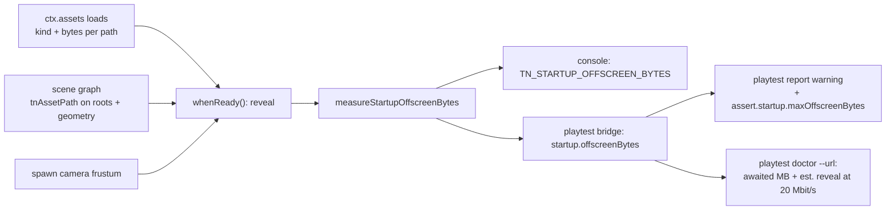

# PRD-744 — Startup reports the bytes it awaits that the spawn camera does not show

**Status:** NOT STARTED
**Priority:** P1 — all boxes are open: an agent told "your assets are big" defers content the spawn camera sees (Wildwood revealed a bare valley, `trees=1 ferns=0`, then froze 2-4 s in play), and no engine signal separates that mistake from the right fix
**Complexity:** 5 (MEDIUM) — 6–10 files (2), new measurement module (+2), crosses core and playtest builds (+2) → 6; risk override: none
**Owner:** João (decisions), agent (implementation)
**Depends on:** None. Builds on the `ctx.assets` byte ledger (`progress.requestedBytes`) and the startup readiness gate already on `develop`. PRD-743 (PR #572, `ctx.assets.prefetch`) names the fix text but is not required.

## Context

PR #572 (PRD-743) gave web games a disk cache and `ctx.assets.prefetch`. Its Wildwood test game was "optimized" by
revealing before the forest loaded: `startup.readyMs` fell from 44 s to 20 s. But the reveal logged
`TN_VALLEY_REVEAL trees=1 ferns=0`, a bare valley, and the game froze 2-4 s during play while the forest built.

The lesson: telling an agent "your assets are big, stream them" pushes it to defer content the **spawn camera
sees**. The useful signal is the opposite one: **bytes awaited before the reveal that the spawn camera does not
show**. Those bytes are pure cost to the reveal and safe to stream or prefetch.

What exists today (all read in this tree):

- `ctx.assets.progress` counts `requested` / `requestedBytes` / `settledBytes`, weighed by the `bytes` the asset
  compile step records on every manifest entry (`packages/core/src/assets.ts:940-1010`, `bytesOf`). It keeps no
  per-path size, so nothing can say *which* file cost the wait.
- `ctx.assets.resolved` maps each settled logical path to `{ url, via }` (`assets.ts:81`, `:799`, `:928`).
- Every model root the loader returns is stamped `userData.tnAssetPath = <logical path>`, and the stamp survives
  `.clone()` (`stampAssetProvenance`, `assets.ts:1262`; key `GEOMETRY_ASSET_KEY`, `geometry-capture.ts:46`;
  reader `assetOf`, `geometry-capture.ts:344`). Instanced batches built from a model's geometry lose the root, so
  the geometry needs the stamp too.
- The reveal is `startupReadiness.whenReady()` in `packages/core/src/game.ts:1259`, which already runs
  `unlitFoliageWarning(threeScene)` there. This PRD adds a sibling call at the same moment.
- The playtest bridge publishes `startup` as `{ phase, progress, warmup, compileSettled, timeline }`
  (`packages/core/src/playtest.ts:155`); `assert.startup` accepts `maxEnteredMs|maxCompileSettledMs|maxReadyMs`
  (`packages/playtest/src/evaluators/startup.ts`); `doctor --url` prints a scene overview built from the same
  observation (`packages/playtest/src/runner/sceneOverview.ts`).

## Solution

Measure at the reveal, report three ways, decide no appearance.

**Layer: engine, three places.** Core mechanism (`packages/core/src/`, measurement only, no DOM, runs on native
unmodified; nothing exported from `src/index.ts`, so no new public API). Playtest (`packages/playtest/`) owns
the report warning, the assertion and the doctor line. Templates are not touched (their `AGENTS.md` already tell
the agent to await what the camera sees; that text lives on PR #572).

**Measurement.** At the reveal, take every path in `ctx.assets.resolved` that settled with a known size. A model
path is **visible** when some scene object carrying its stamp (on a root or a mesh geometry) is visible through
its whole ancestry and its world bounds meet the camera frustum. Otherwise it is **off-screen**, with a reason per
file: `outside-view`, `hidden`, or `not-placed` (nothing in the scene carries the stamp). Textures and audio loaded
through `ctx.assets` have no scene object the engine can follow, so they count in `awaitedBytes` and in an
`unattributedBytes` field, never as off-screen: the engine does not guess.

**Line.** `TN_STARTUP_OFFSCREEN_BYTES {"awaitedBytes","offscreenBytes","visibleBytes","unattributedBytes","top":[{path,bytes,reason}],"fix"}`
with the fix text: stream them with `WorldCells`, or `ctx.assets.prefetch` them after the reveal, and keep
awaiting everything the spawn camera sees. `top` is the five largest off-screen files. Nothing is printed when no
sized asset was awaited.

**When it warns versus informs (no fixed MB threshold).** The engine compares two measured values: off-screen
bytes against visible bytes. Off-screen bytes above zero print the line as `console.log` (inform). Off-screen
bytes above the visible bytes, meaning most of the wait bought nothing on screen, print it as `console.warn`
(warn). Both comparisons are ratios of measurements in the same run, so no constant needs revisiting. The
playtest report mirrors the same rule: inform adds nothing to the report, warn adds a `warning` diagnostic.

**Gate (opt-in).** `assert.startup.maxOffscreenBytes` fails the run when the observed off-screen bytes exceed the
ceiling, and fails closed when the runtime reported no measurement.

**Reveal estimate in doctor.** The bytes the first scene awaits are only known by running the scene (the manifest
has no per-scene index), so the surface is `threenative-playtest doctor --url`, which already loads the scene. It
prints awaited MB, off-screen MB and the estimated reveal time at 20 Mbit/s. 20 Mbit/s (2.5 MB/s) is a stated
reference link for a modest home or mobile connection, printed with the figure so a reader can rescale it; the
JSON carries the raw bytes. No new CLI command or flag.

Known ceiling: a game that merges geometry into a new buffer loses the stamp, so its bytes read `not-placed`
(off-screen) although they show. The line says `not-placed` rather than `outside-view` for that reason, and the
fix text asks the author to check it. Instanced meshes built from the model's own geometry keep the stamp.

## Acceptance Criteria

- [ ] AC-1 [local]: A reveal that awaited one visible model and one large out-of-view model logs a `console.warn` `TN_STARTUP_OFFSCREEN_BYTES` naming the large file; the clean variant logs no warning. — proof: `pnpm exec vitest run packages/core/__tests__/startup-offscreen-bytes.spec.ts` — Evidence: pending.
- [ ] AC-2 [local]: The playtest report carries the same measurement as a warning diagnostic, and `assert.startup.maxOffscreenBytes` fails the offscreen fixture and passes the clean one, in a browser run. — proof: playtest scenario `packages/playtest/__tests__/fixtures/startup-offscreen/` run with the commands in Phase 3 — Evidence: pending.

## Blocked on

None.

## Integration Ledger

| Capability | Reachable consumer/trigger | Replaces / disposition | Evidence |
|---|---|---|---|
| Off-screen bytes measured at the reveal | `startupReadiness.whenReady()` handler, `packages/core/src/game.ts` (beside `unlitFoliageWarning`) | New; no incumbent | AC-1 |
| Bridge field `startup.offscreenBytes` | `packages/core/src/playtest.ts` `startup()` → `evaluators/startup.ts`, `runner/sceneOverview.ts` | Extends the startup observation | AC-2 |
| `assert.startup.maxOffscreenBytes` | scenario file → `emitStartup` | Extends `STARTUP_CEILINGS` | AC-2 |

## Decisions

- 2026-10-25 (agent, on the lead's brief): warn when off-screen bytes exceed visible bytes; inform for any
  off-screen bytes. Reason: a fixed MB threshold is a constant the author must revisit; a within-run ratio is
  not. A 4 KB prop off-screen informs and never warns.
- 2026-10-25 (agent): only models are attributed to the camera. Textures and audio go in `unattributedBytes`
  because no scene object ties them to a view without guessing.
- 2026-10-25 (agent): the doctor estimate lives on `playtest doctor --url`, not `threenative doctor`, because the
  first scene's awaited set is only knowable by loading it; the static manifest total would overstate an
  open-world game by its streamed cells.
- 2026-10-25 (agent): no core export. The measurement is internal; the report is a console line plus a bridge
  field, so there is no new capability row and no template edit.

## Execution Phases

#### Phase 1: Core measures and reports at the reveal
**Status:** NOT STARTED
**Files:** `packages/core/src/assets.ts` (record kind and bytes on `resolved`; stamp geometry), `packages/core/src/startup-offscreen-bytes.ts` (new), `packages/core/src/game.ts` (call at reveal; bridge getter), `packages/core/src/playtest.ts` (publish), `packages/core/__tests__/startup-offscreen-bytes.spec.ts` (new)
**Implementation:** `IResolvedAsset` gains optional `kind` and `bytes`, set when the size lands. `stampAssetProvenance` also stamps mesh geometry `userData`. `measureStartupOffscreenBytes(resolved, root, camera)` returns the report; `game.ts` logs it once at the reveal (`log` or `warn` by the rule above) and keeps it for the bridge.

- [ ] Loader records `kind` and `bytes` per settled path and stamps mesh geometry, so an instanced batch keeps provenance. proof: `pnpm exec vitest run packages/core/__tests__/assets.spec.ts` — pending.
- [ ] The measurement separates visible, `outside-view`, `hidden`, `not-placed` and unattributed bytes, and the warn/inform rule holds on both fixtures. proof: `pnpm exec vitest run packages/core/__tests__/startup-offscreen-bytes.spec.ts` — pending.
- [ ] The reveal prints `TN_STARTUP_OFFSCREEN_BYTES` once and the playtest bridge publishes `startup.offscreenBytes`. proof: `pnpm exec vitest run packages/core/__tests__/startup-offscreen-bytes.spec.ts packages/core/__tests__/playtest.spec.ts` — pending.

**Verification:** `pnpm --filter @threenative/core typecheck` and the three proofs above.

#### Phase 2: Playtest warns, gates and estimates
**Status:** NOT STARTED
**Files:** `packages/playtest/src/protocol.ts`, `src/evaluators/startup.ts`, `src/scenario/schema-base.ts`, `src/scenario/schema-accessors.ts`, `src/assertion-schema.ts` (+ regenerated validators), `src/runner/sceneOverview.ts`, `__tests__/startup-assertion.spec.ts`, `__tests__/` doctor/overview spec
**Implementation:** the report gets a `warning` diagnostic `TN_PLAYTEST_STARTUP_OFFSCREEN_BYTES` under the same rule; `maxOffscreenBytes` joins the ceilings and fails closed on a missing measurement; `formatSceneOverview` prints awaited MB, off-screen MB and the 20 Mbit/s estimate.

- [ ] A run whose bridge reports warn-level off-screen bytes carries the warning diagnostic; an inform or clean run carries none. proof: `pnpm exec vitest run packages/playtest/__tests__/startup-assertion.spec.ts` — pending.
- [ ] `assert.startup.maxOffscreenBytes` passes under the ceiling, fails over it, and fails closed with no measurement; a wrong-typed value throws at load. proof: `pnpm exec vitest run packages/playtest/__tests__/startup-assertion.spec.ts packages/playtest/__tests__/scenario.spec.ts` — pending.
- [ ] `doctor --url` prints awaited and off-screen MB with the estimated reveal time at 20 Mbit/s. proof: `pnpm exec vitest run packages/playtest/__tests__/scene-overview.spec.ts` — pending.

**Verification:** `pnpm --filter @threenative/playtest typecheck`, the generated-validator drift check, and the proofs above.

#### Phase 3: Playtest proof on a real page, docs, manifest
**Status:** NOT STARTED
**Files:** `packages/playtest/__tests__/fixtures/startup-offscreen/` (small game: offscreen and clean variants, two scenarios), `packages/playtest/AGENTS.md`, `packages/playtest/docs/reference.md`, `packages/create-threenative/agent-docs/references/assertion-reference.md`
**Implementation:** one fixture page awaits a visible model and a large out-of-view model; the clean variant awaits the visible one only. The AGENTS and reference docs name the warning and the assertion. Templates stay untouched.

- [ ] Browser playtest: the offscreen scenario reports the warning and `maxOffscreenBytes` fails it; the clean scenario passes. proof: `node packages/playtest/dist/runner/cli.js packages/playtest/__tests__/fixtures/startup-offscreen/*.playtest.json --url … --browser-recipe webgpu` — pending.
- [ ] Docs and capability checks stay green. proof: `pnpm capabilities:sync && pnpm exec vitest run scripts/__tests__/capability-*.spec.ts scripts/__tests__/check-capability-docs.spec.ts packages/create-threenative/__tests__/scaffold.spec.ts` — pending.

**Verification:** the two proofs above.
