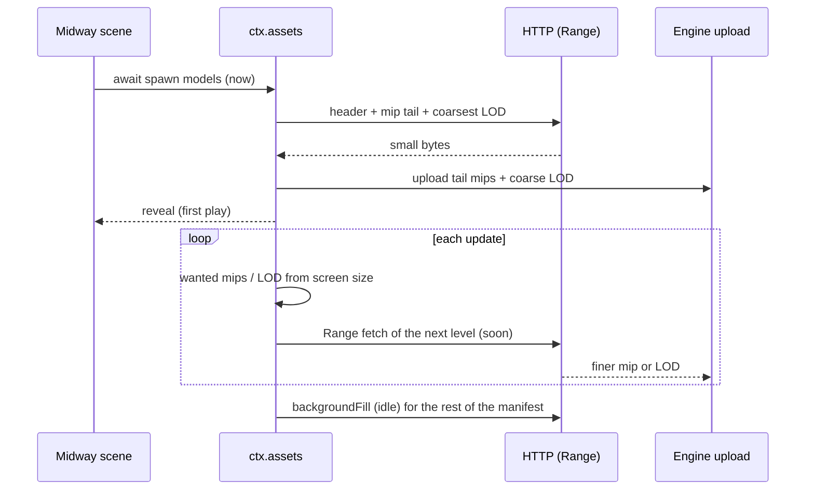

# PRD-860 — The first scene plays before the game finishes downloading

**Status:** IN PROGRESS — the engine's late-asset line landed and Midway now ships cooked, but no box is done: its cooked bytes are 166 MB rather than the tens of MB a KTX2 cook would give, because the default engine refuses KTX2 and meshopt (`TN_ASSETS_COMPRESSION_SKIPPED`), so AC-2's 50 MB now rests on the load split alone, which Midway cannot do until a hull can arrive after `enter`.
**Priority:** P1 — Midway still waits for 136.4 MB before the first frame of play (measured below, AC-1), and texture and mesh streaming (AC-4 to AC-8) do not exist.
**Complexity:** 8 (HIGH) — 6–10 implementation files (+2): the loader, a mip-streaming module, the KTX2 path in the owned engine, the model cook and the Midway game; a new streaming module (+2); request queues and residency are concurrent state (+2); the change crosses the TypeScript packages and the owned C++ engine build (+2).
**Owner:** João
**Depends on:** None. Reuses [PRD-729](../done/assets/PRD-729-assets-ship-smallest-and-preload-fastest.md) (cooked bytes, throttled preload probe) and [PRD-496](../performance/PRD-496-the-loading-screen-is-bytes-not-files.md) (loader fan-out).

## Context

The owner asked for web asset streaming (2026-11-08): "instead of downloading a 2GB game, it only
gets 50mb for the first scene, then downloads the rest on the go in background". Midway is the
subject (owner, 2026-11-08: "use midway as a sample game for this, its large enough").

What ships today:

- `ctx.assets` (`packages/core/src/assets.ts`) downloads what a scene awaits, then
  `backgroundFill` (on by default, `assets.ts:65`) fetches the rest of the manifest at idle priority.
  `prefetch(paths)` (`assets.ts:215`) warms named files early. Priority `now` goes before `soon`.
- `TN_STARTUP_OFFSCREEN_BYTES` (`packages/core/src/startup-offscreen-bytes.ts:40`) reports the bytes
  the reveal waited for that the spawn camera does not show.
- `WorldCells`, `TerrainTiles`, `ScatterColliders` and `propPackageFiles` stream open worlds by
  position.
- Playtest scenarios throttle the network (`artifacts.network.downloadKbps`, `latencyMs`,
  `packages/playtest/src/scenario/schema-validate.ts:327`).

What is missing:

- **Midway does not use any of it.** `src/scenes/Midway.ts` `load()` awaits every model and all
  audio in one `Promise.all`. The game ships 197 MB (`dist/`, measured 2026-11-08): 29 GLBs and
  146 OGG files. Its GLBs are not cooked: `akagi.glb` is 26.3 MB with 33 PNG/JPEG images and no
  KTX2 or meshopt data.
- **No texture streaming.** A texture downloads and uploads all its mips at once. The feature map
  row "Texture and mesh streaming" is open (`docs/PRDs/Unreal/research/unreal-visuals-and-performance-feature-map.md:265`).
- **No mesh LOD streaming.** A cooked LOD chain (`lodChainOf`, `TN_discrete_lod`) shares the vertex
  buffers of its base level, so the coarse level cannot download first.

## Solution

Three slices, each proven on Midway with a throttled playtest:

1. **Midway boots on its spawn bytes.** Cook Midway through `compileAssets` (KTX2 textures,
   meshopt geometry). Change its `load()` to await only what the spawn camera shows. Every other
   file goes to `prefetch` or `backgroundFill`. The engine adds one log line, `TN_ASSET_LATE`, for
   a file that a scene requests after the reveal and that is not yet resident. That line makes a
   pop-in visible to a playtest.
2. **Textures stream by mip.** A KTX2 file keeps its level index in its header, so the loader can
   read each mip level with one HTTP `Range` request. The loader first fetches the header and the
   small mip tail. It then fetches the larger levels that the screen size asks for.
3. **Meshes stream by LOD.** The model cook writes each streamed LOD level with its own vertex and
   index ranges, coarsest first. The loader draws the coarsest level, then fetches finer levels by
   projected error.

### Unreal reference (UE 5.8.3, read 2026-11-08 at `~/projects/UnrealEngine`)

Borrow the algorithm and defaults. Do not copy code.

- **Wanted texture mips.** `ceil(1 + log2(max(1, screenSize)))`, clamped to the allowed range.
  UE 5.8.3: Engine/Source/Runtime/Engine/Private/Streaming/StreamingTexture.cpp:309.
- **Wanted mesh LODs.** The smallest LOD count whose normalized screen size covers the wanted size.
  UE 5.8.3: Engine/Source/Runtime/Engine/Private/Streaming/StreamingTexture.cpp:320.
- **Always-resident tail.** The mips the cook inlines stay resident, and at least one mip always
  stays resident. UE 5.8.3: Engine/Source/Runtime/Engine/Private/TextureDerivedData.cpp:2658.
- **Visible first.** A request loads the visible-wanted mips before the mips for hidden primitives.
  A request is important when it misses more than two mips (one for meshes).
  UE 5.8.3: Engine/Source/Runtime/Engine/Private/Streaming/StreamingTexture.cpp:503.
- **Budgets.** `r.Streaming.PoolSize` (-1: platform default, :120), `r.Streaming.PoolSizeForMeshes`
  (below 0: meshes share the texture pool, :126) and `r.Streaming.MaxTempMemoryAllowed` (50 MB of
  in-flight mip memory, :139). UE 5.8.3: Engine/Source/Runtime/Engine/Private/Streaming/TextureStreamingHelpers.cpp.
- **Mesh streaming is off by default in Unreal** (`r.MeshStreaming` 0).
  UE 5.8.3: Engine/Source/Runtime/Engine/Private/ContentStreaming.cpp:38. Here it is on by
  default ("Auto by default"), with a named override.

### What execution measured (2026-11-09, local)

Four findings change the slices below. Each is measured on this machine, not assumed; the numbers
come from Midway's own cooked manifest (`public/assets.manifest.json`, 228 entries).

- **The default engine refuses the compression this PRD's Phase 1 is built on.** `webRuntimeDecoders`
  returns `{ ktx2: false, meshopt: false }` unless the game sets `engine: "threejs"`
  (`packages/create-threenative/src/web-engine.ts:11`), because the owned Wasm engine has no decoder
  for either. The bake says so out loud: `TN_ASSETS_COMPRESSION_SKIPPED model: 29 file(s), 63.2 MB`
  and `texture: 52 file(s), 13.2 MB`. Midway's cook is therefore quantize + compact + LOD + WebP
  only: **166.2 MB shipped** (90.1 MB of manifest entries plus 76.1 MB of shared images) from 188 MB
  of sources, and a 165 MB `dist` against 197 MB before. Phase 1's "KTX2 textures, meshopt geometry"
  is unavailable until the owned engine decodes them — filed as
  [PRD-861](PRD-861-the-owned-engine-decodes-meshopt-and-ktx2.md): the meshopt decoder is already
  vendored in `third_party/meshopt/` and never compiled, and KTX2 needs a Basis transcoder that is
  not in the tree at all.
- **The load split, not the cook, is what reaches AC-2's 50 MB.** Everything `load()` awaits today
  is **136.4 MB over 255 files** (every model, all 68 speech clips, every cockpit texture, the sky).
  A spawn-only await — the player's SBD, Yorktown, the deck crew, the atoll, the escort destroyer,
  the atoll structures, the sky and the launch audio — is **64.3 MB**, so the split must also defer
  the two 11 MB hulls and the cockpit's 13 MB of dial textures to land under 50 MB. No KTX2 needed.
- **The compact `instance` pass and the engine's `clone()` disagree.** Cooking turned repeated hull
  parts into `EXT_mesh_gpu_instancing`, and the shipped engine then threw
  `TN_ABI_6: clone(): TN_NATIVE_UNSUPPORTED TN_NATIVE_CLONE_UNSUPPORTED: InstancedMesh` inside
  `createCarrier` before the briefing drew — every ship in this game is built by cloning its model.
  `assets.models.compact.instance: false` in the game's config clears it. Either the clone path or
  the cook has to learn about the other; that is a follow-up, not this PRD's subject.
- **A cooked game exposes two game-side defects an uncompiled one hides**, both fixed here because
  without them the cooked build cannot boot:
  - 106 logical paths were written `/assets/x.glb`. The manifest's keys are **source-relative**
    (`x.glb`), and `resolveCandidates` throws `Asset '…' is not listed in the asset manifest` for a
    path it does not list, so the whole game had to move to the templates' convention. The
    source-relative spelling also makes the delete-test fallback work: the loader tries `x.glb`
    first, then `assets/x.glb`.
  - `cockpit-detail.ts` loaded its 40 dial and label textures through its own `TextureLoader` on a
    literal `cockpit/dial-rpm.png`, which a cook renames to `cockpit/dial-rpm.<hash>.png` — so the
    launch died on `TN_STARTUP_FAILED: The source image could not be decoded`. It now goes through
    `ctx.assets.texture`, which resolves the manifest, keeps the disk cache warm, and already picks
    `createImageBitmap` on a host with no ``; ~25 lines of duplicated decode logic went with it.
- **The playtest lane on this machine cannot settle Midway.** The runner takes a private Xvfb and
  Chromium falls back to SwiftShader (`TN_GPU_CLASS: software`), where Midway's startup warm-up runs
  past the runner's 195 s `describe` window; a 30-minute run at the 40 Mbps profile was still
  loading. Every byte figure above is therefore read from the manifest, and the playtest boxes stay
  open until a run on a real adapter settles (`--allow-software` is not evidence for a time claim).

### Conventions

- **On by default, named override.** `ctx.assets` options take `streamTextures: false` and
  `streamMeshes: false`. An override is reported in the startup line, not silent.
- **Measured, not configured.** The wanted level comes from the render camera and the viewport.
  The browser exposes no GPU memory size, so the default pool has no cap below what fits. It
  reports resident bytes in `TN_STREAMING_POOL`. `texturePoolBytes` is the named override, and it
  is a hard cap that reports pressure.
- **Native.** A native host reads installed files, so a `Range` read becomes a file offset read.
  The native proof shows the same settled frame (Rule 5: web-only is unfinished).

### Risks

- ⚠️ The owned C++ engine is the default on web. It needs a path that uploads one mip level into an
  existing texture (`packages/runtime-native/src/webgpu/bindings_resources.cpp`). If that path
  does not exist, Phase 2 adds it.
- ⚠️ A static file host without `Range` support returns 200 with the full body. The loader must
  detect this and keep the full file, not fail.
- ⚠️ Lower mips first changes the image for a short time. The visual judge rule applies to the
  settled frame and to the pop-in.

## Acceptance Criteria

Thresholds: the playtest network profile is 40 Mbps down and 20 ms latency (the PRD-729 profile).
"First play" is `ctx.startup.whenReady()` settling.

- [ ] End to end [local]: a cold browser profile plays cooked Midway at 40 Mbps from the spawn through the flight with texture and mesh streaming on, after the AC-7 byte count, with zero `TN_ASSET_LATE` lines. proof: the AC-3 flight playtest after Phase 3 — Evidence: pending.

#### Phase 1 — Midway boots on its spawn bytes

- [ ] AC-1 [local]: The Midway launch playtest at 40 Mbps records the baseline: bytes before first play, time to first play and total shipped bytes. proof: `node packages/playtest/dist/runner/cli.js <midway>/playtests/launch.playtest.json --url http://127.0.0.1:5173 --browser-recipe webgpu` with `artifacts.network` set — Evidence: partial, not ticked. Bytes: 136.4 MB awaited before first play across 255 files, 166.2 MB shipped, both read from the cooked manifest. Time to first play: not measured — the SwiftShader lane never settled in 30 minutes (see "What execution measured").
- [ ] AC-2 [local]: Cooked Midway reaches first play after 50 MB or less, and `TN_STARTUP_OFFSCREEN_BYTES` reports no warn. proof: the same playtest — Evidence: not met. 136.4 MB awaited, unchanged by the cook, because the split that would cut it needs a hull to arrive after `enter` (open item 1). A spawn-only await measures 64.3 MB, so the ceiling is reachable once the two 11 MB hulls and the cockpit's textures move out of the launch.
- [ ] AC-3 [local]: The flight playtest reaches the enemy fleet with zero `TN_ASSET_LATE` lines, and the engine test proves that a late request emits the line. proof: `<midway>/playtests/flight.playtest.json` at 40 Mbps and `pnpm exec vitest run packages/core/__tests__/assets*.spec.ts` — Evidence: engine half done — `assets-late.spec.ts` proves a late request emits one line carrying its bytes, and that an awaited or prefetched file stays quiet; 94 tests green. Playtest half not run: nothing is deferred yet, so a zero there would prove nothing.

#### Phase 2 — Textures stream by mip

- [ ] AC-4 [local]: A KTX2 texture uploads its resident tail first, then fetches the wanted levels with `Range` requests. A host without `Range` keeps the full file. proof: `pnpm exec vitest run packages/core/__tests__/texture-streaming.spec.ts` — Evidence: pending.
- [ ] AC-5 [local]: On cooked Midway at 40 Mbps, texture bytes before first play drop below the AC-2 result, and the owned engine (the default) draws the streamed mips. proof: the AC-2 playtest, with `TN_STREAMING_POOL` read from the console — Evidence: pending.
- [ ] AC-6 [local]: A fresh visual judge returns NEUTRAL or IMPROVEMENT for the settled spawn frame and one flight pose, streamed against `streamTextures: false`, two runs per arm. proof: headed `--browser-recipe webgpu` captures, `adapter.info` checked, images on the PR — Evidence: pending.

#### Phase 3 — Meshes stream by LOD

- [ ] AC-7 [local]: The model cook writes each streamed LOD with its own vertex and index ranges, and Midway's ships draw the coarsest level first. Bytes before first play drop below the AC-5 result. proof: `pnpm exec vitest run packages/assets/__tests__/model-pass*.spec.ts` and the AC-2 playtest — Evidence: pending.
- [ ] AC-8 [local]: A fresh visual judge returns NEUTRAL or IMPROVEMENT for the settled frames, streamed against `streamMeshes: false`, and the native desktop host draws the same settled frame. proof: the AC-6 capture recipe and `pnpm native:verify:desktop` on cooked Midway — Evidence: pending.

## Integration Ledger

| Capability | Reachable consumer/trigger | Replaces / disposition | Evidence |
|---|---|---|---|
| Spawn-only boot | Midway `src/scenes/Midway.ts` `load()` → `ctx.assets` | One `Promise.all` of every asset becomes spawn awaits plus `prefetch` — **open**: `WorldView` cannot build a hull it has not loaded | 136.4 MB awaited today, 64.3 MB spawn-only |
| Late-asset report | `ctx.assets` request after the reveal → `TN_ASSET_LATE` | New line, no old path | `packages/core/src/assets.ts:84`, `packages/core/__tests__/assets-late.spec.ts` |
| Cooked Midway | `pnpm build` in the game → `public/assets.manifest.json` | 188 MB of uncompiled sources become a 228-entry manifest | 166.2 MB shipped, 165 MB `dist` |
| Texture mip streaming | `ctx.assets` KTX2 load → owned-engine mip upload | Whole-file KTX2 load stays only for hosts without `Range` | not started (no KTX2 output on the default engine) |
| Mesh LOD streaming | `compileAssets` model pass → `ctx.assets` model load | Shared-buffer LOD chains stay for non-streamed models | not started |

Fill the `file:line` entry points when each phase lands.

## Execution Phases

#### Phase 1: Midway boots on its spawn bytes

**Status:** IN PROGRESS — the engine line and the cooked build landed; the load split and every
playtest gate are open, for the reasons this section records.
**Estimate:** about half a day.
**Files:** `<midway>/src/scenes/Midway.ts` and its asset build config (game layer: what the spawn
shows is the game's choice); `packages/core/src/assets.ts` (engine layer: `TN_ASSET_LATE`, which
every game needs); `<midway>/playtests/launch.playtest.json` and `flight.playtest.json` (network
profile).
**Implementation:** Measure AC-1 before any change. Cook the GLBs and audio with `compileAssets`.
Split `load()`: await the spawn carrier, the player aircraft, the sky and the spawn audio. Send the
enemy fleet, distant hulls and later audio to `prefetch` in the order the flight reaches them.
**Verification:** the AC-1 to AC-3 commands. Work on Midway at `~/projects/threenative/sandbox/midway-open-pacific`
(`<midway>` above). Engine edits go into `packages/` and are reinstalled with
`scripts/midway-bench/install.sh`, never patched into the game copy.

**Landed:**

- `TN_ASSET_LATE` (`packages/core/src/assets.ts:84`; the reveal is marked in `startBackgroundFill`
  at `:1558`, the `prefetch` warm set is at `:1142`): one line per file a scene asks for after the
  reveal that the game did not `prefetch`, carrying `{ bytes, kind, ms, path }`. Three unit tests in
  `packages/core/__tests__/assets-late.spec.ts`;
  `pnpm exec vitest run packages/core/__tests__/assets*.spec.ts` is green (94 tests) and
  `packages/create-threenative/capabilities.json` carries the constraint.
- Midway's sources moved to `assets/` (the pipeline's source directory; source and output must be
  disjoint or the bake refuses with `TN_ASSETS_OVERLAP`), so `pnpm build` now cooks 228 files and
  `public/assets.manifest.json` is Midway's first real manifest.
- The 106 logical paths, the cockpit texture loader and the instancing pass, as recorded under
  "What execution measured" above.
- Both playtests carry the 40 Mbps / 20 ms profile with console and network artifacts
  (`<midway>/playtests/launch.playtest.json`, `flight.playtest.json`).

**Measured:** 166.2 MB shipped cooked from 188 MB of sources; 136.4 MB awaited before first play
over 255 files; a spawn-only await of 64.3 MB; the bake skips 63.2 MB of model and 13.2 MB of
texture compression for want of an engine decoder.

**Open, in the order it blocks this phase:**

1. A hull must be able to arrive after `enter`. `WorldView` builds every ship at entry by cloning a
   model that `load()` awaited and `hull()` throws without one, so deferring a model means a
   placeholder that fills in when its bytes land — the change that makes AC-2 reachable. Measure the
   result with `TN_STARTUP_OFFSCREEN_BYTES.awaitedBytes` at the reveal (ceiling 50 MB) and
   `TN_ASSET_LATE` at zero on the flight (its `prefetch` list is what silences it).
2. A playtest lane that settles Midway inside 195 s at 40 Mbps on a real adapter, so AC-1 to AC-3
   can run at all.
3. The compression question, if the owner wants the 166 MB down: [PRD-861](PRD-861-the-owned-engine-decodes-meshopt-and-ktx2.md)
   owns it, because meshopt is a CMake line and a bufferView decode while KTX2 needs a transcoder
   decision. `engine: "threejs"` would sidestep both by changing Midway's renderer, which is not
   this PRD's call.

#### Phase 2: Textures stream by mip

**Status:** NOT STARTED — behind Phase 1's open KTX2 question: a mip stream needs a KTX2 file whose
header carries a level index, and the default engine refuses KTX2 output today.
**Estimate:** 2 to 3 days.
**Files:** a new `packages/core/src/texture-streaming.ts` (wanted mips, request queue, pool
report); `packages/core/src/assets.ts` (KTX2 `Range` path); `packages/runtime-native/src/webgpu/bindings_resources.cpp`
(single-level upload, if missing); `packages/core/__tests__/texture-streaming.spec.ts`.
**Implementation:** Port the wanted-mip formula and the visible-first order from the Unreal
reference above. Read the KTX2 level index from the header. Keep the in-flight bytes under a cap
in the manner of `MaxTempMemoryAllowed`. Grade from the render camera, as `WorldCells` does.
Update the feature map row to cite this PRD, then run `pnpm unreal:status`.
**Verification:** the AC-4 to AC-6 commands, plus `pnpm typecheck && pnpm lint`.

#### Phase 3: Meshes stream by LOD

**Status:** NOT STARTED
**Estimate:** 2 to 3 days.
**Files:** the model pass in `packages/assets/src/` (per-level vertex and index ranges, coarsest
first); `packages/core/src/assets.ts` (LOD fetch by projected error, the same `autoLod` error
measure that `WorldCells` uses); `packages/assets/__tests__/`.
**Implementation:** Port the mesh LOD rule from the Unreal reference. Reuse the cooked chain and
its projected-error switch distances. A skinned mesh keeps its current path.
**Verification:** the AC-7 and AC-8 commands, plus `pnpm native:build` before the native frame.
