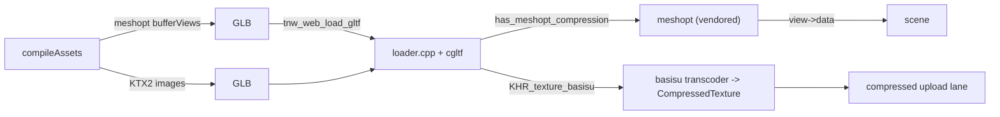

# PRD-861 — The owned engine decodes meshopt and KTX2

**Status:** NOT STARTED
**Priority:** P1 — every cook for the default engine ships its geometry and its textures uncompressed, which is why cooked Midway is 166.2 MB instead of tens of MB ([PRD-860](PRD-860-the-first-scene-plays-before-the-game-finishes-downloading.md) records the measurement).
**Complexity:** 6 (MEDIUM-HIGH) — 5 implementation files (+2): the bake gate, the engine's glTF loader, its CMake wiring, a TypeScript unit test and a conformance case, across the TypeScript packages and the C++ engine build (+2); one new vendored transcoder (+2).
**Owner:** João (owner); an agent executes
**Depends on:** [PRD-860](PRD-860-the-first-scene-plays-before-the-game-finishes-downloading.md) is the consumer whose byte ceiling this unblocks. `EXT_texture_webp` in the same loader is the pattern to follow (`packages/runtime-native/cmake/NativeEngineCore.cmake:239`).

## Context

The owner asked (2026-11-09) why a cook for the owned engine cannot ship compressed assets: "we should make this work with wasm engine, no?" It should. Today it cannot, and the reason is a missing decoder in the engine's glTF loader, not a missing format.

What ships today:

- `webRuntimeDecoders` (`packages/create-threenative/src/web-engine.ts:11`) answers `{ ktx2: false, meshopt: false }` for every game that does not set `engine: "threejs"`. `engine: "threenative"` is the default on web and desktop, so the default cook ships uncompressed geometry and textures and prints the reason itself: `TN_ASSETS_COMPRESSION_SKIPPED model: 29 file(s), 63.2 MB ... texture: 52 file(s), 13.2 MB` on Midway's bake.
- Models on the web build do not go through three's `GLTFLoader`: `packages/create-threenative/src/web-engine.ts:266` rewrites `three/addons/loaders/GLTFLoader.js` to `packages/three-native/src/addons/gltf-loader-web.ts`, which hands the bytes to the engine's own loader in Wasm (`tnw_web_load_gltf`). That loader is `packages/runtime-native/src/engine/assets/gltf/loader.cpp` over cgltf, and it refuses the two extensions by name: `kSupported` (`:107`) omits `KHR_texture_basisu` and `EXT_meshopt_compression`, and `loader.h:11` says why — "needs a decoder this loader does not have (draco, meshopt, basisu, avif)".
- **The meshopt decoder is already in this repository and is never compiled.** `packages/runtime-native/third_party/meshopt/` holds `vertexcodec.cpp`, `indexcodec.cpp`, `vertexfilter.cpp` and `meshoptimizer.h` — the decode-only subset. No CMake file mentions it: `packages/runtime-native/cmake/NativeEngineCore.cmake:230` lists `loader.cpp`, `cgltf_impl.cpp` and `image_decode.cpp` and nothing else.
- cgltf already parses the extension and documents the seam this PRD fills: `cgltf_buffer_view` carries `has_meshopt_compression` and `meshopt_compression`, and its `data` member is "overrides buffer->data if present, filled by extensions" (`packages/runtime-native/third_party/cgltf/cgltf.h:321`, `:322`).
- KTX2 has no transcoder in the tree: `third_party/` has `webp`, `stb`, `cgltf`, `meshopt` and no basisu. Three's `KTX2Loader` and `basis_transcoder.wasm` are bundled for the *JS* texture path (`packages/core/src/assets.ts` `loadCompiledKtx2`), and the browser engine's compressed-upload lane is gated by the conformance case `compressed-texture-preparation` (`packages/runtime-native/conformance/registry.json`), so a `CompressedTexture` reaches the GPU today. The native player's lane refuses it by design: `packages/runtime-native/src/engine/player/core-compressed-texture-preparation.mjs:11` rejects with "WebGPU renderer lacks bounded compressed texture preparation".
- The native cooked-package path is a separate question and stays closed: `targetDecoders()` answers 0 on every target (`packages/runtime-native/src/engine/assets/package.cpp:108`) and `verifyPackage` fails a decoder-backed entry with `TN_NATIVE_KTX2_UNSUPPORTED` / `TN_NATIVE_MESH_COMPRESSION_UNSUPPORTED` (`:114`).

## Solution

Two slices, smallest first. Each flips one half of `webRuntimeDecoders` and proves it on a cooked web game running the owned engine.

1. **Meshopt, because the decoder is already here.** Compile the vendored decoder into `tn_engine_gltf`, decode every bufferView that carries the extension into a retained buffer, and point `cgltf_buffer_view::data` at it before anything reads the view. Then `webRuntimeDecoders` answers `{ ktx2: false, meshopt: true }` for a web build — the two formats resolve independently, so half the win does not wait for the transcoder.
2. **KTX2, which needs a transcoder.** Vendor the Basis Universal transcoder (decode only), transcode `KHR_texture_basisu` images to the format the target device supports, and hand the result to the compressed-upload lane the conformance case already gates. `webRuntimeDecoders` then answers both true for a web build.

### Conventions

- **The gate is per format and per target, not per renderer.** `engine: "threejs"` was standing in for "this build can decode", which stopped being true when the owned engine became the default. A build says what its loader can decode; `engine` says which renderer draws.
- **A format the loader cannot decode stays refused by name**, never silently loaded uncompressed: `TN_NATIVE_GLTF_EXTENSION_UNSUPPORTED` already does this, and the cook's `TN_ASSETS_COMPRESSION_SKIPPED` names the bytes it withheld.
- **Auto by default.** Once a target decodes the format, the bake emits it with no game-side switch, and a game that wants the uncompiled path keeps `assets.textures: "none"` / the model pass switches.
- **Native stays honest.** The player's package path answers `targetDecoders() == 0` until a decoder is qualified there; a desktop or Android build keeps the uncompressed cook and says so.

### Risks

- ⚠️ Meshopt decoding allocates per bufferView. The decoded bytes must outlive the whole load and be freed with it; a per-view `new` would leak on every model.
- ⚠️ The vendored decoder is the decode-only subset and carries no version pin in a CMake comment today. Pin it the way `webp-source` is pinned, or a future bump silently changes the bitstream.
- ⚠️ KTX2 is a licence decision as much as an engineering one: Basis Universal's transcoder has its own terms, and `third_party/` is reconstructed by `download-deps` rather than patched.
- ⚠️ A cooked model that fails to decode must fail loudly at load, not draw an empty mesh: the LOD plugin's `failClosed` is the precedent.

Thresholds: a cooked web build of a template, run on the owned engine, is the subject; "settles" means `ctx.startup.whenReady()`. The box for each criterion sits with the phase that proves it.

## Integration Ledger

| Capability | Reachable consumer/trigger | Replaces / disposition | Evidence |
|---|---|---|---|
| Meshopt geometry | `compileAssets` model pass → `tn_engine_gltf` loader | `webRuntimeDecoders`'s blanket `false` for the default engine | AC-1, AC-4 |
| KTX2 textures | `compileAssets` texture pass → loader + compressed upload | the JS-only `KTX2Loader` path stays for a standalone `.ktx2` file | AC-5 |
| Native package decoders | `verifyPackage` → `targetDecoders()` | unchanged: still 0 until a target qualifies | AC-6 |

Fill the `file:line` entry points when each phase lands.

## Execution Phases

#### Phase 1: meshopt geometry in the engine's loader

- [ ] AC-1 [local]: the bake for a web game with `engine: "threenative"` emits meshopt geometry and reports no `TN_ASSETS_COMPRESSION_SKIPPED model` line. proof: `pnpm --filter create-threenative exec threenative build` in a cooked template, then read its bake log — Evidence: pending.
- [ ] AC-2 [local]: the engine's glTF loader decodes `EXT_meshopt_compression` and the scene it builds equals the decoded-from-uncompressed one. proof: `pnpm exec vitest run packages/three-native/__tests__/gltf-loader-web.spec.ts` and the corpus test in `packages/runtime-native/tests/native-engine/` — Evidence: pending.
- [ ] AC-3 [local]: a cooked web template runs on the owned engine with meshopt geometry, and `TN_GPU_CLASS`/`adapter.info` name a real adapter. proof: `node packages/playtest/dist/runner/cli.js <template>/playtest/*.playtest.json --browser-recipe webgpu` — Evidence: pending.
- [ ] AC-4 [local]: Midway's cooked bytes drop from 166.2 MB with meshopt alone. proof: the same bake as AC-1 in `~/projects/threenative/sandbox/midway-open-pacific`, manifest totals recorded in PRD-860 — Evidence: pending.

**Status:** NOT STARTED
**Estimate:** about a day, most of it in the C++ build.
**Files:** `packages/runtime-native/cmake/NativeEngineCore.cmake` (compile the vendored decoder into `tn_engine_gltf`, add its include path); `packages/runtime-native/src/engine/assets/gltf/loader.cpp` (`kSupported`, the bufferView decode and the retained allocations); `packages/create-threenative/src/web-engine.ts` (`webRuntimeDecoders` split); `packages/create-threenative/__tests__/` for the gate.
**Implementation:** decode on first use of a view, keep the decoded bytes beside the load, and assign `view->data`. The cook already writes the extension (`packages/assets/src/passes/model.ts:250`), so nothing on the bake side changes except the gate.
**Verification:** the AC-1 to AC-4 commands.

#### Phase 2: KTX2 through the engine's loader

- [ ] AC-5 [local]: a KTX2 image decodes through the engine's loader and draws, and `webRuntimeDecoders` answers `{ ktx2: true, meshopt: true }` for a web build. proof: conformance case `compressed-texture-preparation` plus a KTX2 corpus model — Evidence: pending.
- [ ] AC-6 [local]: the native player's package path still refuses a decoder-backed entry rather than loading it empty. proof: `pnpm exec vitest run packages/create-threenative/__tests__/native-ktx2.spec.ts` — Evidence: pending.

**Status:** NOT STARTED
**Estimate:** 2 to 3 days, the transcoder included.
**Files:** `packages/runtime-native/third_party/` (the pinned transcoder, via `download-deps`), `loader.cpp` (`KHR_texture_basisu`), `web-engine.ts` (the second half of the gate), a conformance case for a KTX2 model.
**Implementation:** transcode to the format the device reports, then reuse the compressed-upload lane the conformance case already exercises. A device with no supported format keeps the uncompressed cook, named, not silent.
**Verification:** the AC-5 and AC-6 commands, plus `pnpm native:build` for the desktop frame.

## Blocked on

- Vendoring the Basis Universal transcoder: it is a licence decision for the owner, and `third_party/` is rebuilt by `download-deps`, so the pin has to live there.
- A playtest lane that can settle a cooked game on a real adapter: this machine's private Xvfb falls back to SwiftShader, where an owned-engine startup does not settle inside the runner's window (recorded in PRD-860).

## Decisions

- 2026-11-09: meshopt is sliced ahead of KTX2 because its decoder is already vendored and unused, so half the byte win costs no new third-party code. KTX2 waits for the transcoder decision above.
- 2026-11-09: the bake gate becomes per format and per target. `engine === "threejs"` is not a decoder capability and stops standing in for one.
