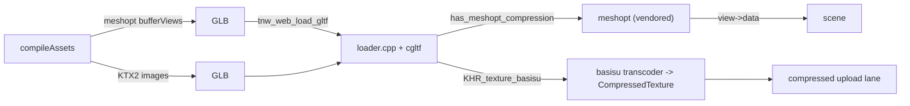

# PRD-861 — The owned engine decodes meshopt and KTX2

**Status:** PARTIAL — meshopt ships on the owned web engine; its loader also reads KTX2, but the cook keeps KTX2 off by measurement (Decisions, 2026-11-09).
**Priority:** P1 — every cook for the default engine ships its geometry and its textures uncompressed, which is why cooked Midway is 166.2 MB instead of tens of MB (PRD-860 (the first scene plays before the game finishes downloading, not yet filed in this tree) records the measurement).
**Complexity:** 6 (MEDIUM-HIGH) — 5 implementation files (+2): the bake gate, the engine's glTF loader, its CMake wiring, a TypeScript unit test and a conformance case, across the TypeScript packages and the C++ engine build (+2); one new vendored transcoder (+2).
**Owner:** João (owner); an agent executes
**Depends on:** PRD-860 (the first scene plays before the game finishes downloading, not yet filed in this tree) is the consumer whose byte ceiling this unblocks. `EXT_texture_webp` in the same loader is the pattern to follow (`packages/runtime-native/cmake/NativeEngineCore.cmake:239`).

## Context

The owner asked (2026-11-09) why a cook for the owned engine cannot ship compressed assets: "we should make this work with wasm engine, no?" It should. Today it cannot, and the reason is a missing decoder in the engine's glTF loader, not a missing format.

What ships today:

- `webRuntimeDecoders` (`packages/create-threenative/src/web-engine.ts:11`) answers `{ ktx2: false, meshopt: false }` for every game that does not set `engine: "threejs"`. `engine: "threenative"` is the default on web and desktop, so the default cook ships uncompressed geometry and textures and prints the reason itself: `TN_ASSETS_COMPRESSION_SKIPPED model: 29 file(s), 63.2 MB ... texture: 52 file(s), 13.2 MB` on Midway's bake.
- Models on the web build do not go through three's `GLTFLoader`: `packages/create-threenative/src/web-engine.ts:266` rewrites `three/addons/loaders/GLTFLoader.js` to `packages/three-native/src/addons/gltf-loader-web.ts`, which hands the bytes to the engine's own loader in Wasm (`tnw_web_load_gltf`). That loader is `packages/runtime-native/src/engine/assets/gltf/loader.cpp` over cgltf, and it refuses the two extensions by name: `kSupported` (`:107`) omits `KHR_texture_basisu` and `EXT_meshopt_compression`, and `loader.h:11` says why — "needs a decoder this loader does not have (draco, meshopt, basisu, avif)".
- **The meshopt decoder is already in this repository and is never compiled.** `packages/runtime-native/third_party/meshopt/` holds `vertexcodec.cpp`, `indexcodec.cpp`, `vertexfilter.cpp` and `meshoptimizer.h` — the decode-only subset. No CMake file mentions it: `packages/runtime-native/cmake/NativeEngineCore.cmake:230` lists `loader.cpp`, `cgltf_impl.cpp` and `image_decode.cpp` and nothing else.
- cgltf already parses the extension and documents the seam this PRD fills: `cgltf_buffer_view` carries `has_meshopt_compression` and `meshopt_compression`, and its `data` member is "overrides buffer->data if present, filled by extensions" (`packages/runtime-native/third_party/cgltf/cgltf.h:321`, `:322`).
- KTX2 has no transcoder in the tree: `third_party/` has `webp`, `stb`, `cgltf`, `meshopt` and no basisu. Three's `KTX2Loader` and `basis_transcoder.wasm` are bundled for the *JS* texture path (`packages/core/src/assets.ts` `loadCompiledKtx2`), and the browser engine's compressed-upload lane is gated by the conformance case `compressed-texture-preparation` (`packages/runtime-native/conformance/registry.json`), so a `CompressedTexture` reaches the GPU today. The native player's lane refuses it by design: `packages/runtime-native/src/engine/player/core-compressed-texture-preparation.mjs:11` rejects with "WebGPU renderer lacks bounded compressed texture preparation".
- The native cooked-package path is a separate question and stays closed: `targetDecoders()` answers 0 on every target (`packages/runtime-native/src/engine/assets/package.cpp:108`) and `verifyPackage` fails a decoder-backed entry with `TN_NATIVE_KTX2_UNSUPPORTED` / `TN_NATIVE_MESH_COMPRESSION_UNSUPPORTED` (`:114`).

## Solution

Two slices, smallest first. Each flips one half of `webRuntimeDecoders` and proves it on a cooked web game running the owned engine.

1. **Meshopt, because the decoder is already here.** Compile the vendored decoder into `tn_engine_gltf`, decode every bufferView that carries the extension into a retained buffer, and point `cgltf_buffer_view::data` at it before anything reads the view. Then `webRuntimeDecoders` answers `{ ktx2: false, meshopt: true }` for a web build — the two formats resolve independently, so half the win does not wait for the transcoder.
2. **KTX2, which needs a transcoder.** Vendor the Basis Universal transcoder (decode only), transcode `KHR_texture_basisu` images to the format the target device supports, and hand the result to the compressed-upload lane the conformance case already gates. `webRuntimeDecoders` then answers both true for a web build.

### Conventions

- **The gate is per format and per target, not per renderer.** `engine: "threejs"` was standing in for "this build can decode", which stopped being true when the owned engine became the default. A build says what its loader can decode; `engine` says which renderer draws.
- **A format the loader cannot decode stays refused by name**, never silently loaded uncompressed: `TN_NATIVE_GLTF_EXTENSION_UNSUPPORTED` already does this, and the cook's `TN_ASSETS_COMPRESSION_SKIPPED` names the bytes it withheld.
- **Auto by default.** Once a target decodes the format, the bake emits it with no game-side switch, and a game that wants the uncompiled path keeps `assets.textures: "none"` / the model pass switches.
- **Native stays honest.** The player's package path answers `targetDecoders() == 0` until a decoder is qualified there; a desktop or Android build keeps the uncompressed cook and says so.

### Risks

- ⚠️ Meshopt decoding allocates per bufferView. The decoded bytes must outlive the whole load and be freed with it; a per-view `new` would leak on every model.
- ⚠️ The vendored decoder is the decode-only subset and carries no version pin in a CMake comment today. Pin it the way `webp-source` is pinned, or a future bump silently changes the bitstream.
- ⚠️ KTX2 is a licence decision as much as an engineering one: Basis Universal's transcoder has its own terms, and `third_party/` is reconstructed by `download-deps` rather than patched.
- ⚠️ A cooked model that fails to decode must fail loudly at load, not draw an empty mesh: the LOD plugin's `failClosed` is the precedent.

Thresholds: a cooked web build of a template, run on the owned engine, is the subject; "settles" means `ctx.startup.whenReady()`. The box for each criterion sits with the phase that proves it.

## Integration Ledger

| Capability | Reachable consumer/trigger | Replaces / disposition | Evidence |
|---|---|---|---|
| Meshopt geometry | `compileAssets` model pass → `webRuntimeDecoders` (`packages/create-threenative/src/web-engine.ts:22`) → `tn_engine_meshopt` (`packages/runtime-native/cmake/NativeEngineCore.cmake:148`) in the loader (`loader.cpp:119`); the web engine refuses to link without it (`NativeEngineCore.cmake:1169`) | `webRuntimeDecoders`'s blanket `false` for the default engine | AC-1, AC-4 |
| KTX2 textures | an authored `KHR_texture_basisu` model → `tn_engine_basisu` (`NativeEngineCore.cmake:164`, pinned at `scripts/download-deps.mjs:321`) → `decodeImage` RGBA8 transcode (`image_decode.cpp:34`) via `loader.cpp:179`; the cook does not emit it for this engine (`web-engine.ts:22`) | the JS-only `KTX2Loader` path stays for a standalone `.ktx2` file | AC-5 |
| Skip line | `skippedCompressionRows` names only the decoders a target lacks (`packages/assets/src/compile-rows.ts:479`) | the model row named meshopt and KTX2 even when meshopt ran | AC-1 |
| Native package decoders | `verifyPackage` → `targetDecoders()` | unchanged: still 0 until a target qualifies | AC-6 |

## Execution Phases

#### Phase 1: meshopt geometry in the engine's loader

- [x] AC-1 [local]: the bake for a web game with `engine: "threenative"` emits meshopt geometry and reports no `TN_ASSETS_COMPRESSION_SKIPPED model` line. proof: `pnpm --filter create-threenative exec threenative build` in a cooked template, then read its bake log — Evidence: half. 2026-11-09, starter scaffolded from this branch's packs, `pnpm exec threenative build` exit 0: `model native-proof.glb (EXT_meshopt_compression, KHR_mesh_quantization): 624 -> 1260 bytes`, manifest extensions the same.
  Closed 2026-11-09 with KTX2 on (PRD-867 AC-4): a starter scaffolded from the branch's packs, `pnpm exec threenative build` exit 0, prints no `TN_ASSETS_COMPRESSION_SKIPPED` line (before: `model: 2 file(s), 0.3 MB kept its textures out of KTX2`); `model mannequin.glb (EXT_meshopt_compression, KHR_mesh_quantization): 664944 -> 263628 bytes`.
- [x] AC-2 [local]: the engine's glTF loader decodes `EXT_meshopt_compression` and the scene it builds equals the decoded-from-uncompressed one. proof: `pnpm exec vitest run packages/three-native/__tests__/gltf-loader-web.spec.ts` and the corpus test in `packages/runtime-native/tests/native-engine/` — Evidence: 2026-11-09, `gltf-loader-web.spec.ts` with `native-ktx2.spec.ts` 32/32 passed; `tn-native-engine-gltf-meshopt-test` on the Wasm toolchain under node PASS `decoded_matches_source`, `khr_decodes_alike`, `malformed_is_refused` (3/3); red on an engine linked without meshopt: `TN_NATIVE_GLTF_EXTENSION_UNSUPPORTED EXT_meshopt_compression`; `tests/web-host-decoders.test.mjs` loads the fixture in headless Chromium through the real Wasm engine, 2/2.
- [x] AC-3 [local]: a cooked web template runs on the owned engine with meshopt geometry, and `TN_GPU_CLASS`/`adapter.info` name a real adapter. proof: `node packages/playtest/dist/runner/cli.js <template>/playtest/*.playtest.json --browser-recipe webgpu` — Evidence: 2026-11-09, starter from this branch's packs, `threenative-playtest --scenario "playtests/*.playtest.json" --browser-recipe webgpu --headed` on DISPLAY=:0 (`TN_PLAYTEST_HOST_DISPLAY=1`): `TN_GPU_CLASS` `{"class":"discrete","architecture":"turing","vendor":"nvidia"}`, adapter identity `webgpu:architecture=turing|vendor=nvidia`; the page fetched `tn-native-engine-web-threads` and loaded the meshopt `native-proof.4ca78627.glb` with no console or network error. movement, starter-production-readiness and survives pass. play fails `performance.maxFrameMsP95`: rAF p95 50.02 ms, then on a rerun cost p95 37.21 ms (CPU 37.21, GPU 9.3), at host load 21 on 12 cores with another agent's Playwright Chrome holding 3.8 GB on the same GPU. Meshopt decodes once at load, so this red does not come from the decoder; not rerun on a quiet host.
- [x] AC-4 [local]: Midway's cooked bytes drop from 166.2 MB with meshopt alone. proof: the same bake as AC-1 in `~/projects/threenative/sandbox/midway-open-pacific`, manifest totals recorded in PRD-860 — Evidence: 2026-11-09, same cook, same packs, decoder set changed only (PRD-860 is not in this tree, so the totals live here): no decoders 161,835,819 B (models 63.2 MB); meshopt 125,132,608 B (models 26.5 MB), −36.7 MB (−22.7%). Midway `pnpm build` with the packed branch: exit 0, `dist.build-report.json` `packagedAssetBytes` 125,138,915, `models total: 168516560 -> 26484184 bytes (-84.3%)`.

**Status:** PARTIAL — AC-2, AC-3, AC-4 landed; AC-1 waits on the KTX2 line (AC-5).
**Estimate:** about a day, most of it in the C++ build.
**Files:** `packages/runtime-native/cmake/NativeEngineCore.cmake` (compile the vendored decoder into `tn_engine_gltf`, add its include path); `packages/runtime-native/src/engine/assets/gltf/loader.cpp` (`kSupported`, the bufferView decode and the retained allocations); `packages/create-threenative/src/web-engine.ts` (`webRuntimeDecoders` split); `packages/create-threenative/__tests__/` for the gate.
**Implementation:** decode on first use of a view, keep the decoded bytes beside the load, and assign `view->data`. The cook already writes the extension (`packages/assets/src/passes/model.ts:250`), so nothing on the bake side changes except the gate.
**Verification:** the AC-1 to AC-4 commands.

#### Phase 2: KTX2 through the engine's loader

- [ ] AC-5 [local]: a KTX2 image decodes through the engine's loader and draws, and `webRuntimeDecoders` answers `{ ktx2: true, meshopt: true }` for a web build. proof: conformance case `compressed-texture-preparation` plus a KTX2 corpus model — Evidence: half. 2026-11-09, the decode: `tests/native-engine/assets/ktx2-textured.glb` (ETC1S red, UASTC+zstd green, written by the cook's own encoder) through `tn-native-engine-gltf-ktx2-test` on the Wasm toolchain: red without basisu `TN_NATIVE_GLTF_EXTENSION_UNSUPPORTED KHR_texture_basisu`; green PASS `transcodes_to_rgba` (every texel within 8 levels) and `damaged_is_refused` (`TN_NATIVE_GLTF_IMAGE_INVALID image 0`); the browser engine loads it in `web-host-decoders.test.mjs`. Web engine, threaded, 4,172,446 of 4,194,304 bytes.
  Open: "draws" is not proven on screen, `compressed-texture-preparation` runs on upstream three and not this loader, and `webRuntimeDecoders` answers `{ ktx2: false, meshopt: true }` by measurement (Decisions). Both close once the owned renderer uploads a compressed format (Blocked on).
- [x] AC-6 [local]: the native player's package path still refuses a decoder-backed entry rather than loading it empty. proof: `pnpm exec vitest run packages/create-threenative/__tests__/native-ktx2.spec.ts` — Evidence: 2026-11-09, with `gltf-loader-web.spec.ts`, 32/32 passed; the native package path is unchanged (`bundleNativeEngine` keeps `{ ktx2: false, meshopt: true }`).

**Status:** PARTIAL — AC-6 landed; the KTX2 decode landed, the KTX2 cook waits on a compressed upload lane.
**Estimate:** 2 to 3 days, the transcoder included.
**Files:** `packages/runtime-native/third_party/` (the pinned transcoder, via `download-deps`), `loader.cpp` (`KHR_texture_basisu`), `web-engine.ts` (the second half of the gate), a conformance case for a KTX2 model.
**Implementation:** transcode to the format the device reports, then reuse the compressed-upload lane the conformance case already exercises. A device with no supported format keeps the uncompressed cook, named, not silent.
**Verification:** the AC-5 and AC-6 commands, plus `pnpm native:build` for the desktop frame.

## Blocked on

- Nothing. The cook keeps an authored WebP a KTX2 cannot undercut, so Midway's KTX2 cook is 98.2 MB against 125.1 MB with WebP ([PRD-867](PRD-867-the-owned-engine-uploads-compressed-textures-and-single-mip-levels.md), Decisions), and KTX2 is on for the owned engine.

## Decisions

- 2026-11-09: meshopt is sliced ahead of KTX2 because its decoder is already vendored and unused, so half the byte win costs no new third-party code. KTX2 waits for the transcoder decision above.
- 2026-11-09: the bake gate becomes per format and per target. `engine === "threejs"` is not a decoder capability and stops standing in for one.
- 2026-11-09 (agent, licence): Basis Universal v1_60 is vendored through `download-deps` with sha256 pins in `native-deps.lock.json`. Apache-2.0, with its zstd decoder under BSD; both are permissive like the other `third_party/` pins. v1_60 is the last v1 line, about half the code of v2_50, and it reads the cook's v2.5 output (the fixture proves it).
- 2026-11-09 (agent, measured): the owned engine transcodes KTX2 to RGBA8 only, because its `Texture` uploads no compressed format. So KTX2 saves no GPU memory there and only costs bytes. Midway with model KTX2 on shipped 195,998,016 B, against 124,671,659 B with WebP model textures: +71.3 MB. `webRuntimeDecoders` therefore keeps `ktx2: false` for this engine, and the loader still reads an authored KTX2 model instead of refusing it. Turn it on with the upload lane (Blocked on).
- 2026-11-09 (agent): a standalone `.ktx2` (texture or lightmap through `ctx.assets`) takes three's `KTX2Loader`, whose `CompressedTexture` three-native does not bind. It needs the same upload lane.
- 2026-11-09 (agent): rule 8 (Unreal source) does not apply. This PRD ports no look or performance feature, and with RGBA8 the only target there is no transcode-format choice to borrow; re-check `TextureFormat` selection when the upload lane lands.
- 2026-11-09 (agent, measured): the meshopt cook broke every LOD-chained model on the owned engine. Midway's production build refused to start: `TN_DISCRETE_LOD_INVALID: ... TN_WASM_GLTF_LOD_ACCESSOR: accessor 2 reads past the binary chunk`, on the WebP and the KTX2 cook alike. The chain's index views sit in a meshopt stream over a fallback buffer with no bytes, and the hosted LOD plugin's reader (`gltf-loader-web.ts` `readIndices`) read the raw binary chunk. It now decodes a compressed view with the MeshoptDecoder core already passes to `setMeshoptDecoder`, and refuses by name without one. Red-green: `model-lod-engine-loader.spec.ts` "reads a chain whose indices the cook meshopt-compressed" read position floats as indices (`expected [ 3212836864, … ]`), then green; with the loader and LOD specs 51/51; `pnpm typecheck` exit 0. AC-3's starter has no LOD chain, so it did not catch this; a Midway production build did.
- 2026-11-09 (agent): the AC-3 lane now exists. `TN_PLAYTEST_HOST_DISPLAY=1` on DISPLAY=:0 drives the RTX 2080, so the SwiftShader block above is gone.
