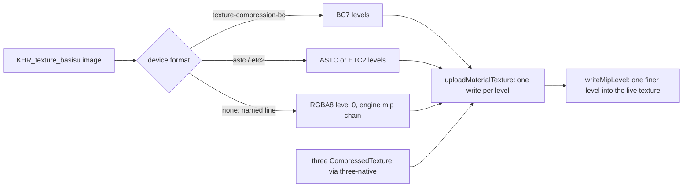

# PRD-867 — The owned engine uploads compressed textures and single mip levels

**Status:** NOT STARTED
**Priority:** P1 — the owned engine (the default on web and desktop) holds every texture as RGBA8, so a KTX2 costs bytes and saves no GPU memory; [PRD-861](PRD-861-the-owned-engine-decodes-meshopt-and-ktx2.md) keeps KTX2 out of its cook for that reason (AC-1, AC-5 open), and PRD-860's texture streaming (its AC-5) needs one mip level uploaded into a texture that already exists.
**Complexity:** 7 (HIGH) — 5 implementation files (+2): the engine `Texture`, the material upload, the glTF image decode, the three-native texture bridge and the bake gate (+2); a new GPU upload format family with block layouts (+2); the change crosses the C++ engine and the TypeScript packages (+1).
**Owner:** João (owner); an agent executes
**Depends on:** PRD-861 (branch `prd-861-decoders`, PR #650): the Basis Universal transcoder and the `KHR_texture_basisu` loader path. This PRD stacks on it.

## Context

The owned engine's `Texture` (`packages/runtime-native/src/engine/scene/texture.h:141`) stores RGBA bytes only. `Renderer::uploadMaterialTexture` (`src/engine/renderer/renderer_material.cpp:303`) writes level 0 and builds the mip chain itself. Both devices already ask for `texture-compression-bc`, `-etc2` and `-astc` when the adapter has them (`src/engine/wasm/web_host.cpp:233`, `src/webgpu/context.cpp:509`), but nothing uploads a compressed format. PRD-861 measured the cost: Midway with model KTX2 transcoded to RGBA8 shipped 71.3 MB more than with WebP.

## Solution

Follow three's own shape. A compressed texture is a `CompressedTexture`: `format` names the block format (`RGBA_BPTC_Format` = BC7, `RGBA_ASTC_4x4_Format`, `RGBA_ETC2_EAC_Format`) and `mipmaps` holds one `{ data, width, height }` per level. The engine `Texture` gains `mipmaps` and these `format` values. The renderer creates the GPU texture in the matching `WGPUTextureFormat` (sRGB from `colorSpace`) and writes each level with block rows. The glTF loader asks the device once which block format it samples, and Basis transcodes every KTX2 level to that format. A device with none keeps RGBA8, and the loader says so in one `TN_TEXTURE_TRANSCODE_TARGET` line.

### Conventions

- Auto by default: the engine measures the device and picks the format; no game option.
- Named override: `TN_TEXTURE_TRANSCODE=rgba8` keeps RGBA8 for a comparison run, and the line reports it.
- A size that is not a multiple of 4 cannot be a BC base level on WebGPU; it keeps RGBA8, named in the same line.

### Risks

- Wasm size: the web engine has 21.9 KB of its 4,194,304-byte budget left after PRD-861. The BC7 transcoder tables may not fit; raising the budget needs its own commit and reason.
- Disk bytes: KTX2 on disk was larger than WebP for Midway (115.1 MB against 71.3 MB of shared images). The GPU win is real; the download may not be.

## Integration Ledger

| Capability | Reachable consumer/trigger | Replaces / disposition | Evidence |
|---|---|---|---|
| Compressed material texture | a `Texture` with a block `format` and `mipmaps` → `uploadMaterialTexture` | RGBA8-only upload; RGBA8 stays for the no-format device | AC-1, AC-2 |
| Device-format transcode | `decodeImage` KTX2 → the device's block format | PRD-861's RGBA8-only transcode | AC-2, AC-3 |
| KTX2 in the owned web cook | `webRuntimeDecoders` → model KTX2 | PRD-861's `ktx2: false` | AC-4, AC-5 |
| CompressedTexture and one mip level | three-native texture bridge → engine `Texture.mipmaps`; `writeMipLevel` | standalone `.ktx2` on `engine: "threejs"` only | AC-6, AC-7 |

Fill the `file:line` entry points when each phase lands.

## Execution Phases

#### Phase 1: the engine uploads a compressed texture

- [ ] AC-1 [local]: a `Texture` with `RGBA_BPTC_Format` and its `mipmaps` uploads as `BC7RGBAUnorm` (or `BC7RGBAUnormSrgb`) with one write per level, and a device without `texture-compression-bc` refuses it by name. proof: a C++ test in `packages/runtime-native/tests/native-engine/` on the desktop Dawn device — Evidence: pending.
- [ ] AC-2 [local]: the glTF loader transcodes a KTX2 image to BC7 on a device with `texture-compression-bc`, to RGBA8 on one without, and prints `TN_TEXTURE_TRANSCODE_TARGET` naming the choice. proof: `ktx2_decode_test.cpp` for both targets, and `tests/web-host-decoders.test.mjs` on the real Wasm engine — Evidence: pending.
- [ ] AC-3 [local]: the web engine stays within its size budget, or the budget rises in its own commit with the measured reason. proof: `pnpm exec vitest run packages/runtime-native/__tests__/wasm-size-budget.spec.ts` — Evidence: pending.

**Status:** NOT STARTED
**Estimate:** about a day.
**Files:** `src/engine/scene/texture.h`, `src/engine/renderer/renderer_material.cpp`, `renderer_internal.h` (`textureFormat`), `src/engine/assets/gltf/image_decode.cpp`, `cmake/NativeEngineCore.cmake` (BC7 on in the transcoder).
**Verification:** the AC-1 to AC-3 commands, plus `pnpm native:build`.

#### Phase 2: KTX2 on in the owned web cook

- [ ] AC-4 [local]: `webRuntimeDecoders` answers `{ ktx2: true, meshopt: true }` for the owned engine, and a cooked template bakes model KTX2 with no `TN_ASSETS_COMPRESSION_SKIPPED model` line (PRD-861 AC-1). proof: `pnpm exec vitest run packages/create-threenative/__tests__/web-engine.spec.ts` and the starter bake log — Evidence: pending.
- [ ] AC-5 [local]: a KTX2 model draws on the owned engine on a real adapter, judged by a fresh read-only visual judge (headed `--browser-recipe webgpu`, `adapter.info` checked, two runs per arm, KTX2 against WebP), and Midway's cooked bytes are not above the WebP cook (124,671,659 B, PRD-861). proof: the judge's verdict and the Midway bake totals — Evidence: pending.

**Status:** NOT STARTED
**Estimate:** half a day, most of it captures.
**Files:** `packages/create-threenative/src/web-engine.ts` and its spec; PRD-861 moves to `docs/PRDs/done/` in the commit that closes its AC-1 and AC-5.
**Verification:** the AC-4 and AC-5 commands.

#### Phase 3: three's CompressedTexture and one mip level

- [ ] AC-6 [local]: a three `CompressedTexture` (format and `mipmaps`) built on the owned facade draws through the engine, and `KTX2Loader.detectSupport` answers from the engine's device features. proof: `pnpm exec vitest run packages/three-native/__tests__/` for the bridge and one browser load in `tests/web-host-decoders.test.mjs` — Evidence: pending.
- [ ] AC-7 [local]: one finer mip level uploads into a texture that already exists, without re-creating it or rewriting the other levels. proof: a C++ test of `writeMipLevel` and one browser load — Evidence: pending.

**Status:** NOT STARTED
**Estimate:** about a day.
**Files:** the three-native texture bridge, `renderer_material.cpp`, the web host bindings.
**Verification:** the AC-6 and AC-7 commands.

## Blocked on

- Nothing yet.

## Decisions

- 2026-11-09 (lead): KTX2 stays off in the owned web cook until this PRD's Phase 1 lands (PRD-861 report accepted).
- 2026-11-09 (agent): BC7 first. Desktop Chrome, Dawn on Vulkan and the RTX 2080 lane all expose `texture-compression-bc`. ASTC and ETC2 follow only if the transcoder tables fit the Wasm budget; otherwise they are deferred here by name.
- 2026-11-09 (agent): the number PRD-862 is taken (`refactoring/untangle-2026-11-06/PRD-862-untangle-native-leftovers.md`), and so are 863 to 866, so this plan is PRD-867.
