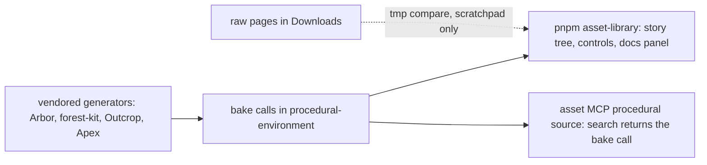

# PRD-900 — Every procedural asset is browsable, absorbed whole and found by the asset MCP

**Status:** PARTIAL — Phase 1 in progress
**Priority:** P2 — no viewer shows what `@threenative/procedural-environment` bakes, the Apex city kit is not absorbed at all, and the asset MCP does not return any procedural asset.
**Complexity:** 5 (MEDIUM) — one new dev viewer, one new vendored generator (75 modules), one cross-repo MCP source.
**Owner:** João
**Depends on:** none. It builds on [PRD-889](../done/PRD-889-the-forest-floor-bakes-and-scatters-from-one-nature-package.md) and PRD-892 (Outcrop as `bakeRock`, rename to `procedural-environment`).

## Context

Owner, 2026-11-17: "we should create a 'project' that's essentially a asset library visualizer ... should behave like storybook ... everything available on the procedural environment package", "should open with a pnpm asset-library command", "I dont think it was implemented properly, please put side by side and compare, also check if all were absorbed. the comparison checker should be a tmp project only", "this new one should be absorbed 100% apex-city-kit.html", "hook this properly with threenative assets mcp for discoverability".

Raw material: `~/Downloads/PROCEDURAL ENVIRONMENT/` — `arbor.js`, `GrassSystem.js`, `forest-kit-source.zip`, `Outcrop Rock Generator.html`, `apex-city-kit.html`.

**Absorption audit (2026-11-17, read at `39c3a6e5e`):**

| Source | State | Evidence |
| --- | --- | --- |
| `arbor.js` 1.0.0 (28 trees, 27 cover) | ✅ absorbed. The core is the same, and only `Arbor.three` and `encodePNG` are cut | `diff` of raw against `vendor/arbor.js` |
| `arbor.js`: `saguaro` | ❌ → ✅ the bake threw in `leafTexture` on a leafless preset | fixed in this PRD's first commit, spec "bakes every preset" red, then green |
| Outcrop look (`createRockMaterial`, `createRockTextures`) | ❌ → ✅ the bake kept only COLOR_0, so a rock read as a painted blob. The GLB now keeps `_ROCK`, `_COVER` and `_WET`, the bake writes the two maps, and the library shades with Outcrop's own material | owner side by side, desert arch seed 3 detail 0.5, 23,714 triangles on both sides |
| Baked PNG maps | ❌ → ✅ a canvas round trip premultiplied alpha (Outcrop normal map error up to 253) | `src/png.ts`, spec red then green |
| forest-kit `rock` | ❌ → ✅ a local icosphere gave 320 triangles against the zip's 180 | `debris.js` is now the zip's file, spec red then green |
| **Identity, in code** | ✅ 129/129 identical: 54 Outcrop form × biome geometries (6 attributes each), 8 Outcrop maps, 55 Arbor presets, 12 forest-kit presets | temporary harness, table at `~/Downloads/asset-library/identity-raw-vs-baked.tsv` |
| `GrassSystem.js` | ✅ mechanism in `GrassField3D` (core), look in the adventure kit `src/render/grass.ts` | PRD-883 |
| forest-kit `debris.js`, `grassClump` gaps (`reeds`, `tussock`, `seedgrass`, `clover`, `dock`, `plume`) | ✅ vendored copies are the same, apart from import paths and the three-free icosphere | `diff -u` |
| forest-kit `fern`, `flowerCluster`/`flowerSpike` (BLOOMS), `herb`, `broadleaf`, `grassClump`/`grassLods` | ⚠️ not vendored. PRD-889 counts Arbor's `bracken`, `daisy` and `meadowgrass` as cover for them, and Phase 1 compares them side by side | Phase 1 |
| forest-kit `trees.js` (`birch`, `broadleaf`, `pole`, `shrub`, `snag`) | ⚠️ not vendored. PRD-889 does not mention it. Arbor has no standing dead tree (`snag`) | Phase 1 |
| forest-kit `foliage.js`, `forestBiome.js`, `Sky`, `SunRig`, `Water`, `BiomeMap`, `Terrain`, `textures/*` | out by decision (PRD-889): they decide the look, or core and terrain own them | PRD-889 Decisions |
| Outcrop (9 forms, 6 biomes) | ✅ `bakeRock`. The generator body is the same | `diff` of the page's first script against `vendor/outcrop.js` |
| Outcrop page controls (size, 8 traits, 8 surface sliders, tile) | ⚠️ → ✅ the bake took size, traits and surface, the library showed none of them; `tile()` modules were not bakeable. `module: n` now bakes cliff module n (seam: 109/109 edge vertices shared), and the library renders every option as a control | `__tests__/scans.spec.ts` cliff module spec |
| Outcrop `scatter()` (debris ring) | out by decision: it places instanced copies of small forms, and placement is the game's (core scatter); each variant bakes as a sized `boulder` or `slab` | Decisions |
| `apex-city-kit.html` (75 modules, 11 categories) | ❌ not absorbed | Phase 2 |

## Solution

1. **`pnpm asset-library`** opens a Storybook-shaped viewer: a sidebar tree by kind (trees, cover, debris, rocks, city categories) with search, one story per element, controls (seed, LOD, biome for rocks, wind on or off), and a docs panel (name, latin name, biomes, triangles, bounds, the paste-ready bake call). It lists `environmentElements()` and bakes on demand through the package's own bake calls, so the viewer cannot show something the package does not ship. It lives in `packages/procedural-environment/library/` as a dev-only Vite page. It is not in `files`, so the package does not ship it.
2. **Side-by-side check (temporary, scratchpad only):** each raw generator next to our baked GLB, at the same seed and pose, plus the list of raw generators that have no row. Its results go in the audit table above. The project is deleted afterwards.
3. **Apex city kit:** vendor the generator, bake each of the 75 modules to a GLB (`bakeCity` or presets of a new kind), keep its textures and the seed determinism, and list them in `environmentElements`.
4. **Asset MCP:** a `procedural` source in `threenative-asset-mcp`, so `asset_search_sources` and `asset_search` return the element and its bake call, next to Poly Haven scans.

## Execution Phases

#### Phase 1: the library and the audit
- [x] `pnpm asset-library` opens the viewer, and every element of `environmentElements()` has a story that bakes and draws. proof: headed Chrome walk over every story — 76/76 bake and draw, 0 errors (`d87b9697f`)
- [x] The side-by-side check runs for every raw generator, and the audit table records each verdict. proof: identity harness 129/129 identical (Outcrop, Arbor, forest-kit); the owner's desert arch pair in the page and the library
- [x] Each gap the comparison rates as a real loss is absorbed, or recorded as a decision with its reason. proof: saguaro, the Outcrop look, PNG alpha and the forest-kit stone fixed with red-green specs (`e6601454b`, `c6a4e04d6`, `52a01340d`); forest-kit's `fern`, `flowerCluster`, `herb`, `broadleaf`, `grassClump` and `trees.js` stay out by PRD-889's decision
- [ ] Textures that are generated and weak, or absent, use a Poly Haven CC0 scan by default, with `textures: "generated"` as the override that keeps the raw generator's bytes. Embedded textures are WebP. proof: package spec, identity harness rerun with the override, visual judge on before and after

#### Phase 2: the Apex city kit
- [ ] All 75 Apex modules bake to deterministic GLBs, and each has its textures. proof: package spec (same bytes twice, one GLB per module)
- [ ] The city categories show in the library next to Apex's own page, side by side. proof: contact sheet and visual judge

#### Phase 3: the asset MCP finds it
- [ ] `asset_search` for "oak tree", "mossy boulder" and "traffic light" returns the procedural element with its bake call. proof: asset MCP spec
- [ ] The engine pins the asset MCP release that carries the source. proof: `packages/core/package.json` and `pnpm exec vitest run packages/engine-mcp/__tests__`

## Blocked on

- Package name: keep `procedural-environment` or rename to `procedural-assets` before 0.3.16 publishes. Waits for the owner.

## Decisions

- 2026-11-18 (agent): Poly Haven scans are vendored as 512 px WebP in `scans/` (3.9 MB, 14 scans), not fetched at bake time, so a bake stays offline and deterministic. Profiles with no fitting scan (birch, aspen, bamboo, banana, cactus, stems, shrub twigs, cover, leaf litter, Arbor leaf cards) keep the generated texture. Outcrop's rocks keep Outcrop's own maps, because the owner asked for the page's look.
- 2026-11-18 (agent): Outcrop `scatter()` is not a bake: it is instanced placement, which the game owns.
- 2026-11-17 (agent): the viewer is a dev-only page inside the package, not an `examples/` game. It shows bake output, and a game would add a renderer and a look that hide what the bake writes.
