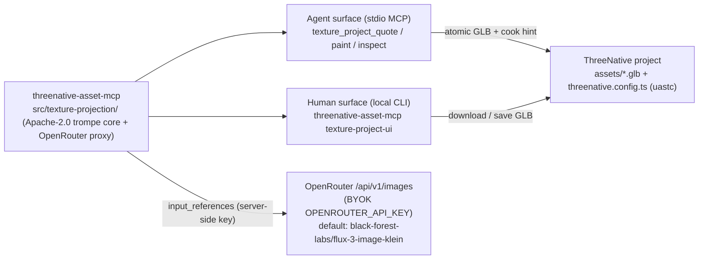

# PRD-916 — Multi-view texture projection through the asset MCP (FLUX 3 Klein + OpenRouter)

**Status:** IN PROGRESS
**Priority:** P2 — Open: wire a clean Apache-2.0 adaptation of `Patch-gg/trompe` (defaulting to OpenRouter FLUX 3 Klein, with Muse Image and local Web UI) for multi-view texture projection into `threenative-asset-mcp` and scaffolded ThreeNative projects.
**Complexity:** 9 (HIGH) — 6–10 implementation files across `threenative-asset-mcp` and `threenative-engine` (+2), new projection/UI subsystem (+2), Playwright Chromium + resumable per-view state (+2), crosses the external `threenative-asset-mcp` npm release boundary (+2), external OpenRouter `/api/v1/images` API integration (+1); risk override: BYOK secret handling (`OPENROUTER_API_KEY` must never reach browser JS, logs, or persisted receipts).
**Owner:** João
**Depends on:** None. Follows the external-server integration pattern established by [PRD-372](PRD-372-anycreature-through-the-asset-mcp.md).

## Context

Agents and humans texturing gray blockout levels and environments from GLBs currently rely on a personal skill (`~/.agents/skills/ai-level-texture/`) that clones `Patch-gg/trompe` (`ba9ef76687f57eef157057c7592d26e59c805992`, Apache-2.0) into `~/.cache/ai-level-texture/trompe` and runs `git apply` with a 138-line OpenRouter patch. That prototype proved multi-view texture projection in `~/projects/threenative/sandbox/trompe-yard` (40 views, $0.40, 56% surface coverage, 484 KB cooked KTX2 GLB, headed hardware-WebGPU playtest pass), but has four gaps preventing it from shipping to ThreeNative users and agents:

1. **Fragile local-only delivery:** cloning and patching into `~/.cache` cannot run reliably inside scaffolded ThreeNative projects or across developer machines.
2. **Headless-only patch:** `trompe-openrouter.patch` only wires OpenRouter into `scripts/texture.mjs`; `Patch-gg/trompe`'s polished interactive Web UI (`src/ui/app.ts` — drag-and-drop GLB, live Clay/Textured/Lit sun-slider preview, live thumbnails, one-click GLB download) still defaults to fal models (`flux3-klein`/`fibo2`) and `FAL_KEY`, and upstream's single-view `scripts/prompt-test.mjs` is not exposed.
3. **No crash safety or cook-config guardrails:** upstream `trompe` loses paid views if Chromium aborts mid-run, and ThreeNative's default asset cook caps `baseColorTexture` at 2048 px with ETC1S compression, visibly degrading 4K–8K projected texture atlases unless `threenative.config.ts` sets `maxSize` and `codec: "uastc"` (`packages/core/src/config.ts:89-92`).
4. **Default model choice:** OpenRouter FLUX 3 Klein (`black-forest-labs/flux-3-image-klein`) was measured on 2026-11-23 at `$0.009/view` and ~8 s/view while preserving clay geometry — faster and slightly cheaper than Meta Muse Image (`meta/muse-image`, `$0.01/view`, 10–20 s/view), making FLUX 3 Klein the right default with Muse Image and arbitrary `or:<model-id>` models selectable.

`threenative-asset-mcp` (currently pinned at `0.18.0` in [packages/core/package.json](../../../packages/core/package.json) and [packages/core/mcp/servers.mjs](../../../packages/core/mcp/servers.mjs#L54)) is already wired into every scaffolded game's `.mcp.json` via [packages/core/mcp/assets.mjs](../../../packages/core/mcp/assets.mjs) and already depends on `playwright`, `three`, `@gltf-transform/*`, `sharp`, and `zod`. Adding multi-view texture projection for gray blockout levels and environments there keeps zero extra runtime code in `@threenative/core` or player bundles.

## Solution

Vendor a clean, Patch-brand-stripped Apache-2.0 adaptation of `Patch-gg/trompe` (`ba9ef76687f57eef157057c7592d26e59c805992`, keeping Apache-2.0 `NOTICE` attribution) directly inside `threenative-asset-mcp` (`src/texture-projection/`), with OpenRouter + FLUX 3 Klein baked into **both** the headless runner and the interactive Web UI — one core serving two surfaces:

### Core behavior (shared by MCP and local Web UI)

1. **Provider & auth (`OPENROUTER_API_KEY` BYOK):**
   - Server-side `/api/openrouter/images` proxy reads `OPENROUTER_API_KEY` from process environment only. The key is never injected into browser JS, never written to `run.json` or receipts, and never printed in stdout/stderr or tool errors.
   - Sends clay/composite frames using OpenRouter's `input_references` field (never `images`, which OpenRouter silently drops, causing geometry loss).
   - Model aliases: `or-klein` (**default**, `black-forest-labs/flux-3-image-klein`, `$0.009/view`), `muse-image` (`meta/muse-image`, `$0.01/view`), `or-seedream-lite` (`bytedance-seed/seedream-5-0-lite`, `$0.035/view`), and any `or:<model-id>` passthrough.
   - Optional `styleImagePath` attaches a PNG/JPEG reference as a second `input_references` entry with the material-only transfer instruction.
2. **Projection quality & crash safety:**
   - Rejects steep grazing angles (`cosv < 0.35`, replacing upstream `0.08`) so stretched strips stay unpainted for hole-fill passes.
   - Persists each completed view (`view_<n>_{clay,gen,comp}.png` + updated `run.json`) immediately under `.threenative/texture-projection/<runId>/` and releases per-view image memory, so an aborted run keeps paid views and resumes cleanly via `resumeRunId`.
   - Fails closed with `TEXTURE_PROJECT_MISSING_UV` when an input GLB has no `TEXCOORD_0` attribute, and with `TEXTURE_PROJECT_MISSING_API_KEY` when painting without `OPENROUTER_API_KEY`.
3. **Interactive Web UI (`threenative-asset-mcp texture-project-ui`):**
   - Serves the same bundled WebGL app locally on `127.0.0.1` (random or `--port`), defaulting both first and fill selectors to `or-klein` (FLUX 3 Klein), listing `muse-image` and `or-seedream-lite`, adding a style-image dropzone, displaying the pre-run cost quote, listing resumable runs for the loaded level, and keeping Clay / Textured / Lit live sun sliders.
4. **Three MCP tools on `threenative-assets` (tool descriptions advertise gray blockout levels and environments for agent discovery):**
   - `texture_project_quote` (`readOnlyHint: true`, `openWorldHint: false`): validates project-relative GLB path and UVs for gray blockout levels and environments, runs the camera planner headlessly with zero API calls and no `OPENROUTER_API_KEY` needed, and returns view counts (`views`, `aerial`, `roofs`, `holes`), `model`, and `estimatedUsd`.
   - `texture_project_paint` (`openWorldHint: true`): runs headless Chromium WebGL multi-view texture projection + OpenRouter painting on gray blockout levels and environments (default `model: "or-klein"`, `atlas: 4096`, `viewSize: 1024`, `lighting: "overcast"`), supports `promptTestView` (paint one chosen view for ~$0.009 without full bake) and `resumeRunId`, atomically writes `outputPath` under project `assets/`, and returns `runId`, `outputPath`, `coveragePercent`, `viewsPainted`, `estimatedUsd`, and `cookConfigHint` (exact `assets.models.textures` `maxSize` + `uastc` snippet for `threenative.config.ts`).
   - `texture_project_inspect` (`readOnlyHint: true`, `openWorldHint: false`): reads a completed/partial run or projected GLB, outputs a contact sheet PNG (clay / generated / lit) for host visual review, reports coverage and atlas dimensions, and checks `threenative.config.ts` to flag ETC1S or `maxSize < atlas` downscaling.
5. **ThreeNative scaffold & docs integration:**
   - Pin the new `threenative-asset-mcp` version in [packages/core/package.json](../../../packages/core/package.json) and [packages/core/mcp/servers.mjs](../../../packages/core/mcp/servers.mjs#L54), regenerate [packages/create-threenative/asset-mcp-tools.json](../../../packages/create-threenative/asset-mcp-tools.json), add `packages/create-threenative/agent-docs/references/texture-projection.md` (explicitly guiding texturing of gray blockout levels and environments), and link it from [packages/create-threenative/agent-files/.agents/skills/threenative-assets/SKILL.md](../../../packages/create-threenative/agent-files/.agents/skills/threenative-assets/SKILL.md).

## Non-Goals

- Hosted multi-tenant web deployment or metered ThreeNative credit billing (`OPENROUTER_API_KEY` BYOK only for v1).
- Automatic UV unwrapping inside `threenative-asset-mcp` (`xatlasjs` lives in `@threenative/assets` with a 65,535-vertex Uint16 cap in [packages/assets/src/passes/lightmap.ts](../../../packages/assets/src/passes/lightmap.ts#L171); v1 fails closed with `TEXTURE_PROJECT_MISSING_UV`).
- Normal/roughness map synthesis (PATINA), fal.ai/ComfyUI provider UI flows, or post-paint `three-gpu-baker` GI/AO lightmap baking (candidate follow-up PRD once the albedo pipeline ships).
- Runtime projection materials (`three-projected-material`) or any package code entering player builds.

## Acceptance Criteria

- [x] AC-1 [local]: Calling `texture_project_quote` over stdio MCP on a UV-mapped blockout GLB with `OPENROUTER_API_KEY` unset returns `model: "or-klein"`, planned view counts, and non-zero `estimatedUsd` with zero network calls; calling it on a UV-less GLB returns `isError: true` with `TEXTURE_PROJECT_MISSING_UV` — proof: `npm --prefix ../threenative-asset-mcp test -- texture-projection-mcp` — Evidence: asset MCP f9eb463 `tests/texture-projection-mcp.test.ts` 5/5 pass (quote with no key and no request returns `or-klein` and a non-zero `estimatedUsd`; a UV-less GLB fails closed with `TEXTURE_PROJECT_MISSING_UV`); PR #83 CI green on all 5 jobs.
- [x] AC-2 [local]: `texture_project_paint`, `texture_project_inspect`, and `texture-project-ui` use `black-forest-labs/flux-3-image-klein` by default (with `muse-image` and `styleImagePath` verified), send images via OpenRouter `input_references`, resume an interrupted run without re-requesting completed views, emit a valid baked GLB + contact sheet, and never leak `OPENROUTER_API_KEY` into browser globals, logs, or `run.json` — proof: `npm --prefix ../threenative-asset-mcp test -- texture-projection` — Evidence: asset MCP f9eb463 `tests/texture-projection*.test.ts` 57/57 pass (`input_references`, style image, paint, prompt test, resume, inspect); live FLUX 3 Klein paints `courtyard-mwufue98` ($0.70) and `courtyard-mwuijnnl` ($0.53) wrote a marked GLB and a contact sheet, and muse-image ran in the 2d paid prompt tests; PR #83 CI green.
- [ ] AC-3 [local]: A fresh scaffolded ThreeNative project exposes `texture_project_quote`, `texture_project_paint`, and `texture_project_inspect` through `.mcp.json` (`threenative-assets`), paints a courtyard blockout with live FLUX 3 Klein (`OPENROUTER_API_KEY`), cooks it with `maxSize` + `codec: "uastc"`, and passes a headed hardware-WebGPU playtest and independent visual judge check — proof: `pnpm exec vitest run scripts/__tests__/mcp-tool-schemas.spec.ts && node packages/playtest/dist/runner/cli.js playtests/texture-projection.playtest.json --url http://127.0.0.1:5173 --browser-recipe webgpu` — Evidence: pending.

## Blocked on

- Publishing the new `threenative-asset-mcp` version to npm before Phase 3's registry snapshot (`pnpm tsx scripts/capture-asset-mcp-tools.ts`) and package pin can land — unblocked by João authorizing and running the `threenative-asset-mcp` npm publish.

## Integration Ledger

`A/` is `/home/joao/projects/threenative/threenative-asset-mcp`. `E/` is this `threenative-engine` repository. NEW paths below are planned, not shipped.

| Capability | Reachable consumer / trigger | Replaces / disposition | Evidence |
| --- | --- | --- | --- |
| Vendored Apache-2.0 `trompe` core + OpenRouter/Klein proxy + local UI (`A/src/texture-projection/`) | `A/src/cli.ts` (`texture-project-ui`) and `A/src/tools/texture-projection.ts` (Playwright runner) | `~/.agents/skills/ai-level-texture/run.sh` git-clone + `trompe-openrouter.patch` (personal skill delegates to MCP/CLI once shipped) | AC-2 |
| Three MCP tools (`texture_project_quote`, `texture_project_paint`, `texture_project_inspect`) in `A/src/tools/texture-projection.ts` | Registered from `A/src/server.ts:259` (`createAssetServer`) / `A/src/index.ts:66` and served over stdio | Shell-only access to headless `scripts/texture.mjs` | AC-1, AC-2 |
| Engine pin, tool snapshot, and bundled authoring guide | `E/packages/core/mcp/assets.mjs:4` → `E/packages/core/mcp/servers.mjs:54` (`MCP_PACKAGES.assets`); `E/packages/create-threenative/agent-files/.agents/skills/threenative-assets/SKILL.md` links new `E/packages/create-threenative/agent-docs/references/texture-projection.md` | Asset MCP `0.18.0` without texture-projection tools | AC-3 |

## Decisions

- 2026-11-23 (João): Use BYOK `OPENROUTER_API_KEY` for now; default to FLUX 3 Klein (`black-forest-labs/flux-3-image-klein`) rather than Muse Image, keeping Muse Image (`meta/muse-image`) selectable, and hook the workflow into `threenative-asset-mcp`.
- 2026-11-23 (João): Use the standard graphics term "texture projection" for tool names, CLI subcommand, and source paths while keeping level-texturing keywords ("gray blockout levels and environments") in tool descriptions and reference docs for agent discovery.
- 2026-11-23 (João): Painted textures must not blur or stretch. Each texel keeps its sharpest head-on view, the grazing reject stays at `cosv < 0.35`, the quote reports UV stretch, and paint and inspect report `blurredTexelPercent`.
- 2026-11-23 (João): The paint must not invent geometry (fake arches, doors, windows or passages on flat walls). A fixed prompt rule forbids new openings, and a per-view structure check rejects a painting that departs from its clay view. The fill or hole pass then repaints those texels.
- 2026-11-23 (João): The texture cook must be optimized. `atlas: "auto"` picks the smallest power of two that the views resolve. UV gutters are dilated against mip bleed. The painted GLB marks its atlas (`extras.threenative.textureProjection`), and the engine model cook keeps the authored size and skips ETC1S for a marked texture, without a manual `threenative.config.ts` edit. An explicit `maxSize` or codec override still wins and is reported.
- 2026-11-23 (Architecture): Keep `texture-project-ui` as a local CLI command on `threenative-asset-mcp` rather than a stdio MCP tool so human UI sessions do not leave long-lived servers dangling behind request/response MCP calls, while sharing 100% of the same web app and OpenRouter proxy.
- 2026-11-23 (Architecture): Evaluated six adjacent libraries (`three-projected-material` ×2, `three-shader-baker`, `tsl-hex-tiling`, `@promontis/threejs-pom`, `three-gpu-baker`). Skipped `three-projected-material` (WebGL-only, inferior to `trompe`'s occluded UV-space atlas baker) and `three-shader-baker` (AGPL-3.0 incompatible); deferred `three-gpu-baker` (post-paint GI/AO bake) and `tsl-hex-tiling` (tiling first-person floor complement) out of v1 scope.

## Execution Phases

#### Phase 1: Core OpenRouter/Klein painter, crash-safe runner, and local Web UI in `threenative-asset-mcp`
**Status:** NOT STARTED
**Files:** `A/src/texture-projection/{models,openrouter-proxy,session,runner,ui-server}.ts`, `A/src/texture-projection/app/` (Apache-2.0 adapted `Patch-gg/trompe` WebGL core + UI with Patch branding removed), `A/src/cli.ts`, `A/package.json`, `A/THIRD_PARTY_NOTICES.md`, `A/tests/texture-projection.test.ts`, `A/tests/texture-projection-ui.test.ts`.
**Implementation:**
- Vendor `Patch-gg/trompe` `src/core/*`, `src/session.ts`, and `src/ui/*` from commit `ba9ef76687f57eef157057c7592d26e59c805992` under Apache-2.0 (`A/THIRD_PARTY_NOTICES.md`), removing Patch marks/fonts/publish banners and adding `three-mesh-bvh` to `A/package.json`.
- Implement OpenRouter `/api/v1/images` proxy reading `OPENROUTER_API_KEY` server-side, sending `input_references`, supporting `or-klein` (default, `black-forest-labs/flux-3-image-klein`, `$0.009`), `muse-image` (`meta/muse-image`, `$0.01`), `or-seedream-lite`, `or:<id>`, and optional `styleImagePath`.
- Apply `cosv < 0.35` anti-smear threshold in `atlas.ts`, write each view incrementally to `.threenative/texture-projection/<runId>/` with `run.json` resume state, and expose `threenative-asset-mcp texture-project-ui [--level <glb>] [--port <n>]`.
- [x] Core OpenRouter/Klein adapter (`input_references`), `cosv < 0.35` projection, incremental per-view resume, and bundled UI build pass unit tests against a stubbed local OpenRouter server — proof: `npm --prefix ../threenative-asset-mcp run typecheck && npm --prefix ../threenative-asset-mcp run build && npm --prefix ../threenative-asset-mcp test -- texture-projection` — covers AC-2. Result 2026-11-23 (asset MCP `382dc71..cfb2602`, lead rerun): typecheck and build pass, `tests/texture-projection{,-ui}.test.ts` 14/14 pass, and a fresh `TMPDIR` keeps only `node-compile-cache`.
- [x] `texture-project-ui` serves the adapted Web UI on `127.0.0.1` with `or-klein` selected by default, keeps `OPENROUTER_API_KEY` out of browser context, and runs a free camera-plan quote on a UV-mapped sample GLB — proof: `npm --prefix ../threenative-asset-mcp test -- texture-projection-ui` — covers AC-2. Result 2026-11-23: passes in the same 14/14 run. A fake key is absent from `window` and the quote reads 54 views. The lead review found two faults, and Phase 2 fixes both: the app directory resolved from `process.cwd()`, and the proxy accepted cross-origin `text/plain` POSTs.

#### Phase 2: Register `texture_project_quote`, `texture_project_paint`, and `texture_project_inspect` MCP tools
**Status:** NOT STARTED
**Files:** `A/src/tools/texture-projection.ts`, `A/src/server.ts`, `A/src/index.ts`, `A/src/config.ts`, `A/tests/texture-projection-mcp.test.ts`.
**Implementation:**
- Define strict Zod input/output schemas (unknown fields rejected, project-relative path containment enforced via `A/src/config.ts`) and keep gray blockout levels/environments in tool descriptions so agents searching for level texturing discover them.
- Wire `texture_project_quote` (UV validation, headless plan-only, zero API cost), `texture_project_paint` (full run, single-view `promptTestView`, `resumeRunId`, atomic GLB write, `cookConfigHint` for `maxSize` + `uastc`), and `texture_project_inspect` (contact sheet PNG + `threenative.config.ts` cook-settings audit).
- Register all three tools in `A/src/server.ts` (`createAssetServer`) with accurate MCP annotations (`readOnlyHint`, `openWorldHint`) and fail-closed `isError: true` codes (`TEXTURE_PROJECT_MISSING_UV`, `TEXTURE_PROJECT_MISSING_API_KEY`).
- [x] Blur, stretch and invented-geometry guards: `uvStretch` in the quote, `blurredTexelPercent` in paint and inspect, a fixed no-new-openings prompt rule, a per-view structure check (clay accepted, fake dark arch rejected), `atlas: "auto"`, and the `extras.threenative.textureProjection` marker in the output GLB — proof: `npm --prefix ../threenative-asset-mcp test -- texture-projection` — covers AC-2. Done in asset MCP 2a to 2e (f9eb463): 57/57 tests pass, including the structure check and the edge-strip mask; vision check with one repaint, magnification guard on the worse screen axis, aerial views paint only texels no player view sees.
- [x] Stdio MCP client integration test verifies `tools/list`, `texture_project_quote`, `texture_project_paint` (including interrupted-run resume and `promptTestView`), `texture_project_inspect`, and fail-closed UV/key error paths — proof: `npm --prefix ../threenative-asset-mcp test -- texture-projection-mcp` — covers AC-1, AC-2. Done: `tests/texture-projection-mcp.test.ts` 5/5 pass at f9eb463 (tools/list, quote, missing UV and key fail closed, paint with prompt test and resume, inspect).

#### Phase 3: Engine pin, scaffold guide, and live ThreeNative game proof
**Status:** NOT STARTED
**Files:** `E/packages/core/package.json`, `E/packages/core/mcp/servers.mjs`, `E/packages/create-threenative/asset-mcp-tools.json`, `E/packages/create-threenative/agent-docs/references/texture-projection.md`, `E/packages/create-threenative/agent-files/.agents/skills/threenative-assets/SKILL.md`.
**Implementation:**
- After `threenative-asset-mcp` is published with Phases 1–2, bump the pin in `packages/core/package.json` and `packages/core/mcp/servers.mjs`, run `pnpm install`, and regenerate `packages/create-threenative/asset-mcp-tools.json` with `pnpm tsx scripts/capture-asset-mcp-tools.ts`.
- Add `texture-projection.md` documenting quote-first usage for gray blockout levels and environments, `OPENROUTER_API_KEY`, FLUX 3 Klein default vs `muse-image`, `styleImagePath`, `texture-project-ui`, `threenative.config.ts` `maxSize` + `uastc`, and first-person floor guidance; link it from `threenative-assets/SKILL.md`.
- Run one live end-to-end paint on a blockout courtyard GLB in a fresh scaffolded project with FLUX 3 Klein, cook with `uastc` at full atlas size, and verify via headed hardware-WebGPU playtest + independent visual judge.
- [x] The engine model cook keeps a texture marked `extras.threenative.textureProjection` at its authored size (up to 4096, the KTX2 encoder ceiling) and skips ETC1S, with an explicit `maxSize` or codec override still winning and the reason in the cook report — proof: `pnpm exec vitest run packages/assets/__tests__/model-texture-pass.spec.ts` — covers AC-3. Result 2026-11-23 (`7abccd2fe`, lead rerun): 76/76 pass. A marked 4096 atlas keeps its size and never encodes ETC1S. The unmarked twin still caps at 2048, `maxSize: 1024` and an `etc1s` override both win, and a malformed marker throws. The whole `packages/assets` suite passes 849/849 (2 skipped).
- [ ] Engine pin, `asset-mcp-tools.json` snapshot, and bundled `texture-projection.md` guide pass schema, scaffold, and doc checks — proof: `pnpm tsx scripts/capture-asset-mcp-tools.ts && pnpm exec vitest run scripts/__tests__/mcp-tool-schemas.spec.ts packages/create-threenative/__tests__/scaffold.spec.ts && pnpm check:docs` — covers AC-3.
- [ ] Live FLUX 3 Klein paint through `threenative-assets` MCP in a fresh scaffolded project renders cleanly in a headed hardware-WebGPU playtest and passes independent visual judge review against gray-blockout BEFORE frames. Judge criteria: walls, floors and roofs read as real materials; no blurred, smeared or stretched texels at first-person distance; no painted arch, door, window, passage or opening that the geometry lacks; no dark or clay seams at UV islands — proof: `node packages/playtest/dist/runner/cli.js playtests/texture-projection.playtest.json --url http://127.0.0.1:5173 --browser-recipe webgpu` — covers AC-3.
