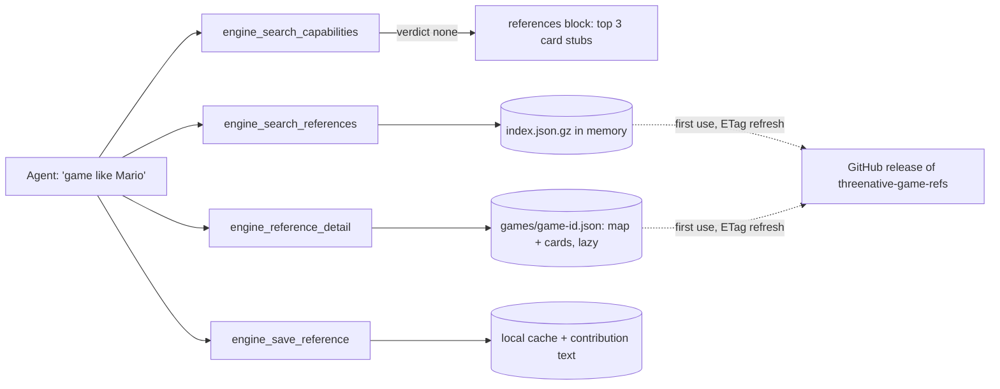

# PRD-734 — Game reference cards: agents borrow mechanics from classic game decompilations

**Status:** NOT STARTED
**Priority:** P2 — AC-1 to AC-8 are open; "like Mario" requests still get only a kit and no measured reference for feel.
**Complexity:** 6 (MEDIUM) — new module +2, separate data release +2, external download +1, 1–5 files +1; risk override: none.
**Owner:** João Paulo Furtado
**Depends on:** None

## Context

A request such as "make a game like Mario" routes to a starter kit (Hop Garden). The kit has decent
mechanics, but neither the kit author nor the user agent has a measured reference for how the
original feels: jump arcs, coyote time, camera lag, enemy state machines. Each agent guesses again.

Public decompilations answer these questions. The list at
<https://github.com/Carter54git/Greates-Games-Decompilations-List> holds 2,359 projects over 51
platforms (README, 2026-10-20). The repo already has the same pattern for Unreal: read the source,
borrow the algorithm and the defaults, cite `file:line`, copy no code (`docs/PRDs/Unreal/README.md`).

Inspected:

- `packages/engine-mcp/src/index.ts:215` holds the server instructions. `:402` holds the IDF token weights and `:630-678` holds
  `engine_search_capabilities` with its `verdict: "none"` branch. `:723` and `:743` register the two tools.
- `packages/engine-mcp/__tests__/server.spec.ts` and `search.spec.ts` are the existing harness.
- `packages/core/mcp/engine.mjs` launches the server in every game project through `.mcp.json`.
- `packages/create-threenative/templates/*/AGENTS.md` hold the agent rules that ship with each template.

## Solution

Two new tools go in the existing engine-mcp server, and the data lives in a separate data repo.
No new server and no new npm package.

**Data repo** `threenative-game-refs` (CC-BY 4.0, separate from the MIT engine):

- `index.json.gz` holds one row per game (title, platform, repo URL, tier), one stub per map node
  and one stub per card (id, game, name, one-line summary, tags, capability ids). Search reads only
  this file.
- `games/<game-id>.json` holds two parts at one pinned commit SHA:
  - **map**: the internal map of the repo, a tree of systems → subsystems → files. Each node has a
    purpose, its paths, its key functions with line ranges, and the nodes it depends on (for
    example SM64: player → actions → airborne → `src/game/mario_actions_airborne.c`). An agent uses
    it to find the right file without a crawl of the repo.
  - **cards**: one per mechanic, attached to a map node. Each card has the behavior in prose,
    constants (`name`, `value`, `unit`, `source`), sources (`path`, `line`) and capability ids.
  The schema has no code field.
- **Tier 1** is about 20 classic repos with a full map and full cards. Cheap scouts (the `ds` harness, V4.1-Flash
  max) write the cards, and each card gets a full review before merge. **Tier 2** is the rest of the
  list: an index row only.
- A merge publishes a GitHub release. The MCP gets `latest` with an ETag on startup, caches it in
  `~/.cache/threenative/refs/`, and works offline from the cache. `THREENATIVE_REFERENCES_URL`
  overrides the source for tests.

**Search** reuses the engine-mcp scorer (`tokenWeights`, `situationScore`) over the card stubs, so cards and
capabilities rank the same way. Malformed data throws (fail closed). A missing cache with no
network returns a clear "references unavailable" guidance, and capability search keeps working.

**On-demand Tier 2:** the agent reads the decomp repo itself under the borrow-not-copy rule. Then it
calls `engine_save_reference` with the map nodes it walked and the cards it wrote. The tool
validates them against the schema, writes them to the cache and returns a ready issue or PR body for the data repo.

**Guardrail:** cards describe mechanics and feel only: constants, state machines, camera rules.
They hold no code, no level layouts, no character names for game use and no art. The rule goes in
the server instructions and the template `AGENTS.md`.

## Acceptance Criteria

See the phase boxes below. Each box names its proof.

## Blocked on

- Public repo `jonit-dev/threenative-game-refs` with a CC-BY 4.0 licence, needed for AC-4 and AC-5 — unblocked by João's confirmation to create and publish it.

## Integration Ledger

| Capability | Reachable consumer/trigger | Replaces / disposition | Evidence |
|---|---|---|---|
| Reference search and detail | `.mcp.json` → `packages/core/mcp/engine.mjs` → engine-mcp tool list (`index.ts`, line filled in Phase 1) | New | AC-1 |
| References on an empty capability search | `engine_search_capabilities` `verdict: "none"` branch (`index.ts:672-678`) | Extends the guidance branch | AC-2 |
| Agent rule | `packages/create-threenative/templates/*/AGENTS.md` and the server instructions (`index.ts:215`) | Adds one rule | AC-8 |

## Decisions

- 2026-10-24 (João): any user can use it, both kit authors and end users, so it ships in the user install.
- 2026-10-24 (João): the MCP returns mechanic cards plus links, not live code search. Two tiers, and cheap scouts deep-map Tier 1.
- 2026-10-24 (João): an on-demand card goes to the local cache plus a PR to the data repo, with no central write API.
- 2026-10-24 (João): the tools go in engine-mcp. The data is a separate repo, released as gzipped JSON.
- 2026-10-24 (João): references show on `verdict: "none"`, plus a separate tool and an agent rule.
- 2026-10-24 (João): storage is JSON, not SQLite. Reasons: Node 20 on this machine has no `node:sqlite`, and `better-sqlite3` is a
  native addon every user would inherit. JSON works on any Node version, any OS and the browser.
- 2026-10-24 (João): **scale to 100 MB+**. The split index plus lazy per-game card files keeps search memory
  at the index size only. About 47,000 stubs at about 200 B each come to about 9 MB (estimate). One
  `loadReferences()` function owns storage. Swap it for MiniSearch (fuzzy match) or SQLite through
  `node:sqlite` or sql.js when the index passes 20 MB or the p95 search time passes 50 ms. The tool
  contract does not change.

## Execution Phases

#### Phase 1: Tools work against a fixture

**Status:** NOT STARTED
**Files:** `packages/engine-mcp/src/references.ts` (new: load, cache, search, save), `packages/engine-mcp/src/index.ts` (register 3 tools, add references block to the `none` branch), `packages/engine-mcp/__tests__/references.spec.ts` (new), fixture under `packages/engine-mcp/__tests__/fixtures/refs/`.
**Implementation:** the loader validates the schema and throws on malformed data. It downloads with an ETag to the cache directory and falls back to the cache when offline. The search reuses the scorer. The detail call loads `games/<game-id>.json` lazily and returns one map node (with its children and cards) or one card. The save call validates map nodes and cards, writes it and returns the contribution body.

- [ ] AC-1 [local]: `engine_search_references` "triple jump" returns the fixture SM64 card stub first, and "camera system" returns the SM64 camera map node. `engine_reference_detail` returns the card constants with pinned sources, and the node with its files, functions and child nodes, through the MCP server. proof: `pnpm exec vitest run packages/engine-mcp/__tests__/references.spec.ts packages/engine-mcp/__tests__/server.spec.ts`
- [ ] AC-2 [local]: a capability search with `verdict: "none"` carries at most 3 reference stubs, and a `matched` search carries none. The existing search specs stay green. proof: `pnpm exec vitest run packages/engine-mcp/__tests__/search.spec.ts packages/engine-mcp/__tests__/references.spec.ts`
- [ ] AC-3 [local]: a second start sends the ETag and skips the download on a 304. An offline start reads the cache. A malformed index throws. `engine_save_reference` writes a valid card and rejects a card with a code field. proof: `pnpm exec vitest run packages/engine-mcp/__tests__/references.spec.ts`

#### Phase 2: Data repo with Tier 2 index and the first Tier 1 cards

**Status:** NOT STARTED
**Files:** the data repo only: an import script, the schema and a release workflow. No engine files.
**Implementation:** import every list row as Tier 2. Scouts write the Tier-1 map and cards for Super Mario 64 (Hop Garden) and Ocarina of Time (Lantern Vale), each at a pinned SHA. A full review checks each map path and each constant against the pinned clone.

- [ ] AC-4 [shared]: release `v0.1` has as many Tier-2 rows as the list (2,359 on 2026-10-20), and the MCP downloads and searches it. proof: data repo release run + `THREENATIVE_REFERENCES_URL=<release> pnpm exec vitest run packages/engine-mcp/__tests__/references.spec.ts -t live`
- [ ] AC-5 [shared]: SM64 and OoT each have a reviewed map whose every path and function exists at the pinned SHA. proof: data repo `validate` job (schema + path and function check against the pinned clone)
- [ ] AC-5b [shared]: SM64 and OoT have at least 10 reviewed cards each, and each cited line holds the stated constant. proof: data repo `validate` job (line check against the pinned clone)

#### Phase 3: Agents use it in a cold build

**Status:** NOT STARTED
**Files:** `packages/engine-mcp/src/index.ts` (server instructions), the template `AGENTS.md` source (one rule plus the guardrail), then `pnpm sync:agents`.
**Implementation:** add the rule: "a request that names a game or a feel calls `engine_search_references` and cites the card it used". Add the guardrail.

- [ ] AC-6 [local]: a cold sandbox agent asked for "a 3D platformer that feels like Mario 64" calls `engine_search_references` and puts the jump constants of a cited card into the game. proof: `pnpm sandbox` run, transcript plus the game diff
- [ ] AC-7 [local]: in a cold sandbox, a request for a Tier-2 game makes the agent read the repo, call `engine_save_reference` with the map nodes it walked and its cards, and get a cache file plus contribution text with no copied code. proof: `pnpm sandbox` run, cache file plus review of the transcript
- [ ] AC-8 [local]: the template rule ships, and the doc gates pass. proof: `pnpm sync:agents --check && pnpm check:docs`
