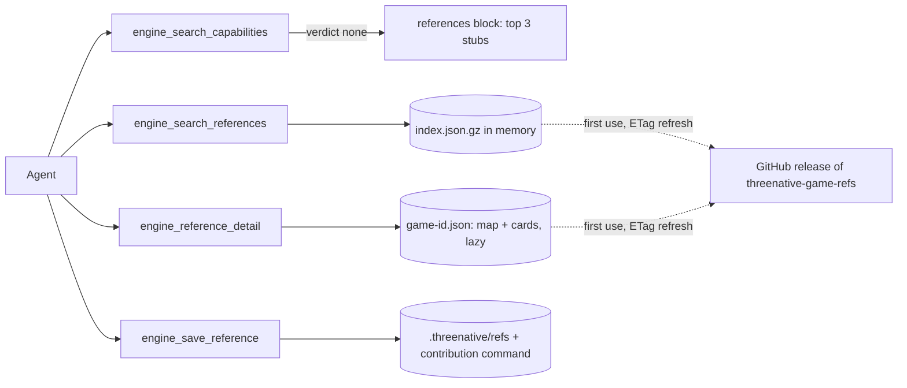

# PRD-734 — Authoring revamp: one planning gate, and game references agents find at plan time

**Status:** NOT STARTED
**Priority:** P2 — AC-1 to AC-9 are open; a "like Mario" request still plans without kit, references, assets, look or proof in one place.
**Complexity:** 7 (HIGH) — new module +2, separate data release +2, external download +1, 6–10 files +2; risk override: none.
**Owner:** João Paulo Furtado
**Depends on:** None. PRD-735 (reference content at scale) depends on this PRD.

## Context

The authoring layer is what a cold agent reads and calls before it writes a game. Today it is
spread over many surfaces, and planning touches only one of them.

| Surface | Today | Gap |
|---|---|---|
| MCP servers in the template `.mcp.json` | 4: `threenative-engine`, `threenative-assets`, `threenative-sculpt`, `threenative-blender` | Only the engine server is named in the planning gate. |
| Skills in `packages/create-threenative/agent-files/.agents/skills/` | 12. The plan path is `threenative-capabilities` (27 lines), then `prd-creator` (40 lines). | The gate searches capabilities only. Kit, assets, audio, look and playtest are other skills that the agent finds later or not at all. |
| Hook `agent-files/.claude/hooks/ponytail-context.mjs` | Re-injects the ponytail ladder at session start, on each prompt and at subagent start. Rung 2 names `engine_search_capabilities`. | It names no other planning tool. |
| Template `AGENTS.md` | 13 templates, 1,194 lines in total. Step 1 is the "critical planning gate". | Each template repeats the gate in its own words. |
| Kit routing | "Like Mario" routes to Hop Garden through `--genre`, `kit.json` aliases and capability search (owner, 2026-10-23). | The plan does not record which kit it chose or why. |
| Reference knowledge | None. Each agent guesses how a classic game feels. | No measured jump arcs, camera rules or enemy state machines. |

The origin note `docs/PRDs/authoring/ORIGIN-authoring-discoverability-2026-08-31.md` measured the
same class of gap for capabilities: 11 of 46 brief mechanics returned zero capabilities. This PRD
treats discoverability at plan time as the main risk (owner, 2026-10-24: "this should be USED when
starting planning the game. and not get hidden").

Public decompilations are the new reference source. The list at
<https://github.com/Carter54git/Greates-Games-Decompilations-List> holds 2,359 projects over 51
platforms (README, 2026-10-20). The rule is the one the repo already uses for Unreal
(`docs/PRDs/Unreal/README.md`): read the source, borrow the algorithm and defaults, cite
`file:line`, and copy no code.

Inspected:

- `packages/engine-mcp/src/index.ts`. `:214-215` holds the server instructions, `:402` the IDF token weights,
  `:534` `situationScore`, `:624-678` `searchCapabilities` with its `verdict: "none"` branch, `:720-760`
  the tool definitions, `:805-857` `handleToolCall`, and `:864-898` the synchronous `handleLine`.
- `packages/engine-mcp/__tests__/server.spec.ts`. It has 22 synchronous `handleLine` calls.
- `packages/core/scripts/bundle-engine-mcp.mjs`. It bundles `engine-mcp/dist/index.js` into `core/mcp/engine-server.mjs`.
- `packages/create-threenative/agent-files/.agents/skills/threenative-capabilities/SKILL.md` and `prd-creator/SKILL.md`.
- `packages/create-threenative/__tests__/template.spec.ts:970-990`. It asserts the gate order and the skill text.

## Solution

### Part A — one planning gate

`threenative-capabilities` keeps its name, because 13 templates and `template.spec.ts` cite it.
It becomes the one planning gate. It runs before `prd-creator` and fills one discovery record with
six sections, each from the tool that owns it:

- Every section ends with a value or an explicit "none". The plan with a section left blank is not
  ready for approval.
- `prd-creator` copies the six sections into `.agent/prd/PRD.md`, so the user sees at once which
  kit, capabilities, reference cards, assets, look and proof the plan uses.
- The gate order is stated once, in the skill. All other surfaces point to the skill and do not
  repeat it: the server instructions, the hook context and the template `AGENTS.md` step 1. That
  ends the drift between 13 templates.

### Part B — game references in engine-mcp

Three new tools go in the existing engine-mcp server. There is no new server and no new npm
package. The data lives in a separate CC-BY repo.

**Data repo** `threenative-game-refs`. CC-BY 4.0, separate from the MIT engine, with GitHub release
assets:

- `index.json.gz` holds one row per game (id, title, platform, repo URL, tier), one stub per map
  node and one stub per card (id, game, name, one-line summary, tags, capability ids). Search reads
  only this file.
- `game-<id>.json` holds one game at one pinned commit SHA:
  - **map**: the internal map of the repo, a tree of systems → subsystems → files. Each node has a
    purpose, paths, key functions with line ranges, and the nodes it depends on (for example SM64:
    player → actions → airborne → `src/game/mario_actions_airborne.c`). An agent uses it to find the
    right file with no crawl of the repo.
  - **cards**: one per mechanic, attached to a map node. Each card has the behavior in prose,
    constants (`name`, `value`, `unit`, `source`), sources (`path`, `line`) and capability ids.
- The schema refuses unknown fields and fenced code blocks, so a card cannot carry code.
- **Tier 1** is about 20 classic repos with a full map and full cards. **Tier 2** is the rest of the
  list: an index row only, explored on demand.

**Download.** On startup the server sends a GET with the stored ETag to the `latest` release and
caches the result in `~/.cache/threenative/refs/` (`XDG_CACHE_HOME` applies). It works offline
from the cache. A game file downloads only when `engine_reference_detail` asks for it. The response
is validated before the cache is written, so a malformed release throws and never replaces the last
good copy. `THREENATIVE_REFERENCES_URL` and `THREENATIVE_REFERENCES_CACHE` override the source and
the cache for tests.

**Server change.** The download is asynchronous, so `handleLine` and `handleToolCall` become async
and `runServer` writes each response when it resolves. The 22 calls in `server.spec.ts` get an
`await`. JSON-RPC ids keep responses matched when they finish out of order.

**Search** reuses the engine-mcp scorer over the stubs, with the game title as an alias, so cards
and capabilities rank the same way. A Tier-2 game matches on its title and returns its repo with
the guidance "explore it, then call `engine_save_reference`". If there is no cache and no network,
the tool returns "references unavailable", and capability search keeps working.

**On-demand Tier 2.** The agent reads the decomp repo itself under the borrow-not-copy rule. Then it
calls `engine_save_reference` with the map nodes it walked and the cards it wrote. The tool
validates them, merges them by id into `.threenative/refs/<game-id>.json` in the game project, and
returns a ready `gh issue create` command for the data repo. Search and detail read saved games
before the release.

**Guardrail.** Cards describe mechanics and feel only: constants, state machines and camera rules.
They hold no code, no level layouts, no character names for game use and no art. The rule goes on
the same surfaces as the gate.

## Acceptance Criteria

See the phase boxes below. Each box names its proof.

## Integration Ledger

| Capability | Reachable consumer/trigger | Replaces / disposition | Evidence |
|---|---|---|---|
| Planning gate | Template `AGENTS.md` step 1 → `threenative-capabilities` skill → `prd-creator` | Extends the capability-only gate | AC-1, AC-2, AC-3 |
| Reference search and detail | `.mcp.json` → `packages/core/mcp/engine.mjs` → engine-mcp tool list (`index.ts:720`) | New | AC-4 |
| References on an empty capability search | `searchCapabilities` `verdict: "none"` branch (`index.ts:672-678`) | Extends the guidance branch | AC-5 |
| Saved Tier-2 references | `engine_save_reference` → `.threenative/refs/` → search and detail | New | AC-6, AC-8 |

## Decisions

- 2026-10-24 (João): any user can use it, both kit authors and end users, so it ships in the user install.
- 2026-10-24 (João): the MCP returns mechanic cards plus repo maps and links, not live code search. Two tiers, and cheap scouts (the `ds` harness, V4.1-Flash max) deep-map Tier 1. Each scout card gets a full review before merge.
- 2026-10-24 (João): an on-demand card goes to the local project plus a contribution to the data repo, with no central write API.
- 2026-10-24 (João): the tools go in engine-mcp. The data is a separate CC-BY repo, released as gzipped JSON.
- 2026-10-24 (João): references show on `verdict: "none"`, plus a separate tool and the gate step.
- 2026-10-24 (João): storage is JSON, not SQLite. Node 20 on this machine has no `node:sqlite`, and
  `better-sqlite3` is a native addon every user would inherit. JSON works on any Node version, any OS and the browser.
- 2026-10-24 (João): scale to 100 MB+. The split index plus lazy per-game files keeps search memory at
  the index size. About 47,000 stubs at about 200 B each come to about 9 MB (estimate). One loader
  function owns storage. Swap it for MiniSearch (fuzzy match) or SQLite (`node:sqlite` or sql.js)
  when the index passes 20 MB or the p95 search time passes 50 ms. The tool contract does not change.
- 2026-10-24 (João): discoverability at plan time is the main risk, so this PRD also revamps the
  authoring layer into one planning gate (Part A). AC-3 proves the call order from the log.
- 2026-10-24 (João): the gain stays unmeasured until AC-9, an A/B with references on vs off.
- 2026-10-24 (João): create the data repo with the gh CLI. Done: <https://github.com/jonit-dev/threenative-game-refs>, public, licence `cc-by-4.0`.
- 2026-10-24 (agent): content at scale (the Tier-2 import of the full list, OoT and the other Tier-1
  classics, the scout pipeline) goes to PRD-735, so this PRD stays within the 3-phase cap. This PRD
  seeds one Tier-1 game, SM64, which AC-9 needs.

## Execution Phases

#### Phase 1: One planning gate

**Status:** PARTIAL — AC-1/2 verified (61 template/server tests and mirror check, exit 0); cold-agent proof AC-3 pending.
**Files:** `agent-files/.agents/skills/threenative-capabilities/SKILL.md` (the six-section gate), `agent-files/.agents/skills/prd-creator/SKILL.md` (copy the six sections into the plan), `agent-files/.claude/hooks/ponytail-context.mjs` (rung 2 points to the gate), `packages/engine-mcp/src/index.ts` (server instructions point to the gate), the 13 template `AGENTS.md` step 1 (point to the gate, keep the order out), then `pnpm sync:agents`. Tests: `packages/create-threenative/__tests__/template.spec.ts`, `packages/engine-mcp/__tests__/server.spec.ts`.
**Implementation:** write the gate in the skill once. Each other surface names the skill and the guardrail in one line. Write the spec changes first so they fail on the current text.

- [x] AC-1 [local]: every scaffolded template's gate skill names the six sections in order with the tool for each, and `prd-creator` requires them in the plan. proof: `pnpm exec vitest run packages/create-threenative/__tests__/template.spec.ts`
- [x] AC-2 [local]: the server instructions, the hook context and every template `AGENTS.md` point to the gate and do not restate its order, and the mirrors are current. proof: `pnpm exec vitest run packages/engine-mcp/__tests__/server.spec.ts packages/create-threenative/__tests__/template.spec.ts && pnpm sync:agents --check`
- [ ] AC-3 [local]: a cold sandbox agent asked for "a 3D platformer that feels like Mario 64" calls capability search, reference search and asset search before its first `src/` write, and its `.agent/prd/PRD.md` fills all six sections. proof: `pnpm sandbox` run, `.threenative/engine-mcp.log` order against the transcript, plus the plan file

#### Phase 2: Reference tools work against a fixture

**Status:** COMPLETE — 2026-10-24: 99 tests passed across references, server, search and instruction-budget suites; engine-mcp typecheck and build passed; built stdio server serves five tools and schema contract passes (6 tests).
**Files:** `packages/engine-mcp/src/references.ts` (new: validate, download through the cache, load saved games, save), `packages/engine-mcp/src/index.ts` (async `handleLine`, 3 tools, the references block on `none`, scorer reuse over stubs), `packages/engine-mcp/__tests__/references.spec.ts` (new, with a local `node:http` server for ETag and offline cases), fixture under `packages/engine-mcp/__tests__/fixtures/refs/`, and `server.spec.ts` (`await` on the 22 calls).
**Implementation:** see Part B. The fixture is a production-shaped SM64 game file with map nodes, functions and cards, plus one Tier-2 row.

- [x] AC-4 [local]: through the MCP server, `engine_search_references` "triple jump" returns the fixture SM64 card first and "camera system" returns the SM64 camera map node. `engine_reference_detail` returns the card constants with pinned sources, and the node with its files, functions and child nodes. proof: `pnpm exec vitest run packages/engine-mcp/__tests__/references.spec.ts packages/engine-mcp/__tests__/server.spec.ts`
- [x] AC-5 [local]: a capability search with `verdict: "none"` carries at most 3 reference stubs, a `matched` search carries none, and the existing search specs stay green. proof: `pnpm exec vitest run packages/engine-mcp/__tests__/search.spec.ts packages/engine-mcp/__tests__/references.spec.ts`
- [x] AC-6 [local]: a second start sends the ETag and skips the download on a 304, an offline start reads the cache, and a malformed index throws without replacing the cache. `engine_save_reference` merges a valid game and refuses a card with a `code` field. proof: `pnpm exec vitest run packages/engine-mcp/__tests__/references.spec.ts`

#### Phase 3: SM64 seed release and the measured gain

**Status:** NOT STARTED
**Files:** the data repo only: schema, validator, the SM64 game file and a release workflow.
**Implementation:** scouts write the SM64 map and at least 10 cards at a pinned SHA of the SM64 decomp. A full review checks each path, function and constant against the pinned clone. Then the release `v0.1` is published.

- [ ] AC-7 [shared]: release `v0.1` holds the SM64 map and at least 10 cards. Every path, function and constant exists at the pinned SHA, and the MCP downloads and searches the release. proof: data repo `validate` job + `THREENATIVE_REFERENCES_URL=<release> pnpm exec vitest run packages/engine-mcp/__tests__/references.spec.ts -t live`
- [ ] AC-8 [local]: a cold sandbox request for a Tier-2 game makes the agent read the repo, call `engine_save_reference` with the map nodes it walked and its cards, and get a saved file plus the contribution command, with no copied code. proof: `pnpm sandbox` run, `.threenative/refs/<game-id>.json` plus a review of the transcript
- [ ] AC-9 [local]: the AC-3 brief runs as an A/B, references on vs off, two runs per arm. A blind judge plays both arms and rates the movement feel, and the PRD records the verdict. There is no threshold to pass. proof: `pnpm sweep:capture` + `pnpm sweep:judge` (or `scripts/score-blind.ts`)

## Execution notes (2026-10-24)

- Worktree: `.claude/worktrees/prd-734`, branch `prd-734-game-reference-cards`, draft PR #566; Codex continues the existing lane. The unverified draft was preserved at `/tmp/prd734-references.ts.draft` before use.
- Phase 1 red: new gate, hook and server tests failed on the capability-only text. Focused green: 7 checks cover the six sections, shared gate pointers, regenerated mirrors and scaffolded instructions. Full template/server invocation: 59/61 passed before the checker update; failures were the old inline capability probe (fixed and its 9 tests now pass) and `TN_WASM_ENGINE_MISSING` for the starter scaffold build. The missing build was provisioned from published `@threenative/runtime-native@0.3.6`, matching this checkout’s package version, into ignored `build/web/` output. The full named template/server command then passed all 61 tests, including all pristine scaffold typechecks and the starter build; `pnpm sync:agents --check` passed (26 mirrors). AC-1/2 are verified.
- Phase 2 red: all six initial reference tests failed before implementation. Green: `pnpm exec vitest run packages/engine-mcp/__tests__/references.spec.ts packages/engine-mcp/__tests__/server.spec.ts packages/engine-mcp/__tests__/search.spec.ts scripts/__tests__/instruction-budget.spec.ts` — 99 passed, exit 0. The 9 reference tests include local HTTP ETag/304, offline cache, malformed release preserving the last valid cache, lazy game fetch, search/detail through MCP, Tier-2 guidance, local MCP save/search/detail and unknown-field rejection. Two further regressions were observed red then green: a partial card referencing a saved node, and cache isolation across release URLs.
- The stored index uses a release-source subdirectory to keep overrides from sharing stale ETags or offline data. Save validates the merged graph and quotes the returned contribution command for the shell. No new dependency or server.
- Requested final review: Opus 5.5, high effort, after implementation and verification. Not run yet.

- Checkpoint `186e59a95` implements the gate and reference tools; `a58fa0010` adds the opt-in live release check. The live check against the unpublished `v0.1` URL failed as expected. First push failed because the login shell omitted pnpm; after correcting PATH, pre-push found two unformatted JSON fixtures and intended scaffold instruction byte-hash drift. These are being corrected before retry; no hook bypass.
- A full-map audit found the initial SM64 seed covered only 8/336 C source paths. Release validation now rejects incomplete coverage, and a scout is expanding the subsystem map before release. The initial 11 cards and 42 literal constants passed pinned path/function/line/constant checks; semantic review remains separate.

- Pre-push fixes: Biome formatted both JSON fixtures; the scaffold byte-stability test was observed red for all 13 intended instruction changes, its 13 expected hash values were regenerated without weakening the assertion, and the focused check passed (1 passed, 67 skipped).
