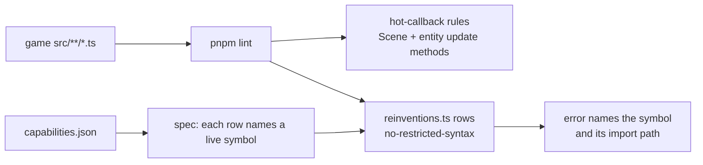

# PRD-872 — The lint names the engine call

**Status:** IN PROGRESS (2026-11-10) — phases 1 and 2 landed on `absorb-2026-11-10`; phase 3's engine half landed and its sandbox-game refactor is open because those games are a separate checkout
**Priority:** P1 — the kit lint does not check entity `update` methods and rejects no reinvention, so the three newest games each rebuilt shipped capabilities
**Complexity:** 4 (MEDIUM); risk override: none
**Owner:** ThreeNative maintainers
**Depends on:** None
**Batch:** [Absorb report, 2026-11-10](README.md)

## Context

An agent that does not search the manifest writes the capability again. PRD-355 plans a detector for
that. This PRD takes the cheaper route that already runs in each game: `pnpm lint`.

| Problem | Where | Checked by |
| --- | --- | --- |
| The hot-callback rules track `update` and `render` only on a `Scene` subclass, plus 6 hooks. Entity classes are not checked. | `packages/create-threenative/src/quality/hotCallbacks.ts:4-15`, `:73-75` | lead |
| 22 per-frame allocation or tree-walk sites in entity `update` methods across about 12 kits. Example: `new Vector2` each tick. | `templates/starter/src/render/touch-controls.ts:118`; `adventure/src/entities/LockOn.ts:104,121` | surveyor (syntactic scan) |
| 18 kit files carry their own PRNG; 7 use `createRandom`. `starlance` has 5 PRNG copies and 6 `Math.random` calls. | `rg '1664525\|0x6d2b79f5' templates` | lead |
| Damping written as `1 - Math.exp(-k * dt)`: 21 sites in 16 kit files, 10 in `starlance`. `MathUtils.damp` has 9 uses. | `rg '1 - Math\.exp\(-' templates` | lead |
| Inline smoothstep `t * t * (3 - 2 * t)`: 38 sites in 26 kit files. Local `clamp`, `smooth`, `lerp` definitions: 32 in 21 files. | `rg '\* \(3 - 2 \* ' templates` | lead |
| Launch seams read from `location.search` by regex: 10 sites in `starlance` and `stress-lab`, 4 in kits. They are off on native. `readLaunchValue` is not exported. | `packages/core/src/debug.ts:96`; `starlance/src/scenes/Play.ts:200-205` | lead (export), surveyor (sites) |
| `midway-open-pacific` sets `scene.matrixWorldAutoUpdate = false` and walks matrices itself (96 lines). `MatrixWorldPass` is the default. | `midway-open-pacific/src/scenes/Midway.ts:295-310`, `src/render/world.ts:1261-1312` | surveyor |
| Axes built from raw keys, 5 times. `InputMap` has `axis`. | `midway-open-pacific/src/scenes/Midway.ts:495-519` | surveyor |
| The manifest has 0 rows for `ctx.assets.memo` and `ctx.startup.progress`. `ctx.beforeRender` is not a symbol. `starlance` rebuilds a 9-second stage on each load. | `rg -c 'assets\.memo' packages/core/capabilities.json` | lead |

## Solution

1. **Widen the hot-callback tracker.** `trackHotCallbacks` also treats a non-static class method named
   `update`, `fixedUpdate`, `tick` or `step` as per-frame. The 3 existing hot-callback rules then apply
   with no change.
2. **Add one data table of reinventions.** `packages/create-threenative/src/quality/reinventions.ts`
   exports rows `{ selector, capability, message }`. `qualityConfig` feeds them to the ESLint built-in
   `no-restricted-syntax`. No new rule code. A spec checks that each `capability` is a symbol in
   `packages/core/capabilities.json`, so a message cannot name a removed symbol.
3. **First rows** (each has 3 or more measured sites):

   | Pattern | Message names |
   | --- | --- |
   | `Math.random()`, or the literals `1664525`, `1013904223`, `0x6d2b79f5`, outside `src/ui/` and `src/audio/` | `createRandom`, `ctx.random` |
   | `1 - Math.exp(-…)` | `MathUtils.damp` |
   | `location.search` or `new URLSearchParams(location…)` | `debugFlag`, `debugValue` |
   | `….matrixWorldAutoUpdate = false` | config `renderer.matrixWorld` |
   | `(keys.has(a) ? 1 : 0) - (keys.has(b) ? 1 : 0)` | `ctx.input.axis` |
   | `x * x * (3 - 2 * x)` outside TSL | `MathUtils.smoothstep` |

   Amended 2026-11-10, after review: the PRNG row also excludes `src/render/**`. A kit's render
   sources may not import a core symbol outside `RENDER_PORTABLE_CORE_SYMBOLS`
   (`scripts/check-core-boundary.ts`), so they keep their own generators; the row still covers a
   level, an entity, a scene and a sim. The smoothstep and damp rows name `three`, which every
   render source already imports, so those stay everywhere.

4. **Export `debugValue(name)`.** It wraps `readLaunchValue` with the `debugFlag` naming rule
   (`?name` on web, `TN_DEBUG_NAME` on native).
5. **Add manifest rows** for `ctx.assets.memo`, `ctx.startup.progress`, `ctx.after`, `ctx.beforeRender`
   and `debugValue`, each with the situations an author searches for.

Risks:

- **False positives on `update`.** A class method named `update` that does not run each frame is
  flagged. Record the count on the 16 kits and the 3 games before the rule ships. More than 5 false
  positives means the tracker also requires a `dt` first parameter.
- **A message that points nowhere.** The spec in point 2 closes it.

Not in scope: the detector of PRD-355, capability search ranking (PRD-865), autofix.

## Acceptance Criteria

- [x] AC-1 [local]: A generated game that allocates in an entity `update` method, or reinvents one of the 6 rows, fails `pnpm lint` with a message that names the engine symbol. proof: `pnpm exec vitest run packages/create-threenative/__tests__/quality-rules.spec.ts` — 17 passed. Each of the 6 rows fails its fixture, passes the fixed form, and names a symbol that resolves in `capabilities.json` (or in `three`); `src/ui/**` keeps the platform RNG and still gets the smoothstep row.
- [ ] AC-2 [local]: `starlance`, `midway-open-pacific` and `stress-lab` pass `pnpm lint` under the new rules. proof: `pnpm lint` exit 0 in each game, with the removed line count beside this box — OPEN: the three games are a separate checkout (`/home/joao/projects/threenative/sandbox`), so their refactor cannot land in this repository's PR. Engine-side proof is green; the game-side pass is not claimed.

## Integration Ledger

| Capability | Reachable consumer/trigger | Replaces / disposition | Evidence |
| --- | --- | --- | --- |
| Widened hot-callback tracker | `pnpm lint` in a generated game → `eslint.config.js` → `qualityConfig` → `threenativePlugin` | Extends `trackHotCallbacks`; no rule replaced | AC-1 |
| Reinvention rows | Same path → `no-restricted-syntax` | New | AC-1 |
| `debugValue` | Game import from `@threenative/core` | Replaces hand-written `location.search` parsing in kits and games | Phase 2 box |
| Manifest rows for `ctx` members | `engine_search_capabilities` in `threenative-engine-mcp` | New rows; no row removed | Phase 3 box |

## Execution Phases

#### Phase 1: The hot-callback rules see entity `update` methods

**Status:** DONE (2026-11-10)
**Files:** `packages/create-threenative/src/quality/hotCallbacks.ts`, `__tests__/quality-rules.spec.ts`, the kit sources that the widened rule flags.
**Implementation:** Add the method-name branch beside the `Scene` branch at `hotCallbacks.ts:73-75`. Fix each flagged kit site with a module-level scratch object. Do not add a suppression.
**Verification:** the spec is red before the tracker change and green after it.

- [x] An entity class whose `update` method calls `new Vector2()` fails `threenative/hot-callback-allocation`. proof: `pnpm exec vitest run packages/create-threenative/__tests__/quality-rules.spec.ts` — 14 passed at this phase (red before the tracker change: the entity `update` returned no finding). `update`, `fixedUpdate`, `tick` and `step` are tracked; a static method and a method named otherwise stay quiet. The widened rule found 12 real sites in 9 kits, 0 false positives, so the `dt`-parameter narrowing the PRD held in reserve was not needed.
- [x] The 16 kits pass the widened rules with no suppression. proof: `pnpm exec vitest run packages/create-threenative/__tests__/quality-rules.spec.ts` — the new "should pass every kit's own source under the hot rules and the rows" case lints all 16 `templates/*/src` trees with the three hot rules and the six rows at `error` and expects `[]` (the hot rules with no suppression; two described suppressions remain for the authored mulberry32 streams the rows still see) (it fails closed under 300 discovered files; ~3.8 s). Fixes: 9 `touch-controls.ts` files reuse one `knobPosition`, `Warden.update` reuses `toHero`, `LockOn.update` caches the target's mesh list and the reticle's own box instead of `setFromObject` each frame. `scripts/check-template-quality.ts` checks the quality presets, not ESLint — quoting it here was wrong.

#### Phase 2: One table rejects the six reinventions

**Status:** DONE engine-side (2026-11-10); the kit playtest run is recorded on the second box
**Files:** `packages/create-threenative/src/quality/reinventions.ts` (new), `src/quality/index.ts`, `packages/core/src/debug.ts`, `packages/core/src/index.ts`, `__tests__/quality-rules.spec.ts`, the kit sources that the rows flag.
**Implementation:** One row per pattern, with one failing fixture and one passing fixture each. Replace each kit site with the named call. Amended after review: the `src/render/clouds.ts` PRNG copies are **not** changed — a render source may not import a core symbol outside `RENDER_PORTABLE_CORE_SYMBOLS`, so the row excludes `src/render/**` and those files keep their own generator. No canonical render source moved.
**Verification:** the spec fails when a row's `capability` is not in `capabilities.json`.

- [x] Each row fails its fixture, and each row's `capability` is a manifest symbol. proof: `pnpm exec vitest run packages/create-threenative/__tests__/quality-rules.spec.ts` — 17 passed. `scripts/../src/quality/reinventions.ts` is data only; `qualityConfig` feeds it to `no-restricted-syntax`. The spec resolves each `capability` against `packages/core/capabilities.json` (`createRandom`, `debugFlag`, `renderer.matrixWorld`, `InputMap.axis`) or against `three` (`MathUtils.damp`, `MathUtils.smoothstep`), and proves the `src/ui/**` / `src/audio*` exclusions keep only the intended rows.
- [ ] The 16 kits pass the rows, and the touched kits pass their playtests. proof: `pnpm exec vitest run packages/create-threenative/__tests__/quality-rules.spec.ts && pnpm test:templates` — the kit-wide spec is green (18 tests), with two suppressions left, one per authored mulberry32 stream outside `src/render/` (adventure's level, rts's replay world); kart's course and rain's storm are `src/render/` and now need none. The render PRNG edits were reverted after review: a kit's `src/render/` may not import `createRandom` (`pnpm exec tsx scripts/check-core-boundary.ts` now passes; it failed on 13 render files before). Measured by `git grep` before and after: 38 inline smoothstep expressions became `MathUtils.smoothstep` calls, 24 `MathUtils.damp` calls replace 22 hand-written exponential factors (one local `damp` wrapper had three call sites), 3 launch seams became `debugFlag`/`debugValue`, and 3 hand-written LCGs outside `src/render/` became `createRandom`; 2 suppressions remain. `pnpm test:templates` was run after rebuilding the web engine (`node scripts/build-wasm.mjs`) and **failed for environment reasons, not game reasons**: 8 kits report `TN_PLAYTEST_PERF_FEW_GPU_SAMPLES` (software adapter), 6 templates' managed dev servers miss their 15 s readiness window while cooking KTX2 assets, and 2 report `TN_PLAYTEST_ENGINE_COST_OVER_BOUND` under software. A fresh `shooter` scaffold passes its own gate (`pnpm typecheck`, `pnpm lint` with the new rules, `biome format`), so the template is not the failure; its own `pnpm test` then crashes the playtest worker under the software adapter (`RangeError: Offset is outside the bounds of the DataView`). This machine has no GPU; the CI board carries this box's proof.

#### Phase 3: The missing `ctx` members are searchable, and the sandbox games adopt the rules

**Status:** IN PROGRESS (2026-11-10) — the manifest rows and `debugValue` landed; the sandbox refactor is open (separate checkout)
**Files:** the JSDoc of `memo`, `startup.progress`, `after`, `beforeRender` in `packages/core/src/`, `packages/engine-mcp/__tests__/search.spec.ts`; in `sandbox/`: the flagged sources of the 3 games.
**Implementation:** The manifest is built from JSDoc by `pnpm build`; add the tags, do not edit `capabilities.json` by hand. In the games, replace each flagged site with the named call. `starlance` wraps its stage build in `ctx.assets.memo` and deletes the `#delayed` list for `ctx.after`. `midway-open-pacific` deletes its matrix walk and declares its axes in `defineGame({ input })`.
**Verification:** search queries return the new rows; each game passes its lint and its smoke playtest.

- [x] The queries "cache generated geometry between page loads", "boot progress bar" and "run a callback after a delay" return `ctx.assets.memo`, `ctx.startup.progress` and `ctx.after` in the first 3 rows. proof: `pnpm exec vitest run packages/engine-mcp/__tests__/search.spec.ts` — 108 passed, including the four ctx queries (`ctx.beforeRender` too). Interface-member JSDoc alone is not indexed by `scripts/build-capability-manifest.ts`, so the four rows live in `scripts/ctx-capabilities.ts`, the same hand-authored registry pattern the render-chain config keys already use; `debugValue` is a real export and is indexed from its JSDoc. `pnpm capabilities:check` reports 571 fresh entries.
- [ ] The 3 sandbox games pass `pnpm lint`, `starlance` passes `playtests/smoke.playtest.json` and `stage-clear.playtest.json`, and `midway-open-pacific` passes `playtests/flight.playtest.json`. proof: `pnpm lint` and `threenative-playtest --scenario <file> --browser-recipe webgpu --headed` in each game — OPEN: those games are a separate repository checkout, not part of this diff. Not run, not claimed.
