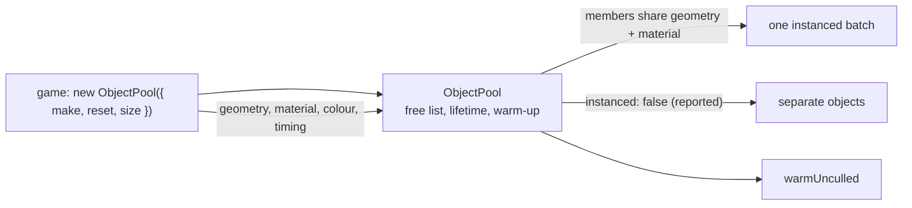

# PRD-873 — The engine owns the pool and the body's rest

**Status:** IN PROGRESS (2026-11-10) — the store's changed-only publication landed on `absorb-2026-11-10`; `ObjectPool`, the body rest options and the `prewarm` restore are open
**Priority:** P2 — three games and three kits hand-write object pools, two games work around a `RigidBody3D` with no damping, and three games work around `prewarm` (all phases open)
**Complexity:** 7 (HIGH); risk override: the pool changes the draw path, so the visual-judge rule applies
**Owner:** ThreeNative maintainers
**Depends on:** None
**Batch:** [Absorb report, 2026-11-10](README.md)

## Context

| Problem | Where | Checked by |
| --- | --- | --- |
| 8 object pools in one game, about 390 lines. Each scans for a free slot with `find((i) => !i.visible)` and wires `ctx.add`, `ctx.interpolate` and warm-up by hand. | `starlance/src/render/shotFx.ts:117-302`, `src/entities/Enemies.ts:276-349`, `Weapons.ts:295-334`, `Ship.ts:783-836`, `src/render/fx.ts:342-421` | surveyor; lead confirmed 5 scans |
| The same keyed entity-to-view loop 3 times, about 230 lines: a `Map<id, mesh>`, a new `Set` each frame, a removal loop, a build budget. | `midway-open-pacific/src/render/world.ts:1499-1589`, `1907-1944`, `2128-2265` | surveyor |
| Pools in 3 kits. | `templates/kart/src/scenes/Race.ts:268-285`, `tower-defense/src/scenes/Battle.ts:140-190`, `shooter/src/render/pooled-billboards.ts` (144 lines) | surveyor |
| About 200 sparks and shards are one `Mesh` each, so one draw each. | `starlance/src/render/shotFx.ts:396-434` | surveyor; draw count not measured |
| The manifest has 2 pools and both are specific: `TracerPool3D`, `CastPool`. | `packages/core/capabilities.json` | lead |
| `RigidBody3D` has no damping, friction, restitution, angular velocity, sleep flag or point impulse. | `packages/physics/src/RigidBody3D.ts` (0 hits) | lead |
| Two games worked around it. `starlance` applies a drag force each tick and infers rest from mesh motion. | `starlance/FRICTION.md` 2026-11-05; `starlance/src/entities/Towers.ts:84-120`; `fluid-lab/FRICTION.md:34` | lead (starlance log), surveyor |
| `prewarm` on a live root leaves cloned materials at opacity 0. Nothing throws. Three games hit it or wrote their own warm-up. | `packages/core/src/renderer.ts:129-155`; `fps-framework/FRICTION.md:10`; `starlance/src/entities/Enemies.ts:246-319`; `midway-open-pacific/src/render/world.ts:918-1203` | surveyor |
| `state.set` marks the store dirty on every call, so `flush` publishes unchanged values. 5 kits hand-write a changed-only check. | `packages/core/src/state.ts:48-53`; `templates/action-rpg/src/scenes/Play.ts:583-611`, `tower-defense/src/scenes/Battle.ts:521-559` | lead (store), surveyor (kits) |

## Solution

1. **`ObjectPool` in `@threenative/core`.** `new ObjectPool({ make, reset, size, onFull })` with
   `acquire()`, `release(item)` and `forEachLive(fn)`. A free list replaces the scan. The pool adds its
   members to the scene, registers interpolation, and warms each distinct member through `warmUnculled`.
2. **Instanced by default.** When `make` returns members that share one geometry and one material, the
   pool draws them as one instanced batch. `instanced: false` is the named override, and the pool reports
   it. The game supplies geometry, material, colour and timing (root `AGENTS.md` rule 3).
3. **`RigidBody3D` rest options.** Options `linearDamping`, `angularDamping`, `friction`, `restitution`.
   Members `angularVelocity` (read and write), `sleeping` (read) and `applyImpulseAtPoint`. Each maps to
   the Rapier call of the same meaning. The native host gets the same options in the same commit.
4. **`prewarm` cannot hide a live scene.** `prewarm` restores each material it changed when the compile
   settles. A root that the engine cannot restore throws `TN_PREWARM_LIVE_SCENE` and names `warmUnculled`.
5. **`state.set` skips unchanged keys.** A key whose new value is `Object.is`-equal to the current value
   does not enter `pending`. `flush` publishes nothing when nothing changed.

Reused: `warmUnculled`, `InstancedBatch`, `ctx.interpolate`, the Rapier body API. Check
`engine_search_capabilities` for `pool`, `recycle` and `instanced` before you write `ObjectPool`.

Risks:

- **Kill switch.** `ObjectPool` must cost less code at the call site than the scan it replaces.
  `scripts/count-loc.ts` scores it on `starlance`.
- **Instancing changes the draw path.** Per-member material state (opacity, colour) moves to instance
  attributes. A member that needs its own material uses `instanced: false`.
- **Store equality hides a mutated object.** A game that mutates an object in place and sets it again
  no longer publishes. The error text for that case names a new object or a version field.

## Validation scene

Proposed, not run.

| Item | Pool | Store |
| --- | --- | --- |
| Consumer | `starlance`, `playtests/tower-break.playtest.json` (shards, flashes, rings) | `action-rpg` kit, idle HUD for 600 ticks |
| Baseline and candidate | Same commit, `instanced: false` against the default, paired runs | Same commit, hand check removed, store skip off and on |
| Small control | A pool of 4 members: charges the free list and the instance buffer | A state that changes each tick: charges the equality check |
| Hardware | Local RTX 2080, headed, `--browser-recipe webgpu`, `adapter.info` checked | Same |
| Pass bar | Fewer draws, and presented p95 not worse than run noise on the control | 0 publishes while idle, and frame time not worse than run noise on the control |

## Acceptance Criteria

- [ ] AC-1 [local]: `starlance` and `midway-open-pacific` run on `ObjectPool` with no hand-written pool left, and their playtests pass. proof: `rg -c 'find\(\([a-z]+\) => !' src` returns 0 in `starlance`, and `threenative-playtest --scenario playtests/tower-break.playtest.json --scenario playtests/smoke.playtest.json --browser-recipe webgpu --headed` passes — Evidence: pending.
- [ ] AC-2 [local]: The validation scene shows a net whole-frame gain on the pool workload and no loss on the small control. proof: playtest `perf` on `tower-break`, paired arms, numbers beside this box — Evidence: pending.

## Integration Ledger

| Capability | Reachable consumer/trigger | Replaces / disposition | Evidence |
| --- | --- | --- | --- |
| `ObjectPool` | Game import from `@threenative/core`; `shooter` kit `pooled-billboards.ts`; `starlance` `shotFx.ts` | Hand-written pools are deleted in the kits and the 2 games | AC-1 |
| `RigidBody3D` rest options | `new RigidBody3D({ linearDamping })` in `starlance/src/entities/Towers.ts` | The drag-force workaround is deleted | Phase 2 box |
| `prewarm` restore | `prewarm(root)` in any game | `starlance` hand warm-up (`Enemies.ts:246-319`) is deleted | Phase 2 box |
| `state.set` skip | `ctx.state.set` in each kit scene | Changed-only checks are deleted in 5 kits | Phase 2 box |

## Execution Phases

#### Phase 1: `ObjectPool`, instanced by default

**Status:** NOT STARTED
**Files:** `packages/core/src/object-pool.ts` (new), `packages/core/src/index.ts`, `packages/core/__tests__/object-pool.spec.ts` (new), `templates/shooter/src/render/pooled-billboards.ts`, `templates/kart/src/scenes/Race.ts`, `templates/tower-defense/src/scenes/Battle.ts`, one playtest scenario.
**Implementation:** Free list; `onFull: "recycle-oldest" | "drop"`; a bad `size` throws. Add a `reinventions.ts` row for the `find(!visible)` scan when PRD-872 Phase 2 has landed.
**Verification:** unit spec for the lifetime contract; a `shooter` playtest scenario for the frame loop.

- [ ] `acquire`, `release`, `onFull` and `forEachLive` hold their contract, and a pool of members that share geometry and material issues one draw. proof: `pnpm exec vitest run packages/core/__tests__/object-pool.spec.ts`
- [ ] The `shooter`, `kart` and `tower-defense` kits use `ObjectPool` and pass their playtests. proof: `TN_TEMPLATE_ONLY=shooter,kart,tower-defense pnpm test:templates`
- [ ] The visual judge returns NEUTRAL or better on the `shooter` kit, same pose before and after. proof: judge verdict recorded on this box

#### Phase 2: A body rests, a warm-up restores, an unchanged state stays quiet

**Status:** IN PROGRESS (2026-11-10) — the store skip landed; the body options and the `prewarm` restore are open
**Files:** `packages/physics/src/RigidBody3D.ts`, `packages/physics/__tests__/rigidbody.spec.ts`, `packages/core/src/renderer.ts`, `packages/core/src/state.ts`, `packages/core/__tests__/state.spec.ts`, the native host body options, the 4 kit scenes that carried a changed-only check (`starter`, `action-rpg`, `tower-defense`, `runner` — the survey counted 5, a grep finds 4).
**Implementation:** Each body option is validated (a negative damping throws). Native proof ships in the same commit as the option (root `AGENTS.md` rule 5).
**Verification:** red-green unit specs; one desktop-target playtest for the body options.

- [ ] A body with `angularDamping` stops and reports `sleeping`, on web and on the desktop target. proof: `pnpm exec vitest run packages/physics/__tests__/rigidbody.spec.ts` and one `--target desktop` playtest scenario
- [ ] `prewarm` on a live root leaves each material at its authored opacity, or throws `TN_PREWARM_LIVE_SCENE`. proof: `pnpm exec vitest run packages/core/__tests__/prewarm.spec.ts`
- [ ] `state.set` with unchanged values publishes nothing, and the kits pass with their hand checks deleted. proof: `pnpm exec vitest run packages/core/__tests__/state.spec.ts && TN_TEMPLATE_ONLY=starter,action-rpg,tower-defense,runner pnpm test:templates` — engine proof green: `state.spec.ts` has 3 new cases (600 unchanged frames publish 0 times; one changed key publishes once; the same object mutated and set again publishes nothing), red on the previous store. The four hand-written checks are deleted. The playtest arm is not green: `pnpm test:templates` fails this machine's software adapter (`TN_PLAYTEST_PERF_FEW_GPU_SAMPLES`, 15 s dev-server readiness while cooking KTX2), not the store.

#### Phase 3: The sandbox games adopt it

**Status:** NOT STARTED
**Files:** in `sandbox/starlance`: `src/render/shotFx.ts`, `src/render/fx.ts`, `src/entities/{Enemies,Weapons,Ship,Towers}.ts`. In `sandbox/midway-open-pacific`: `src/render/world.ts`, `src/render/particles.ts`.
**Implementation:** Reinstall from the branch tarballs. `starlance`: 8 pools to `ObjectPool`, `Towers.ts` drag workaround to `linearDamping` and `sleeping`, hand warm-up deleted. `midway-open-pacific`: the 3 view loops to `ObjectPool`. Record the removed lines per game beside AC-1. A fresh Opus 5.5 subagent at high effort reviews each game diff.
**Verification:** AC-1 and AC-2.

- [ ] The visual judge returns NEUTRAL or better on `starlance` (`tower-break`, `laser`) and `midway-open-pacific` (`flight`), same pose before and after. proof: judge verdict recorded on this box
