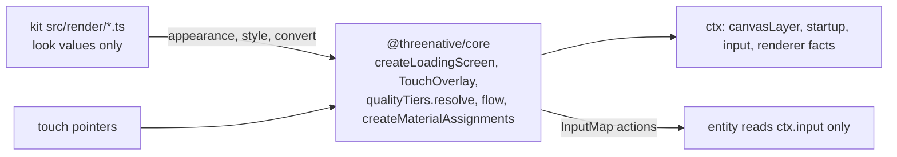

# PRD-874 — Kit plumbing leaves the generated game

**Status:** NOT STARTED
**Priority:** P2 — a new game starts with about 850 lines of mechanism that no game should edit, and 17 kit files pass facts that the engine can measure (all phases open)
**Complexity:** 9 (HIGH); risk override: the moved files draw the loading cover and assign materials, so the visual-judge rule applies
**Owner:** ThreeNative maintainers
**Depends on:** None
**Batch:** [Absorb report, 2026-11-10](README.md)

## Context

PRD-833 stamps shared kit sources from one copy. That removed the drift. The lines still ship in each
generated game, where an agent reads them and can edit them.

| Problem | Where | Checked by |
| --- | --- | --- |
| The loading cover is about 300 lines in 14 kits. The per-kit look is one marked block of 14 to 21 lines. The rest is layout, progress, texture attach and teardown. | `templates/starter/src/render/loading.ts:14-27` (look), `:29-325` (mechanism); canonical `template-assets/loading.ts` | surveyor; lead confirmed 16 files, 12 variants |
| On-screen touch controls: 1 976 lines in 12 kits, plus 276 in `shooter`. Each entity then merges touch into its keyboard input by hand. `InputMap` has no on-screen stick. | `templates/*/src/render/touch-controls.ts`; `starter/src/entities/Player.ts:126,139-140` | lead (line count, 13 wiring files), surveyor (split) |
| Each kit passes measured facts to the quality tier: `mobile: isMobile()` at 35 sites in 17 files, `softwareAdapter !== undefined` at 50 sites, `gpuClass?.class` at 33 sites. 4 kits also read `globalThis.__THREENATIVE_PROFILE__`. | `templates/*/src/render/postprocessing.ts`; `packages/core/src/look/quality.ts:49-51` | lead |
| Restart, pause and resume are hand-wired in 12 kits, with `paused` and `uiReady` fields in 14 `state.ts` files. | `templates/starter/src/game.ts:48-59`, `src/scenes/Play.ts:399-404` | lead (12 kits), surveyor |
| Material assignment and material lighting: 3 614 lines in 12 kits. The look enters through one convert function and one options object. | `templates/starter/src/render/materialAssignments.ts:82`, `materialLighting.ts:28` | surveyor |

Root `AGENTS.md` puts "plumbing every game repeats" in `packages/core/src/` and the look in the kit's
`src/render/`. Each row above mixes the two in one file.

## Solution

Each mechanism moves to `@threenative/core`. Each kit keeps one short file that holds only its look and
one call.

| Mechanism | Engine symbol | The kit keeps |
| --- | --- | --- |
| Loading cover | `createLoadingScreen(ctx, appearance)` | The appearance block: colours, images, bar geometry, `showStatus` |
| Touch overlay | `TouchOverlay(ctx.input, { stick, buttons, style })`, which writes into `InputMap` actions | Radii, positions and colours |
| Quality-tier inputs | `qualityTiers.resolve(ctx)` reads platform, software adapter, GPU class and the hosted profile | `quality.ts` presets; `tier` stays the named override and is reported |
| Restart and pause | `defineGame({ flow: { restart, pause } })`; the engine publishes `paused` and `uiReady` | The scene name and the initial state |
| Material assignment | `createMaterialAssignments(scene, convert)` and `createMaterialLighting(options)` in `@threenative/core/render/environment` | `backlightMaterial.ts`, `backlightControls.ts` and the convention values |

Consumer flow: a kit scene calls the engine symbol once in `enter`. An entity reads `ctx.input.vector`
and `ctx.input.justPressed` and has no touch branch.

Risks:

- **The engine owns a look by accident.** Each symbol takes each colour, size and position from the
  kit. A layout that the options cannot express stays possible: the kit draws its own cover on
  `ctx.canvasLayer`. The spec renders one cover with every option changed.
- **Web-only.** The touch overlay and the loading cover must run on the native host. Each ships a
  native playtest in the same commit.
- **Scaffold hashes.** Each move re-pins the `shared` and `kit` hashes with `pnpm scaffold:pin`.

Not in scope: height fog and sky plumbing (rows L5 and L6 of the batch README), the kit contract (PRD-749).

## Acceptance Criteria

- [ ] AC-1 [local]: A fresh `starter` scaffold holds at least 800 fewer source lines than at 86ba395ab (9 606 lines), and passes its golden playtest. proof: `find src -name '*.ts*' | xargs cat | wc -l` in a fresh scaffold, and `TN_GOLDEN_PATH_TEMPLATES=starter pnpm verify:golden-path` — Evidence: pending.
- [ ] AC-2 [local]: `stress-lab` and `starlance` run on the engine symbols with their kit plumbing files deleted, and pass their playtests. proof: `pnpm lint` and `threenative-playtest --scenario "playtests/*.playtest.json" --browser-recipe webgpu --headed` in each game, removed line count beside this box — Evidence: pending.

## Integration Ledger

| Capability | Reachable consumer/trigger | Replaces / disposition | Evidence |
| --- | --- | --- | --- |
| `createLoadingScreen` | Kit `src/render/loading.ts` → scene boot | The mechanism in `template-assets/loading.ts` is deleted; the stamp of the appearance block stays | Phase 1 box |
| `qualityTiers.resolve(ctx)` | Kit `src/render/postprocessing.ts` → `setupPost` | The fact arguments are deleted in 17 files | Phase 1 box |
| `TouchOverlay` | Kit scene `enter` on a touch device | 12 `touch-controls.ts` files shrink to style values; entity touch branches are deleted | Phase 2 box |
| `defineGame({ flow })` | Kit `src/game.ts` | The `onIntent` restart and pause blocks are deleted in 12 kits | Phase 2 box |
| `createMaterialAssignments` | Kit scene `enter` | 2 files per kit shrink to one call | Phase 3 box |

## Execution Phases

#### Phase 1: The engine draws the cover and measures the tier inputs

**Status:** NOT STARTED
**Files:** `packages/core/src/loading-screen.ts` (new), `packages/core/src/look/quality.ts`, `packages/core/src/index.ts`, `packages/create-threenative/src/index.ts` (stamp), `template-assets/loading.ts`, the 16 kit `loading.ts` and `postprocessing.ts` files, `__tests__/scaffold*.spec.ts`.
**Implementation:** Move `loading.ts:29-325` behind `createLoadingScreen`. `qualityTiers.resolve` accepts `ctx` and keeps its argument form for one release with a deprecation row in the manifest. Each kit prints the same `TN_QUALITY_TIER` before and after.
**Verification:** core spec with each appearance option changed; template playtests; the judge.

- [ ] Each kit's `loading.ts` holds its appearance block and one `createLoadingScreen` call, and the 16 kits pass their playtests. proof: `pnpm exec vitest run packages/core/__tests__/loading-screen.spec.ts && pnpm test:templates`
- [ ] No kit passes `isMobile()`, `softwareAdapter`, `gpuClass` or `__THREENATIVE_PROFILE__` to the tier. proof: `rg -c 'mobile: isMobile\(\)|softwareAdapter !== undefined|__THREENATIVE_PROFILE__' packages/create-threenative/templates` returns 0, and `pnpm exec vitest run packages/core/__tests__/quality-tiers.spec.ts` (new spec; none covers `qualityTiers` today)
- [ ] The visual judge returns NEUTRAL or better on the loading cover and the first settled frame of `starter`, `racing` and `snow`. proof: judge verdict recorded on this box

#### Phase 2: Touch writes into the input map, and the game flow is declared

**Status:** NOT STARTED
**Files:** `packages/core/src/touch-overlay.ts` (new), `packages/core/src/input*.ts`, `packages/core/src/game.ts` (flow), the 13 kit touch files, the 12 kit `game.ts` files, the kit entities with a touch branch.
**Implementation:** `TouchOverlay` maps a stick to an `InputMap` vector and a button to an action. `flow.restart` resets the store to the declared initial state, flushes, and re-enters the scene.
**Verification:** core specs; a touch playtest on web and on the Android emulator; a restart playtest.

- [ ] A touch drag moves the `starter` player through `ctx.input.vector("move")`, on web and on the Android emulator. proof: one playtest scenario with touch pointers, run with `--browser-recipe webgpu` and with `--target android`
- [ ] Restart and pause work in 12 kits with no `onIntent` block in `game.ts`. proof: `rg -c 'intent === "restart"' packages/create-threenative/templates` returns 0, and `pnpm test:templates`

#### Phase 3: Material assignment moves, and the sandbox games adopt it

**Status:** NOT STARTED
**Files:** `packages/core/src/render/environment/` (2 new files), the 12 kit `materialAssignments.ts` and `materialLighting.ts` files; in `sandbox/`: `stress-lab/src/render/`, `starlance/src/render/`.
**Implementation:** Move the enroll, ref-count and restore code. The kit passes `backlightMaterial` as `convert`. Reinstall the 2 games from the branch tarballs and delete their copies of the moved files. A fresh Opus 5.5 subagent at high effort reviews each game diff.
**Verification:** the judge on 3 kits; AC-1 and AC-2.

- [ ] The visual judge returns NEUTRAL or better on `starter`, `racing` and `snow` after the material move, same pose before and after. proof: judge verdict recorded on this box
