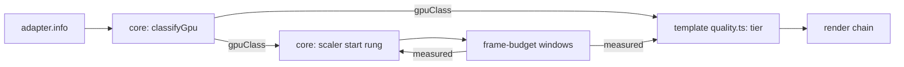

# PRD-563 — The first frame starts at the tier the GPU family can hold

**Status:** COMPLETE
**Complexity:** 5 (MEDIUM) — 11+ files, because each template's generated `quality.ts` takes the new input (3); new core module (+2); risk override: none
**Owner:** João (tier mapping in the templates), agent (implementation)
**Depends on:** None. Related: [PRD-549](../performance/PRD-549-the-engine-holds-60-fps-on-a-weak-gpu.md) (it fixes how fast the scaler reacts on a weak GPU; this PRD fixes where it starts, and duplicates none of its boxes), [PRD-294](../useful-defaults/PRD-294-a-software-rasteriser-should-not-run-the-high-tier-chain.md) (its software-adapter floor becomes one class of this table), [PRD-287](../useful-defaults/PRD-287-the-default-look-holds-the-phones-budget.md) (the measured ladder that refines the start).

## Context

Today the start point of the look and of the pixel count is a guess with two inputs:

- Each template's generated `src/render/quality.ts` picks the tier from `{ mobile, software, tier }`.
  The starter returns `low` for `software`, `low` for `mobile`, and `high` for everything else
  (`packages/create-threenative/templates/starter/src/render/quality.ts:52-71`).
- `RenderChain` with `tier: "auto"` starts at `high` and steps down on measured windows
  (`packages/core/src/render/chain.ts:304-306`).
- `ResolutionScaler` starts at rung 0, scale 1.0 (`packages/core/src/resolution-scaler.ts`, `RESOLUTION_SCALER.rungs`).
- The renderer already reads `adapter.info` (`architecture`, `description`, `device`, `vendor`)
  into an identity string and a software flag (`packages/core/src/renderer.ts:1074-1145`). Only
  the software flag reaches a template.

Effect: a Mali-G52 phone and a Mali-G715 phone get the same `low` look. A laptop with an Intel
iGPU gets the same `high` look and scale 1.0 as an RTX desktop. PRD-549 measured that case on
the LAN laptop's Iris Xe: Machinefall started at scale 1.0 with 4× MSAA, its main pass took
43–110 ms, and the scaler needed several windows after readiness to reach the 0.61 floor. Each wrong start costs measured
windows to correct, and each tier step can compile new pipelines.

**What Unreal does (UE 5.8.3, ideas only, no code copied):**

- `Engine/Config/BaseDeviceProfiles.ini:923-937` matches the Android GPU family string with a
  regular expression (for example "Adreno (TM) 7xx", "Mali-G71") to a device profile.
- Each family profile inherits one bucket: Adreno 5xx → Mid, Adreno 6xx → High, Adreno 7xx and
  8xx → Epic (`:1172-1211`); Mali-G710, G7xx and G9xx → Epic, an unknown newer Mali "Gx" → High
  (`:1374-1406`).
- Each bucket sets the scalability group levels and a content scale factor. `Android_Low` sets
  `r.MobileContentScaleFactor=0.8` and all groups to 0 (`:1033-1041`); `Android_Mid` sets 1.0 and
  groups to 1 (`:1049-1057`); `Android_High` sets groups to 2 (`:1065-1073`).
- On desktop, a short synthetic benchmark gives a CPU and a GPU performance index. Each group
  level comes from thresholds on the GPU index or on the smaller of the two
  (`Engine/Source/Runtime/Engine/Private/Scalability.cpp:205-222`,
  `Engine/Config/BaseScalability.ini:24-33`, thresholds 18 / 42 / 115).

We take the first idea (a family table for the start point) and skip the benchmark: our measured
ladder already does that job after the first window, at no startup cost.

## Solution

1. **Core classifies the adapter (mechanism).** A new `gpu-class.ts` maps the four `adapter.info`
   fields to one class: `software`, `mobile-low`, `mobile-mid`, `mobile-high`, `integrated`,
   `discrete` or `unknown`. One table, ordered rules, first match wins. The software rule is the
   existing `SOFTWARE_ADAPTER` test. The renderer reports `TN_GPU_CLASS` with the class, the
   matched rule and the raw fields. An adapter that no rule matches is `unknown`, and `unknown`
   keeps today's behaviour exactly.
2. **The template maps class to tier (look).** `resolveQualityTier` receives `gpuClass` beside
   `mobile` and `software`. The generated table is game source. The starter's first mapping:
   `software` and `mobile-low` → `low`, `mobile-mid` → `low`, `mobile-high` and `integrated` →
   `medium`, `discrete` → `high`, `unknown` → today's `mobile` rule.
3. **Core picks the starting scale (mechanism).** `ResolutionScaler` starts at a rung chosen
   from the class: `mobile-low` starts one rung down (0.85, near Unreal's 0.8 for its Low
   bucket), every other class starts at rung 0. The source reads `auto`. The first eligible window
   moves it either way, so measurement always wins over the table.
4. **Browsers may coarsen the fields.** Chrome reports `vendor` and `architecture` and can leave
   `description` empty. Each rule names the field it reads. A rule that needs a field the platform
   does not report never matches, so the result is `unknown`, never a wrong class.

Risk: a wrong rule caps a strong GPU. Phase 2 pins `discrete` and `unknown` to today's start
with a test, the same failure mode that PRD-294 names.

## Acceptance Criteria

- [x] AC-1 [local]: A desktop RTX 2080 in browser WebGPU still starts at `high` and scale 1.0, and reports `TN_GPU_CLASS` `discrete`. proof: starter playtest `--browser-recipe webgpu`, `TN_GPU_CLASS` and `TN_RENDER_CHAIN` lines. — Evidence: 2026-10-09, desktop RTX 2080, Chrome WebGPU headed, scaffolded starter built from this branch: exit 0, pass true. Console `TN_GPU_CLASS:{"class":"discrete","fields":{"architecture":"turing","description":"","device":"","vendor":"nvidia"},"rule":"nvidia"}`, `TN_QUALITY_TIER high mobile=false software=false source=platform`, `renderChain.tier` pass at `high`, surface `resolutionScale` 1 with `scaleSource` auto.
- [x] AC-3 [local]: On the LAN laptop's Iris Xe (Chrome WebGPU), the starter reports `TN_GPU_CLASS` `integrated` and starts at the `medium` tier. proof: starter playtest `--browser-recipe webgpu` on the laptop lane. — Evidence: 2026-10-09, LAN laptop, Intel Iris Xe (`architecture: gen-12lp`, `vendor: intel`), Chrome WebGPU headed on the real display, scaffolded starter built from this branch, two runs: `TN_GPU_CLASS` `integrated` (rule `intel`) and `TN_QUALITY_TIER medium mobile=false software=false source=platform` both runs; the control arm (same build, the `gpuClass` line removed from `Play.ts`) reported `high` both runs. Visual judge (fresh read-only subagent, 2 runs per arm, same pose and tick, BEFORE/AFTER burned in): NEUTRAL on both pairs and NEUTRAL overall, which is the intended effect of a perf-only start tier (no visible change). Frame time is not claimed as a win: p95 was 80.8 and 90.2 ms (after) against 94.7 and 92.6 ms (before) on a laptop at 92 to 100 C, and both arms miss the starter `maxFrameMsP95` 33 ms bound. The starter's flat `renderChain.tier: "high"` assertion failed on this adapter before Phase 3 (observed `medium`, `adapterClass: hardware`); Phase 3 adds the `integrated` row. First-frame re-judge, same lane and build, `warmupFrames: 0` with a capture at the first and second frame after startup-ready and one 1200 ticks later, two runs per arm: NEUTRAL on all six pairs and NEUTRAL overall. No IMPROVEMENT is claimed: the old arm never leaves `high` in the run (every `TN_QUALITY_TIER` line and render-chain sample reads `high`), so there is no tier pop on this adapter for the new start to remove, and `medium` differs from `high` only in `gtaoSamples` and static grain. The pose that carries the effect is a phone: a Pixel 8 (Mali-G715, `mobile-high`) starts at `low` before this change (the starter's `mobile` rule) and at `medium` after it, with scale 1.0 in both arms. The capture therefore compares `low` against `medium`, not a drop from `high`; it needs the Pixel 8 (see Blocked on), and the emulator reports `discrete`. The NEUTRAL verdicts cover the starter only: its `medium` preset already requested the medium chain, and ten other kits' did not until Phase 3 (see Decisions, 2026-10-11).
- [x] AC-2 [local]: The Android emulator native host reports its adapter fields and a class, and the starter runs to steady state. proof: starter native `render-chain.playtest.json --target android --device emulator-5554 --allow-software`. — Evidence: 2026-10-11, source-built runtime from this checkout, Android x86_64, explicit QuickJS rollback, SwiftShader. The normal QuickJS asset cook removed `EXT_meshopt_compression` (the proof GLB requires only `KHR_mesh_quantization`), fixing the previous installed-runtime startup blocker without changing the engine. `TN_GPU_CLASS` reports `software`, rule `software`, vendor `SwiftShader driver`, device `SwiftShader Device (Subzero)`, architecture `unknown`; `TN_QUALITY_TIER low`. Exit 0, pass true: all seven assertions pass, startup ready and compile settled, 660 fixed ticks, odometer 0.0098 → 2.029, low stages include bloom/vignette/grade and exclude ambientOcclusion/grain, grade changes the graph output. Startup warmup timed out with zero pending compilations and subsequently reached ready; no warmup-complete, hardware performance or V8 claim. The software adapter is accepted explicitly for this emulator proof; the same run without that flag correctly refused software evidence. Log: `/tmp/pr481-android-playtest-software.log` (local, untracked).

## Blocked on

None for the owner-requested emulator acceptance. Physical Pixel performance is unverified, not a substituted emulator claim.

- Owner decision, 2026-10-11: use an Android emulator and keep the personal Pixel 8 out of further testing. Final acceptance now uses two low/medium release runs on the same emulator, matched first-ready/second-ready/settled captures, a fresh read-only visual judge, and repeated normal-clock measurements. The final accelerated emulator reports its real integrated Intel adapter; the AFTER fixture naturally selects medium without an override or an impersonated Mali identity. Emulator results establish emulator behavior only; the historical Pixel regression below remains unresolved on physical hardware.
- The ten added medium `renderChainTier` fields were initially believed to alter appearance. That premise is superseded by the source/runtime audit under Decisions; their reporting contract is verified, and the isolated field change is not a separate visual-improvement claim.

## Integration Ledger

| Capability | Reachable consumer/trigger | Replaces / disposition | Evidence |
|---|---|---|---|
| GPU class | `createRenderer` adapter read (`renderer.ts:1115-1145`) → `classifyGpu` → `TN_GPU_CLASS` | Software flag stays; it becomes the `software` class | AC-1 |
| Starting tier | template `resolveQualityTier({ gpuClass })` | `mobile` flag stays as the `unknown` fallback | Phase 2 |
| Starting scale | `ResolutionScaler` construction (`game.ts:1394`) | rung 0 stays for every class except `mobile-low` | Phase 2 |

## Execution Phases

#### Phase 1: Classify the adapter
**Status:** COMPLETE
**Files:** `packages/core/src/gpu-class.ts` (new), `packages/core/src/renderer.ts`; `packages/core/__tests__/gpu-class.spec.ts`
- [x] `classifyGpu` maps recorded `adapter.info` fixtures to classes: nvidia/turing → `discrete`, SwiftShader → `software`, an Intel iGPU → `integrated`, Mali-G715 → `mobile-high`, Mali-G52 → `mobile-low`, Adreno 5xx → `mobile-mid`, empty fields → `unknown`. proof: red-green `pnpm exec vitest run packages/core/__tests__/gpu-class.spec.ts`. — Evidence: 2026-10-09, 23 cases pass (19 fixtures, rule/field shape, `none` rule, software-before-vendor, Tegra).
- [x] The renderer prints `TN_GPU_CLASS` with class, rule and raw fields once per launch. proof: renderer spec with a stubbed adapter; the live lines are AC-1 and AC-2. — Evidence: 2026-10-09, `renderer.spec.ts` prints one `TN_GPU_CLASS:{json}` for a stubbed Mali-G52 (`mobile-low`, rule `mali-model`) and no `gpuClass` on the WebGL2 fallback.

#### Phase 2: Start from the class
**Status:** COMPLETE
**Files:** `packages/core/src/resolution-scaler.ts`, `packages/core/src/game.ts`, `packages/create-threenative/templates/*/src/render/quality.ts`; scaler and template specs
- [x] Every template's `resolveQualityTier` takes `gpuClass`, and `unknown` returns exactly today's tier. proof: create-threenative template spec over all 13 generated `quality.ts` files. — Evidence: 2026-10-09, `template-quality.spec.ts` 42 pass; `unknown` and absent equal today's answer for five request shapes in every template, and each `setupPost` reports the family tier. Red: removing one `gpuClass` line from `sailing/postprocessing.ts` failed `sailing: iGPU`.
- [x] `ResolutionScaler` starts at the class rung, and the first measured down or up window still moves it. proof: red-green `pnpm exec vitest run packages/core/__tests__/resolution-scaler.spec.ts`. — Evidence: 2026-10-09, three cases: the table names `mobile-low` at 0.85 only; the first miss window steps down; four clean windows climb back to 1.0 (a down move needs one window, an up move needs `upWindows`). `game-gpu-class-start.spec.ts` shows `game.ts` applies the rung to the renderer (red when `game.ts` is reverted).
- [x] `discrete` and `unknown` start at `high` and scale 1.0. proof: same specs, one case each. — Evidence: 2026-10-09, `game-gpu-class-start.spec.ts` (8 pass): `discrete`, `integrated`, `mobile-high`, `unknown` and a missing `gpuClass` start at scale 1; a pinned scale is never overruled. Template side: `template-quality.spec.ts` `discrete` is `high` in all 13.

#### Phase 3: The harness and the templates hold the family start
**Status:** COMPLETE
**Layer:** engine (`packages/playtest`) for the classifier and the row selection: a template scenario cannot assert a class the harness cannot classify, and a game-side workaround would leave every other scenario red on the same adapter. Game (the templates) for the preset markers and scenario rows: the template decides which chain tier each quality tier requests. Ten kits already authored medium appearance parameters but still reported the default `high` chain marker; correcting that marker changes no image parameter (R4).
**Files:** `packages/playtest/src/evaluators/adapter-class.ts`, `.../evaluators/render-chain.ts`, `.../scenario/schema-base.ts`, `.../scenario/schema-accessors.ts`, `.../assertion-schema.ts`; `packages/create-threenative/templates/*/src/render/quality.ts` (ten `medium` presets gain `renderChainTier: "medium"`); the 22 shipped template scenarios that assert `renderChain` (under `packages/create-threenative/templates/*/playtests/`, `.../templates/*/native-playtests/` and `packages/create-threenative/template-playtests/starter/look.playtest.json`); `packages/playtest/__tests__/render-chain-adapter.spec.ts`, `packages/create-threenative/__tests__/template-quality.spec.ts`, `packages/create-threenative/__tests__/scaffold.spec.ts` (scaffold fingerprints)
**Scope:** `perAdapter` keeps `hardware` and `software` and gains `discrete`, `integrated`, `mobile-high`, `mobile-mid` and `mobile-low`. `classifyAdapter` proves a family from the four observed `adapter.info` fields with its own copy of core's family rules (the package takes no `@threenative/core` dependency; a spec compares the copy with `classifyGpu`). A family row overrides `hardware` only when the observed fields prove that family. Software, an unnamed adapter and an unknown family keep today's selection, so a scenario with no family row behaves exactly as before, and a missing field never proves a family. The expected tier is written in the scenario from the template table, never read from the game's output. Every kit's `medium` preset requests the medium chain marker; the ten added fields align metadata with their already-medium authored appearance parameters, without changing those parameters. Every shipped template scenario that asserts `renderChain` carries family rows, the four that once asserted a flat `high` included (starter native `render-chain`, sailing native `survives`, rain native `boot`, rain `performance`): rain and sailing pass `gpuClass` into `setupPost`, so an integrated or phone start changes their chain tier like any other kit. Their `medium` and `low` rows keep the original `stages` and `contributions` assertions, because those prove the mechanism on every platform, Android included. Out of scope: `packages/create-threenative/__tests__/fixtures/backlight-defaults/` (fixtures for the backlight spec, not shipped scenarios), `examples/strata-terrain-preview` (its chain assertion names no tier), the Pixel 8 capture and AC-2.
- [x] `classifyAdapter` returns the family the observed fields prove, equal to core's `classifyGpu` on every shared fixture; Intel Arc stays `discrete`; empty or unrecognised fields return no family. proof: red-green `pnpm exec vitest run packages/playtest/__tests__/render-chain-adapter.spec.ts` — Evidence: 2026-10-11, red before the change (35 failed | 44 passed of 79), green after (95 pass): a parity table of 21 adapters against core's `classifyGpu`, the Arc A770 stays `discrete`, and empty, partial or malformed provenance returns no family.
- [x] A `perAdapter` family row beats `hardware` only when proven, a scenario with only `hardware` and `software` rows is selected exactly as before, and an unknown row key throws at load. proof: same spec, red before the change — Evidence: 2026-10-11, red message `Unknown key 'integrated' at assert.renderChain.perAdapter.integrated. Supported keys: hardware, software.`, green after. The focused set (render-chain-adapter, render-chain-assertion, scenario, scenario-load, schema-boundaries, runner, cli-classify, native-smoke-scenarios) is 291 pass in 8 files, so hardware and software scenarios, the schema boundaries and the runner keep their answers.
- [x] Every kit's `medium` preset requests the medium chain, and `low` and `high` request theirs. proof: red-green `pnpm exec vitest run packages/create-threenative/__tests__/template-quality.spec.ts` — Evidence: 2026-10-11, red for action-rpg, minimal, platformer, puzzle, racing, rts, runner, sailing, shooter and tower-defense (effective tier `high` at `medium`); green after `renderChainTier: "medium"` on those ten presets only. 43 pass over all 13 kits and all three tiers; starter, rain and snow already requested it. No file under `packages/core` changed.
- [x] Every shipped template scenario that asserts `renderChain` names the start tier of the integrated, phone and software adapters, and the four formerly flat scenarios keep their stage assertions in those rows. proof: `pnpm exec vitest run packages/create-threenative/__tests__/template-quality.spec.ts packages/playtest/__tests__/render-chain-adapter.spec.ts` — Evidence: 2026-10-11, the drift guard in `template-quality.spec.ts` scans `templates/` and `template-playtests/` and fails closed on a scenario without a row (red on a flat-only rain native boot, green with the rows restored); `render-chain-adapter.spec.ts` runs the shipped blocks of the starter `play`, `look` and native `render-chain`, sailing `survives` and rain `boot` and `performance` against Iris Xe, Mali-G715, Mali-G78, Mali-G52, SwiftShader and Turing observations, and a low-tier chain that still runs `ambientOcclusion` fails the starter's `excludes`. A one-off loader pass (not committed) read all 169 shipped template scenarios through the real loader: 22 assert `renderChain`, 0 flat-only, 0 load failures. The scaffold fingerprints were recomputed through the actual-tree test: `pnpm exec vitest run packages/create-threenative/__tests__/scaffold.spec.ts` 66 pass.
- [x] The starter family assertion selects `medium` on the LAN laptop's Iris Xe, and the native `render-chain.playtest.json` asserts its stages and contributions through browser WebGPU. proof: both scenarios on the laptop lane with `--browser-recipe webgpu --headed`. — Evidence: 2026-10-11, real display `:1`, adapter vendor `intel`, architecture `gen-12lp`. `play.playtest.json` correctly selects `gpuFamily: integrated` and passes `renderChain.tier` at `medium`; its whole-run result remains FAIL solely on the pre-existing frame-time ceiling (83.9 ms p95 against 33 ms). No performance pass is claimed and its bound is unchanged. The native render-chain scenario, run with `--target browser`, exits 0, pass true, all assertions pass: medium tier, ambientOcclusion/bloom/vignette/grade/grain stages in order and grade/grain graph contributions. This proves the repaired family selection live; it is browser evidence on Iris Xe, not Linux native host evidence.

#### Phase 4: Android visual and runtime acceptance
**Status:** COMPLETE
- [x] Keep the starter grade filterable without optional float32-filterable support, preserving authored LUT precision, grade/grain stages and intensities. proof: red-green real-loader half-float regression, existing grade tests, and the physical Pixel native scenario. — Evidence: 2026-10-11, `filterableTable` converts the loader’s Float32Array to HalfFloatType with Three DataUtils, rejecting unexpected input. The final grade/scaffold rerun passes 81 tests (15 grade, 66 scaffold), package typecheck passes. The exact final arm64 QuickJS APK passes the physical native capture scenario: medium tier, required stages/order, grade/grain contributions, no diagnostics, and unpaused at first-ready, second-ready and 1200-tick settled captures; `/tmp/pr481-pixel-final-after-1.log`, exit 0, pass true. Full grade/grain settings and the authored nine-cell LUT are unchanged. Grain-off had left the artifacts; grade-off removed them; half floats remove the nearest-cell posterization without optional float32 filtering. This proves representation and functional behavior; the independent paired visual/performance acceptance remains open below.
- [x] Owner-requested Android emulator release comparison: two BEFORE/AFTER runs at the same first-ready, second-ready and settled poses receive a fresh read-only visual judge IMPROVEMENT verdict; repeated normal-clock emulator p95 is no worse than its matched control. Post labeled images on the PR. Use the real adapter classification and natural family-based medium selection in the AFTER fixture. Compare the worst steady p95 over two runs per arm, retaining each run’s result and any paired regression. proof: emulator Android playtests and a fresh read-only judge over labeled capture pairs. Physical Pixel performance is unverified for the final candidate. — Final emulator evidence, 2026-10-11: two integrated Android 15 V8 release runs per arm pass; final_emulator_visual_judge returns IMPROVEMENT on all six matched pairs and overall. Natural low → medium selection, no override; final gameplay 6/6 assertions pass. At 1280×720 / scale 1, each run retains 1,200 steady frames: worst p95 BEFORE 92.66 / 59.62 ms and AFTER 80.73 / 78.92 ms. Both AFTER runs pass the planned worst-control 92.66 ms bound, but the second pair regresses, so no general performance win is claimed. All 18 labeled images are on the screenshots branch and six pairs embedded on PR #481. Historical physical evidence: Pixel 8 native reports Mali-G715 and `mobile-high`; the control starts low and the candidate starts medium. The original two-run comparison was NEUTRAL because LUT posterization cancelled the contact-shading improvement. With the filterable half-float LUT, a fresh read-only Sonnet judge found IMPROVEMENT on all three poses of one clean pair, but that pair predates the PRD-560 merge and is historical evidence only. The combined-candidate QuickJS debug artifact checks are historical; the old `/tmp` fixture and images are now missing. The final release visual proof and failing real-clock performance result are recorded below; historical QuickJS proof is not substituted for either. Pinned recipe-6 Android V8 11.0.226.16 provisioning completed successfully for arm64-v8a and x86_64, with verified 16 KB LOAD segments (`download-deps.mjs --only v8-android`, exit 0). After the missing-fixture preflight stopped safely, the existing sandbox workflow recovered a tarball-installed fixture under persistent storage. Both default-V8 release APKs now build and pass the shipped 16 KB checks, release signing/app-ID checks and V8 library/snapshot checks; native libraries are identical across arms and the packaged game bundles differ only by the intended `gpuClass` input. The fixture config and Play source are restored byte-for-byte. Artifacts: `~/.cache/pr481-pixel/native/release-v8-before.apk` SHA-256 `ed8d1ed7ffe1dd08d31b4bc33427502d1f91b8f1a97503d61eba8d799ad77be4`; `release-v8-after.apk` SHA-256 `814d8e07f14d732d91cf66f323c4971657ef6212514bed8e89badea4777146ac`. These are artifact checks, not phone runtime or performance proof. Wi-Fi ADB is restored at `192.168.1.192:5555`. Both final release arms now pass two clean physical capture runs at first-ready, second-ready and settled (1200 ticks): BEFORE eight assertions per run, AFTER seven per run, V8 confirmed from each process log, Mali-G715/mobile-high, low BEFORE and medium AFTER with no capture-run tier drop. The unchanged shipped native render-chain gameplay scenario also passes all six assertions, including actual odometer movement. Notification-contaminated preliminary captures are excluded. A fresh read-only Sonnet 5.5 high judge (`4e4b3284-f482-4f68-8b05-0b648046d017`) returns IMPROVEMENT on all six matched pairs and overall: a small contact-shadow grounding improvement, no visible posterization or lost detail; fine grain is not independently confirmed at the viewer scale. All 12 eligible original-size images have large burned-in arm/run/pose labels. Latest develop integration `c3f98298e` adds contributor documentation only, with no executable changes to the release artifacts. The final real-clock performance gate now FAILS. At 59% battery, physically unplugged, thermal NONE throughout both completed 65-second runs, the default-V8 control has seven steady frame-budget windows with worst p95 20.56 ms; the candidate has three steady windows with worst p95 26.84 ms. Window 1 is discarded and each log is bound to its fresh process PID and launch timestamp. Both render at the actual 2400×1080 drawing buffer, automatic scale 1.0; the candidate stays medium. Android SurfaceFlinger per-layer present-to-present histogram tails corroborate the regression (33 ms control bucket versus 66 ms candidate bucket; histogram buckets are not exact timestamps). The shipped perf reader rejects the candidate against the observed control bound (exit 1). Further repeat runs that reached thermal status 1 are excluded and stopped. A half-resolution GTAO-gather experiment failed to complete without throttling. A second experiment materialized denoised AO with the existing Three.js texture helper; its cache/lifetime regression passed, 62 focused cases and TypeScript passed, but a completed unplugged, thermal-NONE run still had worst steady frame p95 26.58 ms. Both experiments are reverted, including generated copies and the installed fixture; neither earns a code or visual claim. The doubtful assumption is that the current medium contact-occlusion chain holds the Pixel budget at native resolution. The next work is profiling that chain, not repeating the same tuning attempts. Keep this box open, PR draft, label 75% and auto-merge off. Images remain prepared locally.

## Decisions

- 2026-10-09 (João, via the Unreal review request): take Unreal's family table, not its startup benchmark. Our frame-budget windows already measure the real game after the first window, and a benchmark would add startup time.
- 2026-10-09 (lane agent), superseded by the 2026-10-11 entries below: `classifyAdapter` is independent of the game and of core by design, so it does not read `TN_GPU_CLASS`. That part stands. Measured on the Iris Xe laptop: the flat `renderChain.tier: "high"` hardware assertion in the template scenarios that carry `perAdapter` read `medium` on an Intel integrated GPU and failed. This entry first left `perAdapter` at `hardware|software` and named the `integrated` class and rows as a follow-up; Phase 3 does that work.
- 2026-10-11 (lane agent): the harness holds its own copy of core's family rules, and `perAdapter` gains `discrete`, `integrated`, `mobile-high`, `mobile-mid` and `mobile-low`. A family row replaces the flat expectation only when the observed `adapter.info` fields prove the family. Software never takes a family row. A scenario that names no family selects exactly as before. An unclassified adapter still fails `renderChain.adapterClass`. The expected tier in each row comes from the template start table, never from the game's output. A spec compares the copy with core's `classifyGpu` over 21 adapters, so the two tables cannot drift unseen. Intel Arc stays `discrete`, so it keeps `high`.
- 2026-10-11 (coordinator review, gap 1): ten kits' `medium` preset (action-rpg, minimal, platformer, puzzle, racing, rts, runner, sailing, shooter, tower-defense) resolved `medium` and left the chain on its `high` default, because `renderChainTier` was absent. An `integrated` or `mobile-high` start therefore reported `medium` and rendered the high chain. Each of the ten now carries `renderChainTier: "medium"`; starter, rain and snow already did. The appearance stays in the templates, no package graphics code changed, and the chain was not left at `high` to make a scenario pass.
- 2026-10-11 (coordinator review, gap 2): the scope line that left rain, sailing and the starter native `render-chain` flat at `high` "by design" was false. Rain and sailing pass `gpuClass` into `setupPost`, so an integrated or phone start changes their chain tier. The four scenarios (starter native `render-chain`, sailing native `survives`, rain native `boot`, rain `performance`) now carry `integrated` and `mobile-high` rows at `medium`, `mobile-mid`, `mobile-low` and `software` rows at `low`, and the flat expectation still serves `discrete` and `unknown`. Checked against each template: the starter drops `ambientOcclusion` and `grain` at `low` and keeps bloom, vignette, antialias and grade, where only grade changes the output; sailing's bloom and rain's `stormPost` apply at every tier. The rows keep the original `stages` and `contributions` assertions, and these assertions apply on Android.
- 2026-10-11 (lane agent): left unchanged on purpose. `packages/create-threenative/__tests__/fixtures/backlight-defaults/` asserts a flat `high` in fixtures for the backlight spec, and `examples/strata-terrain-preview/playtests/terrain.playtest.json` names stages and contributions with no tier. Neither is a shipped template scenario.
- 2026-10-11 (coordinator review): fresh visual proof stays required before merge. In ten kits `medium` ran the high chain until now, so the starter's NEUTRAL verdicts do not cover them, and no "no visual change" claim is made. The Pixel 8 IMPROVEMENT requirement stands as written.
- 2026-10-09 (lane agent): `mobile-high` (Mali-G710 and newer, Adreno 63x and newer) starts at `medium`, as this PRD's table says. A Pixel 8 (Mali-G715) therefore moves from `low` to `medium` on its first frame. Device-unverified until the Pixel lane is available (see Blocked on).
- 2026-10-09 (lane agent): an AMD adapter that names no `Radeon Graphics` / `Radeon <n>M` description is `discrete`, so an unnamed Ryzen iGPU keeps today's start rather than being capped.

- 2026-10-11 (coordinator review): Haiku independently reviewed the final harness/template diff. Unknown hardware on an unnamed mobile GPU retains the pre-existing flat expectation and can fail a high-tier scenario although the game's unknown/mobile fallback is low; this change neither guesses a mobile family nor relaxes that failure. The scenario drift guard now checks the generic `hardware` fallback as the evaluator does.

- 2026-10-11 (coordinator checks): focused harness/template tests pass (291 harness cases; 109 template/scaffold cases; subsequent final adapter/template run 138 pass), playtest package build/publint and typecheck pass, root typecheck passes after building core/terrain and baking the existing terrain preview, root lint exits 0 with 1,395 existing warnings. Root `pnpm test` built the workspace but failed its native package-test phase: 24 native tests fail on missing desktop host/test executables and stale copied native-dependency SBOM receipts. No full-board pass is claimed; the separate root Vitest run completed with 770 files passing, 3 skipped and only the grade suite failing to load (`filterableTable is not a function`) while that source was being changed. After edits stopped, the explicit failed-suite/scaffold rerun passes all 80 tests. No clean single-run full-board pass is claimed, and no gate was weakened.

- 2026-10-11 (device preflight): Wi-Fi ADB works at `192.168.1.192:5555`. After USB was unplugged, doctor reports battery 27%, discharging, thermal NONE, battery 34 °C. The measurement lane requires >=50% battery, so the requested no-worse-p95 comparison remains unverified pending charging. Visual/functional captures are not performance results.

- 2026-10-11 (physical visual follow-up): with the same filterable half-float LUT in both arms, a fresh read-only Sonnet 5.5 high judge returned IMPROVEMENT on five matched frames, but one settled pair was contaminated by a paused pose and was NEUTRAL; this is not acceptance. A recapture from the final implementation passed once; the second run was interrupted by phone use and is discarded. No personal-app capture is eligible for publication. The phone is at 21%, discharging, so valid timing still awaits charging to at least 50% and an uninterrupted device window.

- 2026-10-11 (fresh code review): Sonnet 5.5 high found no functional conversion bug and confirmed filterable rgba16float plus preserved sampling metadata. Its incomplete-LUT concern was fixed with a source-row count before numerical measurement; a short grid now throws rather than measuring loader zero-fill. Final grade/scaffold 81 pass, package typecheck and focused Biome pass, documentation links pass. A suggested source-text wiring assertion was not added: the physical final-APK capture and scaffold fingerprint exercise the actual wiring without mirroring its spelling. The review’s low-priority unexpected-loader-shape rejection path remains hypothetical; this parser is explicitly set to FloatType and the tested conversion rejects incompatible inputs.

- 2026-10-11 (upstream integration): `origin/develop` advanced to `e6ed27869` (PRD-560), adding template height fog and requesting native float32-filterable when supported. Integration keeps the half-float LUT: it remains filterable on adapters that do not support the optional float32 feature. Earlier screenshots/APKs remain historical evidence, not final combined-candidate visual qualification. Both comparison arms will include the same newly merged fog; the preset controls still omit only their medium renderChainTier field.

- 2026-10-11 (native gate audit): the original 24 runtime-native failures split into 21 missing-built-executable cases, two old dependency-receipt cases (lock predates PRD-465), and one PR-caused static contract drift. `generated-render-chain.test.mjs` expected the old flat starter scenario. Its assertion now pins the full family rows, including medium AO/grain and low exclusions; focused reproduction was 1 fail/1 pass, then 2 pass after the contract update. The adapter-policy fixture still omits the gpuClass input, so its legacy hardware/software expectation is not changed speculatively. Remaining native prerequisites will use normal dependency provisioning and both desktop engines; no receipts are edited or foreign binaries reused.

- 2026-10-11 (clean single-run visual judgment): a fresh Sonnet 5.5 high read all six labeled images from one clean half-float control/final-implementation pair and returned IMPROVEMENT on first-ready, second-ready and settled, overall IMPROVEMENT (modest). Contact shading improves without new speckle or halos; a thin horizon seam remains a caveat. This is one run per arm before the PRD-560 integration, so it does not satisfy the required two-run combined-candidate acceptance.

- 2026-10-11 (merged-tree checks): Haiku 5.5 max resolved the sole scaffold fingerprint conflict by retaining both branches’ source expectations and remeasuring all 13 actual createProject trees. Grade, template quality, height fog, scaffold, template contract and volumetric-fog tests pass: six files, 213 cases. The native composed-chain contract separately passes two cases after its expectation update. Final device and preset visual qualification remains open.

- 2026-10-11 (current native prerequisites): ordinary checksum-verified provisioning refreshed the desktop dependencies plus sdl3-android and webp-source; native-sbom and generated-render-chain tests now pass together, two files/six cases. Fresh root typecheck and lint pass after the develop merge (lint retains 1,395 warnings). The desktop V8 host, V8 contract executables and QuickJS host/timestamp/rg11b10 targets subsequently built successfully; native test results follow below.

- 2026-10-11 (scope correction, R4): remove the added Phase 4 ten-preset visual box because its premise was false, not because an image verdict failed. Fresh read-only Sonnet traced all ten byte-identical WorldEnvironment implementations and core chain.ts: pinned high/medium changes the marker only; no built-in stage has minimumTier, reads tier/quality from its build context, or uses the automatic ladder. Their already-medium GTAO/sharpen/vignette/bloom parameters are unchanged by this field. The real-display Intel/gen-12lp lane then passes all 40 isolated BEFORE/AFTER field comparisons (two runs per arm per kit), restoring every source. Last applied reports excluding tier match in both runs of minimal, puzzle and sailing, covering all three distinct preset groups. The main family-to-tier appearance change still requires the original two-run Pixel IMPROVEMENT and no-worse-p95 gate; that requirement is neither removed nor weakened. Earlier statements that these fields made medium look like high are superseded by this audit.

- 2026-10-11 (current qualification): merged Pixel arm64 QuickJS debug APKs build and pass both ELF/archive 16 KB checks; native libraries match and only the gpuClass-input control bundle differs. They are visual/functional artifacts, not a default-engine performance proof. Proper Android V8 provisioning is running with the pinned NDK 28.2 and two build jobs, without manufacturing the missing receipt. Both desktop engines and the V8 contract executables built successfully. With the process-scoped existing Chromium SwiftShader ICD, adapter-policy/timestamp tests pass all seven cases. Full native Vitest has 133 files passing/four failing (five cases); a serial rerun of the four failed files has 168 cases passing/three timeouts. Native physics parity and publint --strict pass. Fresh read-only Sonnet diagnosis finds the remaining three tests and their source helper unchanged from develop: repeated source scans and the existing two-second fake-host bound are starved under desktop CPU contention. On Omarchy (initial load 0.10, CPU 32 C), single-worker reruns clear all three files, 95 cases across two runs, with unchanged assertions and time limits. The fresh lane needed its normal playtest build before two import-dependent cases could pass; that build and publint also pass. All failures from the native full run are now covered by passing focused reruns; a single clean full-suite run is not claimed. PRD diff checks and 12 documentation-link cases pass; Phase 4 remains open for final combined-candidate Pixel acceptance.

- 2026-10-11 (final review and convention docs): fresh read-only Sonnet 5.5 high found no actionable defect across the candidate runtime and scenario diff; it ran no gates and retained the open Pixel requirement. Its documentation gap is resolved: all 13 template AGENTS/CLAUDE guides and the shared performance reference name the mobile-low 0.85 automatic resolution start, the numeric pin override, TN_GPU_CLASS and TN_FRAME_BUDGET. Actual createProject trees supply the 13 refreshed fingerprints. Documentation links pass (3,025); six prose-contract files pass 244 cases. After folding the new sentence into existing paragraphs to preserve the generated-guide line limit, scaffold/template contracts pass all 104 cases and all 25 mirrors pass sync --check. No rendering code or phone acceptance claim changed.

- 2026-10-11 (timing diagnosis and candidate, not acceptance): existing normal-clock host-gap markers locate the original low → medium slowdown mainly in presentation (mean 4.671 → 23.223 ms), with replay 7.953 → 9.397 ms. Physics substeps rise from 1.49 to 2.98 per frame as cadence slows; the update increase is not evidence of a new gameplay algorithm. The medium arm allocates one additional full-resolution four-sample half-float normal target plus its resolved texture (about 100 MB). A depth-normal diagnostic removed that attachment but exposed an invalid native multisampled-depth textureDimensions shader; it is reverted, including its temporary test. Its asleep-phone first attempt and shader-crashing second attempt provide no timing acceptance. Simpleperf refused the non-debuggable/non-profileable release APK; no CPU profile is claimed.
- 2026-10-11 (single-sample medium candidate): the generated WorldEnvironment forwards an optional authored Three pass `samples` setting, inheriting the renderer when omitted. Starter medium alone requests 0; its material normals, full-resolution denoised AO, grade, grain and SMAA remain requested. The owned world-pass option test fails before forwarding (two failures, eleven passes), then passes; template typecheck and 130 focused template, shared-source, lifecycle and real-scaffold cases pass. Thirteen scaffold fingerprints were refreshed from actual createProject output. Normal default-V8 signed release artifacts pass all existing ABI, signer and 16 KB checks: BEFORE fc9103b83d0284a4a986521a868efbccbbe718053deef49b1e624524d5ff7f0c; AFTER 147a27d46e9999c1d84d7318591ad98ee4a6c563e8ea744d1b8a42517cae0add. Four native libraries match between arms. No performance or visual win is claimed for this candidate: immediately before installation the Pixel disappeared from the LAN, and ADB reports offline/no route to host. Phase 4 stays open pending reconnect, repeated normal-clock comparison, native gameplay and a fresh visual judge.

- 2026-10-11 (candidate validation): root typecheck passes; root lint passes after Biome corrected indentation in the new test (1,395 existing warnings). Documentation-link checks pass all 12 cases. No ADB port is reachable on the local subnet, and the phone wake/reconnect request is pending. These checks do not replace Pixel timing or the fresh visual verdict.

- 2026-10-11 (owner decision): emulator testing replaces the final personal-phone gate at the owner’s request. Both x86_64 default-V8 release APKs built and passed 16 KB alignment, signing and identical-native-library checks. The explicit medium override is fixture-only; no classifier is spoofed. Runtime and visual results remain pending.

- 2026-10-11 (emulator bring-up): Omarchy SwiftShader started the world but produced system/immersive overlays; Intel host rendering failed without DISPLAY, then Android WebView crashed after DISPLAY was supplied. The local 16 KB x86_64 emulator boots and reports its actual SwiftShader software adapter with BEFORE low. Its first-ready capture shows only the HUD and fails the shipped blank-frame check (`bright pixel ratio 0.04073 < 0.05`). These attempts are excluded from acceptance. A normal-paced launch is the next diagnostic; no visual or emulator performance gate is claimed. Owner-requested target revision passes 12 doc-link checks and `git diff --check`; progress remains 75%.

- 2026-10-11 (emulator comparison): Android 15 SwiftShader two runs per arm passed (BEFORE 8 assertions/run, AFTER 7); the authored medium override was test-only and the reported adapter stayed software. Gameplay passed all 6 assertions, including odometer movement. Sonnet judged mild IMPROVEMENT, but an independent fresh judge rejected both settled pairs for foreground mismatch, so that set is not final acceptance. The accelerated Android 15 emulator now reports real Intel HD Graphics 620 / integrated; all four capture runs pass at 1280×720, with matched first-ready, second-ready and 1200-tick settled frames. A new fresh read-only judge (`accelerated_emulator_visual_judge`) returns IMPROVEMENT on all six pairs and overall, with matched camera/geometry, no system overlay, preserved detail and no visible AA regression; motion shimmer and subpixel parity are unverified. The final release fixture is being rebuilt without the diagnostic tier override to verify natural family selection and normal-clock timing.
- 2026-10-11 (develop integration): merged origin/develop 474dea239, retaining the new platformer sky instructions and this PRD’s GPU-family instructions together; regenerated the mirror and measured the combined platformer scaffold fingerprint through createProject. All 122 focused scaffold/quality/lifetime cases pass. The first scaffold attempt overlapped a core dist rebuild and temporarily failed to resolve core/world; the sequential rerun passes. Updated the persistent fixture to a newly packed core from the integrated source so final Android evidence includes current diagnostics.

- 2026-10-11 (final integrated emulator acceptance): Android 15 x86_64, V8 recipe 6 / 11.0.226.16, real Intel HD Graphics 620 (KBL GT2), integrated, hardware adapter. Both release arms use core packed from integrated source 51cd030d8; AFTER APK SHA-256 27a6d1579db4099dc775c43aaee93e3567b6ec9389dfaebdd311b31149c24e58. The final fixture has the canonical Play.ts and no tier override: BEFORE low, AFTER medium. Four capture runs pass (8 assertions per BEFORE, 7 per AFTER), first-ready / second-ready / settled at 1200 ticks, 1280×720. Fresh read-only final_emulator_visual_judge returns IMPROVEMENT on all six pairs and overall: matching foreground/camera, stronger contact grounding, preserved detail, no system overlay or visible AA regression. Motion shimmer and subpixel parity are unverified. Final shipped render-chain Android gameplay passes, including odometer movement.
- 2026-10-11 (normal-clock emulator timing): two interleaved release runs per arm, 1,200 steady frames per run after discarding the first 300-frame window, 1280×720, scale 1, no fixed-tick playtest pacing. Worst steady CPU frame p95: BEFORE 92.66 / 59.62 ms, AFTER 80.73 / 78.92 ms. Both AFTER logs pass the shipped perf reader with --require-windows 3 --max-frame-p95 92.66, using the planned worst-control bound across the two runs. This is a bounded emulator guard, not a general performance win: the second matched pair regresses 59.62 → 78.92 ms, and stable presentation is slower in medium. Emulator guest thermal/battery values are virtual; host conditions were sampled every 15 seconds. Physical Pixel performance remains unverified for this candidate. A concurrent workspace build briefly removed the perf CLI while the final log was being parsed; after its build finished, parsing the unchanged retained log passed. No runtime sample was replaced.
- 2026-10-11 (full-suite environment): the Debian offload orphan check passes with DISABLE_V8_COMPILE_CACHE=1, preserving its process, directory and queue guards. Its broader runtime suite stops on missing native host/contract executables and dependency receipts, plus a globally selected pnpm 12 launcher absent at the fixture’s expected path. Per laptop-offload’s native-host exclusion, the full suite is running locally against the existing native binaries. No full-suite pass is claimed yet.

- 2026-10-11 (desktop gate environment): CMake reports no work to do for the current native host/contract targets, so the binary is current. The local full-suite native failures identify a null adapter: nvidia-smi reports a driver/library mismatch and Vulkan cannot enumerate a GPU. The five unchanged native-adapter-policy tests pass in 6.97 seconds with the installed Android SDK Lavapipe ICD selected through VK_DRIVER_FILES. Stopped only the owned invalid null-adapter test process and resumed the existing suite with that software adapter; no hardware performance claim and no gate bypass. The owned Android emulator and ADB SSH tunnel are stopped, with emulator-job exit 0.

- 2026-10-11 (final native gate): with the explicit Lavapipe software ICD, all 137 runtime-native Vitest files pass (1,579 tests, 62 skipped); native physics parity unit/contract tests and shipping-simulation comparison pass. Final labeled emulator images are published on prd-563-screenshots under prd-563/emulator-android15 and embedded on PR #481. The resumed package-test phase exits 0, including all package tests and publication lint. Root unit results and focused failure reruns are recorded below.

- 2026-10-11 (final root checks): root typecheck and lint pass; workspace build and all package tests pass through the recorded gate phases. Root Vitest completes with 769 files / 10,089 tests passing, 3 files / 19 tests skipped, and five failures: four timeouts under shared desktop load and the starter quality.ts readability ceiling (203 lines). Shortened only its outdated tier comment to 199 lines and measured the new generated starter fingerprint through createProject. All 87 look/scaffold tests then pass; all four timeout suites pass unchanged with one worker (208 tests, original timeout limits). Focused Biome and git diff --check pass; all 3,029 documentation links pass. No clean single-run full-board pass or physical Pixel performance win is claimed.

- 2026-10-11 (merge-queue repair): branch supply-chain passed, but the queue’s full-history scan flagged the slash-separated CellPrewarm counter names in historical PRD-595 commit 0c2f9e4b at line 63. Read the exact source and reproduced the single finding with the CI-pinned Gitleaks image. Added only its commit/file/rule/line fingerprint to the existing .gitleaksignore mechanism. The shared local all-ref store includes unpublished test history and is not CI’s input; a clean bare mirror of published refs scans 6,826 commits / 268.82 MB with zero findings using the same pinned image. Cancelled only PR #481’s obsolete queue candidate and its failed superseded candidate; application code, validation and all other findings remain covered.
