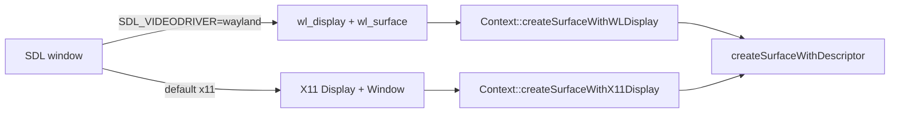

# PRD-614 — Catch the runtime-native fork up with MystralNative v0.1.6

**Status:** COMPLETE
**Priority:** P1 — native-platform catch-up; all four acceptance criteria are verified under the approved stream regression correction.
**Complexity:** 4 → MEDIUM — estimated 6–10 implementation files (+2), independent linux-arm64 build/artifact boundary (+2), no new module; risk override: none. Compatibility risk: shared surface changes must preserve default X11; arm64 dependency versions and library layouts must remain compatible with the QuickJS/wgpu host and Canvas 2D.
**Owner:** João
**Depends on:** None

## Context

`packages/runtime-native/` is a maintained fork of
[MystralNative](https://github.com/mystralengine/mystralnative). `packages/runtime-native/NOTICE`
records the upstream baseline `841fe379` (v0.1.5). Upstream `main` is now `bafab09` (v0.1.6 plus one
merged PR). That range has 15 commits and changes 17 files (+325/−98).

Triage of each upstream change against the fork (2026-10-14):

| Upstream commit(s) | Change | Fork state | Disposition |
| --- | --- | --- | --- |
| `6eeb33b`, `4e01a6e`, `a5b93f1` | Wayland WebGPU surface: `createSurfaceWithWLDisplay`, Wayland `_Compat` descriptor typedefs, `runtime.cpp` tries Wayland before X11 | `src/runtime.cpp:681` fails with "Wayland not yet supported"; `src/platform/window.cpp:233` and `src/cli/main.cpp:1130` force SDL to X11 | **Port** (Phase 1). Keep X11 as the default. |
| `9bec9d7` (part) | `queue.writeBuffer` with zero-length data returns instead of throwing | `src/webgpu/bindings.cpp:1687` throws `writeBuffer: invalid data` on `dataSize == 0` | **Port** (Phase 2). The WebGPU spec makes a zero-size write a valid no-op. |
| `9bec9d7` (part) | MSAA `resolveTarget` on color attachments, and surface tracking through the resolve target | Already in the fork: `src/webgpu/bindings_commands.cpp:1150`, `src/webgpu/bindings_frame_stream.cpp:382` | Skip — present. |
| `9bec9d7` (part) | `externalTexture` bind group layout entry | Absent. three 0.185 sets it only for XR textures (`WebGPUBackend.setXRRenderTargetTextures`), and the fork has no `importExternalTexture` | Skip — see Decisions. |
| `9bec9d7` (part) | Debug `std::cout` per buffer binding in `createBindGroupLayout` | — | Skip — log noise in a hot path. |
| `0d87767` | wgpu-native: replace `wgpuInstanceProcessEvents` (an `unimplemented!()` abort in older wgpu-native) with `wgpuDevicePoll`; libuv-less `DebugServer` stub | Pinned wgpu-native v25.0.2.2 implements `wgpuInstanceProcessEvents` (`src/lib.rs:2690`, `poll_all_devices`). The fork gates `debug_server.cpp` behind `TN_ENABLE_DEBUG_SERVER` (`CMakeLists.txt:1672`) | Skip — not applicable. |
| `4e01a6e` (part) | `#include <cstdint>` in `http_client.h` | Already present | Skip — present. |
| `aa2c18e`, `de75cf7`, `0b2b225`, `53e96a3`, `8f748eb`, `fcd2e95` | linux-arm64 build (QuickJS + wgpu), Skia `arm64` lib subdir, quiche `0.24.6-4`, Canvas 2D on arm64 | Existing `native-platforms.yml` has a linux-arm64 starter row; upstream dependency and Canvas 2D compatibility remain unproved | **Port/adapt and prove** (Phase 3): arm64 Skia, quiche `0.24.6-4`, SWC `swc-41`, libwebp aarch64, Canvas 2D on. |
| `02c86dc`, `21611f0`, `fd2d126`, CI/release workflows, `install.sh` | `.gitignore`, README, version bump, upstream CI | Fork has its own `.gitignore` (`third_party/` ignored), CI and release | Skip — fork owns these. |

## Solution

Port the two behaviour changes and complete the linux-arm64 dependency/Canvas 2D catch-up.
Only after AC-1 through AC-4 have green proofs, move the provenance baseline so the next
catch-up starts from `bafab09`.



- **Wayland.** Reuse `createSurfaceWithDisplay` with its existing `PLATFORM_WAYLAND` discriminator
  instead of renaming the X11 API. Read SDL's Wayland handles when that driver is requested; keep
  X11 as the default. Honor the task's legacy `SDL_VIDEODRIVER` spelling and SDL 3's
  `SDL_VIDEO_DRIVER`, and log the observed SDL driver. The X11-only web overlay rejects an explicit
  Wayland request rather than silently overriding it. Actual presentation is proved with the pinned same-revision Dawn replacement described in Phase 1.
- **Zero-length `writeBuffer`.** Return `undefined` when `dataSize == 0` before the null-pointer
  check, in the direct binding and in the frame-op stream decoder, to match the browser.
- **linux-arm64.** Reuse the existing `native-platforms.yml` linux-arm64 leg, adapting the native dependency/build paths for arm64 Skia, quiche `0.24.6-4`, SWC `swc-41` and libwebp aarch64. Keep Canvas 2D enabled and prove the candidate through a manually dispatched run; a skipped leg does not count.
- **Provenance.** After every required runtime/platform proof is green, update `NOTICE` to the full upstream baseline `bafab09d599bd55aeb7433ba7131c3f320334c99`. This PRD keeps the per-commit
  disposition table above; no separate record.

Risks: the Wayland path changes the shared surface function that the X11 path also uses, so the
default X11 run is proved again. The frame-op stream encodes `writeBuffer` in JS
(`src/runtime-scripts/frame-op-stream.js`), so the zero-length case must not trip the
`truncated writeBuffer record` check.

## Acceptance Criteria

- [x] AC-1 [local]: A native desktop game run with `SDL_VIDEODRIVER=wayland` under a headless Wayland compositor presents 300 non-blank frames. proof: `weston --backend=headless` + `SDL_VIDEODRIVER=wayland pnpm native:verify:desktop` — PASS 2026-10-15: complete command exits 0, observed Wayland, 300 nonblank frames; independent fixed-pose judge NEUTRAL on both runs.
- [x] AC-2 [local]: The default X11 run still presents 300 non-blank frames. proof: `pnpm native:verify:desktop` — PASS 2026-10-15 on the rebuilt candidate, observed SDL driver `x11`, 300 nonblank frames; complete audio/stability/physics/native-contract/loading/UI/bundle command exits 0.
- [x] AC-3 [local]: `device.queue.writeBuffer(buffer, 0, new Uint8Array(0))` returns without an exception on native, as on web. proof: new case in `pnpm parity` (`packages/runtime-native/conformance/registry.json`), genuine RED→GREEN on the direct binding; production encoder/decoder baseline-pass regression coverage on the frame-op stream, retaining invalid-source, detached-source and nonzero readback controls.
- [x] AC-4 [shared]: The dispatched `native-platforms.yml` linux-arm64 leg is GREEN with Canvas 2D enabled, arm64 Skia, quiche `0.24.6-4`, SWC `swc-41` and libwebp aarch64. proof: [run 38695846954](https://github.com/ThreeNativeHQ/threenative-engine/actions/runs/38695846954), successful job `116292229770` on `a8b355190995c09adecb2278e408f3b2129f72e3`; actual configure, verified locked payloads and 300-frame starter artifacts pass.

## Blocked on

None. The user approved baseline-pass production stream regression coverage on 2026-10-16; no stream RED is claimed.

## Integration Ledger

| Capability | Reachable consumer/trigger | Replaces / disposition | Evidence |
| --- | --- | --- | --- |
| Wayland WebGPU surface | `mystral` CLI → `Runtime` surface setup (`src/runtime.cpp:655`) → `Context::createSurfaceWithDisplay` with `PLATFORM_WAYLAND` | Replace the unsupported Wayland branch; retain the existing X11 path and default | AC-1, AC-2 |
| Zero-length `writeBuffer` | Game JS → `GPUQueue.writeBuffer` binding (`src/webgpu/bindings.cpp:1687`) and frame-op stream decoder (`src/webgpu/bindings_frame_stream.cpp:334`) | Throw becomes no-op | AC-3 |
| linux-arm64 Canvas 2D | `gh workflow run native-platforms.yml` → existing linux-arm64 starter leg → native dependency/build paths → Canvas 2D-enabled host | Adapt upstream dependency versions and arm64 library layouts; retain the existing workflow | AC-4 |

## Decisions

- 2026-10-16 (João, approved correction): replace the impossible frame-op stream RED requirement with honest baseline-pass production encoder/decoder regression coverage. The decoder already accepts valid zero-byte records; retain the production stream regression guard, all invalid/detached-source controls and nonzero GPU readback. Direct binding keeps its genuine RED→GREEN. No failure is manufactured.

- 2026-10-14 (AFK decision, Phase 2 detached sources): the detached-source check leaves the shared portable helper and lives in `runWriteBufferContract`'s async JS proof, because Android V8 has no `ArrayBuffer.prototype.transfer` and a `transfer`-requiring shared helper makes the parity row throw there. Desktop-focused proof keeps the fail-closed `transfer` requirement, so the case cannot pass silently on an engine that cannot detach a buffer. No public flag, new API or optional skip; no binding change.
- 2026-10-14 (AFK lane, Phase 2 detached sources): a detached `ArrayBuffer` or TypedArray reports `byteLength` 0 (ECMA-262 25.1.5.3), so the empty-source guard accepted it as a no-op. The guard now reads the intrinsic brand getter first and then probes: `new Uint8Array(data)` for ArrayBuffer, `%TypedArray%.prototype.values.call(data)` for TypedArray, both of which throw `TypeError` on a detached receiver (`quickjs.c:54120-54122`, V8 13.1 `v8-array-buffer.cc`). `ArrayBuffer.prototype.slice` is not used because it runs a species lookup on live receivers. The DataView entry keeps its getter, which already throws on detach. No `WasDetached()` virtual method and no constructor-name check, which user code can spoof.
- 2026-10-14 (AFK lane, Phase 1 source only): the user's exact command is `SDL_VIDEODRIVER=wayland pnpm native:verify:desktop`, and SDL 3.2.30 reads `SDL_VIDEO_DRIVER`, not the legacy spelling (`SDL_hints.h:3326`). Five harness sites set `SDL_VIDEODRIVER=x11` and `verify-desktop-core.mjs` wraps its run in `scripts/xvfb.sh`, so the literal command would run X11 and pass falsely. Decision: `window.cpp` resolves the requested driver from `SDL_VIDEO_DRIVER` first, then the legacy `SDL_VIDEODRIVER`, and defaults to `x11`; `verify-desktop-core.mjs` runs without the Xvfb wrapper when a Wayland driver is explicitly requested, and logs the request; `scripts/xvfb.sh` names the X11 it provides instead of silently standing in for Wayland. `runtime.cpp` logs `SDL_GetCurrentVideoDriver()` as the receipt, so a Wayland claim comes from SDL itself.
- 2026-10-14 (AFK lane, Phase 1 source only): keep `createSurfaceWithDisplay(void*, void*, int)` and add the `PLATFORM_WAYLAND` case rather than taking upstream's split into `createSurfaceWithX11Display`/`createSurfaceWithWLDisplay`. The fork's header already documents the second parameter as "X11 Window or Wayland surface", the behaviour is identical, and a public rename would touch two more call sites for no gain.
- 2026-10-14 (AFK lane, Phase 1 source only): the web overlay attaches to an X11 surface only, and `main.cpp` forces it with `SDL_HINT_OVERRIDE`. An explicit Wayland request with the overlay is refused with a message naming `ui.renderer: "native-css"` or unsetting the variable, instead of being silently overridden to X11. The X11-scoped desktop gates keep running on the X display `scripts/xvfb.sh` provides, and say so.
- 2026-10-14 (user pasted task, agent reconciliation): the explicit AC-4 supersedes the earlier linux-arm64 exclusion. Keep X11 as the default, include linux-arm64 in this PRD, and advance NOTICE only after all four acceptance criteria pass; no owner decision is pending.

- 2026-10-14 (agent, triage): skip upstream's `externalTexture` layout entry. three 0.185 sets `externalTexture` only for WebXR textures, and the fork has no `importExternalTexture`, so the entry has no consumer. Revisit when a game needs `GPUExternalTexture`.
- 2026-10-14 (agent, triage): skip the wgpu-native `wgpuInstanceProcessEvents` replacement. The pinned wgpu-native v25.0.2.2 implements that function, so the abort that upstream fixed cannot occur.

## Execution Phases

#### Phase 1: Wayland surface
**Status:** COMPLETE — the normal build and complete default-X11 and explicit-Wayland commands pass on the same candidate. The pinned same-revision Dawn replacement preserves both surfaces; independent fixed-pose visual judgment is NEUTRAL.
**Files:** `include/mystral/webgpu/context.h`, `src/webgpu/context.cpp`, `include/mystral/webgpu_compat.h`, `src/runtime.cpp`, `src/platform/window.cpp`, `src/cli/main.cpp`, `scripts/verify-desktop-core.mjs`, `scripts/xvfb.sh`, `__tests__/linux-video-driver-routing.spec.ts` (all under `packages/runtime-native/`)
**Implementation:** Port the surface behavior from `6eeb33b` and `4e01a6e` through the existing `createSurfaceWithDisplay` platform discriminator. Keep X11 as the default and preserve Dawn as the Linux x64 backend.
- [x] Native desktop build compiles with the Wayland descriptor. proof: `pnpm native:build` — PASS 2026-10-15, 384 targets, actual CLI and tools linked.
- [x] AC-2 default X11 run. proof: `pnpm native:verify:desktop` — PASS 2026-10-15, complete command exits 0; two preceding core captures also pass 300/nonblank.
- [x] AC-1 Wayland run and visual preservation. proof: `weston --backend=headless` + `SDL_VIDEODRIVER=wayland pnpm native:verify:desktop` exits 0; fresh independent judge returns NEUTRAL on every fixed-pose pair and repeatability set.

Candidate evidence (2026-10-15): the normal build and complete X11 command pass on the rebuilt CLI. Two core captures report observed driver `x11`, 300 frames and nonblank 1280×720 images (`artifacts/prd614-x11-after-{1,2}.png`). First explicit legacy-env Wayland run reaches driver `wayland`, then Dawn rejects `SurfaceSourceWaylandSurface` with zero formats (`artifacts/prd614-wayland-first-failure-runtime.log`); no unchanged retry. The signed user-space Weston passed socket/shm/EGL smoke and its owned process was stopped. The pinned Dawn archive lacks the Wayland Vulkan loader entry. Its [exact-commit replacement build](https://github.com/ThreeNativeHQ/threenative-engine/actions/runs/38695725341) enables Wayland and X11 in an isolated, digest-pinned upstream-compatible container, preserving the backend. The producer and publication pass. The downloaded archive SHA-256 is `bafce657936c161dc14642ddb61f71dcf6528b7ae90c40698831797e9c43d530` (28,193,047 bytes); independent extraction verifies installed headers, x86_64 ELF and actual Wayland/Xcb/Xlib loader entries. The dependency cache is a prerelease and excluded from Latest; publication now sets both flags explicitly. Actual replacement-library Wayland presentation now passes 300 frames and a nonblank 1280×720 capture with 4,096 overlay pixels (`artifacts/prd614-wayland-gl-smoke.png`, `/tmp/prd614-wayland-gl-smoke.log`): observed SDL driver `wayland`, NVIDIA RTX 2080/Vulkan, 12 surface formats and 301 presents. Weston remains headless with its supported `--renderer=gl`, using NVIDIA EGL and DMA-BUF modifiers; its default no-op renderer exposed zero formats. The exact full `SDL_VIDEODRIVER=wayland pnpm native:verify:desktop` command exits 0 (`/tmp/prd614-wayland-gl-final-full.log`), including all 50 native contracts, audio/stability/physics/loading/UI and nine external-bundle tests. Its core reports actual driver `wayland`, 300 frames, nonblank 1280×720 and 4,096 overlay pixels. Default full X11 also exits 0 on the same candidate (`/tmp/prd614-x11-dawn-final-full.log`). Final-source `pnpm typecheck && pnpm lint` exits 0; lint reports existing warnings without fixes. Canonical `CMAKE_BUILD_PARALLEL_LEVEL=2 pnpm --filter @threenative/runtime-native native:coverage` exits 0: 47 targets executed, three configured blockers reported, 78.39% total coverage and every existing floor met. The generated record binds source digest `4694f6c260feec4929114d04f323617c5d8b260073cdb3394f70e751c2122dce`. The final authoritative `taskset -c 0-4 pnpm test` exits 0 on `1c908738e2f4834fa9fca767e0253311442f0b3d`: root 777 files pass / three skip, 10,590 tests pass / 20 skip; native 138 files pass, 1,594 tests pass / 62 skip. A fresh independent read-only review exits 0 with no actionable defects. The first independent X11 visual judgment returned REGRESSION because the rotating cube poses differed; that failure is resolved by deterministic recapture on actual baseline and final candidate binaries. Identical scene bytes (`b72c7292bab250349fc7bc0ce234c2507182d2a6ecfc285c27e30770c7cd8b73`) freeze only the two cube rotation updates. Two runs each of baseline X11, final X11 and final Wayland pass 300 frames/nonblank/overlay checks. The fresh independent judge returns NEUTRAL for all four before/after pairs, all three repeatability sets and overall: pose, silhouette, position, color/exposure, overlap and overlay are preserved. Labelled images are published on the existing orphan `prd614-screenshots` branch under `fixed-pose/`; original failed-pose images remain available. Fresh generated-coverage and dependency-SBOM contracts pass 13/13. The separate root freshness fixture exposed a generator bug: an improved platform measurement retained a floor more than five points below it. The normal generator now ratchets floors upward while retaining tighter floors and regression rejection; actual regeneration raises platform 63.70%→63.81%. Its semantic fixture has genuine RED→GREEN. The first regeneration stopped at a transient timestamp-query failure; the isolated contract and one bounded complete retry pass unchanged. The interrupted full suite has no passing verdict; the subsequent frozen-candidate full run passes as recorded above.

Verification refresh (PR507): the engine native verification wrapper now scopes child `TMPDIR` to its existing owned runtime directory, fixing the real PulseAudio `pulse-*` scratch leak. Separately verified phases: native 1,595 pass / 62 skip, physics 29 JS + 23 Rust pass, strict publint pass, namespace 1→1 (`artifacts/pr507-validation/native-final.log`); root 10,590 pass / 20 skip across 780 files, namespace 1→1, exit 0 on `0c5118fbd` plus the local 18-line fix (`artifacts/pr507-validation/root-unit-final.log`). Final typecheck, lint and documentation checks also pass.

#### Phase 2: Zero-length `writeBuffer`
**Status:** COMPLETE — genuine direct RED→GREEN; approved production stream GREEN→GREEN regression coverage; merged-candidate direct, stream and default replay commands exit 0.
**Files:** `src/webgpu/bindings.cpp`, `conformance/registry.json`, the shared conformance proof and existing native replay harness.
**Implementation:** Validate genuine sources and ranges before the empty-write no-op; preserve malformed and detached-source rejection. Exercise the real frame-op decoder without manufacturing a failure.
- [x] AC-3 direct binding path, red then green. proof: focused native Dawn+V8/Vulkan harness exits 1 on genuine empty sources before the fix and 0 after; nonzero readback and invalid-source controls pass.
- [x] AC-3 production frame-op stream regression guard. proof: actual production encoder supplies five zero-byte and two nonzero records; all seven reach the decoder and pass before and after, with invalid/detached-source rejection and GPU readback preserved. Rebuilt merged-candidate direct, stream and default replay commands exit 0; `artifacts/pr507-validation/{zero-direct-merged,zero-stream-merged,replay-default-merged}.log`.

Verified evidence (2026-10-15): the shared proof covers five zero-size writes, seven invalid-source rejections and GPU readback `[11,22,55,66]`. Direct RED→GREEN logs are `packages/runtime-native/artifacts/conformance/prd614-zero-direct-{before,after}.log`; stream before/after logs use `prd614-zero-stream-{before,after}.log` in the same directory. Genuine detached ArrayBuffer/TypedArray/DataView assertions separately exposed and fixed an empty-source guard regression, with direct RED→GREEN and stream PASS/PASS (`prd614-detached-{direct,stream}-{before,after}.log`). These transfer-based checks stay in the desktop harness so the shared conformance case remains portable. The final focused direct, stream and default replay suite all exit 0 (`prd614-portable-{direct,stream,replay-default}.log`).

The rebuilt actual CLI passes full `pnpm native:verify:desktop` (exit 0; `/tmp/prd614-x11-candidate-full.log`). The selected new parity row passes both headed Chromium WebGPU (NVIDIA/turing) and the rebuilt desktop host; each runner exits 2 because 107 unselected rows are blocked, not because the selected row fails. Final reports are `packages/runtime-native/artifacts/conformance/prd614-zero-web-final/report.json` and `prd614-zero-desktop-candidate/report.json`; desktop raw log is `/tmp/prd614-zero-desktop-candidate.log`. The stream result is GREEN→GREEN regression coverage; the approved requirement does not claim a stream RED.

Reproduce from repository root:
```sh
packages/runtime-native/node_modules/.bin/esbuild packages/runtime-native/conformance/scenes/shared/queue-write-buffer-proof.js --bundle --format=iife --global-name=writeBufferProof --outfile=packages/runtime-native/artifacts/conformance/prd614-write-buffer-proof.js
cmake --build packages/runtime-native/build/tn-linux --target threenative-frame-op-stream-replay-test -j2
packages/runtime-native/build/tn-linux/threenative-frame-op-stream-replay-test write-buffer-direct packages/runtime-native/artifacts/conformance/prd614-write-buffer-proof.js
packages/runtime-native/build/tn-linux/threenative-frame-op-stream-replay-test write-buffer-stream packages/runtime-native/artifacts/conformance/prd614-write-buffer-proof.js
```

#### Phase 3: linux-arm64 proof, then provenance
**Status:** COMPLETE — earlier dispatched linux-arm64 proof retained at its actual SHA; AC-1 through AC-4 supported and NOTICE updated to v0.1.6.
**Files:** Native dependency/build scripts, arm64 Skia/Canvas 2D configuration, existing `.github/workflows/native-platforms.yml` only if required, and `packages/runtime-native/NOTICE`.
**Implementation:** Adapt the upstream linux-arm64 changes to the existing leg; include arm64 Skia, quiche `0.24.6-4`, SWC `swc-41` and libwebp aarch64 with Canvas 2D enabled. Dispatch the workflow against the candidate branch and require its linux-arm64 leg to be GREEN. Only after AC-1 through AC-4 pass, set `Upstream provenance baseline:` to the full hash and name v0.1.6.
- [x] linux-arm64 dependency/build configuration includes arm64 Skia, quiche `0.24.6-4`, SWC `swc-41`, libwebp aarch64 and Canvas 2D enabled. proof: actual job `116292229770` configures `TN_ENABLE_CANVAS2D="ON"`, resolves `Release/arm64/libskia.a` and aarch64 libwebp, and verifies `quiche-linux-aarch64` / `swc-linux-aarch64` against the candidate lock.
- [x] AC-4 dispatched linux-arm64 leg is GREEN. proof: [run 38695846954](https://github.com/ThreeNativeHQ/threenative-engine/actions/runs/38695846954), candidate `a8b355190995c09adecb2278e408f3b2129f72e3`, attempt 1, job `116292229770` concludes success; starter and container reports each pass 300 frames and nonblank captures.
- [x] After AC-1 through AC-4 are green, NOTICE names `bafab09d599bd55aeb7433ba7131c3f320334c99` and v0.1.6. proof: `git diff -- packages/runtime-native/NOTICE` + `pnpm check:docs` (final document check recorded below)

Verified CI evidence (2026-10-15): the exact-candidate receipt binds the successful job, build configuration and reports. The starter capture has 13,117 colors and the container capture 13,145; movement, collection/restart, visibility and diagnostics assertions pass. Log lines 2861/2870 verify the locked SWC/quiche arm64 payload IDs; their candidate lock URLs are `swc-41/swc-linux-arm64.zip` and `quiche-0.24.6-4/quiche-linux-arm64.zip`. The preceding titles print unchanged x64 default version strings, which are cosmetic and do not identify the verified archives. The entire dispatched native matrix subsequently concludes SUCCESS on `a8b355190995c09adecb2278e408f3b2129f72e3`; this is the exact earlier dispatch, not a claim about future CI on the final candidate.

Merged-source reconciliation (2026-10-16, `746e1fff0`): `git diff --exit-code 1c908738e2f4834fa9fca767e0253311442f0b3d HEAD --` over the surface context/header, runtime, window/CLI routing, desktop-core harness, direct binding, frame decoder, production JS encoder, shared proof and replay harness returns 0. Existing dependency payload descriptors are identical; only `v8-linux-arm64` is added. The earlier X11 and headless-Wayland reports both bind binary SHA-256 `9e92191ce792a0603789a32450b80dd8a9ef287631bd53671151f75be94f35af`; their `completedAt` values are timestamps, not source SHAs. Their full-command and fixed-pose visual proofs are reused for the unchanged surface behavior. Console/pipeline output changed since that revision, so the actual merged host and replay executable were rebuilt with `cmake --build packages/runtime-native/build/tn-linux --target threenative-frame-op-stream-replay-test mystral -j2` (exit 0). Fresh `node packages/runtime-native/scripts/verify-desktop-core.mjs` exits 0 on X11: 300 frames, nonblank 1280×720. Fresh current-source Wayland core verification also passes 300 nonblank 1280×720 frames (`artifacts/pr507-validation/wayland-fresh-core-report.json`), using actual host SHA-256 `396fed8f450aa74a24ab447ce2e95caababa6ef9cf9e859edd1947664290cfc2`; rebuilt replay SHA-256 is `b67d7b9c231a47ac1bd96eb6d9c65c3e90333eb6948536435c0e58be8056ade8`. This refresh proves the Wayland core only; full qualification and the NEUTRAL fixed-pose visual verdict remain historical. The current full Wayland qualification is in progress with no result claimed; no fresh visual run is claimed. Final-candidate CI is still required: manual run `38841301134` belongs to the previous `3f476eb61` head.

The four original zero-write logs were inspected: direct-before reports the genuine empty Uint8Array/ArrayBuffer/DataView rejection; direct-after has no proof failure; both stream logs report seven decoded records and checked GPU readback. Those logs contain no source SHA; runtime millisecond counters are not provenance. The existing harness fails closed on missing proof input, failed async assertions, wrong transport, absent decoder crossings or a record count other than seven. A fresh esbuild bundle of the current shared proof and rebuilt merged executable pass `write-buffer-direct`, `write-buffer-stream` and the default replay contract (all exit 0). Assertions retain five empty writes, seven invalid sources, three desktop detached sources and nonzero readback `[11,22,55,66]`. The stream observer counts all seven actual production encoder/decoder writes. This refresh binds the GREEN result to current source; the historical RED is not relabelled as a merged-source run.

The actual linux-arm64 dispatch remains run `38695846954` / job `116292229770` at `a8b355190995c09adecb2278e408f3b2129f72e3`. It proves the catch-up dependencies and Canvas 2D on that earlier candidate; the merged cached-V8 default is a later develop change, not rerun AC-4 evidence. Focused merged dependency-provenance, native coverage/generator/digest contracts pass 36/36; `linux-arm64-v8-source.spec.ts` passes 28/28. No future CI result is claimed.

Final local validation (2026-10-16): canonical `CMAKE_BUILD_PARALLEL_LEVEL=2 pnpm --filter @threenative/runtime-native native:coverage` exits 0 after real compilation/execution: 47 native contract targets, three explicitly configured blockers, 19,492/24,858 lines (78.41%). Generated source digest is `1a8ed34cf063a9530e8fa11b2722ae0b4c475402ee1baef998b5dea0acd3a4d7`; every existing tighter floor and the ratchet policy are retained. No output was hand-picked. `pnpm exec vitest run scripts/__tests__/check-native-coverage.spec.ts` passes 7/7, including exact-input freshness, upward ratchet and regression rejection. `pnpm check:docs` and all six required prose-lane spec files pass (248 tests); `git diff --check` passes. Logs: `artifacts/pr507-validation/{coverage-merged,coverage-freshness-ratchet-merged,focused-native-contracts,arm64-source-contract,docs-merged-final,docs-contracts-merged-final}.log`. `pnpm prd:progress docs/PRDs/done/PRD-614-mystralnative-upstream-catch-up-v0.1.6.md` reports 3/3 phases, 8/8 phase boxes, 4/4 acceptance and `prd:100% — ready`. No whole-root suite, typecheck or lint was rerun for these documentation/generated-output edits.

Fresh compiled provenance: merged replay executable SHA-256 `b67d7b9c231a47ac1bd96eb6d9c65c3e90333eb6948536435c0e58be8056ade8`, actual host `396fed8f450aa74a24ab447ce2e95caababa6ef9cf9e859edd1947664290cfc2`, freshly bundled shared proof `4668a9ad5c57392814ed981551112554036d356630ae0845712941ce5ae94b06`. These identify this local rerun, not the historical before arms or earlier dispatched arm64 job.
