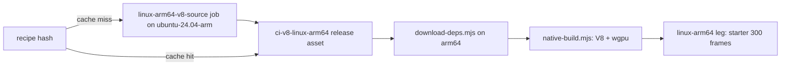

# PRD-615 — V8 on the linux-arm64 native host

**Status:** COMPLETE — implementation and both acceptance criteria are verified: cached V8 startup, 300 non-blank ARM64 frames, strict six-run improvement and same-pose visual acceptance. Final-head full CI, required joins, PR readiness and merge queue remain pending delivery gates; no whole-workflow green result is claimed.
**Priority:** P1 — supported linux-arm64 engine selection and measured improvement; the filed scope is now complete.
**Complexity:** 6 (MEDIUM) — about 6 implementation files, a new V8 build recipe, a CI build-and-cache boundary; risk override: none.
**Owner:** João
**Depends on:** PRD-614 arm64 dependency pins ([PR #507](https://github.com/ThreeNativeHQ/threenative-engine/pull/507)); the four prerequisite dependency/build files are inherited from its published commit `a8b355190`.

## Context

Before this change, the linux-arm64 desktop host ran QuickJS over wgpu-native (`packages/runtime-native/scripts/download-deps.mjs:1548`).
Every other desktop host runs V8 13.1.201.22 from `kuoruan/libv8`, which publishes no Linux arm64
archive (`native-deps.lock.json`, `v8-linux-x64`). The comment in `native-platforms.yml:96` says a
source V8 build is not allowed in CI, but the same workflow already builds Android V8 from source
once per recipe and caches the payload in the `ci-v8-android` release
(`native-platforms.yml:180-255`, `.github/actions/android-v8-source`, `scripts/build-android-v8.mjs`).

João, 2026-10-14: "i dont like QuickJS. V8 is way more performant." Upstream MystralNative also
ships linux-arm64 with QuickJS only (see [PRD-614](https://github.com/ThreeNativeHQ/threenative-engine/pull/507)),
so this is fork-owned work with no upstream to port.

## Solution

Build V8 13.1.201.22 for linux-arm64 with the same build-once, cache-by-recipe pattern as Android.
Then let the arm64 host select V8.

- **Recipe.** Same V8 version, same `v8_monolith` shape and same GN flags as the x64 archive, so
  the headers and ABI the runtime compiles against do not change. Build natively on
  `ubuntu-24.04-arm`, not by cross-compile. Follow the Android producer's fetch, integrity,
  transactional promotion and recipe-hash pattern while keeping its script and cache unchanged.
- **Cache.** A `linux-arm64-v8-source` job in `native-platforms.yml` runs only on a recipe-hash
  miss and uploads `v8-linux-arm64-<recipe-hash>.tgz` to a `ci-v8-linux-arm64` release, as the
  Android job does. No new workflow file.
- **Select.** `download-deps.mjs` fetches that asset on arm64. `native-build.mjs` stops forcing
  QuickJS on arm64. Other targets keep QuickJS where they use it today.

Risks: a native V8 build on a hosted runner can exceed its time limit. Measure the first run. If it
does not fit, cross-compile on the x64 pool with `target_cpu="arm64"` and a Debian arm64 sysroot.
The hosted arm64 runner has no GPU, so the speed comparison measures JS frame time, not GPU time.

## Acceptance Criteria

- [x] AC-1 [shared]: The linux-arm64 starter boots on V8 and presents 300 non-blank frames. proof: current run `38784079933`, arm64 job `116591638231`, starter artifact `11998526511`: report passes 300 frames, 13,139 colors, 187 cyan and 201 magenta asset pixels, with overlay; raw runtime identifies V8 `13.1.201.22`. Screenshot SHA-256 `5bcd522ba2cd23a5ccdacf685fb64bfe0d324ddbcbba42424c09b74f94357ed3`; raw proof `/tmp/prd615-epoch-arm-starter`. The same published archive is consumed; source-cache reuse was proven in run `38728195060`.
- [x] AC-2 [shared]: On the same arm64 runner, the starter's median JS frame time on V8 is lower than on QuickJS, across paired runs. proof: run `38784079933` at `c312cee5a9ad5bdf60da347bfd89423af0022c38`, strict six-run comparison PASS: QuickJS 30.42/31.05/30.70 ms (median 30.70), V8 6.08/6.17/6.06 ms (median 6.08); twelve steady windows report `compiling=false` with the same bundle, features and adapter. Four actual aligned ARM captures pass seven assertions each; fresh read-only visual judge is NEUTRAL / PASS overall, for both QuickJS/V8 pairs and both within-engine repeat comparisons (ARM software Vulkan only).

## Integration Ledger

| Capability | Reachable consumer/trigger | Replaces / disposition | Evidence |
| --- | --- | --- | --- |
| V8 on linux-arm64 | `pnpm native:build` on arm64 → `scripts/native-build.mjs` engine selection → `mystral` binary | QuickJS stops being the arm64 default; QuickJS stays where other targets use it | AC-1 |
| Cached arm64 V8 payload | `native-platforms.yml` recipe-hash check → `ci-v8-linux-arm64` release → `download-deps.mjs` | New; same pattern as `ci-v8-android` | AC-1 |

## Decisions

- 2026-10-14 (João): linux-arm64 uses V8, not QuickJS, for speed.
- 2026-10-15: the pinned V8 toolchain downloads Linux x64 binaries, so the native arm64 producer uses the DEPS-pinned `gn/gn/linux-arm64` CIPD binary (exact SHA-256 and AArch64 ELF checked, native `--version` required before generation), plus Ubuntu arm64 LLVM 18.1.3 packages at exact version `1:18.1.3-1ubuntu1`, recorded in its receipt. The producer is an explicit manual-dispatch auxiliary job; ordinary product qualification retains its existing inventory. Linux keeps its small fetch/integrity helpers local because modifying the Android build script invalidates its expensive cache.

## Execution Phases

#### Phase 1: arm64 V8 payload
**Status:** COMPLETE — source compilation, full payload/receipt/header audit, immutable publication and the second release-cache hit passed in runs `38720103918` and `38728195060`; compiler installation and source compilation were skipped on the cache hit.
Cold run [38699446987](https://github.com/ThreeNativeHQ/threenative-engine/actions/runs/38699446987), source job `116303925220`, fetched the pinned sources and installed the exact compiler packages, then failed before compilation: depot_tools shadowed distro Ninja with its uninitialized launcher. Both GN bootstrap and V8 compilation now call `/usr/bin/ninja` explicitly; the 20 producer tests pass. A real distro Ninja 1.11.1 command-selection probe in an isolated Debian container passed both calls despite a poisoned PATH whose generic Ninja exited 88. No payload was produced or published. Retry [38701515417](https://github.com/ThreeNativeHQ/threenative-engine/actions/runs/38701515417), source job `116310671878`, compiled all 295 GN bootstrap targets, then failed copying over the read-only CIPD launcher. Bounded replan found upstream already provides the pinned native GN: exact V8 DEPS selects `gn/gn/linux-${arch}` at revision `95b0f8fe31a992a33c040bbe3867901335c12762`. Its official arm64 ZIP SHA-256 is `c6d06639cb71ae9771b4e5881e387476293c2bf47c64645d2ce1260a0509dc0b` (3,245,617 bytes); extracted GN is AArch64 ELF64 with SHA-256 `31739b62d88843b32726c4ace0c93b36b65efbcba89bb033891d454766d9e689`. Recipe 2 removes the unused GN source bootstrap/overwrite, fixes relative `custom_deps` keys, and verifies the native DEPS GN binary/hash/version before use. All V8/build license files remain; GN is a build tool and is not distributed. Run [38702992130](https://github.com/ThreeNativeHQ/threenative-engine/actions/runs/38702992130), source job `116315553882`, passed native GN identity checks and reached GN generation, then failed because GLib development pkg-config modules were absent. The Linux source job now installs `libglib2.0-dev` alongside pkg-config, records their exact installed package version/architecture and all four GLib module versions, and checks the adjacent system-C++ `libatomic` link prerequisite before building. Pinned Linux GN configs expose no other pkg-config modules in that adjacent compiler path. Subsequent run [38705493315](https://github.com/ThreeNativeHQ/threenative-engine/actions/runs/38705493315), source job `116324390005`, generated 565 GN targets successfully but Ninja stopped before compilation: Chromium defaults expected Clang 20 builtins under its target-triple layout, while the pinned compiler is Ubuntu Clang 18. The producer now declares Clang 18 and maps a private SDK directory to the exact compiler, resource headers and pinned compiler-rt 18 archive; V8 source files and features are unchanged. The official runtime package `libclang-rt-18-dev=1:18.1.3-1` contains 278 verified AArch64 objects with archive SHA-256 `af24a6be2920609e5dea1218caad93a17885497e764cef2dc78512fdec159e98`. The installed compiler-rt package copyright ships as a hashed build-dependency notice; embedding is not assumed and the actual monolith must be audited before publication. Its receipt identity is mandatory; native compilation/linking/execution of a tiny builtins caller must pass before GN/Ninja. Run [38709487399](https://github.com/ThreeNativeHQ/threenative-engine/actions/runs/38709487399), source job `116337148007`, stopped earlier at APT: the hosted image already contained newer compiler-rt, disproving the pristine-image assumption. The solver planned exactly one compiler-rt downgrade and no removals; the exact-version install now explicitly allows that downgrade. Producer recipe bytes remain unchanged; the SDK adapter has not executed on arm64 yet. Cancellation was requested for superseded own failed-source runs `38699446987`, `38701515417`, `38702992130`, `38705493315` and `38709487399` to release unused Android/Windows chains; all five source logs are retained, the first four saved their source cache, and the fifth stopped before source modification. No PRD-614 run was cancelled. Source contracts pass 24 tests; native preflight and full V8 compilation still need a fresh cold run.
The published PRD-614 prerequisite files are inherited byte-for-byte: `CMakeLists.txt`, `native-deps.lock.json`, `scripts/download-deps.mjs` and `tests/dependency-provenance.test.mjs`. The package's dependency-provenance spec passed 10 tests; version-pin, build-matrix and native-profile contracts passed 19 tests. The coherent PRD-614 native runtime prerequisite patch is also prepared locally: all 11 files byte-match its immutable destination blobs (patch SHA-256 `8062f0d25a3414839ab0eadf8a37ec42ca137cc8850254e299df7a804a9e44c9`), including the final per-frame binding/driver fixes and Dawn pin. The same 29 focused dependency/profile checks pass. The coherent runtime is included in PRD-614's published candidate `15d39`; both engines use the same inherited runtime bytes for final measurements. The seven related regression/conformance files and measured coverage record are inherited exactly from `bccd65166`; the coverage source/test digest matches all 240 inputs. The verified coverage-generator ratchet repair, its semantic regression test and canonical regenerated record are inherited from `1c908738e2`; the 240-input digest matches `4694f6c260feec4929114d04f323617c5d8b260073cdb3394f70e751c2122dce`. The recorded platform floor is now 63.81%; all seven root coverage-floor fixtures and three native digest-scope fixtures pass. Linux routing specs pass three tests. The earlier regression selection had 54 passes, two skips and four failures due to missing native binaries. After this checkout built its own fixtures, the same selection passed 59 tests with one skip; this does not claim arm64 runtime acceptance.
**Files:** `packages/runtime-native/scripts/build-linux-arm64-v8.mjs` (new, follows the Android producer pattern without changing its cache inputs), `.github/workflows/native-platforms.yml`
**Implementation:** Pin the recipe (version, source commit, GN args, recipe number). Add the build-and-upload job on a recipe-hash miss.
The source job requires `gh workflow run native-platforms.yml --ref feat/prd615-linux-arm64-v8 -f build_linux_arm64_v8=true`. On a feature branch it uploads only the verified tarball and SHA-256 artifact; publication is restricted to main/develop. The parent manually publishes those exact reviewed artifact bytes to `ci-v8-linux-arm64` before the second cache-hit dispatch. Existing recipe-named assets are immutable: identical bytes are reused and a mismatch fails.
- [x] Recipe builds a `v8_monolith` for aarch64 with the x64 archive's headers. proof: source job `116372375638` in [run 38720103918](https://github.com/ThreeNativeHQ/threenative-engine/actions/runs/38720103918) passed; the actual V8 13.1.201.22 header and all 1,286 monolith members verify as AArch64. The complete 126-file receipt verifies locally. All 108 public `*.h` files have identical relative paths and SHA-256 values in the installed x64 archive and verified arm64 payload (zero missing, extra or differing headers).
- [x] A second run reuses the cached release asset with no rebuild. proof: verified run `38728195060`, source job `116399254006`: the job logged `Published Linux arm64 V8 asset hit: v8-linux-arm64-1632c350bb78a60721a092ab696f0b3d274dbb0e5b926ebdca2c1b5edb8bb262.tgz; no rebuild.` at `2026-10-15T11:34:19.0996589Z`; compiler installation and source compilation were skipped.

#### Phase 2: Select V8 on arm64
**Status:** COMPLETE — default V8 selection, fail-closed receipt/SBOM consumption and AC-1 startup are verified. Historical implementation and qualification record: local default selection and fail-closed locked-cache consumption are implemented; actual published payload descriptor is pinned locally. Fresh/cached downloader receipt and SBOM sidecar integration pass; canonical nested receipts take precedence after architecture changes. AC-1 is now proven by the corrected arm64 starter below; paired performance remains open. The first cached qualification (`38728195060`, arm64 job `116399253883`) failed before scaffolding at the final native executable links: V8 `isolate.o` and `wasm-code-manager.o` require `__atomic_compare_exchange`, but the consumer link omitted `libatomic`. Both `mystral` and `mystral-tools` failed; no starter, paired-performance or passing identity artifact was produced. The source cache-hit proof remains valid. The local correction appends `atomic` only to V8 system libraries on Linux `aarch64`/`arm64`, preserving x64 and Android. Executing the existing CMake system-library branch across five platform/architecture cases failed both ARM64 cases before the correction and passed all five after it; the native profile and registered-temporary-directory selection passed 12 tests. Full typecheck and lint pass. The broader focused selection initially passed 28 tests and correctly rejected the inherited coverage record as stale because the CMake input changed. Canonical `native:coverage` then passed with build parallelism two: 47 contract targets executed, three explicitly disabled targets retained, 19,470/24,835 lines covered (78.40%), and every retained floor unchanged. The generated record now carries digest `41cd2268ff5ae99a9e7a01b1353e376cff1113ad30646e32384d6cd1c3584dae`; freshness/profile/build-matrix/temp-cleanup/evidence-budget checks passed 38 tests, native coverage source fixtures passed nine tests, and `pnpm budgets` passed. No digest, measurement or floor was edited manually. Actual arm64 link/startup/performance acceptance remains open; the corrected full workflow has not run.
**Files:** `scripts/download-deps.mjs`, `scripts/native-build.mjs`, `native-deps.lock.json`, `packages/runtime-native/AGENTS.md` (all under `packages/runtime-native/` except where named)
**Implementation:** Add `v8` to the arm64 `desktopDeps`, resolved from the cached asset with its SHA-256. Drop the arm64 QuickJS override. Update the arm64 comments in `download-deps.mjs` and `native-platforms.yml`.
- [x] Engine-selection and pin specs pass. proof: version-pin/build-matrix/profile/qualification/paired-harness specs pass 54 tests; dependency provenance and SBOM specs pass 16 tests. The actual released archive installs through the downloader with one locked fetch and reuses its verified cache with zero fetches; SBOM includes `v8-linux-arm64`. This is acquisition proof on the x64 development host with the platform selector isolated, not an arm64 runtime claim.
- [x] AC-1 arm64 starter on V8. proof: current run `38784079933`, arm64 job `116591638231`, starter artifact `11998526511` passes 300 non-blank frames, 13,139 colors, 187 cyan and 201 magenta pixels, with overlay; raw log identifies V8 `13.1.201.22` (raw proof `/tmp/prd615-epoch-arm-starter`).

#### Phase 3: Speed proof
**Status:** COMPLETE — run `38784079933` at `c312cee5a9ad5bdf60da347bfd89423af0022c38` passes the strict same-VM three-pair comparison (QuickJS median 30.70 ms, V8 median 6.08 ms); four aligned ARM captures pass the actual pose audit and fresh read-only visual judgement (NEUTRAL / PASS, ARM software Vulkan scope).
**Files:** `.github/workflows/native-platforms.yml` (paired perf step in the arm64 leg)
**Implementation:** Build both engines in one job and run the same starter scenario on each, alternating, at least three runs per engine.
- [x] AC-2 V8 beats QuickJS on JS frame time. proof: run `38784079933`, unchanged strict paired collector PASS across three runs per engine: 30.70 ms QuickJS median versus 6.08 ms V8 median; actual same-pose audit PASS and fresh visual judgement NEUTRAL / PASS, scoped to ARM software Vulkan.

## Historical execution record

The following records retain earlier failures and the pending state at each checkpoint. They do not override the current acceptance results below.

The sixth producer attempt (`38711129527`, source job `116342598739`) completed all 1,624 Ninja targets, including the V8 monolith, after native SDK preflight and GN generation. Packaging then failed because the pinned Chromium build checkout has no root `LICENSE`. The required build notice now comes from its owning Chromium revision `054463d932e1883832422ab7280c71899cde8ae7`, verified as 1,536 bytes and SHA-256 `368cca1106be99d39ecd32a38d8305585d802a475effb66380b91ffc9bcf709b`. A one-off migration accepts only the exact saved attempt cache and old/new producer script hashes with every other build-state field identical; native identity checks, SDK preflight, GN and Ninja rerun. The successful follow-up producer, verified receipt and cache publication are recorded below. Runtime acceptance criteria remain open.

The corrected source job `116372375638` succeeded in run `38720103918`: it restored the exact previous compiled-source cache, regenerated 565 GN targets and reported `ninja: no work to do`. Root independently verified the downloaded artifact. The exact 18,745,524-byte archive is published as release asset `643500847` in [`ci-v8-linux-arm64`](https://github.com/ThreeNativeHQ/threenative-engine/releases/tag/ci-v8-linux-arm64), with SHA-256 `ac379519d7e26039831ee7945018c67b48d98e30d04fe760bf5c684d61b82081`; a fresh remote download matches. The tag matches none of the npm/native product-release triggers, and no workflow subscribes to release publication. The payload receipt SHA-256 is `dbec689e6213490b1a581b27cc44fe86c5e6e54dfba2fb1235902f3cc074ab11`. All six required notices are included; the pinned compiler-rt archive's 278 objects share no member names or identical object bytes with the 1,286-object monolith, so its copyright is described as a build dependency notice. A second producer release-cache-hit workflow and actual arm64 starter/performance proof remain pending. The earlier x64 desktop UI budget run failed at 2.14 ms p95 against the unchanged below-2-ms requirement; the subsequent desktop parity job `116374639053` in run `38720103918` passed. The historical failure is retained without a gate waiver.

Local full `pnpm typecheck` and `pnpm lint` pass after building the checkout's missing workspace outputs. This checkout built its own V8/Dawn host plus native contract targets (502 tasks) and QuickJS host/two required contract targets (411 tasks), sequentially with two workers, Canvas2D on and native web UI/physics off. The previously missing-binary regression selection now passes 59 tests with one skip; this is x64 fixture proof, not arm64 starter or performance acceptance. For the pending visual judge, the ARM64 job separately runs the existing starter `native-playtests/render-chain.playtest.json` twice per engine on the same measured bundle, seeded scene and default fixed-step harness clock. Full reports/screenshots retain the actual camera, scene and recorded tick observations for comparison; BEFORE/AFTER labels, observed same-pose verification and a fresh judge remain pending. These four captures replace wall-time screenshot launches and do not alter the six performance launches.

Fresh read-only review of local candidate `4bd73df426` found that warm V8 cache validation did not enforce the lock's raw producer receipt SHA-256. Root cancelled its still-running full suite (`93125`, exit 130) to repair this real defect; that interrupted run is not a passing gate. The downloader now requires the selected payload's 64-hex receipt pin and exact raw `build-receipt.json` hash on fresh and warm paths before the existing full producer verification. A regression first reproduced acceptance of a substituted AArch64 object plus recomputed self-consistent receipt; it now fails before any fetch. Fresh acquisition also rejects absent, malformed or incorrect pins. Dependency-provenance/SBOM tests pass 16 tests; required full typecheck and lint pass after the repair. The real published archive also passes the new warm receipt-pin check with zero fetches. Producer bytes, workflow, native feature criteria and published asset are unchanged; the new full suite and arm64 acceptance remain pending.

Root's subsequent full suite at `339c3540b` completed with six failures (10,623 passes, 20 skips): five synthetic CI receipts still named the former ARM64 QuickJS default, while the strict production verifier correctly required V8; the temp-directory guard also found two test files bypassing the registered cleanup helper. The smallest failing selection reproduced all six failures (85 passes). The shared synthetic receipt now names V8, and both test files use the existing `makeTempDirSync` cleanup registration without a guard exception. Production receipt verification, producer bytes, workflow, runtime pins and acceptance criteria are unchanged. The focused CI/producer/temp selection passes 119 tests; dependency-provenance/SBOM tests pass 16 tests. Required full typecheck and lint pass after this fixture repair. The repaired full-suite result is pending.

The corrected frozen local candidate `c0bef30f7cd97cb5abe778882c042358b1797ff3` passed root's complete `pnpm test` run: 779 root test files passed (three skipped), 10,629 tests passed (20 skipped), 552.95 seconds; the native package passed 1,591 tests (62 skipped), and physics parity passed 29 tests. Suite-owned temporary directory counts stayed at one before and after. Fresh read-only review of the repaired production receipt path reported no actionable defects, and root reviewed the final fixture-only correction. Full typecheck and lint pass. These local gates permit cached qualification; they do not prove either arm64 runtime acceptance criterion. The first cached native workflow `38728195060` demonstrated the release-cache hit but failed the arm64 consumer link as described above. Corrected qualification must still demonstrate the V8 starter's 300 non-blank frames, three paired runs per engine on one arm64 VM with a lower V8 median, and fresh same-pose visual acceptance.

The frozen atomic-link candidate `574779a98b0da5ac741553aaf77c84d945cc1005` passed root's complete `pnpm test` run in 535.16 seconds: 779 root files passed (three skipped), 10,634 tests passed (20 skipped), 1,591 native tests passed (62 skipped), and 29 physics parity tests passed. Suite-owned temporary directories remained one before and after. Fresh bounded Codex review reported no actionable defects. Canonical native coverage passed at 78.40% with retained floors unchanged and current digest `41cd2268ff5ae99a9e7a01b1353e376cff1113ad30646e32384d6cd1c3584dae`. At that checkpoint, the corrected arm64 link, starter, performance and visual proof remained pending the next cached qualification.

Corrected qualification `38733537384` at `6f19dcb7f58e34b1af76f38433d498df8a03d531` cleared both native executable links and passed the V8 starter gate above. Its first QuickJS performance launch failed before steady-state sampling: `TN_ASSETS_UNRESOLVED` for `native-proof.glb`, because the direct decoder-free bundle reused Meshopt-compressed assets prepared by the V8 build instead of running the shipped engine-aware native asset compiler. The raw run presents only one frame and produces no performance JSON, comparison or same-pose images. Pair artifact `11972980580` preserves this failure; no performance or visual acceptance is claimed. The local correction uses the existing installed native build/cook entrypoint once with QuickJS selected, then reuses its canonical bundle and prepared public asset root for both engines and all captures. The actual starter scene, original proof asset inputs, materials, feature profile and strict performance criterion are preserved.

The installed cook correction passes actual local x64/Dawn startup on both own production profiles, with UI overlay, native physics and Canvas2D enabled and all feature flags matched: each existing render-chain scenario passed six assertions and 660 frames, reached `ready`, and captured a non-blank image (black fraction zero) without asset or UI startup errors. The same canonical `.threenative/build/game.js` (SHA-256 `a4e21f8b66f7044e3fb37c6aa17e1d8fb5a0eac748e297ff21cde7951850b19f`) and all 11 bundle/public-file hashes stayed identical before and after both runs; `public/assets.manifest.json` is retained in paired evidence. QuickJS game SHA-256 is `2372661acd3962522d5772c88096f0a3e45de4af579c71f05d52d6d795d93f8c`; V8 game SHA-256 is `27f7ed6b5c36f7fac7fcf9c7306bc41dbd917db0d163557e45dc481161e2c0d1`. Packaging used own V8 helper SHA-256 `cff68eb4f343aac9b6aaaf9de6a8d1ac3fc5f0b5a66c3465468a1a8ca9c76654` through the shipped `THREENATIVE_CLI_TOOLS` override (`src/cli/tool_dispatch.cpp:22`), matching the workflow's retained original helper; this tool is outside the timed game. The unrequired QuickJS tools link encountered duplicate `rust_eh_personality` between SWC and the UI overlay, so it was not retried or changed. The predecessor workflow failed the new executed standard-cook command regression; the corrected command and capture contracts pass. Typecheck, lint, 320 focused CI/profile/collector/freshness tests and 39 documentation fixtures pass; the committed coverage record remains fresh without regeneration because CMake/native source bytes are unchanged. The corrected candidate's full suite and next arm64 qualification remain pending. This local cook/startup proof is not arm64 performance or a visual verdict.

The frozen cook-fix candidate `857c98e7146cd2f24d7e32430f67965890e977bc` passed root's complete `pnpm test` run: 779 root files passed (three skipped), 10,635 tests passed (20 skipped), 455.67 seconds; 1,591 native tests passed (62 skipped), and 29 physics parity tests passed. Suite-owned temporary directories stayed one before and after. Fresh bounded Codex review exited successfully with no actionable defects. The next corrected arm64 qualification must still produce all six paired performance runs, the strict V8 improvement and fresh same-pose visual acceptance.

Qualification `38741054041` at `9c16c18717e16ba7bdf115c99b1bb87cd37eb318` hit the exact published V8 cache without rebuilding, passed the starter gate and completed all six paired collector reports on the same arm64 job (`116442672062`). QuickJS JS-frame p50s were 31.04, 30.48 and 30.88 ms (median 30.88 ms); V8 p50s were 6.14, 6.24 and 6.45 ms (median 6.24 ms). These numbers are not accepted AC-2 evidence: the strict comparison correctly rejected missing `surface.compiling` observations in both steady windows. The producer omitted false values, so no comparison or same-pose captures were produced. Pair artifact `11976610745` preserves the six reports; AC-2 and visual acceptance remain open.

The engine correction emits the actual window compilation boolean explicitly. The real Game regression failed before the fix and now proves active compilation, completed compilation-count changes and a clean window as `true, true, false`; missing or true steady observations still fail the unchanged paired guard. Core was rebuilt, packed and reinstalled into the existing starter: built and installed core bytes match SHA-256 `4d58a09492083538a2a48888b6186101d64a296799892bdc2641250eb2c28f04`. The new standard-cooked bundle SHA-256 is `f789ea75dc60e3780abcd363ab670bee1a66b6d2dc0be48ae505fd3a06c529c3`; all 11 bundle/public-file hashes remained identical across both own production binaries. Each existing render-chain startup scenario passed six assertions and 660 ticks/frames with a non-blank capture. Normal-clock raw frame-budget windows on both engines explicitly emitted `true, false, false` at 1280×720, scale 1 and four samples. The V8 collector exited zero. The QuickJS collector exited one at a separate Dawn pipeline-log parsing failure (`TN_PIPELINE_CAPTURE_MALFORMED`, invalid JSON at position 389); its valid raw window observations and startup scenario are preserved, but no QuickJS local collector pass is claimed. This local x64/Dawn proof does not establish arm64 performance or visual acceptance.

The telemetry slice passes full typecheck and lint (1,442 retained warnings), 258 focused Game/window/pair/CI/profile/coverage-freshness tests, documentation checks and 39 documentation fixtures. The existing native coverage record remains fresh; no native coverage regeneration or runtime rebuild was needed. The previous complete suite predates this telemetry change, so its new full-suite review and corrected arm64 qualification remain pending.

The first complete telemetry-candidate suite (`30787`) failed before root tests: the conformance dry-run returned null status after 120.2 seconds against its 120-second subprocess timeout, and the V8 native compute timestamp query returned equal timestamps. Both failures remain recorded; their cause is unproven. A bounded quiet-host diagnostic required three consecutive 20-second CPU/GPU/load/memory samples, then ran the two unchanged test files once with one worker: all 84 tests passed in 32.83 seconds (CPU 2.75%, GPU 1%, load 3.48 before; CPU 15.65%, GPU 0%, load 4.63 after). Root's single subsequent complete retry on frozen `470e4e2af245c976be6025f4ceb4253e8b12e0e8` passed: 779 root files (three skipped), 10,636 tests (20 skipped), 477.54 seconds; 1,591 native tests (62 skipped) plus 29 physics parity tests. Temporary directories stayed one before and after. Fresh read-only review found no actionable defects. Corrected arm64 paired comparison, four same-pose captures and visual acceptance remain pending.

Corrected telemetry qualification `38749390500` at `a55a88c1f89650e95773d13c384696bedb14fa48` passed cached V8 startup and produced four valid performance reports with explicit false compilation observations in both steady windows. Launch five (QuickJS) then failed the unchanged strict parser: a Rust `TN_UI_SNAPSHOT` record physically interrupted a native `TN_PIPELINE_EVENT` JSON line. This repeats the previously preserved local Dawn logging failure; no automatic retry was made. Only two complete runs per engine exist, so neither their numbers nor the earlier six-run medians establish AC-2. There is no comparison or same-pose capture. All non-arm64 selected product jobs passed; the required receipt failure follows the arm64 job failure.

The bounded engine repair composes complete pipeline and JS-console records before one checked C stdio write and flush, and moves only the two Linux Rust snapshot stdout writers to that same FILE sink. QuickJS error stderr and Android logging are preserved. This coordinates cooperating stdout writers; it does not claim atomicity across arbitrary merged stderr or other processes. The actual old Rust writer bypassed a held C stdout FILE lock; its replacement blocks correctly, rejects embedded NUL and restores test environment/lock state. Rust tests passed 24 cases with one existing display test ignored. The first C++ contention fixture incorrectly assumed compute labels were emitted and is invalid RED evidence. The corrected real render-pipeline fixture uses a supported 96-KiB label, a 96-KiB console record, competing C stdio UI-shaped output and slow-pipe backpressure. Its shipped assertion rejects the old producer's actual UI splice and passes the repair. The unchanged parser validates all physical marker records after repair: 16 markers, seven events, two actual runtime completion records summing to seven events and one pipeline line larger than 64 KiB. Whole-fixture capture parsing is not claimed because that existing fixture contains two runtime metadata records.

Both own production game hosts and the shipped Rust release library were rebuilt sequentially with parallelism two. The same standard-cooked starter and all 11 shared bundle/public-file hashes remain identical across both engines. Both startup scenarios pass six assertions and 660 frames, and both normal-clock collectors pass with explicit settled false observations. Unchanged full capture parsing on each actual single-runtime log reports complete true, 39 recorded/created pipeline events, zero pending/dropped events and no incomplete reasons; the real Rust UI emits 18 QuickJS and 15 V8 snapshot observations. These are local x64/Dawn producer proofs, not arm64 performance or a visual verdict. Canonical native coverage passed all 47 configured contract targets (three explicitly disabled targets retained), covering 19,489/24,858 lines (78.40%) with every retained floor unchanged. The generated source digest is `1a8ed34cf063a9530e8fa11b2722ae0b4c475402ee1baef998b5dea0acd3a4d7`. Typecheck and lint pass (1,442 retained warnings), with 319 root CI/profile/freshness tests and 99 native focused tests passing (one explicit skip). Documentation checks, 39 documentation fixtures and budgets pass. Fresh read-only Codex review found no actionable defects on the unchanged five-file source/test diff. The logging candidate's complete suite passed on frozen `34997a15d9cf325f2e73476153df3c7c351102b9`: 779 root files (three skipped), 10,636 tests (20 skipped), 538.95 seconds; 1,591 native tests (62 skipped) plus 29 physics parity tests. Temporary directories stayed one before and after. An earlier quiet-host observer exited 75 without running tests; it is not a full-suite failure. Corrected arm64 qualification, the strict three-pair result and fresh same-pose visual acceptance remain pending.

Qualification `38764309492` on frozen `d87b42ac666753758747a86bed2b4cd9678a649a`, arm64 job `116523552429`, completed all six paired runs. QuickJS sampled JS-frame p50s were 30.01, 29.99 and 30.17 ms (median 30.01 ms); V8 p50s were 6.06, 6.28 and 6.06 ms (median 6.06 ms). The unchanged strict comparison passed. Pair artifact `11988223305` retains the comparison and four captures. The final sample ticks were 741 and 742 for QuickJS, 740 for both V8 captures; observed camera positions and forward vectors also differ. Exact pose equivalence and the fresh visual verdict remain open, so AC-2 stays unticked.

The same arm64 job failed the strict starter receipt binding after the performance cook replaced the already verified consumer executable. Downloaded starter artifact `11988293674` has a successful desktop row, five assertions, no failures and artifact SHA-256 `36ff601c8d76cd416a64f7d7445cf4aea0cdf9c49ae6ef9e9991b7551afbf7b0`; only the executable-hash operand can explain the receipt rejection. The final debug executable digest was not retained; the release container's stripped executable is a different artifact. The workflow now snapshots the verified consumer with `cp -p` before the cook and restores its bytes and mode in the existing EXIT trap on success or failure. The V8 binary, CMake selection and config restoration remain in place. Tests executing the actual extracted shell step failed both restoration cases before the fix and pass all five paired tests after it; the forced failure still exits 23. Each capture now retains literal CLI stdout as `report.json` and stderr as `runner.stderr.log`. The strict verifier is unchanged. This local workflow slice passes 54 focused paired/workflow/receipt tests and 247 documentation/workflow contract tests; documentation checks resolve 3,097 relative links. The corrected qualification has not run.

Other failures in this qualification remain separate: desktop UI measured 2.19 ms across 11 samples against a strict less-than-2-ms limit; the Android emulator lane reported an unknown ZIP input, whose cause remains unverified. Neither limit nor gate was relaxed. These failures and the visual acceptance gap prevent a complete qualification claim.

The corrected startup slice in the reviewed source diff (SHA-256 `b66e14034cde59bb4acdbfde61eba940874b1bb58887193506ade9dd4b016c9b`) preserves the existing 60-tick prime and authored holds while admitting physics, scene and fixed compute together. The actual Game/SoftBody regression reproduced scene/physics 60 but solver 0 before the fix and proves 60/60/60 afterward. Compile-only warmup uses zero-dispatch WebGPU work; real row-75 browser and native proofs preserve all seven solver buffers, then ordinary solver work changes four. The native deadline case uses an explicitly controlled clock (0→20 ms against the unchanged 10-ms budget), not a wall-time performance claim. Browser and native GPU proof remain separate from starter buffer history, which is not exposed by its probes.

The authored render-chain scenario now anchors its counted clock at tick 600: observed startup reached at most tick 89, and 600 reuses the existing settle window before exact alignment, failing closed on overshoot. Four local production-profile captures (two per engine) each pass six assertions and 660 scenario frames; resource samples reach 660 and 1261, with observed flag steps 659 and 1260. Cameras, player transforms, physics cadence, odometer, peakRise and the remaining observed applied state match exactly. Equality excludes only pickup UUID, asynchronous flagReadbacks, the skipped quality-decision leaves costMs/cpuMs/gpuMs/fallback/meter/overloadBudgetMs/reason, and the post-correction groundClearance observer (QuickJS 0 versus V8 −5.551115123125783e-17 at tick 660). Every sampled quality decision has changed=false and skips before threshold evaluation; applied tier/stages/dropped/material-lighting remain equal. Raw differences are retained, without rounding or tolerance; missing scale/shadow observations and starter solver-buffer history remain unavailable. Literal reports and responses are in `/tmp/prd615-aligned-startup-proof/`, with continuation logs `/tmp/prd615-aligned-startup-proof-continuation.log` and `/tmp/prd615-aligned-startup-proof-final.log`. The canonical native bundle `54dfcf82b40d30c8b02bac883f2ae1673cf28cececedaeaae1f9471f1bbad022` and all 11 shared inputs stayed unchanged throughout the native campaign.

One separate shipped-starter browser render-chain run passes six assertions using headed WebGPU on NVIDIA Turing, high tier and all six stages including antialias; resource samples are 661 and 1261. Its standard web cook prepares web-target assets, so this is browser functionality proof, not cross-platform pose equality. Raw output and image are in `/tmp/prd615-aligned-startup-browser/`. One unchanged stock desktop UI gate with the own production V8 host passes at 0.05 ms p95 across ten samples; the staged host's original bytes and mode were restored. Raw log: `/tmp/prd615-epoch-ui-frame.log`. This local result does not explain the retained Azure 2.19-ms/11-sample failure, and the Android ZIP/SDK cause remains unproven. AC-2 stays open at 75%: fresh visual judgement, final ARM qualification and current-candidate CI remain pending. Final focused checks pass 814 tests; typecheck, lint, budgets and documentation checks pass after fixture-only corrections for required `release: true` and the starter hash changed solely by `startTick: 600`; those fixture failures are not runtime RED evidence. The complete suite on frozen `33f753c230cc90a741ed2b062d278cdef04e696f` passes 779 test files (three skipped) and 10,662 tests (20 skipped) in 590.02 seconds; suite-owned temporary directories remain one before and after.

## Current acceptance and delivery state

At the earlier documentation-only finishing checkpoint, the accepted executable source candidate was `c312cee5a9ad5bdf60da347bfd89423af0022c38`; that completion/archive edit changed no executable, producer, runtime or workflow inputs. The later Node editor/CI repairs below have their own verification and do not inherit an all-executable identity claim. AC-1 retains the verified immutable V8 archive and release-cache reuse, with the current 300-frame starter result above. The current ARM qualification [38784079933](https://github.com/ThreeNativeHQ/threenative-engine/actions/runs/38784079933) passes the strict six-run comparison: QuickJS JS-frame p50s 30.42/31.05/30.70 ms (median 30.70), V8 6.08/6.17/6.06 ms (median 6.08). All twelve steady windows report `compiling=false`, the same bundle and features, and the same ARM llvmpipe LLVM 20.1.2 Vulkan adapter. Antialias is dropped and Image is undefined in both arms; the result is a JS-frame improvement on ARM software Vulkan, not a hardware-GPU or cross-platform performance claim.

Four actual ARM captures, two per engine, pass seven assertions each (six scenario assertions plus diagnostics) and 660 frames. At aligned ticks 600/660/1261, scene, camera, entities, physics and render chain agree exactly. Before alignment the observed ticks differ (80/81/79/78); residual differences are confined to UUIDs, quality CPU/GPU costs and asynchronous-flag readbacks. A fresh read-only visual judge returns NEUTRAL / PASS for both QuickJS/V8 pairs, both within-engine repeat comparisons and overall, scoped to ARM software Vulkan. The four actual pose images are immutable at commit `736c78915fb7c3eadd52c39c7bbf5c1d16a198ac` under `fixed-pose/{quickjs-1,quickjs-2,v8-1,v8-2}.png` on the PR's screenshot branch; publication passed normal hooks. This closes the actual pose/visual requirement without treating historical unaligned captures as acceptable.

The complete local suite on frozen `33f753c230cc90a741ed2b062d278cdef04e696f` passed 779 test files (three skipped), 10,662 tests (20 skipped), in 590.02 seconds; suite-owned temporary directories remained one before and after. The final executable slice also passed the 814 focused tests, typecheck, lint, budgets and documentation checks recorded above. These results establish local verification, not final-head CI.

At this finishing commit, whole manual workflow `38784079933` is **FAILED**, despite the ARM acceptance result: the Windows receipt transport hit a 30-second GitHub API timeout, leaving authoritative Windows receipt coverage unproven and the required join unsuccessful. All other selected jobs, including Android, succeeded. This transport failure is not a Windows product-test pass and the run is not whole-workflow green; it also does not explain the separate historical UI/SDK failures retained above. Final-head full CI and its required joins, taking the PR out of draft and merge-queue admission remain pending. No ready, queued or merged state is claimed at this checkpoint. Current delivery state is tracked on [PR #508](https://github.com/ThreeNativeHQ/threenative-engine/pull/508).

Finishing prose-only checks pass: `pnpm check:docs` resolves 3,097 relative links; the required six documentation/CI-contract spec files pass all 247 tests; both working-tree and staged diff whitespace checks pass. `pnpm prd:progress docs/PRDs/done/PRD-615-v8-on-linux-arm64.md` reports 3/3 phases, 5/5 phase boxes and 2/2 acceptance boxes complete. Its computed `prd:100% — ready` label describes PRD progress only; actual PR readiness still awaits the final-head delivery gates above.

## Bounded CI repair plan

The accepted ARM V8 startup, cache, performance and visual criteria above remain valid; final-head CI remains pending. The following repairs address later CI failures and do not turn the historical whole workflow green. Product changes require the reviewed bounded plan before implementation.

1. Terrain editor revision delivery: the real Linux server loses a supported same-directory atomic external save immediately after a POST. In `/tmp/prd615-sse-atomic-diagnostic.log`, the watcher is ready before POST, accepted-revision public change precedes the external rename by 1 ms, and raw filesystem events observe the new disk revision, but no document event arrives within the unchanged five-second deadline. Earlier in-place saves did not satisfy the stated atomic-save contract and are not product RED evidence. Implemented scope is `packages/terrain/src/editor/server.ts` plus its existing document test: reuse the same watcher's public raw events, match only the configured document using the observed raw path/watchedPath forms, and call existing synchronous refresh; register/remove the named listener with existing close cleanup. Preserve validation, last-valid recovery, revision deduplication and synchronous commit ordering; add no watcher, polling, delay or private API. Verified on Linux: the same valid atomic save and queued actual heartbeat pass after the raw-listener repair; all eight document tests pass, including last-valid recovery, atomic transaction rejection, exact absolute/directory-relative/file-watched target forms, unrelated-path rejection, missing/undefined/non-string raw-path rejection without throws or extra refresh, and listener cleanup. The package build/publint, package typecheck and all 13 consumer tests pass. Documentation checks resolve 3,097 links and pass all 248 selected fixtures; PRD progress remains 3/3 phases, 5/5 phase boxes and 2/2 criteria. Focused lint exits zero with three existing server complexity warnings and one new buffered-test-reader complexity warning (26).
2. QuickJS fallback CI selection: the actual CI RED exposed an engine-selection mismatch in the packaged fallback/cook path. The repair executes the existing CMake/cook shell paths with QuickJS selected and preserves native feature flags; both focused execution checks pass (2/2). The actual QuickJS, decoder-absence, no-WASM and KTX2-refusal assertions remain unchanged. Local QuickJS runtime acquisition is UNVERIFIED: `/tmp/prd615-local-quickjs-assets.log` and `/tmp/prd615-local-quickjs-assets-tools.log` both exited 127 because the first host's sibling `mystral-tools` and the second explicit `build/tn-linux/mystral-tools` were absent. No third GPU attempt or local QuickJS runtime PASS is claimed; fresh ARM CI remains pending.
3. Decal verifier default: the actual CI RED exposed a stale fixture expectation for the shipped asset/decal default. The focused asset/decal unit selection passes (25/25). The verifier changes its exact engine expectation from QuickJS to V8 and retains the ARM, geometry and pixel assertions; a fresh ARM runtime verdict remains unverified until CI. The accepted earlier ARM visual result does not turn this later CI failure green. Final new-head CI remains pending.

Terrain repair proof: `/tmp/prd615-sse-atomic-diagnostic.log` is the contract-valid old-server RED (ready watcher, accepted revision, atomic external rename, raw new-revision events, then five-second document deadline). `/tmp/prd615-sse-guard-green.log` is the final actual built repaired-server whole-file GREEN including malformed raw-path cases (8/8, 198 ms); `/tmp/prd615-sse-guard-build.log`, `/tmp/prd615-sse-guard-typecheck.log`, `/tmp/prd615-sse-consumer.log` and `/tmp/prd615-sse-guard-lint.log` retain the focused checks. The first attempted GREEN still imported stale `dist` and is not new-source proof; a one-time package rebuild and actual dist listener/registration/cleanup readback preceded the valid GREEN. The intermediate TS2532 failure was assertion typing, not behavioral RED. The test reader buffers decoded chunks across calls, ignores only blank/comment frames, validates document/data/revision presence, retains the five-second deadline and original payload assertions, and restores the original real timer spy before the external save with cancellation in `finally`.

This repair changes the Node terrain editor server and its tests; the separately bounded CI selection/fixture repairs have their own owning-lane proof. The C++ host, V8 producer, core runtime and measured starter workload source remain unchanged by this Node-only repair, so no new rendering or ARM performance claim is made. Raw-event delivery is platform-specific: only the actual Linux public-watcher path was exercised here. The accepted V8 criteria remain supported by the earlier ARM evidence; final new-head CI and required joins remain pending.
