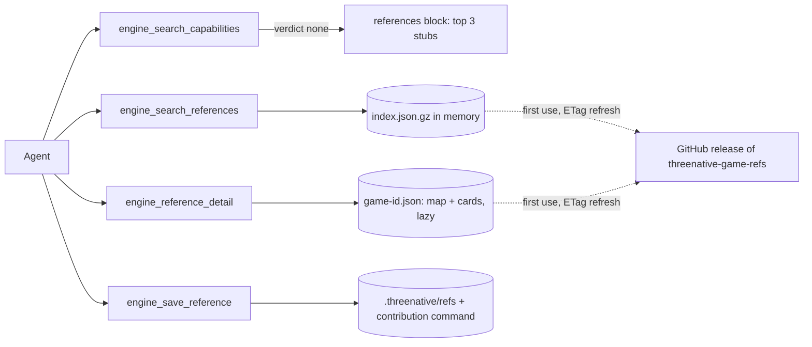

# PRD-734 — Authoring revamp: one planning gate, and game references agents find at plan time

**Status:** COMPLETE — all 9 criteria verified; requested final review completed and reproduced findings corrected.
**Priority:** P2 — completed authoring and reference-tool delivery.
**Complexity:** 7 (HIGH) — new module +2, separate data release +2, external download +1, 6–10 files +2; risk override: none.
**Owner:** João Paulo Furtado
**Depends on:** None. PRD-735 (reference content at scale) depends on this PRD.

## Context

The authoring layer is what a cold agent reads and calls before it writes a game. Today it is
spread over many surfaces, and planning touches only one of them.

| Surface | Today | Gap |
|---|---|---|
| MCP servers in the template `.mcp.json` | 4: `threenative-engine`, `threenative-assets`, `threenative-sculpt`, `threenative-blender` | Only the engine server is named in the planning gate. |
| Skills in `packages/create-threenative/agent-files/.agents/skills/` | 12. The plan path is `threenative-capabilities` (27 lines), then `prd-creator` (40 lines). | The gate searches capabilities only. Kit, assets, audio, look and playtest are other skills that the agent finds later or not at all. |
| Hook `agent-files/.claude/hooks/ponytail-context.mjs` | Re-injects the ponytail ladder at session start, on each prompt and at subagent start. Rung 2 names `engine_search_capabilities`. | It names no other planning tool. |
| Template `AGENTS.md` | 13 templates, 1,194 lines in total. Step 1 is the "critical planning gate". | Each template repeats the gate in its own words. |
| Kit routing | The agent selects the platformer through exact `--genre platformer` routing and the shipped `kit.json` name, title, genre and blurb fields; unknown genres fall back to minimal. | The plan does not record which kit it chose or why. |
| Reference knowledge | None. Each agent guesses how a classic game feels. | No measured jump arcs, camera rules or enemy state machines. |

The origin note `docs/PRDs/authoring/ORIGIN-authoring-discoverability-2026-08-31.md` measured the
same class of gap for capabilities: 11 of 46 brief mechanics returned zero capabilities. This PRD
treats discoverability at plan time as the main risk (owner, 2026-10-24: "this should be USED when
starting planning the game. and not get hidden").

Public decompilations are the new reference source. The list at
<https://github.com/Carter54git/Greates-Games-Decompilations-List> holds 2,359 projects over 51
platforms (README, 2026-10-20). The rule is the one the repo already uses for Unreal
(`docs/PRDs/Unreal/README.md`): read the source, borrow the algorithm and defaults, cite
`file:line`, and copy no code.

Inspected:

- `packages/engine-mcp/src/index.ts`. `:214-215` holds the server instructions, `:402` the IDF token weights,
  `:534` `situationScore`, `:624-678` `searchCapabilities` with its `verdict: "none"` branch, `:720-760`
  the tool definitions, `:805-857` `handleToolCall`, and `:864-898` the synchronous `handleLine`.
- `packages/engine-mcp/__tests__/server.spec.ts`. It has 22 synchronous `handleLine` calls.
- `packages/core/scripts/bundle-engine-mcp.mjs`. It bundles `engine-mcp/dist/index.js` into `core/mcp/engine-server.mjs`.
- `packages/create-threenative/agent-files/.agents/skills/threenative-capabilities/SKILL.md` and `prd-creator/SKILL.md`.
- `packages/create-threenative/__tests__/template.spec.ts:970-990`. It asserts the gate order and the skill text.

## Solution

### Part A — one planning gate

`threenative-capabilities` keeps its name, because 13 templates and `template.spec.ts` cite it.
It becomes the one planning gate. It runs before `prd-creator` and fills one discovery record with
six sections, each from the tool that owns it:

- Every section ends with a value or an explicit "none". The plan with a section left blank is not
  ready for approval.
- `prd-creator` copies the six sections into `.agent/prd/PRD.md`, so the user sees at once which
  kit, capabilities, reference cards, assets, look and proof the plan uses.
- The gate order is stated once, in the skill. All other surfaces point to the skill and do not
  repeat it: the server instructions, the hook context and the template `AGENTS.md` step 1. That
  ends the drift between 13 templates.

### Part B — game references in engine-mcp

Three new tools go in the existing engine-mcp server. There is no new server and no new npm
package. The data lives in a separate CC-BY repo.

**Data repo** `threenative-game-refs`. CC-BY 4.0, separate from the MIT engine, with GitHub release
assets:

- `index.json.gz` holds one row per game (id, title, platform, repo URL, tier), one stub per map
  node and one stub per card (id, game, name, one-line summary, tags, capability ids). Search reads
  only this file.
- `game-<id>.json` holds one game at one pinned commit SHA:
  - **map**: the internal map of the repo, a tree of systems → subsystems → files. Each node has a
    purpose, paths, key functions with line ranges, and the nodes it depends on (for example SM64:
    player → actions → airborne → `src/game/mario_actions_airborne.c`). An agent uses it to find the
    right file with no crawl of the repo.
  - **cards**: one per mechanic, attached to a map node. Each card has the behavior in prose,
    constants (`name`, `value`, `unit`, `source`), sources (`path`, `line`) and capability ids.
- The schema refuses unknown fields and fenced code blocks, while semantic review still checks prose for copied implementation code.
- **Tier 1** is about 20 classic repos with a full map and full cards. **Tier 2** is the rest of the
  list: an index row only, explored on demand.

**Download.** On startup the server sends a GET with the stored ETag to the `latest` release and
caches the result in `~/.cache/threenative/refs/` (`XDG_CACHE_HOME` applies). It works offline
from the cache. A game file downloads only when `engine_reference_detail` asks for it. The response
is validated before the cache is written, so a malformed release throws and never replaces the last
good copy. `THREENATIVE_REFERENCES_URL` and `THREENATIVE_REFERENCES_CACHE` override the source and
the cache for tests.

**Server change.** The download is asynchronous, so `handleLine` and `handleToolCall` become async
and `runServer` writes each response when it resolves. The 22 calls in `server.spec.ts` get an
`await`. JSON-RPC ids keep responses matched when they finish out of order.

**Search** reuses the engine-mcp scoring helpers over the stubs, with the game title as an alias.
Mechanic and game-title scores add so a shared title cannot hide mechanic agreement.
A Tier-2 game matches on its title and returns its repo with
the guidance "explore it, then call `engine_save_reference`". If there is no cache and no network,
the tool returns "references unavailable", and capability search keeps working.

**On-demand Tier 2.** The agent reads the decomp repo itself under the borrow-not-copy rule. Then it
calls `engine_save_reference` with the map nodes it walked and the cards it wrote. The tool
validates them, merges them by id into `.threenative/refs/<game-id>.json` in the game project, and
returns a ready `gh issue create` command for the data repo. Search and detail prefer locally saved entries, retaining published entries that have no local override. Each detail keeps the SHA of the file it came from.

**Guardrail.** Cards describe mechanics and feel only: constants, state machines and camera rules.
They hold no code, no level layouts, no character names for game use and no art. The rule goes on
the same surfaces as the gate.

## Acceptance Criteria

All nine criteria are tracked in the phase boxes below. The final installed-workflow acceptance is explicit here for the progress tool.

- [x] A cold installed agent fills the six-section plan and calls capability, reference, asset and audio discovery before its first source edit. proof: AC-3 call timestamps and planning-boundary source comparison in the execution notes; `/home/joao/Downloads/prd-734-sandboxes/refs-off-1-planning.jsonl` and `.threenative/engine-mcp.log`.

## Integration Ledger

| Capability | Reachable consumer/trigger | Replaces / disposition | Evidence |
|---|---|---|---|
| Planning gate | Template `AGENTS.md` step 1 → `threenative-capabilities` skill → `prd-creator` | Extends the capability-only gate | AC-1, AC-2, AC-3 |
| Reference search and detail | `.mcp.json` → `packages/core/mcp/engine.mjs` → engine-mcp tool list (`index.ts:720`) | New | AC-4 |
| References on an empty capability search | `searchCapabilities` `verdict: "none"` branch (`index.ts:672-678`) | Extends the guidance branch | AC-5 |
| Saved Tier-2 references | `engine_save_reference` → `.threenative/refs/` → search and detail | New | AC-6, AC-8 |

## Decisions

- 2026-10-24 (João): any user can use it, both kit authors and end users, so it ships in the user install.
- 2026-10-24 (João): the MCP returns mechanic cards plus repo maps and links, not live code search. Two tiers, and cheap scouts (the `ds` harness, V4.1-Flash max) deep-map Tier 1. Each scout card gets a full review before merge.
- 2026-10-24 (João): an on-demand card goes to the local project plus a contribution to the data repo, with no central write API.
- 2026-10-24 (João): the tools go in engine-mcp. The data is a separate CC-BY repo, released as gzipped JSON.
- 2026-10-24 (João): references show on `verdict: "none"`, plus a separate tool and the gate step.
- 2026-10-24 (João): storage is JSON, not SQLite. Node 20 on this machine has no `node:sqlite`, and
  `better-sqlite3` is a native addon every user would inherit. JSON works on any Node version, any OS and the browser.
- 2026-10-24 (João): scale to 100 MB+. The split index plus lazy per-game files keeps search memory at
  the index size. About 47,000 stubs at about 200 B each come to about 9 MB (estimate). One loader
  function owns storage. Swap it for MiniSearch (fuzzy match) or SQLite (`node:sqlite` or sql.js)
  when the index passes 20 MB or the p95 search time passes 50 ms. The tool contract does not change.
- 2026-10-24 (João): discoverability at plan time is the main risk, so this PRD also revamps the
  authoring layer into one planning gate (Part A). AC-3 proves the call order from the log.
- 2026-10-24 (João): the gain stays unmeasured until AC-9, an A/B with references on vs off.
- 2026-10-24 (João): create the data repo with the gh CLI. Done: <https://github.com/jonit-dev/threenative-game-refs>, public, licence `cc-by-4.0`.
- 2026-10-24 (agent): content at scale (the Tier-2 import of the full list, OoT and the other Tier-1
  classics, the scout pipeline) goes to PRD-735, so this PRD stays within the 3-phase cap. This PRD
  seeds one Tier-1 game, SM64, which AC-9 needs.

## Execution Phases

#### Phase 1: One planning gate

**Status:** COMPLETE — AC-1/2 verified (61 template/server tests and mirror check, exit 0); AC-3 verified in cold reference-off run 1 with all discovery calls preceding the first source edit.
**Files:** `agent-files/.agents/skills/threenative-capabilities/SKILL.md` (the six-section gate), `agent-files/.agents/skills/prd-creator/SKILL.md` (copy the six sections into the plan), `agent-files/.claude/hooks/ponytail-context.mjs` (rung 2 points to the gate), `packages/engine-mcp/src/index.ts` (server instructions point to the gate), the 13 template `AGENTS.md` step 1 (point to the gate, keep the order out), then `pnpm sync:agents`. Tests: `packages/create-threenative/__tests__/template.spec.ts`, `packages/engine-mcp/__tests__/server.spec.ts`.
**Implementation:** write the gate in the skill once. Each other surface names the skill and the guardrail in one line. Write the spec changes first so they fail on the current text.

- [x] AC-1 [local]: every scaffolded template's gate skill names the six sections in order with the tool for each, and `prd-creator` requires them in the plan. proof: `pnpm exec vitest run packages/create-threenative/__tests__/template.spec.ts`
- [x] AC-2 [local]: the server instructions, the hook context and every template `AGENTS.md` point to the gate and do not restate its order, and the mirrors are current. proof: `pnpm exec vitest run packages/engine-mcp/__tests__/server.spec.ts packages/create-threenative/__tests__/template.spec.ts && pnpm sync:agents --check`
- [x] AC-3 [local]: a cold sandbox agent asked for "a 3D platformer that feels like Mario 64" calls capability search, reference search and asset search before its first `src/` write, and its `.agent/prd/PRD.md` fills all six sections. proof: `pnpm sandbox` run, `.threenative/engine-mcp.log` order against the transcript, plus the plan file

#### Phase 2: Reference tools work against a fixture

**Status:** COMPLETE — 2026-10-24: 99 tests passed across references, server, search and instruction-budget suites; engine-mcp typecheck and build passed; built stdio server serves five tools and schema contract passes (6 tests).
**Files:** `packages/engine-mcp/src/references.ts` (new: validate, download through the cache, load saved games, save), `packages/engine-mcp/src/index.ts` (async `handleLine`, 3 tools, the references block on `none`, scorer reuse over stubs), `packages/engine-mcp/__tests__/references.spec.ts` (new, with a local `node:http` server for ETag and offline cases), fixture under `packages/engine-mcp/__tests__/fixtures/refs/`, and `server.spec.ts` (`await` on the 22 calls).
**Implementation:** see Part B. The fixture is a production-shaped SM64 game file with map nodes, functions and cards, plus one Tier-2 row.

- [x] AC-4 [local]: through the MCP server, `engine_search_references` "triple jump" returns the fixture SM64 card first and "camera system" returns the SM64 camera map node. `engine_reference_detail` returns the card constants with pinned sources, and the node with its files, functions and child nodes. proof: `pnpm exec vitest run packages/engine-mcp/__tests__/references.spec.ts packages/engine-mcp/__tests__/server.spec.ts`
- [x] AC-5 [local]: a capability search with `verdict: "none"` carries at most 3 reference stubs, a `matched` search carries none, and the existing search specs stay green. proof: `pnpm exec vitest run packages/engine-mcp/__tests__/search.spec.ts packages/engine-mcp/__tests__/references.spec.ts`
- [x] AC-6 [local]: a second start sends the ETag and skips the download on a 304, an offline start reads the cache, and a malformed index throws without replacing the cache. `engine_save_reference` merges a valid game and refuses a card with a `code` field. proof: `pnpm exec vitest run packages/engine-mcp/__tests__/references.spec.ts`

#### Phase 3: SM64 seed release and the measured gain

**Status:** COMPLETE — AC-7/8 verified; AC-9 four-game blind keyboard comparison locked with results below.
**Files:** the data repo only: schema, validator, the SM64 game file and a release workflow.
**Implementation:** scouts write the SM64 map and at least 10 cards at a pinned SHA of the SM64 decomp. A full review checks each path, function and constant against the pinned clone. Then the release `v0.1` is published.

- [x] AC-7 [shared]: release `v0.1` holds the SM64 map and at least 10 cards. Every path, function and constant exists at the pinned SHA, and the MCP downloads and searches the release. proof: data repo `validate` job + `THREENATIVE_REFERENCES_URL=<release> pnpm exec vitest run packages/engine-mcp/__tests__/references.spec.ts -t live`
- [x] AC-8 [local]: a cold sandbox request for a Tier-2 game makes the agent read the repo, call `engine_save_reference` with the map nodes it walked and its cards, and get a saved file plus the contribution command, with no copied code. proof: `pnpm sandbox` run, `.threenative/refs/<game-id>.json` plus a review of the transcript
- [x] AC-9 [local]: the AC-3 brief runs as an A/B, references on vs off, two runs per arm. A blind judge plays both arms and rates the movement feel, and the PRD records the verdict. There is no threshold to pass. proof: `pnpm sweep:capture` + `pnpm sweep:judge` (or `scripts/score-blind.ts`)

## Execution notes (2026-10-24)

- Delivery: `.claude/worktrees/prd-734`, branch `prd-734-game-reference-cards`, draft [PR #566](https://github.com/ThreeNativeHQ/threenative-engine/pull/566). Latest pushed implementation: `f21a6010d`. No merge is authorized. Dashboard telemetry was unavailable at port 4319 and did not block work.
- AC-1/2 red-green: gate, hook and server tests failed against the old capability-only instructions. The completed template/server invocation passed 61 tests, including pristine scaffold typechecks and the starter build. The installed-project MCP contract failed on all 13 templates with its old two-tool expectation; the five-tool expectation passed 13 tests (14 unrelated skipped). Scaffold byte-stability hashes changed for all 13 intended instruction edits; regenerated hashes passed the focused check (1 passed, 67 skipped). MCP-schema/mirror contracts passed 14 tests, and `pnpm sync:agents --check` passed with 26 current mirrors.
- The first scaffold build lacked the ignored Wasm output. Published `@threenative/runtime-native@0.3.6` web mjs/wasm files, matching this checkout's package version, were provisioned in `packages/runtime-native/build/web/`. This was not a local C++ compilation and proves no native-platform gate.
- AC-3 cold transcript: reference-off run 1 called capabilities at 18:45:50.333 UTC, references at 18:46:07.331 UTC, assets at 18:46:13.016 UTC and audio at 18:46:15.729 UTC, before its first source edit at 19:20:35.511 UTC (`src/render/sky.ts`). Its plan fills all six sections and correctly records unavailable references as none. Planning-stage source matched the installed baseline. Transcripts, MCP log and plan are in `/home/joao/Downloads/prd-734-sandboxes/`.
- AC-4/5/6 red-green: initial reference tests failed before implementation. Focused reference/server/search/instruction-budget suites passed 99 tests. Later cache identity and interrupted-response regressions were observed red then green: the latest reference/server/search run passed 92 tests with one opt-in live test skipped. Engine-mcp typecheck, package build and publint passed. The built core MCP bundle and its five-tool schema snapshot are updated. No new dependency or MCP server was added.
- Cache regressions cover conditional ETag/304, offline reads, malformed release preservation, lazy game fetch, source-URL isolation, partial card merge against an existing node, mismatched requested/game ids and interrupted HTTP bodies. Save validates the merged graph, rejects unknown fields including code, and shell-quotes its returned contribution command.
- AC-7: published [v0.1](https://github.com/jonit-dev/threenative-game-refs/releases/tag/v0.1) from `9737a03e2b5d6445e4938aaabaf376628646c43a`. Data validation [run 40124779398](https://github.com/jonit-dev/threenative-game-refs/actions/runs/40124779398) and release [run 40124905309](https://github.com/jonit-dev/threenative-game-refs/actions/runs/40124905309) passed. The assets are `index.json.gz` and `game-sm64.json`: 49 map nodes cover all 336 C paths, with 11 cards at SM64 SHA `9921382a68bb0c865e5e45eb594d9c64db59b1af`. `node validate.mjs --source /tmp/prd734-sm64 --release` checked paths, functions and literal constants; both data tests passed. The actual-release MCP test passed (1 passed, 11 unrelated skipped): `THREENATIVE_REFERENCES_URL=https://github.com/jonit-dev/threenative-game-refs/releases/download/v0.1/ pnpm exec vitest run packages/engine-mcp/__tests__/references.spec.ts -t live`.
- Semantic card review with Sonnet high found three incorrect behaviors and seven gaps, each checked against pinned source and corrected: same-impact wall-kick timing, animation-dependent ground-pound windup, water-jump entry overwriting 62 with 42, movement guards, landing windows, signed long-jump behavior, camera special-mode scope, animation timing and one-time dive entry. Effective water-jump speed 42 at `src/game/mario.c:808` has a red-green regression test. Literal validation does not itself prove override order; raw frame units do not claim one universal regional frame rate.
- AC-8 verified in fresh `refs-tier2`: the cold agent found the OoT Tier-2 entry, shallow-cloned `zeldaret/oot` at `14759abf9abb4295de142cdc1452998630ea70fb`, read player collision/climb source and `include/player.h`, and called `engine_save_reference`. The returned `.threenative/refs/oot.json` contains 2 walked nodes, 8 function ranges, 1 card and 18 literal constants; controller checks against that clone passed. The returned `gh issue create --repo jonit-dev/threenative-game-refs --title 'Reference cards: Ocarina of Time (2 nodes, 1 cards)' --body-file '.threenative/refs/oot.json'` was not executed. No source writes, copied implementation code or fenced code were added. Source review caught a false A-button pull-up summary and an incorrectly named state flag; the controls assertion was red, the controller corrected the prose through the installed MCP save tool, then the assertion and all pinned-path/function/literal checks passed. The small local card is proof of on-demand discovery, not a published full OoT map.
- AC-9 completed with four identical cold installs at `/home/joao/Downloads/prd-734-sandboxes/{refs-on-1,refs-on-2,refs-off-1,refs-off-2}`. The first came from `pnpm sandbox --genre platformer --arm framework --template platformer`; the others copied that cold install before agent work. The same original brief/planning prompt, DeepSeek V4.1 Flash max and installed package snapshot applied to both arms. Each plan filled all six sections with source untouched at its approval boundary. Reference-on used immutable v0.1; off used an unreachable local URL, each with isolated caches. On run 1 received index summaries but card-detail downloads timed out; on run 2 read five full cards. Controller permission/renderer recovery advice, later `--auto`, provider retries and report-only continuations are preserved in transcripts. This is a descriptive pilot; the original installed MCP snapshot predates later audited ranking/reliability fixes, so it does not measure the final corrected candidate's causal gain.

- Pre-push checks through `f21a6010d` passed agents, docs, lint and drift. A full product CI board has not run; the PR remains draft. The requested final **Opus 5.5 high** review is completed, with the controller corrections and verification recorded below.

- Requested DeepSeek V4.1 Flash review completed through `opencode run --auto`: two read-only specialists (cache/data integrity and MCP/planning integration), then a separate skeptical manager, all at high effort. The controller independently reproduced findings rather than accepting the reports. Confirmed fixes have red-green checks: conflicting SHA saves refuse before changing existing bytes; targeted detail ignores unrelated damaged files but rejects its own malformed/mismatched file; optional reference failures preserve capability discovery with an explicit error while standalone reference search fails closed; game-title aliases no longer hide mechanic agreement, and title-only search works. The first ranking correction broke title-only lookup; the second reviewer caught it, a new red test confirmed it, and the existing alias scorer fixed it. A further controller regression proved malformed payload text could masquerade as the unavailable error code; exact error-prefix classification now rejects that payload.
- Review curation: global search ignoring damaged local records was rejected to preserve fail-closed behavior. Windows shell execution is unverified; the public command contract now explicitly requires a POSIX shell, with no speculative platform branch. The planning gate now names actual kit manifest fields and exact genre routing instead of nonexistent aliases. The manager read one source snapshot during the controller's edits; its stale targeted-loader finding was checked against the current code and passing regression. Its in-flight bundle warning is addressed by rebuilding before installed proof.
- Post-review focused verification: 104 reference/server/search/MCP-schema tests passed (1 opt-in live test skipped); 3 planning-gate contracts passed; the scaffold byte-stability check passed after all 13 intended shared-skill fingerprint changes were observed and regenerated (1 passed, 67 unrelated skipped; assertion unchanged). After the complete fix set, engine-mcp typecheck, build and publint passed; the shipped core MCP bundle was regenerated; installed-project discovery passed on all 13 templates (14 unrelated skipped), and the actual v0.1 release test passed (1 passed, 17 unrelated skipped). The four experimental games retain their original identical installed package snapshot; later MCP ranking/reliability corrections are verified separately and are not represented as a measured final-candidate A/B gain.

- AC-9 authoring finished: reference-on run 1 passed `pnpm check` and all 17 full-suite summaries; reference-on run 2 passed 18 full-suite summaries, then its related smoke/goal/camera/chain/HUD checks after its final camera and state cleanup (the entire suite was not repeated after those last edits). The controller independently parsed the raw suite summaries, stopped both completed writer sessions at a boundary with no active tool, and rebuilt both frozen web outputs successfully. Report-only high-effort continuations, with every tool denied, cannot change the artifacts. The second run recorded earlier p95 failures of 33.5/35.3 ms and a later pass at 30.1 ms amid logged machine contention; no performance comparison is claimed. Four immutable neutral static copies now feed the same blind judge; only HTML titles were neutralized. The judge has now locked all four ratings, as recorded below.

### AC-9 blind gameplay results

The existing `createBlindBundle` from `scripts/score-blind.ts` assigned four neutral URLs with seed `prd734-movement-v1`. A fresh read-only judge, kept out of source, plans, transcripts and treatment mapping, ran the same three keyboard scenarios per sample using the shipped runner, headed `--browser-recipe webgpu`, 1280×720. All 12 capture metadata files report NVIDIA/Turing and WebGPU; the controller independently checked those files and inspected the reported defect and final reference-on frames. The judge locked 01/02 before 03/04 were available and kept those scores unchanged. The fixed 1–5 rubric covers ground response, air steering, jump-chain coherence, camera readability and recovery.

| Neutral sample | Revealed arm | Ground | Air | Chain | Camera | Recovery | Mean | Visual verdict |
|---|---|---:|---:|---:|---:|---:|---:|---|
| 01 | off run 1 | 4 | 4 | 4 | 4 | 4 | 4.0 | NEUTRAL |
| 02 | off run 2 | 4 | 4 | 4 | 2 | 4 | 3.6 | REGRESSION |
| 03 | on run 1 | 4 | 4 | 5 | 4 | 4 | 4.2 | NEUTRAL |
| 04 | on run 2 | 4 | 4 | 4 | 4 | 4 | 4.0 | NEUTRAL |

The observed arm means are references-on **4.1/5**, references-off **3.8/5**, a descriptive difference of **+0.3 points**. Sample 03 showed a landing-linked `jumpChain` 1→2→3, stronger launches and a visible triple-jump cue; standing extra air presses did not add launches. Sample 04 had repeatable double jumps and landing/relaunch, but its movement mapping was not screen-relative. All four recovered automatically after falls. R restarted samples 01/02; it had no observed effect in 03/04 and was absent from their visible control instructions. Recovery ratings use observed automatic recovery, not a claimed R restart.

Sample 02's camera became completely blocked by a cliff during an off-route jump, with dark route/coin frames also repeated. The controller inspected and confirmed the obstruction. This negative experimental result is retained, not repaired after scoring. The other three preserved bright fox/meadow readability, with simpler cliffs, hard shadows, sparse skies and overlapping coins as limitations. These are comparisons against the fixed appearance target, with no treatment-specific before frames and no product rendering change or appearance-improvement claim.

All eight v2/v3 commands exited 0 for movement/diagnostics; 03/04 v1 commands also exited 0. The original 01/02 v1 commands exited 1 because R returned to spawn and invalidated the judge's final-distance assertion; those failures are retained, and v2/v3 corrected the scenario's movement assertion. An initial screenshot-schema error was likewise corrected after the shipped doctor. A green distance assertion in 03/04 v1 does not establish R restart. No candidate source or game state was mutated by the judge.

Locked ratings, raw results, scenarios and captures: `/home/joao/Downloads/prd-734-sandboxes/blind-judge/runs/{locked-01-02.json,locked-03.json,locked-04.json}`. The complete four-build transcripts and original source remain in the named parent folder. This is scripted model-directed play, not human hands-on feel, statistical evidence, real-time latency/FPS measurement, full-course completion or native-platform proof. Two builds per arm, recorded controller interventions, staggered judge availability, prototype defects and the frozen earlier package snapshot limit interpretation. AC-9 has no quality threshold; it is satisfied by running and recording the comparison, including its failures.

### Final review and corrections

The single requested final review ran with `claude --model claude-opus-5-5 --effort high` and read-only tools; its initialization confirmed model `claude-opus-5-5`, and the process exited 0. It found no declared blockers but identified five actionable code concerns plus imprecise prose. It independently supported the AC-3/8/9 artifact evidence and explicitly ran no tests. The controller reproduced findings rather than treating the report as proof; no second Opus review was launched.

Nine engine regression cases failed on the previous implementation, then passed after corrections: a six-second game body now fits a 30-second game download budget while the index retains five seconds; partial local overrides retain published search entries and fall back to published detail, each with its own file's SHA; constant citations require safe relative `path:line`, card sources are nonempty and every source/function/node path is safe; local enumeration rejects filename/id mismatches. The controller rejected a blanket Tier-1-save ban because it would remove supported local/offline behavior. No cross-SHA graph merge was introduced. Optional installed-engine probes now use an isolated cache and unreachable loopback source instead of touching GitHub/home cache. The review's second cited spawn was assets-only, so it was left alone.

The delegated data-catalogue correction was independently challenged: its original red log only showed a missing export, not the release bug. The controller executed the old release path with an extra catalogue field and observed exit 0 plus a malformed index written; corrected code exited 1 before any index was written. A further root regression found whitespace-only titles accepted by the first delegated schema, was observed red, and passed after correction. All four data tests passed, and complete pinned-source validation/release-asset generation passed with 49 nodes and 11 cards. Validator correction commit `6b2d5ea` ([CI run 40138119526](https://github.com/jonit-dev/threenative-game-refs/actions/runs/40138119526), success) is separate from immutable published v0.1 at `9737a03`; no release was republished or tag moved.

Final source/reference/server/search/schema verification passed **113 tests** (one opt-in live case skipped), followed by engine-mcp typecheck, build and publint, the refreshed shipped core bundle, all **13 installed-template probes** (14 unrelated skipped), and the actual v0.1 release test (**1 passed**, 26 unrelated skipped). The prior documentation lane passed **272 tests** plus 3,513 relative links and Unreal-map freshness. Final archival link checks and pre-push results are reported in the PR. Unverified issue-body limits, cosmetic pluralization, alternate shell behavior and extra retry policy were not promoted to required fixes. Prose now describes fence/field checks without claiming they prove prose contains no code; R restart is explicitly limited to samples 01/02.

The volatile original SM64 clone disappeared during final review. It was restored at the exact pinned SHA under `/home/joao/Downloads/prd-734-sandboxes/reviews/upstream-sm64`; fresh pinned-source validation passed again. Review outputs, red/green logs and final checks are retained in the named `reviews/` folder. Eleven representative images are on the orphan `prd-734-screenshots` branch for the PR; complete sources and captures remain in the sandbox folder. Four owned HTTP servers and the owned Xvfb were stopped after judging. The unmerged task worktree is retained at 1.3 GB for review; no merge or deployment is authorized.
