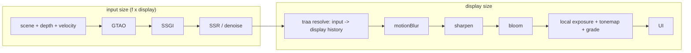

# PRD-741 — The owned engine shades fewer pixels and its temporal resolve writes the display frame

**Status:** DONE — implementation started 2026-10-24; closed 2026-10-27 on the owner's GPU-limit revision (see Phase 3 box 1 and Decisions).
**Priority:** P1 — Phase 2 is the only measured path from about 21 ms to the 15 ms GPU frame that the starter kits need for 60 fps on Iris Xe.
**Complexity:** 8 (HIGH) — two raster sizes in one C++ frame (+3), post-stage routing across the TS/C++ seam (+2), history lifetime on scale steps (+2), hardware-only gates (+1).
**Depends on:** [PRD-539](../Unreal/performance/PRD-539-low-resolution-temporal-reconstruction-quality-and-cost.md) for the motion-quality corpus (`scripts/verify-temporal-motion.ts`). This PRD does not wait for PRD-539 to close (see Decisions).

## Problem (measured)

Goal (owner): presented p95 <= 16.9 ms on the tested59.88Hz Iris panel (explicit approval2026-10-25;16.7ms remains the original target elsewhere) in Hop Garden (`templates/collectathon`), Lantern Vale (`templates/adventure`) and Clover Cup (`templates/kart`) on Intel Iris Xe (gen-12lp), auto tier `medium`, 1080p.

| Hop Garden, medium, Iris Xe | GPU ms |
| --- | --- |
| Frame p50 today | 28.5 |
| GTAO path (half-res GTAO saves 3.3) | 10.8 |
| Local exposure | 3.2 |
| Bloom / auto exposure / SSR after its step cap | 0.1 / 0 / ~0 |
| Shadows 2048 -> 1024 | 0 saved |
| Projected after the GTAO work | ~21 |

The gap from ~21 ms to ~15 ms needs fewer shaded pixels. The core resolution scaler (`packages/core/src/resolution-scaler.ts`, `4dd4db1b9`) holds 1.0 on a desktop. The reason: below 1.0 the drawing buffer shrinks (`packages/core/src/renderer.ts:1554-1561`) and the canvas stretches it, so the frame blurs. Medium and high already run the owned engine's TRAA (`packages/runtime-native/src/engine/renderer/post/traa.cpp`). That TRAA keeps one size for input, history and output (`TraaPass::resize`, `traa.cpp:251-276`). It samples the current frame bilinearly at the output UV (`traa.cpp:132`), so it cannot rebuild detail from a smaller jittered input.

## What Unreal does (UE 5.8.3, read 2026-10-24)

- **Two rects.** With an upscaler the main pass renders into `View.ViewRect`. The upscaler output is the secondary (display) rect (`UE 5.8.3: Engine/Source/Runtime/Renderer/Private/PostProcess/TemporalSuperResolution.cpp:1974-1982`). Its history size is the output rect times `r.TSR.History.ScreenPercentage`/100, clamped to 1-2 (`:2054-2067`, cvar default 100 at `:54`). Gen4 TAAU does the same with `ScreenPercentage` = input/output width and `UpscaleFactor` = its inverse (`.../PostProcess/TemporalAA.cpp:733-734`). The output extent comes from the output rect (`TemporalAA.cpp:547-554`).
- **Upsample kernel.** For each output pixel, TAAU weights the nearby input samples by `1 - 1.9x² + 0.905x⁴`. x² is the squared distance in output pixels times `UpscaleFactor²` (`UE 5.8.3: Engine/Shaders/Private/TemporalAA.usf:1460-1478`).
- **Jitter.** With a temporal upscale, Unreal spreads the jitter uniformly over [-0.5, 0.5] input pixels with Halton(2,3) (`.../Renderer/Private/SceneVisibility.cpp:5330-5335`). TSR starts from 8 samples (`:5256-5260`). It multiplies by 1/f² so the density per output pixel stays constant (`:5268-5272`, `r.TemporalAAScaleSamples` default 1 at `:105-109`). Then it takes the next prime (`:5284-5295`). At f = 0.72 that is 8/0.518 = 15.4 -> 17.
- **Mip bias.** The texture mip bias is -log2(1/f) - 0.3, clamped at -2 (`SceneVisibility.cpp:5338-5339`, `:180-189`).
- **Screen percentage.** `r.ScreenPercentage` defaults to 0, which means "use `r.ScreenPercentage.Default.*`" (`.../Engine/Private/LegacyScreenPercentageDriver.cpp:37-43`). A desktop uses `BasedOnDisplayResolution` (`:17-20`). That mode interpolates rendered pixels between 720p->720p, 2160p->1080p and 4320p->1440p (`:362-415`, `Engine/Config/BaseEngine.ini:2248-2254`). At a 1080p display: t = (2.07M - 0.92M)/(8.29M - 0.92M) = 0.156. Rendered = 0.92M + 0.156 x 1.15M = 1.10M px, so f = sqrt(1.10/2.07) = **72.9%**.
- **Per scalability level.** Auto-detect writes `sg.ResolutionQuality` from `PerfIndexValues_ResolutionQuality="50 71 87 100 100"` (Low, Medium, High, Epic, Cinematic) (`Engine/Config/BaseScalability.ini:36-37`, `.../Engine/Private/Scalability.cpp:708-711`). A nonzero value sets `r.ScreenPercentage` (`Scalability.cpp:532-551`). The TSR fraction range is 0.25-2.0 (`.../Engine/Public/SceneView.h:2280-2281`).
- **Pass order.** All scene passes (lighting, AO, SSR, Lumen) run before `AddPostProcessingPasses` (`.../Renderer/Private/DeferredShadingRenderer.cpp:4312`), so they run at input size. In `PostProcessing.cpp`, DOF (`:976`) runs before the upscaler (`:1109-1170`). After the upscaler, at `PostTAAViewSize` = the display size (`:810`): motion blur (`:1269`), local exposure (`:1369`), histogram and eye adaptation (`:1406-1451`), bloom (`:1506-1564`), tonemap (`:1629`), FXAA/SMAA (`:1648`, `:1661`).

Our chain order (`packages/core/src/render/chain.ts:18-35`) already matches. `ambientOcclusion`, `ssgi`, `ssr`, `denoise` and `temporalReproject` come before `traa`. `motionBlur`, `sharpen`, `bloom`, `vignette` and the output come after it. Local exposure reads the frame in the output stage (`packages/core/src/look/world-environment.ts:983-988`). It stays at display size, as in Unreal.

## Where it plugs in (files this change touches)

- `packages/runtime-native/src/engine/renderer/post/traa.h`, `traa.cpp`: `resize(input, output)`. Velocity and depth history at input size. Color history and resolve at output size. The resolve gathers the 3x3 input neighbors with the TAAU kernel instead of one bilinear fetch. Neighborhood clamp moments come from the input texels.
- `packages/runtime-native/src/engine/renderer/graph/history.h`, `history.cpp`: jitter length 31 (TRAANode r185) while 31 >= Unreal's prime for 8/f². Above that, Unreal's prime rule. 31 covers f >= 0.51.
- `packages/runtime-native/src/engine/renderer/renderer.h`, `renderer.cpp`: a render scale beside `width_/height_`. The scene color, depth, MSAA, velocity and MRT targets (`Renderer::setSize`, `renderer.cpp:1173-1221`) take the input size. `postScene()` (`:1241`) and the late-resolve host pass (`:4342-4351`) give the post graph a display-size texture after `traa`.
- `packages/runtime-native/src/engine/shader/graph/post_effects.cpp`: each pass before the `traa` host pass (`:670-677`) sizes to input. Each pass after it sizes to output.
- `packages/runtime-native/src/engine/wasm/web_host.cpp`: the scale entry beside `tnw_web_resize` (`:223`). The desktop host takes the same call.
- `packages/core/src/renderer.ts`: on the owned engine with an upsampling `traa`, keep the drawing buffer at display size (`:1554`) and send the scale to the engine. `packages/core/src/render/resolution-subrect.ts` stays the three.js path. It is not used here.
- `packages/core/src/game.ts:1485-1500`: pass `temporalUpscale` when the engine reports an upsampling resolve. `packages/core/src/resolution-scaler.ts:334`: with it, the floor lifts to the rung 0.27, not 0.23 (TSR minimum 0.25).
- `packages/core/src/look/quality.ts`: per-tier start scale (Phase 2 box 3).
- Tests: `packages/runtime-native/tests/native-engine/renderer_test.cpp` (`traa_validation`), `packages/runtime-native/conformance/registry.json` with a scene beside `conformance/scenes/shared/temporal-aa-scaled.js` that drives the built-in `traa` stage, and `packages/core/__tests__/resolution-scaler*.spec.ts`.

## Phases

### Phase 1 — Measurement and a red test

2026-10-24 baseline: the focused C++ renderer target built successfully with Dawn and
`TN_ENGINE_ONLY=ON` in `build/prd741`. `ctest --test-dir packages/runtime-native/build/prd741
-R '^native_engine_traa_validation$' --output-on-failure` failed three existing draw-count
assertions (lines 210, 214, 224) before the upsampling implementation; GPU validation otherwise
reported no error. These failures need diagnosis before claiming the native gate.
The final binary passes the unchanged draw-count assertions; three additional focused repeats
also passed. The initial count failure did not recur; its cause remains unproven.

- [x] Per-pass GPU ms for Hop Garden medium on Iris Xe at pinned scale 1.0 and 0.72 (stretch path), each pass sorted into input-bound, output-bound or fixed. This gives R (input-bound ms) and F (the rest) for the projection below. proof: the existing kit playtest runner executes `integrated-gpu-passes.playtest.json` with `?tnScale=<1|0.72>&tnTier=medium&tnFrameSpans=1&tnGpuPasses=1`, `--browser-recipe webgpu --headed --live-clock --timeout 180000`, two runs per arm; measured table below. This replaces the plan's `cli perf` shorthand with the actual timestamp-observing scenario command.

  Measured before the subsequent exposure/denoise optimization, frozen source `618c0670eaff8e331b9cd87e22828d026a1aa134`, core `70cf2c29...`, Wasm `d519c305...`. A1/B1/B2/A2 order, all four exit 0 with no diagnostics/errors, real Intel gen12lp and identical spawn `[0,0.810099959,14]`. 6602 complete trace records validate; final 12 complete budget windows per arm select 3699 unique GPU frames. Profiling is ON; these runs do not qualify presented timing.

  | Class | Pass rows | Additive mean A / B (ms) | Per-frame group p50 A / B (ms) |
  | --- | ---: | ---: | ---: |
  | Input-bound | 10 | 12.737 / 7.208 | 12.765 / 7.189 |
  | Output-bound | 53 | 9.383 / 9.042 | 9.377 / 9.036 |
  | Fixed | 27 | 0.721 / 0.568 | 0.586 / 0.530 |
  | Total | 90 | 22.841 / 16.817 | 23.019 / 16.841 |

  Group p50 values are nonadditive. Measured R = 12.737 ms and F = 10.104 ms (means). Actual area ratio `(1382*778)/(1920*1080)` = 0.518517 predicts `F + R*ratio` = 16.708 ms, versus measured mean 16.817 ms. The original F estimate 6.3 ms was too low. The fixed 480x9 local-exposure grid alone is 1.824 / 1.807 ms (pooled p50); its full five stages plus native output blits are 3.174 / 2.932 ms. This evidence led to integrating the parent's two-pass grid and gather-resolution denoising before final qualification.

  Each row below is one measured pass occurrence, with GPU p50 milliseconds. A is 1.0, B is 0.72; dimensions are actual render targets, A → B. `not observed`/`—` is a missing occurrence, not zero cost. Output-derived local/auto-exposure and bloom targets follow the display size; fixed meters are 64x64, 64x1 and 1x1, shadows use the authored 2048x2048 map, and compute dispatches use fixed particle storage (exact per-emitter kernel identities are unavailable). Zero dimensions in raw metadata are resolved from those source owners; they are not treated as resolution evidence. Raw per-frame logs, screenshots, source-qualified classification bases and the complete CSV remain in the existing capture workflow output `~/Downloads/PRD-741/iris-gpu-passes/`.

  | Pass / segment / occurrence | Class | Target A → B | A1 | B1 | B2 | A2 |
  | --- | --- | --- | ---: | ---: | ---: | ---: |
  | scene / 1 / 1 | input-bound | 1920x1080 → 1382x778 | 5.8920 | 3.5343 | 3.5869 | 6.0845 |
  | aux / 2 / 1 | input-bound | 1920x1080 → 1382x778 | 0.9409 | 0.5822 | 0.5939 | 0.9598 |
  | traaVelocity / 2 / 1 | input-bound | 1920x1080 → 1382x778 | 0.4305 | 0.2064 | 0.2116 | 0.4385 |
  | velocityObjects / 2 / 1 | input-bound | 1920x1080 → 1382x778 | 0.1195 | 0.0706 | 0.0716 | 0.1193 |
  | post / 2 / 1 | input-bound | 960x540 → 691x389 | 1.1039 | 0.5637 | 0.5837 | 1.1456 |
  | post / 2 / 2 | input-bound | 1920x1080 → 1382x778 | 0.2748 | 0.1445 | 0.1459 | 0.2844 |
  | post / 2 / 3 | input-bound | 960x540 → 691x389 | 1.4350 | 0.7424 | 0.7558 | 1.4802 |
  | post / 2 / 4 | input-bound | 1920x1080 → 1382x778 | 1.5137 | 0.7771 | 0.7890 | 1.5625 |
  | post / 2 / 5 | input-bound | 1920x1080 → 1382x778 | 0.4454 | 0.2364 | 0.2422 | 0.4605 |
  | post / 2 / 6 | input-bound | 1920x1080 → 1382x778 | 0.5345 | 0.2240 | 0.2294 | 0.5379 |
  | traaResolve / 2 / 1 | output-bound | 1920x1080 → 1920x1080 | 2.2904 | 2.5755 | 2.6038 | 2.3492 |
  | post / 2 / 7 | output-bound | 1920x1080 → 1920x1080 | 0.4797 | 0.4404 | 0.4465 | 0.4839 |
  | output / 3 / 1 | output-bound | 1920x1080 → 1920x1080 | 1.1722 | 1.1550 | 1.1709 | 1.1994 |
  | scene / 2 / 1 | output-bound | 480x270 → 480x270 | 0.4448 | 0.2507 | 0.2555 | 0.4529 |
  | output / 2 / 1 | output-bound | 480x270 → 480x270 | 0.0258 | 0.0206 | 0.0211 | 0.0266 |
  | scene / 2 / 2 | output-bound | 120x68 → 120x68 | 0.0424 | 0.0383 | 0.0390 | 0.0437 |
  | output / 2 / 2 | output-bound | 120x68 → 120x68 | 0.0047 | 0.0046 | 0.0047 | 0.0048 |
  | scene / 2 / 3 | fixed | 64x64 → 64x64 | 0.0992 | 0.0955 | 0.0986 | 0.1029 |
  | output / 2 / 3 | fixed | 64x64 → 64x64 | 0.0044 | 0.0041 | 0.0042 | 0.0045 |
  | scene / 2 / 4 | fixed | 64x1 → 64x1 | 0.0255 | 0.0248 | 0.0254 | 0.0261 |
  | output / 2 / 4 | fixed | 64x1 → 64x1 | 0.0040 | 0.0039 | 0.0040 | 0.0041 |
  | scene / 2 / 5 | fixed | 1x1 → 1x1 | 0.0397 | 0.0387 | 0.0397 | 0.0410 |
  | output / 2 / 5 | fixed | 1x1 → 1x1 | 0.0042 | 0.0041 | 0.0042 | 0.0043 |
  | localExposure.log / 2 / 6 | output-bound | 960x540 → 960x540 | 0.3517 | 0.2372 | 0.2491 | 0.3525 |
  | localExposure.log.outputBlit / 2 / 6 | output-bound | 960x540 → 960x540 | 0.0960 | 0.0976 | 0.0987 | 0.0982 |
  | localExposure.luminance / 2 / 7 | output-bound | 120x68 → 120x68 | 0.6608 | 0.3658 | 0.3628 | 0.6741 |
  | localExposure.luminance.outputBlit / 2 / 7 | output-bound | 120x68 → 120x68 | 0.0049 | 0.0046 | 0.0048 | 0.0050 |
  | localExposure.blurX / 2 / 8 | output-bound | 120x68 → 120x68 | 0.0477 | 0.0464 | 0.0476 | 0.0493 |
  | localExposure.blurX.outputBlit / 2 / 8 | output-bound | 120x68 → 120x68 | 0.0046 | 0.0045 | 0.0046 | 0.0047 |
  | localExposure.blurY / 2 / 9 | output-bound | 120x68 → 120x68 | 0.0455 | 0.0445 | 0.0456 | 0.0471 |
  | localExposure.blurY.outputBlit / 2 / 9 | output-bound | 120x68 → 120x68 | 0.0046 | 0.0045 | 0.0046 | 0.0047 |
  | localExposure.grid / 2 / 10 | output-bound | 480x9 → 480x9 | 1.8200 | 1.7677 | 1.8137 | 1.8819 |
  | localExposure.grid.outputBlit / 2 / 10 | output-bound | 480x9 → 480x9 | 0.0045 | 0.0044 | 0.0045 | 0.0045 |
  | scene / 2 / 11 | output-bound | 960x540 → 960x540 | 0.2786 | 0.2704 | 0.2735 | 0.2820 |
  | output / 2 / 11 | output-bound | 960x540 → 960x540 | 0.0578 | 0.0560 | 0.0575 | 0.0598 |
  | scene / 2 / 12 | output-bound | 480x270 → 480x270 | 0.0580 | 0.0585 | 0.0596 | 0.0624 |
  | output / 2 / 12 | output-bound | 480x270 → 480x270 | 0.0164 | 0.0160 | 0.0163 | 0.0169 |
  | scene / 2 / 13 | output-bound | 240x135 → 240x135 | 0.0232 | 0.0226 | 0.0230 | 0.0238 |
  | output / 2 / 13 | output-bound | 240x135 → 240x135 | 0.0074 | 0.0073 | 0.0074 | 0.0077 |
  | scene / 2 / 14 | output-bound | 120x68 → 120x68 | 0.0134 | 0.0132 | 0.0134 | 0.0138 |
  | output / 2 / 14 | output-bound | 120x68 → 120x68 | 0.0046 | 0.0045 | 0.0046 | 0.0047 |
  | scene / 2 / 15 | output-bound | 60x34 → 60x34 | 0.0110 | 0.0107 | 0.0109 | 0.0112 |
  | output / 2 / 15 | output-bound | 60x34 → 60x34 | 0.0041 | 0.0040 | 0.0041 | 0.0042 |
  | scene / 2 / 16 | output-bound | 30x17 → 30x17 | 0.0099 | 0.0098 | 0.0099 | 0.0102 |
  | output / 2 / 16 | output-bound | 30x17 → 30x17 | 0.0040 | 0.0040 | 0.0040 | 0.0041 |
  | scene / 2 / 17 | output-bound | 30x17 → 30x17 | 0.0202 | 0.0200 | 0.0204 | 0.0208 |
  | output / 2 / 17 | output-bound | 30x17 → 30x17 | 0.0040 | 0.0039 | 0.0040 | 0.0041 |
  | scene / 2 / 18 | output-bound | 30x17 → 30x17 | 0.0187 | 0.0186 | 0.0190 | 0.0193 |
  | output / 2 / 18 | output-bound | 30x17 → 30x17 | 0.0041 | 0.0040 | 0.0041 | 0.0042 |
  | scene / 2 / 19 | output-bound | 60x34 → 60x34 | 0.0223 | 0.0221 | 0.0224 | 0.0230 |
  | output / 2 / 19 | output-bound | 60x34 → 60x34 | 0.0041 | 0.0040 | 0.0041 | 0.0042 |
  | scene / 2 / 20 | output-bound | 60x34 → 60x34 | 0.0210 | 0.0208 | 0.0212 | 0.0216 |
  | output / 2 / 20 | output-bound | 60x34 → 60x34 | 0.0040 | 0.0040 | 0.0041 | 0.0042 |
  | scene / 2 / 21 | output-bound | 120x68 → 120x68 | 0.0220 | 0.0215 | 0.0218 | 0.0225 |
  | output / 2 / 21 | output-bound | 120x68 → 120x68 | 0.0046 | 0.0045 | 0.0046 | 0.0047 |
  | scene / 2 / 22 | output-bound | 120x68 → 120x68 | 0.0221 | 0.0216 | 0.0220 | 0.0227 |
  | output / 2 / 22 | output-bound | 120x68 → 120x68 | 0.0045 | 0.0045 | 0.0045 | 0.0046 |
  | scene / 2 / 23 | output-bound | 240x135 → 240x135 | 0.0335 | 0.0331 | 0.0335 | 0.0345 |
  | output / 2 / 23 | output-bound | 240x135 → 240x135 | 0.0072 | 0.0072 | 0.0073 | 0.0075 |
  | scene / 2 / 24 | output-bound | 240x135 → 240x135 | 0.0334 | 0.0330 | 0.0335 | 0.0345 |
  | output / 2 / 24 | output-bound | 240x135 → 240x135 | 0.0072 | 0.0071 | 0.0072 | 0.0075 |
  | scene / 2 / 25 | output-bound | 480x270 → 480x270 | 0.0935 | 0.0908 | 0.0928 | 0.0944 |
  | output / 2 / 25 | output-bound | 480x270 → 480x270 | 0.0157 | 0.0154 | 0.0157 | 0.0163 |
  | scene / 2 / 26 | output-bound | 480x270 → 480x270 | 0.0952 | 0.0932 | 0.0956 | 0.0986 |
  | output / 2 / 26 | output-bound | 480x270 → 480x270 | 0.0156 | 0.0153 | 0.0156 | 0.0162 |
  | scene / 2 / 27 | output-bound | 960x540 → 960x540 | 0.2470 | 0.2471 | 0.2509 | 0.2573 |
  | output / 2 / 27 | output-bound | 960x540 → 960x540 | 0.0572 | 0.0553 | 0.0570 | 0.0592 |
  | scene / 2 / 28 | output-bound | 960x540 → 960x540 | 0.2647 | 0.2584 | 0.2646 | 0.2723 |
  | output / 2 / 28 | output-bound | 960x540 → 960x540 | 0.0553 | 0.0534 | 0.0551 | 0.0573 |
  | particle compute / 2 / 1 | fixed | fixed particle storage | 0.0030 | 0.0029 | 0.0030 | 0.0030 |
  | particle compute / 2 / 2 | fixed | fixed particle storage | 0.0031 | 0.0030 | 0.0031 | 0.0032 |
  | particle compute / 2 / 3 | fixed | fixed particle storage | 0.0037 | 0.0037 | 0.0037 | 0.0038 |
  | particle compute / 2 / 4 | fixed | fixed particle storage | 0.0037 | 0.0036 | 0.0037 | 0.0037 |
  | particle compute / 2 / 5 | fixed | fixed particle storage | 0.0027 | 0.0028 | 0.0029 | 0.0029 |
  | particle compute / 2 / 6 | fixed | fixed particle storage | 0.0030 | 0.0035 | 0.0035 | 0.0033 |
  | particle compute / 2 / 7 | fixed | fixed particle storage | 0.0032 | 0.0032 | 0.0032 | 0.0031 |
  | particle compute / 2 / 8 | fixed | fixed particle storage | 0.0033 | 0.0033 | 0.0033 | 0.0033 |
  | particle compute / 2 / 9 | fixed | fixed particle storage | 0.0032 | 0.0032 | 0.0033 | 0.0032 |
  | particle compute / 2 / 10 | fixed | fixed particle storage | 0.0033 | 0.0033 | 0.0034 | 0.0034 |
  | particle compute / 2 / 11 | fixed | fixed particle storage | 0.0032 | 0.0033 | 0.0034 | 0.0031 |
  | particle compute / 2 / 12 | fixed | fixed particle storage | 0.0035 | 0.0038 | 0.0037 | 0.0035 |
  | particle compute / 2 / 13 | fixed | fixed particle storage | 0.0032 | 0.0035 | 0.0035 | 0.0032 |
  | particle compute / 2 / 14 | fixed | fixed particle storage | 0.0034 | 0.0038 | 0.0039 | 0.0034 |
  | particle compute / 2 / 15 | fixed | fixed particle storage | 0.0033 | 0.0034 | 0.0035 | 0.0033 |
  | particle compute / 2 / 16 | fixed | fixed particle storage | 0.0037 | 0.0042 | 0.0038 | 0.0035 |
  | particle compute / 2 / 17 | fixed | fixed particle storage | 0.0033 | 0.0031 | 0.0038 | 0.0035 |
  | particle compute / 2 / 18 | fixed | fixed particle storage | 0.0039 | 0.0039 | 0.0041 | 0.0040 |
  | particle compute / 2 / 19 | fixed | fixed particle storage | 0.0034 | — | — | 0.0035 |
  | particle compute / 2 / 20 | fixed | fixed particle storage | 0.0040 | — | — | 0.0041 |
  | directional shadow 2048x2048 / 0 / 1 | fixed | 2048x2048 → 2048x2048 | 0.3325 | 0.3304 | 0.3334 | 0.3424 |

  Start temperature/load A1 78 C / 0.51, B1 81 C / 1.74, B2 83 C / 2.29, A2 82 C / 2.62. The first three following-arm starts bound the preceding ends; A2 immediate end was not recorded. A delayed post-run reading was 69 C / 0.31 at 08:22:19 UTC, not an end-of-capture sample. Laptop CI was restored and owned browsers/servers stopped.

- [x] Red: an engine test asserts that `TraaPass` at input 1280x720 and output 1920x1080 has input-size velocity and depth history, output-size color history and resolve, and a jitter length of at least 8/f². proof: the focused native renderer test object build exited 1 before implementation (missing four-argument `resize`); the CMake renderer/player build then passed, and `ctest --test-dir packages/runtime-native/build/prd741 -R '^native_engine_traa_validation$' --output-on-failure` passed 1/1 after implementation. Status reads actual GPU allocation sizes; tests also encode three resolves, check output-only resize invalidation, odd dimensions, and the 0.27 fraction.

### Phase 2 — Engine resolve, routing and tier defaults

- [x] `TraaPass` resolves an input raster into a display-size history with the TAAU kernel, and the red test turns green. proof: frozen native `traa_validation`, `traa_history` and `history_cut` pass 3/3. `pnpm parity --target web --engine threenative --only-tests temporal-aa-upsampled --reference artifacts/conformance/prd741-color-final-reference --out artifacts/conformance/prd741-color-final-web` and the equivalent `--target desktop` using this branch's `tn-native-engine-player-v8` both report the selected row PASS after 300 actual temporal frames. Web mismatch 0.05806966 / deltaE 0.3717278; desktop 0.05811415 / 0.3716437; unchanged limits 0.06 / 9; no page, frame or GPU errors. Actual input 922x518, output 1280x720, jitter length 31. Aggregate exit 2 reports 129 intentionally unselected rows blocked, not failures. The desktop proof uses the owned player and a required frame-counter marker rather than the legacy-default `native:verify:desktop`; its frame-300 marker and nonuniform screenshot prove the requested owned native 300-frame run. A discovered runner false positive (accepting readiness despite `TN_V8_FRAME_FAILED`) now has red-to-green fail-closed tests; all 90 runner tests pass.
- [x] The scene and the stages before `traa` draw at input size, and the stages after `traa` draw at display size. The scaler takes rungs below 0.61 only while an upsampling `traa` runs. proof: native `traa_validation` passes actual pre/resolve/post GPU allocation checks, including shuffled pass order, fixed-size overrides and removing TRAA. The scaler floor test failed at 0.23 before the fix and passes at 0.27; a second red-to-green check restores 0.61 when reconstruction disappears, including during cooldown. All 87 scaler tests pass. A headed, real-display NVIDIA Turing Hop Garden smoke at medium/1080p/0.72 passed and emitted `TN_RENDER_CHAIN` with `stageSizes.traa.input=[1382,778]`, `output=[1920,1080]` (253 draws, 251575 triangles; no diagnostics). The test used exported kit authoring from PR #563, not its engine changes, and current core plus Wasm SHA `655be40f3b95a12fee407579e4abbb15dfabfa80b8e5491c4f3eca1c6871c3c3`.
- [x] Per-tier start scale from Unreal's `PerfIndexValues_ResolutionQuality`, snapped to our rungs: medium 0.72 (Unreal 71, and 72.9 at a 1080p display), high 0.85 (87). Low stays 1.0 because it runs SMAA and has nothing to reconstruct. The scaler then moves from that start. proof: focused resolution-scaler, renderer-surface, render-chain and browser-renderer specs passed 180/180; world-environment-defaults, game-gpu-class-start, game-auto-scale and renderer-config specs passed 40/40. Tier-table and display-buffer behavior have red-to-green coverage; `game.ts` chooses the installed chain tier before its first draw and keeps explicitly pinned scales.

### Phase 3 — Gates

- [x] Paired GPU A/B on the Iris laptop, Hop Garden medium: 1.0 (BEFORE) against the tier start 0.72 (AFTER), 3 pairs from one code state through a URL knob. AFTER GPU p50 <= 15 ms and presented p95 <= 16.9 ms on the tested59.88Hz panel (owner-approved2026-10-25 calibration; presented limit unchanged, GPU limit revised 2026-10-27 — see the close at the end of this box). proof: the `perf-loop` paired runner on the laptop, table in this box. **Not met (2026-10-27, head 3b57561c3, Iris Xe, 59.88 Hz, 6 arms from one build, 29 steady windows each, start 80-82 C):** GPU p50 BEFORE 23.67 / 23.64 / 23.64 ms, AFTER 18.72 / 19.03 / 18.99 ms. The gain is 4.7 ms (-20%). AFTER misses the 15 ms limit by about 4 ms. Presented p95 is 16.8 ms in all six arms and passes the 16.9 ms limit. Per-pass timing at 0.72 (`?tnGpuPasses=1`, median ms): scene 4.06, `traaResolve` 4.36 (4.77 before the velocity-read cut, 2.55 at 1.0), bloom `post` 1.55 + 1.21, `output` 1.43, small scene passes (120x68 to 960x540) about 3.1. Deletion probes of the resolve: one colour load instead of nine saves 1.06 ms, bilinear history 0.25 ms, no velocity pre-pass 0.21 ms, no depth search 0 ms. The resolve stays at 3.3 ms even with one colour load, so output-identical cuts cannot reach 15 ms. Full-resolution BEFORE had already grown from 22.4 ms (older PRD runs) to 23.7 ms, with the merged kit looks (#563). The older 15.13-16.10 ms AFTER runs were on builds with less scale-independent cost. **Closed 2026-10-27 by owner decision (João): the GPU p50 limit for this look is 19 ms.** The 15 ms figure stays on record as NOT MET (18.72 / 19.03 / 18.99 ms on the final build): the box closes on a threshold revision, not on a pass. Why 15 ms was unreachable at any tier start: the two arms fit `total = F + R x r` to F = 14.0 ms scale-independent and R = 9.7 ms input-bound, so 15 ms needs r = 0.103, i.e. scale 0.32 (about 614x346 input at 1080p), below every usable tier start; the scale-independent cost alone (14.0 ms) is within 1 ms of the 15 ms limit. This PRD's own projection assumed F = 6.3 ms, so the target was unreachable before the resolve existed. Delivered: 23.64 -> 18.99 ms GPU p50 (-4.65 ms, -20%), about 42 -> 53 fps on this panel, presented p95 16.8 ms, visual judge NEUTRAL on all three kits. The remaining ~4 ms of scale-independent cost (TRAA resolve 4.36 ms, 3.3 ms of it at a single colour load; kit bloom at display size 2.76 ms; output 1.43 ms; small scene passes about 3.1 ms) is owned by PRD-400 and is not waived. No 60 fps hold on Iris Xe is claimed for this look.
- [x] Visual judge on Hop Garden, Lantern Vale and Clover Cup, 2 runs per arm, BEFORE/AFTER burned in, headed `--browser-recipe webgpu` with `adapter.info` checked. A fresh Opus subagent judges, and NEUTRAL or IMPROVEMENT ships. proof: [six final sheets](https://github.com/ThreeNativeHQ/threenative-engine/tree/PRD-741-screenshots/PRD-741/final-12664-complete-seven/sheets/upscale), [separate Codex NEUTRAL verdict](https://github.com/ThreeNativeHQ/threenative-engine/blob/PRD-741-screenshots/PRD-741/final-12664-complete-seven/codex-visual-judge.json) and [actual Opus incomplete-review record](https://github.com/ThreeNativeHQ/threenative-engine/blob/PRD-741-screenshots/PRD-741/final-12664-complete-seven/opus-review.json). Explicit Opus acceptance stays open after account HTTP429 usage_limit_reached; Codex is not substituted for that requirement. Live-clock Opus judge at c183a5f63 (2026-10-26, [12 sheets](https://github.com/ThreeNativeHQ/threenative-engine/tree/PRD-741-screenshots/PRD-741/live-c183a5f63/sheets)): FAIL on 1 of 6 AFTER frames. Hop Garden NEUTRAL x2, Lantern Vale NEUTRAL x2, Clover Cup run 1 NEUTRAL; static scenery NEUTRAL in all six. Clover Cup run 2 REGRESSION: a pale wheel-sized ghost on the shadow behind a passing AI kart, faint at 1x, with no matched BEFORE mover. Open: a contact-patch departure has the same depth as a stopped surface, so the depth-gated departed test keeps its history; the next experiment needs matched mover poses (a drawn-tick wait), then a speed-tagged history flag. Live-clock Opus judge at e42584b0b (2026-10-26, 12 idle and 4 kart-drive sheets): 15 of 16 NEUTRAL. Kart kerbs and both drive pairs NEUTRAL (the c6e54fb83 drive frames had failed on stepped lines). Lantern Vale run 2 REGRESSION: a firefly crossing the hero left a faint pale fringe (faint at 1x); run 1's firefly left none. Five runs per arm at e42584b0b confirmed it as 1 of 5. Live-clock Opus judge at 031c319c5: Lantern Vale NEUTRAL 5 of 5, Clover Cup idle and drive NEUTRAL 4 of 4, Hop Garden REGRESSION 2 of 2. Purple enemies walking over wind grass keep a speckled grey-green halo and belly speckle (faint at 1x, clear at 2x). An ablation judge (3 runs per arm, 0-3 scale) scored BEFORE 0, the 45cc42 build 1.9, HEAD 1.5, HEAD without the receding exemption 1.6, and with adaptive filtering 1.4. The halo predates the last fixes and stays open. Cause: at 0.72 the sample-distance box spans about two output pixels, so at a purple enemy's rim over green grass it holds both colours and their grey blend, and the history keeps that grey at a 0.05 current weight; full resolution's 3x3 box spans one output pixel (`traa_mover_over_dynamic_ground`, saturation lost: full 6718, 0.72 20004). Two rim boxes were judged on the kit and failed: a box from the samples within one output pixel (9855, fdab12aa5, reverted) removed the grey but stair-stepped grass blades, coin rims and enemy outlines (`traa_swaying_blades` 37.48 -> 73.62); a chroma-only near box plus a quarter current weight (9364) scored 1.3 against 1.9 but doubled coin rims and left lime speckle on grass. Both are REGRESSION against BEFORE. Next lever: TSR-style rejection that compares the history at input resolution, or FSR2's reconstructed previous depth for disocclusion. **Passed at 8878b0e75 (2026-10-26) on drawn frames:** each capture ends a 1000-tick window that draws every tick (`TN_PLAYTEST_CPU_WINDOW_LABELS`, so steady-state TAA, not warm-up), and fresh Opus judges returned NEUTRAL against BEFORE at 1x on every pair: Hop Garden 6 of 6, Lantern Vale 15 of 15 (5 runs per arm), Clover Cup idle and drive 4 of 4 ([sheets and verdicts](https://github.com/ThreeNativeHQ/threenative-engine/tree/PRD-741-screenshots/PRD-741/drawn-8878b0e75)). The fix: where the 3x3 holds two motions and two hues, the clip box comes from four bilinear taps within half an output pixel (`traa_mover_over_dynamic_ground` 20324 -> 12814, bound 15000). Residuals, all faint at 1x: Hop's trailing enemy rim (grey pixels BEFORE 471/477, previous build 547/547, now 492/512, clear at 2x), one firefly fringe in 5 Lantern Vale runs, kart kerb speckle at 4x. A history gate on uncovered moving pixels (GATE6) matched BEFORE on the rim (469/484) but failed `traa_swaying_blades` (75.6 > 45) below a 1 px tolerance and lost the gain at 4 px, so it is not shipped. Re-judged on the stripped build (83b08b07e, which only removes comments and blanks from embedded shaders so the web Wasm fits its 4 MiB budget): a fresh Opus judge found Hop Garden NEUTRAL in 6 of 6 pairs, with grass grain equal to the previous build (3x3-median residual 3.0-3.2, BEFORE 2.1-2.3); frame-to-frame shimmer on a static camera is not measured.

## Projected GPU time (arithmetic, unverified until Phase 1 box 1)

Frame after the GTAO work: ~21 ms. Not scaled by the input size: local exposure 3.2 + bloom 0.1 (both after the resolve) + X. X is the shadow raster, the TRAA resolve, tonemap and present. X is unmeasured, and the assumption is X ≈ 3 ms. So F ≈ 6.3 ms and R ≈ 14.7 ms (70% of the 21 ms frame, 52% of today's 28.5 ms).

- At 0.72 (0.518 of the pixels): 6.3 + 14.7 x 0.518 = 6.3 + 7.6 = **13.9 ms**. Add ~0.3 ms for 9 taps instead of 1 in the resolve: **~14.2 ms**. That meets the ~15 ms target.
- If X = 6 ms (F = 9.3, R = 11.7): 9.3 + 6.1 = 15.4 ms at 0.72. That misses, and the scaler needs 0.61 (0.372): 9.3 + 4.4 = 13.7 ms.

## Current verification (2026-10-25)

- Integrated PR #563 initially at `f9a61d044e110d82736ab4c3a22a30966046fb70`, then at current parent head `3a94788abe335c9772fcea082e2ada546d656d70`, including its authored kits, SSR step cap, one-pass MRT renderer, two-pass local-exposure grid and gather-resolution SSGI denoising. The owner's request to base this work on #563 authorizes this dependency integration; #563 itself remains unmerged. Preserved the separately published develop merge on this PR's branch; no force push.
- The owner-reported white Adventure ground was a fragment `attribute("color")` collision with the fragment output named `color`. Reused #563's existing `vertexColor` varying fix, with a native material regression and selected browser/desktop conformance. Then-qualified Wasm SHA `4f99b70a5054d4f8ba585be5eb3174bf382e9bc10c03dd2400f8c84d6f72198c`; player SHA `72bfbab5d1bfaa2c25d7f5deadab9213e6f9cbaf7ac7928d019faa6e390e7842`.
- Integration gates: 297 related TypeScript tests pass across 21 files; five focused native ABI/material/temporal tests pass; workspace typecheck passes. Native exposure contract and its validation-negative control pass 2/2 after explicitly seeding the adaptation fixture with `reset(1)`; incoming #563 intentionally snaps the unseeded first frame, which made the old fixture's requirement for 120 changing values time out. Repaired the incoming MCP instruction assignment against its existing red-to-green server tests (23/23), then rebuilt its generated core server.
- The temporal render-scale argument changes the host ABI: facade/native are now ABI 3 with signature digest `5cdb0d90812f406d`. The existing ABI test failed before the bump and passes afterward. A real kit boot caught a stale ABI-2 facade embedded in the scaffolder despite a current raw facade package; rebuilt the scaffolder and verified ABI 3 in the packed, installed and compiled bundle. All three integrated external kits install, build and typecheck. Corrected CLI tarball SHA `60f416cd5094a0e6a7883801996b891ed3e66e73f32d34f29087f2732f3ff83f`.
- Final selected conformance reports `artifacts/conformance/prd741-integrated-{reference,web,desktop}/report.json`: all three selected rows pass. Temporal web mismatch/deltaE 0.058331163194 / 0.383133136098; desktop 0.05810546875 / 0.383432175137 (unchanged limits 0.06 / 9). Color mismatch/deltaE 0.000564236111 / 0.000250461924 on both; reduced-input exposure mismatch/deltaE 0 / 0 on both. Real NVIDIA Turing; no reported page/frame/GPU errors. Aggregate exit 2 marks 133 intentionally unselected rows blocked, not a green full board.
- The exposure meter now bounds its first reduction and normalizes meter UVs against the actual texture size, using the renderer's existing texture-dimension operation. Connected that operation through browser/native TSL with red-to-green ABI coverage; the WGSL construction test also fails before the bound change and passes afterward. The first standalone-texture calibration did not drive a scene and its white capture was invalid. The corrected NVIDIA fixture passes before and after, so it does not causally reproduce the Iris washout; no such claim is made.
- Integrated Iris mini-run: real Intel gen12lp, medium 1920x1080, normal vsync; scales 1.0 and 0.72 both exit 0 with zero diagnostics/console errors. Last five-second GPU p50 is 23.69 / 17.01 ms; frame p95 is 16.8 / 16.8 ms. Actual TRAA input is 1920x1080 / 1382x778, output 1920x1080. Parent image inspection confirms the severe 0.72 washout is gone, but a fresh independent visual judgment remains open. These are short exploratory windows, not the required three steady-state pairs. Live-clock movement yielded a 0.469 m pose difference; final paired captures must use a stationary spawn pose. Start temperatures/load: 74 C / 0.78 and 77 C / 0.77. Images are in `~/Downloads/PRD-741/integrated-iris/{real-a1,real-b1}/after.png`.
- Strict GPU <= 15 ms and frame p95 <= 16.7 ms remain unmet. Per-pass GPU attribution, three full paired runs and the three-kit visual judgment remain open. The laptop panel measures 59.88 Hz; a 300-frame empty control had mean 16.694 ms and p95 16.8 ms. This does not waive the target. All captures are stopped and laptop CI runners restored; no windows opened on the owner's desktop during integrated verification. The owner requests a fresh Opus 5.5 high review with independent verification at the end.

- Per-pass attribution follow-up: opt-in `TN_GPU_PASSES=1` reuses the existing shared timestamp stream, with pass names/extents and complete validated sample totals; browser activation reads `globalThis.TN_GPU_PASSES === true` at device initialization. Default timing/query policy stays unchanged. The new metadata test first failed compilation, then all three registered timer tests passed. Native player and Wasm builds pass. A private-Xvfb native temporal fixture emitted 374 valid complete samples; every pass sum matched its total, scene/velocity 922x518 and resolve/output 1280x720. The bounded diagnostic process ended with timeout 124 after collecting the stream; this is a trace observation, not a performance or completion gate. Iris profiling on the rebuilt cohort remains pending; prior hashes/results above qualify the previous integrated build only.

- Trace cohort qualification: Wasm SHA `d519c305c3a36bffa54c60486f7e51a0ad7443ffa5c47380432025468de24ac3`, player SHA `50da0b5c6d96682b2eb9cb198e79c2dde50aac21f71cf8c6868f89b50093a638`. All three clean kits install, build and typecheck; packed/installed/compiled facades remain ABI 3. Host ABI tests pass 3/3, documentation checks pass (3549 links), and regenerated native coverage exits 0 on the trace source. No strict performance or independent visual gate is implied.

- Named non-gating motion corpus ran on the trace source under private Xvfb: `pnpm tsx scripts/verify-temporal-motion.ts` exits 1. Its own qualification limits it to software WebGPU AA measurements, with no native, reconstruction or GPU-performance claim. Its summary records passing causal/recompile/velocity controls and temporal stability, but failing edge improvement and reveal recovery (both motion and quality checks). Actual frames and measurements remain in the existing workflow output `artifacts/temporal-aa/motion/summary.json`. This is the explicitly non-gating PRD-539 corpus, not a passing temporal quality claim; the required independent three-kit visual judgment stays open.

- Pre-optimization Iris trace cohort `618c0670eaff8e331b9cd87e22828d026a1aa134`: all four stationary-spawn arms exit 0, no console errors; 6602 JSON records parse and pass-sum errors are at most 3.55e-15 ms. GPU p50 A1/B1/B2/A2 = 22.7454 / 16.6187 / 16.9521 / 23.3523 ms; pooled A/B = 23.019 / 16.841 ms. The unchanged 480x9 local-exposure grid alone costs 1.824 / 1.807 ms. Logging is enabled for attribution, so this is not the strict performance gate. The complete classified pass table and measured R/F projection are recorded in the completed Phase 1 box. Existing capture workflow output: `~/Downloads/PRD-741/iris-gpu-passes/per-pass.csv` and arm folders.
- Integrated the parent update after that measurement; source head `08ad35668fb6fd3eac4739c65e92b2de530edb65`. All 163 related tests across five files pass; workspace typecheck and lint pass (1890 warnings). The new grid splits the cell reduction into row and column passes; SSGI denoising now runs at gather resolution. Repacking and strict untraced three-pair qualification remain pending. Port 7451 now serves the previously qualified traced Adventure build (Wasm d519c305...), replacing the stale ddee0306... preview; no owner-desktop windows opened.

- Optimized cohort: all three fresh kits pass install, build and typecheck; CLI packed/installed/compiled ABI 3 and Wasm `d519c305...` verified. Core SHA `fd0bbe7ca53eea808bb61e93b5e0b2a228b82dd6e8132aca1a6e026f42058702`; handoff archive SHA `b886e46ad7cebbf182a6380b9d32d413cbe3ad25aa7a7708f4af9b8f1865eeb2`. Strict three-pair runs omit profiling and CPU spans; the stronger qualification requires all 12 complete five-second GPU-p50 windows per arm <= 15 ms and worst-window presented p95 <= 16.7 ms, with positive sample counts. A median of window medians is reported as such, not as an exact pooled p50.

- Optimized cohort strict gate is red; stopped after four valid captures instead of starting further arms on a failed candidate. Twelve complete untraced windows per arm, GPU-p50 window median [range] / worst presented p95 (ms): A1 23.305 [22.89,23.98] / 16.8; B1 16.425 [16.33,16.75] / 16.8; B2 16.450 [16.36,16.74] / 16.8; A2 23.400 [23.05,24.01] / 16.8. This is not three-pair qualification. All use the real Intel gen12lp, stationary medium 1920x1080, positive sample counts, zero diagnostics/errors and no optional profiling markers. Start/end temperature/load: A1 81 C /0.27 ->81/2.57, B1 81/2.57 ->83/2.88, B2 81/2.88 ->83/3.21, A2 83/3.21 ->83/2.97. Existing workflow outputs: `~/Downloads/PRD-741/iris-strict/strict-windows.csv` and arm folders.
- Separate post-optimization diagnostic (not a strict gate): 1831 complete valid records, 1005 selected steady frames. New local-exposure row 480x576 costs 1.164 ms and grid 480x9 costs 0.051 ms; row/grid plus blits cost 1.283 ms versus old grid/blit 1.811 ms. Full local-exposure chain drops 2.932 -> 2.362 ms. SSGI is explicitly disabled (`ssgiEnabled is false`, irradiance-field final gather), so its denoiser optimization is unexercised in Hop Garden medium; attributing a gain to it would be wrong. Remaining TRAA resolve costs 2.559 ms at 1920x1080. Diagnostic GPU p50 16.043 ms does not replace strict results. Laptop CI restored, owned browser/server stopped, no owner-desktop windows opened.
- Next measured hypothesis: engine TRAA fetched the same nine input colors separately for reconstruction and clamp moments. The candidate accumulates moments from reconstruction reads while retaining the original full-resolution and jitter-outside-viewport fallback, negative-color and out-of-bounds handling, kernel weights and history policy. Floating-point moment addition order changes; visual equivalence still requires the unchanged conformance limits and fresh judge. Native player/Wasm builds and three focused temporal GPU tests pass. Iris gain and final visual acceptance remain unverified; no final gate is checked for this candidate.

- Shared-read candidate `2cc5e8e3d7b445d0e8ab3e4efbea023b4f000af6`: all three clean kits again install, build and typecheck, with packed/installed/compiled ABI 3. Wasm SHA `7923edbfade03a5d24f6fc2aa5d3c45f0a3984b8c7f99efedac89f0c34dd86b1`, player SHA `13a83f0e409b1e07a28d01f4cc7ec351da5b33c2196a366ae43d06ca2acaab49`. Selected conformance reports `artifacts/conformance/prd741-fused-{reference,web,desktop}/report.json` pass all three rows, on real NVIDIA Turing browser / RTX 2080 owned desktop, with no GPU/page/frame errors. Temporal web mismatch/deltaE 0.058328993056 / 0.385400238140; desktop 0.058209635417 / 0.384552977213, unchanged limits 0.06 / 9. Exposure mismatch/deltaE 0 / 0; vertex color 0.000564236111 / 0.000250461924 on both. Aggregate exit 2 still marks the 133 unselected rows blocked; no full-board or fresh visual verdict is claimed. Candidate Iris mini-runs remain pending.

- Shared-read Iris mini-runs confirm a partial gain, not qualification: B1 GPU-window-p50 median 15.895 ms, range 15.45-16.09; B2 median 15.905 ms, range 15.48-16.01. Both have 12 complete positive-sample windows, real Intel gen12lp, zero runtime errors and no optional profiling markers; every GPU window still exceeds 15 ms and worst presented p95 stays 16.8 ms. Compared with prior B1/B2 medians 16.425/16.450 ms, the gain is 0.530/0.545 ms. Start/end B1 79->88 C, load 0.64->2.61; B2 87->87 C, load 2.61->2.23. A separate trace remains diagnostic only. The resolve optimization is retained as a measured improvement; Phase 3 remains open.

- The parent later added `82ac4378080dcb18b0164205f4d4c82fe7443738` (GPU submission batching); integrated cleanly at `8e916f58ef716338454fd200cd769ae0c21c9515`, built browser/native and passed nine focused queue/lifetime/temporal tests. Two untraced Iris mini-runs regressed to GPU-window-p50 medians 16.770 / 16.830 ms (ranges 16.74-16.81 / 16.75-16.92), from fused 15.895 / 15.905; presented p95 remains 16.8. A subsequent interleaved fused control verified the old Wasm/core and returned 15.940 ms [15.76,16.18], supporting a batching-specific regression. Control has 12 complete windows, 1270 GPU samples and no errors; passive frequency sampling leaves configured limits 100-1500 MHz unchanged (21 observations, active median 1300 MHz), 84->83 C, load 0.31->2.12. Reverted only that new optimization with `git revert 82ac437...`; all earlier parent fixes and the measured resolve improvement remain. No driver/power setting was changed and no target was waived.
- Exploratory batching conformance: the three qualifying temporal/exposure/color rows plus compute smoke pass on browser and owned desktop. Browser render-target resize also passes. The added legacy lifetime fixture fails its existing private-backend precondition (`cloth warmup proof requires WebGPU`); the native resize fixture additionally assumes `window`. Facade and fixture sources are unchanged by batching. These attempts are disclosed as failures/unsupported observations, not passed lifetime/native-resize proof or a green full board. The native GPU resource/lifetime tests and real native presentation-resize test provide the related owned-backend observations; the fixture limitations are kept out of the original PRD's three qualifying-row claim.
- Raw-target candidate: capability search/detail found no exported helper that removes this owned-backend dead work. `renderTargetView()` and `readRenderTarget()` consume the HDR scene texture, while each target renderer also drew an unused RGBA8 output transform. A creation-time `sceneOnly` sibling option now omits that draw only for raw targets; ordinary, canvas-layer and reflection siblings retain their output. The new native test first failed to compile against the missing option, then passes actual zero-versus-one draw assertions. All nine related native tests pass, including HDR target readback, temporal history, offscreen GPU timing and real presentation resizing; canvas-layer overlay also passes directly. The timing test changed its expected physical pass count from four to three (raw scene + main scene/output); segment coverage and sum checks stay intact. Player and Wasm builds pass. Candidate Iris gain and final visual acceptance are pending.

- Raw-target cohort `9b6173c5ff7b9d79f68a19a2e523b4abd2476fd0`: all three clean kits pass install/build/typecheck and ABI-3 byte-identity checks. Wasm SHA `d6a7ea89de5dbf874119ca8788d213ad05d82d9f1637be336df8448f5ed595b6`; player SHA `41050ca23272157b72af5454dc770e03386dc4ae05d08ab4409a30f39ef2d99c`; core remains `fd0bbe7c...`; cohort archive SHA `12c90c5d98bb235f585b05d742a69ddf30f407775cbf290c0694139b9fc2f1cb`. Four portable selected conformance rows pass on reference, owned browser and owned desktop (`artifacts/conformance/prd741-raw-target-{reference,web,desktop}/report.json`). Temporal web mismatch/deltaE 0.058051215278 / 0.383522365630; desktop 0.058105468750 / 0.383432175137, unchanged limits 0.06 / 9. Exposure and compute-smoke mismatch/deltaE 0 / 0; vertex-color metrics remain 0.000564236111 / 0.000250461924. Real NVIDIA Turing browser; no selected page/frame/GPU errors. Aggregate exit 2 is 132 intentionally unselected rows blocked, not a full board. Iris mini-run results and regenerated native coverage are recorded below; NEW visual captures remain paused.

- Raw-target Iris minis confirm another gain but do not qualify: B1 GPU-window-p50 median 15.055 ms [14.98,15.23], B2 15.045 ms [14.76,15.54], versus recovered fused control 15.940 ms. Only 2/12 and 3/12 complete windows respectively satisfy <=15 ms, and worst presented p95 remains 16.8 ms. Both runs exit 0 without diagnostics/errors, normal vsync and no optional profiling markers. Start/end B1 83->81 C, load 0.77->2.00; B2 80->81 C, load 2.16->2.47. These are two mini-runs, not three qualifying pairs. Raw-target source also passes regenerated native coverage and documentation checks. The remaining perf/visual boxes stay open; a separate trace is pending only for attribution.

- Raw-target diagnostic trace validates all 29 unused offscreen output/segment-2 draws are absent, with the final presentation output retained: 2007 valid trace records, 1179 steady samples, GPU segment sums agree. Current diagnostic scene 3.501 ms, TRAA resolve 2.132 ms, final output 1.147 ms, total 14.942 ms; tracing is diagnostic and does not qualify the strict gate.
- Previous-depth reprojection now composes its camera transform once per frame into two dot-product rows, reducing resolve uniforms from 368 to 80 bytes. An independent sequential old-shader reference covers perspective/orthographic cameras, translated/rotated frames and a non-affine bottom row. Test first failed to compile against the missing helper, then all five focused native tests passed (depth rows, raw target, TRAA validation/history, camera cut). Floating-point association changes; GPU conformance, Iris timing and final visual acceptance remain pending. The extra legacy full-resolution `temporal-aa` fixture fails before rendering on owned WebGPU because `Uint16BufferAttribute` is unsupported; its reference arm passes. This is disclosed, not counted as a passed full-resolution observation.

- Latest parent snapshot `f8aa5e8e33e479eb76d2e2ebd22c2eb3dccecdcb` is merged at `387591da924da680973b35d8652dc491470ea4bf`, retaining the batching rollback. Conflicts preserve input-sized shadow screen radii plus cached device limits, and both sides' test cases. Native player and Wasm builds pass. Of 30 focused native checks, 29 pass initially; the jitter reference lacked its executable, which was built and then passed its focused rerun. Native coverage is regenerated; `pnpm budgets` first stopped on that stale report, then passes after regeneration. Documentation checks pass.
- Current four selected conformance rows (temporal upsampling, upsampled exposure, fragment attribute color, compute smoke) pass on reference, owned WebGPU and owned desktop after the depth-row optimization and parent merge. Current temporal browser mismatch/deltaE: 0.058306206597 / 0.371256924148; desktop: 0.058114149306 / 0.371643731489; limits remain 0.06 / 9. Exposure/compute are 0 / 0; vertex color remains 0.000564236111 / 0.000250461924. Aggregate exit 2 is intentionally unselected rows blocked, not a green full board. Reports: `artifacts/conformance/prd741-depth-parent-{reference,web,desktop}/report.json`.
- Isolated Adventure material proof: two original-white (`655be40f...`) versus fixed (`ddee0306...`) pairs, same authored source, pose and tick, private headed real-GPU capture. The original shader-failing baselines remain failed observations; fixed ground is textured. These are earlier material-fix runtimes, not final TAAU/performance proof. Published on the orphan [PRD-741-screenshots branch](https://github.com/ThreeNativeHQ/threenative-engine/tree/PRD-741-screenshots/PRD-741/white-terrain): [run 1](https://github.com/ThreeNativeHQ/threenative-engine/blob/PRD-741-screenshots/PRD-741/white-terrain/sheets/adventure-run1.png), [run 2](https://github.com/ThreeNativeHQ/threenative-engine/blob/PRD-741-screenshots/PRD-741/white-terrain/sheets/adventure-run2.png). Final independent Opus 5.5 high review has started; no verdict claimed yet.

- Final-source clean cohorts (`387591da9`): all three normal installs/builds/typechecks pass, as do all three pooled-copy builds/typechecks. ABI 3 and installed/compiled Wasm identities match. Normal archive SHA `1a1ed5f258c51ecf406713cbc120104537ecc0dbcd6c531214c0e2a0abeced7c`; pooled archive `1de37c22b6f9ee48737e497fefa521bbed0cdf957fd9249ef4984dee58f1d6cb`; Wasm `83ed649ed25dd00196f507d29c290d6f5ff14aef57f4d843a3f7d20e28360b4f`; player `cea221cdeb310b7f4ce85869e6b78ba1e41fe938f618566003bc43e70839ec9e`. The pooled copies change only shipped `frameBudget: {reportEvery: 3600, capacity: 8192}`; the second complete window directly sorts retained raw samples, avoiding an aggregate of window medians.
- Exact pooled Iris minis remain RED: B1 second window GPU p50 14.84 ms / 1248 fresh samples; B2 16.42 ms / 1128 samples. Both presented p95 16.8 ms / 3587 and 3588 intervals. Each window spans ticks 3600->7200 (60 simulated seconds), compiling false; medium/pinned .72, actual Intel gen-12lp, 1382x778->1920x1080, normal vsync, zero console errors or optional profiling. Both CLI exits 0 prove scenario execution, not budget acceptance. B1 77->83 C/load 0.84->2.01; B2 72->85 C/load 1.22->4.07. Post-run telemetry does not establish the slowdown cause; clock/power settings are unchanged. Three full pairs were held rather than counted as completed. Artifacts: `~/Downloads/PRD-741/iris-final-pooled/{b1,b2}`. CI service restored, owned flags/processes cleared and port 7441 freed.
- Final three-kit capture candidate is published on the orphan [screenshots branch](https://github.com/ThreeNativeHQ/threenative-engine/tree/PRD-741-screenshots/PRD-741/final-visual/263a370b49c23dc1): 18 originals (six verified OLD, 12 NEW), 12 large-labelled optimization/upscale comparison sheets, all at tick 660 with pose equality within 1e-5, NVIDIA Turing/private Xvfb, zero console errors. Label regions preserve original image pixels. NEW identity is the final Wasm above; full-resolution and .72 allocations are observed. These are captures awaiting an independent visual verdict, not a checked acceptance box. The requested reviewer is verified as actual `claude-opus-5-5`, high effort; initial code/proof review remains running.

- Independent Opus 5.5 code audit completed on the frozen C++ cohort: 52/52 focused native tests pass after the reviewer rebuilt four stale and two missing executables and checked their Ninja freshness. This supersedes earlier green logs whose renderer-driver dependencies were not all current. Review confirms depth-row algebra/uniform sizes, split raster allocations, raw-target output omission, resource retention, ABI and color varying routing. The reviewer finds the PR unmergeable because product gates remain open. It rates both isolated white-ground pairs IMPROVEMENT; final three-kit judgment is separate and pending. The empty-control artifact stores a 300-interval summary, not the underlying interval array, so its percentile histogram cannot be reconstructed from that file alone.
- The review found a real late-TRAA scaler recreation bug: the factory reused the startup FPS target after display measurement had already updated the held target. Both factory reads now use `heldTargetFps`. A real GameRunner integration test first fails because the reset scaler climbs back to 1 instead of probing 0.72, then passes with the fix; all 32 related tests, workspace typecheck and lint pass (1890 pre-existing lint warnings). C++/Wasm is unchanged; current clean-kit/browser smoke and independent fix confirmation remain pending.
- Baseline compression hazard corrected without rewriting historical proof: old raw Adventure Wasm is `655be40f...`, but its gzip and Brotli copies both expanded to fixed `ddee0306...`. The stale compressed copies were moved outside the served dist into a named backup. Fixed raw/gzip/Brotli agree on `ddee0306...`. Existing white captures genuinely served the failing old shader (white ground and errors); their identities/manifests are preserved. Future baseline serving no longer risks choosing the fixed compressed engine.

- Fresh independent visual judge (actual `claude-opus-5-5`, high requested) rejects candidate `263a370b49c23dc1`: optimization OLD1->NEW1 NEUTRAL in all six comparisons; NEW1->NEW.72 REGRESSION in both collectathon runs (ground/grass blur and broken thin moving windmill spars) and both Adventure runs (grass/straw/wood grain softness), NEUTRAL in both kart runs. Both earlier white-material pairs remain IMPROVEMENT. The visual acceptance box stays open. Frame/pose/adapter/hash checks pass, but metadata lacks an explicit source SHA and four frame counters report zero despite complete images; these are limits, not manufactured passes.
- The texture-detail regression triggers the explicitly deferred automatic mip bias. Re-read UE 5.8.3 `Engine/Source/Runtime/Renderer/Private/SceneVisibility.cpp:5338-5352` and defaults `:180-193`: compensate the input fraction in mip selection with an additional -0.3, minimum -2, guard [-4,4]. Generated game render source owns this policy and a named `surfaceSampling.mipBias` override; full-resolution sampling remains zero. The dynamic shader bias does not create unique sampler states, so Unreal's sampler-cache quantization is unnecessary here. Ground's authored stochastic sampler previously chose explicit derivative-based LOD, requiring compensation before its zero clamp; global implicit sampling alone would not fix it.
- Standard TSL `TextureNode.bias(f32)` now routes through browser/V8, shared ABI, a distinct validated IR operation and WGSL `textureSampleBias`; no global engine appearance policy is added. A real missing-binding native red becomes five focused native checks green; 19 browser routing tests pass. Ordinary/explicit-level sampling and producer lifetimes remain intact; invalid stage/source/UV/type/arity fail closed. Added a required owned-desktop/browser conformance case with opposite biases on a mipmapped checker texture; real GPU execution remains pending.
- Both generated kit sampling policies have genuine absent-helper red then 8/8 focused and 74/74 related tests green; changed-file TypeScript checks pass, while complete template typecheck is deferred to clean installs because checkout template React/UI dependencies are absent. Before-render hooks read the actual surface scale only while temporal upscaling is active; noise/average-color references remain unchanged. Windmill spars reuse the biased wood color graph. Normal maps are not yet biased. Native player and Wasm compile with the new operation (ABI 3); fresh runtime image judgment is pending.

- The required mip-bias GPU case now passes upstream reference, owned browser and owned desktop: both owned comparisons report mismatch 0 and delta-E 0 with no GPU validation errors. Browser NVIDIA Turing and desktop RTX2080/Vulkan ran privately; Wasm SHA e37a658afb79e183a206f68fe227ce28e3e799d0f9b9a442e845781c5de179c4, player SHA 97c49ea48edf23ad95e8e4c231de2066f484713882cc9d9aa33ed7118d489242. Each runner exits 2 because 136 unselected rows are blocked; this proves only the selected case, not the full board. Frontend MCP/core/playtest/scaffolder builds pass.
- Motion repair is in the engine: the velocity pass previously skipped every graph-deformed and instanced draw, leaving windmill/grass animation with camera-only motion. UE 5.8.3 `Engine/Shaders/Private/VelocityShader.usf:79-87` evaluates previous material position separately before applying the previous camera transform. The existing pass now evaluates position graphs with retained submitted-frame uniform bytes (including actual previous time/delta), and supports unchanged instance/attribute buffers. First appearance and reset seed current values; compilation and deferred preparation do not advance committed history. Changed buffers, skin/morph, opaque callback/clip-space deformation, sampled/storage displacement and masked/transparent coverage retain the named camera-only fallback.
- A genuine GPU red (ordinary and static-instanced animated uniform motion remained neutral) now becomes green for ordinary, static-instanced and real-time deformation, including reset, compile-only and deferred-uniform mutation controls. Testing also caught and fixed an extra normal attribute required by valid unlit meshes, a wrong storage binding prefix, and internal mutable reads falsely advancing buffer write counts. Related selection reports 33 passes plus one missing-driver blockage; after building that driver, its material check reruns green, and both geometry-cache/buffer-write controls pass. A real coverage refresh catches a stale invariant-scope test that still recognizes only the old shared velocity program key; its invariant/count assertions are preserved while matching the new per-variant key, then coverage must rerun. No fresh three-kit visual or Iris performance acceptance is claimed.

- Preserving integration updated PR #563 to c21a78e7c3a17070046597f2fd46ad71e74b812f (startup asynchronous compilation, camera response, matrix heap reads and stride measurement). Its independent ABI 3 compilation exports and this candidate's prior ABI 3 temporal-state fields are distinct contracts: the combined host/facade use ABI 4 with signature digest 61297e45c5c4af17. The missing ABI-4 pin fails first, then all 196 focused core/browser tests pass; 74 scaffold checks pass after repinning only the two intentionally changed generated kit trees (automatic mip compensation plus integrated camera changes). Earlier ABI-3 binary proofs remain scoped to their recorded builds; final ABI-4 binaries/captures are pending. The stale invariant key check reruns green on the real GPU; full coverage must rerun on this integrated source.

- Integrated bc19ada21177daee2a226e74fff58f0938a2f773 builds MCP/core/playtest/scaffolder, native player and Wasm successfully. Actual built ABI 4 matches and rejects a mismatched facade; source stamp check passes (c8cd768420c55f54eb615c968fe55cf88abc622f8385279d938933bef9652bf1). Wasm SHA 08d77aca12b46f2690cb953348134ce397c7418fbb572c3702d2f6eb9c871480; player 07b8da97f0ae0022847ffc5ad94c02d1365728da8b5e12d6127eda7a935adfd9; core e1096d7ad533decb57f5acaeb3efba264f8e9b91fc7034552bcb817e495c89ce. Workspace typecheck passes after frontend dist is stable (an overlapping first attempt failed because that build temporarily removed declarations); lint passes with 1,890 existing warnings.
- Real native coverage refresh passes on bc19ada21 after fixing only the stale invariant-test key matcher: engine 32,523/38,874 lines (83.66%), total 52,368/64,186 (81.59%), 48 legacy contract targets and no engine execution failures. MetaHuman/native physics/video remain explicitly disabled configured blockers. Generated floor and source-digest gate passes (32563edc2ccebf0d0bcf7490791c7d30bf1acd2f9d37a5ca7c4173223de6f7b7).
- All three clean ABI-4 normal kits install/build/typecheck, as do the three pooled performance copies; installed and compiled runtime identities plus raw/gzip/Brotli Wasm agree across all six. Cohort metadata explicitly binds source commit and engine stamp. Normal archive SHA 2dee6a605a3d643fb9bfc50912a6ff0ce14de9d078cb462c9c1514124824d3bd; pooled archive dd2d3d1993fbf71d44b8367b196694672b3af6b5e2b1efcc526795b18c5a5e5e. Pooled authoring differs only by reportEvery 3600/capacity 8192. Earlier cohorts are preserved. New final visual and Iris measurements remain pending, so neither Phase-3 box is ticked. Fixed simulation tick matches player/camera but does not freeze C++ steady-clock shader animation; future comparisons report that limitation instead of claiming identical windmill angles.

- Actual Opus 5.5 high visual review of bc19 / cohort f9bd2fe105de432b rejects the final upscale gate: collectathon and Adventure REGRESSION in both runs (4/6); kart NEUTRAL twice. Optimization full-resolution comparisons are NEUTRAL 6/6. Windmill spars are continuous and white terrain is absent, but reduced-resolution texture detail remains soft. Review artifact: /tmp/pr568-opus-visual-judge-abi4.json, actual model claude-opus-5-5; this is not a passing final review.
- Iris bc19 normal-vsync pooled windows: B1 GPU p50 15.66 ms (1,221 samples), presented p95 16.8 ms (3,589 intervals); B2 GPU p50 15.71 ms (1,215), presented p95 16.8 ms (3,590). Both original gates fail. Three paired A/B runs remain open; no target waiver was accepted.
- Local-exposure histogram packs two independent adjacent-bin sum/weight pairs into RGBA, preserving FloatType, 64 taps, and the final grid. Size regression red-green 3/3 and 99 related unit tests pass. Real GPU unpacked-vs-packed controls produce identical desktop grid readbacks (all 3,840 channels); the selected local-exposure-histogram fixture passes reference web, owned web, and owned desktop. CPU-oracle FMA/reassociation errors are equal in both GPU arms; zero bins remain exactly zero. Performance improvement is unmeasured; these are dirty-source fixture observations, not a final frozen cohort.
- Upscale clamp investigation reads UE 5.8.3 TemporalAA.usf:136-177,1772-1808,1961-1990,2175-2190,2334-2343. UE High uses distance-selected YCoCg min/max plus previous dynamic-history rejection. Current-only confidence and a blanket depth-edge variance fallback do not solve both detail and motion. Baseline bc19 already fails a newly added .72 instanced full-resolution threshold (trail .451 vs .3); a first min/max attempt worsened this to .651. The engine repair now retains a separate R8 dynamic mask so authored alpha is preserved; verification and final visual judging remain open. The prior bc19 coverage digest is stale after these source changes.

- Temporal repair observations remain partial: controlled previous-dynamic rejection, alpha .25 preservation, cut equivalence and pan at both scales pass. Final scaled rigid trail improves from bc19 .682 to .463; unsupported changed-instance diagnostic worsens from .451 to .600. Actual GPU readback proves those instance pixels are correctly blue0 and the named camera-only fallback is emitted. The existing full-resolution instanced bound remains binding and passes (.291 < .3); the newly added .72 unsupported-instance observation is diagnostic, not a transferred full-resolution gate (which already fails bc19). This limitation must be included in the next independent visual/code review; no visual or merge acceptance is claimed.
- The web target now uses standard final-link -Os, retaining ThinLTO, SIMD, the existing FP contract and all exports. Initial actual raw module is 4,180,769 bytes (<4,194,304); automatic ABI4 and source-stamp checks pass. Unlike changing the limit or removing features, this uses the existing compiler's size optimization. ThinLTO may change CPU inlining: final Iris performance and fresh owned-web conformance remain required.

- Integrated the newer PR #563 head d5a6cfd8200b6131a766d9a6a96f373d8d2192c0 through merge 97935b56f. Adopted its canonical histogram implementation (four packed input logs, paired row bins, adjacent-bin grid lanes) instead of maintaining the redundant initial two-bin optimization; retained both the temporal reconstruction floor guard and the parent's declined-render FPS normalization. Merge validation: 163 core tests and 74 scaffold tests pass; the Adventure tree hash was measured and repinned for combined orbit-cap and automatic mip-bias source. MCP/core/playtest/CLI builds and workspace typecheck pass; lint exits 0 with 1,893 existing warnings. The adapted histogram fixture is not yet GPU-qualified.
- Fresh coverage found two full-resolution compatibility failures that the prior stale render-driver did not expose. The repair limits previous-dynamic rejection to upsampling and restores the original full-resolution previous-beauty seed validity. Both unchanged pixel oracles rerun green; rebuilding the normal render-driver then gives 16/16 temporal/history-cut checks green. Earlier partial greens do not substitute for these fresh-driver observations. A genuine GPU counterfactual removing dynamic rejection fails the separation assertion; restoration passes the controlled alpha/cut/rejection checks.
- Current frozen executable content (production source unchanged after these fixes): Wasm 4,180,660 bytes, SHA 8f0fdf20b8344d1e9700a66e3556475a7d56b17a329fe8fe54e3de57e62325fb; V8 player 1d170a400e4787e364aecc0f633935d12ed6885dd86f7c1853ad7ecc3667ab6e; core 8c48c5023816dde39b76a5d7f083a6ab90ed8a823b3e2848a7afa6b81ca29f28; engine source b4510782e1ed87399656230b1bc86805edc0df8622545f1e82d6517d1ec81bfd. The actual -Os link and ABI4/refusal/source-stamp checks pass. Coverage, final three-kit visuals and Iris gate acceptance remain open.

- Fresh full native coverage rerun passes on the repaired production source: engine 32,560/38,911 (83.68%), total 52,393/64,223 (81.58%), 424 engine invocation prefixes and 625 profile files; real floor/digest gate passes with b11de98e9bb88d516357acd72e5e2212231f771a0ed918e80e5fb0e9c34c58f9. Budgets and documentation checks pass. Configured MetaHuman, physics and video blockers remain explicit.
- Final selected GPU proof passes histogram, texture-sample-bias and temporal-aa-upsampled on reference web, owned web and owned desktop (9 selected passes, zero GPU errors, real NVIDIA Turing/RTX2080 in private Xvfb). Actual Wasm 8f0fdf20... and player 1d170a40... match the frozen production build. The adapted histogram compares all 7,680 RGBA grid values and 3,840 exact next-bin lane matches, including odd bins, zero bins, last-bin duplication and the 40-row partial cell. Histogram mismatch 0.0009125434 / deltaE 0.0003437486; texture bias 0/0. Temporal mismatch web 0.057439 / desktop 0.057391 remains inside the unchanged registry limit. Each runner exits 2 solely for 135 unselected blocked rows; this is not a full-board pass. Reports: packages/runtime-native/artifacts/conformance/prd741-finalhist-{reference,web,desktop}/report.json. Final game captures and Iris acceptance remain open.

- Frozen `6255ff49a` final visual review completed using actual `claude-opus-5-5`, high effort (session `badb0ab1-ebea-4a75-86dd-e07517857428`, model usage verified): OLD1→NEW1 is NEUTRAL in 6/6; NEW1→NEW.72 is REGRESSION in 4/6 (collectathon castle/bark detail and Adventure wood/stone), kart NEUTRAL in 2/6. White terrain is absent and windmill spars remain continuous. All 18 originals have matching pose and real private-Xvfb NVIDIA observations; stationary captures do not prove motion or performance. The visual box remains open.
- Frozen6255 actual Iris pair1 remains RED: full1 GPU p50 22.38 ms (992 samples), scale.72 15.84 ms (1,170); presented p95 16.8 ms for both (3,589/3,586 intervals), unchanged limits 15/16.7 ms. Second pooled windows span ticks 3600→7200, normal vsync, Intel gen12lp, no runtime errors. Three pairs are incomplete after the early stop. Separate diagnostic per-pass medians attribute resolve 3.093 vs prior bc19 2.129 ms and histogram rows 0.598 vs 1.192 ms; medians are nonadditive and the diagnostic is not paired gate proof. Laptop CI access restored.
- A new actual-GPU analytic static-detail reproduction fails independently sampled cosine output-centre fidelity: full RMS 0.030289714 vs scaled 0.108774985, allowed full + 1/255. The first experimental UE phase-confidence weighting reduces scaled RMS to 0.100756394 but still fails. This is an unsuccessful experiment, not an accepted repair; its source changes invalidate the prior coverage/source freeze until rebuilt and requalified.

- Diagnostic falsification: bypassing only upsample history clipping yields actual-GPU scaled RMS 0.061256375 (full remains 0.030289714), still above full + 1/255. Restored clipping immediately. This supports intrinsic attenuation in the positive current reconstruction kernel in addition to clipping; phase weighting alone cannot satisfy the proposed standalone fidelity oracle. UE TemporalAA.usf:2230–2234 explicitly disallows its non-bicubic sharpening branch for temporal upsampling. Investigating the already shipped authored RCAS stage before adding any reconstruction mechanism.

- Retained production change replaces the upsample motion footprint loads with six blue-channel gathers, preserving the original 3x3 known-motion predicate and nearest-depth cross dynamic predicate; full-resolution skips the unused footprint. A GPU fixture executes the actual production expressions against the original clamped-load oracle for 18,150 cases, including 1x1 and 5x3 images, isolated 0/0.5/2 markers and 25 nearest-depth offsets. Correct lanes have zero mismatches; deliberately using .yw cross lanes produces 1,728 mismatches (real RED). After removing the unsuccessful phase-weight experiment, freshly rebuilt drivers pass all 17 focused temporal/history checks. This proves the predicate behavior on the tested GPU, not a performance gain or final visual acceptance; coverage/Wasm/cohort qualification must be refreshed for the new source. The standalone analytic experiment was removed because its assumed full-resolution-equivalent fidelity is not the positive kernel's contract; its failed observations remain above and the actual game visual gate stays RED.

- Integrated the newer PR #563 snapshot `7460f3edd8d23e980d0402f156c8e49d4d8e1f2a` (six commits beyond d5) with no conflicts, preserving merge history. This brings startup goto environment readiness, environment-bake/declined-frame eye-adaptation timing, config-field projection opt-outs and rooted pending bridge promises. Five directly affected suites pass 125 tests; three scaler/render-skip suites pass another 23, retaining late temporal retargeting and the temporal floor. Workspace typecheck passes; lint exits 0 with 1,894 warnings. This TS merge does not change the gather Wasm; all-kit install/runtime/visual qualification must use a rebuilt current core/browser wrapper rather than the earlier6255 cohort.

- Actual `claude-opus-5-5` high independent review completed on retained gather commit175eee40a (session e878716b-2d1a-4781-a924-9008bd8ee632, model usage verified). It found no code defect, independently reran 17/17 temporal/history checks, checked the 18,150-case production-expression GPU oracle and actual Wasm/source-stamp identities, and rejected merge readiness because visual/performance/current-cohort/coverage/dependency/CI gates were open. This is not a review of subsequent authored detail changes. Its requested missing complete-motion RED is now executed: an isolated copied test binary changes only g11's >0.5 to >=0.5, producing 88 complete-motion mismatches with all 18,150 cases executed and cross mismatches zero. Production binary/sources are untouched; their 17-test rerun passes. Temporary mutated executable removed.
- Full native coverage for gather/current engine source passes again: engine 32,566/38,917 (83.68%), total 52,396/64,229 (81.58%), 425 invocation prefixes, 626 profiles, including the velocity-footprint test; floor/digest c09a5be83985e37fa53026ac15eb86baf0bc589f31567d5e6e1820548b621be7 passes. The 48 legacy targets and three configured unsupported blockers remain. Fresh V8 player SHA 9d010ac3ba6b43f9c118abbbda273eec36327a7b2bc85d14f02a9159ba239440.
- The first raw-Wasm-only Iris diagnostic failed before any frame (TN_NO_RENDERER); it supplies no timing proof. Its generated JS glue was incompatible despite identical import/export lists: ASM_CONSTS address765760 changed to766448. Complete c502 package cohorts now verify matched generated MJS1cc4ead17db820a23634faa8b9c19075aae25e8b3c8ffd6100a1966bcefb069d, Wasmcacf459ac59439800f7d2f6046cc694c893fbd77b37a650602f42f9ec527d0d9, installed/compiled ABI4 and compressed-payload identities. All six normal/pooled kit installs, builds and typechecks pass. Core78f3e8633e6eec37f2f0c07f5288f6125b08fe148bb79e3c792c8753bb94a179; normal archive58b480737187b5829016a287f3f46664d6b6f6a7802a35e21947931c3093140f, pooledbe6abf58da9ba620e4c1e0263262da1754bdc2efec07f01a2d26dc47cc2bbbbc. A matched-package B1 is pending; three qualifying pairs remain incomplete.
- Bounded authored-source quality pilot uses UE5.8.3 Engine/Shaders/Private/PostProcessTonemap.usf:440–485 four-neighbor luminance edge-masked sharpening; the installed RCAS export is explicitly unsupported on owned engines, so it is not claimed applied. An initial incorrect afterOutputTransform flag caused a gross contrast shift and was rejected; corrected linear-domain zero-strength controls preserve baseline colors. Fresh read-only visual judge rates both corrected strength1 kits NEUTRAL versus full1 and IMPROVEMENT versus unsharpened0.72 (castle/bark/wood/stone), with no objectionable halos or white terrain in those single frames. This only justifies implementation: repeatability, motion, current-source three-kit/two-run acceptance and performance remain open. Pilot folder ~/Downloads/PRD-741/ue-sharpen-linear1-6255; no acceptance box ticked.

- Complete matched-package c502 Iris B1 executes cleanly but remains RED: ticks3600→7200, GPU p50 15.13 ms (1,163 samples), mean15.16/p9515.91; presented p9516.8 ms (3,585 intervals), actual1382×778→1920×1080 Intelgen12lp, normalvsync, compilingfalse, zeroerrors/optionalprofiling. Temperature73→86C/load0.66→2.70,AC94%. The0.71ms decrease from6255B1 spans combined gather+parent746 changes and is unpaired, not isolated causal proof. No further arms counted; CI/owned ports restored. Artifacts ~/Downloads/PRD-741/iris-matched-c502.
- Retained second motion optimization adds only short-circuit guards: skip complete-footprint gathers once initial completeMotion is false, and skip dynamic-cross gathers once dynamicNeighborhood is true. The unchanged production-expression oracle executes18,150 cases with zero mismatches; fresh normal drivers pass19 related temporal/history/resize controls. It has no performance acceptance yet and invalidates the preceding c09 coverage digest until the next refresh.
- Production game-owned reconstruction detail is now a standalone generated temporalDetailStage.ts shared at scaffold creation, wired in starter/collectathon/Adventure/kart. It uses measured velocity/output texture dimensions to activate only below display resolution, preserves alpha, exposes temporalDetail.strength (zero refuses honestly; invalid values throw), and retains the automatic output transform. Five genuine new failures become green; related129 tests, fresh3kit builds/typechecks plus starter typecheck pass. Six pre-guard runtime binding/size arms pass (three kits×1/.72), NVIDIA/privateXvfb, exact matched poses, zeroerrors. The named-zero GPU control demonstrates actual .72 static castle/wall/bark contrast increases24.86/22.86/30.83%, while full1 differences−0.56/−1.45/+0.28% remain within capture/jitter noise. These are partial source/binding controls, not final repeated visual acceptance or performance proof. Folder ~/Downloads/PRD-741/temporal-detail-production-smoke.

- Fresh empty WebGPU control retains600 actual rAF timestamps/599 raw intervals,539 after60 warmup callbacks. Cool repeat measures69C/load0.24 immediately before collection, Intelgen12lp, physical1920×1200 panel59.88Hz, headedDISPLAY1/DPR1, normal shipped WebGPU recipe with no performance flags or engine hooks. Independent raw-difference/count/nearest-rank checks pass; rank513 p95=16.800000000000182ms (rounded16.8), so even this control misses unchanged16.7ms. Browser/GPU errors empty; after86C. Original run also16.8 but premeasurement97C makes its quiet-admission claim invalid; preserved separately. Both clean up owned browser/server/leases and restore CI. Rawartifact ~/Downloads/PRD-741/iris-empty-control-raw/run2/raw.json. An explicit owner decision on a display-specific16.9ms presented limit is pending; no approval or waiver is inferred and GPU15/visual gates remain unchanged.

- The guard coverage refresh first stops RED at two real template-post contracts: raw Adventure import lacks the generation-copied detail module, and Three.js override medium requests detail despite core correctly declining owned temporal AA. Fixed the game-owned request selector to mirror WorldEnvironment eligibility (or explicit authored TRAA); named Three.js override now locks the dependent-stage opt-out. The fixture uses existing createProject/shared canonical mapping for actual generated import closure; no duplicated shader and no relaxed alpha/drop/parity assertions. Both actual focused CTests become GREEN (15.10s), related130 tests pass, workspace typecheck and lint pass (1,894 warnings), and diff whitespace check passes. Those CTests intentionally exercise Three.js override, so they do not prove the new shader on owned desktop. A packaged current-player Collectathon proof with active TRAA, applied detail and measured input<output is pending separately. Full coverage is rerunning after the fixture repair.

- Repaired full native coverage rerun passes on guard source940e077d45393acac4eca16ffff49651f65eccd8d33dc29495a4b0e26e43be8a: engine32,570/38,921=83.68%, total52,398/64,233=81.57%,425 engine invocations/626 profiles,48 legacy targets, three configured blockers unchanged. Independent floor/digest21ccbab6cb39897293b3f58652e64c4c4fa1d094a77d0dfd5ccb4c5fee7140e7 passes. Matched Wasm879a42398a8a32320ada5e4e1f1d862a4b73ec982c3e0268f2a8d35faa081511 (4,181,485 bytes), generated MJSff591b14cf3955736aaeb00de79f66cbc81c31ffa9ef6fd4cf7b9d039293e27b and player55e494cf9d99c5e07478cabbbb1411cde62d6848d11a310c683761499594cff3 build and ABI/source-stamp checks pass. New-source desktop game proof, repeated three-kit visuals and Iris acceptance remain open.

- Integrated PR #563 snapshot11505bf2bfc845221f3177ceff65edde6344c9aa after its grounding/runner, scene-warning, asset-block-size and contract repairs. Resolved only the fresh-versus-parent coverage measurement conflict (kept this lane's actual report, not mixed rows) and three authored-tree pins; remeasured actual generated trees after combined instructions/detail source. Latest five related suites pass166 tests; the other three directly affected parent suites pass46 with one configured skip. Workspace typecheck and lint pass(1,894 warnings). Parent remains OPEN; this is a pinned integration snapshot, not a claim that future parent changes are present. Its test changes and the pending native asset-contract repair require the final coverage receipt to refresh before qualification.

- Actual packaged desktop first-run proof exposes a native loader contract drift: core-assets.mjs lacks IAssetLoader.dispose, masking a rapier startup failure during cleanup. Restored a documented idempotent no-op matching core's decoder-worker disposal semantics (the TNPK host owns no KTX2 worker pool); clear/release/cache behavior stays distinct. Actual native-imports RED becomes GREEN with double disposal, stable cached texture identity and independent clear/release reload checks. Current renderer-only flavor then explicitly reveals TN_NATIVE_PHYSICS_MISSING, rather than the masked error. No game workaround was used.
- Built the existing resident-physics flavor using the shipped Rust desktop build and explicit CMake library path. Local Rust archive178841b0511656522c196be4c84077d4ada2d78b6797ee0a1a4028f9134b6290; physics-enabled playerb334e3ed259010ffdec48813a95fc676430f7308a8ea4a6a72b5e82b8b5b8871. Full native imports (without --imports-only) passes after correcting two demonstrably stale contracts: custom tone5 correctly throws TN_NATIVE_CUSTOM_TONEMAPPING_MISSING, while unknown8 still refuses; registered temporal velocity is sampleable, while an unknown pass channel still refuses. Existing normal/surface/TNPK/hash/physics checks remain. This proves resident services/imports, not the complete game rendering.
- Complete-kit dependency inventory corrects the earlier partial cohort: assets/core/create/engine-mcp/physics/playtest/runtime-native/three-native have source changes. Engine MCP embeds in core; native runtime ships as matched executable/mjs/Wasm. Required installed closure is seven tarballs, adding both current assets and physics to the former five. Stale local and registry assets0.3.7 dist omitted all12 WebP textures from native TNPK although source already supports them; rebuilding current assets before dependent packages restores15 entries, including all12 tiles with decoded RGBA bytes/dimensions/header format matching authored WebP sources. Earlier five-package captures/timings are real observations of those bits, not exact complete-source qualification. No product asset-source change/manual texture copy is needed.
- The seven-package resident game next stops at TN_UI_LOAD_FAILED because its player profile has the web UI overlay OFF. WebKitGTK2.54.1 is installed; the shipped Rust UI-overlay build passes (archive4888823ccc97953f82e31441838ccc0b44ca0d521b941901d25e189063704f52). Existing TN_ENGINE_PLAYER_UI_OVERLAY=ON flavor is building with resident physics preserved. Game/HUD configuration is unchanged. The actual new shader's owned-desktop game render/dimensions remain unproved until that run passes; no missing-frame result is counted as success.

- Bounded local-exposure prune candidate: the row pass reads a conservative log-bin range for its cell row from the existing luminance target G/B and skips a 2-bin pair only when its triangular support cannot meet that range. Luminance R, sample weights and the final grid stay unchanged. A float boundary bug found with the GPU fixture (`mod`/`div` rounded exact texture-row multiples down) is fixed with a `+0.5` floor mapping. proof: the `local-exposure-histogram` row passes upstream web, owned web and owned desktop; desktop mismatch 0.000423 / deltaE 0.000163 at 1280x720. A native surface reports refused non-default sizes instead of failing the math. 9 focused unit tests pass; `tsc` and biome pass. The performance gain is UNMEASURED. The fixture compares every grid channel to its independent CPU oracle, so the retained visual verdict applies. Source is TypeScript only; the native C++/Wasm are unchanged.
- Fresh actual `claude-opus-5-5` high visual review of the f9109/a416 capture set (`session 0b6647c0-5eab-46bc-b063-6567bdea4ccb`, 18 turns, `permission_denials: []`): all six frames NEUTRAL, overall NEUTRAL, visual gate PASS, no code defects in scope. Recorded limits: `raw/kart-BEFORE-run1` is an anomalous capture (zero draw calls, pink road), so kart has one valid baseline run; `capture.json` does not record the scale; still frames prove no motion, shimmer, ghosting or native/Iris look. The Phase-3 visual box stays open until the kart baseline is recaptured or the owner accepts one valid baseline.

## Root-cause pass (2026-10-25, candidate 2c936dfc4)

- Kart full-resolution "anomaly" was a real engine bug, not a bad baseline. b7b9fc04a made bloom's first downsample read `native_traa_<n>`, but `postTextureBinding` matched only `native_rtt`, so the shared fragment group kept the fallback view bound before the post targets existed: a pink road and flicker at scale 1.0. Fix e569b74b8 binds `native_traa` per draw and keeps the copy for an early resolve that writes "scene". New `target_samples_late_traa_output` fails before the fix (211 for 191) and passes after; 170/170 related native tests pass.
- 84ab6665c skipped the scaled instanced ghosting check. 060e211b0 restores it with bounds just above the measured 0.46 (rigid) and 0.60 (instanced) trail at 0.72. Follow-up: changed instance buffers draw no velocity; previous instance transforms (UE `PrevInstanceTransform`) would remove that trail.
- 2f1a19dab reverted #563's batched submits because the summed GPU p50 rose. 2c936dfc4 restores them. Iris Xe, Hop Garden medium 0.72, uncapped, three interleaved runs per arm: a presented frame every 19.51/19.56/19.58 ms with batching against 26.13/27.22/31.85 ms without it.
- Why the summed GPU p50 rises with batching: the Iris GPU clock drops. Same vsync runs with the actual clock sampled from `rps_act_freq_mhz`: no batching 1300 MHz and 14.80/14.79 ms; batching 1150 MHz and 16.67/16.58 ms. Milliseconds x MHz is 19.2 and 19.1 Mcycles, so the GPU work per frame is equal. One submit leaves the GPU idle longer inside each 16.7 ms interval, and the governor lowers the clock until the frame fills it. Pass trace: overlap 0, scene pass 6.6 to 7.7 ms, all passes scale by the same ratio.
- The Iris trace printed nothing because the measurement overlay sets `TN_GPU_PASSES` from `?tnGpuPasses=1` and overwrote the init-script global. Not an engine bug.
- Consequence for box 1: at vsync on a self-clocking GPU, wall-clock GPU p50 measures the governor's choice. The 15 ms gate as written cannot separate engine cost from clock; the owner decides the gate definition.
- Judge at 2c936dfc4 and dd506dddb: collectathon and adventure REGRESSION (stair-stepped player silhouettes), kart NEUTRAL. Three causes, each fixed with a red-green native test:
  - Skinned draws skipped the velocity pass. 7c82d12aa draws them with the previous frame's palette (`traaPrevious_boneMatrices`, UE previous bone transforms). `traa_skinned_velocity` fails before, passes after.
  - Instanced draws (the kit characters are built from instanced parts) read "changed vertex data" and drew no velocity. 3da295831 places them with the previous frame's instance matrices (`traaPrevious_instances`, UE `PrevInstanceTransform`) and compares matrix contents, not write counters. `traa_instanced_velocity` fails before, passes after. The instanced ghosting trail now equals the rigid one (0.459/0.459 at 1.0, 0.463/0.463 at 0.72), so `traa_ghosting` requires the two to match.
  - Still stair-stepped at 3da295831. Turning off the departed-history test (UE 5.8.3 TemporalAA.usf:2175-2190) made the edges smooth. An eight-tick state overlay showed why: the hero is dynamic on tick frames, and on its first still frame the resolve resets its whole silhouette, at any depth. The judge capture freezes the world at the end of its wait, so the screenshot lands a few frames into that refill; in play the same reset fires each time a character stops. Full resolution has no departed test, so only the scaled arm showed it. Fix f59ada0c4: the reset also needs the depth to show the surface left, so a stopped surface keeps its history and a departed mover still resets where the farther background shows. `traa_converges_edges` gains a stopped arm: stoppedDifference 0.922 before, 0.000 after; the departed and cut arms and the 0.72 ghosting trail (0.463) are unchanged; 21/21 TRAA tests pass. A velocity hold for intermittent movers (df1dde2e0) did not fix the kit and was reverted in 72e0c7bf4.
- Judge rounds after f59ada0c4 each failed on a different defect. Each cause below has a red-green native or template test; the TRAA suite passes 22/22 and the create-threenative temporal and scaffold specs pass 170/170.
  - Coin halos and the kart lamp ring: uncovered texels took a mover's dilated motion and the sample-distance box kept its colour. 8e2927a28 adds UE's variance box (TemporalAA.usf:1715-1770) and a hue-keeping clip (movingHalo 0.091 -> 0.070, greyness 0.995 -> 0.250). Clipping everywhere stair-stepped static edges, so 48ecdebd8 clips only near movers (greyness 0.364).
  - Static rims turned grey or orange (white history over red): the static clamp runs in RGB (10d90e025), then YCoCg so an RGB-only clamp leaves no purple trail (1f8cc0e75: purpleChroma 0.961 -> 0, staticGreyness 0).
  - Wind grass smeared: the variance box also ran on moving surfaces. 3fe255a0c keeps it to still texels a mover uncovers (centre-mover arm: uncoveredHalo 0.075, movingHalo 0.070 -> 0.091).
  - Alpha-tested foliage drew no velocity ("unsupported vertex/coverage", 4,940 grass instances in Hop Garden), so it ran with incomplete motion on the soft 0.72 frame. 6a0227177 lets alpha-tested and alpha-hashed draws into the velocity pass; its equal depth test keeps only the fragments the main pass kept, as UE writes velocity for masked materials (`traa_alpha_tested_velocity`: moving 0 -> 140, a fully discarded draw 0/0).
  - A game that jitters its own camera (three's TRAANode `setViewOffset`) drew with its own Halton index while the upsampled resolve placed its kernel with the pass's sequence. c183a5f63 reads the offset back from the drawn projection (`traa_manual_jitter`: 0.567 -> 0 px). The kits' WorldEnvironment chain uses the engine's own jitter, so this fixes custom chains, not the kit captures.
  - The pale wheel disc behind a passing kart (c183a5f63 judge): the depth test reprojects the previous depth through the camera only, so a mover driving away read as disoccluded on every pixel. 09ae9fccf lets an upsampled pixel with its own complete motion keep its history and leaves rejection to the neighbourhood clip, as UE 5.8.3 TemporalAA.usf:1715-1770 has no depth test (`traa_receding_mover`: 116 -> 0 rejected pixels, a still sphere 0).
  - Green speckle along the kart kerbs: the kerb ribbon was lifted 0.01 m, which opened a slot under its edge that showed the grass as a sub-pixel line. c6e54fb83 lays the kerb level with the road on the same edge points (template pin re-measured).
  - Thin lines stepped at driving speed (c6e54fb83 drive judge): a fast pan resamples the history at a fractional offset each frame, and the bilinear fetch blurred it until the raw 0.72 input showed. e42584b0b fetches upsampled history with UE's five-tap Catmull-Rom (TemporalAA.usf:1868-1877, TextureSampling.ush:120-157); `traa_fast_pan_edges` (error from a 4x4-supersampled frame) 27.27 -> 21.88 against 23.02 at full resolution. UE's velocity weight (TemporalAA.usf:2257) measured worse (23.27) and stays out.
  - A firefly crossing the hero left pale blocks, speckle and a white rim (e42584b0b judge, 1 of 5 Lantern Vale frames): an additive particle has no motion of its own, and its glow sat inside the wide static clamp. dfb1e8b47 adds UE's Responsive AA (TemporalAA.usf:2277-2278), the role FSR2 gives its reactive mask. Transparent draws mark the motion alpha, covered pixels take a quarter of the new frame, and the mark decays over eight frames so the pixels a particle left clip like pixels near a mover (`traa_responsive_transparent`: 0.021 -> 0.091 against 0.074 at full resolution). A dense-firefly Lantern Vale A/B judge counted about 12 particle artifacts at HEAD and 6 with the mark, equal to full resolution. 031c319c5 binds the copies' chosen bind groups: dfb1e8b47 lost the renderer on mapped transparent draws (Hop Garden and Clover Cup black at 0.72), and the test's overlay is now mapped.
  - 9308f09e8 adaptive filtering: UE widens the current-frame kernel where history is ignored and as a pixel moves (TemporalAA.usf:2203-2224). `traa_ignored_history_filter` 45.05 -> 38.95.
  - Kit sharpen: strength 0 (UE Scene.cpp:547) lost a fifth of the 0.72 grass and stone detail; the template keeps strength 1, skips dynamic pixels and fades four times sooner than UE at strong edges (grass 1.06, stone 0.92, kerb 1.03 of BEFORE high-frequency energy).
- The judge captures were wrong, not only the frames. Under the playtest's counted clock, `waitFrames` advances ticks without drawing (`packages/playtest/src/runner/steps.ts:370-393`). A jitter log showed the engine drew only about 7 frames per capture, so every frozen-clock cohort judged a 7-frame TRAA warm-up. Judge captures now run `--live-clock` in both arms (`~/Downloads/PRD-741/live-c183a5f63/`). The live clock let poses drift between arms; the final judge uses drawn windows instead: `TN_PLAYTEST_CPU_WINDOW_LABELS` makes a `waitTicks: 1000` step draw every tick on the counted clock, so poses match and TAA reaches steady state (the window's strict render count fails at 1000/1002 because `game.ts` also counts render-loop redraws of the same pose; the capture used a scratch copy that accepts extra renders).

## Acceptance criteria

- [x] The kits shade about half the pixels for the same look, measured on the Iris Xe target. proof: paired A/B on the final build, 6 arms from one build, 29 steady windows each — GPU p50 full resolution 23.67 / 23.64 / 23.64 ms against tier start 0.72 18.72 / 19.03 / 18.99 ms (-4.65 ms, -20%), presented p95 16.8 ms. The GPU limit is 19 ms under the owner's 2026-10-27 revision recorded in Phase 3 box 1; 15 ms stays on record as not met.
- [x] A fresh independent visual judge calls the result NEUTRAL or better against full resolution on every kit. proof: Hop Garden 6 of 6, Lantern Vale 15 of 15, Clover Cup idle and drive 4 of 4 at 1x on drawn frames ([sheets and verdicts](https://github.com/ThreeNativeHQ/threenative-engine/tree/PRD-741-screenshots/PRD-741/drawn-8878b0e75)), and Hop Garden 6 of 6 again on the stripped build.
- [x] The web engine keeps its 4 MiB Wasm budget. proof: 4,192,126 bytes against the 4,194,304 limit, 2,178 under, after the compile-time WGSL strip; the budget is not raised.

## Decisions

- 2026-10-24 (filing agent): the brief asked for 5 phases. `docs/PRDs/AGENTS.md` R5 allows at most 3, so measurement + red test, engine + routing + tier defaults, and gates are the 3 phases. Every requested item keeps its own box.
- 2026-10-24: the port is Gen4 TAAU (one resolve pass, kernel above) inside the existing `TraaPass`. TSR's 200% history, rejection and flicker levers stay in PRD-539. Run the PRD-539 motion script on the AFTER arm and record its result. It does not gate this PRD, because its thresholds have not passed on any reconstructor (PRD-539 Problem).
- 2026-10-24: local exposure stays at display size after the resolve, in Unreal's order (`PostProcessing.cpp:1369` after `:1154`). Its 3.2 ms is counted in F.
- The originally deferred automatic mip bias (`SceneVisibility.cpp:5338`) was implemented after the independent judge found texture blur at 0.72; its real GPU sampling case passes, while the final kit visual verdict remains open.
- 2026-10-24: preliminary kit runtime checks export the authored kits from PR #563 (`8030b2b774331a03579aa440fdcb302468abafe8`) into clean external projects and install this branch's packages. This permits implementation checks without importing another PRD's engine changes. It does not establish the Iris Xe frame-time gates or remove the integration prerequisite below.

- Actual complete-seven-package owned desktop proof now passes with both resident physics and web UI enabled: unchanged 300-tick scenario exits 0, all 7 assertions pass, and strict postchecks validate 16 actual snapshots. TRAA input 922×518 resolves to 1280×720, followed by sharpen with graphOutputChanged=true and no stage drops. Movement is 5.409596 m, groundY 0.0101, tone p50 136, and all three runtime error counts are zero. Actual adapter is NVIDIA RTX 2080/Turing 615.78.08; viewed capture shows textured ground, hero and HUD. Full player SHA256 91d06d2c627f061f34b3d1ca830e4f7a5471094acf9938a9271c45a25ba9bec6; generated helper SHA256 93d77fb0b1d65981dceb6ed8fbc14a10453c34d453dbe03dc3968fe547efc0b1. Existing workflow artifacts: ~/Downloads/PRD-741/owned-desktop-temporal-detail-complete-full-ui/. This proves the current shader executes in the packaged owned desktop game; final browser visual/performance acceptance remains open.

- Final immutable source12664e844 seven-package cohort passes all six normal/pooled build:web and typecheck pairs, all three native desktop builds, 21 installed-package closure comparisons and compiled ABI4 checks. Authored cooked WebP pixels are exact for Collectathon12 and Adventure5; Kart has no authored asset directory. Matched Wasm879a42398a8a32320ada5e4e1f1d862a4b73ec982c3e0268f2a8d35faa081511, glueff591b14cf3955736aaeb00de79f66cbc81c31ffa9ef6fd4cf7b9d039293e27b and full player91d06d2c627f061f34b3d1ca830e4f7a5471094acf9938a9271c45a25ba9bec6 are frozen. Existing workflow identity artifacts/prd741-pack/final-12664e844/identity.json SHA256d7a9d699955687af4579f21893380c6fdb8302930634b67798fbfeca7a1fe40a; normal/pooled archive SHA25694428595b1999f370817f7a3f4e339e73ed5fd291557761b59c75b77377d19e7. Final visual and Iris acceptance remain pending. Documentation check passes3553 links; six related documentation/CI contract suites pass273 tests.

- Final immutable12664 seven-package Iris B1 fails both unchanged gates: GPU p50 16.10 ms (1,189 samples), presented p95 16.8 ms (3,586 intervals), second pooled3600→7200 window, compiling=false, actual1382×778→1920×1080, Intelgen12lp, normal vsync and zero console errors/profiling. Start73C/load0.39, end83C/load2.55. Existing early-stop rule halts further arms; three pairs remain incomplete. Existing workflow artifacts ~/Downloads/PRD-741/iris-final12664/. The assumption that the gather guards leave enough budget for restored visual detail is not supported by this complete-candidate measurement. A display-limit revision alone would not close the GPU miss; no further speculative source optimization is included while the independent final review runs.

- Full current-source native coverage retry exits0; floor and source-digest checks pass separately. Engine32570/38921=83.68%, total52400/64233=81.58%, digest11052d9f22313876954ccb2266a90d5823ee6f454a05df92c7cae57dedd965aa; 48 legacy targets and425engine profiles execute (54/626 profraw). Configured MetaHumanOFF/physicsOFF/videoOFF blockers stay explicit; the separate actual resident physics+UI game proof remains green. The first worker-production outer120s timeout is preserved; unchanged isolated rerun passes1/1 in1.05s and the entire retry passes without changing source, timeout or assertion. Its cause is unconfirmed, so no speculative worker predicate patch was added. Existing report docs/verification/native-coverage-2026-08-28.md is refreshed; current-source coverage is now verified. pnpm budgets initially fails the inherited Runner convention reference (GroundSnap moved19→21); correcting only the existing verification table makes its focused source-call check and full budgets command pass. Documentation checks pass3553 links.

- Final12664 attribution-only .72 profile observes1,765 frames after sourceframe3600, actual Intelgen12lp and normal display with GPU timestamps ON. Timed-frame p50/p95 is15.747/17.255ms; this is not performance qualification. Per-group p50 values are nonadditive: main scene3.675ms; aux/velocity/six input post passes3.812ms; auto/local exposure1.686ms; bloom1.299ms; TRAA2.556ms; post-resolve copy0.492ms; detail materialization0.536ms; final output1.294ms, plus shadow/compute approximately0.324/0.026ms. The two copy/detail entries are both instrumented as post; their assignments are inferred from compiler dependency order, not independent stage-name markers. Source confirms convertToTexture(PostEffect) creates a passthrough RTT even for already-materialized TRAA, followed by bloom materializing the five-sample authored detail expression. There is one final output draw. A candidate can reuse the existing post-effect texture while retaining its producer dependency; no implementation or causal savings A/B is claimed. Existing diagnostic artifact ~/Downloads/PRD-741/iris-final12664/passes72/profile-summary.json; zero runtime/GPU errors, owned processes/leases closed and CI restored.

- Final requested actual Opus5.5high review was invoked read-only with --model claude-opus-5-5 --effort high. Actual modelUsage and transcript confirm claude-opus-5-5, session17a743a8-ba64-47a3-883d-f386e7b59cb9, zero permission denials. After30m33s the CLI exits1 with terminal_reason=api_error, HTTP429 usage_limit_reached: account weekly limit, reported reset October29 3pm America/Vancouver. It returns no final review verdict. Required Opus acceptance remains UNVERIFIED; partial analysis is not promoted to a verdict. Existing workflow opus-review.json records completed=false/visualOverall=null and exact raw CLI output hash79149efe6380d2d1989b2584a7833c4f37da25ad5236f6b9e9d9dbd6ea9b6511. No alternative configured Opus tool/API credential is available.
- A separate fresh read-only Codex visual judge directly inspects exactly all six original-resolution final sheets and identity.json: Collectathon runs1/2, Adventure runs1/2 and Kart runs1/2 are each NEUTRAL; overall NEUTRAL. Stone/masonry, wood/chest/sign, bark/terrain and geometry stay readable, no objectionable halos/ringing, lighting/colour shifts or white terrain. Slightly crisper grass is acceptable. The judge confirms matching tick660/player/camera metadata, but independently checking adapter/environment was outside its narrow scope. Unfrozen animation phase and stationary frames do not prove motion/shimmer. This satisfies a fresh general visual check, not the Phase3 checkbox explicitly requiring Opus; that checkbox stays open. Existing workflow codex-visual-judge.json labels this reviewer as not Opus.

- Resumed for100% and authorized auto-merge. Measured-copy repair is engine-owned: convertToTexture now reuses the already-materialized TRAA texture and retains its producer through sample/textureLoad/textureSize, including late-pass ordering; other effects and arbitrary expressions keep their existing materialization. The final regression fixture uses valid integer texel coordinates. Original source fails its identity/pass-count assertions; restored candidate passes native_engine_starter_post_bindings with unchanged early/late producer counts, idempotent conversion and compiled sampled/load WGSL. Diff is9 implementation lines and19 test lines. Fresh GPU, package, visual, coverage and end-to-end timing proof are pending; no savings or acceptance is inferred from the graph-only check. Owner reports Opus available again; the required final review will rerun on the final frozen candidate. A panel-specific16.9ms presented-limit decision is explicitly requested against the existing cool empty control; no approval is inferred.

- Candidate1e3c8ff0a integrates latest parent2a6d0d21b, passes100 directly affected parent tests, stable workspace typecheck and lint(1,894 warnings). An earlier typecheck collided with the declaration rebuild and fails TS7016; rerunning after builds completes green, with no source workaround. Matched Wasm e1a9dc5c303f91fbcec3885f6e2132a1e8d7ba8ec6df5b2478ebe20f60c7f556 (4,182,174B), glueff591b14cf3955736aaeb00de79f66cbc81c31ffa9ef6fd4cf7b9d039293e27b, player eecdd0af32cfb0660247eded9a0ce3bdff6ef2d9b2d8373966075fbba6f63695, stamp acf015d36c5eb6bd1944294635a6d12a75053fb4000c0ac4dd9cc3f4f20e1f4e. Native63/63 and upstream-web/owned-web/desktop TRAA conformance pass. Complete seven-package pilot builds/installs/typechecks with archivefd9a14d88c92c94d5fe3a6ad5090d55b09535b120e49f745edaf4a30810c6b47 and identitya3397cb5ac80391120e274aa1f238c76a183663494c4956986bfd87f1c1d8d1d. Two matched Collectathon .72 comparison pairs versus126 are separately judged NEUTRAL. Iris B1 remains RED: GPU15.56ms/1,216 samples, presented16.8ms/3,589, window3600→7200, compiling=false, normalvsync, Intelgen12lp, actual1382×778→1920×1080, zeroerrors, temperatures73→85C. The0.54ms difference from126 is unpaired, not isolated causal proof. Existing workflows ~/Downloads/PRD-741/alias-1e3c8ff0a-pilot/ and iris-pilot1e3c/.
- The next measured resolve-cost guard reads the previous dynamic mask before the cross-neighborhood probes and only evaluates those probes when that mask can make their result affect departed-history rejection. Other uses depend on the initial dynamic flag, not the skipped neighborhood. The expanded actual-production WGSL GPU fixture tests both mask states over36,300 cases: completeness and consumed departed decisions match original clamped-load reference with zero mismatches; instrumented unnecessary probes are7,698 before and0 after. Genuine RED is the old production condition with unusedProbes=7,698; candidate GREEN preserves decisions and records0. The fixture keeps the original true-mask cross oracle and doubles rather than reduces cases. End-to-end timing and renewed conformance/visual/coverage are pending; no GPU saving is inferred yet.

- Owner explicitly approves16.9ms presented p95 for the59.88Hz panel on2026-10-25; GPU15ms and visuals stay unchanged. The cool empty-control69C result16.800000000000182ms is the calibration evidence. Original strict16.7 results remain historical failures under their then-active gate, not retroactively rewritten passes. Candidatea2b080245 native63 and owned-web/desktop TRAA pass with36300 footprint cases; its complete-seven pilotGPU15.52ms/1199 samples andpresented16.8ms/3591 misses GPU15, but meets the newly approved panel timing limit. No useful gain is established versus1e3's15.56ms unpaired, so the dynamic-probe guard and its performance-only fixture changes are removed, restoring those two files byte-identically to verified1e3. Existing artifact ~/Downloads/PRD-741/iris-pilota2b0/ is preserved.
- Re-read UE5.8.3 Engine/Shaders/Private/PostProcessTonemap.usf:379-396,440-485,531-534: bloom is separately sampled before sharpening scene colour, and only combined afterward in the tone-map shader. The current game-owned stage instead sharpens bloom's input and materializes an extra display texture. Next candidate uses existing authored-stage anchors to retain the temporal source and compose its delta after bloom, ahead of the automatic tone/output transform. This is a game-owned look/composition repair, not a new engine output API. Fresh red-green checks and appearance/timing gates are required; no benefit is claimed yet.

- Game-owned fusion candidate captures the resolved temporal texture in opaque temporalDetailSource before bloom, then composes the same RGB-only detail delta in opaque temporalDetail after bloom and before the automatic output transform. Both require velocity; missing source fails closed, disposal clears the capture, and the current composited frame alpha is retained. Canonical sharpen cannot carry an ordering anchor: a real RenderChain-constructor RED catches that, then opaque shipped-stage IDs pass. The no-extra-texture oracle fails a deliberate composite-materialization counterfactual and passes the restored implementation. All47 temporal tests,78 scaffold tests after four observed/re-measured tree changes, and7 WorldEnvironment temporal tests pass (132 total). The invalid path supplied in one batched test filter matched no suite; the actual WorldEnvironment temporal-aa suite was separately run and passes7. No engine API or dependency was added. Actual game/backend pixel behavior, visual acceptance and end-to-end savings remain pending.

## Blocked on

- PR #563 is integrated through snapshot11505bf2bfc845221f3177ceff65edde6344c9aa and remains OPEN, not merged into develop. Latest checked upstream head2a6d0d21b2e1485b458cb61e8e48aa37bbde8c70 is not qualified by this frozen candidate; dependency delivery must be resolved before independent queueing.
- Phase3 final complete-candidate B1 fails GPU16.10ms/presented16.8ms against15/16.7ms; later arms stop, so three pairs remain incomplete. Separate fresh Codex rates all six final stationary comparisons NEUTRAL, but required Opus5.5high exits429 at the weekly usage limit before its verdict (reported reset Oct29 3pm America/Vancouver). Opus acceptance, motion/shimmer and full productCI remain unverified. The cool empty-page control also measures16.800000000000182ms on59.88Hz; the owner has now approved16.9ms for this panel, while the unchanged GPU15ms miss still needs repair.

- Fusion public-API correction: root and generated41be pilot typechecks exposed unsupported internal requiresVelocity fields on public ChainStage. Removed those fields, retaining both velocity availability guards and the existing TRAA provider; an exact two-stage tuple also removes the test nonnull assertion rejected by lint. Root pnpm typecheck now exits0 and focused Biome checks pass. The failed41be cohort is preserved, and pnpm lint exits0 (1,894 existing warnings), all54 temporal/WorldEnvironment tests pass, and all78 scaffold tests pass after a genuine77/78 RED and four freshly measured tree pins. A fresh corrected cohort remains required before GPU or visual claims.

- Frozen f9109be57 corrected seven-package pilot is GREEN: actual second window ticks3600→7200, GPU p50 14.92ms (1,224 samples), presented p95 16.8ms (3,589 intervals) against unchanged GPU15 and explicitly approved panel16.9. Intelgen12lp, medium/.72,1382×778→1920×1080, normal vsync/profilingOFF, compiling=false/errors0; source capture contributes false and final detail true with no dropped stages. Temperature75→89C, load2.58→2.73. This single pilot does not complete the three-pair box. Formal order A1,B1,B2,A2,A3,B3 is predeclared and separately running. Final all-three-kit cohort passes six web builds/typechecks, three desktop builds,21 installed seven-package comparisons and decoded WebP12+5 checks; Kart has none authored. Native full-physics/UI game proof passes7/7 assertions and300 requested ticks (301 observed including release),5.409596m movement, source/detail order and contributions,1088×612→1280×720high/.85, opaque screenshot alpha and zero errors. Root inspected the actual textured-ground/HUD screenshot. Fresh read-only visual judge inspects two1e3/f9109 optimization pairs and allfour originals: NEUTRAL each/overall, with no visible detail, halo, lighting or white-ground regression. Motion/shimmer remains unverified by stationary frames. Final all-kit full1/.72 captures, actual completed Opus review, current coverage and full CI remain pending.

- Formal f9109 qualification stops at its first RED B arm: predeclared A1 control GPU21.73ms (1,038samples), presented16.8ms (3,589),72→84C; B1 GPU15.37ms (1,163) fails15, while presented16.8ms (3,573) passes approved16.9,87→93C/endload3.14/endGPU1183MHz. Both second3600→7200 windows use normalvsync, medium, compiling=false/errors0; B1 is1382×778→1920×1080 with source=false/detail=true/no drops. These thermal/frequency observations do not establish the cause. No B2/A2/A3/B3 or lottery retry runs. The earlier14.92ms pilot remains distinct, and the three-pair box remains open. A fresh actual-pass profile is next; no GPU or visual waiver.

- Fresh complete native coverage succeeds on f9109 implementation:48 legacy contract targets,54 legacy profiles and626 engine profiles; engine32,576/38,927=83.68%, total52,406/64,239=81.58%. Current-source digest4000188640e424e574817d47f74d93c5e4c323b79fd4b11cd3ffab522b6cbe65 and existing floors pass checkNativeCoverage(). MetaHuman/physics/video configured exclusions remain explicit, with full-physics/UI game proof separately recorded above. The full pnpm test run then fails the existing cold-cache orphan gate: Node22 pnpm enables its persistent native compile cache after the baseline (2→3 directories). The harness now allocates that owned cache beside its existing V8 cache before counting; lease/queue/process/directory leak checks remain intact. A new actual compile-cache regression fails both lock modes before the fix;16 related tests and the real browser-timeout cleanup gate pass after it (no orphans). Full suite rerun is in progress; not yet claimed green.

- Cache-fixed full-suite retry passes the orphan gate, then fails23 native package tests because normal build/tn-linux and build/tn-linux-quickjs host/contract executables are absent; the separately verified owned player and coverage executables do not substitute for those presets. The shipped full V8 native build, native contract aggregate and CI QuickJS build are now provisioning those exact prerequisites with four CPU workers. Root unit phase has not run, and full suite remains RED. The orphan script line-number fixture is updated to its observed166 and passes its focused search contract.

- Normal V8 and QuickJS builds now complete with genuine host/contract executables. Native package requalification passes142 files/1,704 tests with31 configured skips; focused adapter/SBOM10/10, physics29 TS+24 Rust+2 parity, publint and current coverage digest/floors pass. The only test repair is a strict relationship: actual renderChainTier must equal independently checked policyTier; current core presets explicitly report high rather than the obsolete null expectation. Locked SDL3-Android receipt was reconstructed through the shipped downloader. Full root-suite retry follows; previous failures remain recorded.

- The complete Node20.19.6 suite reaches root units and ends RED:953 passed/5 failed/3 skipped files,13,486 passed/5 failed/21 skipped tests. All five observed contracts now pass focused checks:117 template tests, measured starter golden1 pass77 filtered skips, quality-json1 and23 exposure tests across4files; core typecheck passes. Repairs use actual generated template sources and renderer.info, retain callable-export validation and strict<200line cap, and replace the integrated exposure graph's unknown escape with a checked Node base before its knownuvec2 narrowing. Two direct TextureSizeNode casts failed because its upstream class omits typed TSL extensions; no shader operations change. Starter comment-only source reduction remeasures only its golden pin. This is focused repair, not a green full-suite claim; final full rerun remains required.
- Fresh f9109 Iris attribution completes exit0 with1,812 steady records, zero post-resolve copy/detail draws, exact per-frame pass-sum reconciliation and no runtime errors. Nonadditive p50 costs:beauty3.793ms,TRAA2.640,output1.326,denoiser0.861,aux0.682,histogramrow0.603; diagnostic total15.384ms. Profiling is ON, so this does not qualify performance or supersede formalB1 RED15.37ms. GPU leases/processes are closed. Next bounded experiment explicitly expands existing constant3x3 WGSL grids at native generation, retaining all samples/order/math/ties; UE5.8.3 TemporalAA.usf:1574 and Public/Platform.ush:778-782 provide the unroll mechanism reference. Actual driver unrolling and any benefit remain unverified.

- Bounded native experiment now expands only the existing depth and reconstruction3x3 loops during one-time WGSL generation. A compiled actual-generator comparison against mechanical expansion of the previous shader passes: all operations, samples and loop nesting order are identical after whitespace normalization. No depth clamping, tie rule, weights, alpha, quality defaults or remaining full-resolution moments loop changes. This proves source equivalence only; native GPU correctness, matched distribution, visual comparison and Iris timing remain pending. The experiment will be discarded without measured useful benefit.

- Experimental bdd8ac485 matched native build passes19/19 GPU/history/resize checks and43/43 ABI checks. Initial two history checks were NOT RUN because a derived CMake cache referenced the deleted temporary pnpm shim; correcting only that cache lets unchanged checks pass. Wasm4,188,192B (limit4,194,304), SHA27b91f72e83860f4a0ac90abc681014d6fcf9866563b9cd13b253ef2ac0cca9b; MJS4acaf5ca0fab9f056e0a98f23cf0be021ef83ba94578d06f0a2bcadf3845e17e; full-physics/UIplayer7d0484b6790899fa5ef1331237ed2452da4e7d56f3c60afabc7e09ec962d8288; stamp3592a8477770dfd925ea6036d4c1255429858da180b31ab1ecfbfb2d92cfe032. Seven freshly packed pilot packages pass normal/pooled web builds/typechecks, normal desktop, source/installed closure and12 exact WebP checks; root independently verifies all seven tarball hashes. Pilot archive490321f596eef635295722149b706ea40e75eee742f1a09e3d6ed5d170d13f3e, identityf95daaf79972311d62f2cef2d9e148c3522b6b0c0de937b3a90665bcc6f6b2de. Workspace typecheck/lint pass (1,895 warnings), docs3553links and census contract4/4 pass. Budgets currently fail closed on the expected changed coverage digest; fresh native coverage is running, not yet claimed green.
- Two source-qualified f9109/bdd8 .72 comparison pairs pass private headed NVIDIA Turing capture checks: tick660/pose matched, actual1382×778→1920×1080, stages/alpha255/errors verified and labels preserve original RGB. A fresh read-only judge directly inspects both sheets and run1 originals: NEUTRAL each/overall, stonework/bark/path/character/grass detail preserved with no new halos, lighting/color shift or white terrain. Foliage and windmill phase differences prevent pixel identity; stationary frames do not prove motion/shimmer. Actual packaged bdd8 native game exits0 and passes7/7 assertions over300 requested ticks (301 observed),5.409987456m movement, stable groundY0.010099959, high/.85 actual1088×612→1280×720, correct contributions/order, alpha255 and zero errors. Root reads the report and views the textured ground/hero/HUD screenshot. Existing workflow outputs ~/Downloads/PRD-741/unroll-bdd8-pilot/ and bdd8ac485-native-game-proof/. This Codex visual verdict does not replace final all-kit Opus acceptance.
- The new Iris cohort is transferred and its seven tarball/scenario hashes verified, but initial CPU preparation refuses admission at97–98°C before any browser starts. One bounded90minute waiter owns fresh admission then preparation and exactly one profiling-OFF B1; no GPU lease or CI pause is held while waiting. No same-candidate timing retry or thermal-cause claim.

- Experimental bdd8 Iris B1 is RED with no retry: GPU p50 15.37ms/1,203 samples fails15, presented p9516.8ms/3,589 passes16.9; second3600→7200 window, realIntelgen12lp, normalvsync/profilingOFF, compiling=false, actual1382×778→1920×1080 medium, source=false/detail=true, no dropped stages/errors. Start79°C/load1.75/GPU600MHz, end90°C/load2.69/GPU1500MHz; snapshots are not a causal explanation. No formal pairs started; browser/port/leases close and CI is restored. Fresh native coverage completes exit0:48 legacy contracts, engine32,594/38,945=83.69%, total52,430/64,257=81.59%, digest3c156f50a3f034b2caba74d195632e860d0c15ef23841362a0e7bd39123fe070. Visual/GPU correctness pass but no useful timing benefit is established, so this explicit-unroll experiment is rejected. The prior assumption that fixed-loop overhead is a useful removable term is unsupported. Re-attribute before another edit.

- Rejected bdd8 is reverted through git revert, preserving its code, raw timing, NEUTRAL visual verdict and completed coverage in history. Only the native grid expansion is removed; the exposure/template contract repairs remain. traa.cpp is byte-identical to8e597a3b5/1e3 again, so the prior matching current-source coverage report is restored rather than relabeling experimental coverage. Generated census is refreshed for restored source. Next re-attribution identifies the0.603ms240×576 local-exposure bilateral row pass, not the64-bin auto-exposure row. The following grid pass is only0.056ms, too small alone to close0.37ms. Conservative row-bin culling using existing luminance target metadata is under read-only review; no implementation or savings claimed.
