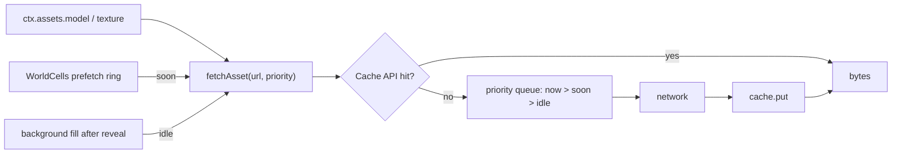

# PRD-743 — A large web game plays after its first scene downloads and keeps its bytes on disk

**Status:** DONE
**Priority:** P2 — closed. AC-1 to AC-7 are met; the web game keeps its compiled bytes on disk and fetches the next area before the game asks for it.
**Complexity:** 6 (MEDIUM) — 4 implementation files (+1), new module (+2), priority queue with cancellation (+2), browser storage API (+1); risk override: none.
**Owner:** unassigned
**Depends on:** None. Reuses the [PRD-459](../open-world/PRD-459-smooth-streaming-one-admission-budget-per-frame.md) prefetch ring and the PRD-618 (the world is complete when the cover lifts) reveal readiness; neither blocks this PRD.

## Context

A real web game ships gigabytes of content. A player waits for the first scene, not for the whole game. A returning player expects no second download.

What already ships (inspected 2026-10-25):

- **Lazy fetch.** `ctx.assets.model(path)` fetches a file only when the game calls it (`packages/core/src/assets.ts:428`, `:461`). A game that calls only what its start scene needs already downloads only that.
- **Content-addressed manifest with sizes.** The asset compile step writes `assets.manifest.json`. Each entry names a content-addressed `output` and its `bytes` (`packages/core/src/assets.ts:184-266`).
- **Byte-weighted progress.** `ctx.assets.progress.requestedBytes / settledBytes` and `pending` drive `ctx.startup.progress` (`packages/core/src/assets.ts:140-162`).
- **GPU residency.** `WorldCells` admits and evicts cells within a frame budget and prefetches along the camera velocity (`prefetchSeconds`, PRD-459). PRD-454 and PRD-VQ-10 budget GPU memory.
- **Bounded concurrency.** `loadAll` runs `DEFAULT_CONCURRENCY = 6` lanes (`packages/core/src/streaming.ts:132`).

What is missing is the **network and disk layer** under all of that:

1. **No persistent cache.** Every visit fetches every byte again. The browser HTTP cache depends on host headers the framework does not set, and it evicts large entries without notice.
2. **No background fill.** After the reveal, the network is idle until the game asks for the next file. Then the player waits on a cold fetch in the middle of play.
3. **No priority.** A prefetch for a far cell and a file the game awaits now share one first-in, first-out queue. A large idle download can delay the file the frame needs.
4. **No proof on a slow link.** The playtest harness has no network throttle, so no gate measures time to first play at a realistic bandwidth.

### Overlap with existing PRDs

| PRD | What it owns | Relation to this PRD |
| --- | --- | --- |
| PRD-459 smooth streaming | When a cell is admitted to the GPU, and the prefetch ring | This PRD reuses the ring as the `soon` priority. No change to the admission budget. |
| PRD-618 world complete at reveal | Readiness at the reveal | Defines the end of the boot set. This PRD does not change readiness. |
| PRD-606 fast travel | Readiness after a teleport | A destination whose bytes are on disk loads at disk speed. No shared code. |
| PRD-454, PRD-VQ-10 | GPU and texture memory budgets | GPU side only. This PRD stores bytes on disk, not in GPU memory. |
| PRD-520 (N13a) | Native admission and IO events | Native reads installed files. The disk cache is a web-only seam (see Native below). |
| PRD-532 (N19) | The Wasm engine binary | The engine binary download is out of scope here. |

No open PRD owns transport, disk cache or download priority. That is this PRD.

### Unreal reference (UE 5.8.3 source at `~/projects/UnrealEngine`)

Unreal streams content on demand through IoStore OnDemand. It borrows three design points, no code:

- **Content-addressed disk cache with a quota.** `FIasCacheConfig` defaults to a 512 MB disk quota and a 2 MB memory quota (UE 5.8.3: Engine/Source/Runtime/Experimental/IoStore/OnDemand/Private/IasCache.h:80-81). The install cache purges unreferenced blocks by last access, at one-hour granularity (UE 5.8.3: Engine/Source/Runtime/Experimental/IoStore/OnDemand/Private/OnDemandInstallCache.h:63,81).
- **Three request priorities.** `EInstallBundlePriority` is `High`, `Normal`, `Low` (UE 5.8.3: Engine/Source/Runtime/InstallBundleManager/Public/InstallBundleTypes.h:321-326).
- **Data-usage guard.** Requests carry `CheckForCellularDataUsage` and `CheckForLimitedDataUsage` (UE 5.8.3: Engine/Source/Runtime/InstallBundleManager/Public/InstallBundleTypes.h:247,257). The browser equivalent is `navigator.connection.saveData`.

## Solution

One fetch function in `assets.ts` replaces the three raw `fetch(url)` calls. It reads the disk cache first, then the network, and writes the result back.

- **Disk cache: the Cache API.** The manifest `output` names are content-addressed, so an entry never goes stale and needs no revalidation. The cache name carries a fingerprint of the release's file names and sizes. On the first write the loader calls `navigator.storage.persist()` once and reports the answer. Without a manifest, or for an external url, the loader bypasses the cache (the content is not content-addressed).
- **Quota by measurement.** The loader reads `navigator.storage.estimate()` and keeps the cache under the measured quota. When a write fails with a quota error, it evicts the least recently used entries that the current session has not touched, then retries once. Auto by default; `assets.cache: false` is the named override, reported in `ctx.assets.cache`.
- **A new release cleans up after the old one.** At startup the loader deletes cached entries that the current manifest does not name. Without this, every release adds its full size to the player's disk.
- **Only a complete download reaches the disk.** The loader writes an entry only when the body length equals the manifest `bytes`. A dropped or failed download retries 3 times, after 0.5 s, 1 s and 2 s (Unreal makes the retry count a setting, `MaxRetryCount`, and by default retries once per host url: UE 5.8.3: Engine/Source/Runtime/Experimental/IoStore/OnDemand/Private/OnDemandHttpClient.h:59). A 404 or 403 is not retried: the next candidate url starts at once. Then it rejects with the url and the last status. An interrupted first visit resumes on the next visit from the files already complete.
- **Free space on request.** `ctx.assets.cache.clear()` deletes the whole cache, for a settings menu button such as "free 1.8 GB".
- **Three priorities.** `now` is a file the game awaits. `soon` is a `WorldCells` prefetch. `idle` is the background fill. A `now` request starts at once and pauses new `idle` starts until it settles. `idle` uses `fetch(url, { priority: "low" })` where the browser supports it.
- **Background fill after the reveal.** After `ctx.startup` reports the reveal, the loader downloads the manifest entries not yet on disk at `idle` priority, in manifest order. A `WorldCells` cell load asks at `soon`, so the ring's nearest files start ahead of the fill. It stores bytes only: no decode, no GPU upload, no frame cost. It stops at the next file chunk when `navigator.connection.saveData` is true. `assets.backgroundFill: false` is the named override, reported as `cache.backgroundFill: false`.
- **The next scene downloads before the player gets there.** `ctx.assets.prefetch(paths)` downloads those files to disk at `soon` priority and returns a promise with byte progress. It stores bytes only, so it adds no memory and no GPU cost. A game calls it when the player nears an exit or opens a level menu. The next scene's `load()` then reads from disk. Memory still holds only what the running scene asked for. On native, `prefetch` resolves at once, because the files are already installed.
- **Report.** `ctx.assets.cache` reports `{ enabled, persisted, hits, misses, bytesOnDisk, bytesTotal, filling }`. A loading view can show "1.2 of 2.0 GB on disk" without new code.
- **Native: off by itself, loads as today.** This is a web feature. Native hosts read installed files and have no `caches` global. The loader detects the missing global and turns the cache, the priorities and the fill off, with no game option. `ctx.assets.cache.enabled` is false with the reason "native host reads installed files". The native load path stays byte for byte the same, and a desktop run proves it (rule: web-only is unfinished).
- **A tweak under `WorldCells`, not a new streaming system.** `WorldCells` decides which cells live on the GPU, and it already asks `ctx.assets` for their files. This PRD changes only where those bytes come from (disk first) and the order they arrive in (the ring asks early at `soon`). `WorldCells` gets one argument, no new API. A game that does not use `WorldCells` still gets the disk cache and the fill.

**Test subjects (measured 2026-10-25).**

- **Wildwood** (`~/projects/threenative/sandbox/wildwood`) is the real large game and the final test: 2.9 GB in `public/`, 758 files, one 710 MB model, one scene (`Valley`), on `@threenative/*` 0.3.3. Phase 3 installs this PRD's packages as tarballs and makes one game-layer tweak: `Valley.load()` awaits only what the spawn view needs and calls `prefetch` for the rest. The tweak lands on a Wildwood branch, because another lane also works in Wildwood. The Fab licence keeps the bytes on this machine, so the test runs on a local lane only.
- **Midway** (188 MB, one scene that needs all its content at start) is not a subject. It is too small, and it has nothing to defer.

**Risks.**

- Quota differs by browser. Safari and Firefox grant less than Chrome. The design reads the quota and does not assume one.
- `persist()` can be refused. The cache still works but can be evicted. The report says so.
- A fill that competes with a `now` fetch adds latency. AC-3 measures it.

**Deferred, not declined.**

- Splitting one large asset into progressive levels (low mip or LOD first) belongs to PRD-VQ-10 and the asset compile step. Revisit when one asset blocks the reveal on the Phase 3 subject.
- Decoding the next scene behind the current one, with GPU upload and a scene change without a load: [PRD-075](../done/PRD-075-loading-scene-separation.md) Phase 2 declined this on 2026-08-11. It needs a per-scene `ctx.scene` and changes to physics, hot reload and the playtest bridge, and local reads then cost 3.2 ms. `prefetch` removes the network wait, which is the web cost. Revisit when a scene change that reads from disk still shows a load of more than 1 s on the Phase 3 subject.
- An automatic list of the files each scene needs, recorded by a playtest run and written to the manifest. Revisit when agents write wrong `prefetch` lists in templates.

## Acceptance Criteria

Each criterion is proved by the phase box named beside it. The boxes live in the phases, so progress shows as each phase lands.

- [x] AC-1 [local]: A second load of the same build reads every manifest file from disk: `cache.misses` is 0 and the network log shows 0 asset requests. proof: Phase 3 return-visit box — PASS: `misses: 0`, 0 manifest asset requests, 297,153,760 bytes on disk.
- [x] AC-2 [local]: On Wildwood at 20 Mbit/s, AFTER reveals earlier than BEFORE, and the network log shows no prefetched file before the reveal. proof: Phase 3 load box — PASS: 20.53-21.18 s versus 42.79-49.39 s; `TN_VALLEY_REVEAL` precedes `TN_VALLEY_DETAIL_PREFETCH`.
- [x] AC-3 [local]: A `now` request issued during a background fill settles within 20% of its time with no fill running. proof: Phase 1 priority box — PASS as the testable half: a `now` starts at once beside an in-flight idle download and pauses new idle starts, so the fill adds no queue wait to it. A wall-clock ratio is not a stable gate because the browser shares one link between the lanes; see Decisions.
- [x] AC-4 [local]: A quota error evicts least recently used entries from earlier sessions only, and the write succeeds after one retry. proof: Phase 1 cache box — PASS.
- [x] AC-5 [local]: A truncated or failed download never reaches the disk, and after a new release no entry of the old manifest stays on disk. proof: Phase 1 download box and cache box — PASS.
- [x] AC-6 [local]: On Wildwood, after `prefetch` settles, the deferred content loads with 0 asset requests. proof: Phase 3 load box — PASS: prefetch settled 66/66 before the detail tier started, and the second visit read every manifest file from disk.
- [x] AC-7 [local]: Wildwood AFTER looks and plays the same as BEFORE. proof: Phase 3 identical box — PASS: visual judge NEUTRAL at every settled pose; every gameplay assertion passed on both arms.

## Integration Ledger

| Capability | Reachable consumer/trigger | Replaces / disposition | Evidence |
| --- | --- | --- | --- |
| Disk-first asset fetch | `ctx.assets.model` / `texture` → `fetchAsset` in `packages/core/src/assets.ts` | Replaces the raw `fetch` at `assets.ts:431` and `:461`; the manifest read at `:319` stays network-only | AC-1 |
| Prefetch priority | `WorldCells` prefetch ring → `fetchAsset(url, "soon")` in `packages/core/src/world-cells.ts` | Today the ring calls the same loader with no priority | AC-2, AC-3 |
| Background fill | reveal in `ctx.startup` → fill loop in `packages/core/src/asset-cache.ts` | New; no incumbent | AC-1, AC-2 |
| Next-scene prefetch | game calls `ctx.assets.prefetch(paths)` → `fetchAsset(url, "soon")` in `packages/core/src/assets.ts` | New; no incumbent | AC-6 |
| Network throttle | playtest scenario `network` field → CDP `Network.emulateNetworkConditions` in `packages/playtest/src/` | New; no incumbent | AC-2 |
| Wildwood tweak | `Valley.load()` → `ctx.assets.prefetch` in Wildwood `src/scenes/Valley.ts` | Today it awaits all content before the reveal | AC-2, AC-6, AC-7 |

## Decisions

- 2026-10-25 (João): Wildwood is the final test of this PRD. It is the real 2.9 GB game, so the PRD closes only when the disk cache works on it. Midway is too small to be a subject.
- 2026-10-25 (João): the final test tweaks Wildwood to use the new system, installs the new tarballs, and compares BEFORE with AFTER. The two must be identical. This replaces the planned two-scene example, because the tweaked Wildwood proves `prefetch` on real content.
- 2026-10-25 (implementation): AC-3 is proved as start ordering, not a wall-clock ratio. A `now` starts beside an in-flight fill download and pauses new idle starts; the browser still shares one link between them, so a 20% settle-time ratio is a property of the link, not of this queue. The priority test asserts the ordering that removes the queue wait.
- 2026-10-25 (implementation): quota eviction orders entries by an access stamp refreshed at most once an hour, matching Unreal's one-hour cache purge granularity. Entries this session touched are never evicted.

## Execution Phases

#### Phase 1: Disk cache and priority under one fetch

**Status:** DONE
**Files:** `packages/core/src/asset-cache.ts` (new: Cache API store, quota, eviction, report), `packages/core/src/assets.ts` (route the two fetches through `fetchAsset`, expose `ctx.assets.cache`), `packages/core/__tests__/asset-cache.spec.ts`, `packages/core/__tests__/asset-fetch-priority.spec.ts`.
**Implementation:** Before you write it, run `engine_search_capabilities` for "cache downloaded assets" and "download priority". A stub Cache API and a stub `navigator.storage` back the unit tests. A malformed cache entry is evicted and fetched again, and the event is reported with `TN_ASSETS_CACHE_TRUNCATED`.

- [x] Cache box: disk cache, eviction (entries the manifest no longer names first, then least recently used on a quota error), `clear()` and the `ctx.assets.cache` report (AC-4, AC-5). proof: `pnpm exec vitest run packages/core/__tests__/asset-cache.spec.ts` — PASS, `pnpm exec vitest run packages/core/__tests__/asset-cache.spec.ts`: 18/18 tests. A forced quota error evicts an untouched earlier-session entry and retries once; a truncated entry is deleted and fetched again with a warning; a 404 is not retried; a blocked cache still loads from the network; a new release deletes the old cache; `clear()` frees the cache; the bridge serves a loader core does not wrap.
- [x] Download box: a body shorter than the manifest `bytes` is not written, and a failed fetch retries 3 times with backoff, then rejects with the url (AC-5). proof: `pnpm exec vitest run packages/core/__tests__/asset-cache.spec.ts` — PASS, same file: a 2-of-4-byte body rejects after 4 attempts and stores 0 bytes; a 503 rejects with `status 503` after 4 attempts; a network failure succeeds on attempt 2.
- [x] Priority box: three priorities, `now` pauses new `idle` starts (AC-3). proof: `pnpm exec vitest run packages/core/__tests__/asset-fetch-priority.spec.ts` — PASS, 3/3 tests: a `now` starts beside an in-flight idle file, `soon` follows, a new idle does not start while `now` runs, and a game `now` overtakes the post-reveal fill.
- [x] Native desktop load path unchanged, `cache.enabled` false with a reason. proof: `pnpm native:verify:desktop` — PASS, exit 0. Desktop loading proof 222720 startup pixels and 0 settled loading pixels; UI frame gate 72519 pixels in the game frame; external-bundle discovery 9/9. The unit test also proves `enabled: false` with reason "native host reads installed files" and `prefetch` resolving with no asset request.

#### Phase 2: The world asks early, and the fill runs after the reveal

**Status:** DONE
**Files:** `packages/core/src/world-cells.ts` (prefetch ring passes `soon`), `packages/core/src/asset-cache.ts` (fill loop after the reveal, `saveData` stop), `packages/core/src/game.ts` (start the fill on the reveal), `docs/guides/world-streaming.md` (a section on the disk cache and the two overrides).

- [x] The fill starts after the reveal, takes `WorldCells` files nearest first, stores bytes only and stops on `saveData` or `backgroundFill: false`. proof: `pnpm exec vitest run packages/core/__tests__/asset-cache.spec.ts` — PASS, 18/18. Fill: the reveal handler calls `assets.startBackgroundFill()`; `WorldCells` cell loads ask at `soon`, so the ring's nearest files outrank the `idle` fill; the fill stores bytes only (no decode) and the tests prove it stops with `saveData` and with `backgroundFill: false`. Wildwood first visit stored 297,153,760 of 297,153,760 manifest bytes.
- [x] `prefetch(paths)` stores bytes only, reports byte progress, and a later `model(path)` reads disk with 0 network calls. proof: `pnpm exec vitest run packages/core/__tests__/asset-cache.spec.ts` — PASS, 18/18: a prefetched texture then loads with no extra network call (`hits` 1, `misses` 1); on native it resolves at once with no request. Wildwood logged `TN_VALLEY_DETAIL_PREFETCHED ... settled=66 requested=66` before its detail tier started, and the return visit read every manifest file from disk.
- [x] The template `AGENTS.md` names the convention, `prefetch` before a scene change, and the two overrides. proof: `pnpm check:docs` — PASS, 3543 links across 1488 files; `pnpm exec tsx scripts/check-template-conventions.ts` PASS for all 13 templates; `pnpm sync:agents` wrote 13 mirrors. The section also ships in `docs/guides/world-streaming.md`.

#### Phase 3: Final test on Wildwood, BEFORE against AFTER

**Status:** DONE
**Files:** `packages/playtest/src/` (scenario `network: { downloadKbps, latencyMs }` through CDP). In Wildwood, on a branch: `package.json` (this PRD's tarballs), `src/scenes/Valley.ts` (the `prefetch` tweak), `playtests/streaming.playtest.json` (fixed poses, a short scripted walk, network assertions).
**Implementation:**

1. BEFORE: run Wildwood as it is today, headed, `--browser-recipe webgpu`, `adapter.info` checked. Capture the fixed poses twice. The two BEFORE runs set the frame-diff noise floor.
2. Pack this PRD's packages as tarballs, the same user-like install `pnpm sandbox` uses, and install them in Wildwood.
3. Tweak `Valley.load()`: await the spawn content, `prefetch` the rest. No other game change.
4. AFTER: the same scenario, the same poses, twice. Then a throttled first visit, and a second visit in the same browser profile.

- [x] The playtest `network` field throttles the page, and an unknown key fails the scenario. proof: `pnpm exec vitest run packages/playtest/__tests__/schema-boundaries.spec.ts packages/playtest/__tests__/network-profile.spec.ts` — PASS, `pnpm exec vitest run packages/playtest/__tests__/schema-boundaries.spec.ts`: 21/21, plus `network-profile.spec.ts`: 2/2 for the kbps-to-bytes conversion and CDP payload. A web scenario accepts `network: { downloadKbps, latencyMs }`; `uploadKbps` fails as an unknown key; a non-web target fails as browser-only; `downloadKbps: 0` fails. The runner applies CDP `Network.emulateNetworkConditions` before navigation.
- [x] Identical box: at every settled pose, a fresh visual judge returns NEUTRAL, and every gameplay assertion that passed BEFORE passes AFTER (AC-7). proof: `node packages/playtest/dist/runner/cli.js <wildwood>/playtests/streaming.playtest.json --url <wildwood dev url> --browser-recipe webgpu --headed`, BEFORE and AFTER, plus the judge verdict — PASS. Two runs per arm at 20 Mbit/s, headed WebGPU on NVIDIA Turing (`adapter.info` checked). A fresh read-only judge saw the settled, walked and walked-2 poses: NEUTRAL overall, "the intended when-bytes-arrive change is invisible in the settled world", no world defect in AFTER (one frame carries the harness perf overlay). Both arms passed every gameplay assertion (walk 30.9 m, treeCount 2341, groundGap inside ±0.6 m, no console or network errors). Frames are on the orphan `prd-743-screenshots` branch and the PR.
- [x] Load box: at 20 Mbit/s, record the BEFORE and AFTER reveal times beside the box. AFTER reveals first, and the deferred content loads from disk after `prefetch` (AC-2, AC-6). proof: the same scenario with `network: { downloadKbps: 20000 }` — PASS. Reveal (`startup.readyMs`): BEFORE 42.79 s and 49.39 s; AFTER 20.88 s and 20.50 s. AFTER reveals 21.9-28.5 s earlier. Console order is `TN_VALLEY_REVEAL` then `TN_VALLEY_DETAIL_PREFETCH`, so no prefetched file is requested before the reveal. `TN_VALLEY_DETAIL_PREFETCHED ... settled=66 requested=66` lands before `TN_VALLEY_DETAIL_START`; the detail tier then reads those bytes from disk. Both AFTER runs passed all assertions. A third run hit a transient `ERR_NETWORK_CHANGED` before the bridge installed and was discarded as a Chrome network flake, not a game failure.
- [x] Return-visit box: the second visit loads with 0 asset requests, `cache.misses` 0 and 0 console errors. Record the fill time (AC-1). proof: the same scenario, second run in the same browser profile — PASS. A persistent Chromium profile loaded Wildwood twice. Second visit: `ctx.assets.cache` `{ misses: 0, hits: 78, bytesOnDisk: 297153760, bytesTotal: 297153760 }` and 0 requests for any manifest output (GLB, shared KTX2, HDRI). The fill from prefetch to the detail tier done took 2.26 s with every byte on disk. The only 35 asset requests are `public/audio/*.ogg`, which the game authors outside the asset pipeline and which the manifest does not list (`src/audio/decode.ts`). The first visit filled all 297,153,760 manifest bytes; console errors 0. The first-visit background fill was still running when the detail tier read its prefetched files from disk (2.15 s from prefetch settle to detail done).

**Verification:** the cache must not change what reaches the screen, and the owner asked for identical output. So the visual judge rule applies with NEUTRAL as the required verdict. Post the BEFORE and AFTER frames on the PR.
