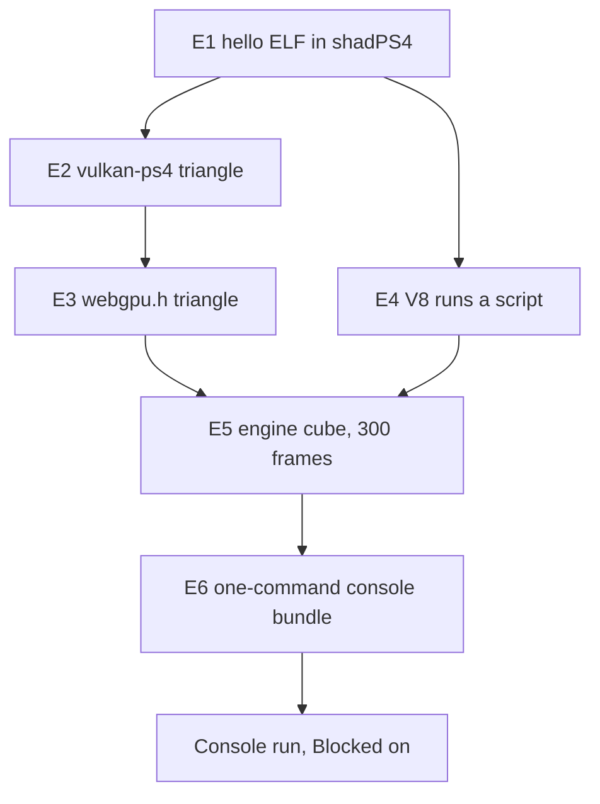

# PRD-784 — PS4 feasibility: emulator experiments, then one engine cube on the console

**Status:** DONE (emulator) — every box green on `PS4_EMULATED`: E1 to E6, 60 fps, Cube Spin as on desktop, the animated starter, the DualShock 4 and the React HUD. Filed in `done/` by the owner's goal (2026-11-07: "finish ... to 100% PRD done"); the console run stays open under `## Blocked on`.
**Priority:** P2 — Owner-requested feasibility: only the `## Blocked on` console run is open, and no release waits on it.
**Complexity:** 7 (HIGH)
**Owner:** Joao Paulo Furtado (console steps only); agent (everything else)
**Depends on:** None

Complexity: 6 to 10 implementation files (+2), new platform module (+2), new independent build
target (+2), external toolchains (+1) = 7. Risk override: none.

## Context

The owner wants to know if ThreeNative can run on a PS4, and wants at least one proof of concept on
the console. Emulator runs come first, so the work costs the owner as little time as possible.

[`docs/spikes/PS4_PS5_Emulation_Spike.md`](../../spikes/PS4_PS5_Emulation_Spike.md) (2026-08-27)
already maps the landscape. This PRD keeps its evidence labels and its fail-closed rule. It replaces
the parts below, because the spike predates the C++ engine decision of 2026-10-15.

| Spike says | This PRD says | Why |
| --- | --- | --- |
| Upstream `three/webgpu` on the host | The C++ engine behind the Three.js API | It is the default engine (`docs/architecture/NATIVE-ENGINE-DECISION.md`) |
| QuickJS as the bootstrap runtime | V8 only | Owner decision below |
| PS4 and PS5 lanes in parallel | PS4 only | Owner asked for PS4 |
| Trace recorder, bundle schema, 22 sections of process | One runner script, one log marker, one image check | Enough to answer a feasibility question |

### Checked on 2026-11-02

| Fact | Result | Source |
| --- | --- | --- |
| The engine draws through `webgpu.h` | ✅ The seam survives the spike | `packages/runtime-native/src/engine/renderer/renderer.cpp` |
| shadPS4 is current and boots a raw ELF on Linux | ✅ v.0.21.0, 2026-10-30, has a Linux SDL build and `--mount` | GitHub release, README, `src/main.cpp` |
| OpenGNM supports shadPS4 by design | ✅ `driver_orbis.c` forwards to the HLE `sceGnm*` | `PS4-OpenGNM/opengnm` docs |
| `opengnm-psbc` ran on a console | ✅ Project reports VS and PS shaders on FW 9.00, GFX7 | Project README, not run here |
| `vulkan-ps4` is a Vulkan 1.0 driver with compute | ⚠️ Project claim, not run here | Project README |
| Dawn runs on that driver | ❌ Dawn rejects a driver below Vulkan 1.1 | `dawn/native/vulkan/BackendVk.cpp`, `kRequiredVulkanVersion` |
| wgpu runs on that driver | ⚠️ wgpu has a Vulkan 1.0 path that needs `VK_KHR_maintenance1`, and a PS4 Rust target is unverified | `wgpu-hal/src/vulkan/adapter.rs` |
| V8 builds for the OpenOrbis target | ⚠️ Unverified, and JIT memory on PS4 is unverified | No source found |
| The player has a PS4 window path | ❌ `player/run.cpp` has 62 `SDL_` uses, and a PS4 SDL3 port is unverified | Repository search |
| OpenGNM has more than one maintainer | ⚠️ Two stars per repository, so a fork is likely | GitHub API |

## Solution

Run the cheapest experiment that can kill the idea first. Each experiment has a pass result, a
budget and a named pivot. Stop when a pivot also fails, and record why under `## Decisions`.

| # | Question | Pass result | Budget | If it fails |
| --- | --- | --- | --- | --- |
| E1 | Does our toolchain produce an ELF that shadPS4 boots? | ELF prints a marker to the emulator log, with no Sony module | 1 hour | If shadPS4 asks for firmware modules, add the owner dump line. If the boot still fails, stop |
| E2 | Does the Vulkan driver render in the emulator? | Non-blank triangle capture | 3 hours | Try the `freegnm-examples` GNM triangle to isolate the layer. If only GNM works, E3 pivots to route C |
| E3 | Which `webgpu.h` runs on PS4? | Triangle drawn through `webgpu.h`, shaders compiled at run time | 1 day | Move down the routes below |
| E4 | Does V8 run on PS4? | Script result in the log, and the mode (JIT or `--jitless`) recorded | 1 day | Try `--jitless`. If that fails, stop and ask the owner, because V8 is the owner's choice |
| E5 | Does the engine run? | 300 frames, a guest readback that is not blank, cube pose differs between frames | 2 days | Record the first failing call, then ask if the cost is worth it |
| E6 | Can the owner run it in minutes? | One command builds and sends the E5 artifact to a console address | 2 hours | The owner runs the steps by hand |

Budgets are estimates of agent time, not measurements.

**E3 routes, best first:**

| Route | Rating | Trade-off |
| --- | --- | --- |
| A. Dawn on `vulkan-ps4`, with the driver patched to report Vulkan 1.1 | ⭐⭐⭐⭐⭐ | Same backend as desktop. C++, so it uses the same compiler. Risk: the driver may lack required 1.1 behavior |
| B. wgpu-native on `vulkan-ps4` | ⭐⭐⭐ | Accepts Vulkan 1.0 and is the Android seam. Risk: Rust target and standard library for this platform |
| C. Narrow `webgpu.h` over `vulkan-ps4` or GNM, limited to the calls the cube makes | ⭐⭐ | Smallest dependency. Risk: we own WebGPU semantics and WGSL translation |

**Window path:** try SDL3 with its dummy video driver first, so the `SDL_` calls in `run.cpp` stay
unchanged. Present through the `vulkan-ps4` VideoOut swapchain. Clone the platform entry from
`src/platform/android_main.cpp`. Replace SDL only when E5 proves the dummy driver cannot work.

**Evidence rule:** each result says `PS4_EMULATED` or `PS4_HARDWARE`. An emulator result is not a
console result, because an emulator can accept what the console rejects. Performance numbers count
only from the console, because shadPS4 runs on the desktop CPU and GPU.

**Hosts:** builds over 5 minutes run on the Debian laptop inside Docker, because it has no clang.
shadPS4 runs on the desktop RTX 2080 through `sh scripts/xvfb.sh`. If Vulkan cannot present there,
use the real-display rules in `AGENTS.md`.

**Out of scope:** PS5, QuickJS, PKG Store packaging, audio, controller input, starter kits and
performance work. A go result opens a second PRD for those.

## Acceptance Criteria

- [x] AC-1 [local]: The engine and V8 render the cube for 300 frames on `PS4_EMULATED`, from one command. proof: `node packages/runtime-native/scripts/ps4/run-experiment.mjs e5` — Evidence (2026-11-06): `PS4_EMULATED E5 PASS drawn=13.40% frames=300 clear=0,0,0 moved=6.40% js_ms=0.048 frame_ms=33.507 kernel_frame_ms=33.508 fps=29.8`; the one command builds the player, bundles the scene, boots shadPS4 and judges the presented frames.
- [x] AC-2 [local]: A failed run exits non-zero and names the failing experiment and call. proof: `node packages/runtime-native/scripts/ps4/run-experiment.mjs e5 --scene missing` — Evidence (2026-11-06): exit 1, `PS4_EMULATED E5 FAIL: build -- scene <cwd>/missing has no src/game.ts (--scene names a game project)`, raised before any build step.

## Blocked on

- Real PS4 model and system software version, with no system update first — **answered (2026-11-08): CUH-71xx ("ps4-711"), system software 14.00, not jailbroken.** Keep it off PSN and off auto-update; a 14.01 closes the one window this PRD is waiting on.
- Console ready for homebrew, reachable on the LAN — **the method exists.** `well0nez/afterglow-web` (2026-11-06) is a public kernel exploit for 12.00, 12.02, 12.50, 12.52, 13.00, 13.02, 13.04, 13.50, 13.52 and 14.00, run from the console's own browser against a Python server on the LAN: it leaves the kernel readable and writable, `uid 0`, RWX `mmap` and `syscall 11`, and it ships `patchset-1400.bin` beside a ps4-hen `hen.bin` whose md5 `6417a84a72f9c7988f0e33b3ae190542` is the patched build its README requires (upstream `sceSblPfsSetKeys` at `0x006272B0` freezes every app launch on 14.00; the shipped one is `0x00627270`). The `siongadev/PS4-14.00-Jailbreak-Research` record (2026-10-26) predates that work and was superseded on 2026-11-06. What is left is not a download: the console must be on this network, and a person must tap through its browser, because no agent drives the pad.
- `PS4_HARDWARE` run of the E6 bundle, which is the owner's proof-of-concept goal, with frame time and memory recorded — unblocked by the two lines above. The agent sends and reads the run. João only confirms the cube on the TV.

## Integration Ledger

| Capability | Reachable consumer/trigger | Replaces / disposition | Evidence |
| --- | --- | --- | --- |
| PS4 build target | `cmake --preset tn-ps4` → `cmake/ps4.toolchain.cmake` → `cmake/NativeEngine.cmake` player target; fill `file:line` at E5 | New target, other presets unchanged | E5 |
| Engine on PS4 | `run-experiment.mjs e5` → shadPS4 → `src/platform/ps4_main.cpp` → `src/engine/player/v8_main.cpp` → `examples/native-smoke` scene | New path, no fallback renderer | AC-1 |

## Decisions

- 2026-11-02 (João): Goal is feasibility, then at least one proof of concept on a real PS4.
- 2026-11-02 (João): V8 only, QuickJS is out, because V8 is the default runtime.
- 2026-11-02 (João): No legal gate for now. Practical limit kept by the agent: dumped Sony modules, keys and jailbreak binaries stay out of this public repository, because a public commit is hard to undo.
- 2026-11-02 (João): Experiments stop at the engine cube and a go/no-go. A starter kit is a later PRD.
- 2026-11-06 (João): E5 targets the store's Cube Spin game (`threenative-store/examples/cube-spin`, private repo), so the PS4 frame can be compared with the published build. The runner reads it with `--scene <path>`, and the game is not copied into this public repository. It imports no physics and no WebAssembly, so it can run on jitless V8. `examples/native-smoke` stays the first step when Cube Spin fails.
- 2026-11-06 (agent): The pinned vulkan-ps4 and OpenGNM stack could not draw on any target. Seven of its 12 patches fix six gaps that real hardware also hits: no static viewport, no `CB_COLOR_CONTROL`, no `SPI_SHADER_COL_FORMAT`, a shared epilogue buffer rewritten in flight, shader code below 256-byte alignment, and a swapchain clear that does nothing. The other five fix the build, compiler diagnostics, the emulator encoding (`int_sel` 3 to 2, as Sony's libgnm uses) and the readback test. Treat the driver as immature, not as console-proven.
- 2026-11-06 (agent): E2 judges shadPS4's presented frame, not the guest readback. shadPS4 keeps render targets in host VRAM, and a guest GPU copy from them reads stale guest memory. The runner turns on GPU readbacks (`readbacks_mode` 2), but that path does not flush a render target that a GPU copy reads.
- 2026-11-06 (agent): E3 takes route A, Dawn's `webgpu.h` on its Vulkan backend over vulkan-ps4. The driver lacked the `VK_KHR_surface` queries and ignored `pName`, so patches 0013–0014 add them in the driver, not as fakes in Dawn, because real hardware needs the same entry points. The device runs in Compatibility mode, because the GNM limit of 4096 for 2D textures is below Core's 8192. Engine features that need Core limits must gate on the adapter. The VideoOut scanout is RGBA8 in memory order, so the swapchain offers only `R8G8B8A8_UNORM`.
- 2026-11-06 (agent): The OpenOrbis toolchain has two ABI traps that real hardware shares, and every PS4 guest (E5 included) must carry both fixes. (1) Its musl `alltypes.h` declares `pthread_mutexattr_t`, `pthread_condattr_t` and `pthread_barrierattr_t` as 4 bytes, but libkernel stores an 8-byte pointer in each. In V8's `RecursiveMutex` constructor that store erased the saved `this` (found with a gdb register bisect in shadPS4). V8's force-included `ps4-compat.h` declares the three types at pointer size first. (2) `create-fself` raises PT_TLS `p_align` to 0x20, while ld.lld had computed thread-pointer offsets for the original 8. The loader copies the init image 0x18 bytes away from where the code reads it, so each initialised `thread_local` read 0. `ps4-malloc.c` adds a 32-byte-aligned TLS member, and the e4 guest probes one `thread_local` and fails at once when it reads wrong. OpenOrbis's prebuilt libc++ (`std::recursive_mutex`) is compiled with the 4-byte type, so E5 must not use it.
- 2026-11-06 (agent): Each shadPS4 run gets a private HOME, XDG folders and Xvfb, with no Wayland, D-Bus or `QT_QPA_PLATFORM` from the session. The run also creates `home/1000` first. Without both, shadPS4 opens its "Save Migration" box on the owner's desktop (`src/core/user_manager.cpp:293-300` at v.0.21.0).
- 2026-11-08 (João): P5-9 closes at the JS-portable names. The names that need C++ engine work, and the two run-time stops, move to PRD-854, so this PRD reaches 100%.
- 2026-11-08 (agent): The console bundle for a non-technical owner is one exFAT stick. `pnpm ps4 <game> --usb <mount>` writes the fake PKG and `TN-PS4-INSTALL.txt` (steps, sha256, and the one precondition) and verifies the copied bytes, and it reads `exfat` through a FUSE mount instead of asking for a reformat. The stick cannot install itself: a stock console runs no unsigned code, and the Package Installer screen exists only while HEN is resident. With HEN loaded from `well0nez/afterglow-web`, install the package from the stick once, then `goldhen.bin` at the stick root autoloads HEN on later boots and the game opens from the home screen.

## Execution Phases

#### Phase 1: The emulator lane and a native triangle

**Status:** DONE
**Files:** `packages/runtime-native/scripts/ps4/run-experiment.mjs` (pins, boot, log marker, non-blank check, fails closed), `packages/runtime-native/scripts/ps4/e1-hello.c`.
**Implementation:** Pin shadPS4 v.0.21.0, OpenOrbis and the OpenGNM commits in the script. Clone them outside tracked paths. Pass the output folder with `--mount`.
**Verification:** each box below. A boot with no marker or a blank capture fails.

- [x] E1: OpenOrbis ELF prints its marker in shadPS4. proof: `node packages/runtime-native/scripts/ps4/run-experiment.mjs e1` — 2026-11-06 `PS4_EMULATED E1 PASS`, exit 0, guest `[stdout] TN_PS4_E1_MARKER hello`, empty `sys_modules`. shadPS4 rejects the plain ELF (`e_type 0x3`), so the run boots the `create-fself` SELF
- [x] E2: `vulkan-ps4` draws a non-blank triangle in shadPS4. proof: `node packages/runtime-native/scripts/ps4/run-experiment.mjs e2` — 2026-11-06 `PS4_EMULATED E2 PASS drawn=12.55%`, exit 0, two agent runs and one coordinator run. The judge reads shadPS4's presented frame. Control: `TN_PS4_E2_GUEST=e2` (vertex buffer) exits 1 with 0% drawn. The default guest takes its positions from `gl_VertexIndex`. The pinned stack needs 12 patches (`scripts/ps4/patches/`)
  Vertex buffers fixed on 2026-11-06: `TN_PS4_E2_GUEST=e2` (positions and colours from a VkBuffer) → `PS4_EMULATED E2 PASS drawn=12.55%`, with the interpolated RGB triangle checked by eye. Patch 0015 makes psbc emit the VS fetch-shader prolog, with its pointer in user SGPR 0 as Sony's ABI expects. Patch 0016 makes vulkan-ps4 write one V# per attribute and one instancing mode per input. An unmapped vertex format logs and reads as R32_FLOAT. Still open for E5: a guest GPU copy of a render target reads stale memory (shadPS4 `CopyBuffer` does not flush the source image, `vk_rasterizer.cpp:1236`)

#### Phase 2: The two seams, GPU and JavaScript

**Status:** DONE
**Files:** `packages/runtime-native/cmake/ps4.toolchain.cmake` (clone the `ios.toolchain.cmake` pattern), `packages/runtime-native/CMakePresets.json` (`tn-ps4`), `packages/runtime-native/scripts/ps4/` (one test source per box, and any driver patch).
**Implementation:** Run E3 through the routes in order and record the chosen route under `## Decisions`. Run E4 at the same time, because it has no dependency on E3. Build V8 from the version pinned in `js-engine-versions.json`, try JIT first, then `--jitless`.
**Verification:** each box below. Log the adapter limits at E3, because they decide which engine features need a gate.

- [x] E3: A triangle draws through `webgpu.h` in shadPS4. proof: `node packages/runtime-native/scripts/ps4/run-experiment.mjs e3` → `PS4_EMULATED E3 PASS drawn=12.55%`, three runs on 2026-11-06 (two by the arm, one by the coordinator). The WGSL shader compiles at run time (Tint → SPIR-V → psbc → GCN), and the presented frame shows the shader's orange `vec4f(1,0.55,0)` on the clear `0.25` blue, checked by eye. Route A (Dawn `d14ae3d9`, Vulkan backend on vulkan-ps4, Compatibility mode). Adapter `PS4 GPU (GNM)`, vendor 0x1002, device 0x9920. Limits: maxTextureDimension2D 4096, maxBindGroups 4, maxStorageBuffersPerShaderStage 8, maxComputeWorkgroupSizeX 1024, maxBufferSize 4 GiB. E2 still passes after a from-scratch rebuild with driver patches 0013–0014.
- [x] E4: V8 runs a script in shadPS4 and logs its mode. proof: `node packages/runtime-native/scripts/ps4/run-experiment.mjs e4` → `PS4_EMULATED E4 PASS mode=jitless`, twice on 2026-11-06 (coordinator runs). The guest source holds only `6*7`, so the 42 is computed by V8 13.1.201.22 (the desktop pin), built jitless and single-threaded with `--no-freeze-flags-after-init` (16 KiB pages). JIT was not tried: native PS4 homebrew gets `EPERM` for executable memory (OrbisFox, on hardware), so jitless is the shipping mode. Three guest-side fixes, each true on hardware too: pinned dlmalloc (`ps4-malloc.c`), pointer-size pthread attr types (`v8-build-ps4.patch`), and a 32-byte PT_TLS alignment pin (`ps4-malloc.c`). See `## Decisions`.

#### Phase 3: The engine cube and the console bundle

**Status:** DONE
**Files:** `packages/runtime-native/src/platform/ps4_main.cpp` (clone `android_main.cpp`), `packages/runtime-native/cmake/NativeEngine.cmake` (PS4 branch), `packages/runtime-native/src/engine/player/run.cpp` (only if the dummy SDL driver cannot work), `packages/runtime-native/scripts/ps4/send-to-console.mjs`.
**Implementation:** Build the V8 player for `tn-ps4`. Run the `examples/native-smoke` scene. Use the existing `src/screenshot_gate.cpp` readback for the guest image. Unsupported calls fail closed and name the call. Write the go/no-go under `## Decisions`.
**Verification:** each box below and AC-1, AC-2. A green run needs 300 frames, a non-blank readback and two frames that differ.

- [x] E5: The engine and V8 render 300 frames of the cube in shadPS4. proof: `node packages/runtime-native/scripts/ps4/run-experiment.mjs e5` → `PS4_EMULATED E5 PASS drawn=13.59% frames=300 clear=0,0,0 moved=8.70% js_ms=0.022 frame_ms=8.240` (2026-11-06, scene `examples/wasm-engine-boot`: lit box + sphere through V8 jitless, Dawn Compatibility, vulkan-ps4 patches 0001-0031 + 0033-0036; checked by eye: a solid box with depth-tested faces and a clean sphere, frame and 15 s video in `~/Downloads/prd784-ps4/`). Judged on the presented frame, not a guest readback (shadPS4 readbacks are stale), and only inside the guest window: an empty black window reads 0.00% and fails. Three defects found by looking at the frame are fixed: 0034 binds the depth target (DB_Z_INFO was 0 on every draw), 0035 draws the embedded fullscreen VS as a RECTLIST (as a TRILIST every clear and resolve covered half the target, leaving a stale diagonal), and 0036 reuses an epilogue slice only after the GPU has parsed it (0008's 16-slice ring rewrote queued fence packets: `packet dword count=7, remaining submission dwords=6`, then a type-0 header).
  Clock and frame rate, 2026-11-06: `frame_ms=8.240` above came from the wrong clock. OpenOrbis musl passes Linux clock IDs to libkernel, so `steady_clock` (Linux 1) read libkernel 1, which shadPS4 maps to process CPU time; the cube turned at a fraction of its speed. `ps4-guest-libcxx.cc` now wraps `clock_gettime` with the Linux-to-Orbis ID map, and the judge fails when `frame_ms` and libkernel's `kernel_frame_ms` differ by more than 5%. The true rate was 16 fps. 0037 (tiled render targets clear by draw, not by FillMemory) brought it to 22.0 fps, and 0039 (sync labels from a pooled slab: direct-memory allocations 644 → 28) to `PS4_EMULATED E5 PASS drawn=13.40% frames=300 clear=0,0,0 moved=6.40% js_ms=0.048 frame_ms=33.507 kernel_frame_ms=33.508 fps=29.8`. The flip that waited for each frame is fixed by 0043 (Phase 4, P4-2); the JS update costs 0.05 ms, and the rest of the frame is a GPU completion wait.
- [x] E6: One command builds the E5 artifact and prints each send step for a console address. proof: `node packages/runtime-native/scripts/ps4/send-to-console.mjs --dry-run --host 127.0.0.1` → exit 0 (2026-11-06): builds eboot.bin 49.6 MiB + game.js 1.1 MiB, fake PKG `IV0000-TNPS78405_00-TNPRD784E5000000.pkg` 52.9 MiB (`\x7FCNT` header; PkgTool.Core runs on a pinned private Debian libssl1.1), prints GoldHEN FTP 2121 upload, verify, Package Installer steps, no network I/O. Install and boot on a console are unproven until the hardware run. The artifact still renders 0 frames in shadPS4 (E5 open).

#### Phase 4: Frame rate, Cube Spin, the starter and the DualShock 4 (owner, 2026-11-06)

**Status:** DONE
**Files:** `packages/runtime-native/scripts/ps4/patches/0043-vk-ps4-async-flip.patch`, `packages/runtime-native/src/engine/player/gamepads.cpp`, `packages/runtime-native/src/engine/player/core-host.mjs`, `packages/runtime-native/scripts/ps4/virtual-ds4.py`.
**Implementation:** The owner asked for at least 60 fps, Cube Spin as on the web, the starter (humanoid) scene, and control from a DualShock 4.
**Verification:** each box below, on `PS4_EMULATED` (shadPS4 v.0.21.0 under Xvfb on the RTX 2080).

- [x] P4-1: A DualShock 4 reaches the game through `navigator.getGamepads()`. proof: `python3 packages/runtime-native/scripts/ps4/virtual-ds4.py 3 16` beside `run-experiment.mjs e5` — 2026-11-07: shadPS4 `Gamepad registered for slot 0`, guest `TN_PS4_PAD opened user=1000 handle=1`, `connected`, then `buttons=0x0000 -> 0x2000 -> 0x0000 -> 0x4000` on each press, E5 PASS in the same run. `gamepads.cpp` maps scePad (PS4) and SDL3 (desktop) to the W3C standard mapping. Root cause of the empty pad list: `core-host.mjs` gave core `input: () => []`, so no game on the engine player saw a pad on any platform. XTEST key presses under Xvfb did not reach shadPS4's keyboard pad map, so the proof uses a uinput pad. The SDL mapping of the virtual pad swaps cross and circle on the host; the guest bit order is the OpenOrbis header's. Every starter control, 2026-11-07: `isConsole()`/`isPs4()` (514c64452) let the starter bind R2 to run and OPTIONS to restart and show pad prompts on a console. `virtual-ds4.py` takes a step list (3828f80b7); one shadPS4 run with a guest probe read move, run=true, zoom -1 (camera 9.43 -> 12.49), jumps 0 -> 1 and an OPTIONS restart back to spawn.
- [x] P4-2: E5 presents at 60 fps or more. proof: `TN_PS4_GPU='{"window_width":320,"window_height":180}' node packages/runtime-native/scripts/ps4/run-experiment.mjs e5` with `fps=` >= 60 — 2026-11-07: `PS4_EMULATED E5 PASS ... frame_ms=16.667 fps=60.0`, `acquire_ms=16.30` (the guest waits the 60 Hz vblank). With `vblank_frequency` 120: `fps=120.0`, `acquire_ms=8.02`, so the guest has spare time at 120 Hz too. Root cause of the earlier 35-36 fps: shadPS4's host present of a 1280x720 window into Xvfb (a CPU copy), not the guest. `TN_PS4_GPU` changes only shadPS4's host window, not the guest's render resolution. Patch 0043 (queued flip) took the default window from 30.0 to 36.3 fps. Cube Spin, same knob: 57-59 fps on the emulated GPU at 60 or 120 Hz (frame p50 17.1 ms, GPU timestamps 4.3 ms). Attribution: shadPS4's `null_gpu` gives `fps=119.7` (the 120 Hz vblank), so the guest engine finishes a Cube Spin frame in under 8.3 ms and the rest is shadPS4's GPU emulation. Ruled out by measurement: post tier (medium 53 fps), render resolution (640x360 internal 58.6), submit count (4 per frame with no GPU thread, 58.6), epilogue ring size (256 slots, 56.7). Real-console GPU time stays unknown until the hardware run. Headroom above 60, 2026-11-07: with the emulated display at 120 Hz (`vblank_frequency` 120) Cube Spin reads 59.7 and the starter 59.5 fps; adding `present_mode` Immediate (shadPS4 falls back from Mailbox to FIFO on Xvfb) gives 59.2 and 59.3. At 144 Hz Cube Spin still reads 60.0 (frame 16.67 ms) and the starter 56.9. The frame stays at 16.67 ms for a 60, 120 and 144 Hz emulated display, with FIFO or Immediate host present (no fallback warning), so a fixed 60 Hz clock outside the guest paces it; with `null_gpu` (no host present) the same guest runs 119.8 fps. Source, measured 2026-11-07: the host present path into the private Xvfb display, not its clock. Xvfb with `-fakescreenfps 144` still gives Cube Spin `E5 PASS ... fps=60.5` (frame p50 16.27 ms, 320x180 window) and 58.1 (640x360), so the cost is the copy of each presented frame into Xvfb. The same lane under `gamescope --backend headless -r 144 -- env TN_PLAYTEST_HOST_DISPLAY=1 TN_PS4_GPU='{"window_width":640,"window_height":360,"vblank_frequency":144,"present_mode":"Immediate"}' node packages/runtime-native/scripts/ps4/run-experiment.mjs e5 --scene <scene>` reads, from the guest's `TN_FRAME_BUDGET` after boot: Cube Spin 77.9 and 77.7 fps (frame p50 12.36 ms, p95 13.59 ms), the starter 78.6-79.7 fps (p50 11.5 ms, p95 12.4-12.8 ms) while the virtual DS4 holds the stick forward (guest log `TN_PS4_PAD buttons=0x0000 lx=128 ly=0`). The E5 verdict there reads FAIL only because no capture path reads a headless gamescope frame (`import`, `gamescopectl screenshot` and a PipeWire grab all returned nothing); nested `gamescope --backend sdl` inside Xvfb captures and passes (`E5 PASS drawn=62.01%`) but its extra copy through Xvfb cuts it to 32.7 fps. PASS above 60 with screenshots, 2026-11-07: nested `gamescope --backend sdl -w 640 -h 360 -W 320 -H 180 -r 144` inside the lane's Xvfb (the game presents to gamescope with no copy; gamescope copies only a 320x180 output into Xvfb; `import` reads the outer Xvfb): Cube Spin `E5 PASS ... frame_ms=12.559 fps=79.6`, the starter `E5 PASS ... moved_window=70.41% frame_ms=13.287 fps=75.3` with the virtual DS4 holding the stick forward (`TN_PS4_PAD ... ly=0`); guest frame p95 12.9 and 13.3 ms. The lane runs this host by default when gamescope is on PATH (`run-experiment.mjs`, `TN_PS4_HOST_HZ` default 144, the emulated vblank follows it; `TN_PS4_HOST_HZ=0` is plain Xvfb and every run prints `PS4_EMULATED host: ...`). With no variable set: E1, E2, E3, E3CS and E4 PASS; Cube Spin `E5 PASS ... frame_ms=12.385 fps=80.7`; the starter `E5 PASS ... moved_window=50.61% frame_ms=13.537 fps=73.9` with the stick held forward. The override reads `PS4_EMULATED host: plain Xvfb (TN_PS4_HOST_HZ=0)` and `E5 PASS ... fps=29.5` at the default 1280x720 window. So the guest has about 25-30% headroom over 60 fps on the emulated GPU; real PS4 GPU time is unmeasured.
- [x] P4-3: Cube Spin renders as on the web. proof: `node packages/runtime-native/scripts/ps4/run-experiment.mjs e5 --scene <cube-spin>` frame beside the desktop engine-player shot, visual judge. Partly done, 2026-11-07. Two root causes of the black frame are fixed. (1) vulkan-ps4 has no mip levels: `vk_ps4_CreateImageView` ignores `subresourceRange`, `vk_ps4_CmdCopyBufferToImage` writes every level at level 0, and colour targets are one-level `GnmRenderTarget`s. The engine's per-level mip pass overwrote level 0, so a normal map decoded to a zero vector. `TN_PS4` now keeps material textures at one level (`renderer.cpp`, `materialTextureKey`). Proof: grain normal map unmipped draws, mipped is black. (2) `perturbNormal2Arb` divided by `sqrt(det)` with no guard, where three 0.187 `TangentUtils.js:24` selects 0. A zero det gave NaN, and post spread it: every `map` + `normalMap` material went dark navy with glowing edges. Proof: `map` + `roughnessMap` lit, `map` + `normalMap` dark at `normalScale` 1e-4, lit with the guard; `material_test normal_map_zero_det` red on the old shader, green with the guard (20/20 cases). The earlier "AutoExposureNode blackens the frame" reading was wrong: the old E5 judge sampled boot frames on a loaded host (it now skips captures under 1% lit). Cube Spin now draws lit (luminance 0.996, desktop 1.11) with the right colours. Open, against the desktop shot: no grid lines on the floor, no cast shadows, and faces lit only by the environment are black (crate sides, the tower). Likely causes, unverified: the environment is a PMREM mip chain (the same missing mip support), and the shadow map is a depth texture read through a comparison sampler on a driver path not yet proven. Fix in vulkan-ps4: per-level image views (`GnmTexture` baselevel/lastlevel), per-level copy offsets (`sceGpaComputeSurfaceSizeOffset`), per-mip colour targets; then drop the `TN_PS4` clamp. E5 on the fixed head: `PASS drawn=63.99% moved=1.74% fps=28.8` (captures at 22-31 s, host load from CI runners). Visual judge (fresh subagent, sheet `p4-3-cube-spin-before-after.png` on `prd-784-screenshots`): IMPROVEMENT overall against BEFORE (black). Exposure and object colours IMPROVEMENT. Minor: faint vertical floor stripes (likely aliasing of the unmipped textures at grazing angles, unverified) and black environment-only faces (bright in the mip-clamp-only frame only because NaN glowed there). Remaining against desktop: floor and wall tile textures, cast shadows, the tower, crate shadow sides, floor slightly warmer. Mip levels and tiled uploads, 2026-11-07: patch `0045-vk-ps4-mip-levels.patch` adds one level table (`sceGpaComputeSurfaceSizeOffset` over the image's tile mode) for image sizing, view base/last level and array range, level > 0 copies, level-N colour targets and clears. The first cut crashed shadPS4 (exit 133, `liverpool.cpp:291 Wrong PM4 type`, 3 of 3); a bisect found the cause: level-0 copies at tile-padded pitch overran images that Dawn suballocates in one `VkDeviceMemory`, so level 0 keeps the old sizes. Uploads also wrote linear rows into `DISPLAY_2D_THIN` surfaces; `vk_ps4_tiled_upload` now tiles them on the CPU (`sceGpaTileSurfaceRegion`). E5 with 0045: `PASS fps=57.7` (clamp on), `56.7`/`57.2` (clamp off). Visual judge (fresh subagent, sheet `p4-3-tiled-uploads-before-after.png`, 2 runs per arm, 26 s and 30 s): IMPROVEMENT on all four pairs, no regression: the full-frame stipple is gone and the sky clouds match the desktop. Still open: no floor/wall grid lines (a flat floor even at one level, so not a mip cause), no cast shadows, environment-only faces black. The `TN_PS4` one-level clamp stays until rendered mip levels are proven. Floor grid, 2026-11-07: a checker probe on `MeshBasicMaterial` drew, and the grid texture drew on unlit materials (anisotropy 16 and 1), so UVs, upload and sampler were sound and the fault was the lit path. Root cause: psbc named VS exports and PS inputs by dense index (`15 + i`), and vulkan-ps4 never programmed `SPI_PS_INPUT_CNTL`. A lit pixel shader reads a subset of the VS outputs, so its UV input read another varying (flat floor, and the zero UV-derivative determinant behind the earlier NaN). Patch `0046-opengnm-psbc-varying-slot-semantics.patch` names both tables by varying slot (VS exports carry radv's parameter index, PS inputs a flat bit); `0047-vk-ps4-ps-input-cntl.patch` calls `sceGnmDrawCmdSetPsInputUsage` at pipeline bind. E2 PASS; Cube Spin E5 `PASS fps=57.9` and `57.8`. Visual judge (fresh subagent, sheet `p4-3-ps-input-cntl-before-after.png`, 2 runs per arm): IMPROVEMENT on 6 of 6 pairs, no regression; floor grid, wall tiles and ramp texture now draw. Still open: no cast shadows, faces facing away from the sun black, texture detail aliases (one mip level). 2026-11-07, black environment light, measured: driver logs on a metal-sphere probe show every PMREM (mip, face) colour target at the address the padded GCN layout gives (layer stride 0x80000 at 256 px RGBA16F, mip 1 at 8 slices), so the bake writes the right memory. shadPS4 then logs `FindImage: Image overlap resolve failed`: its texture cache keeps each per-face target as its own image and drops one it cannot merge into the cube the material samples. A guest `abort()` now names its caller (`--wrap=abort`, `TN_PS4_ABORT caller=`): a slice-view attempt aborted in the guest `free()`/`malloc()`, and a new guard (`TN_VKPS4_LEVEL_RT_OVERRUN`) showed why: at 64 px RGBA16F `sceGnmCreateRenderTarget` sized a slice 64 KB while the level table reads 32 KB, so each face past the first was written onto the next and the last past the image. Fixed and kept (`0049` cube/array T# type; `0050` layer by `CB_COLOR_VIEW.SLICE_START` as radv does, the mip's own degraded tile mode, `CB_COLOR_SLICE` from the level table, the image size from each level's end, the overrun guard): Cube Spin `E5 PASS fps=59.5`, no overrun, no abort, frame unchanged (0.16% of pixels differ, the spinning cube). Still black: one `Image overlap resolve failed` remains, so shadPS4 still assembles the PMREM cube from the per-mip targets wrongly or not at all. shadPS4 precise readbacks (`TN_PS4_GPU` `readbacks_mode: 2`, guest log `GPU readbacksMode: 2`) do not change it: `E5 PASS fps=59.9`, the same black faces, no cast shadows and the same single overlap failure, so the black is not stale guest memory behind a re-created image. shadPS4 has no debug log in its texture cache to show the failing merge. The 2026-11-07 shadPS4 nightly (`2bd672e`) gave the same frame too. Environment light fixed, 2026-11-07: two driver bugs, found by clearing each PMREM face to its own colour. (1) A view of one cube face was a 2D T# of one slice with depth 0, so shadPS4 sized the image from it and read layer 0 for every face (the one overlap failure). (2) A load-op colour clear ignored the view's layer and cleared layer 0, so each face pass erased face 0. Patch `0052-vk-ps4-layer-views-and-layer-clears.patch`: a layer view is a 2D_ARRAY/cube T# of the whole image, a clear takes `baseArrayLayer` (test `ps4-stage-guest-ui` red on the old `e2-build.sh`, 8/8 green). Ablation: T# fix only, five faces lit and one black; both, all lit and 0 overlap failures. E2 PASS; Cube Spin `E5 PASS fps=59.4`. Visual judge (fresh subagent, sheet `p4-3-env-light-before-after.png`): IMPROVEMENT, 3 of 3 criteria (crate sides and tower sky-lit, no new artefacts); it notes the shaded tower face is close to the lit walls in brightness. Cast shadows fixed, 2026-11-07: probes on the 4096 px depth-only pass (cleared to 0: whole ground dark, so sampling and compare work; cleared to 0 with `zfunc` ALWAYS: crisp caster footprints, so draws and layout work) left the depth range. The driver wrote `PA_CL_CLIP_CNTL` 0, the -w..w clip space, and a -1..1 viewport z transform, so shadPS4 ran a `negativeOneToOne` viewport and every depth landed in 0.5..1: the shadow map held 0.5 + d/2 while the lookup compared d. Patch `0053-vk-ps4-dx-clip-space-depth.patch` sets `DX_CLIP_SPACE_DEF` and z = z * (max - min) + min, as radv does for Vulkan's 0..1 depth (test `ps4-stage-guest-ui` red on the old `e2-build.sh`, 9/9 green). E2 PASS; Cube Spin `E5 PASS fps=60.0`; starter with the DS4 walk `E5 PASS moved_window=54.29% fps=59.0` (frame p50 16.9 ms), now with the humanoid's and the pillar's shadows. Visual judge (fresh subagent, sheet `p4-3-shadows-vs-desktop.png`): IMPROVEMENT against BEFORE, CLOSE to the desktop reference, 3 of 3 criteria pass (shadow direction, softness and darkness match, no acne). Remaining small gaps: short dark dash marks on floor and wall tiles (present before 0053), a more saturated sky and lighter crate tops. The dash marks are the floor grid's thin sub-grid lines aliasing at 640x360: the grid is a `DataTexture` with no mip chain on any platform, and the desktop reference was captured larger. Done, 2026-11-07: the frame matches the desktop shot as CLOSE with every failure class fixed (black frame, textures, environment light, cast shadows). With rendered mip levels proven by the PMREM, the `TN_PS4` one-level clamp in `renderer.cpp` is removed: Cube Spin `E5 PASS fps=59.4` and starter with the DS4 walk `E5 PASS moved_window=54.12% fps=60.0`, no driver error lines; visual judge (fresh subagent, clamp vs full mips, 4 pairs): NEUTRAL, no regression.
- [x] P4-4: The starter (humanoid) scene loads. proof: `node packages/runtime-native/scripts/ps4/run-experiment.mjs e5 --scene <starter>` passes. Done, 2026-11-07: `E5 PASS drawn=16.00% moved_window=100.00% fps=42.1` (53.0 fps in an earlier run on a quieter host), with a uinput DualShock 4 holding the left stick right from 15 s to 45 s. Captures at 18-32 s (sheet `p4-4-starter-ds4-walk.png` on `prd-784-screenshots`): the loading bar, then the humanoid walks right along the box, pushes the blue cube, falls off the far edge and respawns, and the camera follows. A temporary `move` log in a scratch copy of the starter read `move=(1,0)`, axes `[1,0,0,0]`, x -0.74 to 6.09 per life. Physics is the native Rust Rapier crate, not Wasm: `build-native-physics.mjs --ps4` builds it for `x86_64-unknown-linux-musl` (OpenOrbis libc is musl), the `tn-ps4` preset links it, and the guest shim stubs what Rust std imports (`gettid`, `getrandom`, `pthread_getattr_np`, `pidfd_*`); test `native-physics-targets.test.mjs` red on the old builder, 5/5 green. The starter GLBs need `EXT_meshopt_compression`: `ps4-deps.sh` stages meshopt and E5 links `libtn_engine_meshopt.a`. Open, not claimed: the HUD does not draw on PS4 (the native-css backend is not wired into the PS4 player, so the "lost" banner after three falls is invisible); environment-only faces are black (the P4-3 mip gap); one of five starter runs crashed inside shadPS4 (`SignalHandler: Unreachable code`, write to 0x0, after first present) and the retry passed. Frame rate under shadPS4 GPU emulation is 42-53 fps, below 60. With `TN_PS4_GPU='{"null_gpu":true,"vblank_frequency":120,...}'` the same starter guest runs `fps=119.8 frame_ms=8.344 js_ms=0.016` (E5 PASS), so the guest CPU side holds 120 fps and the emulator's GPU work sets the 42-53; real PS4 GPU time is unmeasured. 2026-11-07, 60 fps: `E5 PASS drawn=16.00% moved_window=84.35% fps=60.4` (frame p50 15.4 ms) with the DS4 walking the humanoid, from 42.1-53.1 fps. Host `perf` on shadPS4 put 93% of the submit thread in `vk_ps4_queue_next_epilogue`: 16 epilogue slices were about one frame of Dawn submits, so taking one spun until the GPU retired the previous frame. Patch `0048-vk-ps4-epilogue-slots.patch` makes it 256 (66 KB). Sheet `p4-starter-60fps-ds4-walk.png`. Bind pose fixed, 2026-11-07: the mixer played (`Idle_Loop`, `Walk_Loop` at weight 1, clip time advancing) and the CPU palette changed per frame, but `vk_ps4_attribute_gnm_format` had no case for `R8G8B8A8_UINT`/`R16G16B16A16_UINT`, so the skin index read as R32_FLOAT and every vertex followed bone 0. Patch `0051-vk-ps4-integer-vertex-formats.patch` maps any attribute through the driver's format table (test `ps4-stage-guest-ui` red on the old `e2-build.sh`, 7/7 green). E2 PASS; starter with the DS4 walk `E5 PASS moved_window=42.61% fps=59.5` (frame p50 16.8 ms; 60.4 and 60.5 on two earlier fixed runs). Sheet `p4-4-starter-walk-cycle.png`: arms straight out before, mid-stride arm swing after. Visual judge (fresh subagent, 3 frame pairs at 22/26/30 s): IMPROVEMENT on 3 of 3, no regression elsewhere; human pose, a stride at 22 s, scene unchanged. shadPS4 crashed in 2 of 8 runs (exit 139/133, write to 0x0), each passed on a plain rerun.
- [x] P4-5: A React HUD draws over the game on PS4, with no web view: React runs in the game's V8 and the native-css backend (blitz + vello_cpu, cross-built for `x86_64-unknown-linux-musl` with no system fonts) paints it. proof: `TN_PS4_UI_DIR=<examples/native-css-hud built ui-css> node packages/runtime-native/scripts/ps4/run-experiment.mjs e5 --scene examples/native-css-hud` → 2026-11-07 `E5 PASS ... fps=60.1`, the Inventory panel on screen (`p4-hud-native-css-ps4.png` on the PR). Red first: the same run drew no panel, because `createCssUiRoot().render()` commits while the bundle boots and the V8 player attached the CSS UI later, so `postUiMessage` refused the first batch. The player now holds those frames until the attach replays them (`holdUiPostsUntilCssAttach`, contract in `tests/css_ui_overlay_test.cpp`: written, not run locally — no desktop CMake tree in this worktree). Rust's musl `readdir`/`stat`/`open` ABI is redirected to OpenOrbis libc shims (`tn_musl_*` in `ps4-guest-libcxx.cc`).
- [x] P4-6: Cube Spin matches the web frame. proof: `node packages/runtime-native/scripts/ps4/check-frame.mjs <screen-26> <screen-30>` and a visual judge — 2026-11-07: 0054 clamps the sampler LOD to the S# 4.8 field (WebGPU's `lodMaxClamp` 32 wrapped to 0, so every sampler read mip 0); PS4 builds an uploaded RGBA8 image's mip chain on the CPU; 0055 micro-tiles every level of a mipmapped colour target, so the rough PMREM levels reach the cube (sky fill in shadows); 0056 makes the front face a float (normal relief); 0057 makes 3D textures linear (cloud noise volume intact). Visual judge (fresh Opus subagent, 2 runs per arm, sheet `cube-spin-web-vs-ps4-2211050be.png`): MATCH against web, IMPROVEMENT against 162b08a9f; 5 of 6 criteria MATCH, cube faces CLOSE (faint speckle, present before). On 581cb607d after a clean E2 rebuild: E2 PASS, check-frame 12/12.
- [x] P4-7: The starter matches the web frame. proof: `TN_PS4_HOST_HZ=0 TN_PS4_SCREENSHOT_AT=32,40 node packages/runtime-native/scripts/ps4/run-experiment.mjs e5 --scene <starter>` beside the web `starter-look` frames, visual judge — 2026-11-07: the cloth pennant drew torn. 0058 sizes a raw storage buffer's `num_records` in bytes, so Tint's `arrayLength` clamp stops collapsing the cloth reads; 0059/0060 name a VS input by attribute location (the pennant reads uv at 1 and no position). Holes remained: radv declared the vertex buffer table as one user SGPR, but the driver writes it as a 64-bit pointer into SGPR4-5, so `base_vertex` at SGPR5 added the pointer's high dword to every `gl_VertexIndex`. Driver logging of each VS's user-data slots found it (`[t23 a0 r4]`, `base_vertex` at r5); writing `base_vertex` there zeroed the pointer (garbage V#, Xid 69, device lost). 0063 reserves the high half (as 0017 does for sets) and 0061 adds the apislot 0xFE slot, so the driver writes `base_vertex` at SGPR6. Test `ps4-stage-guest-ui` red without 0063, 23/23 PS4 tests green. Two starter runs drew 300 frames each (the E5 FAIL there is the idle-motion rule, `moved` 0.07-0.08%). The crate's second shadow was a game fix: its contact blob draws only on the `low` tier (f0ea35819; judge IMPROVEMENT, 2 runs per arm on the RTX 2080). Visual judge (fresh Opus subagent, sheet `starter-web-vs-ps4-581cb607d.png`): MATCH on both runs, IMPROVEMENT against e3af713c8, 3 of 3 criteria PASS. Small differences that predate this fix: the PS4 crate is a little lighter, the wall behind the hero a little darker; the PS4 HUD does not draw yet (native-css is not wired into the starter's PS4 player).
- [x] P4-8: The parity and the lane stay locked. proof: `npx vitest run tests/ps4-stage-guest-ui.test.mjs tests/ps4-frame-check.test.mjs tests/ps4-runner-stop.test.mjs` in `packages/runtime-native` — 2026-11-07: 23/23. `check-frame.mjs` measures five named regions of the Cube Spin frame, one claim per fix; each claim fails on its kept regressed frame and passes on the PS4 and web parity frames (4ccbff17e). `ps4-stage-guest-ui` fails when a driver patch leaves `e2-build.sh`. The `playstation` job in `integration.yml` runs these tests only when a PS4 path changes; the emulator capture stays local, because no runner has shadPS4 or a PS4 V8 build. A run cannot hang: shadPS4 ran as its own session leader, out of the process group the runner stops, and held the runner's stdout pipe for 2 h 20 min. The launch script now stops it by PID on TERM and INT (54b50be91; `ps4-runner-stop` red before, green after).

#### Phase 5: Capability sweep, examples beyond Cube Spin and the starter (owner, 2026-11-07)

**Status:** DONE
**Files:** `packages/runtime-native/src/engine/player/{v8_main.cpp,core-host.mjs,core-three.mjs}`, `packages/three-native/src/{grid-helper.ts,browser-entry.ts}`, `packages/runtime-native/scripts/ps4/patches/{0064,0065}-*.patch`
**Implementation:** The owner asked to check the other major engine capabilities (particles, etc.). Each example runs on `PS4_EMULATED`, beside web and the desktop V8 engine player, which separates an engine gap from a PS4-only gap.
**Verification:** each box below, on `PS4_EMULATED` and the desktop V8 player.

- [x] P5-1: The V8 player has the manifest's pure-JS globals and a package-only fetch. proof: `npx vitest run tests/player-host-globals.test.mjs tests/core-host-fetch.test.mjs` in `packages/runtime-native` — 2026-11-07 (920764b56): green. A shim probe on PS4 shows 22 globals. skinned-crowd and procedural-animals get past startup.
- [x] P5-2: The particle showcase (vfx-gallery) starts on PS4. proof: `run-experiment.mjs e5 --scene examples/vfx-gallery` — 2026-11-07 (d1eee6509): `E5 PASS ... fps=26.7`. `three:GridHelper` is bound on both engines (`grid-helper.spec.ts` 2/2; Wasm refusal probe red without the binding, green with it). The player's `document.getElementById` returns null.
- [x] P5-3: vfx-gallery passes its desktop V8 player playtest. proof: playtest `--target desktop --executable build/tn-engine-ui/tn-native-engine-player-v8` — 2026-11-07 (f9b4e0ac6): red (`$.gameplay.world.runtime.agent must be JSON-safe`), then green with `navigator.userAgent`.
- [x] P5-4: Instanced draws read the real instance index on PS4. proof: three-row InstancedMesh probe after `e2-build.sh --force` — 2026-11-07 (eff5b2a1f, patches 0064 + 0065): before, 1 of 15 cubes. After, 15 of 15 in 2 runs at t=30 and t=40, matching the desktop player. prd242 spheres sit on the web x-columns. vfx-gallery shows soft multi-sprite clouds. Visual judge: IMPROVEMENT. Cube Spin `check-frame.mjs` 12/12.
- [x] P5-5: `scene.background` colour renders on PS4. proof: `run-experiment.mjs e5 --scene <bg-probe>` corner pixel = 0x2060ff and a visual judge. Result: two driver faults, fixed by patch 0068. (1) The depth clear draws with GNM's dummy PS, which exports zeros (shader dump `fs_0x1d39766db0a45b2b`: `PackHalf2x16 #0,#0`), while the colour clear just before left its target bound at slot 0, so every scene pass painted its own background back to 0. The depth clear now masks colour writes. (2) The clear PS zeroed s[0:3] before it loaded its colour V# through them and declared USER_SGPR 3; the blob is repaired at load, and the colour clear names its own target mask, CB mode and depth state. Found with a DeepSeek read-only hunt, then a red-green discriminator: a hard-coded magenta clear (logged: format 97, 1920x1080, cc 0.014/0.117/1/1) still read black until the depth-clear mask. Sky pixel at (580,40): PS4 before (0,0,0), after (0,44,185), desktop (1,46,187). Visual judge: IMPROVEMENT (probe and procedural-animals match desktop; vfx-gallery NEUTRAL, 2 runs per arm). Cube Spin 12/12. Sheets: `sky-probe-ps4-before-after-desktop.jpg`, `sky-procedural-animals-ps4-before-after-desktop.jpg`, `sky-vfx-gallery-ps4-before-after.jpg`.
- [x] P5-6: A non-skinned mesh with a custom `skinIndex` attribute loads (procedural-animals). proof: `run-experiment.mjs e5 --scene examples/procedural-animals` passes, and the same on web with the owned engine. Engine gap fixed: `skinIndex`/`skinWeight` are ordinary float attributes on any mesh but a SkinnedMesh, and the skin vertex format applies only to a `u32` shader input. Red-green: `render_database_test skin_attributes_on_a_plain_mesh` fails with the fix reverted and passes with it; all 131 render-database cases pass. The bg-probe `Uint16` skinIndex cube draws cyan on the desktop V8 player and on PS4, and skinned-crowd still draws on desktop. Geometry capture on the V8 player: the player's render() records the frame and draws it after the frame callback, so the capture removed its onBeforeRender hooks before the engine called them and every wolf reported 0 draws (`TN_ANIMAL_VISIBLE_SURFACE_NOT_SUBMITTED`). The capture now keeps its hooks until the next frame on a host that declares `drawsAfterFrame`; red-green: `geometry-capture.spec.ts` "keeps the hooks until a host that draws after the frame has drawn it". Desktop V8 player with native physics: 0 `TN_ANIMAL_*` errors, the camera reaches the close view and the wolves match web. PS4 texels: shadPS4 v0.21.0 detiles DISPLAY micro tiling at 128 bpp in the thin element order (`host_shaders/tiling.comp:159-166`), while opengnm tiles it in addrlib's display order, so an RGBA32F texture read zero at every odd texel and the pose texture drew the wolves as slabs. Patch 0067 gives 16-byte texels thin tiling, which both order alike. Red-green probe (25x1 RGBA32F, `textureLoad`): before red/black/blue/black/black, after red/green/blue/yellow/white in both stages; the DeepSeek hunter's index model matched all ten probe points. Result: procedural-animals on PS4 runs 300 frames with four-legged wolves that match the desktop frame. Visual judge: IMPROVEMENT (2 runs per arm, zoom beside desktop). Its E5 verdict stays FAIL on the moving-pixels rule (0.03%): with no runner attached the qualification camera holds still, as on desktop. Cube Spin 12/12. Sheets: `procedural-animals-ps4-before-after.jpg`, `procedural-animals-zoom-before-after-desktop.jpg`.
- [x] P5-7: skinned-crowd draws the crowd on PS4. proof: `run-experiment.mjs e5 --scene examples/skinned-crowd` beside the web frame, visual judge. Result after P5-4: E5 PASS, Cube Spin 12/12, the full crowd of bending rigs with shadows. Judge: IMPROVEMENT, CLOSE to web. Sheet: `skinned-crowd-web-vs-ps4.jpg`.
- [x] P5-8: The PS4 driver sets the cull mode. proof: a probe with a back-facing quad and `side: FrontSide` draws nothing on PS4, as on desktop. Open: vulkan-ps4 never writes the `PA_SU_SC_MODE_CNTL` cull bits, so every draw is double-sided. Result: patch 0066 emits the pipeline's cull mode and front face on bind and rebind, and the clear draws run unculled. Red-green probe (two back-facing quads): before both drew, after only the DoubleSide one, as on desktop. Visual judge: IMPROVEMENT (probe matches desktop; vfx-gallery 2 runs per arm, nothing lost). Cube Spin 12/12. `e2-build.sh --force` applies 0066 and 0067 cleanly. Sheets: `cull-texel-probe-ps4-before-after-desktop.jpg`, `cull-vfx-gallery-ps4-before-after.jpg`.
- [x] P5-9: The JS-portable unbound names are bound; the C++ remainder moved to PRD-854 ([draft PR #637](https://github.com/ThreeNativeHQ/threenative-engine/pull/637)) (owner decision 2026-11-08). proof: `bundle-native-engine.mjs` exits 0 for prd249 and animation-composition (was 1); the names that remain unbound on the other examples are listed in PRD-854. Done: `three/tsl:compute` is bound as `node.compute(...)`; prd249's bundle now exits 0 (red-green in `starter-post-bundle.spec.ts`). It then stops at run time on the desktop player at `TN_TSL toReadOnly: toReadOnly requires a storage buffer`: the V8 TSL adapter accepts `toReadOnly` on storage buffers only, not on `storageTexture(...)` (`adapters/v8/tsl.cpp:304`). Inventory (DeepSeek read-only, checked): one-line bindings `DataArrayTexture`, `viewportCoordinate`, `InterpolateDiscrete`, `Uint16BufferAttribute`; JS ports `EdgesGeometry`, `CCDIKSolver`, `Box2`; C++ work `Storage3DTexture`, `CompressedArrayTexture`, `InstancedInterleavedBuffer`, `CubeCamera` (plus `CubeRenderTarget`), writable keyframe values for `AnimationUtils`. Bound since (DeepSeek arm, reviewed line by line against three r187): `DataArrayTexture`, `viewportCoordinate` (= `screenCoordinate`, full-target passes), `Uint8/16/32BufferAttribute`, `Interpolate*` and the two animation blend-mode constants, and JS ports `EdgesGeometry`, `Box2`, `AnimationUtils` (builds new tracks: engine keyframe values are copies) and `CCDIKSolver`, on both the V8 facade and the Wasm entry. Red-green specs per port compare with three's own output; 593/593 related tests and `pnpm typecheck` pass. Bundler: animation-composition now exits 0 (was 1); prd249 0. Still open, all C++ engine work: prd476 `Storage3DTexture`; prd493 12 names (`CompressedArrayTexture`, `InstancedInterleavedBuffer` and others); prd268 `CubeCamera`, `CubeRenderTarget`, `RenderTarget3D`, `three-mesh-bvh/webgpu`; at run time prd249 `toReadOnly` on a storage texture and animation-composition `clip.toJSON`, `getValueSize`, `setInterpolation`, plus `animation-layers.ts:208` dropping `makeClipAdditive`'s return value (not additive on the engine). `Int16BufferAttribute` stays unbound: the engine stores Int16Array as float32.
- [x] P5-10: The guest heap fits the PS4 memory budget. The 448 MB flexible pool is the retail limit, so a large game must take its heap from direct memory. proof: procedural-animals passes E5 with no `Out of flexible memory` line in `shad_log.txt`, and Cube Spin stays 12/12. Result: `ps4-malloc.c` maps dlmalloc's segments from direct memory (`sceKernelAllocateDirectMemory` + `sceKernelMapDirectMemory`, with the offset table for whole and tail releases). Red: `Out of flexible memory` then `std::bad_alloc` at the first frames. Green: 0 flexible-memory lines, the game runs 300 frames. Cube Spin E5 PASS, check-frame 12/12. The E5 verdict on procedural-animals stays FAIL on its moving-pixels rule (0.12%), because the scene barely moves with no runner attached; that is the scene, not the heap.
- [x] P5-11: A gap sweep finds the PS4 paths no box proved yet. proof: a DeepSeek read-only hunt ranks 12 untested capabilities with file:line, and a probe scene checks the top ones on PS4 against the desktop player. Result: two driver faults fixed. (1) Patch 0069: Dawn bakes WebGPU's depth bias into the pipeline, the driver never read it, and the slope register is in 1/16 units; `polygonOffset` and the lamp shadow bias were no-ops. Probe (green biased quad before a coplanar magenta one): PS4 before (178,1,175), after (1,190,1), desktop (0,190,0). (2) Patch 0070: a depth view's array layer never reached `DB_DEPTH_VIEW.SLICE_START`, so every point-lamp cube face rendered into face 0 and PS4 drew no lamp shadow; now the shadow matches desktop. Visual judge: IMPROVEMENT for both, rest of frame NEUTRAL (2 runs per arm). Cube Spin 12/12 (screenshots at 50/54: the host load was 52 and the boot passed 30 s). `e2-build.sh --force` applies 0066-0070 cleanly. Checked and equal to desktop: an RGBA32F render target sampled with nearest filtering, and a compute-written storage texture sampled in a material. Not PS4 faults: a game-made `DepthTexture` is refused on desktop too (`TN_NATIVE_TEXTURE_INVALID`, `renderer.cpp:1945`); the web engine refuses `textureLoad` on an unnamed texture. Still unprobed from the list: 4x MSAA depth resolve, the 5-target MRT aux pass, shadow-atlas sub-viewports, copyTextureToTexture between tiled textures, R32F/RG16F targets, sRGB targets, indirect draws. Sheets: `gap-sweep-bias-lamp-ps4-before-after-desktop.jpg`, `gap-sweep-depth-bias-zoom.jpg`, `gap-sweep-lamp-shadow-zoom.jpg`.
- [x] P5-12: The Unreal calibration Cornell box (L7, GI Epic) renders its GI on PS4 as on desktop. proof: a calibration lane ran the cornell scene on PS4, desktop V8 and web; ID and L1 match (PS4 vs desktop RMSE 0.47%), L7 GI was blocky garbage on PS4 only (RMSE 21.5% vs desktop; web vs desktop 0.98%), and bisection put it in the GI volume. Cause: patch 0072, a 3D texture is linear-aligned but its row copy wrote packed rows, so a volume whose width is not already aligned read skewed rows. Result: outer rim pixel PS4 before (178,45,35), after (0,0,0), desktop (1,1,1), in 2 of 2 runs; visual judge IMPROVEMENT on all four criteria (smooth GI, colour bleed, dark rim, no regression). Cube Spin 12/12 (its 64^3 cloud volume takes the same path). Still open: the floor near the red wall is a little less red than on desktop (judge note). Sheet: `cornell-L7-gi-volume-ps4-before-after-desktop.jpg`.
- [x] P5-13: The soft lamp-shadow shader runs on PS4. proof: the calibration lane found that stock cornell L5 and L7 drew no frame (`Unknown opcode S_BFM_B64`, then a recompiler assert); `?sourceRadius=0` drew. Cause: ACO builds a 64-bit SGPR mask constant with `s_bfm_b64` (or `s_brev_b64`), which shadPS4 v0.21.0 does not translate; patch 0073 takes the two 32-bit halves, as 0041/0042 did for `S_LSHR_B64` and `S_OR_SAVEEXEC_B64`. Result: cornell L5 with soft shadows (TRAA and motion blur off) aborts before (0 frames) and draws after, 2 of 2 runs; PS4 vs desktop RMSE 0.71%; visual judge IMPROVEMENT (frame matches desktop, runs agree). `e2-build.sh --force` clean, Cube Spin 12/12. Not PS4: the shadows look hard on desktop too (judge note). Sheets: `cornell-L5-soft-shadow-ps4-before-after-desktop.jpg`, `cornell-L5-soft-shadow-zoom.jpg`.
- [x] P5-14: The TRAA resolve runs on PS4. proof: the calibration lane found stock cornell aborted on the TRAA shader in 3 of 3 runs (`resource_discover_pass.cpp:289` `IsSharpSource`); its gather's sampler dword 0 was `BitFieldInsert32(dw0, 0, 27, 1)`, the TRUNC_COORD clear radv adds before a `tg4`, which shadPS4 cannot trace. The driver zeroes every sampler and never sets `trunccoord` (`vk_ps4_descriptor.c`), so the clear is a no-op there; patch 0074 drops it. Result: stock cornell L1 asserts with 0 frames before and draws after (2 of 2 runs), RMSE 1.9-2.0% vs desktop; `e2-build.sh --force` clean, Cube Spin 12/12. Visual judge: T1 (draws) IMPROVEMENT, runs agree, but edges differ from desktop (P5-15), so the judge did not give an overall IMPROVEMENT. Sheets: `cornell-L1-traa-ps4-before-after-desktop.jpg`, `cornell-L1-traa-lamp-edge-zoom.jpg`.
- [x] P5-15: TRAA edges match desktop on PS4. proof: stock cornell L1 on PS4 shows no lamp outline or edge stair steps, with a visual judge IMPROVEMENT. Result: three causes. Cause 1, fixed by 0078 (P5-21): the resolve never wrote its history target, so the lamp sides and box rims went dark. Cause 2, fixed by 0079 (P5-22): every push constant read 0, so the TRAA previous depth was 0. Cause 3 is not a PS4 fault: the lamp's top edge is the 2 cm side face of the `Shade` slab seen edge-on, and the Unreal 5.8.3 L1 reference draws it as a black row too (x=640, rows 140/141/142: Unreal 233/5/226, PS4 224/1/247, desktop 250/236/251). Desktop's TRAA lifts that row, PS4 keeps it, so at L1 PS4 is the closer match to Unreal. At L7 the row is gone on PS4 (rows 140/141: 194/206; Unreal 147/148). Visual judge (fresh Opus, 2 runs per arm, PS4 before 0078 against PS4 after 0079, with desktop and Unreal L1): IMPROVEMENT on both runs: no side or bottom outline, box top edges clean, the one remaining line matches Unreal, runs agree (RMSE 0.08%). Sheet: `cornell-L1-lamp-edge-ps4-unreal-desktop.jpg`.
- [x] P5-16: Virtual shadow maps render on PS4. proof: the bg-probe scene with a `VirtualShadowNode` sun matches desktop on PS4 in 2 runs, with a visual judge IMPROVEMENT. Result: two driver faults, fixed by 0080 and 0082. (1) The driver reported a 4096 framebuffer and viewport limit (GCN does 16384), so the atlas refused to start (`TN_VIRTUAL_SHADOW_UNSUPPORTED`); 0080 reports 16384. (2) Most surfaces read as shadowed: a VkCommandBuffer recorded into one fixed 256 KB PM4 buffer, and GNM's default grow callback refused, so every packet after it filled was dropped without a message. The first frame's page passes overflowed it; the dropped pages kept the atlas's zeroed depth (full shadow) and a page is not drawn again until it is invalidated. Bisect on PS4 (same scene): 8 pages per level axis passed (192, 320 and 448 pages, atlas up to 5280 texels), 16 per axis and the default failed, a 4 MB buffer fixed the 16-per-axis case; atlas size, page-table bytes and the depth slice size (a real uint16 wrap in `sceGnmDrtSetSliceSize`, kept local: it changed no frame) were ruled out. 0082 chains 1 MB chunks through the GNM grow callback and submits them in order. RMSE against desktop: before 38.8% and 38.6%, after 8.6% (2 runs agree, RMSE 1.5%). Visual judge (fresh Opus): IMPROVEMENT on both runs: lit floor, walls and ramp, shadows placed as on desktop. Open notes: a faint crosshatch stipple on cube side faces at a grazing sun angle (desktop smooth), and the bottom cube row's striped texture is plain on PS4 before and after (separate gap). Cornell L7 unchanged by 0082 (RMSE 0.15%); Cube Spin 12/12 on 2 of 3 runs, one run crashed in guest code (`Write to address 0x2`) and did not reproduce. Sheet: `bg-probe-vsm-ps4-before-after-desktop.jpg`.
- [x] P5-17: Auto-batch keeps a cooked model's placement. proof: the calibration lane saw the Cornell room collapse to a clump at the origin with auto-batch on, on desktop and PS4 (engine layer). The merge placed normalized Int16 positions (`KHR_mesh_quantization`, which the native packager cooks into every model) before it made them float, so each placed vertex was stored back into [-1, 1]. `mergeParts` now places positions as float on both paths (`packages/core/src/merge-parts.ts`). Red-green: `merge-parts.spec.ts` "should place a cooked (quantized position) part at its world transform" failed at -0.525 vs 11.475, passes after; merge, auto-batch and terrain-merge specs 87/87; core tsc clean. Desktop L7 with auto-batch on: RMSE vs auto-batch off 35.6% before, 0.74% after (2 runs, identical). Visual judge: IMPROVEMENT (placement right; 1 px edge differences only).
- [x] P5-18: A presented PS4 frame is complete. proof: a 16-shot series (30-60 s) of the static bg-probe shows no black band, with VSM on and off. Visual judge: IMPROVEMENT (4 of 4 BEFORE frames banded, 0 of 4 AFTER; drawn parts match; no regression). Sheet: `ps4-flip-before-after.jpg`. Present flipped from the CPU (`sceVideoOutSubmitFlip`) before the GPU finished, so a frame showed with a black band over its top: 4 of 16 shots with VSM, 1 of 16 without. A CPU wait fixed it but cost about 40% fps; patch 0077 queues the flip on the GPU behind the frame (`sceGnmSubmitAndFlipCommandBuffers` with the prepareFlip packet). After: 0 of 16 with VSM and 0 of 16 without, no flip errors; `e2-build --force` clean; Cube Spin 12/12 at 18.7 fps (21.0 before, host load 50; some of the old rate was frames shown unfinished).
- [x] P5-19: `pnpm ps4 <game dir> [--console <ip>]` builds, previews in shadPS4 with a pass/fail verdict and writes a per-game fake PKG. proof: cold run (E2 and E5 dirs empty) 369 s PASS on wasm-engine-boot (drawn=13.49% frames=300); cube-spin PASS (drawn=60.67%); static scene PASS with moved=0.00% (static start screen accepted); empty game FAIL (0.00% differs from the clear) and its upload skipped; dir with no `src/game.ts` exits 2 in 0.5 s; upload to a local FTP server (pyftpdlib, 127.0.0.1:2121) byte-identical by sha256 f329f65a...edf37a; PKG header `7F 43 4E 54`; TITLE_ID/CONTENT_ID derived from the game folder name (e.g. TNPS31312 / IV0000-TNPS31312_00-TN71FE901DAB1C81), distinct per game; commit e3ef8fc4e. Unverified: real console; truly cold E3/E4 (Dawn, V8); the HUD path (`src/native.tsx`); WebP textures stay off on PS4 (e5-build.sh does not link libwebp).
- [x] P5-20: `pnpm ps4 <game dir> --usb <mount dir>` copies the PKG to the stick root, verifies sha256, runs sync, warns on a non-FAT32/exFAT filesystem or a PKG over 4 GiB on FAT32, and prints the Package Installer steps; the build stages meshopt or stops naming the missing sources. proof: starter (mannequin.glb, EXT_meshopt_compression) PASS drawn=63.66% fps=20.1 with 0 TN_NATIVE_GLTF_EXTENSION_UNSUPPORTED in shad_log.txt and run.log; USB copy sha256-verified (584e1274...ab28c) into a temp dir on tmpfs, which printed the filesystem warning; missing and read-only mount dirs exit 2 in under 100 ms; commit a4b274d3a. Unverified: real USB stick, loop-mounted exFAT/FAT32 image (needs root), real console; the meshopt stop path is unit-checked only.
- [x] P5-21: A pixel shader writes every colour target it declares on PS4. proof: shader dumps of stock cornell L7 held 72 `SetAttribute RenderTarget0` and no RenderTarget1 or 2, and the TRAA resolve binary had one `exp` (MRT0, done); a probe that showed the stored history drew black on PS4 and the scene on desktop. psbc keyed `spi_shader_col_format` for target 0 only (FP16_ABGR = 4), and ACO drops an export whose field reads ZERO; patch 0078 keys FP16_ABGR for all 8 targets (radv masks it by colors_written). After: 6 RenderTarget1 and 8 RenderTarget2 exports; the lamp outline and box rims are gone; L7 RMSE vs desktop 3.28%/3.26% before, 2.81%/2.73% after (2 runs each); `e2-build.sh --force` clean; Cube Spin 12/12. Visual judge: IMPROVEMENT on all 4 criteria (lamp, box edges, no new artifact, whole frame), runs agree; it also names the residual gaps: weaker red and green bleed on the box sides and floor, and stair steps on edges (P5-15 cause 2). Sheet: `cornell-L7-0078-before-after-desktop.jpg`.
- [x] P5-22: A pixel shader reads its push constants on PS4. proof: the TRAA previous-depth probe (red where 0, blue where it equals the current depth) read 0 on every pixel before, and matched the current depth on most pixels after, as on desktop. Cause: psbc wrote no input usage slot for an inlined push constant, so the driver wrote none and every push constant read 0; Dawn clamps frag_depth to push-constant min/max depth, so each depth blit wrote 0. Patch 0079 emits one `IMM_ALUFLOATCONST` slot per inlined dword. Cube Spin 12/12. L7 PS4 vs desktop RMSE 2.81%/2.73% -> 2.34%/2.34% (2 runs). Visual judge IMPROVEMENT: edges at wall corners, box rims and lamp rim move 3.5x closer to desktop (error 29.4 -> 8.2), the run-to-run edge flicker of BEFORE is gone (AFTER runs differ by at most 5/255), shading and GI NEUTRAL. Sheet: `cornell-L7-0079-before-after-desktop.jpg`.

Only the `## Blocked on` lines remain. The owner's goal of 2026-11-07 filed this PRD in `done/`
instead of `BLOCKED/requires-physical-device/`; the console run below is still open.
