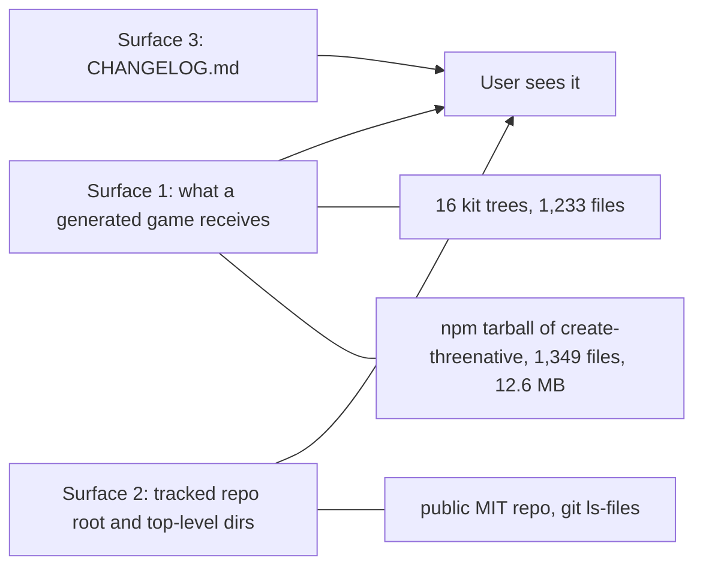

# PRD-826: Ship no junk — what a user clones, installs and scaffolds holds only product

**Status:** DONE — all three phases and the acceptance boxes ticked (2026-11-05) — owner delegated the open calls 2026-11-05
**Priority:** P2 — planned cleanup; the junk costs clone weight, tarball weight and agent friction, and blocks no release (all phases open)
**Owner ask (2026-11-05):** "there are many junk to remove from these starter kits also, like wtf is `CHANGELOG.md` `.linchpin.toml`, we have tons of garbage being shipped, spawn another lane focused on another PRD just for this cleanup on starter kits".
**Related:** PRD-495 (done: the 2026-10-04 dead-code audit), PRD-749 (one kit base), PRD-825 (kit `AGENTS.md` router, a sibling lane: this PRD does not touch agent-file wording).

## Why

The owner named two files at the engine repo root. Neither sits in a starter kit. So the junk lives on three surfaces, and this PRD inventories all three with evidence (measured 2026-11-05 at `dab02b929`).

Findings in one line each:

- Surface 1 is mostly sound. The real junk is **duplicated or maintainer-only files**, not dead kit code: 112 tracked MCP host configs (5 distinct byte contents), two maintainer notes shipped in the npm tarball, a `kit.json` that no generated game reads, and a 515 KB manifest copy.
- Surface 2 is small. Two files are personal workflow (`.linchpin.toml`, `.claude/settings.local.json`). 34 `.log` files are tracked against the `*.log` ignore rule. `plans/` holds audit reports that live outside the PRD tree.
- Surface 3: `CHANGELOG.md` is **not junk**. It is a gate input. It is stale, so fix it. See Decisions.

## Out of scope

- `AGENTS.md` and `CLAUDE.md` wording in the kits (PRD-825). This PRD only says when a whole agent file is junk.
- Dead source inside a kit's `src/`. PRD-495 dispositioned that, and PRD-749 moves the shared render files. A new dead-code sweep is a separate PRD.
- `examples/abyss-vanilla/` (frozen control), `tools/unreal-reference/` and `benchmark/` (read by specs and benches), and the `docs/` evidence trees (`pnpm budgets` caps them). Only the 34 tracked logs are in scope.
- Untracked local state (`.afk/`, `.gauntlet/`, `.leanpi/`, `.opencode/`, `.linchpin/`, `.mcp.json`, `.env`, `notify.log`, `site/`). All are ignored today: `git ls-files` lists none of them and `git check-ignore -v` names the rule for each. They need no action.

## Inventory

Action key: **delete** removes the file from git. **untrack** removes it from git and adds an ignore rule. **generate** replaces tracked copies with output the scaffolder writes. **exclude** keeps the file in the repo and drops it from the npm tarball. **move** relocates it. **keep** records why it stays.

| # | Path | Surface | Why junk (or why not) | Action | Evidence |
| --- | --- | --- | --- | --- | --- |
| 1 | `.linchpin.toml` | 2 | Agent-orchestrator config with model aliases (`sol`, `luna`, `astra`). Personal workflow in a public repo. No reader: the string `linchpin` appears only as the ignored `.linchpin/` directory in `biome.json`, `.vscode/settings.json` and `scripts/sync-agent-docs.ts:16`. | untrack (`git rm --cached`, add to `.gitignore`; the local plugin keeps reading the file) | `git ls-files .linchpin.toml`; `rg -n --no-ignore linchpin biome.json scripts` |
| 2 | `.claude/settings.local.json` | 2 | Claude Code's per-user settings file (`enabledMcpjsonServers`, `Bash(cd *)`). Tracked, last touched by #594. It overrides each contributor's local choices. | untrack, add to `.gitignore` | `git ls-files .claude/settings.local.json`; `git log --oneline -1 -- .claude/settings.local.json` |
| 3 | 112 files: `.mcp.json`, `.codex/config.toml`, `.cursor/mcp.json`, `.vscode/mcp.json`, `.gemini/settings.json`, `.zed/settings.json`, `opencode.json` in each of 16 kits | 1 | One server table (`packages/core/mcp/servers.mjs`) printed 7 ways, 16 times. Byte-identical across kits (5 distinct contents). `@threenative/core` postinstall already writes all 7 on `pnpm install` through the same `ensureHostMcpConfigs`. `scripts/sync-mcp-configs.ts` exists only to keep the copies equal. The 7 editor targets are justified. The tracked copies are not. | generate: `createProject` calls `ensureHostMcpConfigs(target)` after the copy; delete the 112 files and `scripts/sync-mcp-configs.ts` (`pnpm sync:mcp`) | `packages/core/scripts/ensure-mcp.mjs:12-22`; `scripts/sync-mcp-configs.ts:1-9`; `git hash-object` groups in Phase 2 proof |
| 4 | `packages/create-threenative/templates/AGENTS.md` and `CLAUDE.md` | 1 | Maintainer notes ("PRD-723 migrates the kits", `scripts/unreal-look/scaffold/Reference.ts.in`). `files` contains `templates`, so they reach every npm user. `createProject` never copies them (`discoverTemplateNames` lists directories only, `src/index.ts:88`). | exclude (`!templates/AGENTS.md`, `!templates/CLAUDE.md` in `files`); keep in the repo for contributors | `npm pack --dry-run --json` lists both; `packages/create-threenative/package.json` `files` |
| 5 | `kit.json` in each kit (16) | 1 | Scaffolder and `engine_search_capabilities` lookup data (`aliases`, `genre`, `kit: false`). `createProject` copies the whole kit directory, so the file lands in the game. Readers in `packages/`: `create-threenative/src/index.ts` and `engine-mcp/src/index.ts`, and both read the packaged templates. No reader found inside a generated game. | delete from the scaffold output (`rm` after the copy). Keep in the repo | `rg -n 'kit\.json' packages --glob '!**/templates/**'`; `src/index.ts:263,893` |
| 6 | `packages/create-threenative/capabilities.json` (515 KB, byte-identical to `packages/core/capabilities.json`) | 1 | Shipped in the `create-threenative` tarball. No reader in `create-threenative/src`. `core/mcp/engine.mjs:12` and `engine-mcp/src/index.ts:263` read core's copy. Tests and `generate-capability-reference` read the create-threenative copy. | exclude from `files` only. Keep the tracked file (the repo's canonical manifest) | `md5sum` of both; `rg -n capabilities.json packages/create-threenative/src` prints nothing |
| 7 | `packages/create-threenative/template-assets/patches/three@0.185.1.patch` (336 KB) | 1 | Ignored prepack output from an older build. A local `npm pack` ships it beside the current patch. It broke my local scaffold: the stale `dist` expects 0.187.0 and the directory holds 0.185.1. CI is safe because `prepack` copies the current patch, but nothing deletes the old one. | fix `prepack` to empty `template-assets/patches/` before it copies | `.gitignore:203`; `npm pack --dry-run --ignore-scripts`; `packages/create-threenative/package.json` `prepack` |
| 8 | 34 `.log` files under `docs/verification/findings-2026-09-07-bayview-fix/` (12) and `docs/verification/startup-measure-reduce-2026-09-09/` (22), 442 KB | 2 | Raw command output force-added against the `*.log` rule (`.gitignore:17`). PRD rule: results live in the PRD, not in log files. | keep: the citation check found all 34 cited (Decisions). Guard against new ones | `git ls-files \| grep '\.log$' \| wc -l`; `scripts/evidence-citations.ts` |
| 9 | `plans/engine-performance-architecture-2026-10-28.md` | 2 | Live: 8 PRDs cite it. Wrong home: the PRD folder `docs/PRDs/engine-performance-architecture-2026-10-28/` already exists. | move into that folder, fix links | `rg -l 'plans/engine-performance' docs/PRDs` |
| 10 | `plans/technical-debt-audit-2026-08-20.md`, `plans/threenative-area-scorecard-2026-08-22.md` (65 KB together) | 2 | Stale August audits. Only citers: done PRD-495 and blocked PRD-177. | delete (Decisions), fix the two citing PRDs | `rg -n --no-ignore 'technical-debt-audit\|area-scorecard' docs/PRDs` |
| 11 | `CHANGELOG.md` | 3 | Not junk. See Decisions. | keep, fix | `scripts/check-api-surface.ts:20,255`; `CONTRIBUTING.md:111` |
| 12 | `.vscode/settings.json` watcher excludes for `.linchpin/` | 2 | One line of personal workflow in a shared editor file. Harmless. | keep, remove the `.linchpin` line only with row 1 | `.vscode/settings.json` |
| 13 | `PERFORMANCE-LEARNINGS.md` (1,019 lines at the root) | 2 | Internal lab notebook at the root. Cited by `packages/three-native/src/tsl-uniforms.ts`, `debug-telemetry.ts` and the perf skills. | keep (Decisions) | `rg -l PERFORMANCE-LEARNINGS packages docs` |
| 14 | `agent-files/.claude/hooks/ponytail-context.mjs`, `.claude/settings.json`, `.codex/hooks.json`, `.agents/skills/ponytail/` | 1 | Ship the `ponytail` lazy-developer mode to every game. Deliberate (root `AGENTS.md` names the skill and the `PONYTAIL=off` opt-out). Not junk by the evidence. It is the owner's call whether a user's agent gets it by default. | keep (Decisions) | `packages/create-threenative/agent-files/` |
| 15 | `agent-files/.claude/agents/threenative-{builder,verifier}.md`, `.threenative/agents/*.md`, `.agents/skills/threenative-{builder,verifier}/` | 1 | Three small files per role. Two are 245 to 406 byte adapters that point at the canonical contract. `copyAgentFiles` and `linkClaudeSkills` make this on purpose (one canonical copy, thin host adapters). | keep | `src/index.ts:581-614` |
| 16 | `templates/{runner,sailing,snow,tower-defense}/README.md` | 1 | 4 of 16 kits carry a human README. 12 do not. It repeats part of `AGENTS.md`. Inconsistent, not dead. | delete (Decisions) | `git ls-files packages/create-threenative/templates \| grep README` |
| 17 | `templates/rain/tools/` (8 files, 83 KB), `templates/starter/tools/`, `starter/main.html`, `shooter/main.html`, per-kit `playtests/` (228 files), `starter/native-playtests/` | 1 | Documented authoring pipeline (rain `AGENTS.md:48,53`), a named override (`starter/vite.config.ts:43`) and kit proof. | keep | cited paths |
| 18 | `packages/core` `files: ["src/**/*.ts"]` (216 files, 4.8 MB) | 1 | Looks like duplicate source beside `dist`. A reader exists: `packages/runtime-native/shim-manifest.json` and the native CMake read core's TypeScript (PRD-624). | keep. Reader check only | `rg -l 'core/src/' packages/runtime-native` |
| 19 | `dist/quality.js` (6.9 MB, 55% of the `dist` bytes) | 1 | Bundles typescript-eslint on purpose (`tsup.config.ts` comment). It is the kit lint (`@threenative/create/quality`). | keep | `tsup.config.ts` ("quality bundles typescript-eslint" comment) |
| 20 | `packages/create-threenative/{asset,sculpt,animation,devtools,engine}-mcp-tools.json` | 1 | Tool-surface snapshots read by scripts and specs. Not in `files`, so not shipped. | keep | `scripts/capture-asset-mcp-tools.ts`, `mcp-tool-schemas.spec.ts` |

Rows 3 to 7 are the shipped surface: 112 + 2 + 16 files and about 850 KB of tarball. Row 3 shrinks the tracked kit tree by 112 of 1,233 files. The byte count is small. The cost is a generator, a sync gate and 16 places to edit when the server list changes.

## Phases

### Phase 1 — The git index holds no personal files, logs or stray reports

- [x] Untrack `.linchpin.toml` and `.claude/settings.local.json` and add both to `.gitignore`. proof: `git ls-files .linchpin.toml .claude/settings.local.json` prints nothing, and `git check-ignore -v .linchpin.toml .claude/settings.local.json` names both rules.
  Done (2026-11-05): `git ls-files` prints nothing; `git -c core.excludesFile=/dev/null check-ignore -v` names `.gitignore:145` and `.gitignore:146`.
- [x] Run the citation check on the 34 tracked `.log` files and record what it finds. proof: `rg -n -F` of each full path across the repo, and `pnpm check:docs`.
  Done (2026-11-05): all 34 are cited. 22 under `startup-measure-reduce-2026-09-09/` are linked by path from `docs/verification/runtime-perf-state.md` (lines 833-935, with the observed red and green numbers in the prose), and `desktop-baseline-audio/native.log` is also named in `packages/playtest/__tests__/pipeline-timing.spec.ts:123`. The 12 under `findings-2026-09-07-bayview-fix/` are described by that folder's `README.md:64`, and `proof.json` records the hash of `green-host-uninterrupted.log`. The rule "a citation keeps a tracked evidence file" applies, so none is deleted. See Decisions.
- [x] Move the live `plans/` file into `docs/PRDs/engine-performance-architecture-2026-10-28/`, delete the two stale audits, fix the citing PRDs, and drop the empty root `plans/`. proof: `pnpm check:docs`, and `git ls-files plans` prints nothing.
  Done (2026-11-05): `investigation.md` now sits in the PRD folder (its 7 links and its own relative links fixed); the two audits are deleted; PRD-495 and PRD-177 name them as deleted by PRD-826. `pnpm check:docs` checked 3769 links, exit 0; `git ls-files plans` prints nothing.
- [x] Bring `CHANGELOG.md` current (the option in Decisions). proof: `pnpm api:surface:check` exits 0 and `pnpm exec vitest run scripts/__tests__/api-surface.spec.ts` is green.
  Done (2026-11-05): the old `[Unreleased]` block is now `[0.3.11] - 2026-11-03`, the 0.3.3 block is a one-line superseded note, and `[Unreleased]` is empty for the gate. `pnpm api:surface:check`: ok, 505 symbols, every change announced. `api-surface.spec.ts`: 12 of 12 pass.

### Phase 2 — A generated game and the npm tarball hold no duplicate or maintainer-only file

- [x] The scaffolder writes the 7 MCP host configs with `ensureHostMcpConfigs`. The 112 tracked copies and `scripts/sync-mcp-configs.ts` go. proof: `pnpm exec vitest run packages/create-threenative/__tests__/scaffold-mcp.spec.ts packages/create-threenative/__tests__/scaffold.spec.ts` with each scaffold still holding all 7 host configs.
  Done (2026-11-05): both specs green (78 and 29 tests). The first plan said the hashes would not move. They do move, only in server order: the tracked copies held `threenative-terrain` last, and the table order puts it before `threenative-animation`. The generated order matches what `pnpm install` leaves, so the postinstall now changes nothing. `sync:mcp`, its budgets step, its `regen.sh` step and its `temp-dir-guard` entry are gone. Three specs changed meaning and were rewritten: a template that ships no config now gets all 7, a partial `.mcp.json` is completed, and no template may track a host config. The old git-tracks-it spec has no subject any more.
- [x] `files` in `packages/create-threenative/package.json` excludes `templates/AGENTS.md`, `templates/CLAUDE.md` and `capabilities.json`. `prepack` empties `template-assets/patches/` first. proof: `npm pack --dry-run --json` from `packages/create-threenative` lists none of the three and lists exactly the three patches `prepack` copies, and `pnpm exec vitest run packages/create-threenative/__tests__/publication.spec.ts packages/engine-mcp/__tests__` stays green.
  Done (2026-11-05): `npm pack --dry-run --json` with a planted `three@0.185.1.patch` lists exactly `@tailwindcss__node@4.3.3`, `three@0.187.0` and `vite@8.2.0` and none of the three files; the tarball falls from 1,349 to 1,232 files and from 12,600,915 to 12,510,520 bytes (this also counts the MCP, README and `kit.json` removals). `publication.spec.ts` and `packages/engine-mcp/__tests__` pass.
- [x] Delete `templates/{runner,sailing,snow,tower-defense}/README.md`, after any fact the kit `AGENTS.md` lacks moves into it. proof: `git ls-files packages/create-threenative/templates | grep -c README` prints 0; `pnpm sync:agents --check` green
  Done (2026-11-05): no README left in any kit; `pnpm sync:agents --check`: 31 mirrors in sync. Each kit `AGENTS.md` gained one "Kit facts" paragraph (controls, asset credits, the one design rule the README held). The sailing README credited the MIT-licensed beautiful-water source only there, so that credit now sits in the header of `src/render/sky.ts`. The repo holds no copy of that project's copyright line, so the header names the project, its link and the MIT licence, as the README did. All four stay under the 100-line budget (`template.spec.ts` green).
- [x] The scaffolder removes `kit.json` from the generated game. proof: scaffold specs green with the 16 tree hashes re-pinned once, in this commit, with the cause named in the comment block above `PRD_201_PARENT_SCAFFOLD_HASHES`, and `rg -n 'kit\.json' packages --glob '!**/templates/**'` shows no reader that runs inside a generated game.
  Done (2026-11-05): all `kit.json` readers in `packages/` and `scripts/` read the packaged templates, none a generated game. The 16 hashes were re-pinned once with the cause in the comment block above `PRD_201_PARENT_SCAFFOLD_HASHES`; `scaffold.spec.ts`: 78 of 78 pass.

### Phase 3 — Junk cannot come back unseen

- [x] A scaffold path allowlist: `packages/create-threenative/__tests__/scaffold-file-allowlist.spec.ts` scaffolds each of the 16 kits with `install: false` (the same call `scaffold.spec.ts` uses at line 782) and fails on any generated path that matches no allowlist pattern. The allowlist names each pattern's reason. The tree-hash pin cannot do this job: it only detects change, and a re-pin accepts a new junk file without comment. proof: the spec is green, and it fails when a stray `notes.md` is dropped into one kit (observed once, in the PR body, not as a box).
  Done (2026-11-05): `scaffold-file-allowlist.spec.ts` passes (2 tests, all 16 kits). Red observed: a planted `templates/runner/notes.md` failed it with `expected [ 'runner/notes.md' ] to deeply equal []`; the plant is removed.
- [x] A tarball and repo-root allowlist: add a pack-content case to `packages/create-threenative/__tests__/publication.spec.ts` (no `templates/AGENTS.md`, no stale patch, no duplicate manifest) and a `scripts/__tests__/repo-root-allowlist.spec.ts` that reads `git ls-files` for the top-level names, as `scripts/__tests__/source-hygiene.spec.ts` does, and fails on a tracked `*.log` outside the 34 cited ones, `*.local.*`, `.linchpin*` or root `plans/` entry. proof: both specs green in `pnpm test`.
  Done (2026-11-05): `publication.spec.ts` (new PRD-826 case) and `repo-root-allowlist.spec.ts` (3 tests) pass. Red observed: re-adding `capabilities.json` to `files` failed the pack case with `expected [...] to not include 'capabilities.json'`; a planted tracked `plans/x.md` and `stray.log` failed all 3 root cases. Both plants are removed. A stale `three@0.185.1.patch` planted in `template-assets/patches/` is removed by `prepack` and the pack case stays green.

## Acceptance criteria

- [x] `git ls-files` lists no `.linchpin.toml`, no `.claude/settings.local.json` and no `.log` file outside the 34 cited ones, and no new `.log` can join them. proof: the Phase 3 root spec. Result: `repo-root-allowlist.spec.ts` 3 of 3 pass.
- [x] `npm pack --dry-run --json` for `create-threenative` lists no `templates/AGENTS.md`, `templates/CLAUDE.md`, `capabilities.json` or patch that `prepack` does not copy. proof: the Phase 3 publication case. Result: the PRD-826 case in `publication.spec.ts` passes.
- [x] A scaffold of every kit holds only allowlisted paths and no `kit.json`. proof: `pnpm exec vitest run packages/create-threenative/__tests__/scaffold.spec.ts packages/create-threenative/__tests__/scaffold-file-allowlist.spec.ts` on all 16 kits. Result: 78 and 2 tests pass. The first wording said the trees differ only by `kit.json`. They also differ by the MCP server order, the 4 README removals, 4 kit-facts paragraphs and the sailing sky header, as the hash comment says.
- [x] A scaffolded game still has all 7 MCP host configs. proof: `scaffold-mcp.spec.ts`. Result: passes, and the new scaffold case lists all 7 files.
- [x] `pnpm check:docs` and `pnpm sync:agents --check` exit 0. proof: both commands, exit 0. Result: 3769 links checked, 31 mirrors in sync.

## Decisions

- **CHANGELOG verdict: keep and fix. Do not delete.** A Keep-a-Changelog file is standard for a semver MIT repo, and this one is a gate input: `scripts/check-api-surface.ts:20,255` reads `CHANGELOG.md` and fails the build with `TN_API_SURFACE_UNANNOUNCED_BREAK` when a public symbol disappears without a `Breaking` entry. `CONTRIBUTING.md:111` tells contributors to write there. The file is stale, and that is the real problem: its last section is `[0.3.3] - unreleased (release candidate)` while `@threenative/core` is 0.3.11 and `runtime-native-v0.3.11` shipped on 2026-11-03. Nothing writes it: `release:prepare` has no writer. Options for the owner:
  1. ⭐⭐⭐⭐⭐ Keep. Cut the `[Unreleased]` block (about 60 lines) and the "0.3.3 release candidate" block into dated sections, one per shipped version, and keep an empty `[Unreleased]` for the gate. Cheapest, keeps the gate, fixes the stale look.
  2. ⭐⭐⭐ Keep as a short file: one line that points to GitHub Releases, plus `[Unreleased]` for the gate. Smaller. The gate then reads breaks only.
  3. ⭐ Delete. Rewrite `check-api-surface.ts` to read another file first. More work and loses the contributor-facing break log.
- 2026-11-05 (agent): row 8, the 34 tracked logs stay. The citation check this PRD asked for found every one cited (Phase 1 box 2). Deleting them breaks the observed-red evidence in `runtime-perf-state.md` and the hash in `proof.json`, and the evidence rule says a citation keeps the file. The guard allowlists these 34 and rejects any other tracked `.log`.
- **Why the 7 editor configs stay (generated, not tracked):** a user picks one editor. Each reads a different path. A game with no config for the user's editor "reads as a framework that lacks the feature" (`scripts/sync-mcp-configs.ts:3-5`). The fix is where the bytes come from, not which editors we support.
- **Why `ponytail`, builder and verifier files stay:** owner-chosen defaults. Rows 14 and 15 list them so the owner can remove them in one line.
- 2026-11-05 (agent, owner delegated): CHANGELOG takes option 1. Reason: it keeps the API-surface gate and costs one edit.
- 2026-11-05 (agent, owner delegated): row 10, delete the two stale August audits and turn their citations in PRD-495 and PRD-177 into one line naming the deleted file and this PRD. Reason: their only readers are a done PRD and a blocked one, and a move to `docs/verification/` keeps junk under a new name.
- 2026-11-05 (agent, owner delegated): row 13, `PERFORMANCE-LEARNINGS.md` stays at the root. Reason: the perf skills and source comments read it at that path, and it is the repo's documented perf memory.
- 2026-11-05 (agent, owner delegated): row 14, `ponytail` ships by default. Reason: root `AGENTS.md` makes it the default authoring mode, with `PONYTAIL=off` as the named override.
- 2026-11-05 (agent, owner delegated): row 16, no kit ships a README. Delete the 4. Any fact in them that the kit `AGENTS.md` lacks moves into it first. Reason: agents write the games and read `AGENTS.md`. A README that repeats it is a second copy that drifts.
- **PRD-749 overlap:** PRD-749 Phase 3 moves the 295 other byte-identical kit files (render, vite, tsconfig) into `template-assets/base/`. This PRD does not repeat that. Row 3 covers only the MCP files, which that PRD does not name.

## Blocked on

Nothing. The owner delegated the open calls on 2026-11-05 ("your call regarging dhis ... cleanup junk"); see the agent decisions above.
