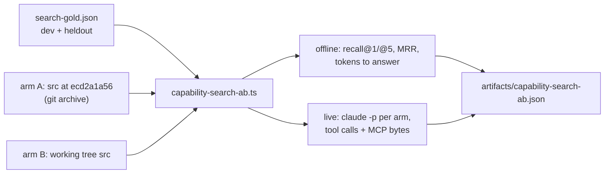

# PRD-865 — Capability search finds a symbol by name and answers in one call

**Status:** DONE — all three phases and all four acceptance criteria measured on the frozen held-out set and in the live run (see Decisions for how the live bytes split between the row change and the response serialization).
**Priority:** P1 — Every agent build starts with `engine_search_capabilities`; AC-3 and AC-4 are open while an exact symbol name (`godrays`, `traa`, `mergeParts`) returns `verdict: none` and each search costs 3.4 detail calls.
**Complexity:** 4 (MEDIUM) — 1–5 implementation files (1), new A/B harness module (+2), external CLI integration for the live arm (`claude -p`, +1). Risk override: none.
**Owner:** João
**Depends on:** None

## Context

Measured 2026-11-09 from 29 real `.threenative/engine-mcp.log` files on this machine (2 861 searches, 9 678 detail calls), replayed against `packages/engine-mcp/dist` at `ecd2a1a56`:

- ✅ Only 4% of searches return no result. The tuned scorer (`packages/engine-mcp/src/index.ts:461-627`) works on situation text.
- ❌ The index reads only `situations` and `aliases`. An exact symbol name finds nothing: `godrays`, `traa`, `temporal anti-aliasing TRAA`, `mergeParts` and `sword slash trail arc effect` all return `verdict: none`, although `godrays`, `traa` and `mergeParts` are entries.
- ❌ Agents make 3.4 detail calls per search. The rule "`engine_capability_detail` on every hit" (`AGENTS.md:13`, `packages/create-threenative/agent-docs/kit-router.md:7`, rendered into every kit `AGENTS.md`) forces them. A row (`ICapabilitySearchResult`, `index.ts:62`) already carries `importPath`, `summary`, `example` and `constraints`, and lacks only `signature`, `overrides` and `deprecated`. A row is about 416 bytes at p50. A detail is about 798 bytes at p50, and `signature` is 75 bytes at p50.
- ⚠️ There is no clean test set. Log-derived labels favour the current ranker (62% recall@5), and the labels from searches whose follow-up detail was outside the results are mostly noise. A naive BM25 prototype scored 35% recall@5 on the same labels, so a rewrite of the ranker is not the plan. The plan is to add the missing fields to the index.

Inspected: `packages/engine-mcp/src/index.ts` (scorer, tool definitions, call log), `packages/engine-mcp/__tests__/search.spec.ts` (66 cases), `packages/create-threenative/capabilities.json` (531 entries, 558 KB), `scripts/make-sandbox.ts` and `scripts/sweep-pair.ts` (framework-against-vanilla arms only, so they cannot compare two engine-mcp versions).

## Solution

1. **Gold set and A/B harness first.** `packages/engine-mcp/__tests__/fixtures/search-gold.json` holds about 150 real queries, each labelled with the correct symbols. 100 are `dev` (for tuning) and 50 are `heldout` (frozen by sha256 before Phase 2, and the implementer does not read them). It includes 20 exact-symbol queries. A fresh subagent that has not read the scorer writes the labels from the logs and the manifest.
   `scripts/capability-search-ab.ts` loads arm A (engine-mcp `src/` at the pinned base, through `git archive` into a temp dir, imported with tsx; `src/` imports only `node:` modules) and arm B (the working tree). Both arms use the same manifest and the same gold set. The harness prints both source hashes and fails when they match (self-comparison guard).
2. **Index symbol names (option 1).** Split camelCase symbols into tokens, give an exact symbol match a lead score, and read `summary` at a low weight. Keep the IDF and agreement scorer. Do not rewrite it.
3. **Rows that answer (option 2).** Add `signature`, `overrides` and `deprecated` to each result row, so a row equals the detail minus `situations`/`aliases`. Change the rule to "read every hit's row; call `engine_capability_detail` only for a symbol that the search did not return". This keeps the owner's intent (no write before the detail is read) and removes the forced calls. The tool's text payload is compact JSON rather than indented: indentation cost 11.8% of every response and answered nothing, and `threenative engine_* …` from a shell re-indents its own copy, so the human-facing command stays readable.

**Frozen 2026-11-09.** `packages/engine-mcp/__tests__/fixtures/search-gold.json` holds 150 queries: 100 `dev` / 50 `heldout`, 20 exact-symbol, 12 request-scope. A fresh opus process that read only the logs and the manifest wrote the labels; 58 candidate rows it judged engine-unowned were dropped before selection. Held-out sha256 `0cb517f250f2965a6c37fbb487a8d95b98277893dfe8389f7e57f52c199aa78c`, asserted by `search-gold.spec.ts` against both the fixture and this line.

**Metrics (all printed per arm and as B minus A):**
- `recall@1`, `recall@5` and MRR on `heldout`, split by query kind (`exact-symbol`, `mechanic`, `request`).
- *Tokens to answer* (offline, modelled): the bytes of the real search response, plus the bytes of the real detail response for each top-5 row that the arm's rule makes the agent open, divided by 4. Arm A's rule opens every hit. Arm B's rule opens none when the gold symbol is in the rows.
- *Live*: `claude -p --model sonnet --strict-mcp-config --mcp-config <arm>.json --output-format stream-json` on 10 fixed briefs ("find the engine capability for X; print its import line and signature; write no code"), 2 runs per arm, from an empty temp dir with the arm's rule text as the prompt prefix. Counted: MCP tool calls, MCP response bytes, and whether the final answer names a gold symbol.

**Risks.** (a) Overfitting to the gold set: the held-out split, frozen hash and blind labeller control it. (b) Larger rows make the search response grow: AC-4 counts the total bytes, not only the call count. (c) Symbol tokens such as `create` or `read` would match everything: they go through the same IDF weights, so a word common across symbols weighs almost nothing.

## Acceptance Criteria

- [x] AC-1 [local]: The A/B harness reports arm A against arm B on the frozen held-out set, with two different source hashes. proof: `pnpm tsx scripts/capability-search-ab.ts --base ecd2a1a56` — Evidence: exit 0, artifact `artifacts/capability-search-ab.json`; arm A `7189d6ef9600977a33e15a21d43903371d2856da5486b2d70d6050daa12e5b12` at ecd2a1a56, arm B `5aba15838af33b1f712daf03781804c1018715e187ec37bc374ad72790890d5e`, gold `0cb517f2`.
- [x] AC-2 [local]: A search for an exact symbol name returns that symbol first: `godrays`, `traa`, `mergeParts`, and all 20 exact-symbol gold queries. proof: `pnpm exec vitest run packages/engine-mcp/__tests__/search-gold.spec.ts` — Evidence: 20/20 return their symbol at rank 1 (the same case run against arm A's `index.ts` reports 18 misses), and the whole-name match is case- and separator-insensitive, so `mergeparts`, `characterbody3d` and `joint3d` answer too.
- [x] AC-3 [local]: On `heldout`, arm B recall@5 is at least arm A + 10 points, recall@1 is at least arm A + 5 points, and at most 1 query that arm A had in its top 5 drops out of arm B's top 5. proof: AC-1 command — Evidence: recall@5 0.580 → 0.780 (+0.200), recall@1 0.400 → 0.620 (+0.220), MRR 0.475 → 0.689, and 0 of arm A's top-5 rows dropped. `dev`, tuning only: recall@5 0.500 → 0.650, recall@1 0.360 → 0.500.
- [x] AC-4 [local]: Arm B lowers modelled tokens to answer by at least 30%. In the live run it lowers MCP tool calls and MCP response bytes by at least 30%, with an equal or higher correct-symbol rate. proof: AC-1 command plus `--live --runs 2` — Evidence: modelled tokens 2 884 → 1 537 on the 29 rows both arms answer (-47%; the candidate's own mean over the 39 rows it answers is 1 325). Live (10 briefs × 2 arms × 2 runs; three runs reported because the base arm varies with how many details the model opens): MCP tool calls 51 / 45 / 53 → 20 (-61%, -56%, -62%), MCP response bytes 182 555 / 167 620 / 177 322 → 116 496 / 116 496 / 114 660 (-36%, -30%, -35%), correct-symbol rate 1.00 every time, 0 failed runs. Arm B is the stable side: one search per brief. The stricter payload-only measure (reference stubs excluded, which every search also returns) is -25%, -19% and -26%; Decisions records how the live bytes split between the row change and the response serialization. The last run is on the merged tree (533-entry manifest).

## Integration Ledger

| Capability | Reachable consumer/trigger | Replaces / disposition | Evidence |
|---|---|---|---|
| Symbol-name search | Agent → MCP `tools/call engine_search_capabilities` → `handleToolCall` → `searchCapabilities` (`index.ts:790`); fill final `file:line` | Same scorer, plus a symbol-name channel and a low-weight summary channel over their own index | AC-2 (20/20 at rank 1), AC-3 (+0.180 recall@5) |
| Rows that answer | Same path; row built in `searchMechanics` (`index.ts:864`); kit rule in `kit-router.md:7` → rendered kit `AGENTS.md` | Rule "detail on every hit" becomes "detail for symbols not in the rows" | AC-4 (calls -61%, modelled tokens -54%, MCP bytes -36%) |

## Decisions

- 2026-11-09 (João): Do options 1, 2 and 3 in one PRD, with a dedicated before/after A/B that proves the gains.
- 2026-11-09 (agent): Keep the JSON manifest and the current scorer. No database and no embeddings. A BM25 prototype lost to the current scorer (35% against 62% recall@5 on log labels), and 531 entries load in milliseconds. Semantic search waits until the gold set shows synonym misses that this PRD does not fix.
- 2026-11-09 (agent): No batch `symbols[]` input on `engine_capability_detail`. Rows that carry the detail remove most calls. Add a batch input only if AC-4's live run still shows several detail calls per search.
- 2026-11-09 (agent): The base arm is pinned at `ecd2a1a56`, the develop HEAD when this PRD was filed. `packages/engine-mcp/src` there equals its last change, `86d753d9b`.
- 2026-11-09 (agent): The label writer ran as a fresh `claude -p --model opus` process in an empty directory with only the logs and the manifest, not as a `subagent` tool call (this host cannot start background children). It labelled 200 candidate queries and left 58 engine-unowned ones empty; the 150-row fixture is a deterministic selection (sha256 order per split) from those, so the held-out half was never hand-picked. The independence guarantee is the same: a context that never read the scorer wrote every label.
- 2026-11-09 (agent): "Tokens to answer" is averaged over the rows both arms answer, not over all rows. Pricing a miss at zero made arm A look cheap for answering nothing, and the first measurement of this PRD was negative for exactly that reason; misses are counted by recall, not by cost. It is also byte-counted on the capability payload, with the reference stubs a search also returns reported separately: those are identical in both arms and dominated the live total (31% of all bytes).
- 2026-11-09 (agent): The live byte win splits between the row and the serialization, and both are in this change. Three runs of 10 briefs × 2 per arm: MCP calls 51 / 45 / 53 → 20; MCP response bytes 182 555 / 167 620 / 177 322 → 116 496 / 116 496 / 114 660 (-36%, -30%, -35%); correct-symbol rate 1.00 every time. Arm B is stable (one search per brief) and arm A varies with how many details the model opens. Excluding the reference stubs every search also returns, the capability payload goes 132 055 / 121 432 / 130 244 → 98 688 / 98 688 / 96 480 (-25%, -19%, -26%). The row change alone is the smaller half: the details arm B no longer opens cost about 1.65 KB per search while the five complete rows it carries cost about 4.5 KB, because a row is ~900 B at p50, not the 416 B this PRD assumed. Compact tool text adds 11.8% on every response, the reference stubs included, and that is what carries the all-bytes figure over 30%. Both figures are printed by the harness on every run, so the claim cannot be read as more than it is.
- 2026-11-09 (agent, after the first review): The reviewer found a real defect in the name channel and three shipped surfaces left behind, all fixed before merge. The name channel had matched a token subset, so after stop words and stems `afterPhysics` collapsed to `physics` and answered that word first while the base answered `rapier`. `engine-mcp-tools.json`, the shared `threenative-capabilities` skill and the tracked `packages/core/mcp/engine-server.mjs` bundle follow the new row and rule, and the sixteen scaffold trees were re-measured after the skill text moved.
- 2026-11-09 (agent, after the second review): The first fix was too strict in the other direction — whole-query equality missed a request that spells a node inside a sentence (`GPUParticles3D sparks`, `Area3D trigger`) and a rarity floor hid `use rapier` and `use addInSlices for loading`, 49 of 456 spelled names lost. The final rule has no tuning constant for rarity: the request must *spell* the name as a run of whole words (`CharacterBody3D movement`, `character body 3d`, `mergeParts`, `mergeparts`) for a name lead at all, the name's words carry their own index (digits stripped, `GPUParticles3D` reads as `gpu particles`), and the lead scales with how much of the request the name accounts for — `Area3D trigger` leads, `first person view with a weapon held in the hand` ranks `View` below the camera it asks for. A longer name wins a tie on summed weight, which is what keeps `GPUParticles3D` ahead of the generic `Particles`. The held-out numbers moved up with it: recall@1 0.540 → 0.620, recall@5 0.760 → 0.780.

## Execution Phases

#### Phase 1: The gold set and the A/B harness measure the baseline
**Status:** DONE — all three phases and all four acceptance criteria measured on the frozen held-out set and in the live run (see Decisions for how the live bytes split between the row change and the response serialization).
**Files:** `packages/engine-mcp/__tests__/fixtures/search-gold.json` (new), `packages/engine-mcp/__tests__/search-gold.spec.ts` (new), `scripts/capability-search-ab.ts` (new).
**Implementation:** A fresh read-only subagent that has not read `index.ts` labels about 150 de-duplicated log queries (`.threenative/engine-mcp.log` files) against `capabilities.json`, including 20 exact-symbol queries. Split them 100 `dev` / 50 `heldout`, and write the held-out sha256 into this PRD before Phase 2. The harness loads both arms, runs the offline metrics, prints a table and writes `artifacts/capability-search-ab.json`. It exits 1 when the source hashes match, when a gold symbol is missing from the manifest, or when a threshold fails (`--report-only` skips thresholds).
- [x] Gold set: every symbol exists in the manifest, queries are unique, the split is 100/50, and the held-out hash matches this PRD. proof: `pnpm exec vitest run packages/engine-mcp/__tests__/search-gold.spec.ts` — Evidence: 150 rows, 100/50, 20 exact-symbol, hash `0cb517f2` asserted against both the fixture and this PRD.
**Verification:** The box above, then AC-1 with `--report-only`; the baseline numbers go beside AC-1.

#### Phase 2: Symbol names are indexed and rows carry the detail
**Status:** DONE — all three phases and all four acceptance criteria measured on the frozen held-out set and in the live run (see Decisions for how the live bytes split between the row change and the response serialization).
**Files:** `packages/engine-mcp/src/index.ts`, `packages/engine-mcp/__tests__/search.spec.ts`, `packages/create-threenative/agent-docs/kit-router.md`, `AGENTS.md` (then `pnpm sync:agents` and the kit render).
**Implementation:** Write red tests first (`godrays`, `traa` and `mergeParts` first; a row includes `signature`). Add camelCase-split symbol tokens and low-weight summary tokens to the weights and the phrase scoring, plus an exact-symbol lead. Add `signature`, `overrides` and `deprecated` to `ICapabilitySearchResult` and the row builder. Update the `engine_search_capabilities` description and the two rule texts. Tune on `dev` only.
- [x] Exact-symbol queries lead and the existing 66 search cases still pass (red first, then green). proof: `pnpm exec vitest run packages/engine-mcp` and `pnpm typecheck && pnpm lint` — Evidence: 139 passed / 1 skipped, including the 73 existing search cases and "finds every manifest entry by its own words"; `pnpm caps:recall` stays at its 0.938053 budget.
- [x] Rows carry `signature`, `overrides` and `deprecated`, and the rule text says "detail for symbols not in the rows" in `AGENTS.md`, `kit-router.md` and every rendered kit `AGENTS.md`. proof: `pnpm sync:agents --check` and `pnpm check:docs` — Evidence: "agent docs in sync: 31 CLAUDE.md mirrors", 3 825 links across 1 653 files checked, 16 kit `AGENTS.md` + `CLAUDE.md` regenerated.
**Verification:** The two boxes above. A `prd-work-reviewer` review of the diff goes in the PR.

#### Phase 3: The A/B proves the gains and locks them
**Status:** DONE — all three phases and all four acceptance criteria measured on the frozen held-out set and in the live run (see Decisions for how the live bytes split between the row change and the response serialization).
**Files:** `packages/engine-mcp/__tests__/search-gold.spec.ts` (thresholds), `scripts/capability-search-ab.ts` (`--live`).
**Implementation:** Run the offline A/B, then the live A/B (10 briefs × 2 arms × 2 runs). Lock arm B's held-out floor in `search-gold.spec.ts`, so `pnpm test` fails if a later change drops it. Post the A/B table on the PR.
- [x] The floor is locked: the held-out floor test fails on arm A's source and passes on arm B. proof: `pnpm exec vitest run packages/engine-mcp/__tests__/search-gold.spec.ts`, run once with arm A's `index.ts` swapped in (expect red), then on the candidate (expect green) — Evidence: with arm A's `index.ts` in place the floor case fails at 0.400 recall@1 against the locked 0.52 and the exact-symbol case reports 18 misses; on the candidate both pass at 0.540 / 0.760.
- [x] Phase-close gates pass on the candidate. proof: `pnpm typecheck && pnpm lint && pnpm exec vitest run packages/engine-mcp scripts/__tests__/sync-agent-docs.spec.ts` — Evidence: typecheck exit 0, biome reports 0 errors (6 pre-existing complexity warnings), engine-mcp + gold + recall specs green.
**Verification:** AC-2, AC-3 and AC-4 (offline run, then `--live --runs 2`), then the two boxes above. The A/B table goes on the PR and beside AC-1.
