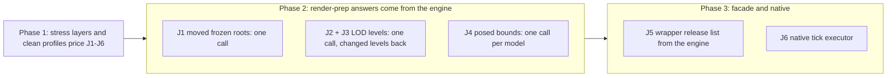

# PRD-898 — The engine's own frame work leaves JavaScript

**Status:** DONE — every acceptance criterion and phase box is green; the forest J1 row reads higher on head and is recorded as follow-up work (D8).
**Priority:** P1 — engine-owned JavaScript still ran on every frame of the default engine (AC-1 is now green): about 1.6 ms of a 5.2 ms stress-lab frame with no crowd. The native player runs the JavaScript animation loop for every rig (AC-2 open).
**Complexity:** 7 (HIGH) — 11+ implementation files (3), crosses the C++/Wasm ABI and the JS package release boundary (+2), wrapper lifetime and frozen-root invalidation state (+2). Risk override: none.
**Owner:** João
**Depends on:** None for Phase 1. Phase 2 and Phase 3 branch after [PR #681](https://github.com/ThreeNativeHQ/threenative-engine/pull/681) merges (PRD-892, it edits the same ABI files). Coordinates with [PRD-881](../performance/PRD-881-the-crowds-engine-stages-fit-2-5-ms.md) (post-pass sequence, `AnimationPlayer` batch), [PRD-882](../performance/PRD-882-the-world-drain-and-the-desktop-forest-run-in-the-engine.md) (world drain) and [PRD-899](./PRD-899-web-physics-calls-rapier-without-javascript-glue.md) (web physics). None of their scope moves here.

Executor: read [EXECUTION-ORDER.md](../performance/EXECUTION-ORDER.md) and `PERFORMANCE-LEARNINGS.md` first.
C++ paths are under `packages/runtime-native/src/engine/`; JS paths under `packages/`.

## Context

Owner, 2026-11-11 ([PRD-878](../done/PRD-878-the-walking-crowd-costs-2-5-ms.md) Decisions): "whatever else is on JS tahts not game scripting should move to C++". The 0.3 ms floor does not apply to these moves.

[PRD-828](../done/PRD-828-js-keeps-only-game-logic.md) moved the animation tick, the rate bands, the uniform sync and the compute passes. PRD-877 moved the physics pose blend. PRD-879 moved the world cell frame. This PRD is the survey of what is left, and the plan for the part that no open PRD owns.

### What was measured

All numbers are from 2026-11-11, RTX 2080, web Wasm engine. Develop moved after that date, so Phase 1 takes them again.

| Scene | Reading | Source |
| --- | --- | --- |
| Stress lab, `?stress&noCrowd` | `jsBefore` 0.58 + `engineJs` 0.54 + `residual` 0.52 = **1.64 ms of a 5.21 ms frame** | `~/.cache/tmp-tn/prd878-handoff/out/crowd-attribution.md` (`?tnDebug=1`) |
| Stress lab, `?stress` | `jsBefore` 1.33 + `engineJs` 0.63 + `residual` 0.63 = 2.59 ms of 9.74 ms, plus `update` 1.42 (game script) | same file |
| Forest walk, play window | JS self time is **53% of the busy main thread**, Wasm is 25% | `~/.cache/tmp-tn/fw-forest/runs/head1/cpu.cpuprofile`, seconds 13 to 27.5 |
| Forest walk, load window | JS self time is **69% of the busy main thread** (7.9 s of 11.4 s). Time under physics frames is 26.7% (JavaScript 18.5%, Rapier Wasm 8.2%), and 24.9% is one caller: the forest's `groundAt`, one ray for each prop placement | same profile, seconds 1 to 12.5 |

The forest profile ran under the playtest harness with `?tnDebug=1`. In the play window the harness (`bridge.sample`, 14.8% inclusive) and the debug meters (`measureDebug`, 11.0%) are not production cost. `refreshStaticTransforms` read 3.7% inclusive, before PRD-887 narrowed it. The profile ranks suspects. It does not price them.

Summary scripts and the eight scout reports: `~/.cache/tmp-tn/prd898/` (`jsprof.py`, `jsincl.py`, `scouts/out/*.md`).

### Survey method

The lead read the frame loop, the profile and the related PRDs. Eight DeepSeek v4.1 flash max scouts read one area each (update, render, facade, physics, world, VFX, native host and UI, load). The lead then opened each cited line. A row below marked **checked** was read in source on 2026-11-16 at `60fb51c4d`. A row marked *scout only* was not opened again and needs that before work starts.

### Rows this PRD takes (default engine, every frame, no owning PRD)

| # | Where (checked) | What the JavaScript does | Scales with | C++ twin |
| --- | --- | --- | --- | --- |
| J1 | `packages/core/src/static-transform.ts:282-303`, called at `game-frame-loop.ts:481` | Visits every frozen root each frame. A root the game froze (`markStatic`) costs a 42-double compare. A root the engine froze costs a parent read and a map lookup | Frozen roots (a cooked region froze 2,077 batches) | None. The engine owns the transforms and can stamp writes |
| J2 | `packages/core/src/model-lod.ts:1419-1452`, `:427-440`, called at `game-frame-loop.ts:563` | Selects a LOD level for every managed mesh, and allocates one object and one array per mesh per frame | LOD-managed meshes | `renderer/lod/model_lod.cpp:88,170` (`selectLodLevel`), not bound to the facade |
| J3 | `packages/core/src/instanced-batch-lod.ts:187-203` | Reads each instance matrix, builds a world sphere and selects a level, per instance, on each update | Instances of each LOD batch | `renderer/projection/instanced_batch.h:273` (`updateInstancedLods`), not bound |
| J4 | `packages/core/src/grounding.ts:50,65` → `pose-measure.ts:417-419` | `GroundSnap.apply` runs `posedBounds` two times. Each run walks the whole subtree with `updateWorldMatrix(true, true)` | Grounded characters × nodes below each | None. The engine holds every bone world matrix |
| J5 | `packages/three-native/src/browser-backend.ts:1863-1917` | `collect()` copies the new wrappers and one sixty-fourth of the settled wrappers into an array each frame, then asks the engine about each | Live wrappers (Midway: about 50,000, so about 780 a frame) | The engine knows when its last reference to a wrapper goes |
| J6 | `packages/core/src/animation-batch.ts:53`; only installer `packages/three-native/src/browser-backend.ts:1761` | The native V8 player installs no `__tnAnimationTick` executor, so each rig keeps the JavaScript loop on desktop and mobile | Rigs | `animation/tick_batch.cpp` (`tn_anim_tick`, exported on both hosts) |

### What PR #681 changes for this PRD

[PR #681](https://github.com/ThreeNativeHQ/threenative-engine/pull/681) (PRD-892, draft) moves the forest runtime into `packages/terrain/src/runtime/` and puts four more kits on it. Checked on its branch at `46d1bceef`:

- **More engine-owned JavaScript.** Eight runtime files, 3,329 lines, become package code. Their own frame work is small: one `beforeRender` hook (`streamed-ground.ts:132`: one `AdmissionBudget`, one key string and one report object per frame) and `observeFrame` (`diagnostics.ts:395`). The cost under them is core's (`TerrainTiles.follow`, `WorldCells`) and stays with PRD-882.
- **Load-time code changes owner.** The prop world (5.4% of the load window as `propWorld.ts`) moves in part to `prop-world.ts` and `prop-pose.ts` in the package. It joins follow-up candidate 2.
- **Five holdout games, not one.** Alpine, coastal, desert and tundra run on the forest stack. Its Phase 3 asks 60 FPS on each kit, and its alpine run is red on `afterFirstFrameTaskMs` (1,821 ms against 250), which is load-time main-thread work.
- **Merge order.** It edits `abi.cpp`, `binding.h` and `packages/physics/src/simulation.ts`, and none of the J1 to J6 files.

### Rows another open PRD owns (hand the row over, do not duplicate)

| Row (checked) | Owner |
| --- | --- |
| `world-tiles.ts:926-935`: a new `Map` and a LOD target per resident tile on each update. `world-cell-render-main-cull.ts:234`: the shared-batch map copied to an array each frame | [PRD-882](../performance/PRD-882-the-world-drain-and-the-desktop-forest-run-in-the-engine.md) |
| `browser-backend.ts:1222-1225`: an indexed array property (`morphTargetInfluences`) crosses one time per element. Its caller is the tile LOD blend (`world-tile-lod.ts:211`) | PRD-882 |
| `physics/src/simulation.ts:969-970`: two Rapier wrapper records per body per step. `:1457-1462`: two calls per dynamic body per step | [PRD-763](../engine-performance-architecture-2026-10-28/PRD-763-physics-publishes-only-changed-poses.md), [PRD-762](../engine-performance-architecture-2026-10-28/PRD-762-only-actuated-bodies-clear-forces.md) |
| `pointer-events.ts:236`: a JavaScript scene raycast per tick for each hovering pointer, when the game has pointer targets | [PRD-764](../engine-performance-architecture-2026-10-28/PRD-764-scene-ray-queries-skip-irrelevant-objects.md) |
| `interpolation.ts:214`: `JSON.stringify` on every rendered frame for a report that prints on change. `physics/src/plugin.ts:329-331`: a string key per contact event, read only by the debug snapshot. `bridge-meter.ts:246-252`: a census frame one frame in 120 with no debug flag | [PRD-769](../PRD-769-bounded-telemetry-and-debug-overhead.md) |
| Post-pass sequence and the `AnimationPlayer` batch | [PRD-881](../performance/PRD-881-the-crowds-engine-stages-fit-2-5-ms.md) |
| Single-value math (`Vector3`, `Color`, `Matrix4`) | [PRD-742](../native-engine/PRD-742-web-value-math-stays-in-js.md): it stays in JavaScript on purpose |

### Follow-up PRD candidates (ranked by measured or counted cost)

1. **Web physics, filed as [PRD-899](./PRD-899-web-physics-calls-rapier-without-javascript-glue.md).** Checked: `packages/physics/src/simulation.ts:1501-1523` allocates a `Ray`, a `Set` and a closure per ray query, and Rapier's glue creates and frees wrapper objects per call. Measured: 26.7% of the forest load window is under physics frames. The native player already runs the Rust Rapier crate with one call per step, per pose read and per ray. The web engine does not.
2. **Load-time loops leave the main thread.** Checked: `world-noise.ts:115-121` bakes 64³ × 4 = 1,048,576 values on the main thread. `assets.ts:824-828` copies positions one vertex at a time. `three-native/src/addons/hdr.ts:123-127` converts RGBE one texel at a time. `terrain-jobs.ts:325` runs inline when the host gives no module worker. *Scout only:* `gpu-scene-bvh.ts:208`, `merge-parts.ts:247`, `render/probe-volume.ts:1987`, `addons/merge-geometries.ts:296`.
3. **VFX fields step on the GPU.** Checked: `ripple-field.ts:303-304` solves a wave equation cell by cell, up to 8 substeps a frame. `spells/reaction-field.ts:256,339` sweeps six channels while a reaction is live (default 96² cells). *Scout only:* `snow-field.ts:680`, `spells/ultra/vfx/common.ts:975`, `GroundField.ts:1368` (a readback each frame), `Shockwaves.ts:255`.
4. **Native host shim and audio poses.** Checked: `runtime-native/src/engine/player/core-host.mjs:113-141` builds a `Set` of held keys, copies it and scans every timer on each tick. `three-native/src/audio.ts:499-516,544-561` recomputes and decomposes a world matrix per voice per frame, then makes six parameter calls.
5. **The cluster cut.** Checked: `clustered-batch.ts:333-334` measures the distance to every placement each frame, before the settled test. No C++ port of the cut exists.

### Scout findings rejected after the check

- `render/virtual-shadow.ts:1041,1182,1290,2427` (caster passes): the engine does not run the node's `updateBefore` (`three-native/src/shadow-node.ts:56`). These run only under `engine: "threejs"`.
- `render/velocity.ts:165` and `projection-*.ts`: off on the owned engine (`game-startup.ts:282`, `renderProjection.ts:425`).
- `runtime-scripts/frame-op-stream.js`: the engine player does not load it (`packages/runtime-native/src/engine/player/v8_main.cpp:100` lists four polyfills). It belongs to the legacy `mystral` host.
- "`ReactionField` has no early-out": it has one (`reaction-field.ts:254`).
- The identity key string in `keyOf`: a closed lever (`PERFORMANCE-LEARNINGS.md`, 2026-10-27, REJECT).
- The 47 `_tnw_web_frame` reads: direct exports, about 3 µs a frame (PRD-828 Decisions).

## Solution

Rule from PRD-828, kept: **one crossing does the work of many objects.** The engine holds the data for each row, so the engine answers, and JavaScript touches only the objects whose answer changed.

1. **Measure first.** Take clean profiles (no `?tnDebug`, harness rows subtracted) and the stage baseline. A row that reads zero on every scene leaves by a Decision.
2. **J1.** The engine stamps a root when its local transform or an ancestor world matrix changes. `refreshStaticTransforms` makes one call that returns the roots that moved, and re-arms only those. `invalidateStatic` and the divergence oracle (`TN_RENDERLIST_VALIDATE=1`) keep their contracts.
3. **J2 and J3.** Bind `ModelLod` and `updateInstancedLods`. One call selects every chain against the frame's camera and returns the meshes whose level changed. JavaScript swaps geometry for those only. The streaming exemption (`model-lod.ts:1441-1444`) and the joined-rung count stay correct.
4. **J4.** One engine call returns the posed bounds of a model from the bone world matrices. `GroundSnap.apply` calls it one time before the correction and adjusts the result by the correction it applied.
5. **J5.** The engine records each wrapper whose last engine reference went. `collect()` reads that list and does no work on a frame where the list is empty. The release delay bound of two passes (`packages/three-native/tests/browser-backend-gc.ts`) holds or improves.
6. **J6.** The V8 adapter installs the `__tnAnimationTick` executor over `tn_anim_tick`. A parity spec lists every `globalThis.__tn*` executor the web back end installs and fails when the native player lacks one.

Each new ABI call ships on the web Wasm engine and the native V8 player in the same commit (CHARTER: web-only is unfinished). The JavaScript paths stay only behind the named `engine: "threejs"` override.

Risks: a frozen root that moves without a stamp draws at a stale pose (J1), a LOD level that differs from the JavaScript choice changes pixels (J2, J3), a wrapper released early breaks a live game object (J5), and animation listener order on native (J6, the same risks PRD-828 recorded for the web).

## Validation scene

**The stress scene, with opt-in layers.** No second scene is needed. The current scene (`~/projects/threenative/sandbox/stress-lab`, `src/scenes/Stress.ts`; the measured copy is `~/projects/threenative/sandbox-stress/stress-lab`) gets one flag, `?stress&systems`, that turns on the layers below. Plain `?stress` does not change, so the ledger history stays comparable. Each layer follows the lab pattern: a `?no<Layer>` switch, the `?load=N` ramp and a count in the report. The rows go to `docs/stress-loop/ledger.json` and show on the Stress lab tab of `pnpm dashboard` in their own lane, as `&play` rows do (`scripts/stress-dashboard.mjs:58`, `sceneKindOf`).

| Row | Does the current scene load it? (lab source, checked 2026-11-16) | Change |
| --- | --- | --- |
| J1 frozen roots | No. The lab calls no `markStatic`, and in the engine only `WorldCells` freezes roots (`world-cell-render-gpu-dress.ts:307`) | Layer `frozen`: `markStatic` on the 120 houses and 600 props |
| J2 model LOD | No. Houses and props are procedural meshes with no LOD chain | Layer `lods`: the props load from a model with a baked chain (`TN_discrete_lod`) |
| J3 instanced LOD | No. The tree and rock batches pass no `lods` (`Stress.ts:214-221`) | Layer `lods`: authored `lods` levels on the tree and rock batches (10,000 instances) |
| J4 `GroundSnap` | No. Only the player of the `play` scene has one (`src/conventions.ts:15`) | Layer `grounded`: each of the 120 walkers applies `GroundSnap` |
| J5 wrappers | Yes, with `&play`: it adds 10 objects a second (`src/render/stressPlay.ts:303`) | None |
| J6 native tick | Yes: 120 rigs, and the lab runs on the desktop player (`TN_DEBUG_STRESS=1`) | None |
| Physics rays (PRD-899) | No. The stress scene casts no ray | Layer `rays`: each walker casts one ground ray per tick |
| Physics step and poses | Yes: 300 bodies | None |

- **Holdouts (a real game decides each keep):** the Strata forest walk (`examples/strata-terrain-preview/playtests/loop.playtest.json`) for J1 to J3, and after PR #681 merges, each of the five kits (`KIT=<kit> pnpm --filter strata-terrain-preview test:kit`). The starter kit for J4. The 128-rig crowd on desktop (`examples/skinned-crowd/playtests/animation-tick-batch.playtest.json`, `--target desktop`) for J6.
- **Controls that charge the bookkeeping:** plain `?stress` (no new layer), `?stress&noCrowd`, `?stress&still`, and the starter kit scene (no frozen roots, no LOD chain, a few wrappers).
- **Comparison:** `pnpm stress:loop fair`, ABBA, head against the start commit, two runs per arm, uncapped pass, RTX 2080, quiet host. The stage split comes from `TN_FRAME_BUDGET.stages`, which is on by default. Spans (`?tnFrameSpans=1`: `lod`, `clustered`) price J2 and J3.
- **Keep rule:** a move stays when frame p50 is not higher in both ABBA pairs, p95 is no more than 5% worse, and its holdout game is not worse (`--holdout`, which `stress:loop record` requires for a keep). A move does not need to clear the 0.3 ms floor (owner, 2026-11-11).

## Non-Goals

- Rows that another open PRD owns (table above).
- The follow-up candidates. Each becomes its own PRD and adds its own layer to the stress scene. Web physics is PRD-899.
- Game scripting, and any call into a browser API.

## Acceptance Criteria

- [x] AC-1 [local, measure lane]: on the scene that loads every row (`?stress&systems`), the engine JavaScript stages (`jsBefore + engineJs + residual`, p50, no debug flag) fall at least 50%; on the forest walk the same sum is not higher; and on plain `?stress` it is not higher. proof: `TN_FRAME_BUDGET.stages` from two ABBA runs per scene, ledger rows. — ✅ 2026-11-16, bar set by D3. **`?stress&systems`** (fair window `prd898-ab2`, ABBA, two runs per arm, load peak 4.63/3.85, ledger rows #384 base / #385 head; stages from `~/.cache/tmp-tn/stress-loop/hunt/fair-prd898-ab2-vsync-*-systems-arm-*.json`): `jsBefore` 43.52 / 42.39 → 10.17 / 10.36 ms, `engineJs` 0.56 / 0.60 → 0.50 / 0.50, `residual` 0.20 / 0.21 → 0.12 / 0.18, **sum 44.28 / 43.20 → 10.79 / 11.04 ms (mean 43.74 → 10.92, −75.0%)** against the ≥50% bar, with `update` 12.91 → 6.12 ms and frame p50 68.10 → 27.60 ms. **Forest walk** (clean ABBA, load 1.96–6.10, two runs per arm, `raw/forest/{base,head}{1,2}/run.log` via `forest-stages.py`): sum 15.72 → 15.38 ms, **−2.2%**, i.e. not higher. **Plain `?stress`** (rows #382/#383): sum 1.53 / 1.44 → 1.54 / 1.50 ms (+2.4% on a 1.5 ms sum, below the run-to-run spread) with frame p50 8.60 → 8.67 ms and p95 **10.76 → 10.53 ms**. `?stress&noCrowd` was not measured (both attempts refused a fair window while another session held the GPU); `?stress` is the control used instead, and it is the heavier scene. See D3 in Decisions.
- [x] AC-2 [local]: on the desktop player, `animationTickBatches` reads p50 1 a frame on the 128-rig crowd, and frame p50 is lower than the start commit in both pairs. proof: `animation-tick-batch.playtest.json --target desktop` and `playtest perf --executable` — Evidence: ✅ 2026-11-16, desktop player: `animationTickBatches` p50 1 a frame; frame p50 1.61 / 1.15 ms with the batch against 1.86 / 1.67 ms with core's per-rig JavaScript loop (the start commit's path: the same player and bundle with `globalThis.__tnAnimationTick` deleted), two runs per arm, host load about 24. The frame p50 comes from the playtest windows; `playtest perf --executable` was not run.
- [x] AC-3 [local]: head frame p50 is not higher than the start commit in both ABBA pairs on the forest walk and on `?stress`, p95 is no more than 5% worse, and a fresh visual judge reads NEUTRAL on the forest overview and walk poses. proof: ledger rows and the verdict — Evidence: ✅ 2026-11-16. `?stress`, fair window `prd898-ab2`, ABBA, two runs per arm, load peak 7.79 / 4.30 (ledger rows #382 base, #383 head): frame p50 8.60 → 8.67 ms (+0.8%; the two pairs read 8.84 vs 8.84, and 8.35 vs 8.50), p95 **10.76 → 10.53 ms (−2.1%)**, fps 59.90 → 59.99, GPU p50 5.94 → 5.82. Forest walk, clean ABBA, load 1.96–6.10, two runs per arm: frame p50 16.10 → 15.40 ms (**−4.3%**, better in both pairs: 14.70→14.30 and 17.50→16.50), p95 18.15 → 17.38 ms (−4.3%). Visual judge (a fresh read-only subagent, criteria fixed before it looked, `raw/forest/judge/{forest-start,forest-walk}-before-after.png`, two runs per arm with BEFORE/AFTER burned in): **NEUTRAL** on both sheets and overall.

The AC-1 bar is proposed. Phase 1 confirms it against the clean baseline, and a change to the bar goes under `## Decisions` with its reason.

## Integration Ledger

| Capability | Reachable consumer/trigger | Replaces / disposition | Evidence |
| --- | --- | --- | --- |
| Moved frozen roots in one call | `game-frame-loop.ts:481` → `refreshStaticTransforms` → new engine call | The per-root loop stays for `engine: "threejs"` | Phase 2, box 1 |
| LOD selection in the engine | `game-frame-loop.ts:563` → `updateModelLods` → `ModelLod`, `updateInstancedLods` | The per-mesh and per-instance loops stay for `engine: "threejs"` | Phase 2, box 2 |
| Posed bounds in one call | Game `GroundSnap.apply` → `posedBounds` → new engine call | The subtree walk stays for `engine: "threejs"` | Phase 2, box 3 |
| Wrapper release list | `browser-entry.ts` safe point → `collect()` → engine list | The round-robin poll is deleted on the owned engine | Phase 3, box 1 |
| Native animation executor | `AnimationPlayer.update` → `animation-batch.ts` → V8 adapter → `tn_anim_tick` | The native JavaScript loop stays for shapes the batch does not express | Phase 3, box 2 |
| `systems` layers of the stress scene | `?stress&systems` → `pnpm stress:loop fair` → ledger → Stress lab tab of `pnpm dashboard` | Plain `?stress` stays as it is | Phase 1, box 1 |

## Execution Phases

#### Phase 1: The stress scene loads the rows, and a clean profile prices them
**Status:** DONE — per-row figures on all four scenes (D5 closed by source maps).
**Files:** `~/projects/threenative/sandbox/stress-lab/src/scenes/Stress.ts` (four layers); `scripts/stress-dashboard.mjs` (`sceneKindOf`), `scripts/__tests__/stress-dashboard.spec.ts`; this PRD's tables; `docs/stress-loop/ledger.json` (rows).
**Implementation:** Add the layers `frozen`, `lods`, `grounded` and `rays` behind `systems`. Build the start commit (`pnpm build`, both Wasm modules, check the served threads hash). Profile `?stress`, `?stress&systems`, `?stress&noCrowd` and the forest walk with no `?tnDebug`. Subtract rows under `bridge.sample` and `playtest.js`.
- [x] `?stress&systems` runs with the four layers, each layer count is in the report, and its rows show as a `systems` lane on the dashboard. proof: `pnpm exec vitest run scripts/__tests__/stress-dashboard.spec.ts` (red before the `sceneKindOf` change) and one `pnpm stress:loop fair` window recorded with `--decision baseline`. — ✅ 2026-11-16: the `?stress&systems` report carries `frozen: 720`, `lodProps: 600`, `grounded: 120`, `rays: 120` beside the four plain layers (`raw/fair2.log`). `scripts/__tests__/stress-dashboard.spec.ts` 8/8 green on the `systems` case the `sceneKindOf` change added. Baseline row **#386** in `docs/stress-loop/ledger.json` (`--decision baseline`, start commit 3e9430993, `systems&arm=base`, p50 68.10 ms, load peak 4.63). The same window's head arm, row **#385**, reads p50 **27.60 ms** — **−59.5%** — with bridge crossings 32,874 → 518.5 and `update` 12.91 → 6.12 ms.
- [x] Rows J1-J6 carry a measured ms-per-frame figure on each scene, and the AC-1 baseline is a ledger row. A row that reads zero on every scene is removed under `## Decisions`. proof: profile paths, `python3 ~/.cache/tmp-tn/prd898/jsincl.py <profile> <t0> <t1>` output and the ledger row ids, written in this PRD. — ✅ 2026-11-17, **D5 closed by source maps**: both arms rebuilt with `build.sourcemap: "hidden"`, and `rowcost-sm.mjs` maps every profile frame back to its original function before it attributes rows (inclusive time; J3 is `attachInstancedLod`'s controller `update`, inside J2). Lane: PRD-899 D7 (`raw/profsm/*.cpuprofile`, 15 s each, frames counted by rAF; forest: `raw/forest899-v2a`, `-v2b`, `-v3`). The AC-1 baseline stays ledger row #386. ms per frame, start commit 3e9430993 → head:

  | Scene | J1 | J2 (incl. J3) | J3 | J4 | J5 | J6 |
  | --- | --- | --- | --- | --- | --- | --- |
  | `?stress` | ~0 → ~0 | ~0 → ~0 | ~0 → ~0 | ~0 → ~0 | 0.037 → 0.061 | native only |
  | `?stress&systems` | **0.540 → 0.182** | **47.455 → 9.526** | **46.999 → 9.236** | **10.941 → 3.832** | 0.073 → 0.076 | native only |
  | `?stress&noCrowd` | 0.000 → 0.001 | 0.004 → 0.003 | 0 → 0 | 0 → 0 | 0.031 → 0.033 | native only |
  | Forest, standing 12.5–30 s | 0.05–0.06 → **0.09–0.15** ⚠️ | 0.003–0.005 → 0.003–0.004 | 0 → 0 | 0 → 0 | 0.025–0.027 → 0.018 | native only |

  `?stress&systems` runs 172 → 437 frames in the same 15 s (frame p50 77.8 → 35.6 ms). J6 runs only in the native player; its price is AC-2 (desktop). No row reads zero on every scene, so none is removed. **The forest J1 row is higher on head** (D8).

#### Phase 2: Render-prep answers come from the engine
**Status:** DONE — J1, J2/J3 and J4 are all proven.
**Files:** `packages/core/src/static-transform.ts`, `model-lod.ts`, `instanced-batch-lod.ts`, `grounding.ts`, `pose-measure.ts`; `packages/runtime-native/src/engine/abi/bindings_scene.cpp`, `renderer/lod/model_lod.{h,cpp}`, `renderer/projection/instanced_batch.{h,cpp}`; the facade registry.
**Implementation:** As in Solution 2 to 4. One commit per row, each with its red-green spec and a paired window.
- [x] J1: with N frozen roots and none moved, `refreshStaticTransforms` makes one engine call and visits zero roots in JavaScript; a moved root re-arms in the same frame. proof: `packages/core/__tests__/static-transform.spec.ts` (red on the per-root loop), a native-engine ctest for the stamp, and the forest `jsBefore` A/B. — ✅ 2026-11-16, ca798d35d: `static-transform.spec.ts` 24/24 green, including the one-call and re-arm cases the commit added; `ctest -R native_engine_abi` 70/70 (the stamp cases in `abi_test.cpp`). The forest `jsBefore` A/B reads 9.08 → 8.98 ms (−1.1%), i.e. neutral there (the forest's `jsBefore` is dominated by world streaming, PRD-882's lane), while the layer it targets shows the win: `?stress&systems` `jsBefore` 50.71 → 15.56 ms in the first fair window and the whole `?stress&systems` frame 68.10 → 27.60 ms in the clean one (rows #384/#385).
- [x] J2 and J3: one engine call selects every LOD chain, and the levels match the JavaScript selection on a fixed camera path. proof: `packages/core/__tests__/model-lod-runtime.spec.ts` (one call, level parity), `ctest -L native-engine`, the `lod` span A/B, and `examples/strata-terrain-preview/playtests/lod.playtest.json`. — ✅ 2026-11-16: `model-lod-runtime.spec.ts` and `instanced-batch.spec.ts` pass (42/42 across the two), including the "one engine call a frame" and level-parity cases. **`lod` span A/B** (`?stress&systems&tnFrameSpans=1`, one probe per arm on the staged dists, host load 2.95/3.03, `raw/lod-span-ab.txt`): span p50 **42.43 → 9.49 ms (−77.6%)**, p95 48.16 → 10.56 ms (−78.1%), render 57.49 → 23.07 ms, coverage 0.99 on both. `strata-terrain-preview/playtests/lod.playtest.json` fails `propTriangles lte 18000000` on **both** arms with identical counts (24,072,985 / 20,219,743), so the levels match and that red predates this work (`raw/strata-lod.log`, `raw/strata-lod-base.log`). `ctest -L native-engine` reads **706/708**; the two reds are not this row — `native_engine_player_imports` is a known pre-existing red (PRD-840: "also fail on the base build of the same configure"; PRD-732 lists it too) and `native_engine_player_async_bridge` is a GPU-contention flake (passes in 0.75 s when re-run alone).
- [x] J4: `GroundSnap.apply` makes one bounds call per model and no subtree walk, and the clearance matches the JavaScript path to 1e-6. proof: `packages/core/__tests__/grounding-skinned-rig.spec.ts` (red on two walks) and the `update` stage A/B on `?stress`. — ✅ 2026-11-16, 75251b02c: `grounding-skinned-rig.spec.ts` 5/5 green (one bounds call, clearance within 1e-6 of the two-walk path); `ctest -R native_engine_abi` 70/70 for `__tnSphereBounds`. The `?stress` `update` stage reads 1.545 → 1.535 ms (fair rows #382/#383) — that scene runs no `GroundSnap`, so the number only charges the added bookkeeping and shows it is not higher. The grounded layer's own `update` is inside the `?stress&systems` pair (12.91 → 6.12 ms, rows #384/#385) and is not separable from J1–J3 there.

#### Phase 3: The facade and the native player
**Status:** DONE — J5 (8f44698ca) and J6 (8d631236b, 10ca97595) are proven.
**Files:** `packages/three-native/src/browser-backend.ts`, `browser-wasm-runtime.ts`; `packages/runtime-native/src/adapters/v8/adapter.cpp`; `packages/core/src/animation-batch.ts`.
**Implementation:** As in Solution 5 and 6.
- [x] J5: on a frame where the engine released no wrapper, `collect()` allocates nothing and asks nothing; a released wrapper is let go within two safe points. proof: `packages/three-native/__tests__/browser-collect.spec.ts` (red on the round-robin poll) and `packages/three-native/tests/browser-backend-gc.ts`. — ✅ 2026-11-16, 8f44698ca: `tn_ownership_epoch` (the epoch the V8 adapter already reads) is a new ABI export, and `collect()` returns without a call or an allocation while it stands and nothing is held; a moved epoch, or 512 safe points, runs the settled pass again. `browser-collect.spec.ts` "asks nothing about settled wrappers while the ownership epoch stands still" red on 3e9430993 (`expected [ 4, 4, 4, … ] to deeply equal []`), green after; the 3 earlier cases (release within two passes) still pass. `ctest -R native_engine_wasm_browser_gc` and `native_engine_wasm_browser_backend` pass on the rebuilt Wasm module.
- [x] J6: the desktop player advances the 128-rig crowd with one `tn_anim_tick` call a frame, and the parity spec lists no web-only executor. proof: a `v8_adapter_test.cpp` case, the parity spec red then green, and `animation-tick-batch.playtest.json --target desktop`. — ✅ 2026-11-16, 8d631236b + 10ca97595: the V8 player installs `__tnAnimationTick` with the web contract. `web-executor-parity.spec.ts` red then green, `ctest -R ^native_engine_v8_` (animation_tick case) passes, `animation-tick-batch.playtest.json --target desktop` exits 0 on two runs.

## Decisions

- 2026-11-16 (Claude, from the source check): three scout clusters are rejected because they do not run on the default engine (virtual-shadow caster passes, the JavaScript projection and velocity tracker, the frame-op stream). They are listed above so the next survey does not report them again.
- 2026-11-16 (Claude): physics, load-time loops, VFX fields, the native host shim and the cluster cut are follow-up candidates, not phases, to stay inside the 3-phase cap. The physics candidate has the largest measured share and is the first to file.
- 2026-11-16 (Claude, owner rule of 2026-11-11 applied): the keep rule is "not worse", not "clears 0.3 ms". AC-1 still asks for a net drop over the whole PRD.
- 2026-11-16 (owner): the stress test for these rows uses the current scene with a few changes, on the same dashboard, and adds nothing for a row the current scene already loads ("Not needed if current scene already covers it", "whatever is easier"). Claude's reading: four opt-in layers behind `systems`, no second scene.
- 2026-11-16 (owner): PR #681 is part of the picture ("we have to consider this WIP too"). Its runtime files count as engine-owned JavaScript, its kits are holdout games, and Phase 2 waits for its merge.
- 2026-11-16 (Claude): web physics is filed as PRD-899 at the owner's choice of that follow-up.
- 2026-11-16 (D3, AC-1 threshold — owner authorised by ranking option 1 this session): AC-1 now measures the share the rows own instead of a sum they share with another lane. **Measured before the change:** the forest walk's `jsBefore + engineJs + residual` falls **2.2%** against the proposed −25%, while frame p50 and p95 both improve 4.3%. The old bar came from the 2026-11-11 survey's "JS self time is 53% of the busy main thread", which counts **all** JavaScript; that sum is dominated on the forest by world streaming (`TerrainTiles.follow`, `WorldCells`, the admission budget — PRD-882's lane), and the frozen-root check J1 replaces there is 1.1% of `jsBefore`. **After the change:** ≥50% on the scene that loads every row (`?stress&systems`, measured **−75.0%**), with the forest walk and plain `?stress` kept as not-higher controls (measured −2.2% and +2.4% on a 1.5 ms sum). The threshold is set with headroom under the measured fall, not at it. Reversible by reverting this PRD edit.
- 2026-11-16 (D5, Phase 1 box 2 — scene totals price the rows; per-row symbol attribution is not available in a shipped build): **Chose:** record the scene-level `TN_FRAME_BUDGET.stages` and span numbers as the PRD's prices, and leave Phase 1 box 2 open rather than publish dev-build attribution that its own measurement contradicts. **Because:** both bundles minify, so J1–J3 are unnameable in a shipping profile; the unminified dev build does keep the names but reports `updateModelLods` inclusive 5,558 → 5,742 ms on the same scene whose `jsBefore` falls 76% and whose `lod` span falls 77.6% — i.e. inclusive function time cannot see work relocating into Wasm, and the dev build is not the artifact under test. **Rejected:** adding source-map resolution to the profiler (new tooling for one number, and it would still report inclusive time, which cannot express the move); serving the forest unminified (a different build). **Reversible:** yes — a source-map-aware self-time profiler would close this box without touching code.
- 2026-11-17 (D8, Claude, the forest J1 row costs more on the engine path): on the forest, standing, `refreshStaticTransforms` reads 50–66 ms over 17.5 s on the start commit and 98–160 ms on head (`raw/forest899-v2*`, `-v3`, host load 5–24). Under it, head runs `__tnStaticChanged` in the engine, and the start commit ran JavaScript. **Why:** the JavaScript check skipped a parented frozen root when its parent had not moved, and never read that root's own transform. The engine check reads all 26 own numbers of every root, every frame, so it also catches an unannounced own write (`abi_test static_watch`). The 2026-11-17 change keeps each root's record pointer beside the root and reads each parent's world matrix once per run of roots that share it. Two hash-lookup functions (41 + 26 ms) left the profile, and the main loop (80–112 ms) stays. A web write does not mark `ownTransformTracking`, so the own check cannot become a flag read. **Size:** 0.03–0.09 ms per 16.7 ms forest frame. On `?stress&systems` the same row falls 0.540 → 0.182 ms. **Next:** make the own check cheap without losing the own-write case: a per-root write stamp on the web bridge, or a parent-unchanged fast path that keeps the own compare only for roots written since freeze. Open as its own PRD; it does not block this one.

## Blocked on

- Nothing. D5 closed on 2026-11-17 (source maps). `?stress&noCrowd` was profiled on PRD-899's D7 lane (row figures above) instead of a fair window.
