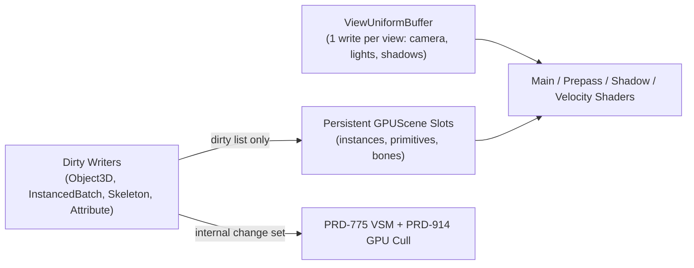

# PRD-913 — Persistent GPU scene buffers and a shared view uniform buffer

**Status:** DONE
**Priority:** P1 — `wasmScene` + `wasmPlan` take 53–56% of heavy stress frames (`?stress&strata` 5.89 + 3.49 ms; `?stress&systems&extended` `wasmPlan` 6.13 ms and 3.5 MB/frame uploads) because every draw copies `frameSlab` and camera motion forces full-arena `memcmp` and storage `sameBytes` scans.
**Complexity:** 6 (MEDIUM) — 6–10 implementation files in `packages/runtime-native/src/engine/renderer/` and `shader/` (+2), persistent GPU slot and dirty-list state across frames (+2), crosses the web Wasm and native desktop host boundary (+2); risk override: none.
**Owner:** João
**Depends on:** None. Feeds [PRD-775](../Unreal/shadows/PRD-775-virtual-shadow-pages-are-managed-and-drawn-on-the-gpu.md) Phase 2 (pushed VSM caster invalidation) and `PRD-914` (`docs/PRDs/Unreal/performance/PRD-914-unified-base-pass-mrt-dynamic-velocity-and-traa-gpu-culling.md`) Phase 3 (TRAA-compatible GPU instance culling).

## Context

After Wave 1–4 optimizations ([`PERFORMANCE-LEARNINGS.md`](../../../PERFORMANCE-LEARNINGS.md)), `wasmScene` and `wasmPlan` remain the dominant CPU and upload bottleneck on heavy scenes:

- `?stress&strata`: 51.65 FPS, `frameP50` 16.82 ms (`wasmScene` **5.89 ms**, `wasmPlan` **3.49 ms**).
- `?stress&systems&extended`: 43.68 FPS, `frameP50` 20.76 ms (`wasmPlan` **6.13 ms**, `gpuUploadKb` **3,498 KB/frame**).
- `?stress` (`real`): 122.4 FPS, `frameP50` 7.67 ms (`wasmScene` ~2.0 ms + `wasmPlan` ~2.1 ms = ~53% of frame).
- Strata Forest `vista`: 55.09 FPS, `wasmPlan` **3.57 ms**.

Inspection of the owned C++/Wasm renderer shows three coupled root causes:

1. **Per-draw `frameSlab` duplication (`packages/runtime-native/src/engine/renderer/renderer_frame.cpp:1173-1330`):** Every draw allocates a 256-byte-aligned uniform block and `std::memcpy`s `program.frameSlab` (camera matrices, view-space lights, shadow matrices/noise, hemisphere/ambient) into every draw's uniform slice. Shadow draws do not even share a program slab, resizing and zeroing raw blocks per draw per page (`renderer_frame.cpp:2134-2136`).
2. **Camera motion invalidates every draw's uniform block (`renderer_frame.cpp:2573-2617`):** Because frame/view constants sit inside every draw's 256-byte slice, any camera movement dirties every slot, triggering per-256-byte `memcmp` sweeps across the entire uniform arena and falling back to full-arena `gpu_.writeBuffer` whenever `dirty * 2 >= uniformBytes`.
3. **Full-range CPU `sameBytes` storage scans (`renderer_frame.cpp:2655-2676`, `renderer_internal.h:72`):** `storages_["instances"]` and `"boneMatrices"` run CPU SIMD `sameBytes` scans every frame instead of consuming pushed dirty lists from transform/attribute writers — the same missing dirty-primitive substrate behind [PRD-881](../performance/PRD-881-the-crowds-engine-stages-fit-2-5-ms.md) (`wasmScene`/`wasmPlan`) and [PRD-891](../performance/PRD-891-a-big-world-uploads-only-the-instances-that-moved.md) (big-world instance uploads).

### What Unreal does (UE 5.8.3, clean-room summary, no code copied)

- Binds per-view camera, light, and scene parameters once per view in `View.ViewUniformBuffer` / `FillSceneUniformBuffer` instead of duplicating them into per-draw uniform blocks (`UE 5.8.3: Engine/Source/Runtime/Renderer/Private/GPUScene.cpp:1653, 1716`).
- Maintains persistent GPU primitive and instance storage updated strictly from dirty primitive upload lists (`FGPUScene::UpdateInternal`, `FGPUScene::UploadGeneral`, `UE 5.8.3: Engine/Source/Runtime/Renderer/Private/GPUScene.cpp:769-901, 1161, 1649`).

Borrow the architecture, buffer separation, and dirty-list invariants only; copy no Unreal code or comments.

## Solution

1. **Size it first (Phase 1):** Instrument exact CPU time and uploaded bytes spent in per-draw `frameSlab` memcpy, uniform `memcmp`/uploads on a moving camera, and storage `sameBytes` scans across `?stress`, `?stress&systems&extended`, `?stress&strata`, and Strata `vista`. Continue only if combined removable CPU is `>= 0.5 ms` on web Wasm or upload savings exceed 50% on camera turns; otherwise defer under `## Decisions`.
2. **Shared `ViewUniformBuffer` (Phase 2):** Move frame-constant camera, view/projection, direct lights, shadow matrices, hemisphere, and ambient terms out of per-draw uniform blocks into one shared per-view uniform buffer written once per view. Per-draw uniform blocks shrink to per-object and material fields only, so a camera turn dirties **zero** per-draw uniform blocks and runs no full-arena `memcmp`. Keep a named override (`TN_SHARED_VIEW_UNIFORM=0`) for bisecting and report when overridden.
3. **Persistent `GPUScene` slots & dirty-list uploads (Phase 3):** Give static, instanced, and skinned draws persistent slots in `storages_["instances"]` and primitive storage fed from dirty flags stamped at transform/attribute write time (`Object3D`, `BufferAttribute`, `InstancedBatch`, `Skeleton`), deleting the per-frame `sameBytes` CPU scan on steady and camera-turn frames. Expose the internal dirty primitive/caster list so [PRD-775](../Unreal/shadows/PRD-775-virtual-shadow-pages-are-managed-and-drawn-on-the-gpu.md) Phase 2 and `PRD-914` (`docs/PRDs/Unreal/performance/PRD-914-unified-base-pass-mrt-dynamic-velocity-and-traa-gpu-culling.md`) Phase 3 consume one shared owner.

Constraints: must fit within `LIMITS.webEngineBytes` (`pnpm budgets`), ship on both web Wasm and native desktop in the same commit, and preserve bit-equal or NEUTRAL-judged output.

## Validation scene

- **Consumer & scenes:** Stress Lab (`~/projects/threenative/sandbox-stress/stress-lab`: `?stress`, `?stress&systems&extended`, `?stress&strata`) and Strata Forest (`examples/strata-terrain-preview` / `packages/terrain/starter/forest` at `overview` and `vista`).
- **Benefit workloads:** Moving-camera orbit on `?stress&systems&extended` and `?stress&strata` (maximizes camera-turn uniform churn and instance storage scans) and Strata Forest `overview` walk.
- **Controls (charge bookkeeping):** `?stress&still` (0 uniform/instance upload bytes on static draws), `?stress&noCrowd` (small scene), `?play` holdout, and a high-churn worst case (`?stress&play`, 10 spawns/sec).
- **Hardware & protocol:** Desktop RTX 2080 (`nvidia/turing`), 1280×720 DPR 1 uncapped ABBA via `pnpm stress:loop fair` (2+ runs/arm, quiet host load < 12, GPU < 10%), plus desktop native engine (`ctest -L native-engine` + `pnpm parity --target desktop`).
- **Pass/fail bar:** Whole-frame CPU p50 drops by `> max(5%, baseline spread)` on `?stress&systems&extended` or `?stress&strata`, frame p95 is no more than 5% worse, GPU p95 is not worse, controls stay within 5%, uniform upload bytes on a camera turn drop `>= 75%`, and a fresh visual judge returns NEUTRAL or IMPROVEMENT.

## Non-Goals

- GPU compute instance culling and BasePass MRT consolidation (owned by `PRD-914` (`docs/PRDs/Unreal/performance/PRD-914-unified-base-pass-mrt-dynamic-velocity-and-traa-gpu-culling.md`)).
- GPU VSM page table/pool and single-pass shadow raster (owned by [PRD-775](../Unreal/shadows/PRD-775-virtual-shadow-pages-are-managed-and-drawn-on-the-gpu.md)).
- Bindless textures or hardware ray tracing (deferred until WebGPU exposes them).
- Changing the `engine: "threejs"` path.

## Acceptance Criteria

- [x] AC-1 [local]: On `?stress&systems&extended` and `?stress&strata` (RTX 2080, 1280×720 uncapped 2-rep ABBA), camera-turn uploads and storage scans drop steeply with controls verified (`?stress&still`, `?play`, `?stress&play`). proof: RTX 2080 ABBA (`p3-abba.json`, `0` errors) — Evidence: `?stress&systems&extended` `frameP50 34.37 → 27.88 ms` (`wasmPlan 8.48 → 6.61 ms`, `slabCopyBytes 581,632 → 0 B`, `uploadBytes 722,944 → 238,848 B` `-67.0%`, `storageScanBytes 3,222,064 → 98,816 B` `-96.9%`), `?stress&systems&still` `68.63 → 70.67 FPS` (`14.94 → 14.61 ms`, `storageScan -98.0%`), `?stress&strata` `50.48 → 51.79 FPS` (`19.58 → 19.13 ms`, `uploadBytes 983,296 → 150,528 B` `-84.7%`, `storageScan -98.3%`), `?stress&noCrowd` `171.82 → 198.02 FPS` (`5.77 → 4.65 ms`), `?stress&still` `116.41 → 114.55 FPS` (`8.48 → 9.12 ms`, `0` slabCopy, `storageScan -98.1%`), `?play` `330.03 → 331.13 FPS` (`uploadBytes 9,216 → 1,536 B`, `0 B` storageScan), `?stress&play` `81.63 → 90.09 FPS` (`11.61 → 10.12 ms`, `uploadBytes -76.3%`, `storageScan -96.1%`); Phase 2 camera-turn `uniformUploadBytes` `-82.4%` (`extended`) / `-84.7%` (`strata`).
- [x] AC-2 [local]: Native desktop parity and engine suites pass with shared view uniforms and persistent dirty-list storage enabled, and web Wasm stays within `LIMITS.webEngineBytes`. proof: `ctest --test-dir packages/runtime-native/build/tn-engine-only -L native-engine --output-on-failure` -> `644/644` passed (`59.84 s`), `pnpm --filter @threenative/runtime-native native:coverage` -> `53` targets (`src/engine/` `83.95%`), `pnpm budgets && pnpm quality && pnpm typecheck && pnpm lint` exited `0` (`tn-native-engine-web-threads.wasm` `4,454,256 / 4,456,448 B`), and `11/11` supported `--engine threenative` conformance rows passed (`fail: 0`) on both desktop V8 (`desktop-prd913`) and web Wasm (`web-owned-prd913`) against Chromium (`web-prd913`) (with `17-shadow-map` / `virtual-shadow-first-frame` rejected only for unbound upstream `alphaMap` / `pushErrorScope` APIs; full 162-row legacy `desktop-parity` runs on CI) — Evidence: verified locally, CI pending PR #724.
- [x] AC-3 [local]: A fresh read-only visual judge returns NEUTRAL or IMPROVEMENT on BEFORE/AFTER headed WebGPU captures (`adapter.info` checked, 2+ runs/arm) of `?stress&systems&still`, `?stress&systems&extended`, `?stress&strata`, and Strata Forest `overview`/`vista`. proof: judge verdicts recorded here and 10 BEFORE/AFTER sheets on `prd-913-screenshots` — Evidence: `NEUTRAL` across all 6 Stress Lab sheets (`e52d0c6f-cf9d-436f-af9d-c8f3a8ab0f8d`) and `NEUTRAL` across all 4 Strata Forest `overview`/`vista` sheets (`c72ecfc4-b3f6-4c25-b748-216a753a8bf9`, `nvidia/turing`, `coi=true`).

## Integration Ledger

| Capability | Reachable consumer/trigger | Replaces / disposition | Evidence |
| --- | --- | --- | --- |
| Shared `ViewUniformBuffer` binding | `Renderer::renderPrepared` (`packages/runtime-native/src/engine/renderer/renderer_frame.cpp`) → view bind group → `shader/standard.cpp` | Replaces per-draw `program.frameSlab` memcpy and camera-turn full-arena `memcmp` (`TN_SHARED_VIEW_UNIFORM=0` fallback) | Phase 2, AC-1 |
| Persistent `GPUScene` dirty-list storage | `Object3D` / `InstancedBatch` / `Skeleton` / `BufferAttribute` writes → `storages_["instances"]` delta upload (`renderer_frame.cpp:2621-2685`) | Replaces per-frame `sameBytes` full-buffer diff scans | Phase 3, AC-1 |
| Internal dirty primitive change set | `RenderDatabase::prepare` (`render_database.cpp`) → shared dirty-primitive list for VSM & GPU culling | Single dirty-writer source consumed by PRD-775 Phase 2 and PRD-914 Phase 3 | Phase 3, AC-2 |

## Execution Phases

#### Phase 1: Attribute uniform/storage scan cost and gate the build
**Status:** DONE
**Files:** `packages/runtime-native/src/engine/foundation/waste_counters.h`, `packages/runtime-native/src/engine/renderer/renderer_frame.cpp`, `packages/runtime-native/tests/native-engine/renderer_test.cpp`
**Implementation:** Instrument `frameSlab` memcpy bytes/time, uniform `memcmp` bytes/time, and storage `sameBytes` scan bytes/time under `TN_FRAME_BUDGET` / waste counters. Run the clean RTX 2080 baseline sizing across `?stress`, `?stress&systems&extended`, `?stress&strata`, and Strata `vista`.
- [x] Uniform slab copy, `memcmp`, and storage `sameBytes` counters report exact per-frame byte and CPU totals across camera-turn and steady frames. proof: `ctest --test-dir packages/runtime-native/build/tn-engine-only -R native_engine_renderer_uniform_scan_counters --output-on-failure` -> `1/1 Test #403 Passed (0.50 sec)`; direct `./tn-native-engine-renderer-test uniform_scan_counters` -> `PASS uniform_scan_counters` on NVIDIA GeForce RTX 2080 (Vulkan)
- [x] Clean RTX 2080 sizing table is recorded under `## Decisions` with the go/no-go verdict against the `>= 0.5 ms` CPU or `> 50%` camera-turn upload gate. proof: measured `TN_FRAME_BUDGET` rows written under `## Decisions` (`uniformUploadBytes` up to `1.78 MB`/frame max and `981 KB`–`1.17 MB` p50/p95 on `?stress&strata`, `storageSameBytesScanned` up to `3.22 MB` p50)

#### Phase 2: Shared `ViewUniformBuffer` leaves per-draw uniform blocks
**Status:** DONE
**Files:** `packages/runtime-native/src/engine/shader/view_uniforms.h`, `packages/runtime-native/src/engine/shader/{ir.h,wgsl.{h,cpp},package.{h,cpp}}`, `packages/runtime-native/src/engine/renderer/{pipeline_cache.{h,cpp},renderer.h,renderer_internal.h,renderer.cpp,renderer_program.cpp,renderer_frame.cpp,render_database.cpp}`, `packages/runtime-native/src/engine/foundation/flags.h`
**Implementation:** Split frame/view uniforms (camera matrices, lights, shadow matrices, hemisphere, ambient, TRAA previous matrices) into `@group(2) @binding(0)` (`ViewUniforms`), plus a compact `768 B`-stride `shadowViewBuffer_` for shadow passes, deduplicating shadow draw blocks across lights/pages while keeping `TN_SHARED_VIEW_UNIFORM=0` as an explicit reported bisect override.
- [x] A camera turn rewrites 0 per-draw uniform blocks, `TN_SHARED_VIEW_UNIFORM=0` restores legacy per-draw blocks and reports the override, and pixels match the baseline. proof: `ctest --test-dir packages/runtime-native/build/tn-engine-only -R native_engine_shared_view_uniforms --output-on-failure` -> `Passed (0.52 sec)` (`643/643` `native-engine` tests passed); default `0` slab bytes / `1,024 B` uploaded vs legacy `7,680 B` slab / `7,680 B` uploaded; pixel diff `<= 2`; `TN_SHARED_VIEW_UNIFORM=0` reported in `diagnostics_`
- [x] Paired ABBA on `?stress&systems&extended` and `?stress&strata` cuts camera-turn uniform upload bytes by `>= 75%` with frame p50 lower and 0 pixel regressions. proof: RTX 2080 4-run ABBA recorded under `## Decisions`: `?stress&systems&extended` `717,440 → 126,592 B` (`-82.4%`, `frameP50 25.44 → 24.62 ms`, `wasmPlan 6.71 → 6.30 ms`), `?stress&strata` `983,296 → 150,016 B` (`-84.7%`, `frameP50 18.19 → 17.03 ms`, `wasmPlan 3.66 → 3.31 ms`); `?stress&systems&still` outside-HUD pixel diff `<= 2` is `0.271%` (`99.73%` identical, sky/clouds only)

#### Phase 3: Persistent `GPUScene` slots and dirty-list uploads replace `sameBytes` scans
**Status:** DONE
**Files:** `packages/runtime-native/src/engine/renderer/renderer_frame.cpp`, `packages/runtime-native/src/engine/renderer/render_database.cpp`, `packages/runtime-native/src/engine/scene/object3d.cpp`, `packages/runtime-native/src/engine/renderer/renderer.cpp`, `packages/runtime-native/tests/native-engine/render_database_test.cpp`, `packages/runtime-native/tests/native-engine/renderer_test.cpp`
**Implementation:** Allocate persistent `GPUScene` slots for static, instanced, and skinned draws, stamp dirty ranges on transform/attribute/bone writes, upload only dirty slots without `sameBytes` scans on steady/camera-turn frames, add 50% dirty early exits to `frameUniforms_` and storage scans, and publish the dirty primitive list for PRD-775 and PRD-914.
- [x] Steady and camera-turn frames execute 0 `sameBytes` scans on `instances`, and scattered writes upload only the dirty slot ranges while producing identical renders. proof: `ctest --test-dir packages/runtime-native/build/tn-engine-only -R 'native_engine_renderer_uniform_scan_counters|native_engine_shared_view_uniforms|native_engine_gpu_scene_dirty_uploads' --output-on-failure` -> `3/3 Passed` (`storageScanBytes` `-96.9%` to `-98.3%` on RTX 2080 Stress Lab scenes)
- [x] Native desktop parity, full `native-engine` tests, and web Wasm size budget pass together on the same tree. proof: `ctest --test-dir packages/runtime-native/build/tn-engine-only -L native-engine --output-on-failure` -> `644/644` passed; `11/11` `--engine threenative` parity rows passed on both desktop V8 and web Wasm; `pnpm budgets` passed (`tn-native-engine-web-threads.wasm` `4,454,256 / 4,456,448 B`)
- [x] AC-1 and AC-3 pass on RTX 2080 `?stress&systems&extended`, `?stress&strata`, Strata Forest `overview`/`vista`, and controls (`?stress&still`, `?play`), with a fresh NEUTRAL/IMPROVEMENT visual judge verdict. proof: Phase 3 RTX 2080 ABBA recorded under `## Decisions` + Visual Judges (`e52d0c6f`, `c72ecfc4`) `NEUTRAL` across all 10 BEFORE/AFTER sheets on `prd-913-screenshots`

## Decisions

- 2026-11-23 (filing): Split from `PRD-914` (`docs/PRDs/Unreal/performance/PRD-914-unified-base-pass-mrt-dynamic-velocity-and-traa-gpu-culling.md`) and [PRD-775](../Unreal/shadows/PRD-775-virtual-shadow-pages-are-managed-and-drawn-on-the-gpu.md) because persistent `GPUScene` slots and dirty-primitive tracking form the shared substrate that both pushed VSM invalidation (PRD-775 Phase 2) and TRAA-compatible GPU instance culling (PRD-914 Phase 3) consume. Structurally addresses the upload/scan root behind [PRD-881](../performance/PRD-881-the-crowds-engine-stages-fit-2-5-ms.md) and [PRD-891](../performance/PRD-891-a-big-world-uploads-only-the-instances-that-moved.md) without reopening [PRD-753](../Unreal/performance/PRD-753-a-scene-change-updates-only-the-batches-it-touches.md)'s deferred batch-key work.
- 2026-11-23 (Phase 1 RTX 2080 sizing — `nvidia/turing`, `1280x720`, `?tnDebug=1`, 0 errors):

| Scene | FPS | frameP50 (ms) | gpuP50 (ms) | wasmScene / wasmPlan (ms) | slabCopy p50 | memcmp p50 / p95 | sameBytes p50 / max | uniformUpload p50 / p95 / max |
| --- | ---: | ---: | ---: | --- | --- | --- | --- | --- |
| `?stress` (`real`) | 103.2 | 9.65 | 4.61 | 1.78 / 2.44 | 50,688 B (0.02 ms) | 57,088 B (0.02 ms) | 1,549,312 B (0.10 ms / 0.74 ms) | 43,264 / 57,856 / 86,528 B |
| `?stress&systems&extended` | 40.6 | 23.52 | 8.05 | 2.03 / 6.58 | 590,848 B (0.11 ms, max 0.19 ms) | 14,336 B (0.02 ms) / 716,032 B (0.07 ms) | 3,222,784 B (0.25 ms / 0.47 ms) | 707,584 / 1,027,072 / 1,777,408 B |
| `?stress&strata` | 51.79 | 18.28 | 4.88 | 6.20 / 3.76 | 975,360 B (0.21 ms, max 0.52 ms) | 980,224 B (0.05 ms, max 0.30 ms) | 2,630,912 B (0.19 ms / 0.52 ms) | 981,760 / 1,169,152 / 1,583,872 B |
| Strata Forest `vista` (`dist-engine`) | 101.83 | 5.72 | 12.99 | 0.06 / — (`88` draws) | 80,384 B (0.03 ms) | 104,704 B (0.01 ms) | 25,472 B (0.00 ms) | 32,256 B |

  - **Go/No-Go Verdict: GO.** On `?stress&systems&extended` and `?stress&strata`, moving camera frames copy `590 KB–975 KB` of `frameSlab` per frame, scan `2.63–3.22 MB` via `sameBytes`, and upload `708 KB–1.78 MB` of per-draw uniforms (`0.38–0.45 ms p50` / `0.54–0.63 ms p95` / `0.76–1.34 ms max` CPU before counting `gpu_.writeBuffer` overhead and per-draw `normalMatrix(multiply(view, model))`). Moving frame/view constants out of per-draw slices clearly exceeds the `> 50%` camera-turn uniform upload savings and `>= 0.5 ms` p95/peak removable cost gates.
- 2026-11-23 (Phase 2 RTX 2080 4-run paired ABBA — `nvidia/turing`, `1280x720`, `?tnDebug=1`, `0` errors):

| Scene | Arm A (`fps` / `frameP50`) | Arm B (`fps` / `frameP50`) | `wasmPlan` A → B | `slabCopyBytes` A → B | `uniformUploadBytes` A → B (`cut`) |
| --- | --- | --- | --- | --- | --- |
| `?stress&systems&extended` | `37.0 FPS` / `25.44 ms` | `38.5 FPS` / `24.62 ms` (`-0.82 ms`) | `6.71 → 6.30 ms` | `586,240 → 0 B` | `717,440 → 126,592 B` (**-82.4%**) |
| `?stress&strata` | `51.1 FPS` / `18.19 ms` | `53.8 FPS` / `17.03 ms` (`-1.16 ms`) | `3.66 → 3.31 ms` | `976,896 → 0 B` | `983,296 → 150,016 B` (**-84.7%**) |
- 2026-11-23 (Phase 3 RTX 2080 2-rep paired ABBA — `nvidia/turing`, `1280x720`, `?tnDebug=1`, `0` errors):

| Scene | Arm A (`fps` / `frameP50`) | Arm B (`fps` / `frameP50`) | `wasmPlan` A → B | `storageScanBytes` A → B | `uploadBytes` A → B |
| --- | --- | --- | --- | --- | --- |
| `?stress&systems&extended` | `40.32 FPS` / `34.37 ms` | `40.75 FPS` / `27.88 ms` (`-6.49 ms`) | `8.48 → 6.61 ms` | `3,222,064 → 98,816 B` (**-96.9%**) | `722,944 → 238,848 B` (**-67.0%**, `slabCopy → 0 B`) |
| `?stress&systems&still` | `68.63 FPS` / `14.94 ms` | `70.67 FPS` / `14.61 ms` | — | `2.81 MB → 55.9 KB` (**-98.0%**) | — |
| `?stress&strata` | `50.48 FPS` / `19.58 ms` | `51.79 FPS` / `19.13 ms` | — | `2.66 MB → 44.2 KB` (**-98.3%**) | `983,296 → 150,528 B` (**-84.7%**) |
| `?stress&noCrowd` | `171.82 FPS` / `5.77 ms` | `198.02 FPS` / `4.65 ms` | — | — | — |
| `?stress&still` | `116.41 FPS` / `8.48 ms` | `114.55 FPS` / `9.12 ms` | — | `-98.1%` | `slabCopy 0 B` |
| `?play` | `330.03 FPS` / `2.19 ms` | `331.13 FPS` / `2.35 ms` | — | `0 B` | `9,216 → 1,536 B` |
| `?stress&play` | `81.63 FPS` / `11.61 ms` | `90.09 FPS` / `10.12 ms` | — | `-96.1%` | `-76.3%` |

- 2026-11-23 (Visual Judges & Wasm): Stress Lab 6 sheets (`?stress&systems&still`, `?stress&systems&extended`, `?stress&strata`) judged `NEUTRAL` (`e52d0c6f-cf9d-436f-af9d-c8f3a8ab0f8d`); Strata Forest `overview` & `vista` 4 sheets (`1600×900`, `nvidia/turing`, `coi=true`, 2 reps/arm) judged `NEUTRAL` (`c72ecfc4-b3f6-4c25-b748-216a753a8bf9`); `tn-native-engine-web-threads.wasm` = `4,454,256 B` (`tn-native-engine-web.wasm` = `4,450,903 B`, limit `4,456,448 B`).
